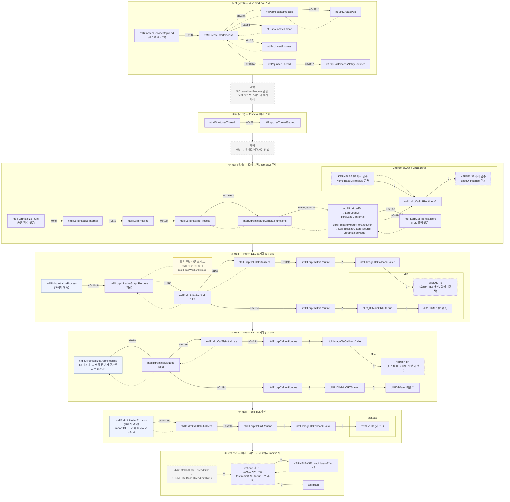

# test.exe 실행 흐름 — 프로세스 생성부터 `main`까지

## 기준

- 타깃: Windows 11 24H2, **26100.9457**
  - ntkrnlmp.pdb: `C29EBFB06B78B3C020DCA66D99713F9E1`
- 디버거: WinDbg 커널 디버깅 (KDNET)
- 부모: `cmd.exe`에서 `test.exe` 실행
- 근거 로그: `runs/01_sprint/` run3 ~ run8
- 테스트 프로그램: `sample/` (`test.c`, `dll1.c`, `dll2.c`, `build.bat`)
  - 의존 관계: **`test.exe` → `dll1.dll` → `dll2.dll`**
    - `test.c`가 `Dll1Hello`를, `dll1.c`가 `Dll2Hello`를 import
  - 세 모듈 모두 TLS 콜백이 있다: `ExeTls`, `Dll1Tls`, `Dll2Tls`
  - 빌드 옵션 `/MT`: CRT(C 런타임)를 DLL로 따로 두지 않고 **각 모듈 안에 넣어서** 빌드

### 표시 규칙

| 표시 | 뜻 |
|---|---|
| `[관찰]` | 멈춤점·콜스택·레지스터로 **직접 본 것** (26100.9457) |
| `[소스]` | `sample/` 소스 코드·빌드 스크립트에 **그렇게 쓰여 있는 것**. 디버거로 실행을 본 건 아님 |
| `[추측]` | 관찰한 사실에서 짐작한 것, 또는 일반적으로 알려진 설명. **직접 보지 않음** |
| `[공백]` | 아직 아무것도 관찰하지 않은 구간 |

함수 **이름·호출 순서·누가 불렀는지(오프셋)** 는 관찰이다.
단, **콜스택으로 caller를 직접 보지 못한 호출 관계**는 추측으로 둔다 (그림의 `?`).
함수가 **안에서 무슨 일을 하는지**는, 따로 적지 않는 한 추측이다.

---

## 1. 흐름도

읽는 법:

- **위 → 아래 = 시간 순서.** 큰 노란 상자 하나가 한 단계다. (①만 부모 cmd.exe 스레드, ② 이후는 test.exe 메인 스레드)
- **왼쪽 → 오른쪽 = 호출.** 왼쪽이 부르는 함수(caller), 오른쪽이 불린 함수(callee).
  - 한 함수가 여러 개를 차례로 부르면, 불린 함수들이 오른쪽에 **위에서 아래로** 늘어선다.
  - 큰 상자 안에서는 이 위아래 순서가 흐트러질 수 있어서, 순서가 중요한 곳은 상자를 나눴다. 이때 왼쪽 첫 칸에 `(③에서 계속)`처럼 같은 caller를 다시 적었다.
- **실선 화살표 = 호출(call).**
  - 라벨 `+0x…` = **콜스택으로 직접 본 호출.** caller 안에서 그 call이 있는 자리(돌아올 주소의 오프셋)다.
  - 라벨 **`?`** = **추측한 호출.** 콜스택으로 caller를 직접 보지 못했다. 예: 인자(`rcx`)로 넘긴 주소만 봤거나, callee가 불린 건 봤지만 누가 불렀는지는 못 본 경우. 사이에 다른 함수가 더 끼어 있을 수도 있다. → 4.1에서 추가 분석 대상
- **점선 화살표 = 돌아감(return).** 그 뒤에 caller가 다른 일을 하는 게 관찰돼서, 돌아간 게 확실한 곳에만 그렸다.
- **안쪽 작은 상자** (`dll2`, `dll1`, `test.exe`, `KERNELBASE / KERNEL32`) = 그 함수가 들어 있는 모듈.
- **점선 테두리** = 이름이나 실행이 확실하지 않은 것. **회색 점선 상자** = 공백 또는 추측. **노란 메모** = 같은 무렵 다른 스레드에서 일어난 일.
- 가지 없이 한 줄로 이어진 호출은 한 상자에 `→`로 묶었다 (③의 `LdrLoadDll → … → LdrpInitializeNode`).



---

## 2. 단계별 설명

### 2.1 커널 `nt` — 부모 cmd.exe 스레드 안에서 (run3)

이 구간은 **test.exe가 아니라 부모 cmd.exe**가 일하는 시간이다.
test.exe는 아직 "만들어지는 중"이라, 자기 코드는 한 줄도 안 돌았다.

```
NtCreateUserProcess
 ├─ +0xc36   PspAllocateProcess
 │            └─ +0x2314  MmCreatePeb
 ├─ +0xe5c   PspAllocateThread
 ├─ +0xfc2   PspInsertProcess
 └─ +0x101a  PspInsertThread
              └─ +0x807   PspCallProcessNotifyRoutines
```

- `[관찰]` 위 7개 전부 **cmd.exe의 같은 스레드 하나**에서 차례로 불렸다. 중간에 다른 스레드로 넘기지 않는다.
- `[관찰]` 옛날 방식 함수 `nt!PspCreateProcess`는 **불리지 않았다.**

#### `nt!NtCreateUserProcess`

- `[관찰]` 유저 쪽에서 시스템 콜로 들어온다 (`nt!KiSystemServiceCopyEnd+0x28`이 부름).
- `[관찰]` 아래 함수들을 직접 부르는 **총괄 함수**다.
- `[추측]` 유저 쪽 `CreateProcess`가 결국 이 시스템 콜 하나로 커널에 "프로세스 만들어줘"를 요청하는 것.

#### `nt!PspAllocateProcess`

- `[관찰]` `NtCreateUserProcess+0xc36`에서 불린다. 안에서 `MmCreatePeb`를 부른다.
- `[추측]` 새 프로세스의 정보 묶음(`_EPROCESS`)과 메모리 공간을 준비한다. 비유하면 **가게 건물 짓기**.

#### `nt!MmCreatePeb`

- `[관찰]` `PspAllocateProcess+0x2314`에서 불린다.
- `[추측]` 유저 쪽(ntdll)이 나중에 읽을 프로세스 정보판(PEB)을 만든다.

#### `nt!PspAllocateThread`

- `[관찰]` `NtCreateUserProcess+0xe5c`에서 불린다. **프로세스를 목록에 등록하기 전에** 불린다.
- `[추측]` 첫 스레드(메인 스레드)를 만든다. 아직 일은 시작하지 않는다.

#### `nt!PspInsertProcess`

- `[관찰]` `NtCreateUserProcess+0xfc2`에서 불린다.
- `[추측]` 새 프로세스를 시스템 프로세스 목록에 올린다.
  - 참고 `[관찰]`: 이 뒤의 시점(`PspCallProcessNotifyRoutines`)에서 `!process 0 0 test.exe`로 test.exe가 보였다.

#### `nt!PspInsertThread`

- `[관찰]` `NtCreateUserProcess+0x101a`에서 불린다. 안에서 `PspCallProcessNotifyRoutines`를 부른다.
- `[추측]` 첫 스레드를 등록한다.

#### `nt!PspCallProcessNotifyRoutines`

- `[관찰]` **`PspInsertThread` 안에서**(`+0x807`) 불린다.
- `[추측]` 커널에 "새 프로세스 생기면 알려줘"라고 등록해 둔 드라이버들(백신·EDR 등)에게 알림을 보낸다.

---

### 2.2 `[공백]` 부모 쪽 마무리 ~ 첫 스레드 출발

- `NtCreateUserProcess`가 돌아간 뒤 cmd.exe(유저 쪽)가 무엇을 더 하는지
- 멈춰 있던 test.exe 첫 스레드가 언제·어떻게 풀려서 돌기 시작하는지

이 사이는 아직 멈춤점을 걸어보지 않았다.

---

### 2.3 커널 `nt` — test.exe 스레드 출발 (run4, run5)

```
nt!PspUserThreadStartup
nt!KiStartUserThread+0x28
nt!KiStartUserThreadReturn
ntdll!RtlUserThreadStart      ← 유저 스택 쪽에 보이는 자리
```

#### `nt!PspUserThreadStartup`

- `[관찰]` test.exe의 **모든 새 스레드**(4개 전부)가 여기서 출발한다. 콜스택 모양도 4개 모두 같다.
- `[관찰]` 메인 스레드의 시작 주소(Win32 Start Address)는 `test!mainCRTStartup` (RVA `0x1D40`, `dumpbin /headers`로 확인).
- `[관찰]` 메인 스레드의 `_ETHREAD` 주소가 `_EPROCESS` 주소 바로 옆이었다 (`...943f4080` / `...943f5080`).
- `[추측]` 커널 쪽에서 스레드가 "출근 도장"을 찍고 유저 쪽으로 넘어갈 준비를 하는 곳.

#### `[공백]` 커널 → 유저 전환

- `[관찰]` 이 스레드가 유저 쪽에서 처음 멈춘 곳은 `ntdll!LdrInitializeThunk`이고, **부른 함수가 없다** (콜스택에 자기 혼자).
- `[관찰]` 그런데 커널 콜스택의 유저 쪽 자리에는 `ntdll!RtlUserThreadStart`가 보인다.
- `[추측]` 커널이 유저의 첫 위치를 `LdrInitializeThunk`로 직접 정해 보내고, 로더 일이 끝나면 `RtlUserThreadStart`로 이어지는 구조.
- 전환 방법 자체는 관찰하지 않았다.

---

### 2.4 `ntdll` — 로더 시작 (run7, run8)

```
LdrInitializeThunk
 └─ +0xe    LdrpInitializeInternal
     └─ +0x5a   LdrpInitialize
         └─ +0x16c  LdrpInitializeProcess      ← 첫 스레드
         └─ +0xa7   LdrpInitializeThread       ← 나중 스레드 (Worker 스레드에서 관찰)
```

#### `ntdll!LdrInitializeThunk`

- `[관찰]` test.exe의 **모든 새 스레드**가 유저 쪽에서 처음 도착하는 곳. 같은 스레드가 커널 `PspUserThreadStartup` 다음에 바로 여기 온다.
- `[관찰]` 부른 함수가 콜스택에 없다 (2.3 참고).

#### `ntdll!LdrpInitialize`

- `[관찰]` 메인 스레드에서는 `+0x16c`에서 `LdrpInitializeProcess`를, Worker 스레드에서는 `+0xa7`에서 `LdrpInitializeThread`를 부른다.
- `[추측]` "이 프로세스의 첫 스레드인가?"를 보고 갈림길을 고른다. 첫 스레드면 프로세스 전체 준비, 아니면 스레드 준비만.

#### `ntdll!LdrpInitializeProcess`

- `[관찰]` 메인 스레드에서 딱 한 번 불린다.
- `[관찰]` 이 함수 안에서 아래 세 가지가 **이 순서로** 일어난다.
  1. `+0x19a2` → kernel32 준비 (2.5)
  2. `+0x1bb6` → import DLL 초기화 (2.6 ~ 2.8)
  3. `+0x1c99` → exe의 TLS 콜백 (2.9)
- `[추측]` 프로세스 하나당 한 번만 하는 유저 쪽 준비의 총괄 함수.

---

### 2.5 `ntdll` → `KERNELBASE` / `KERNEL32` 준비 (run7, run8)

```
LdrpInitializeProcess+0x19a2
 └─ LdrpInitializeKernel32Functions (+0xc0, +0x156)
     └─ LdrLoadDll → LdrpLoadDll → LdrpLoadDllInternal
         └─ LdrpPrepareModuleForExecution → LdrpInitializeGraphRecurse → LdrpInitializeNode
             └─ LdrpCallInitRoutine  (r8=1) ×2
```

#### `ntdll!LdrpInitializeKernel32Functions`

- `[관찰]` `LdrpInitializeProcess`가 부르고, 이 함수가 **`LdrLoadDll`을 직접 두 번** 부른다 (`+0xc0`, `+0x156`).
- `[추측]` exe가 무엇을 import하든 상관없이, ntdll이 kernel32를 **스스로** 불러온다.

#### KERNELBASE · KERNEL32 시작 함수

- `[관찰]` `LdrpCallInitRoutine`이 두 번 불리고, 그때 `rcx` 값이 각각 아래 기호 **근처**였다. `r8`은 둘 다 1.
  - `KERNELBASE!KernelBaseDllInitialize` 근처
  - `KERNEL32!BaseDllInitialize` 근처
- `[관찰]` 두 번 모두 첫 번째 `LdrLoadDll`(`+0xc0`)과 두 번째 `LdrLoadDll`(`+0x156`) 사이에 일어났다 (run7 순서).
- `[관찰]` 그 직전 `LdrpCallTlsInitializers`는 불렸지만, `LdrpCallInitRoutine`으로 TLS 콜백을 부르는 건 이어지지 않았다.
- `[추측]` `LdrpCallInitRoutine`이 이 주소로 **실제로 들어갔다**는 것 (그림의 `?`). 주소가 기호와 "정확히 일치"하지도 않아서 어느 함수인지도 확인 필요.

---

### 2.6 `[공백]` import DLL이 메모리에 올라오는 순간

- `[관찰]` 2.7의 시작 지점(`LdrpInitializeProcess+0x1bb6`)에서 이미 dll1·dll2가 메모리에 올라와 있었다 (`lm m dll*`).
- `[소스]` test.exe가 직접 import하는 건 dll1뿐이고, dll2는 dll1을 거쳐 **간접으로** 붙는다.
- `[관찰]` import로 붙는 dll1·dll2는 **`LdrpLoadDll`을 타지 않았다.** `LdrpLoadDll`은 kernel32 준비와 `LoadLibraryExW` 호출 때만 찍혔다.
- 누가, 언제, 어떤 함수로 올려놓는지는 아직 관찰하지 않았다.
- `[관찰]` dll 주소는 **재부팅 없이도 실행마다 바뀔 수 있다** (run6 ↔ run8). test.exe 주소는 그대로였다.

---

### 2.7 `ntdll` — import DLL 초기화의 틀 (run7, run8)

```
LdrpInitializeProcess+0x1bb6   call LdrpInitializeGraphRecurse
 └─ LdrpInitializeGraphRecurse (재귀)
     └─ LdrpInitializeNode            ← 모듈 하나
         ├─ +0x16b  LdrpCallTlsInitializers
         │           └─ +0x19b  LdrpCallInitRoutine (rcx = ntdll!ImageTlsCallbackCaller)
         └─ +0x19c  LdrpCallInitRoutine (rcx = 모듈의 시작 함수)
```

#### `ntdll!LdrpInitializeGraphRecurse`

- `[관찰]` 재귀로 여러 번 겹쳐 불린다. 더 깊이 들어간 모듈이 먼저 초기화됐다 (run7 콜스택 깊이 비교).
- `[관찰]` + `[소스]` 실제 순서 dll2 → dll1 → exe가 소스의 의존 관계 `test.exe → dll1 → dll2`를 **거꾸로** 따라간 순서와 같다.
- `[추측]` import 관계를 가계도처럼 따라가서, **남한테 기대는 모듈일수록 나중에** 초기화한다. 비유하면 집을 지을 때 기초 → 기둥 → 지붕 순서.

#### `ntdll!LdrpInitializeNode`

- `[관찰]` 모듈마다 한 번. 안에서 **TLS 먼저(`+0x16b`), 시작 함수 나중(`+0x19c`)**.

#### `ntdll!LdrpCallTlsInitializers`

- `[관찰]` `+0x19b`에서 `LdrpCallInitRoutine`을 부르고, 그때 `rcx`가 **`ntdll!ImageTlsCallbackCaller`와 정확히 일치**했다.
- `[추측]` 그래서 `LdrpCallInitRoutine` → `ImageTlsCallbackCaller`로 들어간다 (그림의 `?`).
- `[추측]` `ImageTlsCallbackCaller`가 실제 TLS 콜백을 대신 불러주는 중간 함수. 그 안은 관찰하지 않았다.

#### `ntdll!LdrpCallInitRoutine`

- `[관찰]` 이 함수가 불릴 때마다 `rcx`에 함수 주소(`ImageTlsCallbackCaller`, `_DllMainCRTStartup` 등), `r8`에 1이 들어 있었다.
- `[추측]` `rcx` = 부를 함수, `r8` = 부르는 이유. 근거는 강하지만, callee 안에서 콜스택으로 caller를 확인하진 않았다.
  - 근거: `rcx`가 `dll2!_DllMainCRTStartup`과 정확히 일치했고, `r8=1`이 바로 뒤 `dll2!DllMain`의 `rdx=1`과 같았다.
- `[추측]` DLL 시작 함수도, TLS 콜백도 전부 이 함수를 거친다. **ntdll이 유저 코드를 부를 때 쓰는 공용 창구**.

| 이유 값 | 뜻 |
|---|---|
| 1 | 프로세스에 처음 붙음 |
| 2 | 새 스레드 시작 |
| 3 | 스레드 끝 |
| 0 | 프로세스 끝 |

---

### 2.8 `dll2` → `dll1` (run8, run7 정정 반영)

```
dll2:  TLS(ImageTlsCallbackCaller → Dll2Tls?) → dll2!_DllMainCRTStartup → dll2!DllMain(1)
dll1:  TLS(ImageTlsCallbackCaller → Dll1Tls?) → dll1!_DllMainCRTStartup → dll1!DllMain(1)
```

(`?` = 소스상 있어야 할 함수지만, 실행 순간은 아직 못 봄)

#### 순서

- `[관찰]` **dll2가 먼저, dll1이 나중**.
- `[소스]` `dll1.c`가 `Dll2Hello`를 import한다. 즉 dll1은 dll2에 기댄다.
  ```c
  // dll1.c
  __declspec(dllimport) void Dll2Hello(void);
  ```
- → 기대는 쪽(dll1)이 나중에 초기화됐다. 관찰과 소스가 맞는다.

#### TLS 콜백 `dll2!Dll2Tls`, `dll1!Dll1Tls`

- `[소스]` 두 DLL 모두 `.CRT$XLB` 섹션에 TLS 콜백을 하나씩 등록한다.
  ```c
  // dll2.c
  __declspec(allocate(".CRT$XLB")) const PIMAGE_TLS_CALLBACK dll2_tls_cb = Dll2Tls;
  ```
- `[관찰]` 각 DLL의 `LdrpInitializeNode+0x16b` → `LdrpCallTlsInitializers` → `LdrpCallInitRoutine`까지, 그리고 그때 `rcx`가 `ImageTlsCallbackCaller`였던 것까지 봤다.
- `[추측]` `ImageTlsCallbackCaller`가 이 `Dll2Tls` / `Dll1Tls`를 부른다. `Dll2Tls`·`Dll1Tls`에 직접 멈춤점을 걸어보지는 않았다.

#### `dllN!_DllMainCRTStartup` → `dllN!DllMain`

- `[관찰]` `LdrpInitializeNode+0x19c`의 `LdrpCallInitRoutine`에서 `rcx`가 `DllMain`이 아니라 **CRT의 `_DllMainCRTStartup`** 과 정확히 일치했다. 그 직후 같은 스레드에서 `DllMain`(`rdx=1`)이 불렸다.
- `[추측]` `LdrpCallInitRoutine` → `_DllMainCRTStartup` → `DllMain` 순서로 불린다 (그림의 `?` 두 개). `DllMain`의 콜스택은 찍지 않아서, 사이에 다른 함수가 있는지는 모른다.
- `[소스]` 소스에는 `DllMain`만 있고 `_DllMainCRTStartup`은 없다. 빌드 때 CRT(`/MT`)가 넣어준 함수다.
- `[관찰]` (run7) 시작 함수가 불린 뒤, `DllMain`보다 먼저 그 DLL 안 코드에서 `KERNELBASE!LoadLibraryExW`가 3번 불렸다.
- `[추측]` CRT가 자기 준비를 끝낸 뒤 우리 `DllMain`을 불러주는 구조. `LoadLibraryExW` 3번도 CRT 준비 과정.
  - `/MT`라서 CRT 코드가 각 DLL **안에** 들어 있다. 그래서 `LoadLibraryExW`를 부른 곳이 ucrtbase 같은 별도 DLL이 아니라 DLL 자기 주소였던 것으로 보인다.
  - 단, run7은 DLL 주소가 빗나간 run이라 "어느 DLL의 주소였는지"는 확정 못 함 (run7 정정 참고).

---

### 2.9 `ntdll` → `test.exe` TLS 콜백 (run7, run8)

```
LdrpInitializeProcess+0x1c99
 └─ LdrpCallTlsInitializers
     └─ LdrpCallInitRoutine (rcx = ImageTlsCallbackCaller, r8 = 1)
         └─ … → test!ExeTls (rdx = 1)
```

- `[관찰]` exe의 TLS 콜백은 **DLL 초기화가 전부 끝난 뒤, `main` 전에** 불린다.
- `[추측]` `LdrpCallInitRoutine` → `ImageTlsCallbackCaller` → `test!ExeTls` 호출 관계 (그림의 `?`). `ExeTls`가 불린 건 봤지만 콜스택은 안 찍었다.
- `[관찰]` DLL과 달리 그래프 순회(`LdrpInitializeNode`)가 아니라 `LdrpInitializeProcess`가 **직접** 부른다.
- `[공백]` `ImageTlsCallbackCaller` → `test!ExeTls` 사이.

---

### 2.10 `test.exe` — 진입점에서 `main`까지

- `[관찰]` 메인 스레드의 시작 주소 = `test!mainCRTStartup`.
- `[관찰]` (run7) `ExeTls` 다음, `main` 전에 **test.exe 안 코드**(`0x7ff70ee67723`)에서 `LoadLibraryExW`가 3번 불렸다.
- `[추측]` 그 코드가 test.exe의 어느 함수인지(`mainCRTStartup` 쪽인지)는 이름으로 확인하지 않았다 (그림의 `?`).
- `[관찰]` 그다음 `test!main`.
- `[추측]` 로더 일이 끝나면 `ntdll!RtlUserThreadStart` → `KERNEL32!BaseThreadInitThunk` → `test!mainCRTStartup` 순서로 넘어간다.
  - 근거: Worker 스레드 종료 때 콜스택에 `RtlUserThreadStart+0x2c` → `BaseThreadInitThunk+0x20`이 보였다. 메인 스레드에선 직접 보지 않았다.
- `[소스]` `test.c`에는 `main`만 있고 `mainCRTStartup`은 없다. `/MT` 빌드로 CRT가 test.exe 안에 넣어준 함수다.
- `[추측]` `mainCRTStartup`은 CRT 준비(`LoadLibraryExW` 3번 포함)를 하고 `main`을 부른다. `mainCRTStartup` 실행 자체에는 멈춤점을 걸지 않았다.

---

## 3. 같은 시간대의 다른 스레드

test.exe에서는 스레드가 **4개** 출발한다 (run4, run5).

| 순서 | 시작 주소 | 정체 |
|---|---|---|
| 1 | `test!mainCRTStartup` | 메인 스레드 |
| 2 | `ntdll!TppWorkerThread` | ntdll 일꾼 |
| 3 | `ntdll!TppWorkerThread` | ntdll 일꾼 |
| 4 | `test!Worker` | sample의 `CreateThread` 스레드 |

### ntdll 일꾼 2개

- `[관찰]` test.exe 코드가 아니라 ntdll이 스스로 만든 스레드다.
- `[관찰]` (run8) import DLL 초기화가 시작될 무렵(BEFORE-GRAPH 직후) 유저 쪽에 도착한다.
- `[관찰]` `LdrInitializeThunk`만 찍히고, **DllMain·TLS 콜백은 불리지 않았다.**
- `[추측]` DLL 여러 개를 동시에 불러오기 위한 도우미. 스레드 시작 알림을 건너뛰도록 만들어진 것.

### `test!Worker` 스레드 (main 이후, 이번 범위 밖)

- `[관찰]` `LdrpInitialize+0xa7` → `LdrpInitializeThread` → 모듈마다 TLS → DllMain(이유 2), 마지막에 `test!ExeTls`(이유 2).
- `[관찰]` 끝날 때 `RtlExitUserThread` → `LdrShutdownThread` → DllMain·ExeTls (이유 3).

---

## 4. 공백 목록 (다음에 채울 곳)

| 위치 | 무엇이 비었나 |
|---|---|
| 2.2 | `NtCreateUserProcess` 반환 후 부모 쪽 마무리, 첫 스레드가 풀리는 시점 |
| 2.3 | 커널 → 유저 전환 방법 (`LdrInitializeThunk`로 오는 방법, `RtlUserThreadStart`와의 관계) |
| 2.5 | KERNELBASE·KERNEL32 시작 함수의 정확한 이름 |
| 2.6 | dll1·dll2가 메모리에 올라오는 순간 |
| 2.7 | `ImageTlsCallbackCaller` 안쪽 |
| 2.8 | `Dll2Tls`·`Dll1Tls`가 실제로 불리는 순간 (소스엔 있음, 멈춤점은 아직) |
| 2.10 | 로더 끝 → `mainCRTStartup` 연결, `mainCRTStartup` 안쪽 |

### 4.1 추측으로 둔 호출 관계 (그림의 `?`)

콜스택으로 caller를 직접 보지 못한 것들이다. 공통 확인 방법: **callee 입구에 멈춤점을 걸고 `k`로 콜스택을 찍는다.**

| 그림 | 추측한 호출 | 지금까지 본 것 | 확인할 것 |
|---|---|---|---|
| ③ | `LdrpCallInitRoutine` → KERNELBASE·KERNEL32 시작 함수 | `rcx`가 기호 근처 (정확히 일치 아님) | 실제 진입 함수 이름과 콜스택 |
| ④⑤⑥ | `LdrpCallInitRoutine` → `ImageTlsCallbackCaller` | `rcx` 정확히 일치 | `ImageTlsCallbackCaller`에서 `k` |
| ④⑤ | `ImageTlsCallbackCaller` → `Dll2Tls` / `Dll1Tls` | 소스에만 있음 | `Dll2Tls`·`Dll1Tls`에서 `k` |
| ⑥ | `ImageTlsCallbackCaller` → `test!ExeTls` | `ExeTls`가 불린 것 (`rdx=1`) | `ExeTls`에서 `k` |
| ④⑤ | `LdrpCallInitRoutine` → `_DllMainCRTStartup` | `rcx` 정확히 일치 | `_DllMainCRTStartup`에서 `k` |
| ④⑤ | `_DllMainCRTStartup` → `DllMain` | `DllMain`이 불린 것 (`rdx=1`) | `DllMain`에서 `k` |
| ⑤ | dll1의 `LdrpInitializeNode`를 부른 `LdrpInitializeGraphRecurse`가 재귀 몇 번째 단계인지 | `+0x6a`에서 부름 | 더 깊은 `k`로 재귀 단계 비교 |
| ⑦ | 로더 끝 → `RtlUserThreadStart` → `BaseThreadInitThunk` → `mainCRTStartup` | Worker 스레드 종료 콜스택에서만 봄 | `mainCRTStartup`에서 `k` |
| ⑦ | `mainCRTStartup` → `LoadLibraryExW` ×3, → `main` | test.exe 안 주소에서 부른 것, `main`이 불린 것 | `LoadLibraryExW` 호출 지점 `ln`, `main`에서 `k` |

(해결됨) dll1 ↔ dll2 import 관계 → `sample/dll1.c`로 확인: dll1이 dll2를 import

## 5. 근거 run

| run | 내용 |
|---|---|
| run3 | 커널 생성 단계 7개 함수 순서 (cmd 스레드) |
| run4 | 새 스레드마다 `PspUserThreadStartup` → `LdrInitializeThunk` |
| run5 | 스레드 4개의 시작 주소 |
| run6 | 심볼 짝 확인, 유저 쪽 함수 이름 존재 확인 |
| run7 | 유저 쪽 첫 시간표 (dll 주소 문제로 일부 정정) |
| run8 | DLL 주소 확정, `LdrpCallInitRoutine`의 대상 이름 확인 |
| `sample/` 소스 | 의존 관계, 모듈별 TLS 콜백, `/MT` 빌드 |

- run3 ~ run5는 타깃에서 빌드한 test.exe, run6 ~ run8은 디버거 VM에서 빌드해 옮긴 test.exe (같은 소스).