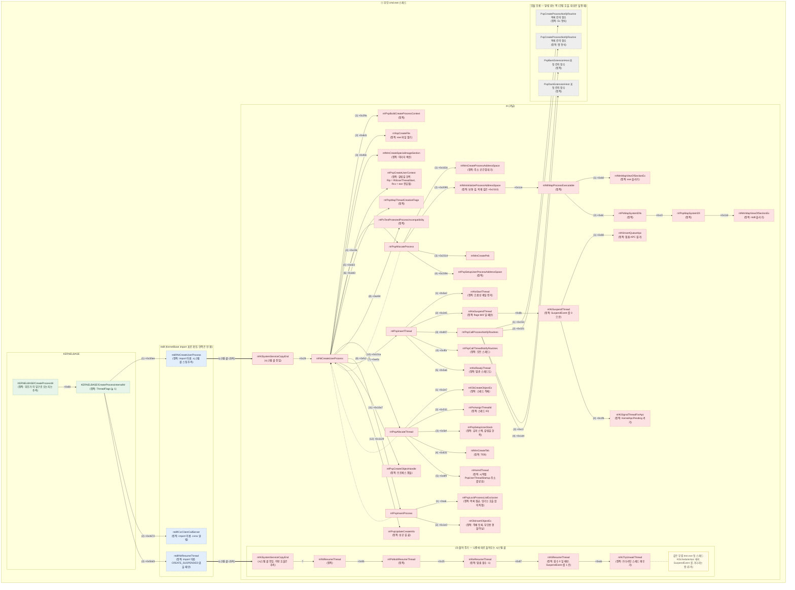

# test.exe 실행 흐름 — 프로세스 생성부터 `main`까지

## 기준

- 타깃: Windows 11 24H2, **26100.9457**
  - ntkrnlmp.pdb: `C29EBFB06B78B3C020DCA66D99713F9E1`
  - kernelbase.pdb: `72CCE506944DE0267C172AD64287F9BD1` (run14)
- 디버거: WinDbg 커널 디버깅 (KDNET)
- 부모: `cmd.exe`에서 `test.exe` 실행
- 근거 로그: `runs/01_sprint/` run3 ~ run8 (디버거)
- 정적 근거: `runs/02_sprint/` run9 ~ run16 (Ghidra 디컴파일·디스어셈블, pdb GUID 위와 같음. run9 ~ run13·run15·run16 ntoskrnl, run14 KernelBase. run16 은 ntdll 기존 export `LdrInitializeThunk.asm` 도 씀)
  - Ghidra 가 함수로 안 잡은 곳은 원본 바이트(`objdump`)로, 구조체 칸 이름은 PDB 타입 레코드(`llvm-pdbutil`)로 읽었다. 그런 곳은 글에 그렇다고 밝혔다.
  - 전역 변수 이름(`PsNtdllExports` 등)은 PDB 공개 심볼 + PE 구역표로 맞췄다 (run16).
- 테스트 프로그램: `sample/` (`test.c`, `dll1.c`, `dll2.c`, `build.bat`)
  - 의존 관계: **`test.exe` → `dll1.dll` → `dll2.dll`**
    - `test.c`가 `Dll1Hello`를, `dll1.c`가 `Dll2Hello`를 import
  - 세 모듈 모두 TLS 콜백이 있다: `ExeTls`, `Dll1Tls`, `Dll2Tls`
  - 빌드 옵션 `/MT`: CRT(C 런타임)를 DLL로 따로 두지 않고 **각 모듈 안에 넣어서** 빌드

### 표시 규칙

| 표시 | 뜻 |
|---|---|
| `[관찰]` | 멈춤점·콜스택·레지스터로 **직접 본 것** (26100.9457) |
| `[정적]` | 디컴파일·디스어셈블 **코드에 그렇게 쓰여 있는 것**. 실행 때 그 길로 갔는지는 모름 |
| `[소스]` | `sample/` 소스 코드·빌드 스크립트에 **그렇게 쓰여 있는 것**. 디버거로 실행을 본 건 아님 |
| `[추측]` | 관찰한 사실에서 짐작한 것, 또는 일반적으로 알려진 설명. **직접 보지 않음** |
| `[공백]` | 아직 아무것도 관찰하지 않은 구간 |

함수 **이름·호출 순서·누가 불렀는지(오프셋)** 는 관찰이다 (02_sprint부터는 정적도 있다. 그땐 `[정적]` 이라고 따로 붙인다).
단, **콜스택으로 caller를 직접 보지 못한 호출 관계**는 추측으로 둔다 (그림의 `?`).
같은 사실을 관찰과 정적 둘 다로 봤으면 둘 다 적는다 (예: `[관찰]` run3 + `[정적]` run9).
함수가 **안에서 무슨 일을 하는지**는, 따로 적지 않는 한 추측이다.

---

## 1. 흐름도

그림은 **스레드마다 한 장**, 모두 2장이다.

- 그림 1: 부모 cmd.exe 스레드 — 커널이 test.exe를 만드는 과정
- 그림 2: test.exe 메인 스레드 — 커널에서 출발 → ntdll 로더 → `main`

두 그림 사이(부모 쪽 마무리 ~ 첫 스레드 출발)는 **nt 쪽과 부모 KERNELBASE 쪽을 코드로 채웠다** (2.2). 실행으로 본 건 아직 없다.
- `NtCreateUserProcess` 안쪽은 코드로 봤다 (run9 `[정적]`): 거기엔 첫 스레드를 **풀어 주는 호출이 없다**.
- `PspInsertThread` 는 멈춤 여부와 상관없이 끝에서 `KeReadyThread` 를 부른다 (run12 `[정적]`).
- 멈춰 두기 = 멈춤 APC 걸기 + `SuspendEvent` 내리기, 풀어 주기 = `NtResumeThread` → … → `KiResumeThread` (run13 `[정적]`). 그림 1 의 `(3) 풀어 주기` 상자와 그림 2 의 APC 갈래가 이것이다.
- 부모 유저 쪽 `KERNELBASE!CreateProcessInternalW` 는 **늘 멈춘 채로 만들어 달라고 하고**(`ThreadFlags` = 1), csrss 알림 등을 한 뒤, `CREATE_SUSPENDED` 가 없으면 **직접 `NtResumeThread` 로 풀어 준다** (run14 `[정적]`). 그림 1 의 KERNELBASE 상자가 이것이다.

그림 2 안의 커널 → 유저 전환도 **코드로 봤다** (run15 `[정적]`, 2.3). 실행으로 본 건 아직 없다.
- `KiStartUserThread` 가 `PspUserThreadStartup` 을 부르고, 돌아오면 레지스터를 되살려 **`IRETQ`** 로 유저에 들어간다. 유저 첫 위치는 트랩 프레임의 `Rip` 칸에서 꺼낸다.
- 그림 2 의 굵은 화살표 `IRETQ` 두 갈래가 이것이다 (어느 쪽을 타는지는 `KiKvaShadow` 값, 동적).
- 유저 첫 위치가 `LdrInitializeThunk` 가 되는 까닭도 **코드로 봤다** (run16 `[정적]`, 2.3).
  - 처음 문맥은 `Rip = RtlUserThreadStart` 다 (`PspCreateUserContext`, 그림 1).
  - 출발 직전 `PspInitializeThunkContext` 가 그 문맥을 유저 스택에 맡기고 `Rip` 를 `LdrInitializeThunk` 로 바꿔 끼운다 (그림 2).
  - 로더는 끝에서 맡긴 문맥으로 `NtContinue` 를 부른다 (그림 2 `+0x18`). 커널 `NtContinue` 안쪽은 아직 `[공백]`.

> 왜 2장인가: 서로 화살표로 이어지지 않은 덩어리는 머메이드가 위아래 순서를 마음대로 정한다 (실험해보니 ③ → ② → ① 거꾸로 나왔다). 두 스레드 사이엔 호출 관계가 없어서 화살표로 이을 수 없으니, 그림을 나누고 **문서 순서로 시간 순서**를 보인다.

### 읽는 법

- **왼쪽 → 오른쪽 = 호출.** 왼쪽이 부르는 함수(caller), 오른쪽이 불린 함수(callee). 오른쪽으로 갈수록 더 깊이 들어간 호출이다.
- **한 함수가 여러 개를 부르면, 라벨 앞의 `(1)`, `(2)`, `(3)`이 부른 순서**다.
  - **위아래 자리는 순서가 아니다.** 머메이드는 선이 덜 꼬이도록 같은 줄의 상자 자리를 바꾸고, 버전마다 결과도 다르다.
  - 시간 순서로 읽으려면: 맨 왼쪽에서 출발 → `(1)` 가지를 끝까지 따라감 → 돌아와서 `(2)` 가지 → `(3)` 가지.
- **실선 화살표 = 호출(call).**
  - 라벨 `+0x…` = **콜스택으로 직접 본 호출.** 숫자는 caller 안에서 **돌아올 자리**(ret, call 바로 다음 명령)의 오프셋이다. WinDbg 콜스택에 `caller+0x…` 로 찍히는 값이 이것이다.
    - call 명령 자체의 자리(call)는 이보다 몇 바이트 앞이다. 글에서 call 을 쓸 땐 "(call `+0x…`)" 처럼 따로 적는다.
    - 단, 화살표 끝 상자가 **점선 테두리 + `(정적)`** 이면: 디스어셈블 코드에서 읽은 호출이다. 라벨은 똑같이 돌아올 자리(ret)다. 실행 때 정말 불렸는지는 아직 안 봤다.
    - `(정적)` 상자가 섞인 caller의 `(n)` 번호는 **코드 흐름 순서**다. 관찰한 상자끼리의 순서는 관찰 그대로다.
  - 라벨 **`?`** = **추측한 호출.** 콜스택으로 caller를 직접 보지 못했다. 사이에 다른 함수가 더 끼어 있을 수도 있다. → 4.1에서 추가 분석
- **점선 화살표 = 돌아옴(return).** 다음 번호의 호출이 관찰돼서 앞 번호가 돌아온 게 확실한 곳에만 그렸다.
- **굵은 화살표 = 호출이 아니라 실행이 넘어감** (커널 → 유저 전환, 유저 → 커널 시스템 콜, 인터럽트, 돌아오지 않는 꼬리 점프 `JMP` 처럼). 한 상자에서 여러 개 나가면 `(1)` `(2)` 가 시간 순서다.
  - 같은 번호가 둘이면 **값에 따라 둘 중 하나만** 탄다 (라벨에 갈리는 조건을 적었다).
- **상자 = 묶음.**
  - 가장 큰 상자 = 스레드
  - 그 안의 상자 = 모듈 (`nt`, `ntdll`, `KERNELBASE`, `KERNEL32`, `dll2`, `dll1`, `test.exe`)
  - `ntdll` 상자 안의 상자 = `LdrpInitializeProcess`가 차례로 하는 일 `(1)` `(2)` `(3)`, 그리고 로더가 끝난 뒤
  - `nt` 상자 안의 상자 = 같은 스레드에서 따로 일어나는 단계 (그림 1 `(3) 풀어 주기` = 나중의 다른 시스템 콜, 그림 2 `(1) 멈춤 APC 처리` = 멈춰 둔 스레드일 때만)
  - `ntdll` 상자가 크게 자리를 차지해서, 다른 모듈 상자는 오른쪽에 모여 그려진다. **오른쪽 모듈 상자의 위치는 호출 깊이와 상관없다.**
- **함수 상자 색 = 모듈.** 분홍 `nt` · 파랑 `ntdll` · 초록 `KERNELBASE`/`KERNEL32` · 보라 `dll2` · 노랑 `dll1` · 청록 `test.exe`
  - 회색 = **모듈을 모르는 함수.** 함수 포인터로 부르는 간접 호출이라 대상이 실행 때 정해진다. 상자 글은 "어디서 주소를 꺼내나" 이지 함수 이름이 아니다.
- **점선 테두리** = 이름이나 실행이 확실하지 않은 것. **노란 메모** = 같은 무렵 다른 스레드에서 일어난 일.
- `[dll1 추정]`처럼 대괄호 = 그 함수가 그때 맡은 모듈. "추정"이 붙으면 추측이다.

### 그림 1 — 부모 cmd.exe 스레드 (run3, run9, run10, run11, run12, run13, run14, run16)



### 그림 2 — test.exe 메인 스레드 (run4 ~ run8, run13, run14 메모, run15, run16)

```mermaid
flowchart LR
    classDef default fill:#e3eefc,stroke:#5b7fbf,color:#1d2b45
    classDef ntg fill:#e3eefc,stroke:#5b7fbf,color:#1d2b45,stroke-dasharray:4 3
    classDef kern fill:#fde2e4,stroke:#c0606a,color:#3a1d20
    classDef kerng fill:#fde2e4,stroke:#c0606a,color:#3a1d20,stroke-dasharray:4 3
    classDef k32 fill:#e6f4ea,stroke:#4f9a64,color:#1b3523
    classDef k32g fill:#e6f4ea,stroke:#4f9a64,color:#1b3523,stroke-dasharray:4 3
    classDef dll2 fill:#efe6fb,stroke:#8a63c7,color:#2b1d45
    classDef dll2g fill:#efe6fb,stroke:#8a63c7,color:#2b1d45,stroke-dasharray:4 3
    classDef dll1 fill:#fff4d6,stroke:#c49a2c,color:#3d2f0b
    classDef dll1g fill:#fff4d6,stroke:#c49a2c,color:#3d2f0b,stroke-dasharray:4 3
    classDef exe fill:#dff5f3,stroke:#3c9a90,color:#123532
    classDef exeg fill:#dff5f3,stroke:#3c9a90,color:#123532,stroke-dasharray:4 3
    classDef side fill:#fffbe6,stroke:#c9a400,color:#555

    subgraph T2["② test.exe 메인 스레드"]
        direction LR
        subgraph T2NT["nt (커널)"]
            direction LR
            b1["nt!KiStartUserThread"]
            b2["nt!PspUserThreadStartup"]
            b3["nt!PspDisablePrimaryTokenExchange<br/>(정적)"]:::kerng
            b4["nt!PsGetSessionLocaleId<br/>(정적: Minimal 아닐 때)"]:::kerng
            b5["nt!KeUpdateTebSchedulingPropertiesCurrentThread<br/>(정적: Minimal 아닐 때)"]:::kerng
            b6["nt!PspNotifyThreadCreation<br/>(정적: Minimal 아닐 때)"]:::kerng
            b7["nt!PspInitializeThunkContext<br/>(정적: 모든 스레드, Terminated·Minimal 아닐 때.<br/>원래 문맥을 유저 스택에 맡기고 Rip 를 LdrInitializeThunk 로)"]:::kerng
            b8["nt!PspGetContextThreadInternal<br/>(정적: 원래 문맥 읽기, Rip = RtlUserThreadStart)"]:::kerng
            b9["nt!PspSetContextThreadInternal<br/>(정적: 새 문맥 쓰기, 안쪽 PspSetContext +0x68 이 트랩 프레임 Rip 에)"]:::kerng
            kx["nt!KiKernelExit<br/>(정적: KiKvaShadow 켜졌을 때만)"]:::kerng
            subgraph T2NTA["(1) 멈춤 APC 처리 — 멈춰 둔 스레드일 때만 (추측 연결)"]
                direction LR
                h0["nt!KiApcInterrupt 추정<br/>(장부: 조각 FUN_1406b2db3)"]:::kerng
                h1["nt!KiDeliverApc<br/>(정적)"]:::kerng
                h2["nt!KiSchedulerApc<br/>(정적)"]:::kerng
                h3["nt!KeWaitForSingleObject<br/>(정적: SuspendEvent 기다림, 이유 Suspended)"]:::kerng
                w0["같은 무렵 부모 cmd.exe 스레드:<br/>CreateProcessInternalW +0x5bd3 NtResumeThread<br/>→ … → KiTryUnwaitThread 로 깨움<br/>(부르는 자리는 정적 run14, 시점은 추측)"]:::side
            end
        end

        subgraph T2DLL["ntdll"]
            direction LR
            c1["ntdll!LdrInitializeThunk<br/>(부른 함수 없음. Rcx = 맡긴 원래 문맥)"]
            c2["ntdll!LdrpInitializeInternal"]
            c3["ntdll!LdrpInitialize"]
            c4["ntdll!LdrpInitializeProcess"]

            subgraph PH1["(1) kernel32 준비"]
                direction LR
                k1["ntdll!LdrpInitializeKernel32Functions"]
                k2["ntdll!LdrLoadDll"]
                k3["ntdll!LdrpLoadDll"]
                k4["ntdll!LdrpLoadDllInternal"]
                k5["ntdll!LdrpPrepareModuleForExecution"]
                k6["ntdll!LdrpInitializeGraphRecurse"]
                k7["ntdll!LdrpInitializeGraphRecurse<br/>(재귀)"]
                k8["ntdll!LdrpInitializeNode<br/>[KERNELBASE 추정]"]
                k9["ntdll!LdrpCallTlsInitializers<br/>(TLS 콜백 호출 없음)"]
                k10["ntdll!LdrpCallInitRoutine"]
                k11["ntdll!LdrpInitializeNode<br/>[KERNEL32 추정]"]
                k12["ntdll!LdrpCallInitRoutine"]
                k13["ntdll!LdrLoadDll"]
                k14["ntdll!LdrpLoadDll"]
            end

            subgraph PH2["(2) import DLL 초기화: dll2 → dll1"]
                direction LR
                g1["ntdll!LdrpInitializeGraphRecurse<br/>[test.exe 추정]"]
                g2["ntdll!LdrpInitializeGraphRecurse<br/>(재귀) [dll1 추정]"]
                g3["ntdll!LdrpInitializeGraphRecurse<br/>(재귀) [dll2 추정]"]
                w1["같은 무렵 다른 스레드:<br/>ntdll 일꾼 2개 출발<br/>(ntdll!TppWorkerThread)"]:::side
                n2["ntdll!LdrpInitializeNode<br/>[dll2]"]
                n2a["ntdll!LdrpCallTlsInitializers"]
                n2b["ntdll!LdrpCallInitRoutine"]
                n2c["ntdll!ImageTlsCallbackCaller"]
                n2d["ntdll!LdrpCallInitRoutine"]
                n1["ntdll!LdrpInitializeNode<br/>[dll1]"]
                n1a["ntdll!LdrpCallTlsInitializers"]
                n1b["ntdll!LdrpCallInitRoutine"]
                n1c["ntdll!ImageTlsCallbackCaller"]
                n1d["ntdll!LdrpCallInitRoutine"]
            end

            subgraph PH3["(3) exe TLS 콜백"]
                direction LR
                x1["ntdll!LdrpCallTlsInitializers"]
                x2["ntdll!LdrpCallInitRoutine"]
                x3["ntdll!ImageTlsCallbackCaller"]
            end

            subgraph PH4["로더 끝 → 진입점 (NtContinue 호출은 정적, 그 뒤는 추측)"]
                direction LR
                q1["ntdll!NtContinue<br/>(정적: 맡긴 문맥, TRUE)"]:::ntg
                r1["ntdll!RtlUserThreadStart<br/>(정적: 맡긴 문맥의 Rip 값. 실제로 가는지는 추측)"]:::ntg
            end
        end

        subgraph T2KB["KERNELBASE"]
            direction LR
            d1["KERNELBASE 시작 함수<br/>KernelBaseDllInitialize 근처"]:::k32g
            m2["KERNELBASE!LoadLibraryExW ×3"]:::k32
        end
        subgraph T2K32["KERNEL32"]
            direction LR
            d2["KERNEL32 시작 함수<br/>BaseDllInitialize 근처"]:::k32g
            s1["KERNEL32!BaseThreadInitThunk<br/>(추측)"]:::k32g
        end
        subgraph T2D2["dll2"]
            direction LR
            f0["dll2!Dll2Tls<br/>(소스상 TLS 콜백, 실행 미관찰)"]:::dll2g
            f1["dll2!_DllMainCRTStartup"]:::dll2
            f2["dll2!DllMain (이유 1)"]:::dll2
        end
        subgraph T2D1["dll1"]
            direction LR
            i0["dll1!Dll1Tls<br/>(소스상 TLS 콜백, 실행 미관찰)"]:::dll1g
            i1["dll1!_DllMainCRTStartup"]:::dll1
            i2["dll1!DllMain (이유 1)"]:::dll1
        end
        subgraph T2EXE["test.exe"]
            direction LR
            e1["test!ExeTls (이유 1)"]:::exe
            m1["test!mainCRTStartup<br/>(추측: 스레드 시작 주소)"]:::exeg
            m3["test!main"]:::exe
        end
    end

    %% 커널 → 유저
    b1 -->|"(1) +0x28"| b2
    b2 ==>|"APC 인터럽트 — 멈춘 스레드만, 호출 (1) 앞 (+0x22 IRQL 내림 직후, 자리 +0x26 은 추측)"| h0
    h0 -->|"?"| h1
    h1 -->|+0x220| h2
    h2 -->|+0xf7| h3
    h3 -.- w0
    b2 -->|"(1) +0x3c"| b3
    b2 -->|"(2) +0x78"| b4
    b2 -->|"(3) +0x99"| b5
    b2 -->|"(4) +0xa1"| b6
    b2 -->|"(5) +0xb3"| b7
    b7 -->|"(1) +0x16d"| b8
    b7 -->|"(2) +0x2db"| b9
    b1 ==>|"(2) IRETQ — KiKvaShadow 꺼짐 (정적)"| c1
    b1 ==>|"(2) JMP — KiKvaShadow 켜짐 (정적)"| kx
    kx ==>|"IRETQ +0xa5 (정적)"| c1

    %% 로더 시작
    c1 -->|"(1) +0xe"| c2
    c2 -->|+0x5a| c3
    c3 -->|+0x16c| c4

    %% LdrpInitializeProcess (1) kernel32 준비
    c4 -->|"(1) +0x19a2"| k1
    k1 -.-> c4
    k1 -->|"(1) +0xc0"| k2
    k2 -.-> k1
    k2 -->|+0x170| k3
    k3 -->|+0x100| k4
    k4 -->|+0x284| k5
    k5 -->|+0xef| k6
    k6 -->|"(1) +0x96"| k7
    k7 -.-> k6
    k7 -->|+0x6a| k8
    k8 -->|"(1) +0x16b"| k9
    k9 -.-> k8
    k8 -->|"(2) +0x19c"| k10
    k10 -->|"?"| d1
    k6 -->|"(2) +0x6a"| k11
    k11 -->|+0x19c| k12
    k12 -->|"?"| d2
    k1 -->|"(2) +0x156"| k13
    k13 -->|+0x170| k14

    %% LdrpInitializeProcess (2) import DLL 초기화
    c4 -->|"(2) +0x1bb6"| g1
    g1 -.-> c4
    g1 -.- w1
    g1 -->|+0x96| g2
    g2 -->|"(1) +0x96"| g3
    g3 -.-> g2
    g3 -->|+0x6a| n2
    n2 -->|"(1) +0x16b"| n2a
    n2a -.-> n2
    n2a -->|+0x19b| n2b
    n2b -->|"?"| n2c
    n2c -->|"?"| f0
    n2 -->|"(2) +0x19c"| n2d
    n2d -->|"?"| f1
    f1 -->|"?"| f2
    g2 -->|"(2) +0x6a"| n1
    n1 -->|"(1) +0x16b"| n1a
    n1a -.-> n1
    n1a -->|+0x19b| n1b
    n1b -->|"?"| n1c
    n1c -->|"?"| i0
    n1 -->|"(2) +0x19c"| n1d
    n1d -->|"?"| i1
    i1 -->|"?"| i2

    %% LdrpInitializeProcess (3) exe TLS
    c4 -->|"(3) +0x1c99"| x1
    x1 -->|+0x19b| x2
    x2 -->|"?"| x3
    x3 -->|"?"| e1

    %% 로더 끝 → 진입점 → main
    c1 -->|"(2) +0x18"| q1
    q1 ==>|"실행이 넘어감 — 커널 NtContinue 안은 공백 (추측)"| r1
    r1 -->|"?"| s1
    s1 -->|"?"| m1
    m1 -->|"(1) ?"| m2
    m2 -.-> m1
    m1 -->|"(2) ?"| m3

    class b1,b2 kern
```



---

## 2. 단계별 설명

### 2.1 커널 `nt` — 부모 cmd.exe 스레드 안에서 (run3, run9, run10, run11, run12, run13, run16)

이 구간은 **test.exe가 아니라 부모 cmd.exe**가 일하는 시간이다.
test.exe는 아직 "만들어지는 중"이라, 자기 코드는 한 줄도 안 돌았다.

- 이 시스템 콜을 부르는 부모 유저 쪽(`KERNELBASE!CreateProcessInternalW +0x30ee`)과, 돌아간 뒤 부모가 하는 일은 2.2 맨 앞에 모았다 (run14 `[정적]`).

```
NtCreateUserProcess                                    (번호 = 코드 순서)
 ├─ (1)  +0x29a   PspBuildCreateProcessContext          [정적]
 ├─ (2)  +0x6cb   IopCreateFile                         [정적]
 ├─ (3)  +0x93c   MmCreateSpecialImageSection           [정적]
 ├─ (4)  +0xc36   PspAllocateProcess                    [관찰]+[정적]
 │                 ├─ (1) +0x163c  MmCreateProcessAddressSpace       [정적] 주소 공간
 │                 ├─ (2) +0x2095  MmInitializeProcessAddressSpace   [정적] 보통 길로 [추측]
 │                 │     └─ +0x1ce  MiMapProcessExecutable           [정적]
 │                 │          ├─ (1) +0xb8  MmMapViewOfSectionEx     [정적] exe 올리기
 │                 │          └─ (2) +0xdc  PsMapSystemDlls          [정적]
 │                 │               └─ +0xc0  PspMapSystemDll         [정적]
 │                 │                    └─ +0x11d  MmMapViewOfSectionEx  [정적] ntdll 올리기
 │                 ├─ (3) +0x2314  MmCreatePeb                       [관찰]+[정적]
 │                 └─ (4) +0x239c  PspSetupUserProcessAddressSpace   [정적]
 ├─ (5)  +0xd22   PspCreateUserContext                  [정적] Rip = RtlUserThreadStart, Rcx = 진입점 (run16)
 ├─ (6)  +0xdd3   PspMapThreadCreationFlags             [정적]
 ├─ (7)  +0xe5c   PspAllocateThread                     [관찰]+[정적]
 │                 ├─ (1) +0x2e7  ObCreateObjectEx      [정적] 스레드 객체
 │                 ├─ (2) +0x532  PsAssignThreadId      [정적] 스레드 ID
 │                 ├─ (3) +0x5ef  PspSetupUserStack     [정적] 유저 스택 (갈림길 한쪽)
 │                 ├─ (4) +0x631  MmCreateTeb           [정적] TEB
 │                 └─ (5) +0x6f9  KeInitThread          [정적] 시작점 = PspUserThreadStartup 주소
 │                       └─ +0x301  KiInitializeContextThread
 │                            └─ +0x1b1  KxContextToKframes   [정적] CONTEXT → 트랩 프레임 (처음, run16)
 ├─ (8)  +0xe94   PsTestProtectedProcessIncompatibility [정적]
 ├─ (9)  +0xfc2   PspInsertProcess                      [관찰]+[정적]
 │                 ├─ (1) +0xa6   PspLockProcessListExclusive  [정적] 목록 잠금 → 직접 잇기
 │                 └─ (2) +0x1e3  ObInsertObjectEx      [정적] 객체 등록 (부모용 핸들 아님)
 ├─ (10) +0x101a  PspInsertThread                       [관찰]+[정적]   (아래 번호 = 흐름 순서)
 │                 ├─ (1) +0x5e2  KeStartThread         [정적] 제일 먼저 (2.2)
 │                 ├─ (2) +0x2e5  KeSuspendThread       [정적] flags bit0 일 때만 (2.2)
 │                 │     └─ +0x6b  KiSuspendThread      [정적] (run13)
 │                 │          ├─ (1) +0x88   KiInsertQueueApc      [정적] 멈춤 APC 걸기
 │                 │          └─ (2) +0x1fb  KiSignalThreadForApc  [정적]
 │                 │     (+0x3ea ObInsertObjectEx 객체 등록 → +0x499 스레드 락 풀기)
 │                 ├─ (3) +0x807  PspCallProcessNotifyRoutines  [관찰]+[정적] 첫 스레드만
 │                 │               ├─ (1) +0x152  (간접·대상 모름) 등록 목록, Ex 형식   ┐ 칸마다
 │                 │               ├─ (2) +0x321  (간접·대상 모름) 등록 목록, 옛 형식   ┘ 둘 중 하나
 │                 │               ├─ (3) +0xc3   (간접·대상 모름) BAM 표 첫 칸
 │                 │               └─ (4) +0x1d4  (간접·대상 모름) DAM 표 첫 칸
 │                 ├─ (4) +0x4fa  PspCallThreadNotifyRoutines   [정적] 모든 스레드
 │                 │     (+0x525 PspCreateObjectHandle 스레드 핸들, +0x8ef 잡 배정 조건부)
 │                 └─ (5) +0x5a6  KeReadyThread         [정적] 멈춘 스레드도 (2.2)
 ├─ (11) +0x10a7  PspCreateObjectHandle                 [정적]
 └─ (12) +0x1129  PspUpdateCreateInfo                   [정적]
```

- `[관찰]` 관찰한 7개(`[관찰]` 붙은 줄)는 전부 **cmd.exe의 같은 스레드 하나**에서 차례로 불렸다. 중간에 다른 스레드로 넘기지 않는다.
- `[관찰]` 옛날 방식 함수 `nt!PspCreateProcess`는 **불리지 않았다.**
  - `[정적]` (run9) `NtCreateUserProcess` 안에 `PspCreateProcess`를 직접 부르는 코드도 없다. 관찰과 맞는다.
- `[정적]` (run9) `NtCreateUserProcess`가 직접 부르는 호출은 모두 **83줄**이다. 위 트리는 그중 대표 12개만. 나머지는 검사·잠금·해제·정리 같은 잡일이다.
  - 관찰 4개를 경계로 나누면: 앞 47개 / 사이 10개 / 사이 5개 / **사이 0개** / 뒤 17개 (+ 경계 4개).
- `[관찰]`+`[정적]` 관찰 4개(`+0xc36`, `+0xe5c`, `+0xfc2`, `+0x101a`)와 `PspInsertThread +0x807`은 디스어셈블 코드의 돌아올 자리와 **오프셋까지 같다**. 네 함수는 한 번씩만 불린다.
- `[관찰]`+`[정적]` (run10) `PspAllocateProcess +0x2314` → `MmCreatePeb`도 코드와 오프셋까지 같다 (call `+0x230f`).
- `[정적]` (run10) `PspAllocateProcess` 안에서 **주소 공간 → exe 올리기 → ntdll 올리기 → PEB** 순서다. 트리의 `PspAllocateProcess` 아래가 그 길이다.
- `[정적]` (run11) `PspAllocateThread` 안에서 **스레드 객체 → 스레드 ID → 유저 스택 → TEB → `KeInitThread`** 순서다. `PspInsertProcess` 는 목록 잠금 사이에서 **호출 없이 직접** 새 프로세스를 목록에 잇는다.
- `[정적]` (run12) `PspInsertThread` 안에서 **`KeStartThread` → 멈춤(조건부) → 객체 등록 → 스레드 락 풀기 → 프로세스 알림(첫 스레드만) → 스레드 알림 → 스레드 핸들 → `KeReadyThread`** 순서다. 오프셋 순서가 아니라 점프를 따라간 순서다.
- 주의 `[정적]`: 오프셋 순서가 늘 실행 순서인 건 아니다. 에러 길·공통 정리 길이 코드 뒤쪽에 모여 있고, 서명 검사 재시도는 루프다. 위 트리 번호는 **성공 길로 보이는 코드 순서**이고, `(정적)` 줄은 실행을 아직 안 봤다.

#### `nt!NtCreateUserProcess`

- `[관찰]` 유저 쪽에서 시스템 콜로 들어온다 (`nt!KiSystemServiceCopyEnd+0x28`이 부름).
- `[정적]` (run14) 유저 쪽에서 이걸 부르는 곳: `KERNELBASE!CreateProcessInternalW +0x30ee` (call `+0x30e7`, ntdll 에서 가져온 `NtCreateUserProcess`). 그 함수 안에 **한 곳뿐**이다 (2.2).
  - `[추측]` run3 의 cmd.exe 도 이 자리에서 왔을 것. 그때 유저 쪽 콜스택은 안 찍었다 (4.1).
- `[관찰]` 아래 함수들을 직접 부르는 **총괄 함수**다.
- `[정적]` (run9) 이 함수를 직접 부르는 함수는 코드상 없다 (Ghidra 호출자 목록이 빈다). 시스템 콜 입구가 간접으로 부르는 모양과 맞다.
- `[정적]` (run9) 입구에서 인자를 검사한다. `ThreadFlags`(8번째 인자)에 bit0 말고 다른 비트가 있으면 바로 `0xc000000d`로 돌아간다 (`+0x1bf` → `+0x1ce` → `+0x11f9`).
  - 인자 이름(`ThreadFlags` 등)은 알려진 함수 모양에서 빌린 것이다. 이 빌드 PDB로 확인한 건 아니다. `[추측]`
- `[정적]` (run9) 함수 포인터를 거치는 **간접 호출이 2곳** 있다 (`+0x5b2`, `+0x11bb`). 무엇을 부르는지는 실행해 봐야 안다 (4장).
- `[추측]` 유저 쪽 `CreateProcess`가 결국 이 시스템 콜 하나로 커널에 "프로세스 만들어줘"를 요청하는 것.
  - `[정적]` (run14) KERNELBASE 쪽 코드로는 맞다: `CreateProcessW` → `CreateProcessInternalW` → 이 시스템 콜 한 자리. 다만 실패 길에서 같은 자리로 다시 돌아오는 재시도 길이 있어서, 몇 번 불리는지는 동적 (4장).

#### `nt!PspBuildCreateProcessContext` (정적)

- `[정적]` (run9) `NtCreateUserProcess+0x29a`(call `+0x295`)에서 부른다.
- `[정적]` 유저가 준 **속성 목록**(11번째 인자)을 읽어 커널 안의 "만들기 준비물" 묶음으로 풀어 둔다 (디컴파일 요약).

#### `nt!IopCreateFile` (정적)

- `[정적]` (run9) `NtCreateUserProcess+0x6cb`(call `+0x6c6`)에서 부른다. **실행 파일(exe)을 연다.** 접근권 `0x100020` = 실행 + 동기.
- `[정적]` 앞에서 `PspCreateUserProcessEcp`(call `+0x5fa`)로 덧붙일 정보를 만들고, 실패하면 `IoCreateFileEx`(call `+0x73b`)로 한 번 더 시도하는 코드가 있다.
- `[추측]` 비유하면 **설계도(exe 파일) 꺼내 오기**.

#### `nt!MmCreateSpecialImageSection` (정적)

- `[정적]` (run9) `NtCreateUserProcess+0x93c`(call `+0x937`)에서 부른다. 연 파일로 **이미지 섹션**(메모리에 올릴 준비가 된 exe 모양)을 만든다.
- `[정적]` 서명 수준이 안 맞으면 섹션을 닫고(call `+0xa1e`, `+0xa2a`) 다시 만드는 **루프 안**에 있다. test.exe 때 몇 번 도는지는 모른다.
- `[정적]` points.md의 `MiCreateImageFileMap`은 `NtCreateUserProcess`가 직접 부르지 않는다. 이 함수 안쪽인지는 모른다. `[추측]`

#### `nt!PspAllocateProcess`

- `[관찰]` `NtCreateUserProcess+0xc36`에서 불린다. 안에서 `MmCreatePeb`를 부른다.
  - `[정적]` (run9) 코드도 같은 자리(call `+0xc31`, 돌아올 자리 `+0xc36`).
- `[정적]` (run10) 직접 호출 **144줄**. 하는 일로 묶으면 14단위 + 실패 정리 + 복제 갈래다 (표는 run10 문서).
  - 앞쪽: 프로세스 객체 만들기, exe 이미지 정보·IFEO 레지스트리 읽기, 토큰·세션·쿼터, 보안·핸들 표, 완화 정책
  - 메모리 쪽 4가지 일이 **이 순서로** 있다:
    1. `+0x163c` `MmCreateProcessAddressSpace` — 주소 공간 껍데기
    2. `+0x2095` `MmInitializeProcessAddressSpace` — 그 안에서 exe, 그다음 ntdll 올리기
    3. `+0x2314` `MmCreatePeb` — PEB
    4. `+0x239c` `PspSetupUserProcessAddressSpace` — 유저 쪽 준비 마무리
  - 끝쪽: `PspCidTable`에 핸들을 만들어(`ExCreateHandleEx` `+0x2703`) 새 프로세스 `+0x1d0`에 둔다. `[추측]` 이게 프로세스 ID.
- `[정적]` (run10) 이 함수를 부르는 곳은 `NtCreateUserProcess` 말고도 `PspCreateProcess`, `PsCreateMinimalProcess`가 있다.
- `[정적]` (run10) 함수 포인터로 부르는 **간접 호출이 2곳** 있다 (`+0x121a`, `+0x17c4`). 대상은 실행해 봐야 안다 (4장).
- `[추측]` 비유하면 **가게 건물 짓기**: 땅 다지기(주소 공간) → 설계도대로 건물 올리기(exe) → 관리실 들이기(ntdll) → 안내판 달기(PEB).

#### `nt!MmCreateProcessAddressSpace` (정적)

- `[정적]` (run10) `PspAllocateProcess+0x163c`(call `+0x1637`)에서 부른다. caller 는 이 하나뿐.
- `[정적]` 맨 위 페이지 표를 만들고(`MiAllocateTopLevelPage` `+0x1fd`), 커널 쪽 매핑을 잇고(`MiCreateNewProcessTopLevelMappings` `+0x208`), 세션에 넣는다(`PsJoinSession` `+0x21f`).
- `[추측]` 새 프로세스 메모리의 **빈 껍데기**. 유저 쪽 장부와 내용물은 다음 함수 몫이다.

#### `nt!MmInitializeProcessAddressSpace` (정적)

- `[정적]` (run10) `PspAllocateProcess`가 **두 곳에서** 부른다. points.md `[확인 필요]` 이름이 여기서 풀렸다.
  - `+0x2095`(call `+0x2090`): 보통 길. 부모 없음, 이미지 섹션 있음.
  - `+0x2113`(call `+0x210e`): 복제 길. 부모 있음, 섹션 없음.
  - 두 길은 같은 플래그(bit `0x4`)로 갈린다. `MmCreatePeb`도 그 플래그가 꺼졌을 때만 부른다 (`+0x22e9`).
  - `[추측]` run3 에서 `+0x2314`(`MmCreatePeb`)가 찍혔으니 test.exe 때는 `+0x2095` 쪽이다. 같은 변수라는 가정이라 동적으로 확인할 것 (4.1).
- `[정적]` 세 번째 인자로 받는 섹션 = run9 의 `MmCreateSpecialImageSection`(`NtCreateUserProcess +0x93c`)이 만든 **exe 이미지 섹션**이다 (`NtCreateUserProcess +0xc0c` → `PspAllocateProcess +0x2080` ~ `+0x2090`).
- `[정적]` 안에서 순서: 새 프로세스 안으로 들어감(`KiStackAttachProcess` `+0xb5`) → 작업 집합 장부(`+0xed`) → 유저 주소 범위 계산(`+0x13b`) → VAD(메모리 구역 장부) 만들고 넣기(`+0x161`, `+0x1a8`) → **`MiMapProcessExecutable` `+0x1ce`** → 나옴(`+0x1e5`).
- `[정적]` 부팅 때 `MiInitializeBootProcess`도 이 함수를 부른다.

#### `nt!MiMapProcessExecutable` (정적)

- `[정적]` (run10) `MmInitializeProcessAddressSpace+0x1ce`에서 부른다. caller 는 이 하나뿐.
- `[정적]` **exe 먼저, ntdll 다음.**
  1. `+0xb8` `MmMapViewOfSectionEx` — exe 이미지 섹션을 새 프로세스 메모리에 올린다.
  2. `+0xc5` 올린 주소를 새 프로세스 `+0x2b0`에 저장 (나중에 `MmCreatePeb`가 PEB `+0x10`에 옮김).
  3. `+0xdc` `PsMapSystemDlls` — ntdll 쪽.

#### `nt!PsMapSystemDlls` → `nt!PspMapSystemDll` (정적)

- `[정적]` (run10) `PsMapSystemDlls`는 `MiMapProcessExecutable+0xdc`에서 불리고, `+0xc0`에서 `PspMapSystemDll`을 부른다.
- `[정적]` `PsMapSystemDlls`는 `PspSystemDlls` 표를 최대 6칸 돈다. 0번 칸은 늘 부르고, 나머지 칸은 WOW64(32비트) 조건이 붙는다.
  - `[추측]` 64비트 test.exe 면 0번 칸(ntdll) 하나만.
- `[정적]` `PspMapSystemDll`은 미리 준비된 섹션을 잡아(`PspReferenceSystemDll` `+0x40`) **`+0x11d` `MmMapViewOfSectionEx`로 올린다.**
- `[정적]` points.md 의 `PspMapSystemDll`은 `PspAllocateProcess`가 **직접 부르지 않는다**. 새 프로세스 길의 직접 caller 는 `PsMapSystemDlls`.
  - 다른 caller 3곳(`PspInitPhase3`, `PsLocateSystemDlls`, `PspLocateSystemDll`)도 있다. `[추측]` 부팅 때 ntdll 섹션을 준비하는 쪽.
- `[추측]` ntdll 섹션은 부팅 때 한 번 만들어 두고, 프로세스마다 **같은 섹션을 붙이기만** 한다.
  - `[정적]` (run16) 모양은 맞다: 프로세스마다 붙일 땐(`PsMapSystemDlls`, 네 번째 인자 0) `PspMapSystemDll +0x172` 가 **부팅 때 정한 주소**(`PspSystemDlls[0]` 칸 `+0x20`)에 붙었는지만 검사한다. 그 칸은 부팅 때 `PspLocateSystemDll +0x238` / `PsLocateSystemDlls +0x89` 가 인자 1 로 부를 때 채운다. 2.3 `PspInitializeThunkContext` 가 이 칸을 `Rdx` 로 넘긴다.

#### `nt!MmCreatePeb`

- `[관찰]` `PspAllocateProcess+0x2314`에서 불린다.
  - `[정적]` (run10) 코드도 같은 자리(call `+0x230f`).
- `[정적]` (run10) 새 프로세스 안으로 들어가서(`+0xc7`) PEB 자리를 만들고(`MiCreatePebOrTeb` `+0x14b`), exe 헤더를 읽어(`+0x2ce`, `+0x311`) 값을 채운 뒤 나온다.
  - 그 전에 leap second 데이터 섹션을 새 프로세스에 올린다 (`MmMapViewOfSection` `+0x132`).
  - 32비트 조건이면 `MiInitializeWowPeb`(`+0x680`)도.
- `[정적]` PEB 주소는 새 프로세스 `+0x2e0`에 돌려준다 (`PspAllocateProcess +0x22f2`에서 그 자리를 인자로 줌).
- PEB 에 쓰는 것 — **오프셋은 `[정적]`, 이름은 `[추측]`** (알려진 PEB 배치에 맞춰 본 것):

| PEB 오프셋 `[정적]` | 무엇을 쓰나 `[정적]` | 이름 `[추측]` |
|---|---|---|
| `+0x0`, `+0x3`, `+0x8` | `PspAllocateProcess`가 넘긴 견본 복사 | InheritedAddressSpace / BitField / Mutant |
| `+0x10` | 새 프로세스 `+0x2b0` = exe 를 올린 주소 | ImageBaseAddress |
| `+0xb8` ~ `+0xe0` | 프로세서 개수, 전역 플래그 등 | NumberOfProcessors, NtGlobalFlag 등 |
| `+0x118` ~ `+0x124` | 버전 숫자 (exe 헤더 값이 있으면 덮어씀) | OS 버전 칸들 |
| `+0x128` ~ `+0x130` | exe 헤더의 서브시스템 값 | ImageSubsystem 등 |
| `+0x2c0` | 세션 번호 | SessionId |
| `+0x7b8` | leap second 뷰 주소 | LeapSecondData |

- `[정적]` **PEB `+0x18`, `+0x20`, `+0x30`은 쓰지 않는다.** ntdll 은 `+0x20`을 읽는데, 누가 채우는지는 아직 모른다 (4장).
- `[추측]` 유저 쪽(ntdll)이 나중에 읽을 프로세스 **안내판**(PEB). 비유하면 새 가게 문 앞에 "주소·층수·영업 규칙"을 붙여 두는 것.

#### `nt!PspSetupUserProcessAddressSpace` (정적)

- `[정적]` (run10) `PspAllocateProcess+0x239c`(call `+0x2397`)에서 부른다. `MmCreatePeb` 바로 다음 대표 호출.
- `[정적]` 새 프로세스 안으로 들어가서(`+0xfa`) 차례로:
  - 메모리 할당(`ZwAllocateVirtualMemory` `+0x19c`) → `PspCopyAndFixupParameters` `+0x1b9`
  - `PspPrepareSystemDllInitBlock` `+0x1e6`
  - ApiSet 뷰 올리기(`MmMapApiSetView` `+0x255`), silo 공유 데이터 뷰(`PspMapSiloSharedDataView` `+0x263`)
- `[추측]` `PspCopyAndFixupParameters`가 프로세스 매개변수(명령줄 등)를 새 프로세스로 복사하고 PEB `+0x20`에 잇는 곳. 본문은 안 봤다.
- `[추측]` `PspPrepareSystemDllInitBlock`은 ntdll 에 넘길 시작 정보 묶음을 준비한다 (이름으로 본 것).

#### `nt!PspCreateUserContext` (정적)

- `[정적]` (run9) `NtCreateUserProcess+0xd22`(call `+0xd1d`)에서 부른다. 첫 스레드가 **유저 쪽에서 시작할 문맥**(레지스터 묶음)을 만든다.
- `[정적]` 갈림길이 있다. 이미지 섹션 참조가 있으면 이 함수, 없으면 `PspGetContextThreadInternal`(`+0xd3e`, call `+0xd39`). 어느 쪽을 타는지는 런타임 값이다.
- `[추측]` 일반 exe 실행이면 이 함수 쪽이다. ~~첫 스레드의 유저 첫 위치(2.3의 `LdrInitializeThunk`)를 정하는 곳일 수도 있다.~~ → 아니다. 여기서 정하는 건 `RtlUserThreadStart` 이고, `LdrInitializeThunk` 는 나중에 바꿔 끼운다 (run16, 2.3).
- `[정적]` (run16) **처음 문맥의 세 칸을 채운다** (91바이트, 호출 없음. 칸 이름은 PDB 타입 `_CONTEXT`):
  - `Rip`(+0xf8) ← **`RtlUserThreadStart`** — `NtCreateUserProcess +0xd10` 이 전역 `PsNtdllExports` 의 `+0x10` 칸에서 꺼냄 (`PspCreateUserContext +0x28`)
  - `Rcx`(+0x80) ← **exe 진입점** = `_SECTION_IMAGE_INFORMATION.TransferAddress` (`+0xd09`, `+0x2f`). 출처는 `PspAllocateProcess +0x991` `MmGetSectionInformation`, 다른 주소에 올라가면 `+0x20b3 ~ +0x20ce` 에서 보정
  - `Rdx`(+0x88) ← **PEB** (`EPROCESS.Peb`, WoW64 면 32비트 값) (`+0xce9 ~ +0xd04`, `+0x36`)
  - 그 밖에 `SegCs` `0x33`, `SegSs` `0x2b`, `MxCsr` `0x1f80` 등. **`Rsp` 는 안 쓴다** — `PspAllocateThread +0x5ef` `PspSetupUserStack` 이 `+0xdc` 에서 적는다 (새 유저 스택 위 − 임의 오프셋 − 0x28).
- `[정적]` (run16) 그러니 `PspAllocateThread` 가 옮겨 적는 `_ETHREAD.StartAddress` = `RtlUserThreadStart`, `Win32StartAddress` = exe 진입점이다. 2.3 `[관찰]` "Win32 Start Address = `test!mainCRTStartup`" 과 맞는다.
- `[정적]` (run16) `NtCreateThreadEx +0x1c1`, `PspWow64InitThread +0x73` 도 같은 `PsNtdllExports+0x10` 칸을 읽는다 (참조 훑기만, 코드는 안 읽음). `[추측]` 다른 스레드도 `Rip = RtlUserThreadStart` 로 시작 (3장).

#### `nt!PspMapThreadCreationFlags` (정적)

- `[정적]` (run9) `NtCreateUserProcess+0xdd3`(call `+0xdce`)에서 부른다. 유저가 준 `ThreadFlags`를 **커널 안쪽 플래그로 바꾼다.**
- `[정적]` 바뀐 값은 `PspInsertThread`의 4번째 인자(이하 **flags**)로 넘어가서 "첫 스레드를 멈춰 둘지"를 가른다 (2.2).
- `[정적]` (run12, 원본 바이트) **bit0 는 bit0 로 그대로 간다.** 나머지: `0x2`→`0x2`, `0x4`→`0x4`, `0x10`→`0x80`, `0x20`→`0x100`, `0x40`→`0x200`. (run9 까지 `[공백]` 이던 것)
  - 입구 검사(위)가 `ThreadFlags` 에 bit0 만 허용하니, 이 길에서 flags 에 실려 오는 `ThreadFlags` 비트는 bit0 하나뿐이다.
  - `[정적]` (run14) 부모 쪽 `KERNELBASE!CreateProcessInternalW` 는 `ThreadFlags` 로 **늘 1** 을 넘긴다 (`+0x6cb` `ESI = 1` → `+0x30af` 8번째 인자). 그러니 그 길로 왔다면 flags bit0 는 늘 켜진다 (2.2).
- `[정적]` (run12) 그 뒤 `+0xdfd` 에서 flags 에 `0x60` 을 **무조건** 켠다 (`OR dword ptr [RBP+0x10],0x60`). 그래서 `PspInsertThread` 는 이 길에서 늘 "프로세스 락을 이미 잡아 왔음"(`0x20`), "실행 상태 바꾸기"(`0x40`) 쪽으로 간다.

#### `nt!PspAllocateThread`

- `[관찰]` `NtCreateUserProcess+0xe5c`에서 불린다. **프로세스를 목록에 등록하기 전에** 불린다.
  - `[정적]` (run9) 코드도 같은 자리(call `+0xe57`).
- `[정적]` (run11) 첫 스레드(메인 스레드)의 **커널 쪽 몸**을 만든다. 직접 호출은 장부(`_calls.tsv`)에 **34줄** + 장부 밖 10곳(디컴파일로 확인)이다. 대표 5개가 이 순서다:
  1. `+0x2e7` `ObCreateObjectEx` — 스레드 객체(`_ETHREAD`) 만들기
  2. `+0x532` `PsAssignThreadId` — 스레드 ID
  3. `+0x5ef` `PspSetupUserStack` — 유저 스택
  4. `+0x631` `MmCreateTeb` — TEB (아래)
  5. `+0x6f9` `KeInitThread` — 커널 쪽 스레드 초기화 (아래)
  - 이 함수를 부르는 곳은 `NtCreateUserProcess` 말고 `PspCreateThread`, `PspCreatePicoThread` 도 있다.
- `[정적]` (run11) 3·4번(스택·TEB)은 **유저 스레드일 때만**이고, 그 안에서도 갈림길이 있다.
  - 5번째 인자(유저 CONTEXT)가 0이면 시스템 스레드 길: 스택·TEB 를 건너뛴다.
  - 11번째 인자(스택 정보)가 0이 아니면 보통 길: 위 순서대로 스택·TEB 를 새로 만든다.
  - 0이면 함수 먼 쪽 덩어리로 가서 Pico 길, 또는 "지금 스레드를 본뜨는" 길 (스택·TEB 를 새로 안 만듦).
  - `NtCreateUserProcess` 가 이 인자에 무엇을 주는지는 코드로 못 정했다 → 4장.
  - 32비트(WOW64) 프로세스면 `PspWow64SetupUserStack`, `PspWow64InitThread` 가, CET 면 `PspSetupUserShadowStack` 이 더 불린다 (장부에 없음, 디컴파일로 확인). `[추측]` 64비트 test.exe 면 WOW64 쪽은 안 탄다.
- `[정적]` (run11) **유저 쪽 시작 주소는 인자로 받은 CONTEXT 에서 옮겨 적는다.**
  - `+0x640 ~ +0x647`: `_ETHREAD.StartAddress` ← `CONTEXT.Rip`
  - `+0x64e ~ +0x655`: `_ETHREAD.Win32StartAddress` ← `CONTEXT.Rcx`
  - 필드 이름은 PDB 타입으로 확인한 것이다 (sast/06 결과서).
  - 그래서 2.3 의 `[관찰]` "Win32 Start Address = `test!mainCRTStartup`" 은 여기서 `CONTEXT.Rcx` 를 옮겨 적은 값이다. CONTEXT 를 누가 채웠는지는 이 함수 밖이다 → (run16) `PspCreateUserContext` (`Rip`·`Rcx`·`Rdx`), `Rsp` 는 이 함수 안 `+0x5ef` `PspSetupUserStack`.
  - `[정적]` (run16) `+0x6af` 에서 CONTEXT 포인터를 시작 정보 묶음 `+0x20` 칸에도 넣는다 → `KeInitThread` 를 거쳐 트랩 프레임에 처음 옮겨진다 (아래 `KeInitThread`).
- `[정적]` (run11) 성공해서 돌아갈 때까지 스레드 락(`+0x51c` 에서 잡음, 스레드 `+0x590`)을 푸는 호출이 이 함수 안에 없다.
  - `[정적]` (run12) 호출자 `PspInsertThread` 가 `+0x499` `XADD` / `+0x4b2` `KeAbPostRelease` 에서 **같은 락**(`+0x590`)을 푼다. run11 의 `[추측]` 이 맞았다.
- `[정적]` (run11) 함수 몸통 일부가 멀리 떨어진 곳에 있다 (오프셋 `+0x2ca…` 줄들, 자주 안 가는 길 모음). 예외표(.pdata)로 같은 함수임을 확인했다.
  - `[추측]` WinDbg 는 그 줄들을 `PspAllocateThread+0x2ca…` 가 아니라 다른 이름 + 큰 오프셋으로 보여 줄 수 있다 (그 구간에 공개 심볼이 없음). 그래서 그림 라벨로는 안 쓴다 → 4장.
- `[추측]` 비유하면 새 직원 **책상 차리기**: 사원증(객체)·사번(ID)·작업 공간(스택)·개인 서랍(TEB)을 마련하고, "첫 출근하면 여기부터"라는 쪽지(`PspUserThreadStartup`)를 붙여 둔다. 아직 출근(실행)은 안 한다.

#### `nt!MmCreateTeb` (정적)

- `[정적]` (run11) `PspAllocateThread+0x631`(call `+0x62c`)에서 부른다. points.md `[확인 필요]` 이름이 **맞다** (`_index.tsv` 에 있음, rva `0x9318c4`). 지도에서 caller 는 이 하나뿐.
- `[정적]` `PspSetupUserStack`(`+0x5ef`)이 성공했을 때만 이어진다 (`+0x5f8 JS` 로 실패면 정리로).
- `[정적]` 받는 것: 프로세스, InitialTeb, 스레드의 Cid 자리, TEB 를 돌려받을 칸. 돌려받은 TEB 는 `KeInitThread` 로 넘어간다 (sast/06 결과서 요약).
- `[공백]` 본문은 안 봤다. TEB 에 무엇을 쓰는지 모른다.
- `[추측]` 스레드마다 하나씩 있는 유저 쪽 **개인 메모장**(TEB). PEB 가 프로세스 안내판이면 TEB 는 스레드 이름표.

#### `nt!KeInitThread` (정적)

- `[정적]` (run11) `PspAllocateThread+0x6f9`(call `+0x6f4`)에서 부른다.
- `[정적]` 2번째 인자로 **시작 정보 묶음**(`rsp+0x120`)을 받는다. 그 `+0x8` 칸에 `PspUserThreadStartup` 주소가 들어 있다.
  - `+0x681 LEA RAX,[0x140910de0]` (= `PspUserThreadStartup`) → `+0x688` 에서 `rsp+0x128` 에 저장 → `+0x6e9` `LEA RDX,[RSP+0x120]`.
  - `PspAllocateThread` 안에서 `PspUserThreadStartup` 주소를 참조하는 곳은 이 두 줄뿐이다.
  - 2.3 의 `[관찰]` "모든 새 스레드가 `PspUserThreadStartup` 에서 출발" 의 **정적 근거**다. 호출이 아니라 주소를 값으로 넘기는 거라 호출 지도에는 안 나온다.
- `[정적]` 다른 칸: TEB(`MmCreateTeb` 결과), 유저 CONTEXT, 프로세스, `_ETHREAD.StartAddress`. 칸 이름(SystemRoutine, Teb 등)은 알려진 인자 순서에 맞춘 것이라 `[추측]`.
- `[정적]` 시스템 스레드 길은 `PspSystemThreadStartup`(`+0x949`), 보안 프로세스 조건이면 `PspSecureThreadStartup`(`+0xb98`)을 넣는다 (둘 다 장부에 없음, 디컴파일로 확인). 그러니 "모두 `PspUserThreadStartup`" 은 **유저 스레드** 얘기다.
- `[정적]` (run13) 본문 일부를 봤다. 멈춤에 쓰는 두 가지를 **스레드가 만들어질 때 미리** 준비한다 (2.2).
  - `+0x152` (ret `+0x157`) `KeInitializeApc`: 스레드 안의 `SchedulerApc`(`스레드+0x288`) — NormalRoutine = `KiSchedulerApc`, 커널 모드.
  - `+0x163` (ret `+0x168`) `KeInitializeEvent`: `SuspendEvent`(`스레드+0x2e0`) 를 **신호 상태(1)** 로.
  - `+0xed` `BTS EAX,0xe`: `ApcQueueable`(`+0x74` bit 14) 을 기본으로 켠다.
- `[정적]` (run13) `+0x301` 에서 `KiInitializeContextThread` 를 부르고, 그 안 `+0x1e1` `LEA` 가 첫 커널 스택 자리에 **`KiStartUserThread`** 주소를 넣는다 (2.3).
- `[정적]` (run15, run13 까지 `[추측]`) 시작 정보 묶음 `+0x8` 칸(`PspUserThreadStartup`)이 `KiInitializeContextThread` 를 거쳐 첫 스택에 들어가 `KiStartUserThread` 가 부르는 값이 된다. 한 줄씩 이으면:
  - `KeInitThread +0x2f6 MOV RDX,R15` → call `+0x2fc` / ret `+0x301` `KiInitializeContextThread` (묶음이 2번째 인자)
  - `KiInitializeContextThread +0x1c7 MOV RAX,[R13+0x8]` → `+0x1cf MOV [RBX+0x10],RAX` — 새 커널 스택 `_KEXCEPTION_FRAME.P3Home` 칸 (PDB 타입)
  - 그 칸이 `KiStartUserThread` 에선 `[RSP+0x10]` 이고, 거기서 꺼내 부른다 (2.3).
- `[정적]` (run16, run15 까지 `[추측]`) 같은 묶음 `+0x20` 칸의 **유저 CONTEXT 를 트랩 프레임에 처음 옮기는 곳**은 `KiInitializeContextThread +0x1ac` (ret `+0x1b1`) `KxContextToKframes` 다.
  - `KiInitializeContextThread +0xb5` 가 CONTEXT 를 꺼내 로컬로 복사하고, `ContextFlags`·`SegCs`(0x33)·`SegSs`(0x2b) 를 손본 뒤 넘긴다. 트랩 프레임 = `InitialStack − 0x190`.
  - `KxContextToKframes` 가 옮기는 칸: `Rip` → `+0x168` (`+0x6d`), `Rsp` → `+0x180` (`+0x7b`), `Rcx` → `+0x38` (`+0xe8`), `Rdx` → `+0x40` (`+0xf3`) (PDB 타입 `_KTRAP_FRAME`).
  - 그래서 **만들어진 직후 트랩 프레임은 `Rip = RtlUserThreadStart`, `Rcx = exe 진입점`, `Rdx = PEB`** 다. 2.3 에서 `LdrInitializeThunk` 로 바뀐다.

#### `nt!PsTestProtectedProcessIncompatibility` (정적)

- `[정적]` (run9) `NtCreateUserProcess+0xe94`(call `+0xe8f`)에서 부른다.
- `[추측]` 부모와 자식이 "보호 프로세스"로서 서로 안 맞는지 검사한다 (이름과 인자로 본 역할).

#### `nt!PspInsertProcess`

- `[관찰]` `NtCreateUserProcess+0xfc2`에서 불린다.
  - `[정적]` (run9) 코드도 같은 자리(call `+0xfbd`).
- `[정적]` (run9) 여기서 `PspInsertThread`까지 사이에 **호출이 하나도 없다.** 인자만 채우고 바로 넘어간다.
  - 이 함수가 실패를 돌려줘도 `PspInsertThread`를 **먼저 부르고**, 실패 검사는 그 뒤(`+0x1025`)에 한다.
- `[정적]` (run11) 직접 호출 21줄. 실행 순서로: 감사 → 잡 상속 → 시스템 콜 제공자 상속 → **목록에 올리기** → 디버그 포트 → 객체 등록 → 끝맺음.
  - 이 함수를 부르는 곳은 `NtCreateUserProcess` 말고 `PspCreateProcess`, `PsCreateMinimalProcess` 도 있다.
- `[정적]` (run11) **새 프로세스를 시스템 프로세스 목록에 올린다.** (run10 까지 `[추측]` 이던 것)
  - `+0xa6` `PspLockProcessListExclusive` (목록 잠금) → **호출 없이 직접** 잇기 → `+0x115` `PspUnlockProcessListExclusive` (풀기).
  - 그 사이 (`+0xa6 ~ +0x109`): 목록 끝이 머리(`PsActiveProcessHead`)를 제대로 가리키는지 검사(틀리면 `+0xc5` 빠른 실패) → 새 프로세스의 `ActiveProcessLinks`(EPROCESS `+0x1d8`)를 맨 뒤에 잇기 → 전역 순번을 1 올려 EPROCESS `+0x678` 에 적기.
  - `[관찰]` run3 + `[정적]` run11: 이 뒤의 시점(`PspCallProcessNotifyRoutines`, `PspInsertThread +0x807`)에서 `!process 0 0 test.exe`로 test.exe가 보였다. 코드 순서와 맞는다.
- `[정적]` (run11) `+0x1e3` `ObInsertObjectEx` 는 **객체 등록**이다. 부모(cmd.exe)에게 줄 핸들을 만드는 호출이 아니다.
  - 핸들을 돌려받는 인자 자리에 0을 넣는다 (`+0x1c1`, `+0x1ca`). 인자 이름은 확인 못 했다 `[추측]`.
  - 부모용 프로세스 핸들은 `NtCreateUserProcess +0x10a7` `PspCreateObjectHandle` (run9). 같은 접근 상태 버퍼(`rbp+0x400`)를 쓰지만 다른 일이다.
- `[정적]` (run11) 그 밖에 한 줄씩:
  - 감사: 켜져 있으면 `SeAuditProcessCreation` (`+0x78`).
  - 잡: 부모가 잡에 있으면 `PspImplicitAssignProcessToJob` (`+0xd9`) 로 새 프로세스도 같은 잡에. **목록 잠금 전**이다.
  - 디버그 포트: `DbgkCopyProcessDebugPort` (`+0x143`) 로 부모의 디버그 포트를 새 프로세스에 복사.
- `[추측]` 비유하면 새 가게를 **상가 명부에 올리기**. 명부를 잠그고 맨 끝 줄에 직접 적은 뒤 잠금을 푼다.

#### `nt!PspInsertThread`

- `[관찰]` `NtCreateUserProcess+0x101a`에서 불린다. 안에서 `PspCallProcessNotifyRoutines`를 부른다.
  - `[정적]` (run9) 코드도 같은 자리(call `+0x1015`, 안쪽 call `+0x802`).
- `[정적]` (run12) 직접 호출 **62줄** (call 59 + 조각으로 가는 tail 3). 이 함수를 부르는 곳은 `NtCreateUserProcess` 말고 `PspCreateThread`, `PspCreatePicoThread` 도 있다.
- `[정적]` (run12) test.exe 첫 스레드의 보통 길, **흐름 순서** (오프셋 순서 아님, 점프를 따라간 순서):
  1. `+0x5e2` **`KeStartThread`** — 오프셋은 뒤쪽이지만 제일 먼저 (2.2).
  2. 스레드 수(`프로세스+0x380`) 1 올리기 → 첫 스레드 판정 (아래).
  3. 프로세스 `+0x5e0` 푸시락 안에서 **프로세스의 스레드 목록 꼬리에 직접 달기** (호출 없음, `+0x6c0` ~ `+0x266`).
  4. 프로세스 락(`프로세스+0x1c8`) 풀기 `+0x2a2`. **호출자가 잡아 온 락이다** (`PspAllocateProcess +0x26e9 → PspLockProcessExclusive`) `[정적 + 간접]`.
  5. `+0x2e5` **`KeSuspendThread`** — flags bit0 일 때만 (2.2).
  6. `+0x3ea` **`ObInsertObjectEx`** — 스레드 객체 등록.
  7. **스레드 락 풀기** — `+0x490` 스레드 `+0x5a0` 에 `0x2` 켜기 → `+0x499` `XADD` → `KeAbPostRelease` `+0x4b2`. run11 의 `PspAllocateThread` 가 잡은 락이다.
  8. `+0x807` **`PspCallProcessNotifyRoutines`** — 첫 스레드일 때만. 함수 뒤쪽 덩어리라 `+0x4b8`에서 건너갔다가 `+0x809`에서 `+0x4be`로 돌아온다.
  9. `+0x4fa` **`PspCallThreadNotifyRoutines`** — 모든 스레드.
  10. `+0x525` **`PspCreateObjectHandle`** — **스레드 핸들**.
  11. (조건부) `+0x8ef` `PspAssignProcessToJobList` — 잡 배정.
  12. `+0x5a6` **`KeReadyThread`** — 모든 길의 끝 (2.2).
  - run9 의 "멈춤 `+0x2e5` → 알림 `+0x807` → 준비 `+0x5a6`" 순서는 그대로 맞다. 그 앞에 `KeStartThread`, 사이에 객체 등록·락 풀기, 뒤에 핸들·잡이 낀다.
  - 그 밖에 조건부: 잡 자원 잠금(`+0x106`), `PspCreateSecureThread`(`+0x93d`), `PspChangeProcessExecutionState`(`+0x2ba`, flags `0x40`), ETW 기록(`+0x7d3`, `+0x4dc`), 그룹 친화도 버퍼.
- `[정적]` (run12) **첫 스레드 판정**: 스레드 수를 올린 값이 1 이고 `프로세스+0x7dc` bit0 가 이번에 처음 켜지면 지역 비트 `0x2` 가 켜진다 (`+0x792`). `+0x4b4` `TEST DIL,0x2` 가 이걸 보고 프로세스 알림 덩어리로 간다.
- `[정적]` (run12) **알림 문턱** (프로세스·스레드 알림 같은 조건, `+0x7ee` / `+0x4e3`): `프로세스+0x5fc` bit0 가 꺼져 있으면 부른다. 켜져 있으면 `프로세스+0x640` 이 0 이 아닐 때만.
  - `[추측]` `+0x5fc` bit0 = "일반 프로세스가 아닌 종류" 표시, `+0x640` = Pico 프로세스 표시. test.exe 는 문턱을 통과할 것.
- `[정적]` (run12) 알림이 생성을 거부하면(음수 반환) `+0x505` `JS` 로 **스레드 핸들을 건너뛰고** 실패 길 → `KeRequestTerminationThread` → 그래도 `+0x59e` 로 돌아와 `KeReadyThread` → 음수 반환.
- `[추측]` 비유하면 새 직원을 **회사 명부에 올리기**: 근무 조건 정하기(`KeStartThread`) → 부서 명단에 이름 적기 → (대기 팻말) → 사원 등록 → 사장님·관리자들에게 "새 사람 왔어요" 알리기 → 출입증(핸들) 발급 → 대기 줄에 세우기(`KeReadyThread`).

#### `nt!PspCallProcessNotifyRoutines`

- `[관찰]` **`PspInsertThread` 안에서**(`+0x807`) 불린다.
- `[정적]` (run12) **첫 스레드일 때만** 불린다. 위 "첫 스레드 판정" 비트가 `+0x4b4` 에서 조건이다. (run9 까지 `[추측]` 이던 것)
  - `[관찰]` run3 은 test.exe 첫 스레드 때 불린 것을 봤다. 둘째 스레드 때 안 불리는 건 아직 안 봤다.
- `[정적]` (run12) `PspInsertThread` 는 3번째 인자 `Create = 1` 로 부른다 (`+0x7f4`) → **생성 길**. 종료 쪽 caller `PspExitProcess +0xa7` 은 `(Process, NULL, 0)` 으로 부른다 (원본 바이트).
- `[정적]` (run12) **함수 포인터로 부르는 간접 호출 4곳.** 주소를 꺼내는 곳의 이름은 PDB 데이터 심볼이다. 대상 함수는 실행 때 정해진다 (그림 1 회색 상자).

| ret (call) | 함수 주소를 꺼내는 곳 | 인자 모양 |
|---|---|---|
| `+0x152` (`+0x14d`) | `PspCreateProcessNotifyRoutine` (64칸) 한 칸 → 콜백 블록 `+8` | `(Process, 프로세스 id, info)` — "Ex" 형식 |
| `+0x321` (`+0x31c`) | 같은 목록, 블록 플래그 bit1 이 꺼진 칸 | `(부모 id, 프로세스 id, Create)` — 옛 3인자 형식 |
| `+0xc3` (`+0xbe`) | `PspBamExtensionHost` → `ExGetExtensionTable` 표 첫 칸 | `(Process, 프로세스 id, info)` |
| `+0x1d4` (`+0x1cf`) | `PspDamExtensionHost` → 표 첫 칸 | 위와 같음 |

  - 흐름 순서: `info` 만들기 → **목록 64칸 돌기** (칸마다 Ex 형식 또는 옛 형식 중 하나) → **BAM** → **DAM**. 목록 돌기는 전역 `PspNotifyEnableMask` bit1·bit2 가 둘 다 꺼져 있으면 건너뛴다.
  - `info`(0x48바이트)는 `PS_CREATE_NOTIFY_INFO` 와 모양이 같다 `[추측: 오프셋 대응]`. "만든 스레드 id" 칸에는 지금 도는 스레드 = 부모 cmd.exe 스레드를 넣는다 `[정적]` — run3 `[관찰]`(부모 스레드에서 불림)과 맞다.
  - `[추측]` BAM / DAM = 윈도우의 백그라운드·데스크톱 활동 관리 확장이 등록한 표 (이름으로 본 것).
- `[정적]` (run12) `+0x176` `PsTerminateProcess` 는 알림 함수가 `info` 의 CreationStatus(`+0x40`)에 **음수**를 써서 생성을 거부했을 때만 부른다 (`+0x162` 검사). 그 뒤 목록 돌기를 멈추고 BAM·DAM 도 건너뛴다. 옛 형식 블록은 `info` 를 못 받으니 거부할 수 없다.
- `[추측]` 커널에 "새 프로세스 생기면 알려줘"라고 등록해 둔 드라이버들(백신·EDR 등)에게 알림을 보낸다. 거부권도 있다 (위 `PsTerminateProcess`).

#### `nt!PspCallThreadNotifyRoutines` (정적)

- `[정적]` (run12) `PspInsertThread+0x4fa`(call `+0x4f5`)에서 부른다. 인자 `(Thread, 1, 0)`. 다른 caller 는 `PspExitThread`.
- `[정적]` 첫 스레드만이 아니라 **모든 스레드**가 부른다. 부르는 문턱은 프로세스 알림과 같다.
- `[추측]` 본문은 안 뽑았다. 지도로 보면 프로세스 쪽과 같은 모양(콜백 블록 목록 + 간접 호출 3곳)이라, 드라이버가 등록한 "스레드 생김/끝남" 알림을 부르는 곳으로 보인다.

#### `nt!PspCreateObjectHandle` (정적)

- `[정적]` (run9) `NtCreateUserProcess+0x10a7`(call `+0x10a2`)에서 부른다. 성공 길에서 **프로세스 핸들**(부모가 자식을 가리킬 손잡이)을 만든다.
- `[정적]` 바로 뒤에서 결과를 복사하고, 핸들 값을 유저가 준 출력 칸에 쓴다 (`+0x10b1` ~ `+0x10f6`).
- `[정적]` 스레드 핸들은 `PspInsertThread` 안(`+0x525`)에서 같은 함수로 만든다.

#### `nt!PspUpdateCreateInfo` (정적)

- `[정적]` (run9) `NtCreateUserProcess+0x1129`(call `+0x1124`)에서 부른다. 성공 길의 끝. 값 6(`+0x111f`)을 결과 묶음에 적는다.
- `[정적]` 실패 길에서는 다른 자리(`+0x75f`, call `+0x75a`)에서 값 1(파일 열기 실패) 또는 2(섹션 만들기 실패)로 부른다.
- `[추측]` 6 = "성공"으로 알려진 값. 이 빌드에서 이름으로 확인하진 않았다.

#### 아직 어디서 하는지 모르는 일

- `[정적]` (run9) points.md에 `[확인 필요]`로 적어 둔 `MiCreateImageFileMap`, `MmInitializeProcessAddressSpace`, `PspMapSystemDll`, `MmCreateTeb`는 이 빌드에 함수로 **있지만**, `NtCreateUserProcess`가 **직접 부르지는 않는다.**
- (해결됨) `MmInitializeProcessAddressSpace` ← `PspAllocateProcess` `+0x2095`/`+0x2113`, `PspMapSystemDll` ← `PsMapSystemDlls` `+0xc0` → run10 `[정적]`
- (해결됨) `MmCreateTeb` ← `PspAllocateThread` `+0x631` → run11 `[정적]`
- 남은 것: `MiCreateImageFileMap`. `[추측]` `MmCreateSpecialImageSection` 안쪽(대기열 Q33).

---

### 2.2 부모 쪽 마무리 ~ 첫 스레드 출발 (nt 쪽·부모 KERNELBASE 쪽 `[정적]`, run9, run12, run13, run14, run15)

여기서 알고 싶은 건 두 가지다.

- `NtCreateUserProcess`가 돌아간 뒤 cmd.exe(유저 쪽)가 무엇을 더 하는지 → **KERNELBASE 코드로 봤다** (run14). csrss 알림 등을 한 뒤 직접 풀어 준다. 실행으로는 아직 안 봤다.
- 멈춰 있던 test.exe 첫 스레드가 언제·어떻게 풀려서 돌기 시작하는지 → **nt 쪽 장치는 코드로 봤다** (run9, run12, run13). 마지막 연결 하나는 `[추측]`.

먼저 비유로 큰 그림:

- **멈춰 두기** = 새 직원 책상에 "출근하면 이것부터" 쪽지(멈춤 APC)를 붙이고, 문 앞 신호등(`SuspendEvent`)을 빨간불로 바꿔 두기.
- 직원은 대기 줄에는 **그대로 선다** (`KeReadyThread`). 출근(첫 실행)하자마자 쪽지를 읽고, 빨간불이면 그 앞에서 기다린다.
- **풀어 주기** = 부모가 신호등을 초록불로 바꾸고, 기다리던 직원 어깨를 두드려 깨우기.
- 부모는 **늘 빨간불로 시작해 달라고** 한다 (run14). 직원이 일 시작하기 전에 서류(csrss 등록 등)를 마저 챙기고, 그다음 직접 초록불로 바꾼다. 호출자가 "빨간불 그대로 둬"(`CREATE_SUSPENDED`)라고 했으면 안 바꾼다.

```
(부모 cmd.exe 스레드, 유저 KERNELBASE) 전체 순서                      (run14)
KERNELBASE!CreateProcessW                  (부모가 이 입구로 오는지는 [추측])
 └─ +0x66  CreateProcessInternalW          dwCreationFlags 는 그대로 받음
      │  +0x6cb  ESI = 1  →  +0x30af  ThreadFlags(8번째 인자) = 1  (늘, 조건 없음)
      ├─ (1) +0x30ee  NtCreateUserProcess   ══▶ 커널: 아래 "멈춰 두기" (2.1 전체)
      │      … 검사 (조건부)
      ├─ (2) +0x4672  CsrClientCallServer   csrss 알림 (보안 프로세스가 아니면 늘 지남)
      │      … 상승·잡·앱 호환·패키지 후처리 (조건부)
      │  +0x5bb8  dwCreationFlags & 4 (CREATE_SUSPENDED) ?  켜짐 → +0x5bc0 JNZ 로 건너뜀
      └─ (3) +0x5bd3  NtResumeThread(첫 스레드 핸들)   ══▶ 커널: 아래 "풀어 주기"

(부모 cmd.exe 스레드) 멈춰 두기
ThreadFlags (NtCreateUserProcess 8번째 인자, bit0 만 허용)
 └─ NtCreateUserProcess +0xdd3  PspMapThreadCreationFlags   → flags (bit0 → bit0 그대로, run12)
     │  +0xdfd  flags |= 0x60 (무조건)
     └─ NtCreateUserProcess +0x101a  PspInsertThread (flags = 4번째 인자가 가리키는 값)
          ├─ (1) +0x5e2  KeStartThread   (늘, 제일 먼저, call +0x5dd)
          ├─ (2) flags bit0 켜짐 → +0x2e5  KeSuspendThread  (call +0x2e0)
          │       │  꺼짐 → +0x2db JZ 로 건너뜀
          │       │  +0x60  SuspendCount + 1                              (run13)
          │       └─ +0x6b  KiSuspendThread                               (run13)
          │            │  +0x6c  SuspendEvent.SignalState 1 → 0
          │            ├─ (1) +0x88   KiInsertQueueApc      스레드 안 SchedulerApc 걸기
          │            └─ (2) +0x1fb  KiSignalThreadForApc  KernelApcPending = 1 (새 스레드 갈래 [추측])
          └─ (5) 끝 +0x5a6  KeReadyThread  (멈췄든 안 멈췄든, 실패 길도 지남, call +0x5a1)

(test.exe 첫 스레드) 서는 곳                                           (run13, run15)
KiStartUserThread +0x28 → PspUserThreadStartup                        (IRQL 1 로 들어옴, run15)
 │  +0x22  IRQL 을 0 으로 내림 (1 → 0 의 유일한 자리, run15)
 ═▶ APC 인터럽트                                                       [추측] 배달 자리 +0x26
      └─ KiDeliverApc +0x220 → KiSchedulerApc +0xf7 → KeWaitForSingleObject(SuspendEvent, Suspended)
                                                       ← 여기서 잠듦 [정적]

(부모 cmd.exe 스레드, 나중 시스템 콜) 풀어 주기          (run13, 부르는 곳은 위 (3) run14)
NtResumeThread
 └─ +0x9b  PsMultiResumeThread
      └─ +0x25  KeResumeThread               SuspendCount - 1 (+0x68)
           └─ +0x87  KiResumeThread          0 이 될 때만. SuspendEvent.SignalState = 1 (+0x20)
                └─ +0xab  KiTryUnwaitThread  기다리던 스레드 깨우기
```

- 이 절의 필드 이름은 PDB 타입(`_KTHREAD` 등)으로 맞춘 것이라 `[정적]` 이다 (run13). 자주 나오는 것만:

| 자리 (`_KTHREAD`) | 이름 | 쉬운 말 |
|---|---|---|
| `+0x284` | `SuspendCount` | 멈춤 횟수 (최대 `0x7f`) |
| `+0x288` | `SchedulerApc` | 스레드가 처음부터 품고 있는 APC. 멈춤에 쓴다 (`+0x2da` = 걸렸나 표시) |
| `+0x2e0` | `SuspendEvent` | 멈춘 스레드가 기다리는 신호등. `+0x2e4` SignalState (1 = 초록, 0 = 빨강), `+0x2e8` 기다리는 줄 |
| `+0x74` bit 14 / bit 19 | `ApcQueueable` / `SuspendSchedulerApcWait` | APC 를 걸 수 있나 / "멈춤 APC 안에서 기다리는 중" |
| `+0xc1` (`ApcState` `+0x98` 안) | `ApcState.KernelApcPending` | 커널 APC 가 줄 서 있음 |

  - APC(비동기 프로시저 호출) = 다른 스레드에 "다음에 돌 때 이것 좀 해" 하고 맡겨 두는 일감. 그 스레드가 직접 처리한다.

#### `KERNELBASE!CreateProcessW` (정적)

- `[정적]` (run14) 107바이트 껍데기. `+0x61` 에서 `CreateProcessInternalW` 를 한 번 부른다 (ret **`+0x66`**).
  - 1번째 인자(토큰) = 0, 마지막 인자 = 0, 나머지는 한 칸씩 밀어서 그대로. `dwCreationFlags` 도 **값을 바꾸지 않고** 넘긴다 (`+0x3c` → `+0x43`).
- `[정적]` `CreateProcessInternalW` 를 부르는 곳은 지도 기준 5곳이다. 나머지 4곳은 안 봤다. 어느 입구로 오든 아래 세 자리는 같은 함수 안의 같은 줄이라, 달라지는 건 `dwCreationFlags` 값뿐이다.
- `[추측]` cmd.exe 는 이 입구(또는 `kernel32!CreateProcessW` 를 거쳐 여기)로 온다. cmd.exe·kernel32 쪽은 안 봤다 `[공백]`.

#### `KERNELBASE!CreateProcessInternalW` (정적)

- `[정적]` (run14) 28087바이트짜리 큰 함수. 직접 호출 자리 357곳, 거의 다 잡일. 함수 포인터 간접 호출은 없다. 대표 세 자리가 이 순서다 (점프를 따라간 흐름 순서):
  1. **`+0x30ee` `NtCreateUserProcess`** (call `+0x30e7`) — 이 함수 안에 **한 곳뿐**. 같은 함수의 SEH 정리 함수 3개에도 없다.
  2. **`+0x4672` `CsrClientCallServer`** (call `+0x466b`) — csrss(윈도우 서브시스템 서버)에 "프로세스 만들었다" 알림. ApiNumber `0x1001d`, 길이 `0x218`.
  3. **`+0x5bd3` `NtResumeThread`** (call `+0x5bcc`) — 첫 스레드 풀어 주기. 이것도 **한 곳뿐**.
  - 세 이름은 다른 모듈에서 가져온 함수(import) 이름 그대로다. `[정적]` 셋 다 **ntdll.dll** 에서 가져온다 — KernelBase import 표(`llvm-readobj --coff-imports`)로 확인.
  - 결과서가 흐름 그래프로 확인: `+0x4672` 를 지나지 않고는 `NtResumeThread` 에 못 간다. 예외는 `CREATE_SECURE_PROCESS`(0x400000) 길 하나 (`+0x417d` 에서 가운데를 건너뜀).
- `[정적]` **커널에 넘기는 `ThreadFlags`(8번째 인자)는 늘 1 이다.**
  - `+0x699` `XOR EAX,EAX` → `+0x6cb` `LEA ESI,[RAX+1]` 로 `ESI = 1`. 그 뒤 함수 끝까지 `ESI` 를 바꾸는 줄이 없다.
  - `+0x30af` `MOV [RSP+0x38],ESI` 가 8번째 인자 자리다. `dwCreationFlags` 를 읽어서 이 값을 바꾸는 줄이 없다.
  - 그래서 **늘 멈춘 채로 만든다**: 커널 `PspMapThreadCreationFlags`(bit0 → bit0) → `PspInsertThread +0x2e5 KeSuspendThread` (2.1, 아래).
- `[정적]` **풀어 주기는 `CREATE_SUSPENDED`(4) 가 없을 때만.**
  - `+0x47` → `+0xc7`: 7번째 인자 `dwCreationFlags` 를 `[RSP+0x108]` 에 사본으로 둔다.
  - `+0x5bb2` `MOV R15D,4` → `+0x5bb8` `TEST [RSP+0x108],R15B` → `+0x5bc0` `JNZ` 로 켜져 있으면 `NtResumeThread` 를 건너뛴다.
  - 인자: 1번째 = `NtCreateUserProcess` 가 돌려준 **스레드 핸들**(`[RSP+0x1b8]`), 2번째 = 0 (`+0x5bc2`, 이전 횟수는 안 받음).
  - 4 = `CREATE_SUSPENDED` 는 Win32 공개 상수 값이다. `[RSP+0x108]` 이 `dwCreationFlags` 라는 건 같은 사본의 `0x3`(디버그 플래그)을 보고 `DbgUiConnectToDbg`(`+0x81a`)를 부르는 것과도 맞는다.
  - 같은 비트를 앞에서 한 번 더 본다: 4 가 **꺼져 있으면** 커널에 넘길 ProcessFlags 의 bit9(`0x200`)를 켠다 (`+0x7f6` ~ `+0x800`). 커널에서 이 비트의 뜻은 안 봤다 (4장).
  - 건너뛰는 길이 둘 더 있다: 패키지(AppX) 앱 마무리 함수들이 신호를 주면 사본에 4 를 켠다 (`+0x5b5b`), 정상 PE 가 아닌 이미지 처리 뒤 (`+0x394d`). `[추측]` 둘 다 test.exe 길과는 관계없다.
- `[정적]` **`NtAlertResumeThread` 는 안 쓴다.** KERNELBASE 의 `ResumeThread` 함수도 안 거친다. `ResumeThread`(`+0x15`)도 같은 import 칸으로 `NtResumeThread` 를 따로 부를 뿐이다.
- `[정적]` 두 시스템 콜 사이의 큰 일 (모두 조건부, 묶음 순서는 흐름으로 확인, 묶음 안 순서는 코드 배치 순):
  - ① 새 프로세스 검사: `BasepCheckWebBladeHashes` `+0x3f91`, `BasepIsProcessAllowed` `+0x3fd1`, `BasepCheckWinSaferRestrictions` `+0x40c4`.
  - ② csrss 알림: 메시지 만들기 `BasepConstructSxsCreateProcessMessage` `+0x445f` → `BasepCsrCaptureSxsMessage` `+0x4640` → **`CsrClientCallServer` `+0x4672`**.
  - ③ 후처리: 관리자 상승 검사(`BaseCheckElevation` `+0x47c1`·`+0x48d5`), 잡 연결(`AssignProcessToJobList` `+0x55f1`), 앱 호환 데이터를 자식 메모리에 써 넣기(`BasepGetAppCompatData`, `NtAllocateVirtualMemory` `+0x5755`, `NtWriteVirtualMemory` `+0x5795`·`+0x57d7`·`+0x5831`, `BasepInitAppCompatData` `+0x597d`), 패키지 앱 마무리(`BasepPostSuccessAppXExtension` `+0x59cd` 등).
  - 대부분 "어떤 import 가 있는지" 검사(12곳) 뒤에서만 부른다. 그 검사 함수는 링커가 합친 함수라 Ghidra 이름을 믿을 수 없다 (같은 주소 이름 21개).
  - `[추측]` 앱 호환 데이터 쓰기 중 하나가 자식 PEB `+0x2d8` (x64 PEB 의 `pShimData` 자리로 알려진 오프셋)에 주소를 쓴다.
- `[추측]` 왜 늘 멈춰 두나: 자식이 한 줄이라도 달리기 전에 csrss 등록, 앱 호환 데이터 써 넣기 같은 준비를 부모가 끝내야 해서로 보인다. 비유하면 신입이 출근하기 전에 인사팀 등록·자리 세팅을 끝내 두고 문을 열어 주는 것.

#### `NtCreateUserProcess` 안 — 풀어 주는 호출이 없다

- `[정적]` (run9) `PspInsertThread` 뒤의 호출 17개에는 Resume·Ready·Start 같은 이름이 **없다**. 프로세스 핸들 만들기, 결과 기록, 정리뿐이다.
- `[정적]` 그러니 첫 스레드를 멈춰 뒀다면, 푸는 건 **`NtCreateUserProcess` 밖**의 일이다.
- (해결됨, nt 쪽) 풀어 주는 커널 사슬 → run13 `[정적]` (아래 `nt!NtResumeThread` 절).
- (해결됨, 정적) 부모 유저 쪽이 그 시스템 콜을 부르는지, 어느 쪽인지 → run14 `[정적]`: `KERNELBASE!CreateProcessInternalW +0x5bd3` 에서 **`NtResumeThread`** (`CREATE_SUSPENDED` 가 없을 때만). `NtAlertResumeThread` 는 안 씀. (위 `KERNELBASE!CreateProcessInternalW` 절)
  - run13 까지의 `[추측]` "부모 유저 쪽이 시스템 콜로 따로 풀어 준다" 가 코드로 맞았다.
  - 실제로 cmd.exe 가 그 자리를 지나는지는 동적 (4.1).

#### `nt!KeSuspendThread` (정적, 조건부)

- `[정적]` (run9) `PspInsertThread+0x2e5`(call `+0x2e0`). **flags bit0** 가 켜졌을 때만 부른다 (`+0x2d4` 검사 → `+0x2db` `JZ`면 건너뜀).
  - 정정 (run12): run9 까지 "`ThreadFlags` bit0" 라고 썼는데, 정확히는 **`PspInsertThread` 4번째 인자(flags)의 bit0** 다. flags 는 `NtCreateUserProcess +0xdd3` `PspMapThreadCreationFlags` 가 `ThreadFlags` 를 옮겨 만든 값이고, bit0 는 그대로 bit0 로 간다 (2.1). 그래서 뜻은 같다: `ThreadFlags` bit0 가 켜져 있으면 여기서 멈춘다.
- `[정적]` (run12) 흐름에서 자리: `KeStartThread` → 스레드 목록에 달기 → 프로세스 락 풀기 → **여기** → 객체 등록(`ObInsertObjectEx` `+0x3ea`). `KeReadyThread` 보다 한참 앞이다.
- `[정적]` (run13) 하는 일 (222바이트):
  1. IRQL 을 2 로 올리고 (`+0x25`) `SuspendEvent` 잠금 (`KiAcquireKobjectLockSafe` ret `+0x4a`).
  2. 멈춤 횟수가 이미 최대 `0x7f` 면 상태 `0xc000004a` 를 던지고 끝 (`+0xd2` tail → 조각 `FUN_1406f517a`).
  3. 아니면 **`+0x60` 에서 `SuspendCount + 1` 을 먼저 저장** → **`+0x6b` `KiSuspendThread`** (call `+0x66`).
  4. `KiSuspendThread` 가 0(실패)을 돌려주면 `+0xd7` 에서 횟수를 되돌린다.
  5. `KiExitDispatcher` (`+0x8b`) → 이전 횟수 반환.
  - caller: `PspInsertThread`, `PsSuspendThread` (`callers:`).
- `[정적]` 부른 직후 스레드의 어떤 비트(`[스레드+0x5a0]` bit0, 이름 모름)가 켜져 있으면 `KeForceResumeThread`(call `+0x9fc`)로 바로 푼다. `[추측]` 에러 때 쓰는 길.
- `[정적]` (run14) 부모가 `KERNELBASE!CreateProcessInternalW` 로 왔다면 `ThreadFlags` 는 늘 1 이라 **이 길을 늘 탄다**. 호출자가 `CREATE_SUSPENDED` 를 줬든 안 줬든 같다.
- `[공백]` test.exe 때 실제로 이 길을 탔는지. `PspInsertThread` 입구에서 flags(`poi(@r9)`) bit0, 또는 `NtCreateUserProcess` 입구 `ThreadFlags` 를 봐야 한다 (Q19).

#### `nt!KiSuspendThread` (정적)

- `[정적]` (run13) `KeSuspendThread+0x6b`(call `+0x66`). 다른 caller: `KiFreezeSingleThread`, `KiAdjustThreadTimer`.
- `[정적]` **멈춤 = 횟수 올리기(위) + 멈춤 APC 걸기 + `SuspendEvent` 내리기.** 순서:
  1. 스레드 잠금(`+0x40` bit0) 잡기 (`+0x27`).
  2. `ApcQueueable` 이 꺼져 있으면 아무것도 안 하고 0 반환 (`+0x4b`). → `KeSuspendThread` 가 횟수를 되돌린다.
  3. `SuspendEvent.SignalState` 가 이미 0 이면 "이미 멈춤" 으로 보고 APC 를 또 안 걸고 1 반환 (`+0x58` → `+0x5f`).
  4. 아니면 **`SignalState = 0`** (`+0x6c`). `SchedulerApc` 가 아직 안 걸렸으면 걸렸다고 표시하고 **`KiInsertQueueApc(스레드+0x288)`** (ret `+0x88`).
  5. 두 갈래:
     - **가벼운 멈춤** — 스레드가 이미 다른 걸 기다리는 중 등 조건이 모두 맞을 때. 깨워서 APC 를 돌리지 않고, 기다림 블록을 객체 줄에서 떼어 놓고(타이머 있으면 `KiCancelTimer` `+0x26b`) `KiSignalThread` (`+0x1e3`).
     - **그 밖** — APC 를 방금 걸었으면 **`KiSignalThreadForApc` (ret `+0x1fb`)**.
- `[추측]` 아직 한 번도 안 달린 새 스레드는 "그 밖" 갈래다 ("이미 기다리는 중" 조건이 안 맞으니까).
- `[정적]` `KiSignalThreadForApc` 는 대상이 지금 이 CPU 에서 도는 스레드가 아니고 커널 모드 APC 면 먼저 **`KernelApcPending = 1`** 을 쓴다. 상태가 Running·Waiting 이 아니면 **표시만 켜고 끝**이다 (`.c` 읽은 만큼).
  - `[추측]` 새 스레드의 State 는 0 (Initialized). `KeInitThread` 에서 쓰는 줄을 못 찾았다.

#### 멈춤 APC(`SchedulerApc`)와 `SuspendEvent` (정적)

- `[정적]` (run13) 둘 다 **스레드가 만들어질 때** `KeInitThread` 가 미리 준비한다 (2.1).
  - `SchedulerApc`: `KeInitThread +0x152` `KeInitializeApc` — NormalRoutine = **`KiSchedulerApc`**, 커널 모드, NormalContext = 그 스레드. KernelRoutine·RundownRoutine 은 아무것도 안 하는 함수 (같은 주소 이름 100개, 후보: `KiSchedulerApcNop`, `KiSchedulerApcRundown`).
  - `SuspendEvent`: `KeInitThread +0x163` `KeInitializeEvent(…, Notification, TRUE)` — **처음엔 신호 상태(1)**. 그래서 1 = 안 멈춤, 0 = 멈춤.
- `[정적]` NormalRoutine 이 있는 커널 APC 라서 `KiInsertQueueApc` 는 이걸 **커널 모드 일반 APC 줄 맨 뒤**에 넣는다 (`KiInsertQueueApc +0x28 ~ +0x6e`).
- `[정적]` `SchedulerApc` 는 멈춤 전용이 아니다. 끝내기(`KeRequestTerminationThread`) 등도 같은 APC 를 건다 (`KiInsertQueueApc` `callers:`).

#### `nt!KeReadyThread` (정적)

- `[정적]` (run9) `PspInsertThread+0x5a6`(call `+0x5a1`). 함수 끝 쪽, **멈춤 여부와 상관없이** 지나는 자리다.
- `[정적]` (run12) **멈춘 스레드에도 불린다.** 멈춤 여부로 갈리는 분기가 없다. 즉 "ready 를 안 하고 둔다" 가 아니라 "멈춤 표시를 먼저 해 두고 ready 한다" 모양이다.
  - 정정 (run12): run9 바퀴에 여기 "실패면 `+0x598`에서 다른 길로 빠짐" 이라고 썼다. 실패 길도 조각에서 `KeRequestTerminationThread` 등을 거친 뒤 `+0x59e` 로 **돌아와서** `KeReadyThread` 를 부른다. 그러니 이 자리는 **모든 길의 끝**이다.
  - `[정적]` (run12) 지도로 보면 커널 안에서 `CALL` 로 `KeReadyThread` 를 부르는 함수는 `PspInsertThread` 하나뿐이다 (함수 포인터 호출은 못 셈).
- (해결됨) 멈춘 스레드가 이 뒤 **실제로 서는 곳** → run13 `[정적]` `KiSchedulerApc +0xf7` (아래 "멈춘 첫 스레드가 서는 곳"). 언제 그 자리에 가는지는 `[추측]`.
- `[추측]` 스레드를 "CPU 탈 준비 됨" 줄에 세운다 (`KiFastReadyThread`, `KiInSwapSingleProcess` 만 부르는 111바이트 함수, 이름으로 본 것).
  - (run13 에서 고쳐 씀) 전에는 "멈춤 팻말이 걸려 있으면 줄에 서도 바로 일하진 못한다" 라고 썼다. 코드로 보면 멈춘 스레드도 줄에 서서 **달리기는 시작하고**, 커널 시작 코드 맨 앞에서 멈춤 APC 를 처리하며 잠드는 모양이다 `[추측]` (아래 "맞물림").

#### `nt!KeStartThread` (정적)

- `[정적]` (run12) `PspInsertThread+0x5e2`(call `+0x5dd`). 오프셋은 뒤쪽이지만 **흐름은 제일 먼저**다. 스레드를 프로세스의 스레드 목록에 달기 **전**, 객체 등록 전.
  - 앞쪽 검사(프로세스 비트 등)를 통과해 실패 길로 안 빠졌을 때만 온다.
- `[추측]` 본문은 안 뽑았다 (1182바이트). 지도에서 부르는 것이 `KiAcquireProcessLockExclusive`, `KeSelectInitialIdealProcessorForThread`, `KiAdjustProcessIdealProcessorSetsForThreadCreation`, `KiUpdateSharedReadyQueueAffinityThread`, `KiInitializeForegroundBoostThread` 등이라, "어느 CPU 에서 돌지·우선순위 가산" 같은 **스케줄링 준비**로 보인다. 대기 줄에 넣는 호출은 지도에 없다.
- `[추측]` 그래서 "실행될 수 있는 상태" 가 되는 건 `KeStartThread` 가 아니라 끝의 `KeReadyThread` 쪽이다. 비유하면 `KeStartThread` 는 근무지·근무 시간 정하기, `KeReadyThread` 는 대기 줄에 세우기.

#### 멈춘 첫 스레드가 서는 곳 (test.exe 스레드 안, run13)

이 부분은 **부모가 아니라 test.exe 첫 스레드**가 도는 코드다 (그림 2 의 APC 갈래).

- `[정적]` 고리를 앞에서부터 이으면:
  1. 부모 쪽 `KeSuspendThread` → `KiSuspendThread` 가 멈춤 APC 를 걸고 `KernelApcPending = 1` 을 켠다 (위). 스레드는 아직 한 번도 안 달렸다.
  2. 부모 쪽 `KeReadyThread` 가 대기 줄에 세운다 (run12).
  3. 처음 CPU 에 올라갈 때 `SwapContext` 끝 조각(`frag:FUN_1406b686f+0x292` 근처)에 "다음 스레드에 `KernelApcPending` 이 있고 조건이 맞으면 APC 단계 소프트웨어 인터럽트 요청(`HalRequestSoftwareInterrupt(1)`)" 코드가 있다.
     - (run15) 그 "조건" 은 스택 `[RSP+0x28]` 바이트 OR `[스레드+0x1e6]` ≠ 0 이다 (`+0x29b MOVZX AX,byte [RSP+0x28]`, `+0x2a1 OR`). 새 유저 스레드는 RSP 가 새 스택이고 그 바이트는 `KiInitializeContextThread +0x26f` 가 넣은 **1** 이라 **늘 맞는다** `[정적]`. (run13 은 이 칸을 "CL 인자" 로 적었다 — 정정)
  4. 첫 커널 코드 `KiStartUserThread` 는 IRQL 을 1 로 올린 채 `PspUserThreadStartup` 을 부른다 (`KxStartUserThread +0x71 MOV CR8`, 2.3).
  5. `PspUserThreadStartup +0x22` 가 **IRQL 을 0 으로 내린다** — 함수의 첫 일이다 (2.3).
     - (run15) 앞의 `+0x1d` `KiLowerIrqlProcessIrqlFlags` 는 옛 IRQL 이 2 이상일 때만 일하는데 지금은 1 이라 **아무것도 안 한다** (`KiLowerIrqlProcessIrqlFlags +0x1d CMP CL,2`). 그러니 `+0x22` 가 IRQL 1 → 0 의 **유일한 자리**다 `[정적]`.
  6. APC 인터럽트 → `KiDeliverApc`. `KiDeliverApc` 를 부르는 조각 `FUN_1406b2db3` 이 `callers:` 에 있다 (`KiApcInterrupt` 의 떨어진 조각으로 보임, 이름은 `[추측]`).
  7. `KiDeliverApc` 는 NormalRoutine 이 `KiSchedulerApc` 인지 비교해서 **직접** 부른다 (call `+0x21b` / ret **`+0x220`**). 그 앞 `+0x1f7` 에서 IRQL 을 내린다.
  8. `KiSchedulerApc` 는 `SuspendEvent.SignalState` 가 0 이고 끝내라는 요청(`+0x78` bit 15)이 없으면 `SuspendSchedulerApcWait` 를 켜고 **`KeWaitForSingleObject(SuspendEvent, 이유 5 Suspended, Alertable FALSE, Timeout 없음)`** (call `+0xf2` / ret **`+0xf7`**). 돌아오면 `+0xf7` 에서 그 비트를 끈다.
     - (장부 표시: `KeWaitForMutexObject` — 같은 함수의 공개 이름 둘. PDB 공개 심볼 이름은 `KeWaitForSingleObject` 하나다.)
- `[정적]` 그래서 **멈춘 스레드가 서는 곳 = `KiSchedulerApc +0xf2` 의 기다림**. 스택은 `KeWaitForSingleObject` ← `KiSchedulerApc+0xf7` ← `KiDeliverApc+0x220` ← … 모양일 것이다.
- **배달 시점 = `PspUserThreadStartup +0x22` 의 IRQL 내림 직후** (인터럽트 복귀 자리는 `+0x26`). 그러면 `PspDisablePrimaryTokenExchange`·`PspNotifyThreadCreation`·`PspInitializeThunkContext` 보다 **먼저** 잠든다.
  - (run15) 고리 3·4·5 (APC 요청이 늘 걸림, IRQL 1 로 시작, `+0x22` 가 유일한 내림 자리) 는 `[정적]`. 남은 건 **"걸린 인터럽트가 실제로 `+0x26` 에서 들어오나" 하나 `[추측]`** (CR8 을 내리면 걸려 있던 인터럽트가 다음 명령 앞에서 들어온다는 CPU 규칙으로 짐작) → 동적 (Q42, 4.1).
  - 반대 증거 없음: 유저로 가는 복귀 길은 **유저 APC 만** 본다 (2.3). 멈춤 APC(커널 모드)는 거기서 처리되지 않는다.
  - (해결됨) run13 의 "3번 조건의 CL 인자가 `WaitIrql` 인지" → 스택 바이트, 새 스레드는 늘 1 (run15 `[정적]`, 위 3번).
- `[정적]` **경주(race)도 코드가 처리한다.** 풀어 주기가 먼저 와서 `KiResumeThread +0x20` 이 `SignalState = 1` 을 이미 썼으면, 스레드가 `KiSchedulerApc` 에 와도 `+0x66` 검사에서 기다림을 건너뛴다.

#### `nt!NtResumeThread` (정적)

- `[정적]` (run13) 스레드 하나의 멈춤을 푸는 시스템 콜. 순서:
  1. 부른 쪽이 유저 모드(`_KTHREAD.PreviousMode` `+0x232` ≠ 0)면, 이전 횟수를 돌려받을 포인터를 한 번 읽고 되써 본다 (`+0x32 ~ +0x4a`).
  2. 핸들 → 스레드 (`ObpReferenceObjectByHandleWithTag`, ret `+0x82`, 접근 권한 인자 `0x1000`).
  3. **`PsMultiResumeThread(스레드, &이전횟수, 1)`** (call `+0x96` / ret **`+0x9b`**). 풀 횟수는 상수 1.
  4. 참조 풀기 (`+0xaa`) → `*이전횟수` 쓰기 (`+0xb4`) → 0 반환.
- `[정적]` **`PsResumeThread` 는 이 사슬에 없다.** `PsResumeThread`(20바이트)도 `PsMultiResumeThread(…, 1)` 을 부르는 얇은 껍데기(`+0xf`, 꼬리호출 아님)지만 `NtResumeThread` 는 그걸 안 거친다. `PsResumeThread` 의 caller 는 Ghidra 가 못 찾았다 (`[추측]` 드라이버용 내보내기).
- `[정적]` **`NtAlertResumeThread` 와의 차이**: 접근 권한 인자 `0x2`, 유저가 부르면 시스템 스레드는 `0xc0000022` 로 거절, 그리고 `PsMultiResumeThread` 대신 `KeAlertResumeThread`(ret `+0xb4`) → `KeAlertThread`(`+0x34`) 다음 `KeResumeThread`(`+0x41`). 즉 **"알림(alert) 켜고 풀기"** 이고, 아래 `ProcessFirstResume` 표시·ETW 기록은 **안 한다**.
  - `[추측]` `0x1000`·`0x2` = SDK 의 `THREAD_RESUME`·`THREAD_SUSPEND_RESUME` (헤더 상식으로 맞춘 것).
- (해결됨, 정적) 부모가 둘 중 어느 쪽을 부르는지 → run14 `[정적]` **`NtResumeThread`** (`KERNELBASE!CreateProcessInternalW +0x5bd3`). `NtAlertResumeThread` 는 그 함수에 없다. 실제 cmd.exe 실행으로는 아직 안 봤다.

#### `nt!PsMultiResumeThread` (정적)

- `[정적]` (run13) `NtResumeThread+0x9b`. 안에서 **`KeResumeThread(스레드, 횟수)`** (call `+0x20` / ret **`+0x25`**).
- `[정적]` `KeResumeThread` 가 돌려준 이전 횟수가 0 이 아니고 요청 횟수 이하면 (= 이번에 완전히 풀림):
  - 프로세스 `_EPROCESS +0x5fc` bit 15 **`Flags3.ProcessFirstResume`** 를 켠다 (`+0x4e` `OR.LOCK`, 이미 켜져 있으면 건너뜀).
  - bit 20 `EnableThreadSuspendResumeLogging` 이 켜져 있으면 `EtwTiLogSuspendResumeThread` (`+0x6f`).
- `[공백]` `ProcessFirstResume` 를 **읽는 곳**은 안 봤다. 이름대로면 "이 프로세스의 첫 풀어줌" 표시.

#### `nt!KeResumeThread` (정적)

- `[정적]` (run13) `PsMultiResumeThread+0x25`. 다른 caller: `KeAlertResumeThread`, `PsMultiResumeProcess`.
- `[정적]` **멈춤 횟수를 깎고, 0 이 되면 `KiResumeThread` 로 깨운다.**
  1. IRQL 2 로 올림 (`+0x26`) → `SuspendEvent` 잠금 (ret `+0x4f`).
  2. 이전 `SuspendCount` 를 읽어 둔다 (돌려줄 값). 요청 횟수가 더 크면 이전 횟수로 줄인다.
  3. `SuspendCount -= 횟수` 저장 (`+0x68`).
  4. **새 횟수가 0 이고 얼림 표시(`+0x78` bit 14 FreezeCount)가 꺼져 있으면 `KiResumeThread`** (call `+0x82` / ret **`+0x87`**).
  5. `KiExitDispatcher` (`+0xa5`) → 이전 횟수 반환.
- `[정적]` 얼린 스레드는 여기서 안 깨운다. 얼림을 푸는 `KiThawSingleThread` 가 `KiResumeThread` 를 따로 부른다 (`callers:`).

#### `nt!KiResumeThread` (정적)

- `[정적]` (run13) `KeResumeThread+0x87`. 깨우는 방식은 **"이벤트 신호 + 기다림 줄 풀기"** 다. "깨움 APC" 같은 건 따로 안 건다.
  - `+0x20` 에서 `SuspendEvent.SignalState = 1` 을 **직접 쓴다** (`KeSetEvent` 를 안 부름).
  - `SuspendEvent` 의 기다림 줄을 돌며 블록 종류가 1 이면 **`KiTryUnwaitThread`** (call `+0xa6` / ret **`+0xab`**) 로 그 스레드를 기다림에서 풀어 준비 상태로. **멈춘 스레드를 깨우는 호출이 이것이다.** (종류 2 → `KiInsertQueueInternal` `+0x241`, 4 → `KeInsertQueueDpc` `+0x3e6`)
- `[정적]` 가벼운 멈춤(위 `KiSuspendThread` 5번)을 되돌리는 갈래도 있다: 떼어 놨던 기다림 블록을 원래 객체 줄에 다시 끼우고, 타이머가 멈췄으면 다시 걸고(`KiInsertTimerTable` `+0x32d` 등), `KiSignalThreadForApc` (`+0xcf`) 또는 `KiSignalThread` (`+0x19e`) 로 민다. 블록 상태 숫자(4, 5, 6)의 이름은 PDB 에 열거형이 없어 `[추측]`.

#### run12 `KeReadyThread` 와 맞물림 (run13, 한 문단)

`[추측]` (각 고리는 위 `[정적]`, 잇는 마지막 연결이 추측) 멈춘 스레드도 `KeReadyThread` 로 대기 줄에 똑같이 선다. "멈춤" 은 줄에서 빼 두는 게 아니라 **멈춤 APC 를 미리 걸고 `SuspendEvent` 를 0 으로 내려 두는 것**이다. 그래서 CPU 가 고르면 달리기 시작하고, `KiStartUserThread` → `PspUserThreadStartup` 에서 IRQL 이 내려가자마자 APC 를 처리해 `KiSchedulerApc` 에서 `SuspendEvent` 를 기다리며 잠든다 (Waiting, 이유 Suspended). 나중에 부모가 `NtResumeThread` 를 부르면 (부르는 자리는 `KERNELBASE!CreateProcessInternalW +0x5bd3`, run14 `[정적]`) 횟수 1 → 0, `KiResumeThread` 가 이벤트를 1 로 올리고 `KiTryUnwaitThread` 로 깨운다. 깬 스레드는 `KiSchedulerApc` → `KiDeliverApc` 로 돌아가 `PspUserThreadStartup` 의 나머지 → 유저 쪽(2.3)으로 간다. 즉 첫 스레드는 "한 번도 안 달림" 이 아니라 **"커널 시작 코드 맨 앞에서 잠든 상태"** 일 가능성이 크다. 전제: test.exe 때 flags bit0 가 실제로 켜져 있어야 한다 (Q19). KERNELBASE 는 늘 켜서 보낸다 (run14 `[정적]`).

---

### 2.3 커널 `nt` — test.exe 스레드 출발 ~ 유저로 넘어가기 (run4, run5, run13, run15, run16)

run4 에서 본 콜스택 (`[관찰]`):

```
nt!PspUserThreadStartup
nt!KiStartUserThread+0x28
nt!KiStartUserThreadReturn
ntdll!RtlUserThreadStart      ← 유저 스택 쪽에 보이는 자리
```

- (run16) 이 콜스택은 `PspUserThreadStartup` **입구**에서 찍은 것이라, 유저 자리의 `RtlUserThreadStart` 는 **바꿔 끼우기 전** 트랩 프레임 `Rip` 값이다 (아래 "01_sprint 관찰 두 개가 맞아떨어지는 방법").

코드로 본 흐름 (run15 `[정적]`. `Kx` = Ghidra 함수 `KxStartUserThread` 기준 오프셋, `KiStartUserThread+x` = `Kx +(x+0x60)`):

```
(test.exe 스레드, 커널)
SwapContext 끝 조각 +0x2bf RET  ── 첫 스택 맨 위 주소로 "돌아감" (call 아님)
KiStartUserThread  (= Kx +0x60 이름표)                       [관찰] run4 이름 + [정적]
 │  Kx +0x71  IRQL 1
 │  Kx +0x7e  RAX = [RSP+0x10] = PspUserThreadStartup  (KiInitializeContextThread +0x1cf 가 쌓음)
 ├─ (1) +0x28 (Kx +0x88)  PspUserThreadStartup                [관찰] run4 + [정적]
 │       │  +0x22  IRQL 0   ═▶ (멈춘 스레드면) APC 인터럽트 → KiDeliverApc … (2.2)  [추측: 자리 +0x26]
 │       ├─ (1) +0x3c  PspDisablePrimaryTokenExchange
 │       ├─ (2) +0x78  PsGetSessionLocaleId                         (Minimal = 0)
 │       ├─ (3) +0x99  KeUpdateTebSchedulingPropertiesCurrentThread (Minimal = 0)
 │       ├─ (4) +0xa1  PspNotifyThreadCreation                      (Minimal = 0)
 │       └─ (5) +0xb3  PspInitializeThunkContext   (Terminated = 0, Minimal = 0. 모든 스레드)
 │               │  (run16) 트랩 프레임: 들어올 때 Rip = RtlUserThreadStart → 나갈 때 Rip = LdrInitializeThunk
 │               ├─ (1) +0x16d  PspGetContextThreadInternal   원래 문맥 읽기
 │               ├─ (2) +0x285  RtlCopyContext                원래 문맥 → 유저 스택에 맡김
 │               ├─ (3) +0x29a  KePopulateContinuationContext (CET 일 때만 일함)
 │               ├─ (4) +0x2db  PspSetContextThreadInternal   새 문맥 쓰기
 │               │       └─ +0x136 PspGetSetContextSpecialApc → +0x69 PspGetSetContextInternal
 │               │            → +0x3ef PspSetContext  (+0x68 에서 트랩 프레임 Rip 에 씀)
 │               └─ (5) +0x2fa  KiCheckForKernelApcDelivery   (조건부)
 │  Kx +0x88 ~ +0xdc  비휘발 레지스터 복원 → +0xe0 CLI → +0xe1 CS 검사 (유저면 계속)
 │  Kx +0xfa ~ +0x132 유저 APC 있으면 KiInitiateUserApc (ret +0x11b) 되돌이  (조건부)
 │  Kx +0x13d ~       조건부 마무리 → 조각: 휘발 레지스터 복원, RSP = 트랩 프레임 + 0x168
 └─ (2) ═▶ 유저  IRETQ                                          [정적]
          KiKvaShadow 꺼짐: 조각 FUN_1406afeb5 +0x9c (Kx +0x3e1)
          KiKvaShadow 켜짐: 조각 +0x82 JMP → KiKernelExit +0xa5
          꺼내는 값: _KTRAP_FRAME.Rip(+0x168) … SegSs(+0x188), 트랩 프레임 = InitialStack - 0x190
          ─▶ ntdll!LdrInitializeThunk   [관찰] run4  (Rcx = 맡긴 원래 문맥 주소, run16 [정적])
```

- 비유: 새 직원 첫 출근. 문(커널) 안쪽에서 출근 도장(`PspUserThreadStartup`)을 찍고, 책상에 붙은 쪽지(트랩 프레임)에 적힌 자리로 **한 번에 순간 이동**(`IRETQ`)해서 일(유저 코드)을 시작한다.
  - (run16) 쪽지엔 처음에 "본업 자리(`RtlUserThreadStart`)" 가 적혀 있다. 출근 직전 관리실(`PspInitializeThunkContext`)이 그 쪽지를 **사물함(유저 스택)에 넣어 두고**, "먼저 오리엔테이션실(`LdrInitializeThunk`)로" 라는 새 쪽지와 사물함 번호(`Rcx`)를 붙인다. 오리엔테이션이 끝나면 사물함 쪽지를 꺼내 본업 자리로 간다(`NtContinue`, 2.4).

#### `nt!KiStartUserThread`

- `[관찰]` (run4) 콜스택에서 `PspUserThreadStartup` 바로 위가 `nt!KiStartUserThread+0x28` 이다.
- `[정적]` (run15) **`KiStartUserThread` 는 Ghidra 함수 `KxStartUserThread` 안 `+0x60` 에 붙은 이름표다** (PDB 종류 none, `_index.tsv` 에 없음 — `pdb_aliases.py --where` 로 확인). 그래서 Ghidra 이름으로는 **`KxStartUserThread +0x60`**, run4 관찰 이름으로는 `KiStartUserThread` 다. 이 문서와 그림은 관찰 이름을 쓴다.
  - 정정 (run15): run13 은 "Ghidra 가 함수로 안 잡아서 장부에 없다" 라고 썼다. 이름표만 함수가 아니고 코드는 `KxStartUserThread` 에 들어 있다. run13 이 원본 바이트로 읽은 내용은 그대로 맞다.
  - `[정적]+[추측]` `Kx +0x0 ~ +0x5f` 는 실제로 도는 코드가 아니라 풀어 보기(unwind)용 앞머리로 보인다 (`.pdata` UNWIND_INFO 의 앞머리 설명과 같음, 결과서).
- `[정적]` (run13 원본 바이트, run15 `.asm`) 하는 일:
  - `Kx +0x6c`/`+0x71` `MOV CR8` 로 **IRQL 을 1 (APC 단계)로** 올린다.
  - `Kx +0x7e MOV RAX,[RSP+0x10]` 로 시작 루틴 주소를 꺼내 **`Kx +0x83`** 에서 CFG 검사 함수 `_guard_dispatch_icall` 을 거쳐 부른다 → 돌아올 자리 **`Kx +0x88` = `KiStartUserThread+0x28`** (`0x1406afbf8`). 위 `[관찰]` 과 주소까지 같다.
  - `_calls.tsv`: `KxStartUserThread +0x83 +0x88 indirect:cfg:stack[-0x128]` (입구 RSP 기준 표기, 지금 RSP 기준으론 `[RSP+0x10]`).
  - `[정적]` CFG 검사 함수는 앞부분 원본 바이트만 읽었다: 검사 뒤 RAX 로 넘어가는 모양이라 콜스택엔 안 남는다 (run4 와 맞음).
  - 넘기는 인자는 StartRoutine(0)·StartContext(`ETHREAD.StartAddress`) 지만 `PspUserThreadStartup` 은 둘 다 안 읽는다 (`+0x17`, `+0x1b` 에서 덮어씀).
- `[정적]` (run15) **새 스레드는 여기에 call 이 아니라 `SwapContext` 의 `RET` 로 들어온다.**
  - `KiInitializeContextThread +0x1e1 LEA` / `+0x1e8` 이 첫 스택 맨 위(`[R13+0x38]`)에 이 주소를 쌓고, `R13` 을 새 `KernelStack` 으로 둔다 (`+0x2ce`).
  - `SwapContext +0xf7` 이 그 스택으로 바꾸고, 끝 조각 `frag:FUN_1406b686f +0x2bf RET` 가 그 주소를 꺼낸다. 이때 `[RSP+0x10]` = `KiInitializeContextThread +0x1cf` 가 넣은 `PspUserThreadStartup` (2.1 `KeInitThread`).
  - 그래서 `PspUserThreadStartup` 은 호출 지도(`NtCreateUserProcess` 에서 출발)에 안 닿는다 (sast/05 와 맞음).
- `[정적]` (run15) 시작 루틴이 돌아온 뒤 이 함수가 **커널 → 유저 전환**을 한다 (아래 "커널 → 유저 전환").

#### `nt!KiStartUserThreadReturn` (콜스택에 보인 이름)

- `[정적]` (run15, 원본 바이트) **`NOP; RET` 두 바이트** (rva `0x6afb60`). PDB 로는 함수 `KyStartUserThread` 의 끝 두 바이트다.
  - `KyStartUserThread` = 트랩 프레임을 만드는 진입 코드 모양의 템플릿, 끝에서 `CALL KxStartUserThread`. 이리로 들어오는 참조는 못 찾았다 `[정적]`. 풀어 보기 정보용으로 보인다 `[추측]`.
- `[정적]` **실행되는 코드가 아니라 "가짜 돌아올 주소"다.** `KiInitializeContextThread +0x1d3 LEA` / `+0x1da MOV [RBX+0x138],RAX` 가 `_KEXCEPTION_FRAME.Return` 칸(PDB 타입), 즉 `KxStartUserThread` 프레임의 돌아올 주소 자리에 넣는다. `KxStartUserThread` 는 `RET` 가 아니라 `IRETQ` 로 끝나니 실제로 여기 오진 않는다.
- 그래서 run4 콜스택에 `KiStartUserThread+0x28` 다음 칸으로 보였다 `[정적]`. 이 주소가 `KyStartUserThread` 범위 안이라 그 풀어 보기 규칙(트랩 프레임에서 `Rip`/`Rsp` 읽기)으로 다음 칸이 유저 쪽 자리(`ntdll!RtlUserThreadStart`)로 풀린 것으로 보인다 `[추측]` (관찰과 맞지만 WinDbg 쪽 규칙을 코드로 따라가진 않음).
  - (run16) 그 시각 트랩 프레임 `Rip` 값이 정말 `RtlUserThreadStart` 라는 건 `[정적]` 이다 (아래 "01_sprint 관찰 두 개").
- 시작 루틴이 돌아올 주소는 이게 아니라 `KiStartUserThread+0x28` 이다. `KiStartUserThreadReturn` 은 그 한 칸 위.

#### `nt!PspUserThreadStartup`

- `[관찰]` test.exe의 **모든 새 스레드**(4개 전부)가 여기서 출발한다. 콜스택 모양도 4개 모두 같다.
- `[관찰]` 메인 스레드의 시작 주소(Win32 Start Address)는 `test!mainCRTStartup` (RVA `0x1D40`, `dumpbin /headers`로 확인).
- `[관찰]` 메인 스레드의 `_ETHREAD` 주소가 `_EPROCESS` 주소 바로 옆이었다 (`...943f4080` / `...943f5080`).
- `[정적]` (run11) 이 함수가 시작점이 되는 곳: 부모 쪽 `PspAllocateThread +0x681` 에서 이 함수 주소를 꺼내 `KeInitThread`(`+0x6f9`)에 넘긴다 (2.1). 호출이 아니라 주소를 값으로 넘기는 것이다.
  - 그래서 위 `[관찰]` "모두 여기서 출발" 과 코드가 맞는다. 단, 시스템 스레드 길은 `PspSystemThreadStartup` 을 넣는다 (유저 스레드만 여기).
  - `[정적]` (run15) 그 값이 첫 스택을 거쳐 `KiStartUserThread` 가 부르는 값이 되는 길도 이어졌다 (2.1 `KeInitThread`, 위 `KiStartUserThread`).
- `[정적]` (run11) Win32 Start Address(`test!mainCRTStartup`)는 `PspAllocateThread` 가 인자 CONTEXT 의 `Rcx` 를 `_ETHREAD.Win32StartAddress` 에 옮겨 적은 값이다 (`+0x64e ~ +0x655`). `CONTEXT.Rip` 는 `_ETHREAD.StartAddress` 로 간다.
- `[정적]` (run13, run15) **첫 일이 IRQL 을 0 으로 내리는 것이다** (`+0x22` `MOV CR8,RDI`, `RDI=0`).
  - 앞 `+0x1d` `KiLowerIrqlProcessIrqlFlags` 는 `KiIrqlFlags` 가 켜졌을 때만 부르고, 불려도 옛 IRQL 이 1 이라 아무것도 안 한다 (run15).
- `[정적]` (run15) **정상 길의 호출 순서** (점프를 따라 본 순서, ret 오프셋):
  1. `+0x3c` `PspDisablePrimaryTokenExchange(스레드)` — 늘
  2. `+0x78` `PsGetSessionLocaleId` → 결과를 `TEB.CurrentLocale`(`+0x108`, PDB 타입)에. 이 TEB 쓰기는 SEH `try` 안 (처리기 `+0x80`, 원본 바이트)
  3. `+0x99` `KeUpdateTebSchedulingPropertiesCurrentThread(스레드)`
  4. `+0xa1` `PspNotifyThreadCreation(스레드)`
  5. **`+0xb3` `PspInitializeThunkContext()`** — 인자 레지스터를 새로 안 채운다
  6. `RET` → `KiStartUserThread+0x28`
  - 2~4 는 프로세스 `Flags3.Minimal`(`_EPROCESS +0x5fc` bit0) = 0 일 때, 5 는 그에 더해 스레드 `CrossThreadFlags.Terminated`(`_ETHREAD +0x5a0` bit0) = 0 일 때.
  - 이 함수 이름들이 무슨 일을 하는지는 이름으로 본 것이다 `[추측]` (본문은 안 뽑음).
- `[정적]` (run15) **`PspInitializeThunkContext` 는 첫 스레드만이 아니다.** 이 함수 안에 "첫 스레드인지" 가르는 줄이 없다. 조건을 만족하는 **모든 스레드**에 불린다. run4 `[관찰]` "스레드 4개 모두 `LdrInitializeThunk` 에서 출발" 과 모양이 같다. 첫 스레드만 다른 일이 있다면 그 함수 안이다 (Q7).
  - `[정적]` (run16) 그 함수 안에도 "첫 스레드만" 조건이 없다. 갈림은 계측 콜백·CET·알림 마스크뿐이다 (아래 `PspInitializeThunkContext`).
- `[정적]` (run15) 정상 길이 아닌 갈래 3개 (test.exe 스레드는 안 탈 것 `[추측]`, 값은 동적):
  - `+0xca` `DbgkCreateMinimalThread` ← 프로세스가 Minimal 일 때 (위 2~5 를 다 건너뜀).
  - `+0xe3` `KeWaitForSingleObject(스레드, UserRequest, UserMode, …)` ← 이미 `Terminated` 표시를 받은 채 왔을 때 (5 를 건너뜀). 장부 표시는 `alias:KeWaitForMutexObject+1`, PDB 공개 이름은 `KeWaitForSingleObject` 하나.
  - `+0xf5` `PspTerminateThreadByPointer(스레드, 0xC000004B, TRUE)` ← `CrossThreadFlags.ThreadInserted`(bit1) = 0, 즉 프로세스에 끝까지 못 들어간 스레드.
- `[정적]+[추측]` (run13 → run15) 멈춘 첫 스레드라면 `+0x22` 의 IRQL 내림 직후 멈춤 APC 가 들어와 잠든다 (2.2 "멈춘 첫 스레드가 서는 곳"). 그래서 위 1~5 는 **풀어 준 뒤에** 돈다. 고리 3개는 `[정적]`, "`+0x26` 에서 실제로 들어오나" 만 `[추측]`.
- `[추측]` 커널 쪽에서 스레드가 "출근 도장"을 찍고 유저 쪽으로 넘어갈 준비를 하는 곳.

#### `nt!PspInitializeThunkContext` (정적, run16)

- `[정적]` (run15) `PspUserThreadStartup +0xb3` (call `+0xae`) 에서 부른다. 모든 유저 스레드.
- `[정적]` (run16) **원래 문맥을 유저 스택에 맡기고, 트랩 프레임을 `LdrInitializeThunk` 로 바꿔 끼운다.** 코드 순서:
  1. `+0x113` 특수 APC 막기 시작 (`_KTHREAD.SpecialApcDisable` −1, `+0x2de` 에서 되돌림).
  2. `+0x168` (ret `+0x16d`) `PspGetContextThreadInternal` — 지금 트랩 프레임의 원래 문맥을 커널 버퍼로 읽음 (안쪽 `PspGetContext +0x2f~+0x36` 이 `_KTRAP_FRAME.Rip` → `CONTEXT.Rip`). 이때 `Rip` 는 2.1 `KeInitThread` 에서 본 `RtlUserThreadStart`.
  3. `+0x17a ~ +0x187` 맡길 자리 `R15` = 원래 `Rsp` − 문맥 길이, 16바이트 맞춤 (원래 유저 스택 바로 아래).
  4. `+0x18b ~ +0x208` 새 문맥(로컬) 채우기:
     - `Rip` ← **`LdrInitializeThunk`** — 전역 `PsNtdllExports` 의 `+0x8` 칸 (`+0x1a1`, `+0x1b2`)
     - `Rcx` ← **`R15` = 맡긴 원래 문맥의 주소** (`+0x1b9`)
     - `Rsp` ← `R15 − 0x28` (`+0x18b`, `+0x18f`)
     - `Rdx` ← `PspSystemDlls[0]` 칸 `+0x20` (ntdll 이 올라가는 주소 `[추측: 이름]`) (`+0x196`, `+0x19d`, `+0x1c0`)
     - `ContextFlags` `0x10000b`, `EFlags` 는 안 적음 → 트랩 프레임에선 `0x200` (인터럽트 허용만)
  5. `+0x20e ~ +0x228` 계측 콜백(`_KPROCESS.InstrumentationCallback`)이 0 이 아니면 `Rip` 를 그 값으로, `R10` 에 `LdrInitializeThunk`. 보통 0 `[추측]`, 값은 동적.
  6. `+0x280` (ret `+0x285`) **`RtlCopyContext` — 원래 문맥을 유저 스택 `R15` 에 맡김.** 앞 `+0x23e ~ +0x25b` 에서 유저 메모리를 검사하고, 쓰기 실패면 SEH 착지점 `+0x2ab` (원본 바이트, `.asm` 에 빠짐) → 오류 길.
  7. `+0x295` (ret `+0x29a`) `KePopulateContinuationContext(원래 Rip)` — CET 그림자 스택이 켜진 스레드면 그림자 스택에 원래 `Rip` 를 한 칸 넣음. 목적은 `[추측]` (`NtContinue` 로 돌아갈 때 검사 맞추기).
  8. `+0x2d6` (ret `+0x2db`) **`PspSetContextThreadInternal(현재 스레드, 새 문맥, …)`** — 현재 스레드라 APC 없이 바로: `+0x136` `PspGetSetContextSpecialApc` → `+0x69` `PspGetSetContextInternal` (트랩 프레임 = `InitialStack − 0x190`, `+0xa4`/`+0xb2`) → `+0x3ef` `PspSetContext`. **트랩 프레임 `Rip`(+0x168) 에 실제로 쓰는 줄은 `PspSetContext +0x68`** 이다 (`Rsp` `+0x76`, `Rcx` `+0xe3`, `Rdx` `+0xee`).
  9. `+0x2f5` (ret `+0x2fa`) APC 막기를 푼 뒤 커널 APC 가 걸려 있으면 `KiCheckForKernelApcDelivery` (조건부).
- `[정적]` 같은 함수 `+0x11b ~ +0x153`, `+0x337 ~ +0x360` 에 **스레드 만들기 알림 콜백 루프**가 있다 (`PspNotifyEnableMask` bit4 일 때, `PspCreateThreadNotifyRoutine` 64칸, CFG 간접 호출). 어느 알림인지, `PspNotifyThreadCreation`(`+0xa1`)과 어떻게 나누는지는 안 읽었다 `[추측]`.
- `[정적]` **돌아올 주소 칸은 안 쓴다.** 유저 메모리에 쓰는 건 맡긴 문맥뿐이고, 새 `Rsp` 가 가리키는 칸엔 쓰는 줄이 없다. 그 칸 값은 `[추측: 새 스택이라 0]`, 동적 (Q42).
- `[정적]` `_ETHREAD.StartAddress`(`RtlUserThreadStart`)·`Win32StartAddress`(진입점)는 안 건드린다. 트랩 프레임 `Rip` 만 바뀐다.
- `[정적]` **"첫 스레드만" 을 가르는 줄이 없다.** 그러니 모든 유저 스레드가 같은 바꿔 끼우기를 거친다 (3장).
- `[정적]+[추측]` (run16) 멈춤 APC 가 배달될 수 있는 자리 후보가 하나 더 생겼다: 이 함수의 APC 막기 구간이 끝난 뒤 `+0x2f5` `KiCheckForKernelApcDelivery` (`[정적]`: 막기 구간과 조건부 호출). 멈춘 첫 스레드가 앞서 `PspUserThreadStartup +0x26` 에서 이미 잠드는지(run13·run15 `[추측]`), 이 자리에서 잠드는지는 동적 (Q42·Q19).

#### 커널 → 유저 전환 (run15 `[정적]`, run14 까지 `[공백]`)

- `[관찰]` 이 스레드가 유저 쪽에서 처음 멈춘 곳은 `ntdll!LdrInitializeThunk`이고, **부른 함수가 없다** (콜스택에 자기 혼자).
- `[관찰]` 그런데 커널 콜스택의 유저 쪽 자리에는 `ntdll!RtlUserThreadStart`가 보인다.
- `[정적]` (run15) **유저로 넘어가는 명령은 `IRETQ` 다.** `PspUserThreadStartup` 이 돌아온 뒤 `KiStartUserThread`(`KxStartUserThread`) 가 이어서 한다. `SYSRETQ` 는 이 길에 없다.
  1. `Kx +0x88 ~ +0xdc` 비휘발 레지스터(`rbx`, `rsi`, `rdi`, `r12~r15`, `xmm6~15`)를 예외 프레임에서 되살림.
  2. `Kx +0xe0 CLI`. `+0xe1` 트랩 프레임 `SegCs` 맨 아래 비트가 0 이면 커널로 돌아가는 가지(`+0x3e3 ~ +0x42c`, 끝 `+0x42c IRETQ`)로 — 유저 스레드는 CS `0x33` 이라 안 탄다 (`KiInitializeContextThread +0x163`).
  3. `Kx +0xfa ~ +0x132` 유저 APC 가 걸려 있으면 `KiInitiateUserApc` (ret `+0x11b`) 를 부르고 처음으로 되돌이. **커널 APC 는 여기서 안 본다.**
  4. `Kx +0x13d ~ +0x229` 조건부 마무리 (디버그 레지스터, CET 그림자 스택, 추측 실행 완화 등. 목적은 `[추측]`).
  5. 조각 `FUN_1406afeb5`: 휘발 레지스터를 트랩 프레임에서 되살리고, `RSP` = 트랩 프레임 + 0x168 로 옮김.
  6. 조각 `+0x79` `KiKvaShadow` 비트로 갈림 — **둘 중 하나**:
     - 꺼짐: `+0x99 SWAPGS` → **조각 `+0x9c IRETQ`** (`0x1406aff51` = `Kx +0x3e1`).
     - 켜짐: 조각 `+0x82` 에서 **`KiKernelExit` 로 `JMP`** (꼬리 점프) → 기계 프레임 5칸을 CPU 별 임시 스택으로 옮기고, 조건부 `+0x83 MOV CR3,RSP` (유저 주소 공간으로), `+0xa2 SWAPGS`, **`+0xa5 IRETQ`**.
  - 어느 쪽을 타는지는 `KiKvaShadow` 값(CPU 보안 완화 설정)에 달렸다. 정적으로 못 정한다 → Q42.
- `[정적]` (run15, PDB 타입) **유저 첫 `RIP` 는 `_KTRAP_FRAME.Rip` (`+0x168`) 칸에서 꺼낸다.** `IRETQ` 가 `[RSP]` 에서 `Rip, SegCs, EFlags, Rsp, SegSs` (`+0x168 ~ +0x188`) 를 차례로 꺼낸다.
  - 트랩 프레임 = **`KTHREAD.InitialStack - 0x190`** (`KiInitializeContextThread +0x1b5 LEA R11,[R15-0x190]`, `+0x2ca` `InitialStack = R15`). 시작 루틴이 도는 동안은 `RBP - 0x80`.
  - 그 칸을 처음 채우는 쪽: `KiInitializeContextThread +0x1b1` (ret) `KxContextToKframes` — 유저 CONTEXT → 트랩 프레임. run15 `[추측]` → **run16 `[정적]`** (`Rip` 를 `+0x6d` 에서 씀, 2.1 `KeInitThread`).
  - 다시 정하는 쪽: `PspUserThreadStartup +0xb3` `PspInitializeThunkContext` → **run16 `[정적]`**, 쓰는 줄은 그 안쪽 `PspSetContext +0x68` (위 절).
- `[추측]` 커널이 유저의 첫 위치를 `LdrInitializeThunk`로 직접 정해 보내고, 로더 일이 끝나면 `RtlUserThreadStart`로 이어지는 구조.
  - (run15) 이걸 코드로 바꿔 말하면: 트랩 프레임 `Rip` 는 처음엔 CONTEXT 값(`RtlUserThreadStart` 쪽 `[추측]`)이고, `PspInitializeThunkContext` 가 `LdrInitializeThunk` 로 바꾼 뒤 `IRETQ` 로 간다 `[추측]`. 그래서 `LdrInitializeThunk` 가 "부른 곳 없이" 보이고, run4 커널 콜스택의 유저 칸엔 바뀌기 전 값이 보였을 수 있다. 확인은 Q7(정적)·Q42(동적).
  - **(run16) 앞부분은 `[정적]` 으로 맞았다**: 처음 `Rip` = `RtlUserThreadStart` (`PspCreateUserContext`), `PspInitializeThunkContext` 가 `LdrInitializeThunk` 로 바꿔 끼움, 원래 문맥은 유저 스택에 맡겨 `Rcx` 로 넘김, `LdrInitializeThunk +0x18` 이 그걸로 `NtContinue`. **남은 `[추측]`**: 커널 `NtContinue` 가 맡긴 문맥의 `Rip`(`RtlUserThreadStart`) 로 실제로 보내는 부분 (`[공백]`, Q17·Q29).
  - `[추측]` (run11) 첫 스레드의 `CONTEXT.Rip` → `_ETHREAD.StartAddress` 가 `RtlUserThreadStart` 쪽 값일 수 있다 (위 커널 콜스택 유저 자리에 보인 이름). → **(run16) `[정적]`**: `PspCreateUserContext +0x28` 이 `PsNtdllExports.RtlUserThreadStart` 를 적는다 (2.1). 실행 때 값은 아직 안 봤다 (Q42).
- 실행으로는 아직 안 봤다: 실제로 탄 `IRETQ`, 그때 꺼낸 값 → Q42 (4.1).

#### 01_sprint 관찰 두 개가 맞아떨어지는 방법 (run16)

- `[관찰]` (run4) 커널 콜스택의 유저 자리에 `ntdll!RtlUserThreadStart`.
  - `[정적]` run4 는 `bp nt!PspUserThreadStartup` **입구**에서 찍었다. 그 시각 트랩 프레임 `Rip` 는 `KxContextToKframes` 가 적은 그대로 = `RtlUserThreadStart` 다. 바꿔 끼우기(`+0xae`)는 그보다 뒤다.
  - `[추측]` WinDbg 가 그 칸을 유저 자리로 읽어 보여 준 것 (run15 `KiStartUserThreadReturn` 풀어 보기와 같은 짐작).
- `[관찰]` (run4·run7) 첫 유저 멈춤은 `ntdll!LdrInitializeThunk`, 부른 곳 없음.
  - `[정적]` `PspInitializeThunkContext` 가 `Rip` 를 `LdrInitializeThunk` 로 바꾼 뒤 `IRETQ` 로 가고, 새 `Rsp` 칸에 돌아올 주소를 안 쓴다.
  - `[추측]` 그 칸이 0 이라 콜스택이 혼자로 보였다 (값은 동적, Q42).
- 둘은 모순이 아니라 **같은 칸(`_KTRAP_FRAME.Rip`)의 바꾸기 전·후**를 본 것이다. 시각 차이는 `[정적]`, "그래서 그렇게 보였다" 는 연결은 `[추측]`. `PspUserThreadStartup+0xae`/`+0xb3` 앞뒤 값을 찍으면 닫힌다 (Q42).

#### 커널이 `LdrInitializeThunk` 주소를 아는 법 — 부팅 때 (run16 `[정적]`)

```
PspInitPhase2 +0x177                                    (원본 바이트 훑기로 찾은 자리)
 └─ PspInitializeSystemDlls          종류 0..5 반복
     ├─ (1) +0x32  PsQuerySystemDllInfo   PspSystemDlls[k] 칸
     └─ (2) +0x5b  PspLookupEntryPoint    표의 이름마다
          └─ +0x20  RtlFindExportedRoutineByName   ntdll 내보내기 표에서 이름 찾기
         → +0x6b  표가 가리키는 칸에 주소 기록 (실패면 KeBugCheckEx 0x6b)
```

- `[정적]` 표 `NtdllExports` (19개, 원본 바이트) = {이름 문자열, 기록할 칸}. 첫 항목 {`"LdrInitializeThunk"`, `PsNtdllExports+0x8`}, 둘째 {`"RtlUserThreadStart"`, `+0x10`}. 19개가 PDB 타입 `_PS_NTDLL_EXPORTS` 멤버와 모두 맞는다.
- `[정적]` `PspLookupEntryPoint` 는 커널에서 본 ntdll 주소를 **유저 쪽 주소로 환산**해 적는다 (`+0x2f ~ +0x3a`).
- `[정적]` 그래서 `PspCreateUserContext`(`RtlUserThreadStart`)와 `PspInitializeThunkContext`(`LdrInitializeThunk`, ntdll 칸)가 쓰는 값은 모두 **부팅 때 한 번 정해진 전역**이다. 프로세스마다 다시 찾지 않는다.
- `[추측]` 표와 이름 문자열은 INIT 구역(부팅 뒤 버려지는 곳)에 있어서 나중엔 메모리에 없을 수 있다. 남는 건 `PsNtdllExports` 안 주소뿐.
- `[공백]` 부팅 안에서 `PsLocateSystemDlls`(ntdll 섹션 준비, ← `IoInitSystemPreDrivers +0x10f5`)와 `PspInitPhase2` 의 앞뒤 순서 (범위 밖).

---

### 2.4 `ntdll` — 로더 시작 (run7, run8, run16)

```
LdrInitializeThunk                             ← Rcx = 커널이 맡긴 원래 문맥 주소 (run16 [정적])
 ├─ (1) +0xe    LdrpInitializeInternal
 │   └─ +0x5a   LdrpInitialize
 │       └─ +0x16c  LdrpInitializeProcess      ← 첫 스레드
 │       └─ +0xa7   LdrpInitializeThread       ← 나중 스레드 (Worker 스레드에서 관찰)
 └─ (2) +0x18   NtContinue(맡긴 문맥, TRUE)    ← [정적] run16 (PELdr 기록과 같음). 실행은 아직 안 봄
```

#### `ntdll!LdrInitializeThunk`

- `[관찰]` test.exe의 **모든 새 스레드**가 유저 쪽에서 처음 도착하는 곳. 같은 스레드가 커널 `PspUserThreadStartup` 다음에 바로 여기 온다.
  - `[정적]` (run15) 커널에서 여기로 오는 명령은 `IRETQ` 다 (2.3). ~~이 자리가 트랩 프레임 `Rip` 칸에 어떻게 들어가는지는 Q7.~~ → (run16) `PspInitializeThunkContext` 가 전역 `PsNtdllExports+0x8` 값을 넣는다 (2.3).
- `[관찰]` 부른 함수가 콜스택에 없다 (2.3 참고).
  - `[정적]` (run16) 커널이 새 `Rsp` 칸에 돌아올 주소를 쓰지 않는다 (2.3 "01_sprint 관찰 두 개").
- `[정적]` (run16) **커널이 넘기는 인자**: `Rcx` = 유저 스택에 맡긴 원래 문맥(`CONTEXT`, `Rip = RtlUserThreadStart`, `Rcx` = exe 진입점)의 주소, `Rdx` = 커널 `PspSystemDlls[0]` 칸 `+0x20` 값 (ntdll 이 올라가는 주소 `[추측: 이름]`).
  - `+0x6 MOV RBX,RCX` 로 맡긴 문맥 주소를 쥐고 있는다. `RDX` 는 손대지 않고 로더 본체로 넘긴다 (본체에서 어떻게 쓰나는 Q8).
- `[관찰]` `+0xe`에서 `LdrpInitializeInternal`을 부른다.
  - `[정적]` (run16 이 본 `.asm`) `+0x9` (ret `+0xe`) 대상의 Ghidra 이름은 **`LdrpInitialize`** (rva `0xe1448`)이고, 그 함수가 `+0x3c` 에서 `LdrpInitializeInternal` 로 **꼬리 점프**한다 (`_calls.tsv`). 관찰 이름과 다르다 → 둘 다 둔다. `[추측]` 꼬리 점프는 프레임을 안 남겨서 콜스택엔 `LdrpInitializeInternal` 이 바로 위로 보였다. 이름 정리는 Q8 (4장).
- `[추측]` 로더 일이 끝나면 `ntdll!NtContinue`를 불러 실행을 `RtlUserThreadStart`로 넘긴다 (그림 2의 `(2) ?`).
  - 근거: 예전 PELdr 기록(`points.md` 6-5)에 이 빌드에서 확인한 이름으로 적혀 있다. 이번 커널 디버깅으로는 아직 안 봤다.
  - **(run16) 앞부분은 `[정적]`**: `+0x13` (ret **`+0x18`**) `NtContinue(맡긴 문맥, TRUE)` (`+0xe MOV DL,1`, `+0x10 MOV RCX,RBX`). `NtContinue` 가 돌아오면 `+0x1a` (ret `+0x1f`) `RtlRaiseStatus`. 그림 2 의 `(2) ?` 는 `(2) +0x18` 이 됐다.
  - 남은 `[추측]`: 커널 `NtContinue` 가 맡긴 문맥의 `Rip`(= `RtlUserThreadStart`) 로 실제로 보내는 부분 (`[공백]`, Q17·Q29).

#### `ntdll!LdrpInitialize`

- `[관찰]` 메인 스레드에서는 `+0x16c`에서 `LdrpInitializeProcess`를, Worker 스레드에서는 `+0xa7`에서 `LdrpInitializeThread`를 부른다.
- `[추측]` "이 프로세스의 첫 스레드인가?"를 보고 갈림길을 고른다. 첫 스레드면 프로세스 전체 준비, 아니면 스레드 준비만.

#### `ntdll!LdrpInitializeProcess`

- `[관찰]` 메인 스레드에서 딱 한 번 불린다.
- `[관찰]` 이 함수 안에서 아래 세 가지가 **이 순서로** 일어난다.
  1. `+0x19a2` → kernel32 준비 (2.5)
  2. `+0x1bb6` → import DLL 초기화 (2.6 ~ 2.8)
  3. `+0x1c99` → exe의 TLS 콜백 (2.9)
- `[추측]` 프로세스 하나당 한 번만 하는 유저 쪽 준비의 총괄 함수.

---

### 2.5 `ntdll` → `KERNELBASE` / `KERNEL32` 준비 (run7, run8)

먼저 두 단어를 나눈다. 이 구간에서 **관찰한 건 전부 "켜기"** 다.

| | 뜻 | 비유 (이사) | 이번 빌드에서 |
|---|---|---|---|
| **올리기 (로드)** | DLL 파일을 프로세스 메모리에 올리고, 서로 쓰는 함수 주소를 이어 줌 | 짐 들이기, 전기·수도 연결 | `[공백]` 아직 못 봄 |
| **켜기 (초기화)** | 올라온 DLL의 TLS 콜백·시작 함수(DllMain 등)를 불러 줌 | 가전제품 전원 켜기 | `[관찰]` 아래 콜스택 |

```
LdrpInitializeProcess
 └─ (1) +0x19a2  LdrpInitializeKernel32Functions
      ├─ (1) +0xc0   LdrLoadDll
      │     └─ +0x170  LdrpLoadDll
      │          └─ +0x100  LdrpLoadDllInternal
      │               └─ +0x284  LdrpPrepareModuleForExecution
      │                    └─ +0xef   LdrpInitializeGraphRecurse
      │                         ├─ (1) +0x96  LdrpInitializeGraphRecurse (재귀)
      │                         │     └─ +0x6a  LdrpInitializeNode [KERNELBASE 추정]
      │                         │          ├─ (1) +0x16b  LdrpCallTlsInitializers   (TLS 콜백 호출 없음)
      │                         │          └─ (2) +0x19c  LdrpCallInitRoutine → ? KERNELBASE 시작 함수
      │                         └─ (2) +0x6a  LdrpInitializeNode [KERNEL32 추정]
      │                              └─ +0x19c  LdrpCallInitRoutine → ? KERNEL32 시작 함수
      └─ (2) +0x156  LdrLoadDll
            └─ +0x170  LdrpLoadDll
```

#### `ntdll!LdrpInitializeKernel32Functions`

- `[관찰]` `LdrpInitializeProcess`가 부르고, 이 함수가 **`LdrLoadDll`을 직접 두 번** 부른다 (`+0xc0`, `+0x156`).
- `[추측]` exe가 무엇을 import하든 상관없이, ntdll이 kernel32를 **스스로** 불러온다.

#### `LdrLoadDll` 안쪽 (첫 번째 호출)

- `[관찰]` run7 콜스택으로 한 단계씩 이어진다: `LdrLoadDll+0x170` → `LdrpLoadDll+0x100` → `LdrpLoadDllInternal+0x284` → `LdrpPrepareModuleForExecution+0xef` → `LdrpInitializeGraphRecurse`.
  - `LdrpLoadDll+0x100`은 이름이 아니라 **돌아올 주소**(`00007ffd9627fac0`)를 `LdrpLoadDll` 시작 주소(`00007ffd9627f9c0`)에서 빼서 얻었다.
- `[관찰]` 첫 번째 시작 함수(KERNELBASE 쪽)는 `LdrpInitializeGraphRecurse`가 `+0x96`에서 **자기 자신을 한 번 더 부른 뒤**(재귀) `+0x6a`의 `LdrpInitializeNode`에서 불렸다. 두 번째(KERNEL32 쪽)는 재귀 없이 `+0x6a`에서 바로 불렸다.
- `[추측]` 더 깊이 들어간 쪽이 KERNELBASE, 바깥쪽이 KERNEL32. KERNEL32가 KERNELBASE에 기대니까 KERNELBASE를 **먼저 켠다** (2.7과 같은 원리).
  - 이 재귀는 **"누구를 먼저 켤지"** 정하는 것이다. 이때 DLL을 메모리에 올리는 게 아니다. 재귀가 시작될 땐 이미 다 올라와 있었을 것이다. `[추측]`

#### `[공백]` kernel32·kernelbase를 메모리에 올리는 순간

- `[관찰]` `LdrpLoadDllInternal`은 `+0x284`에서 "켜기" 쪽(`LdrpPrepareModuleForExecution`)을 부른다.
- `[추측]` 그 **앞부분**에서 kernel32를 올리고, kernel32가 import하는 kernelbase도 따라 올리고, 주소 연결까지 끝낸다.
- `[추측]` 이렇게 올리면서 **"누가 누구에게 기대는지" 정보(의존 관계 그래프)도 같이 만든다.** 켜기 단계의 `LdrpInitializeGraphRecurse`는 이렇게 만들어진 그래프를 따라간다.
- `[추측]` `LdrpInitializeProcess`가 시작될 때는 test.exe와 ntdll만 올라와 있고, kernel32·kernelbase는 아직 없다. (커널이 프로세스를 만들 때 올려 주는 건 exe와 ntdll뿐이라고 알려져 있다)
  - `[정적]` (run10) 커널 쪽에서 exe와 ntdll을 **올리는 코드는 있다** (2.1): exe = `MiMapProcessExecutable +0xb8`, ntdll = `PspMapSystemDll +0x11d`, 둘 다 `MmMapViewOfSectionEx`.
  - `[추측]` 그래도 "**그 둘뿐**"은 아직 추측이다. 다른 매핑이 없다는 건 확인 안 했다. 같은 단계에 leap second 섹션(`MmCreatePeb +0x132`), ApiSet 뷰, silo 공유 데이터 뷰(`PspSetupUserProcessAddressSpace +0x255`, `+0x263`)도 새 프로세스에 붙는다 `[정적]`. 이것들은 DLL 은 아니다.
- 확인 방법: 메모리에 올릴 때 커널에 부탁하는 창구(`nt!NtMapViewOfSection` 계열, 이름 확인 필요)에 멈춤점 + `k`. 그래프를 만드는 함수는 디컴파일로 이름부터 찾는다.

#### KERNELBASE · KERNEL32 시작 함수

- `[관찰]` `LdrpCallInitRoutine`이 두 번 불리고, 그때 `rcx` 값이 각각 아래 기호 **근처**였다. `r8`은 둘 다 1.
  - `KERNELBASE!KernelBaseDllInitialize` 근처
  - `KERNEL32!BaseDllInitialize` 근처
- `[관찰]` 두 번 모두 첫 번째 `LdrLoadDll`(`+0xc0`)과 두 번째 `LdrLoadDll`(`+0x156`) 사이에 일어났다 (run7 순서).
- `[관찰]` 그 직전 `LdrpCallTlsInitializers`는 불렸지만, `LdrpCallInitRoutine`으로 TLS 콜백을 부르는 건 이어지지 않았다.
- `[추측]` `LdrpCallInitRoutine`이 이 주소로 **실제로 들어갔다**는 것 (그림의 `?`). 주소가 기호와 "정확히 일치"하지도 않아서 어느 함수인지도 확인 필요.

---

### 2.6 `[공백]` import DLL이 메모리에 올라오는 순간

- `[관찰]` 2.7의 시작 지점(`LdrpInitializeProcess+0x1bb6`)에서 이미 dll1·dll2가 메모리에 올라와 있었다 (`lm m dll*`).
- `[소스]` test.exe가 직접 import하는 건 dll1뿐이고, dll2는 dll1을 거쳐 **간접으로** 붙는다.
- `[관찰]` import로 붙는 dll1·dll2는 **`LdrpLoadDll`을 타지 않았다.** `LdrpLoadDll`은 kernel32 준비와 `LoadLibraryExW` 호출 때만 찍혔다.
- 누가, 언제, 어떤 함수로 올려놓는지는 아직 관찰하지 않았다.
- `[추측]` kernel32와 같은 방식이다. 올리면서 import를 읽어 의존 관계 그래프를 만들고, 다 올라온 뒤 2.7에서 그 그래프 순서대로 켠다.
- `[관찰]` dll 주소는 **재부팅 없이도 실행마다 바뀔 수 있다** (run6 ↔ run8). test.exe 주소는 그대로였다.

---

### 2.7 `ntdll` — import DLL 초기화의 틀 (run7, run8)

```
LdrpInitializeProcess
 └─ (2) +0x1bb6  LdrpInitializeGraphRecurse            [test.exe 추정]
      └─ +0x96  LdrpInitializeGraphRecurse (재귀)      [dll1 추정]
           ├─ (1) +0x96  LdrpInitializeGraphRecurse (재귀) [dll2 추정]
           │     └─ +0x6a  LdrpInitializeNode [dll2]
           │          ├─ (1) +0x16b  LdrpCallTlsInitializers
           │          │     └─ +0x19b  LdrpCallInitRoutine (rcx = ImageTlsCallbackCaller)
           │          └─ (2) +0x19c  LdrpCallInitRoutine (rcx = dll2!_DllMainCRTStartup)
           └─ (2) +0x6a  LdrpInitializeNode [dll1]
                ├─ (1) +0x16b  LdrpCallTlsInitializers
                │     └─ +0x19b  LdrpCallInitRoutine (rcx = ImageTlsCallbackCaller)
                └─ (2) +0x19c  LdrpCallInitRoutine (rcx = dll1!_DllMainCRTStartup)
```

#### `ntdll!LdrpInitializeGraphRecurse`

- `[관찰]` 재귀로 여러 번 겹쳐 불린다. 더 깊이 들어간 모듈이 먼저 초기화됐다 (run7 콜스택 깊이 비교).
  - dll1의 `LdrpInitializeNode` 위로는 `LdrpInitializeGraphRecurse`가 **2단계** 쌓여 있었다 (`+0x6a` ← `+0x96` ← `LdrpInitializeProcess+0x1bbb`).
  - dll2 쪽은 **3단계 이상** 쌓여 있었다 (`+0x6a` ← `+0x96` ← `+0x96` ← …). `k 5`라서 그 위는 잘려 안 보였다.
- `[추측]` 재귀 한 단계 = 모듈 하나. 맨 바깥이 test.exe, 그 안이 dll1, 가장 안쪽이 dll2. 그리고 dll1 쪽과 dll2 쪽의 2단계째가 **같은 호출**이라고 보고 그림에 하나로 그렸다. (그림의 `[… 추정]`)
- `[관찰]` + `[소스]` 실제 순서 dll2 → dll1 → exe가 소스의 의존 관계 `test.exe → dll1 → dll2`를 **거꾸로** 따라간 순서와 같다.
- `[추측]` import 관계를 가계도처럼 따라가서, **남한테 기대는 모듈일수록 나중에** 초기화한다. 비유하면 집을 지을 때 기초 → 기둥 → 지붕 순서.

#### `ntdll!LdrpInitializeNode`

- `[관찰]` 모듈마다 한 번. 안에서 **TLS 먼저(`+0x16b`), 시작 함수 나중(`+0x19c`)**.

#### `ntdll!LdrpCallTlsInitializers`

- `[관찰]` `+0x19b`에서 `LdrpCallInitRoutine`을 부르고, 그때 `rcx`가 **`ntdll!ImageTlsCallbackCaller`와 정확히 일치**했다.
- `[추측]` 그래서 `LdrpCallInitRoutine` → `ImageTlsCallbackCaller`로 들어간다 (그림의 `?`).
- `[추측]` `ImageTlsCallbackCaller`가 실제 TLS 콜백을 대신 불러주는 중간 함수. 그 안은 관찰하지 않았다.

#### `ntdll!LdrpCallInitRoutine`

- `[관찰]` 이 함수가 불릴 때마다 `rcx`에 함수 주소(`ImageTlsCallbackCaller`, `_DllMainCRTStartup` 등), `r8`에 1이 들어 있었다.
- `[추측]` `rcx` = 부를 함수, `r8` = 부르는 이유. 근거는 강하지만, callee 안에서 콜스택으로 caller를 확인하진 않았다.
  - 근거: `rcx`가 `dll2!_DllMainCRTStartup`과 정확히 일치했고, `r8=1`이 바로 뒤 `dll2!DllMain`의 `rdx=1`과 같았다.
- `[추측]` DLL 시작 함수도, TLS 콜백도 전부 이 함수를 거친다. **ntdll이 유저 코드를 부를 때 쓰는 공용 창구**.

| 이유 값 | 뜻 |
|---|---|
| 1 | 프로세스에 처음 붙음 |
| 2 | 새 스레드 시작 |
| 3 | 스레드 끝 |
| 0 | 프로세스 끝 |

---

### 2.8 `dll2` → `dll1` (run8, run7 정정 반영)

```
dll2:  TLS(ImageTlsCallbackCaller → Dll2Tls?) → dll2!_DllMainCRTStartup → dll2!DllMain(1)
dll1:  TLS(ImageTlsCallbackCaller → Dll1Tls?) → dll1!_DllMainCRTStartup → dll1!DllMain(1)
```

(`?` = 소스상 있어야 할 함수지만, 실행 순간은 아직 못 봄)

#### 순서

- `[관찰]` **dll2가 먼저, dll1이 나중**.
- `[소스]` `dll1.c`가 `Dll2Hello`를 import한다. 즉 dll1은 dll2에 기댄다.
  ```c
  // dll1.c
  __declspec(dllimport) void Dll2Hello(void);
  ```
- → 기대는 쪽(dll1)이 나중에 초기화됐다. 관찰과 소스가 맞는다.

#### TLS 콜백 `dll2!Dll2Tls`, `dll1!Dll1Tls`

- `[소스]` 두 DLL 모두 `.CRT$XLB` 섹션에 TLS 콜백을 하나씩 등록한다.
  ```c
  // dll2.c
  __declspec(allocate(".CRT$XLB")) const PIMAGE_TLS_CALLBACK dll2_tls_cb = Dll2Tls;
  ```
- `[관찰]` 각 DLL의 `LdrpInitializeNode+0x16b` → `LdrpCallTlsInitializers` → `LdrpCallInitRoutine`까지, 그리고 그때 `rcx`가 `ImageTlsCallbackCaller`였던 것까지 봤다.
- `[추측]` `ImageTlsCallbackCaller`가 이 `Dll2Tls` / `Dll1Tls`를 부른다. `Dll2Tls`·`Dll1Tls`에 직접 멈춤점을 걸어보지는 않았다.

#### `dllN!_DllMainCRTStartup` → `dllN!DllMain`

- `[관찰]` `LdrpInitializeNode+0x19c`의 `LdrpCallInitRoutine`에서 `rcx`가 `DllMain`이 아니라 **CRT의 `_DllMainCRTStartup`** 과 정확히 일치했다. 그 직후 같은 스레드에서 `DllMain`(`rdx=1`)이 불렸다.
- `[추측]` `LdrpCallInitRoutine` → `_DllMainCRTStartup` → `DllMain` 순서로 불린다 (그림의 `?` 두 개). `DllMain`의 콜스택은 찍지 않아서, 사이에 다른 함수가 있는지는 모른다.
- `[소스]` 소스에는 `DllMain`만 있고 `_DllMainCRTStartup`은 없다. 빌드 때 CRT(`/MT`)가 넣어준 함수다.
- `[관찰]` (run7) 시작 함수가 불린 뒤, `DllMain`보다 먼저 그 DLL 안 코드에서 `KERNELBASE!LoadLibraryExW`가 3번 불렸다.
- `[추측]` CRT가 자기 준비를 끝낸 뒤 우리 `DllMain`을 불러주는 구조. `LoadLibraryExW` 3번도 CRT 준비 과정.
  - `/MT`라서 CRT 코드가 각 DLL **안에** 들어 있다. 그래서 `LoadLibraryExW`를 부른 곳이 ucrtbase 같은 별도 DLL이 아니라 DLL 자기 주소였던 것으로 보인다.
  - 단, run7은 DLL 주소가 빗나간 run이라 "어느 DLL의 주소였는지"는 확정 못 함 (run7 정정 참고).

---

### 2.9 `ntdll` → `test.exe` TLS 콜백 (run7, run8)

```
LdrpInitializeProcess+0x1c99
 └─ LdrpCallTlsInitializers
     └─ LdrpCallInitRoutine (rcx = ImageTlsCallbackCaller, r8 = 1)
         └─ … → test!ExeTls (rdx = 1)
```

- `[관찰]` exe의 TLS 콜백은 **DLL 초기화가 전부 끝난 뒤, `main` 전에** 불린다.
- `[추측]` `LdrpCallInitRoutine` → `ImageTlsCallbackCaller` → `test!ExeTls` 호출 관계 (그림의 `?`). `ExeTls`가 불린 건 봤지만 콜스택은 안 찍었다.
- `[관찰]` DLL과 달리 그래프 순회(`LdrpInitializeNode`)가 아니라 `LdrpInitializeProcess`가 **직접** 부른다.
- `[공백]` `ImageTlsCallbackCaller` → `test!ExeTls` 사이.

---

### 2.10 `test.exe` — 진입점에서 `main`까지 (run5, run7, run16)

- `[관찰]` 메인 스레드의 시작 주소 = `test!mainCRTStartup`.
  - `[정적]` (run11) 이 값은 커널 `PspAllocateThread` 가 첫 스레드 CONTEXT 의 `Rcx` 를 옮겨 적은 것이다 (2.1). `[추측]` 그래서 `mainCRTStartup` 주소는 `RtlUserThreadStart` 에 넘기는 첫 인자 자리(`rcx`)로 간다.
  - `[정적]` (run16) 그 `Rcx` 는 `PspCreateUserContext` 가 넣은 exe 진입점(`_SECTION_IMAGE_INFORMATION.TransferAddress`)이고, 같은 문맥의 `Rip` 는 `RtlUserThreadStart` 다 (2.1). 이 문맥은 유저 스택에 맡겨져 `LdrInitializeThunk +0x18` 의 `NtContinue` 로 넘어간다 (2.4). 문맥대로 돌아간다면 `RtlUserThreadStart` 의 `rcx` = 진입점이 된다 — 이 마지막 단계(커널 `NtContinue` 안)만 `[추측]`.
- `[관찰]` (run7) `ExeTls` 다음, `main` 전에 **test.exe 안 코드**(`0x7ff70ee67723`)에서 `LoadLibraryExW`가 3번 불렸다.
- `[추측]` 그 코드가 test.exe의 어느 함수인지(`mainCRTStartup` 쪽인지)는 이름으로 확인하지 않았다 (그림의 `?`).
- `[관찰]` 그다음 `test!main`.
- `[추측]` 로더 일이 끝나면 `ntdll!NtContinue`로 실행이 `ntdll!RtlUserThreadStart`로 넘어가고, `RtlUserThreadStart` → `KERNEL32!BaseThreadInitThunk` → `test!mainCRTStartup` 순서로 불린다.
  - 근거: Worker 스레드 종료 때 콜스택에 `RtlUserThreadStart+0x2c` → `BaseThreadInitThunk+0x20`이 보였다. 메인 스레드에선 직접 보지 않았다.
  - (run16) 앞부분이 `[정적]` 으로 바뀌었다: `LdrInitializeThunk +0x18` → `NtContinue(맡긴 문맥)`, 맡긴 문맥 `Rip` = `RtlUserThreadStart`. **남은 `[추측]`**: 커널 `NtContinue` 가 그 `Rip` 로 보내는 부분 (`[공백]`, Q17 정적·Q29 동적), 그 뒤 `BaseThreadInitThunk` → `mainCRTStartup` (Q18·Q30).
- `[소스]` `test.c`에는 `main`만 있고 `mainCRTStartup`은 없다. `/MT` 빌드로 CRT가 test.exe 안에 넣어준 함수다.
- `[추측]` `mainCRTStartup`은 CRT 준비(`LoadLibraryExW` 3번 포함)를 하고 `main`을 부른다. `mainCRTStartup` 실행 자체에는 멈춤점을 걸지 않았다.

---

## 3. 같은 시간대의 다른 스레드

test.exe에서는 스레드가 **4개** 출발한다 (run4, run5).

| 순서 | 시작 주소 | 정체 |
|---|---|---|
| 1 | `test!mainCRTStartup` | 메인 스레드 |
| 2 | `ntdll!TppWorkerThread` | ntdll 일꾼 |
| 3 | `ntdll!TppWorkerThread` | ntdll 일꾼 |
| 4 | `test!Worker` | sample의 `CreateThread` 스레드 |

- `[정적]` (run15·run16) 네 스레드 모두 `PspUserThreadStartup +0xb3` `PspInitializeThunkContext` 의 바꿔 끼우기를 거친다 ("첫 스레드만" 조건 없음). run4 `[관찰]` "모두 `LdrInitializeThunk` 에서 출발" 과 맞는다.
- `[정적]` (run16, 참조 훑기만) `NtCreateThreadEx +0x1c1`, `PspWow64InitThread +0x73` 도 `PsNtdllExports` 의 `RtlUserThreadStart` 칸을 읽는다. `[추측]` 그래서 나머지 스레드도 처음 문맥은 `Rip = RtlUserThreadStart`, `Rcx` = 위 표의 시작 주소이고, 그게 유저 스택에 맡겨진다 (동적 Q42).

### ntdll 일꾼 2개

- `[관찰]` test.exe 코드가 아니라 ntdll이 스스로 만든 스레드다.
- `[관찰]` (run8) import DLL 초기화가 시작될 무렵(BEFORE-GRAPH 직후) 유저 쪽에 도착한다.
- `[관찰]` `LdrInitializeThunk`만 찍히고, **DllMain·TLS 콜백은 불리지 않았다.**
- `[추측]` DLL 여러 개를 동시에 불러오기 위한 도우미. 스레드 시작 알림을 건너뛰도록 만들어진 것.
- `[추측]` (run11) 이 스레드들과 `test!Worker` 는 커널 `PspCreateThread` → `PspAllocateThread` 길로 만들어질 것이다. `PspAllocateThread` 의 caller 에 `PspCreateThread` 가 있다 `[정적]`. 실제로 그 길인지는 안 봤다.
- `[정적]` (run12) `PspInsertThread` 의 caller 에도 `PspCreateThread` 가 있다. 그 안에서 **스레드 알림(`+0x4fa`)은 모든 스레드**, **프로세스 알림(`+0x807`)은 첫 스레드만** 간다 (첫 스레드 판정).
  - `[추측]` 그러니 이 스레드들이 `PspInsertThread` 를 거친다면 스레드 알림만 가고 프로세스 알림은 안 간다. 실제로 걸어 보진 않았다.

### `test!Worker` 스레드 (main 이후, 이번 범위 밖)

- `[관찰]` `LdrpInitialize+0xa7` → `LdrpInitializeThread` → 모듈마다 TLS → DllMain(이유 2), 마지막에 `test!ExeTls`(이유 2).
- `[관찰]` 끝날 때 `RtlExitUserThread` → `LdrShutdownThread` → DllMain·ExeTls (이유 3).

---

## 4. 공백 목록 (다음에 채울 곳)

| 위치 | 무엇이 비었나 |
|---|---|
| 2.1 | (해결됨) `NtCreateUserProcess`가 직접 부르는 함수 목록 → run9 `[정적]` (83줄, 대표 12개) |
| 2.1 | (일부 해결) points.md의 `MmInitializeProcessAddressSpace` ← `PspAllocateProcess +0x2095`/`+0x2113`, `PspMapSystemDll` ← `PsMapSystemDlls +0xc0` → run10 `[정적]` |
| 2.1 | 남은 것: `MiCreateImageFileMap`이 어느 함수 안에서 불리는지 (run9: `NtCreateUserProcess` 직접 호출은 아님). (해결됨) `MmCreateTeb` ← `PspAllocateThread +0x631` → run11 `[정적]` |
| 2.1 | (해결됨) `PspAllocateProcess`가 직접 부르는 함수, 주소 공간·exe·ntdll·PEB 순서 → run10 `[정적]` (144줄, (가)→(나)→(다)→(라)) |
| 2.1 | `MmInitializeProcessAddressSpace`를 test.exe 때 `+0x2095`(보통 길)와 `+0x2113`(복제 길) 중 어디서 탔는지 — `[추측]` `+0x2095` |
| 2.1 | `PspAllocateProcess`의 간접 호출 2곳 대상: `+0x121a`(전역 포인터 `nt+0xf04d28`), `+0x17c4`(전역 포인터 `nt+0xf04d20`) — 동적으로만 앎 |
| 2.1 · 2.4 | PEB `+0x20`은 `MmCreatePeb`가 안 씀 (run10 `[정적]`) → 누가 쓰나. 후보 `PspSetupUserProcessAddressSpace +0x1b9` `PspCopyAndFixupParameters` (본문 안 봄) |
| 2.1 | `PspPrepareSystemDllInitBlock`(`PspSetupUserProcessAddressSpace +0x1e6`) 안쪽: ntdll 로 넘기는 시작 정보인지 (2.3 공백과 이어질 수 있음 `[추측]`) |
| 2.1 | `NtCreateUserProcess`의 간접 호출 2곳의 실제 대상: `+0x5b2`(전역 포인터 `nt+0xfd83d0`), `+0x11bb`(전역 포인터 `nt+0xf04d30`) — 동적으로만 앎 |
| 2.1 | (해결됨) `PspMapThreadCreationFlags` 안쪽: `ThreadFlags` bit0 → flags bit0 그대로 → run12 `[정적]` (원본 바이트) |
| 2.1 | (해결됨, 정적) `PspCreateUserContext` 안쪽: 첫 스레드의 유저 시작 위치를 정하는 곳인지 → run16 `[정적]`: `CONTEXT.Rip` = `RtlUserThreadStart`(`PsNtdllExports+0x10`), `Rcx` = exe 진입점(`TransferAddress`), `Rdx` = PEB. `LdrInitializeThunk` 는 여기가 아니라 2.3 에서 바꿔 끼움. `Rsp` 는 `PspSetupUserStack +0xdc` |
| 2.1 | (해결됨) `PspAllocateThread`가 직접 부르는 함수, 스레드 객체·ID·유저 스택·TEB·`KeInitThread` 순서 → run11 `[정적]` (34줄 + 장부 밖 10곳) |
| 2.1 | (해결됨) `PspInsertProcess`가 프로세스를 목록에 올리는 방법 → run11 `[정적]` (잠금 `+0xa6` ~ 풀기 `+0x115` 사이 직접 코드) |
| 2.1 | `PspAllocateThread`를 test.exe 첫 스레드 때 어느 길로 탔는지: 보통 길(11번째 인자 ≠ 0, 스택·TEB 새로) / Pico 길 / 본뜨기 길. `NtCreateUserProcess`가 주는 값이 `+0xadd`(`rbp+0x720`)·`+0xbb5`(0) 둘 중 무엇인지 정적으로 못 정함 |
| 2.1 | `PspAllocateThread` 먼 덩어리(`+0x2ca…` 줄)가 WinDbg 에서 어떤 이름+오프셋으로 보이나 (그 구간에 공개 심볼 없음) — 동적으로만 앎 |
| 2.1 | (해결됨) `PspAllocateThread`가 잡은 스레드 락(`+0x51c`)을 성공 길에서 누가 푸나 → run12 `[정적]` `PspInsertThread +0x499` `XADD` / `+0x4b2` `KeAbPostRelease` |
| 2.1 | (해결됨) `PspInsertThread`가 직접 부르는 함수와 흐름 순서 → run12 `[정적]` (62줄, `KeStartThread` → 멈춤 → 객체 등록 → 락 풀기 → 알림 → 핸들 → `KeReadyThread`) |
| 2.1 | (해결됨) 프로세스 알림이 첫 스레드일 때만인지 → run12 `[정적]` (첫 스레드 판정 `+0x792`, 검사 `+0x4b4`). 둘째 스레드 때 실제로 안 불리는지는 동적 |
| 2.1 | `PspCallProcessNotifyRoutines` 간접 호출 4곳(`+0x152`, `+0x321`, `+0xc3`, `+0x1d4`)의 실제 대상, `PspNotifyEnableMask`·`PspCreateProcessNotifyRoutine` 64칸·BAM/DAM 표 값 — 동적으로만 앎 |
| 2.1 | `PspInsertThread` 알림 문턱: test.exe 의 `프로세스+0x5fc` bit0, `+0x640` 값과 뜻 (`[추측]` 일반 프로세스 아님 / Pico 표시) |
| 2.1 | 프로세스 락(`프로세스+0x1c8`)이 정말 호출자(`PspAllocateProcess +0x26e9`)에서 잡혀 들어오나 (run12 `[정적 + 간접]`) |
| 2.1 | `KeStartThread` 본문 (이름·지도로 "스케줄링 준비" `[추측]`) |
| 2.1 | `MmCreateTeb` 본문: TEB 에 무엇을 쓰나 |
| 2.1 | `PspInsertProcess +0x1e3` `ObInsertObjectEx` 인자 이름·하는 일 (핸들 안 돌려받는 모양까지만 봄) |
| 2.2 | (일부 해결) `NtCreateUserProcess` 안엔 첫 스레드를 풀어 주는 호출이 없다, 멈춤 갈림길 = `PspInsertThread` call `+0x2e0` `KeSuspendThread` / 끝 call `+0x5a1` `KeReadyThread` → run9 `[정적]` |
| 2.2 | (일부 해결) 첫 스레드를 풀어 주는 **nt 쪽 사슬** `NtResumeThread +0x9b` → `PsMultiResumeThread +0x25` → `KeResumeThread +0x87` → `KiResumeThread +0xab` → `KiTryUnwaitThread` → run13 `[정적]`. `PsResumeThread` 는 사슬에 없음 |
| 2.2 | (해결됨, 정적) `NtCreateUserProcess` 반환 후 부모 쪽 마무리, 부모 유저 쪽이 풀어 주는 시스템 콜을 부르는지·어느 쪽인지 → run14 `[정적]` `KERNELBASE!CreateProcessInternalW` `+0x30ee` `NtCreateUserProcess`(ThreadFlags 늘 1) → `+0x4672` `CsrClientCallServer` → `+0x5bd3` **`NtResumeThread`** (`CREATE_SUSPENDED` 없을 때만). `NtAlertResumeThread` 안 씀 (Q5b) |
| 2.2 | 남은 것: test.exe 때 flags bit0 (= `ThreadFlags` bit0) 실제 값 (Q19). run14 로 "KERNELBASE 는 늘 1" `[정적]` 이니 실행으로 맞춰 볼 것 |
| 2.2 | cmd.exe 가 실제로 넘기는 `dwCreationFlags` 에 `0x4`(`CREATE_SUSPENDED`)가 있나 → 없으면 `+0x5bd3` 이 불림 (`[추측]` 없음). cmd.exe 는 분석 범위 밖이라 동적으로만 |
| 2.2 | 부모 유저 쪽 입구: cmd.exe → (`kernel32!CreateProcessW`?) → `KERNELBASE!CreateProcessW` 인지. `CreateProcessInternalW` 를 부르는 나머지 4곳 이름 (run14 지도 기준 5곳) |
| 2.2 | `CreateProcessInternalW` 가 `NtCreateUserProcess` 를 **몇 번** 부르나 — 자리는 한 곳이지만 실패 길(`+0x3158`)에서 돌아오는 재시도 길이 있음 (run14 `[정적]`) |
| 2.2 | 두 시스템 콜 사이 ①검사 ②csrss 알림 ③후처리 중 test.exe 때 실제로 도는 것 ("어떤 import 가 있는지" 검사 12곳이 무엇을 돌려주나) |
| 2.2 | `CreateProcessInternalW +0x800` 이 `CREATE_SUSPENDED` 가 없을 때 켜는 ProcessFlags bit9(`0x200`) 를 커널 `NtCreateUserProcess` 가 어떻게 쓰나 |
| 2.2 | (해결됨) `CsrClientCallServer`·`NtCreateUserProcess`·`NtResumeThread` 를 어느 DLL 에서 가져오나 → ntdll.dll, KernelBase import 표(`llvm-readobj --coff-imports`) `[정적]` → run14 |
| 2.2 | csrss 쪽 ApiNumber `0x1001d` 의 정체. ntdll `NtCreateUserProcess`·`NtResumeThread` 스텁이 바로 시스템 콜을 하는지 (`[추측]` 그렇다) |
| 2.2 | (해결됨) `KeStartThread`(`+0x5e2`)가 언제 타나 → run12 `[정적]` 흐름상 제일 먼저. `KeReadyThread`는 멈춘 스레드에도 불림 (모든 길의 끝) |
| 2.2 | (해결됨, 정적) 멈춘 스레드가 `KeReadyThread` 뒤 **실제로 서는 곳** = `KiDeliverApc +0x220` → `KiSchedulerApc +0xf7` 의 `KeWaitForSingleObject(SuspendEvent)`. 멈춤 = 횟수 + 멈춤 APC(`KiSuspendThread +0x88`) + `SuspendEvent` 0 → run13 `[정적]` |
| 2.2 | (일부 해결) 멈춤 APC 가 **언제** 배달되나 — 고리 3개 `[정적]` → run15: `KiStartUserThread` 가 IRQL 1 로 부름, `PspUserThreadStartup +0x22` 가 1 → 0 의 유일한 자리, `SwapContext` APC 요청 조건이 새 스레드에 늘 맞음. (해결됨) `SwapContext` 끝 조각의 "CL 인자" 정체 → 스택 `[RSP+0x28]` 바이트, 새 스레드는 `KiInitializeContextThread +0x26f` 가 넣은 1 → run15 `[정적]` |
| 2.2 | 남은 것: 걸린 APC 인터럽트가 실제로 `PspUserThreadStartup +0x26` 에서 들어오나 (다른 호출 사이에서 잠들 수도 있음 `[추측]`) — 동적 (Q42·Q19) |
| 2.2 | `KiDeliverApc` 를 부르는 조각 `FUN_1406b2db3` 의 정체 (`[추측]` `KiApcInterrupt` 의 떨어진 조각) |
| 2.2 | 새 스레드가 `KiSuspendThread` 의 어느 갈래를 타나 (`[추측]` 가벼운 멈춤이 아닌 쪽, `+0x1fb` `KiSignalThreadForApc`), 그때 새 스레드 State 가 0(Initialized)인지 (`KeInitThread` 에서 쓰는 줄 못 찾음) |
| 2.2 | `PsMultiResumeThread +0x4e` 가 켜는 `_EPROCESS` `Flags3.ProcessFirstResume` 를 **읽는 곳** |
| 2.3 | (해결됨, 정적) 커널 → 유저 전환 방법 → run15 `[정적]`: `PspUserThreadStartup` 이 돌아온 뒤 `KiStartUserThread`(= `KxStartUserThread`) 가 레지스터를 되살리고 **`IRETQ`** (`KiKvaShadow` 꺼짐: 조각 `+0x9c` = `Kx +0x3e1` / 켜짐: `JMP KiKernelExit` → `+0xa5`). 유저 첫 `RIP` = `_KTRAP_FRAME.Rip` (`+0x168`), 트랩 프레임 = `InitialStack - 0x190` |
| 2.3 | 남은 것: 실제로 탄 `IRETQ` (`KiKvaShadow` 값), 그때 꺼낸 `Rip`·`Rsp` 값 — 동적 (Q42) |
| 2.3 | 남은 것 (run16): 바꿔 끼우기의 실제 값 — `PspUserThreadStartup+0xae`/`+0xb3` 앞뒤 트랩 프레임 `Rip`·`Rcx`·`Rdx`·`Rsp`, `LdrInitializeThunk` 입구 `Rcx`(맡긴 문맥)와 `[Rsp]`(0 인지), `PsNtdllExports` 값, `PspSystemDlls[0]+0x20` 이 ntdll 시작 주소와 같은지, 네 스레드 모두 같은 길인지 — 동적 (Q42) |
| 2.3 | `PspInitializeThunkContext` 곁가지 (run16 `[정적]` 조건만): 계측 콜백(`InstrumentationCallback`) 값, CET 그림자 스택(`+0x295` `KePopulateContinuationContext`)이 이 VM 에서 켜지나, 스레드 만들기 알림 콜백 루프(`PspNotifyEnableMask` bit4)가 어느 알림이고 `PspNotifyThreadCreation`(`+0xa1`)과 어떻게 나누나 |
| 2.2 · 2.3 | 멈춤 APC 배달 자리 후보 추가 (run16): `PspInitializeThunkContext +0x2f5` `KiCheckForKernelApcDelivery` (APC 막기 구간 끝). `PspUserThreadStartup +0x26` 과 어느 쪽인지 — 동적 (Q42·Q19) |
| 2.3 | 부팅 안에서 `PsLocateSystemDlls`(← `IoInitSystemPreDrivers +0x10f5`, ntdll 섹션 준비)와 `PspInitPhase2 +0x177` `PspInitializeSystemDlls`(주소 표 채우기)의 앞뒤 순서 (run16, 범위 밖) |
| 2.3 | (해결됨, 정적) `RtlUserThreadStart` 와의 관계: 트랩 프레임 `Rip` 를 `LdrInitializeThunk` 로 정하는 게 `PspInitializeThunkContext`(`PspUserThreadStartup +0xb3`) 인지, 첫 스레드만 다른 일이 있나 (Q7). 처음 채우는 `KxContextToKframes`(`KiInitializeContextThread +0x1b1`) 본문 `[추측]` → run16 `[정적]`: 처음 `KxContextToKframes` 가 `Rip = RtlUserThreadStart` 로 채우고, `PspInitializeThunkContext` 가 원래 문맥을 유저 스택에 맡긴 뒤(`+0x285 RtlCopyContext`) `Rip = LdrInitializeThunk`(`PsNtdllExports+0x8`), `Rcx` = 맡긴 문맥 주소로 바꿔 끼움 (쓰는 줄 `PspSetContext +0x68`). 첫 스레드만 조건 없음. 주소는 부팅 때 `PspInitializeSystemDlls` 가 이름으로 찾아 둠 |
| 2.3 | (해결됨, 정적) 첫 스레드 CONTEXT 의 `Rip`·`Rcx`를 누가 어떤 값으로 채우나 (`PspAllocateThread`는 받아서 옮기기만 함, run11). 후보 `PspCreateUserContext` (`NtCreateUserProcess +0xd22`, Q7) `[추측]` → run16 `[정적]` `PspCreateUserContext +0x28`/`+0x2f` (2.1) |
| 2.3 | (일부 해결) `KeInitThread +0x301` → `KiInitializeContextThread +0x1e1` 이 첫 스택에 `KiStartUserThread` 를 넣고, `KiStartUserThread +0x23`(ret `+0x28`)이 시작 루틴을 부른다 → run13 `[정적]` (`KiStartUserThread` 는 원본 바이트). run15: `KiStartUserThread` = Ghidra `KxStartUserThread +0x60` 이름표, ret `+0x28` = `Kx +0x88`, 들어오는 건 `SwapContext` 끝 `+0x2bf RET` |
| 2.3 | (해결됨) 시작 정보 묶음 `+0x8` 칸(`PspUserThreadStartup`)이 첫 스택의 시작 루틴 자리까지 가는 길 → run15 `[정적]`: `KeInitThread +0x2fc` → `KiInitializeContextThread +0x1c7`/`+0x1cf` (`_KEXCEPTION_FRAME.P3Home`) → `Kx +0x7e` `[RSP+0x10]` |
| 2.3 | (해결됨) 콜스택의 `KiStartUserThreadReturn` 정체 → run15 `[정적]`: `NOP; RET` 두 바이트, `KiInitializeContextThread +0x1da` 가 쌓은 가짜 돌아올 주소. 남은 것: 그 다음 칸이 `RtlUserThreadStart` 로 풀리는 WinDbg 풀어 보기 규칙 `[추측]`, `KyStartUserThread` 템플릿이 정말 안 도나 |
| 2.3 | (해결됨) `PspInitializeThunkContext` 가 첫 스레드만인가 → 아니오, `Terminated` = 0 · `Minimal` = 0 인 모든 스레드 → run15 `[정적]` |
| 2.3 | `PspUserThreadStartup` 정상 길 4개(`PspDisablePrimaryTokenExchange` `+0x3c`, `PsGetSessionLocaleId` `+0x78`, `KeUpdateTebSchedulingPropertiesCurrentThread` `+0x99`, `PspNotifyThreadCreation` `+0xa1`)의 본문 — 하는 일은 이름으로만 `[추측]` |
| 2.3 | `KiStartUserThread` 유저 복귀 길의 조건부 일: `KiInitiateUserApc`(ret `Kx +0x11b`)가 첫 스레드에 불리나, `Kx +0x13d ~ +0x229` 마무리(디버그 레지스터·CET·추측 실행 완화) 중 무엇이 도나 — 동적 (Q42) |
| 2.4 | `LdrInitializeThunk +0xe` 대상 이름: 관찰 `LdrpInitializeInternal` vs 정적 Ghidra `LdrpInitialize`(rva `0xe1448`, `+0x3c` 꼬리 점프 → `LdrpInitializeInternal`) (run16 이 `.asm` 에서 봄. 이름 정리는 Q8) |
| 2.4 · 2.10 | 커널 `NtContinue` 가 맡긴 문맥의 `Rip`(`RtlUserThreadStart`)로 보내는 부분 — `[공백]`. 이름만 본 후보 `KiContinuePreviousModeUser +0x422`, `KiContinueEx +0x1e0` → `KeContextToKframes` (run16 원본 바이트 훑기) (정적 Q17, 동적 Q29) |
| 2.5 | KERNELBASE·KERNEL32 시작 함수의 정확한 이름 |
| 2.5 | kernel32·kernelbase가 메모리에 올라오는 순간 (`LdrpLoadDllInternal+0x284` 앞으로 추정) |
| 2.5 | 커널이 프로세스를 만들 때 올리는 게 exe·ntdll "뿐"인지 (run10: 둘을 올리는 코드는 `[정적]`, 다른 매핑이 없다는 건 미확인. leap second·ApiSet·silo 뷰도 붙음) |
| 2.5 · 2.6 | 올리면서 의존 관계 그래프를 만드는 함수와 시점 |
| 2.6 | dll1·dll2가 메모리에 올라오는 순간 |
| 2.7 | `ImageTlsCallbackCaller` 안쪽 |
| 2.8 | `Dll2Tls`·`Dll1Tls`가 실제로 불리는 순간 (소스엔 있음, 멈춤점은 아직) |
| 2.10 | 로더 끝 → `mainCRTStartup` 연결, `mainCRTStartup` 안쪽. (일부 해결) 로더 끝 `LdrInitializeThunk +0x18` → `NtContinue(맡긴 문맥)`, 맡긴 문맥 `Rip` = `RtlUserThreadStart`, `Rcx` = 진입점 → run16 `[정적]`. 남은 것: 커널 `NtContinue` 안, `RtlUserThreadStart` 뒤 |

### 4.1 추측·정적으로 둔 호출 관계 (그림의 `?`, `(정적)` 상자)

콜스택으로 caller를 직접 보지 못한 것들이다. 공통 확인 방법: **callee 입구에 멈춤점을 걸고 `k`로 콜스택을 찍는다.**

- 그림 1은 부모 cmd.exe 스레드라 커널 멈춤점에 **cmd.exe의 EPROCESS로 `/p` 필터**를 건다 (run3 방식).
- 아래 그림 1 줄의 인자 위치(`poi(@rsp+0x40)`, `@r9`)는 x64 호출 규약으로 **계산한 값**이다. 디버거로 맞춰 본 적은 없다.

| 그림 자리 | 추측한 호출 | 지금까지 본 것 | 확인할 것 |
|---|---|---|---|
| 그림 1 nt | `NtCreateUserProcess` → (1)(2)(3) `PspBuildCreateProcessContext` / `IopCreateFile` / `MmCreateSpecialImageSection` | 코드의 call 자리 (run9 `[정적]`) | 각 입구에서 `k`. `MmCreateSpecialImageSection`이 서명 루프(call `+0xa08` ~ `+0xa2a`)로 **두 번** 불리는지도 |
| 그림 1 nt | `NtCreateUserProcess` → (5) `PspCreateUserContext` | 코드상 갈림길: 반대쪽은 `PspGetContextThreadInternal`(`+0xd3e`). 채우는 값 `Rip` = `RtlUserThreadStart`, `Rcx` = 진입점, `Rdx` = PEB (run16 `[정적]`) | 두 함수 입구에 다 걸어서 어느 쪽을 타는지 (Q34). `PspCreateUserContext` 입구에서 `ln @r8` (= `ntdll!RtlUserThreadStart`), `ln @r9` (= `test!mainCRTStartup`), `dq @rsp+0x28 L1` (5번째 인자 = PEB, `PspCreateUserContext +0xc` 가 읽는 자리) |
| 그림 1 nt | `NtCreateUserProcess` → (6) `PspMapThreadCreationFlags` | 코드의 call 자리 | `NtCreateUserProcess` 입구에서 `ThreadFlags` = `poi(@rsp+0x40)` 값 |
| 그림 1 nt | `NtCreateUserProcess` → (8) `PsTestProtectedProcessIncompatibility` | 코드의 call 자리 | 입구에서 `k` |
| 그림 1 nt | `PspInsertThread` → (1) `KeStartThread` | 코드상 흐름 맨 앞 (run12 `[정적]`) | `PspInsertThread+0x5dd` 에서 멈춤, `dt nt!_KTHREAD @rcx State` (부르기 전·후) |
| 그림 1 nt | `PspInsertThread` → (2) `KeSuspendThread` | 코드상 flags bit0일 때만 (run9, run12 `[정적]`) | `PspInsertThread` 입구에서 `poi(@r9) & 1`, `KeSuspendThread` 입구(또는 `PspInsertThread+0x2e0`)에서 `k` |
| 그림 1 nt (그림 밖) | `PspInsertThread` 입구 조건: flags `0x20`(프로세스 락 이미 잡힘), 스레드 락 풀기 | `+0xdfd` 가 `0x60` 을 늘 켬, `+0x499` `XADD` (run12 `[정적]`) | 입구에서 `poi(@r9) & 0x20`, 새 EPROCESS(`rdx`) `+0x1c8` bit0. `+0x499` 에서 `poi(@rax)` |
| 그림 1 nt | `PspInsertThread` → (3) `PspCallProcessNotifyRoutines` 첫 스레드만 | `[관찰]` run3 첫 스레드 때 불림 + 첫 스레드 판정 `+0x792` (run12 `[정적]`) | `PspInsertThread+0x802` 가 test.exe 에서 한 번만 걸리고, `test!Worker`·ntdll 일꾼 생성 때는 안 걸리는지 |
| 그림 1 회색 상자 | `PspCallProcessNotifyRoutines` → (1)~(4) 간접 호출 대상 | 주소를 꺼내는 곳만 앎: 등록 목록 64칸 (Ex `+0x152` / 옛 `+0x321`), BAM 표 `+0xc3`, DAM 표 `+0x1d4` (run12 `[정적]`) | `+0x14d`, `+0x31c`, `+0xbe`, `+0x1cf` 에서 `ln @rax`. `PspNotifyEnableMask`, `PspCreateProcessNotifyRoutine` 64칸, `PspBamExtensionHost`, `PspDamExtensionHost` 값 |
| 그림 1 nt (그림 밖) | `PspCallProcessNotifyRoutines` → `PsTerminateProcess` (`+0x176`) | 알림이 CreationStatus 에 음수를 쓸 때만 (run12 `[정적]`) | `+0x171` 이 안 걸리는지 (`[추측]` 보통 안 탐) |
| 그림 1 nt | `PspInsertThread` → (4) `PspCallThreadNotifyRoutines` | 코드상 모든 스레드, 문턱은 프로세스 알림과 같음 (run12 `[정적]`) | `PspInsertThread+0x4f5` 에서 멈춤. 새 EPROCESS `+0x5fc` bit0, `+0x640` 값 |
| 그림 1 nt (그림 밖) | `PspInsertThread` 잡·보안 길: `+0x106`, `+0x8ef` `PspAssignProcessToJobList`, `+0x93d` `PspCreateSecureThread` | 코드상 조건부 (run12 `[정적]`) | call 자리 `+0x101`, `+0x8ea`, `+0x938` 이 test.exe 에서 안 걸리는지 |
| 그림 1 nt | `PspInsertThread` → (5) `KeReadyThread` | 코드상 모든 길의 끝, 멈춘 스레드도 (run9, run12 `[정적]`) | `KeReadyThread` 입구에서 `k`, 돌아올 자리 `PspInsertThread+0x5a6`인지. `+0x5a1` 에서 `dt nt!_KTHREAD @rcx State` |
| 그림 1 nt | `KeSuspendThread` → `KiSuspendThread` → (1) `KiInsertQueueApc` / (2) `KiSignalThreadForApc` | 코드의 call 자리 (run13 `[정적]`). 새 스레드는 (2) 갈래 `[추측]` | `nt!KiSuspendThread+0x83`·`+0x1f6` 에 서나. 값이 바뀌는 순간: 스레드 `+0x284` 0→1 (`KeSuspendThread +0x60`), `+0x2e4` 1→0 (`KiSuspendThread +0x6c`) |
| 그림 1 KERNELBASE | `CreateProcessW` → `CreateProcessInternalW`, 부모가 이 입구로 오나 | `CreateProcessW +0x66` 코드의 call 자리 (run14 `[정적]`). cmd.exe 가 이 입구로 오는지는 `[추측]` | `KERNELBASE!CreateProcessInternalW` 입구 (cmd.exe 문맥) 에서 `k`: `CreateProcessW+0x66` 아래가 cmd.exe 인지, 사이에 `kernel32!CreateProcessW` 가 끼는지 |
| 그림 1 KERNELBASE | `CreateProcessInternalW` → (1) `NtCreateUserProcess` / (2) `CsrClientCallServer` / (3) `NtResumeThread` | 코드의 call 자리, 흐름 순서 (run14 `[정적]`). 각각 한 곳 | `CreateProcessInternalW+0x30e7`·`+0x466b`·`+0x5bcc` 에 멈춤 (유저 모드 자리라 cmd.exe 문맥으로 거는 법은 dast 가 정함). 서는 순서와 횟수 (`+0x30e7` 이 두 번 서면 재시도) |
| 그림 1 KERNELBASE (그림 밖) | `ThreadFlags` = 1 (늘), 풀어 주기 조건 `dwCreationFlags & 4` | `+0x6cb`·`+0x30af`, `+0x5bb8`·`+0x5bc0` (run14 `[정적]`) | `+0x30e7` 에서 `dd @rsp+0x38 L1` (= 1 이어야), `+0x5bb8` 에서 `dd @rsp+0x108 L1` (cmd.exe 의 `dwCreationFlags` 사본, bit2 꺼져 있어야 풀어 줌). 커널 쪽은 `nt!NtCreateUserProcess` 입구 `poi(@rsp+0x40)` (Q19) |
| 그림 1 ntdll ==> nt | ntdll `NtCreateUserProcess`·`NtResumeThread` 스텁 ==> 시스템 콜 진입 | KERNELBASE 가 import 로 부르는 것만 봄 (run14 `[정적]`). 스텁 안쪽은 안 봄 `[추측]`. `KiSystemServiceCopyEnd+0x28` → `nt!NtCreateUserProcess` 는 run3 `[관찰]` | 커널 `nt!NtCreateUserProcess`·`nt!NtResumeThread` 입구 (cmd.exe `/p` 필터) 에서 긴 `k`: 유저 쪽에 `ntdll!NtCreateUserProcess` → `KERNELBASE!CreateProcessInternalW+0x30ee` / `ntdll!NtResumeThread` → `KERNELBASE!CreateProcessInternalW+0x5bd3` 가 보이나. `nt!NtAlertResumeThread` 에는 안 서야 함 |
| 그림 1 (3) 풀어 주기 | `KiSystemServiceCopyEnd` → `NtResumeThread` | `NtCreateUserProcess` 쪽 `+0x28` 은 run3 `[관찰]`, 이 호출은 안 봄 | 위와 같은 멈춤점의 `k` 에서 `KiSystemServiceCopyEnd+0x28` 인지 |
| 그림 1 (3) 풀어 주기 | `NtResumeThread` → `PsMultiResumeThread` → `KeResumeThread` → `KiResumeThread` → `KiTryUnwaitThread` | 코드의 call 자리 (run13 `[정적]`) | `nt!PsMultiResumeThread` 입구 (`rcx` 의 Process = test.exe) 에서 `k` → `NtResumeThread+0x9b` 인지. `nt!KeResumeThread+0x82` 에서 `dt nt!_KTHREAD @rbx SuspendCount SuspendEvent` (횟수 0). `nt!KiResumeThread+0xa6` 에서 깨우는 대상. 값: `+0x284` 1→0 (`KeResumeThread +0x68`), `+0x2e4` 0→1 (`KiResumeThread +0x20`) |
| 그림 1 nt | `NtCreateUserProcess` → (11)(12) `PspCreateObjectHandle` / `PspUpdateCreateInfo` | 코드상 성공 길 끝, 값 6 | `NtCreateUserProcess+0x1124`에서 `ecx`=6, 반환값 `rax` |
| 그림 1 nt | `PspAllocateProcess` → (1) `MmCreateProcessAddressSpace` | 코드의 call 자리 (run10 `[정적]`) | `PspAllocateProcess+0x163c`에서 멈춤 또는 callee 입구에서 `k` |
| 그림 1 nt | `PspAllocateProcess` → (2) `MmInitializeProcessAddressSpace` | 코드상 두 곳 (`+0x2095` 보통 / `+0x2113` 복제), 플래그 bit `0x4`로 갈림 | callee 입구에서 `k`. 돌아올 자리가 `+0x2095`인지 |
| 그림 1 nt | `MiMapProcessExecutable` → (1) `MmMapViewOfSectionEx` (exe) / (2) `PsMapSystemDlls` → `PspMapSystemDll` → `MmMapViewOfSectionEx` (ntdll) | 코드의 call 자리 | `MiMapProcessExecutable+0xb8`·`+0xdc`에 멈춤. `+0xdc` 뒤 새 프로세스의 ntdll 위치가 나중 `LdrInitializeThunk` 주소와 맞는지. `PspMapSystemDll` 입구는 부팅 때 System 에도 걸리니 피한다 |
| 그림 1 nt | `PspAllocateProcess` → (3) `MmCreatePeb` 이 쓰는 PEB 값 | 오프셋 `[정적]`, 필드 이름 `[추측]` | `+0x2314`에서 `poi(새 EPROCESS+0x2e0)`의 `+0x10`, `+0xb8`, `+0xbc`, `+0x118~`, `+0x20`(아직 0이어야 함) |
| 그림 1 nt | `PspAllocateProcess` → (4) `PspSetupUserProcessAddressSpace` | 코드의 call 자리 | `+0x239c`에서 PEB `+0x20`이 채워졌는지 |
| 그림 1 nt (그림 밖) | `PspAllocateProcess` 갈림길: `PspWow64PickBestNtdll` `+0xffb`, `PspSetProcessAffinitySafe` `+0x2364`, `KeSecureProcess` `+0x27a0` | 코드상 조건부 | 각 자리에 멈춤. 64비트 test.exe 면 `+0xffb`는 안 타야 함 `[추측]` |
| 그림 1 nt (그림 밖) | `PspAllocateProcess` 간접 호출 `+0x121a`, `+0x17c4` | 대상이 전역 포인터 | `[nt+0xf04d28]`, `[nt+0xf04d20]` 값을 `ln` |
| 그림 1 nt | `PspAllocateThread` → (1)~(5) `ObCreateObjectEx` / `PsAssignThreadId` / `PspSetupUserStack` / `MmCreateTeb` / `KeInitThread` | 코드의 call 자리 (run11 `[정적]`). (3)(4)는 보통 길일 때만 | 입구에서 `poi(@rsp+0x58)`(11번째 인자) ≠ 0 인지. `+0x5ef`·`+0x631` 반환값, TEB 주소 |
| 그림 1 nt | `PspAllocateThread` → (5) `KeInitThread` 에 넘기는 시작 정보 | `+0x681` LEA = `PspUserThreadStartup` (run11 `[정적]`) | `PspAllocateThread+0x6f4` 에서 `dqs @rdx l0n0xc` (`+0x8` 칸 = `PspUserThreadStartup`, `+0x28` 칸 = TEB) |
| 그림 1 nt | `_ETHREAD.Win32StartAddress` ← `CONTEXT.Rcx` | `+0x64e ~ +0x655` (run11 `[정적]`) | 입구 `dt nt!_CONTEXT poi(@rsp+0x28) Rip Rcx`, `+0x6f9` 에서 `dt nt!_ETHREAD @rsi StartAddress Win32StartAddress` |
| 그림 1 nt (그림 밖) | `PspAllocateThread` 먼 덩어리 (Pico·본뜨기 길) | 오프셋 `+0x2ca…` (run11 `[정적]`, .pdata 체인으로 같은 함수) | `nt+0xb0d315` 에 걸어서 안 걸리면 보통 길. `ln nt+0xb0d383`, `ln nt+0xb0d315` 로 표기 확인 |
| 그림 1 nt | `PspInsertProcess` → (1) `PspLockProcessListExclusive` → 직접 잇기, (2) `ObInsertObjectEx` | 코드의 call 자리 (run11 `[정적]`) | `PspInsertProcess+0x115` 에서 `!process 0 0 test.exe`. `+0x1e3` 앞뒤로 부모 핸들 표(`!handle 0 3 <부모>`) 비교 |
| 그림 2 nt | `PspUserThreadStartup` ==> APC 인터럽트 (`FUN_1406b2db3`, `KiApcInterrupt` 추정) → `KiDeliverApc` → `KiSchedulerApc` → `KeWaitForSingleObject` | `KiDeliverApc +0x220`, `KiSchedulerApc +0xf7` 는 코드 (run13 `[정적]`). 배달 시점까지의 고리 3개(IRQL 1 로 시작, `+0x22` 가 유일한 내림, APC 요청 늘 걸림)는 run15 `[정적]`. 실제 자리 `+0x26`·인터럽트 조각 이름·`?` 한 칸은 `[추측]` | `nt!KiSchedulerApc` 입구 (조건 `poi(@rcx+0x220)` = test.exe EPROCESS. 자주 불림) 에서 `dd @rcx+0x2e4 L1` (0 → 곧 기다림, 1 → 이미 풀림), `+0xf2` 에서 `k`: `KiDeliverApc+0x220` 아래가 `PspUserThreadStartup+0x26` 근처인지 |
| 그림 2 nt (순서) | 풀어 주기 전에 시작 코드가 어디까지 도나 | `PspUserThreadStartup +0x22` IRQL 내림이 첫 일 (run13 `[정적]`). 부모는 csrss 알림 등을 끝낸 뒤 풀어 줌 (run14 `[정적]`) | `nt!PspUserThreadStartup` 입구·`+0x22`·`+0x9c`·`+0xae`, `nt!KiSchedulerApc`, (부모) `KERNELBASE!CreateProcessInternalW+0x466b`, `nt!NtResumeThread` 가 서는 순서 |
| 그림 2 nt | `KiStartUserThread` → (1) `PspUserThreadStartup` → (1)~(5) `PspDisablePrimaryTokenExchange` / `PsGetSessionLocaleId` / `KeUpdateTebSchedulingPropertiesCurrentThread` / `PspNotifyThreadCreation` / `PspInitializeThunkContext` | `KiStartUserThread+0x28` 은 run4 `[관찰]` + run15 `[정적]` (`Kx +0x83` 간접 호출). (1)~(5) 는 코드의 call 자리, 정상 길 순서 (run15 `[정적]`) | 각 callee 입구에서 `k` (돌아올 자리 `PspUserThreadStartup+0x3c`·`+0x78`·`+0x99`·`+0xa1`·`+0xb3`). 분기 값: `dt nt!_ETHREAD @$thread CrossThreadFlags` (`ThreadInserted` 1, `Terminated` 0), `_EPROCESS +0x5fc` bit0 (`Minimal` 0) |
| 그림 2 nt | `PspInitializeThunkContext` → (1) `PspGetContextThreadInternal` / (2) `PspSetContextThreadInternal` (→ `PspGetSetContextSpecialApc` → `PspGetSetContextInternal` → `PspSetContext`) | 코드의 call 자리 (run16 `[정적]`). 그림엔 대표 둘만, `RtlCopyContext` `+0x285`·`KePopulateContinuationContext` `+0x29a`·`KiCheckForKernelApcDelivery` `+0x2fa` 는 글(2.3)에만 | `nt!PspInitializeThunkContext+0x16d` 에서 `dt nt!_CONTEXT @r13 Rip Rcx Rdx Rsp` (원래 문맥), `+0x2d6` 에서 `dt nt!_CONTEXT @rdx Rip Rcx Rdx Rsp R10` 과 `@r15` (맡긴 자리), `+0x2db` 에서 `dq (poi(@rsi+0x28)-0x190)+0x168 L1`·`+0x38 L2`·`+0x180 L1`. `+0x2f5` 에 서는지 (`k`). 모든 프로세스가 거치니 프로세스 조건 필수 (Q42) |
| 그림 2 nt ==> 유저 | `KiStartUserThread` ==> `IRETQ` (`KiKvaShadow` 꺼짐: `Kx +0x3e1`) 또는 ==> `KiKernelExit` (JMP) ==> `+0xa5 IRETQ` → `ntdll!LdrInitializeThunk` | 두 길 모두 코드 (run15 `[정적]`). 어느 쪽인지·꺼낸 값은 안 봄 | `dd nt!KiKvaShadow L1` (bit0). `nt!KiStartUserThread+0x28` (= `KxStartUserThread+0x88`) 에서 `dq @rbp+0xe8 L5` (유저 진입 직전 `Rip, CS, EFlags, Rsp, SS`). `PspUserThreadStartup+0xae`/`+0xb3` 에서 `dq (poi(@$thread+0x28)-0x190)+0x168 L5` 로 `PspInitializeThunkContext` 앞뒤 비교. `IRETQ` 줄 자체엔 걸지 않는다 `[추측]` (SWAPGS·CR3 바뀐 뒤) (Q42) |
| 그림 2 nt (그림 밖) | `PspUserThreadStartup +0x22` 앞 `KiLowerIrqlProcessIrqlFlags`, 유저 복귀 길의 `KiInitiateUserApc` (ret `Kx +0x11b`) | 둘 다 코드상 조건부 (run15 `[정적]`). 앞의 것은 불려도 아무것도 안 함 | `dd nt!KiIrqlFlags L1`. `nt!KiInitiateUserApc` 입구 (test.exe 일 때만) 에 서는지 (Q42) |
| 그림 2 (1) kernel32 준비 | `LdrpCallInitRoutine` → KERNELBASE·KERNEL32 시작 함수 | `rcx`가 기호 근처 (정확히 일치 아님) | 실제 진입 함수 이름과 콜스택 |
| 그림 2 (1) kernel32 준비 | `LdrpInitializeNode` [KERNELBASE] / [KERNEL32] 대응 | 재귀 깊이가 다름 | `LdrpInitializeNode`에서 긴 `k` + 시작 함수 이름 |
| 그림 2 (2) · (3) | `LdrpCallInitRoutine` → `ImageTlsCallbackCaller` | `rcx` 정확히 일치 | `ImageTlsCallbackCaller`에서 `k` |
| 그림 2 (2) | `ImageTlsCallbackCaller` → `Dll2Tls` / `Dll1Tls` | 소스에만 있음 | `Dll2Tls`·`Dll1Tls`에서 `k` |
| 그림 2 (3) | `ImageTlsCallbackCaller` → `test!ExeTls` | `ExeTls`가 불린 것 (`rdx=1`) | `ExeTls`에서 `k` |
| 그림 2 (2) | `LdrpCallInitRoutine` → `_DllMainCRTStartup` | `rcx` 정확히 일치 | `_DllMainCRTStartup`에서 `k` |
| 그림 2 (2) | `_DllMainCRTStartup` → `DllMain` | `DllMain`이 불린 것 (`rdx=1`) | `DllMain`에서 `k` |
| 그림 2 (2) | `LdrpInitializeGraphRecurse` 재귀 단계 ↔ 모듈 대응 (`[test.exe/dll1/dll2 추정]`) | dll1 2단계, dll2 3단계 이상 | `LdrpInitializeNode`에서 긴 `k` (`k 8` 이상) |
| 그림 2 로더 끝 → 진입점 | `LdrInitializeThunk` → `NtContinue` → `RtlUserThreadStart` | PELdr 기록. `LdrInitializeThunk +0x18` → `NtContinue(맡긴 문맥, TRUE)` 는 run16 `[정적]` (`(2) ?` → `(2) +0x18`). `NtContinue` ==> `RtlUserThreadStart` 는 맡긴 문맥 `Rip` 값만 `[정적]`, 넘어가는 건 `[추측]` | `ntdll!LdrInitializeThunk` 입구 `r rcx rdx rsp`, `dq @rsp L2`, `dt ntdll!_CONTEXT @rcx Rip Rcx`. `+0x13` 에서 `@rbx` = 입구 `@rcx` 인지. `NtContinue`에서 `k`, `RtlUserThreadStart` 입구 `@rcx` (= 진입점) (Q29) |
| 그림 2 로더 끝 → 진입점 | `RtlUserThreadStart` → `BaseThreadInitThunk` → `mainCRTStartup` | Worker 스레드 종료 콜스택에서만 봄 | `mainCRTStartup`에서 `k` |
| 그림 2 로더 끝 → 진입점 | `mainCRTStartup` → `LoadLibraryExW` ×3, → `main` | test.exe 안 주소에서 부른 것, `main`이 불린 것 | `LoadLibraryExW`에서 `k`, `main`에서 `k` |

(해결됨) dll1 ↔ dll2 import 관계 → `sample/dll1.c`로 확인: dll1이 dll2를 import

## 5. 근거 run

| run | 내용 |
|---|---|
| run3 | 커널 생성 단계 7개 함수 순서 (cmd 스레드) |
| run4 | 새 스레드마다 `PspUserThreadStartup` → `LdrInitializeThunk` |
| run5 | 스레드 4개의 시작 주소 |
| run6 | 심볼 짝 확인, 유저 쪽 함수 이름 존재 확인 |
| run7 | 유저 쪽 첫 시간표 (dll 주소 문제로 일부 정정) |
| run8 | DLL 주소 확정, `LdrpCallInitRoutine`의 대상 이름 확인 |
| run9 | (정적) `NtCreateUserProcess` 직접 호출 83줄, 관찰 4개 오프셋 일치, `PspInsertThread`의 멈춤 갈림길 |
| run10 | (정적) `PspAllocateProcess` 직접 호출 144줄, 주소 공간 → exe → ntdll → PEB 순서, `+0x2314` 오프셋 일치, `MmCreatePeb`가 쓰는 PEB 오프셋 |
| run11 | (정적) `PspAllocateThread` 직접 호출 34줄 + 장부 밖 10곳, 스레드 객체 → ID → 유저 스택 → TEB(`MmCreateTeb`) → `KeInitThread` 순서, `PspUserThreadStartup` 주소를 시작점으로 넘김, Win32StartAddress ← `CONTEXT.Rcx`. `PspInsertProcess`가 목록에 직접 잇기 |
| run12 | (정적) `PspInsertThread` 직접 호출 62줄, 흐름 순서 `KeStartThread` → 멈춤 → 객체 등록 → 스레드 락 풀기(run11 락) → 프로세스 알림(첫 스레드만) → 스레드 알림 → 핸들 → `KeReadyThread`(멈춘 스레드도). `PspCallProcessNotifyRoutines` 간접 호출 4곳의 출처, `PsTerminateProcess` 조건. `PspMapThreadCreationFlags` bit0 → bit0 |
| run13 | (정적) 첫 스레드 멈춰 두기 = `SuspendCount`+1 → `KiSuspendThread` 가 멈춤 APC(`SchedulerApc`, NormalRoutine `KiSchedulerApc`) 걸기 + `SuspendEvent` 0. 서는 곳 `KiDeliverApc +0x220` → `KiSchedulerApc +0xf7` 기다림. 풀어 주는 nt 사슬 `NtResumeThread +0x9b` → `PsMultiResumeThread +0x25` → `KeResumeThread +0x87` → `KiResumeThread +0xab` `KiTryUnwaitThread`. `KiStartUserThread +0x28` 원본 바이트로 run4 와 일치. `NtAlertResumeThread` 차이 |
| run14 | (정적, KernelBase) 부모 유저 쪽 `CreateProcessW +0x66` → `CreateProcessInternalW`: `+0x30ee` `NtCreateUserProcess` (한 곳, ThreadFlags 늘 1 = 늘 멈춘 채로) → `+0x4672` `CsrClientCallServer` (csrss 알림) → `+0x5bd3` `NtResumeThread` (한 곳, `CREATE_SUSPENDED` 없을 때만). `NtAlertResumeThread`·`ResumeThread` 함수 안 거침 |
| run15 | (정적) `KiStartUserThread` = Ghidra `KxStartUserThread +0x60` 이름표, `SwapContext` 끝 `RET` 로 들어옴, `+0x28` (= `Kx +0x88`) 앞 간접 호출로 `PspUserThreadStartup` (주소는 `KiInitializeContextThread +0x1cf` 가 쌓음, run11 `+0x681` 부터 이어짐). `KiStartUserThreadReturn` = `NOP; RET` 가짜 돌아올 주소. **커널 → 유저 = `IRETQ`** (`Kx +0x3e1` 또는 `KiKernelExit +0xa5`), 첫 `RIP` = `_KTRAP_FRAME.Rip`. `PspUserThreadStartup` 정상 길 5호출, `PspInitializeThunkContext` 는 모든 스레드. run13 멈춤 APC 고리 3개 `[정적]`. run13 정정 2건 |
| run16 | (정적) 유저 첫 위치가 `LdrInitializeThunk` 가 되는 길. `PspCreateUserContext` 가 처음 문맥 `Rip` = `RtlUserThreadStart`, `Rcx` = exe 진입점, `Rdx` = PEB → `KiInitializeContextThread +0x1b1` `KxContextToKframes` 가 트랩 프레임에 (run15 추측 확인) → `PspUserThreadStartup +0xb3` `PspInitializeThunkContext` 가 원래 문맥을 유저 스택에 맡기고(`+0x285 RtlCopyContext`) `Rip` = `LdrInitializeThunk`, `Rcx` = 맡긴 문맥으로 바꿔 끼움 (쓰는 줄 `PspSetContext +0x68`, 모든 스레드) → `LdrInitializeThunk +0x18` `NtContinue(맡긴 문맥)`. 주소는 부팅 때 `PspInitializeSystemDlls` 가 이름으로 찾아 `PsNtdllExports` 에. 단계 1 끝 |
| `sample/` 소스 | 의존 관계, 모듈별 TLS 콜백, `/MT` 빌드 |

- run3 ~ run5는 타깃에서 빌드한 test.exe, run6 ~ run8은 디버거 VM에서 빌드해 옮긴 test.exe (같은 소스).
- run3 ~ run8 문서는 `runs/01_sprint/`, run9부터는 `runs/02_sprint/`.

### 02_sprint 요청서 번호

| run | sast | dast | 비고 |
|---|---|---|---|
| run9 | `_workspace/sast/03_create-user-process` | 없음 | 정적만 (대기열 Q1) |
| run10 | `_workspace/sast/04_allocate-process` | 없음 | 정적만 (대기열 Q2) |
| run11 | `_workspace/sast/06_allocate-thread` | 없음 | 정적만 (대기열 Q3). sast/05 는 run 없는 도구 실험 (Q37) |
| run12 | `_workspace/sast/07_insert-thread` | 없음 | 정적만 (대기열 Q4) |
| run13 | `_workspace/sast/08_resume-thread` | 없음 | 정적만 (대기열 Q5a). KERNELBASE analyze 도 이때 걸어 둠 (Q5b 용) |
| run14 | `_workspace/sast/09_create-process-internal` | 없음 | 정적만 (대기열 Q5b). KernelBase 첫 바퀴, 지도 `ms/disassemble/kernelbase/_map/` |
| run15 | `_workspace/sast/10_user-thread-startup` | 없음 | 정적만 (대기열 Q6). 동적 확인은 Q42 |
| run16 | `_workspace/sast/11_thunk-context` | 없음 | 정적만 (대기열 Q7, 단계 1 마지막). 동적 확인은 Q42 (+ Q34, Q29) |
