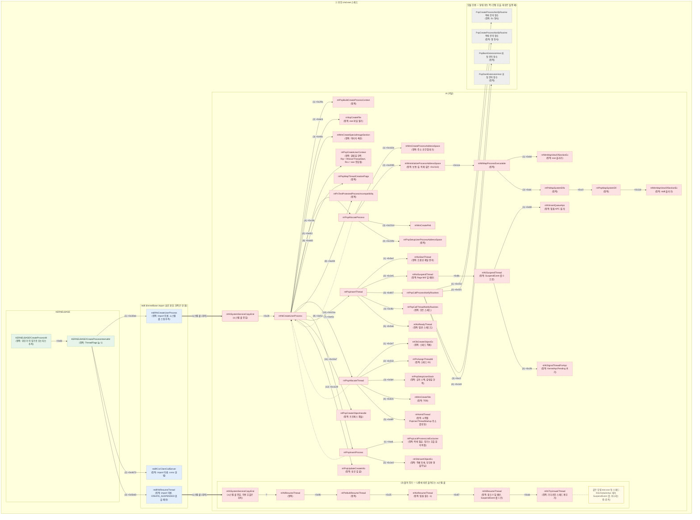

# test.exe 실행 흐름 — 프로세스 생성부터 `main`까지

## 기준

- 타깃: Windows 11 24H2, **26100.9457**
  - ntkrnlmp.pdb: `C29EBFB06B78B3C020DCA66D99713F9E1`
  - kernelbase.pdb: `72CCE506944DE0267C172AD64287F9BD1` (run14, run25)
  - kernel32.pdb: `AE9E9D8F7AC1467A645320FDC23235D01` (run25)
  - ntdll.pdb: `C3093720177DA6851519DCFFE8DF53FE1` (run17, run18, run19, run20, run21, run22, run23, run24, run26, run27, run28)
- 디버거: WinDbg 커널 디버깅 (KDNET)
- 부모: `cmd.exe`에서 `test.exe` 실행
- 근거 로그: `runs/01_sprint/` run3 ~ run8 (디버거)
- 정적 근거: `runs/02_sprint/` run9 ~ run28 (Ghidra 디컴파일·디스어셈블, pdb GUID 위와 같음. run9 ~ run13·run15·run16 ntoskrnl, run14 KernelBase, run17 ~ run24·run26 ~ run28 ntdll, run25 kernel32·KernelBase. run16 은 ntdll 기존 export `LdrInitializeThunk.asm` 도 씀)
  - PE 헤더·import·export 표는 `pefile` 로 읽었다 (run25). KERNELBASE·kernel32·ntdll 의 TLS 디렉터리도 PE 파일에서 읽었다 (run28). Ghidra 는 PE 진입점 함수를 PDB 이름 대신 `entry` 로 잡는다 (run25). 글에선 PDB 이름을 쓴다.
  - Ghidra 가 함수로 안 잡은 곳은 원본 바이트(`objdump`)로, 구조체 칸 이름은 PDB 타입 레코드(`llvm-pdbutil`)로 읽었다. 그런 곳은 글에 그렇다고 밝혔다.
  - 예외 착지점(`__except` 안쪽)은 Ghidra 가 코드로 안 따라간다. 그런 곳은 PE 의 unwind 범위 표(`pefile`)와 원본 바이트로 읽었다 (run27, run28).
  - 전역 변수 이름(`PsNtdllExports` 등)은 PDB 공개 심볼 + PE 구역표로 맞췄다 (run16).
  - 디버거 표시 이름과 PDB 이름이 다를 수 있다: 콜스택 `LdrpInitialize+0x16c` 의 주인은 PDB 이름 `_LdrpInitialize` (run17). 글에선 PDB 이름을 쓰고 표시 이름을 괄호로 붙인다.
- 테스트 프로그램: `sample/` (`test.c`, `dll1.c`, `dll2.c`, `build.bat`)
  - 의존 관계: **`test.exe` → `dll1.dll` → `dll2.dll`**
    - `test.c`가 `Dll1Hello`를, `dll1.c`가 `Dll2Hello`를 import
  - 세 모듈 모두 TLS 콜백이 있다: `ExeTls`, `Dll1Tls`, `Dll2Tls`
  - 빌드 옵션 `/MT`: CRT(C 런타임)를 DLL로 따로 두지 않고 **각 모듈 안에 넣어서** 빌드

### 표시 규칙

| 표시 | 뜻 |
|---|---|
| `[관찰]` | 멈춤점·콜스택·레지스터로 **직접 본 것** (26100.9457) |
| `[정적]` | 디컴파일·디스어셈블 **코드에 그렇게 쓰여 있는 것**. 실행 때 그 길로 갔는지는 모름 |
| `[소스]` | `sample/` 소스 코드·빌드 스크립트에 **그렇게 쓰여 있는 것**. 디버거로 실행을 본 건 아님 |
| `[추측]` | 관찰한 사실에서 짐작한 것, 또는 일반적으로 알려진 설명. **직접 보지 않음** |
| `[공백]` | 아직 아무것도 관찰하지 않은 구간 |

함수 **이름·호출 순서·누가 불렀는지(오프셋)** 는 관찰이다 (02_sprint부터는 정적도 있다. 그땐 `[정적]` 이라고 따로 붙인다).
단, **콜스택으로 caller를 직접 보지 못한 호출 관계**는 추측으로 둔다 (그림의 `?`).
같은 사실을 관찰과 정적 둘 다로 봤으면 둘 다 적는다 (예: `[관찰]` run3 + `[정적]` run9).
함수가 **안에서 무슨 일을 하는지**는, 따로 적지 않는 한 추측이다.

---

## 1. 흐름도

그림은 **스레드마다 한 장**, 모두 2장이다.

- 그림 1: 부모 cmd.exe 스레드 — 커널이 test.exe를 만드는 과정
- 그림 2: test.exe 메인 스레드 — 커널에서 출발 → ntdll 로더 → `main`

두 그림 사이(부모 쪽 마무리 ~ 첫 스레드 출발)는 **nt 쪽과 부모 KERNELBASE 쪽을 코드로 채웠다** (2.2). 실행으로 본 건 아직 없다.
- `NtCreateUserProcess` 안쪽은 코드로 봤다 (run9 `[정적]`): 거기엔 첫 스레드를 **풀어 주는 호출이 없다**.
- `PspInsertThread` 는 멈춤 여부와 상관없이 끝에서 `KeReadyThread` 를 부른다 (run12 `[정적]`).
- 멈춰 두기 = 멈춤 APC 걸기 + `SuspendEvent` 내리기, 풀어 주기 = `NtResumeThread` → … → `KiResumeThread` (run13 `[정적]`). 그림 1 의 `(3) 풀어 주기` 상자와 그림 2 의 APC 갈래가 이것이다.
- 부모 유저 쪽 `KERNELBASE!CreateProcessInternalW` 는 **늘 멈춘 채로 만들어 달라고 하고**(`ThreadFlags` = 1), csrss 알림 등을 한 뒤, `CREATE_SUSPENDED` 가 없으면 **직접 `NtResumeThread` 로 풀어 준다** (run14 `[정적]`). 그림 1 의 KERNELBASE 상자가 이것이다.

그림 2 안의 커널 → 유저 전환도 **코드로 봤다** (run15 `[정적]`, 2.3). 실행으로 본 건 아직 없다.
- `KiStartUserThread` 가 `PspUserThreadStartup` 을 부르고, 돌아오면 레지스터를 되살려 **`IRETQ`** 로 유저에 들어간다. 유저 첫 위치는 트랩 프레임의 `Rip` 칸에서 꺼낸다.
- 그림 2 의 굵은 화살표 `IRETQ` 두 갈래가 이것이다 (어느 쪽을 타는지는 `KiKvaShadow` 값, 동적).
- 유저 첫 위치가 `LdrInitializeThunk` 가 되는 까닭도 **코드로 봤다** (run16 `[정적]`, 2.3).
  - 처음 문맥은 `Rip = RtlUserThreadStart` 다 (`PspCreateUserContext`, 그림 1).
  - 출발 직전 `PspInitializeThunkContext` 가 그 문맥을 유저 스택에 맡기고 `Rip` 를 `LdrInitializeThunk` 로 바꿔 끼운다 (그림 2).
  - 로더는 끝에서 맡긴 문맥으로 `NtContinue` 를 부른다 (그림 2 `+0x18`). 커널 `NtContinue` 안쪽은 아직 `[공백]`.

그림 2 의 ntdll 로더 입구도 **코드로 이름을 정리했다** (run17 `[정적]`, 2.4).
- `LdrInitializeThunk` 가 부르는 `LdrpInitialize` 는 잡일 뒤 **꼬리 점프**(굵은 화살표)로 `LdrpInitializeInternal` 에 넘긴다. 그래서 콜스택엔 안 보였다.
- 콜스택에 `LdrpInitialize+0x16c` 로 보인 함수는 PDB 이름 `_LdrpInitialize` 다. 여기서 전역 깃발로 "첫 스레드인가"를 가른다.

그림 2 의 `LdrpInitializeProcess` 는 **앞쪽 절반**(`+0x0 ~ +0x12dd`, run18)과 **뒤쪽 절반**(`+0x12de ~ 끝`, run19)을 모두 코드로 훑었다 (`[정적]`, 2.4).
- 그림 2 ntdll 상자 안 `(0) 프로세스 준비` 상자가 앞쪽 + 뒤쪽 첫 묶음이다: IFEO 읽기 → 프로세스 힙 → `\KnownDlls` 열기 → ntdll 모듈 항목 → **exe 모듈 항목** (run19).
- 앞쪽은 DLL 을 하나도 메모리에 올리지 않는다. 관찰된 `(1)`~`(3)` 상자는 모두 뒤쪽이다.
- 뒤쪽에서 `(1)` 과 `(2)` 사이에 `(정적)` 상자 셋을 넣었다 (run19): 병렬 로딩 켜기 → exe import 올리고 연결 → 실행 준비. dll1·dll2 가 올라오는 가장 유력한 자리다 (실행으로는 아직 안 봄).
- 간접 호출 둘(kernel32 스레드 시작 thunk, `PEB.PostProcessInitRoutine`)은 대상이 실행 때 정해져서 회색 상자다.

그림 2 의 `(1) kernel32 준비` 상자에 **코드 순서 상자를 넣었다** (run20 `[정적]`, 2.5).
- 관찰된 두 `LdrLoadDll` 이 각각 `KERNEL32.DLL`, `KERNELBASE.dll` 을 이름으로 올린다 (원본 바이트로 이름 확인).
- 그 사이에 "이미 있나" 확인, `BaseThreadInitThunk` 찾기(→ `Kernel32ThreadInitThunkFunction` 칸), `LdrpCodeAuthzInitialize`, `KernelbasePostInit` 찾기를 `(정적)` 상자로 넣었다.
- 마지막 `KernelbasePostInit` 간접 호출은 회색 상자다 (이름으로 찾은 주소, 값은 실행 때).

그림 2 의 `LdrpLoadDllInternal` 에 **코드 순서 상자를 넣었다** (run21 `[정적]`, 2.5).
- 관찰된 `+0x284`(켜기 준비) **앞**에 `(정적)` 상자 셋: 이미 있으면 빨리 끝내기 → 찾거나 준비 → 새로 올릴 때만 `LdrpProcessWork`. 메모리에 올리는 시스템 콜은 둘째·셋째 상자 아래에 있다 (지도 이름 사슬, 2.5 글에만).
- `+0x284` **뒤**에 `(정적)` 상자 하나: `LdrInitState` 가 0 일 때(kernel32 준비 무렵)만 타는 고정 `LdrpPinModule`.
- 둘째 `LdrLoadDll`(`KERNELBASE.dll`) 아래에도 `LdrpLoadDllInternal` 을 `(정적)` 으로 그렸다. 어디서 끝나는지(빠른 끝 / 이미 켜진 노드라 바로 돌아옴)는 실행 값으로 갈린다.
- exe 쪽 `(1)~(2) 사이` 의 `LdrpPrepareModuleForExecution` 이 그래프 켜기를 **건너뛰는 이유**를 상자 글에 적었다 (로드 문맥 비트, 2.7).

그림 2 의 `(1)~(2) 사이` `LdrpMapAndSnapDependency` 아래를 **코드 순서로 채웠다** (run22 `[정적]`, 2.6).
- exe 의 import 표를 준비하고(IAT 쓰기 가능, 서술자 읽기) → import 마다 `LdrpLoadDependentModuleInternal` → 끝에 한 번 `LdrpSnapModule`. 넷 다 `(정적)` 상자다.
- dll1·dll2 쪽은 **같은 `LdrpMapAndSnapDependency` 가 올라온 DLL 마다 다시 불리는 모양**으로 그렸다 (`LdrpMapDllWithSectionHandle +0x1c8`). 모듈 대응은 `[dll1 추정]`·`[dll2 추정]`, 사이 함수는 아직 안 읽어서 `?`.
- 자식 DLL 문맥은 부모가 있어서 snap 대신 `LdrpQueueWork`(일감 넘기기)로 끝나는 코드다. 일감이 어느 스레드에서 도는지는 동적.

그림 2 의 `LdrpLoadDependentModuleInternal` (dll1·dll2 바퀴) 아래를 **코드 순서로 채웠다** (run23 `[정적]`, 2.6).
- 이름 다듬기(ApiSet) → 이미 있나 찾기 → 없으면 새 항목 → KnownDll 시도 → 일감 넘기기(`LdrpQueueWork`). 다섯 다 `(정적)` 상자다.
- **간선(누가 누구에 기대나)은 이 함수 안에서 쓴다** (`+0xf69`/`+0xf8b`). 호출이 아니라서 화살표 대신 상자 글에 적었다.
- 매핑 함수 `LdrpMapDllWithSectionHandle` 은 이제 일감 넘기기 상자 뒤에 `?` 로 이었다. 누가, 어느 스레드에서 일감을 돌려 거기 닿는지는 아직 모른다 (Q12c·Q47). → run24 에서 코드 길은 풀림 (아래 문단), 스레드는 그대로 Q47.

그림 2 의 `(1)~(2) 사이` 에 **일감을 꺼내 도는 쪽을 넣었다** (run24 `[정적]`, 2.6).
- `LdrpQueueWork` 는 큐에 넣기만 한다 (일꾼이 있으면 `TpPostWork` 로 깨운다). 그래서 `LdrpQueueWork` → 매핑 함수 `?` 화살표를 지웠다.
- 대신 `LdrpInitializeProcess` 의 `(10) +0x1ab1 LdrpDrainWorkQueue(1)` 이 큐에서 하나씩 꺼내 `LdrpProcessWork` 를 부르는 모양으로 그렸다. `LdrpProcessWork` 는 노드 `State` 가 0 이면 올리기(`LdrpMapDllSearchPath`), 아니면 `LdrpSnapModule`.
- 매핑 함수 아래에 `LdrpProcessMappedModule` → **`LdrpSignalModuleMapped`** (자식이 Mapped 가 되면 부모 카운터를 줄이고, 0 이면 부모 snap 일감을 넣음) 을 넣었다.
- `Drain` 아래 `(1)`~`(5)` 순서는 **일꾼이 없다고 칠 때**의 짐작이다. 일꾼이 있으면 같은 `LdrpProcessWork` 가 다른 스레드(노란 메모)에서 돌 수 있다 (Q47).
- exe 실행 준비 `LdrpPrepareModuleForExecution` 아래에 그래프 정리 `LdrpCondenseGraph` 를 넣었다. 고리가 없어서 합치기(`LdrpMergeNodes`)는 안 탄다.
- 그래서 `LdrpInitializeProcess` 호출 번호가 `(10)` 부터 하나씩 밀렸다: 실행 준비 `(11)`, 간접 호출 `(12)`, 초기화 `(13)`, exe TLS `(14)`, 간접 호출 `(15)`.

그림 2 의 `KERNELBASE`·`KERNEL32` 시작 함수 상자 글을 **PDB 이름으로 고쳤다** (run25 `[정적]`, 2.5).
- 두 DLL 의 PE 진입점 rva 가 PDB 이름 `KernelBaseDllInitialize`(`0x5060`)·`BaseDllInitialize`(`0x2c5d0`) 와 **정확히 같다**. run8 의 `ln` 은 "근처" 였다 — 왜 그렇게 보였는지는 아직 모른다 (Q21).
- `LdrpCallInitRoutine` → 시작 함수 화살표는 그대로 `?` 이고 상자도 점선 그대로다 (들어가는 걸 본 적은 아직 없다).
- 시작 함수 안쪽(`_BaseDllInitialize` 등)은 그림에 안 넣고 2.5 글에만 적었다.

그림 2 의 `(1)~(2) 사이` 에서 `LdrpMapDllSearchPath` → `?` → 매핑 함수 칸을 **코드로 채웠다** (run26 `[정적]`, 2.6).
- `?` 화살표 둘(dll1·dll2)을 지우고 `LdrpMapDllSearchPath` → `LdrpSearchPath` / `LdrpMapDllNtFileName` → `NtOpenFile` → `NtCreateSection`(`SEC_IMAGE`) → `LdrpMapDllWithSectionHandle` 으로 이었다. 다 `(정적)` 상자다.
- 매핑 함수 아래 번호를 코드 순서로 다시 매겼다: `(1)` 매핑 `LdrpMinimalMapModule` → `(2)` **PEB.Ldr 명부** `LdrpInsertDataTableEntry` → `(3)` 색인 → `(4)` `LdrpCompleteMapModule` → `(5)` `LdrpProcessMappedModule` → `(6)` 마지막에 `LdrpMapAndSnapDependency` 재귀.
- 재배치를 어느 상자가 하는지는 아직 모른다 (`(4)` 또는 `(5)` 후보, 2.6).

그림 2 의 `(2) import DLL 초기화` 상자를 **코드로 뒷받침했다** (run27 `[정적]`, 2.7).
- `LdrpInitializeGraphRecurse` 는 **자식 먼저, 자기 나중** 이다. 노드의 `Dependencies` 에서 아직 안 켜진(`State 7`) 자식만 재귀하고, 다 끝나면 `+0x6a` 로 자기 노드를 켠다. 관찰된 dll2 → dll1 순서와 재귀 깊이가 이 모양 그대로다.
- 맨 바깥 `LdrpInitializeGraphRecurse` 의 `[test.exe 추정]` 에서 "추정" 을 뗐다 (첫 인자 = exe 노드, run19 + run27). 안쪽 `[dll1 추정]`·`[dll2 추정]` 은 그대로다 (어느 프레임이 어느 모듈인지는 실행 값, Q24).
- 맨 바깥 프레임이 dll1·dll2 를 다 켠 뒤 부르는 **`LdrpInitializeNode [test.exe]`** 를 `(정적)` 상자로 넣었다. exe 항목은 통째로 건너뛰어 TLS·진입점을 안 부른다. 그래서 exe TLS 는 `(3)` 에서 따로 돈다.
- TLS·진입점 상자 글에 부르는 조건(`TlsIndex ≠ 0`, `EntryPoint ≠ 0`)과 진입점 인자를 적었다. 넷째 인자는 정적 import 모듈이면 첫 스레드 CONTEXT 포인터다.

그림 2 의 `LdrpCallInitRoutine` → `?` → `ImageTlsCallbackCaller` 칸을 **코드로 채웠다** (run28 `[정적]`, 2.7).
- `LdrpCallInitRoutine` 과 유저 코드 사이에 **`LdrpCallInitRoutineInternal`** 이 하나 더 있다. 인자를 한 칸씩 밀어 부르는 곳이 여기다. 그래서 `LdrpCallInitRoutine` 상자 7개 뒤에 모두 `+0x93` → `Internal` `(정적)` 상자를 넣었다 (TLS 셋, 진입점 넷).
- TLS 쪽은 `Internal` `+0x22` → `ImageTlsCallbackCaller` 다. 이 상자는 이제 `(정적)` 점선이다 (이름은 run8 에서 `rcx` 값으로 봤지만, 들어가는 건 아직 못 봤다).
- `ImageTlsCallbackCaller` → 콜백, `Internal` → 시작 함수 화살표는 그대로 `?` 다. 대상이 실행 때 값(콜백 배열, 진입점 칸)이라서다.
- `LdrpCallTlsInitializers` 상자 글에 콜백을 어디서 꺼내는지(`LdrpTlsList`)와 안 부르는 조건을 적었다. kernel32 길의 "콜백 호출 없음" 은 KERNELBASE 의 콜백 배열이 비어 있어서일 것이다 (PE 파일, 실행 확인은 Q25).

> 왜 2장인가: 서로 화살표로 이어지지 않은 덩어리는 머메이드가 위아래 순서를 마음대로 정한다 (실험해보니 ③ → ② → ① 거꾸로 나왔다). 두 스레드 사이엔 호출 관계가 없어서 화살표로 이을 수 없으니, 그림을 나누고 **문서 순서로 시간 순서**를 보인다.

### 읽는 법

- **왼쪽 → 오른쪽 = 호출.** 왼쪽이 부르는 함수(caller), 오른쪽이 불린 함수(callee). 오른쪽으로 갈수록 더 깊이 들어간 호출이다.
- **한 함수가 여러 개를 부르면, 라벨 앞의 `(1)`, `(2)`, `(3)`이 부른 순서**다.
  - **위아래 자리는 순서가 아니다.** 머메이드는 선이 덜 꼬이도록 같은 줄의 상자 자리를 바꾸고, 버전마다 결과도 다르다.
  - 시간 순서로 읽으려면: 맨 왼쪽에서 출발 → `(1)` 가지를 끝까지 따라감 → 돌아와서 `(2)` 가지 → `(3)` 가지.
- **실선 화살표 = 호출(call).**
  - 라벨 `+0x…` = **콜스택으로 직접 본 호출.** 숫자는 caller 안에서 **돌아올 자리**(ret, call 바로 다음 명령)의 오프셋이다. WinDbg 콜스택에 `caller+0x…` 로 찍히는 값이 이것이다.
    - call 명령 자체의 자리(call)는 이보다 몇 바이트 앞이다. 글에서 call 을 쓸 땐 "(call `+0x…`)" 처럼 따로 적는다.
    - 단, 화살표 끝 상자가 **점선 테두리 + `(정적)`** 이면: 디스어셈블 코드에서 읽은 호출이다. 라벨은 똑같이 돌아올 자리(ret)다. 실행 때 정말 불렸는지는 아직 안 봤다.
    - `(정적)` 상자가 섞인 caller의 `(n)` 번호는 **코드 흐름 순서**다. 관찰한 상자끼리의 순서는 관찰 그대로다.
  - 라벨 **`?`** = **추측한 호출.** 콜스택으로 caller를 직접 보지 못했다. 사이에 다른 함수가 더 끼어 있을 수도 있다. → 4.1에서 추가 분석
- **점선 화살표 = 돌아옴(return).** 다음 번호의 호출이 관찰돼서 앞 번호가 돌아온 게 확실한 곳에만 그렸다.
- **굵은 화살표 = 호출이 아니라 실행이 넘어감** (커널 → 유저 전환, 유저 → 커널 시스템 콜, 인터럽트, 돌아오지 않는 꼬리 점프 `JMP` 처럼). 한 상자에서 여러 개 나가면 `(1)` `(2)` 가 시간 순서다.
  - 같은 번호가 둘이면 **값에 따라 둘 중 하나만** 탄다 (라벨에 갈리는 조건을 적었다).
- **상자 = 묶음.**
  - 가장 큰 상자 = 스레드
  - 그 안의 상자 = 모듈 (`nt`, `ntdll`, `KERNELBASE`, `KERNEL32`, `dll2`, `dll1`, `test.exe`)
  - `ntdll` 상자 안의 상자 = `LdrpInitializeProcess`가 차례로 하는 일 `(0)` `(1)` `(1)~(2) 사이` `(2)` `(3)`, 그리고 로더가 끝난 뒤 (`(0)` 과 `(1)~(2) 사이` 는 코드로만 본 것. 상자 번호는 단계 이름이고, 화살표 `(n)` 호출 순서와는 따로다)
  - `nt` 상자 안의 상자 = 같은 스레드에서 따로 일어나는 단계 (그림 1 `(3) 풀어 주기` = 나중의 다른 시스템 콜, 그림 2 `(1) 멈춤 APC 처리` = 멈춰 둔 스레드일 때만)
  - `ntdll` 상자가 크게 자리를 차지해서, 다른 모듈 상자는 오른쪽에 모여 그려진다. **오른쪽 모듈 상자의 위치는 호출 깊이와 상관없다.**
- **함수 상자 색 = 모듈.** 분홍 `nt` · 파랑 `ntdll` · 초록 `KERNELBASE`/`KERNEL32` · 보라 `dll2` · 노랑 `dll1` · 청록 `test.exe`
  - 회색 = **모듈을 모르는 함수.** 함수 포인터로 부르는 간접 호출이라 대상이 실행 때 정해진다. 상자 글은 "어디서 주소를 꺼내나" 이지 함수 이름이 아니다.
- **점선 테두리** = 이름이나 실행이 확실하지 않은 것. **노란 메모** = 같은 무렵 다른 스레드에서 일어난 일.
- `[dll1 추정]`처럼 대괄호 = 그 함수가 그때 맡은 모듈. "추정"이 붙으면 추측이다.

### 그림 1 — 부모 cmd.exe 스레드 (run3, run9, run10, run11, run12, run13, run14, run16)



### 그림 2 — test.exe 메인 스레드 (run4 ~ run8, run13, run14 메모, run15, run16, run17, run18, run19, run20, run21, run22, run23, run24, run25, run26, run27, run28)

```mermaid
flowchart LR
    classDef default fill:#e3eefc,stroke:#5b7fbf,color:#1d2b45
    classDef ntg fill:#e3eefc,stroke:#5b7fbf,color:#1d2b45,stroke-dasharray:4 3
    classDef kern fill:#fde2e4,stroke:#c0606a,color:#3a1d20
    classDef kerng fill:#fde2e4,stroke:#c0606a,color:#3a1d20,stroke-dasharray:4 3
    classDef k32 fill:#e6f4ea,stroke:#4f9a64,color:#1b3523
    classDef k32g fill:#e6f4ea,stroke:#4f9a64,color:#1b3523,stroke-dasharray:4 3
    classDef dll2 fill:#efe6fb,stroke:#8a63c7,color:#2b1d45
    classDef dll2g fill:#efe6fb,stroke:#8a63c7,color:#2b1d45,stroke-dasharray:4 3
    classDef dll1 fill:#fff4d6,stroke:#c49a2c,color:#3d2f0b
    classDef dll1g fill:#fff4d6,stroke:#c49a2c,color:#3d2f0b,stroke-dasharray:4 3
    classDef exe fill:#dff5f3,stroke:#3c9a90,color:#123532
    classDef exeg fill:#dff5f3,stroke:#3c9a90,color:#123532,stroke-dasharray:4 3
    classDef unkg fill:#eeeeee,stroke:#888888,color:#333333,stroke-dasharray:4 3
    classDef side fill:#fffbe6,stroke:#c9a400,color:#555

    subgraph T2["② test.exe 메인 스레드"]
        direction LR
        subgraph T2NT["nt (커널)"]
            direction LR
            b1["nt!KiStartUserThread"]
            b2["nt!PspUserThreadStartup"]
            b3["nt!PspDisablePrimaryTokenExchange<br/>(정적)"]:::kerng
            b4["nt!PsGetSessionLocaleId<br/>(정적: Minimal 아닐 때)"]:::kerng
            b5["nt!KeUpdateTebSchedulingPropertiesCurrentThread<br/>(정적: Minimal 아닐 때)"]:::kerng
            b6["nt!PspNotifyThreadCreation<br/>(정적: Minimal 아닐 때)"]:::kerng
            b7["nt!PspInitializeThunkContext<br/>(정적: 모든 스레드, Terminated·Minimal 아닐 때.<br/>원래 문맥을 유저 스택에 맡기고 Rip 를 LdrInitializeThunk 로)"]:::kerng
            b8["nt!PspGetContextThreadInternal<br/>(정적: 원래 문맥 읽기, Rip = RtlUserThreadStart)"]:::kerng
            b9["nt!PspSetContextThreadInternal<br/>(정적: 새 문맥 쓰기, 안쪽 PspSetContext +0x68 이 트랩 프레임 Rip 에)"]:::kerng
            kx["nt!KiKernelExit<br/>(정적: KiKvaShadow 켜졌을 때만)"]:::kerng
            subgraph T2NTA["(1) 멈춤 APC 처리 — 멈춰 둔 스레드일 때만 (추측 연결)"]
                direction LR
                h0["nt!KiApcInterrupt 추정<br/>(장부: 조각 FUN_1406b2db3)"]:::kerng
                h1["nt!KiDeliverApc<br/>(정적)"]:::kerng
                h2["nt!KiSchedulerApc<br/>(정적)"]:::kerng
                h3["nt!KeWaitForSingleObject<br/>(정적: SuspendEvent 기다림, 이유 Suspended)"]:::kerng
                w0["같은 무렵 부모 cmd.exe 스레드:<br/>CreateProcessInternalW +0x5bd3 NtResumeThread<br/>→ … → KiTryUnwaitThread 로 깨움<br/>(부르는 자리는 정적 run14, 시점은 추측)"]:::side
            end
        end

        subgraph T2DLL["ntdll"]
            direction LR
            c1["ntdll!LdrInitializeThunk<br/>(부른 함수 없음. Rcx = 맡긴 원래 문맥)"]
            c0["ntdll!LdrpInitialize (0xe1448)<br/>(정적: 잡일 뒤 꼬리 JMP, 콜스택엔 안 보임)"]:::ntg
            c2["ntdll!LdrpInitializeInternal"]
            c2a["ntdll!LdrpInitializeHotPatching<br/>(정적: 처음 온 스레드)"]:::ntg
            c2b["ntdll!LdrpInitializationComplete<br/>(정적: 핫패치 상태 1 → 2)"]:::ntg
            c3["ntdll!_LdrpInitialize (0x8bf8c)<br/>콜스택 표시 LdrpInitialize<br/>(정적: 전역 LdrpProcessInitialized 0 → 첫 스레드)"]
            c3a["ntdll!LdrInitializeMrdata<br/>(정적)"]:::ntg
            c3b["ntdll!LdrpInitializationComplete<br/>(정적: 로더 상태 1 → 2, 신호 켜기)"]:::ntg
            c4["ntdll!LdrpInitializeProcess<br/>(정적: +0x1c1 에서 PEB.Ldr = 전역 PebLdr, 빈 목록.<br/>+0x1374 에서 전역 LdrpImageEntry = exe 항목)"]

            subgraph PH0["(0) 프로세스 준비 — 앞쪽 +0x0 ~ +0x12dd, 뒤쪽 첫 묶음 exe 항목 (정적)"]
                direction LR
                p1["ntdll!LdrpInitializeExecutionOptions<br/>(정적: 실행 옵션 IFEO 읽기)"]:::ntg
                p2["ntdll!LdrpInitializeProcessHeap<br/>(정적: 결과가 PEB.ProcessHeap)"]:::ntg
                p3["ntdll!NtOpenDirectoryObject<br/>(정적: \KnownDlls 열기, 경로만 읽음)"]:::ntg
                p4["ntdll!LdrpInitializeNtdllDataTableEntry<br/>(정적: ntdll 모듈 항목, 조건 없음)"]:::ntg
                p5["ntdll!LdrpInitializeNtdllDataTableEntry<br/>(정적: 둘째 호출, 핫패치 컨텍스트가 있을 때만.<br/>패치 ntdll 항목 추정)"]:::ntg
                p6["ntdll!LdrpAllocateModuleEntry<br/>(정적: exe 모듈 항목 + 그래프 노드, 조건 없음.<br/>BaseDllName = test.exe)"]:::ntg
            end

            subgraph PH1["(1) kernel32 준비"]
                direction LR
                k1["ntdll!LdrpInitializeKernel32Functions"]
                ka["ntdll!LdrpFindLoadedDllInternal<br/>(정적: 플래그 0x20, 이름 KERNEL32.DLL 이<br/>이미 목록에 있나. 찾으면 다음 LdrLoadDll 건너뜀)"]:::ntg
                k2["ntdll!LdrLoadDll<br/>(정적: 이름 KERNEL32.DLL, 못 찾았을 때만)"]
                k3["ntdll!LdrpLoadDll"]
                k4["ntdll!LdrpLoadDllInternal"]
                kf1["ntdll!LdrpFastpthReloadedDll<br/>(정적: 이미 올라온 DLL 빠른 길 추정.<br/>0 이상이면 아래 (2)~(5) 건너뛰고 RET)"]:::ntg
                kf2["ntdll!LdrpFindOrPrepareLoadingModule<br/>(정적: 목록에서 찾거나 새 항목 준비 추정.<br/>지도상 아래 KnownDll 길 → NtMapViewOfSection)"]:::ntg
                kf3["ntdll!LdrpProcessWork<br/>(정적: 앞 결과가 0xc0000135 일 때만.<br/>지도상 아래 파일 길 NtOpenFile·NtCreateSection·NtMapViewOfSection.<br/>그 본문은 dll1 상자와 같은 함수들, run26)"]:::ntg
                k5["ntdll!LdrpPrepareModuleForExecution<br/>(정적: 노드 State 5~7 이고 로드 문맥<br/>+0x20 비트 0 이 0 일 때만 +0xef 켜기)"]
                kf4["ntdll!LdrpPinModule<br/>(정적: LdrInitState == 0 일 때만)"]:::ntg
                k6["ntdll!LdrpInitializeGraphRecurse"]
                k7["ntdll!LdrpInitializeGraphRecurse<br/>(재귀)"]
                k8["ntdll!LdrpInitializeNode<br/>[KERNELBASE 추정]"]
                k9["ntdll!LdrpCallTlsInitializers<br/>(TLS 콜백 호출 없음.<br/>정적: TlsIndex ≠ 0 일 때만 불림.<br/>KERNELBASE 는 콜백 배열 첫 칸 0 — PE 파일)"]
                k10["ntdll!LdrpCallInitRoutine<br/>(정적: EntryPoint ≠ 0 일 때만)"]
                ki1["ntdll!LdrpCallInitRoutineInternal<br/>(정적: 한 칸 밀어 시작 함수를<br/>DllBase, 1, 넷째 인자 로)"]:::ntg
                k11["ntdll!LdrpInitializeNode<br/>[KERNEL32 추정]"]
                k12["ntdll!LdrpCallInitRoutine<br/>(정적: EntryPoint ≠ 0 일 때만)"]
                ki2["ntdll!LdrpCallInitRoutineInternal<br/>(정적)"]:::ntg
                kb["ntdll!LdrGetProcedureAddressForCaller<br/>(정적: kernel32 에서 BaseThreadInitThunk 찾기<br/>→ 전역 Kernel32ThreadInitThunkFunction)"]:::ntg
                k13["ntdll!LdrLoadDll<br/>(정적: 이름 KERNELBASE.dll. 이미 올라온 것 다시 찾기 추정)"]
                k14["ntdll!LdrpLoadDll"]
                k15["ntdll!LdrpLoadDllInternal<br/>(정적: 둘째. 빠른 끝, 또는 Prepare 가<br/>State 9 라 바로 돌아옴 — 어느 쪽인지 동적)"]:::ntg
                kc["ntdll!LdrpCodeAuthzInitialize<br/>(정적: 레지스트리 값에 따라 안에서<br/>LdrLoadDll ADVAPI32.DLL 가능)"]:::ntg
                kd["ntdll!LdrGetProcedureAddressForCaller<br/>(정적: kernelbase 에서 KernelbasePostInit 찾기<br/>→ 지역 칸 RSP+0x58)"]:::ntg
            end

            subgraph PH12["(1)~(2) 사이 — exe import 올리기·연결 (정적)"]
                direction LR
                j1["ntdll!LdrpEnableParallelLoading<br/>(정적: 스레드 풀 + 일감 개체 LdrpMapAndSnapWork.<br/>개체는 스레드 수 > 1 · Detour 없음일 때만.<br/>일꾼이 생길 수 있는 첫 자리)"]:::ntg
                j2["ntdll!LdrpMapAndSnapDependency [test.exe]<br/>(정적: IL-only 아니면. 인자 = exe 로드 문맥, 부모 칸 +0x30 = 0.<br/>import 마다 자식을 맡기고, 끝에 한 번 snap.<br/>이 함수엔 간선 줄 없음 — 간선은 자식 쪽 Internal 이 씀)"]:::ntg
                ja1["ntdll!LdrpPrepareImportAddressTableForSnap<br/>(정적: IAT 를 찾아 쓰기 가능으로)"]:::ntg
                ja2["ntdll!LdrpGetImportDescriptorForSnap<br/>(정적: import 서술자 배열)"]:::ntg
                ja3["ntdll!LdrpLoadDependentModuleInternal [dll1 추정]<br/>(정적: import 마다, 조건 없음. 인자 = 자식 이름, 부모 문맥, 부모 항목, 이유 0.<br/>이름 다듬기 → 이미 있나 → 없으면 새 항목 → KnownDll → 일감.<br/>락 독점 안에서 간선 +0xf69 부모 Dependencies / +0xf8b 자식 IncomingDependencies,<br/>부모 남은 수 +0x12f7)"]:::ntg
                jd1["ntdll!ApiSetpResolveHost [dll1 추정]<br/>(정적: ApiSetMap 이 새 모양일 때. 옛 모양은 +0x22b5 / +0x22e0.<br/>dll1 은 api-set 아님 쪽 추정)"]:::ntg
                jd2["ntdll!LdrpFindLoadedDllByName [dll1 추정]<br/>(정적: 맨 이름일 때 이미 있나. 전체 이름은 해시 훑기.<br/>dll1 은 못 찾음 0xc0000135 추정)"]:::ntg
                ja4["ntdll!LdrpSnapModule [test.exe]<br/>(정적: 고리 밖 한 번. 남은 자식 0 이고 부모 없을 때.<br/>직전 노드 State = 4. 일꾼이 없으면 dll1 이 아직이라<br/>여기선 안 탈 것 — 그땐 아래 Drain 의 (2) 일감에서)"]:::ntg
                jb1["ntdll!LdrpAllocateModuleEntry [dll1 추정]<br/>(정적: 못 찾았을 때만. 새 문맥 +0x30 = exe 항목 뒤.<br/>항목 0x138 + 그래프 노드 0x50 한 쌍, 노드 State 를 쓰는 줄 없음)"]:::ntg
                jd3["ntdll!LdrpLoadKnownDll [dll1 추정]<br/>(정적: 새 항목마다, 이유 ≠ 9. 0 이면 그 안에서 올림 끝.<br/>dll1 은 KnownDll 아님 0xc0000135 추정)"]:::ntg
                jd4["ntdll!LdrpQueueWork [dll1 추정]<br/>(정적: KnownDll 아님 · 경로 직접 준 이름 아님일 때.<br/>LdrpModuleDatatableLock 독점 안, 바로 앞에서 간선을 씀.<br/>큐 LdrpWorkQueue 꼬리에 넣기만 한다)"]:::ntg
                tp1["ntdll!TpPostWork<br/>(정적: 일감 개체 ≠ 0 이고 종료 중 아닐 때만.<br/>풀 일꾼을 깨움. 다른 LdrpQueueWork 상자도 같은 조건)"]:::ntg
                w2["같은 무렵 다른 스레드 (일꾼이 있다면):<br/>ntdll!TppWorkpExecuteCallback +0x2e0<br/>→ 같은 큐에서 꺼내 LdrpProcessWork(일감, 0)<br/>(정적 코드. 실제로 도는지는 Q47)"]:::side
                jf0["ntdll!LdrpSearchPath [dll1 추정]<br/>(정적: 검색 경로 = 보통 문맥 +0x10.<br/>못 찾으면 파일 안 열고 오류. exe 폴더 자리는 안쪽 Q53)"]:::ntg
                jf1["ntdll!LdrpMapDllNtFileName [dll1 추정]<br/>(정적: 명부에 아직 없을 때만. 인자 = NT 경로)"]:::ntg
                jf2["ntdll!NtOpenFile [dll1 추정]<br/>(정적: 권한 0x100021, 공유 5, 옵션 0x60)"]:::ntg
                jf3["ntdll!NtCreateSection [dll1 추정]<br/>(정적: 속성 0x1000000 SEC_IMAGE, 보호 0x10)"]:::ntg
                jb2["ntdll!LdrpMapDllWithSectionHandle [dll1 추정]<br/>(정적: 섹션 핸들을 받아 매핑 → 명부 → 마무리 → 마지막에 import 펼치기.<br/>이미 있는 모듈이면 +0x3c3 바꿔치기로 끝. 일감 안, 어느 스레드인지 Q47)"]:::ntg
                jm1["ntdll!LdrpMinimalMapModule [dll1 추정]<br/>(정적: 메모리에 붙음. 지도상 안에 +0x179 NtMapViewOfSection)"]:::ntg
                ji1["ntdll!LdrpInsertDataTableEntry [dll1 추정]<br/>(정적: 락 안, PEB.Ldr 명부에 들어가는 자리.<br/>같은 이름·같은 매핑이 없을 때만)"]:::ntg
                ji2["ntdll!LdrpInsertModuleToIndexLockHeld [dll1 추정]<br/>(정적: 색인, 락 안)"]:::ntg
                jm2["ntdll!LdrpCompleteMapModule [dll1 추정]<br/>(정적: 매핑 결과 코드를 받음. 재배치 후보 추측, Q52)"]:::ntg
                jp1["ntdll!LdrpProcessMappedModule [dll1 추정]<br/>(정적: 락 안에서 노드 State = 2 Mapped)"]:::ntg
                js1["ntdll!LdrpSignalModuleMapped [dll1 추정]<br/>(정적: 기다리던 부모(exe) 문맥의 남은 수 −1.<br/>0 이면 부모 State = 4, snap 일감으로)"]:::ntg
                jq1["ntdll!LdrpQueueWork [test.exe snap 추정]<br/>(정적: 부모 snap 일감을 큐에)"]:::ntg
                jb3["ntdll!LdrpMapAndSnapDependency [dll1 추정]<br/>(정적: CorILOnly 아니면. 같은 함수가 dll1 에 대해 다시.<br/>부모 칸 +0x30 = exe 항목)"]:::ntg
                jb4["ntdll!LdrpLoadDependentModuleInternal [dll2 추정]<br/>(정적: dll1 의 import 마다. dll1 바퀴와 같은 코드.<br/>간선 dll1 노드 → dll2 노드 +0xf69 / +0xf8b)"]:::ntg
                je1["ntdll!ApiSetpResolveHost [dll2 추정]<br/>(정적: ApiSetMap 이 새 모양일 때)"]:::ntg
                je2["ntdll!LdrpFindLoadedDllByName [dll2 추정]<br/>(정적: 맨 이름일 때)"]:::ntg
                jb5["ntdll!LdrpQueueWork [dll1 추정]<br/>(정적: 부모 있음, 남은 자식 0 일 때 자기 snap 을 일감으로.<br/>일꾼이 없으면 dll2 가 아직이라 안 탈 것 —<br/>그땐 dll2 의 Signal 이 대신 넣음)"]:::ntg
                jc0["ntdll!LdrpAllocateModuleEntry [dll2 추정]<br/>(정적: 못 찾았을 때만)"]:::ntg
                je3["ntdll!LdrpLoadKnownDll [dll2 추정]<br/>(정적: 새 항목마다)"]:::ntg
                je4["ntdll!LdrpQueueWork [dll2 추정]<br/>(정적: KnownDll 아님 · 경로 직접 아님일 때, 락 안.<br/>큐에 넣기만)"]:::ntg
                jg0["ntdll!LdrpSearchPath [dll2 추정]<br/>(정적)"]:::ntg
                jg1["ntdll!LdrpMapDllNtFileName [dll2 추정]<br/>(정적: 명부에 아직 없을 때만)"]:::ntg
                jg2["ntdll!NtOpenFile [dll2 추정]<br/>(정적)"]:::ntg
                jg3["ntdll!NtCreateSection [dll2 추정]<br/>(정적: SEC_IMAGE)"]:::ntg
                jc1["ntdll!LdrpMapDllWithSectionHandle [dll2 추정]<br/>(정적: dll1 상자와 같은 코드. 일감 안)"]:::ntg
                jn1["ntdll!LdrpMinimalMapModule [dll2 추정]<br/>(정적: 메모리에 붙음)"]:::ntg
                jn2["ntdll!LdrpInsertDataTableEntry [dll2 추정]<br/>(정적: PEB.Ldr 명부)"]:::ntg
                jn3["ntdll!LdrpInsertModuleToIndexLockHeld [dll2 추정]<br/>(정적: 색인)"]:::ntg
                jn4["ntdll!LdrpCompleteMapModule [dll2 추정]<br/>(정적)"]:::ntg
                jp2["ntdll!LdrpProcessMappedModule [dll2 추정]<br/>(정적: 락 안에서 노드 State = 2)"]:::ntg
                js2["ntdll!LdrpSignalModuleMapped [dll2 추정]<br/>(정적: 부모(dll1) 문맥의 남은 수 −1.<br/>0 이면 dll1 State = 4, snap 일감으로)"]:::ntg
                jq2["ntdll!LdrpQueueWork [dll1 snap 추정]<br/>(정적: 부모 snap 일감을 큐에)"]:::ntg
                jc2["ntdll!LdrpMapAndSnapDependency [dll2 추정]<br/>(정적. dll2 의 import 는 안 봄)"]:::ntg
                jc3["ntdll!LdrpQueueWork [dll2 추정]<br/>(정적: 부모 있음, 남은 자식 0 일 때. dll2 snap 일감)"]:::ntg
                jw1["ntdll!LdrpDrainWorkQueue(1)<br/>(정적: 큐에서 하나씩 꺼내 LdrpProcessWork.<br/>비었는데 일꾼이 일하면 NtWaitForSingleObject.<br/>아래 (1)~(5) 순서·모듈은 일꾼이 없을 때의 짐작)"]:::ntg
                jw2["ntdll!LdrpProcessWork [dll1 추정]<br/>(정적: 노드 State 0 → 올리기)"]:::ntg
                jw3["ntdll!LdrpMapDllSearchPath [dll1 추정]<br/>(정적: 기본 올리기 길)"]:::ntg
                jw4["ntdll!LdrpProcessWork [test.exe 추정]<br/>(정적: State 4 → snap)"]:::ntg
                jw5["ntdll!LdrpSnapModule [test.exe 추정]<br/>(정적: 일감 길)"]:::ntg
                jw6["ntdll!LdrpProcessWork [dll2 추정]<br/>(정적: 노드 State 0 → 올리기)"]:::ntg
                jw7["ntdll!LdrpMapDllSearchPath [dll2 추정]<br/>(정적: 기본 올리기 길)"]:::ntg
                jw8["ntdll!LdrpProcessWork [dll1 추정]<br/>(정적: State 4 → snap)"]:::ntg
                jw9["ntdll!LdrpSnapModule [dll1 추정]<br/>(정적)"]:::ntg
                jw10["ntdll!LdrpProcessWork [dll2 추정]<br/>(정적: State 4 → snap)"]:::ntg
                jw11["ntdll!LdrpSnapModule [dll2 추정]<br/>(정적)"]:::ntg
                j3["ntdll!LdrpPrepareModuleForExecution<br/>(정적: exe 항목 실행 준비. +0x1a94 가 로드 문맥<br/>비트 0 을 켜 둬서 그래프 켜기 +0xef 는 건너뜀.<br/>노드 State 5 면 +0x12f 그래프 정리)"]:::ntg
                cg1["ntdll!LdrpCondenseGraph [test.exe 추정]<br/>(정적: 서로 기대는 고리를 합치는 정리.<br/>고리가 없어 LdrpMergeNodes 는 안 탐, State 5 → 6 만)"]:::ntg
                cg2["ntdll!LdrpCondenseGraphRecurse [test.exe 추정]<br/>(정적)"]:::ntg
                cg3["ntdll!LdrpCondenseGraphRecurse<br/>(재귀) [dll1 추정]"]:::ntg
                cg4["ntdll!LdrpCondenseGraphRecurse<br/>(재귀) [dll2 추정]"]:::ntg
            end

            subgraph PH2["(2) import DLL 초기화: dll2 → dll1 (→ exe 노드는 정적)"]
                direction LR
                g1["ntdll!LdrpInitializeGraphRecurse<br/>[test.exe]<br/>(정적: 첫 인자 = exe 항목의 DdagNode.<br/>Dependencies 에서 State 7 자식만 먼저 재귀,<br/>다 끝난 뒤 자기 노드. 실패면 State -4)"]
                g2["ntdll!LdrpInitializeGraphRecurse<br/>(재귀) [dll1 추정]"]
                g3["ntdll!LdrpInitializeGraphRecurse<br/>(재귀) [dll2 추정]"]
                w1["같은 무렵 다른 스레드:<br/>ntdll 일꾼 2개 출발<br/>(ntdll!TppWorkerThread)<br/>코드상 생길 수 있는 첫 자리는<br/>LdrpEnableParallelLoading 뒤 (정적)"]:::side
                n2["ntdll!LdrpInitializeNode<br/>[dll2]<br/>(정적: State 8 → 모듈 켜기 → 9.<br/>진입점 FALSE·예외면 0xc0000142, State -4.<br/>TLS 콜백 예외는 여기까지 안 옴, run28)"]
                n2a["ntdll!LdrpCallTlsInitializers<br/>(정적: TlsIndex ≠ 0 일 때. 인자 1, 항목.<br/>LdrpTlsList 에서 콜백 배열을 꺼내 0 까지,<br/>콜백마다 아래 호출. 예외면 남은 콜백 건너뜀)"]
                n2b["ntdll!LdrpCallInitRoutine<br/>(정적: 인자 ImageTlsCallbackCaller, DllBase, 1, 콜백.<br/>그대로 Internal 로, AL 그대로)"]
                n2i["ntdll!LdrpCallInitRoutineInternal<br/>(정적: 한 칸 밀기 — rcx 를 부르고<br/>인자는 rdx, r8d, r9. CFG 중개는 JMP 라 프레임 없음)"]:::ntg
                n2c["ntdll!ImageTlsCallbackCaller<br/>(정적: 콜백을 DllBase, 1, 0 으로 부르고 늘 TRUE.<br/>이름은 run8 rcx 로 봄, 들어가는 건 미관찰)"]:::ntg
                n2d["ntdll!LdrpCallInitRoutine<br/>(정적: EntryPoint ≠ 0 일 때. 인자 진입점,<br/>DllBase, 1, 정적 import 면 CONTEXT 포인터)"]
                n2e["ntdll!LdrpCallInitRoutineInternal<br/>(정적: 진입점을 DllBase, 1, 넷째 인자 로)"]:::ntg
                n1["ntdll!LdrpInitializeNode<br/>[dll1]<br/>(정적: dll2 상자와 같은 코드)"]
                n1a["ntdll!LdrpCallTlsInitializers<br/>(정적: TlsIndex ≠ 0 일 때)"]
                n1b["ntdll!LdrpCallInitRoutine"]
                n1i["ntdll!LdrpCallInitRoutineInternal<br/>(정적)"]:::ntg
                n1c["ntdll!ImageTlsCallbackCaller<br/>(정적)"]:::ntg
                n1d["ntdll!LdrpCallInitRoutine<br/>(정적: EntryPoint ≠ 0 일 때)"]
                n1e["ntdll!LdrpCallInitRoutineInternal<br/>(정적)"]:::ntg
                n0["ntdll!LdrpInitializeNode [test.exe]<br/>(정적: 항목 == LdrpImageEntry 라 통째로 건너뜀.<br/>State 8 → 9 만, TLS·진입점 없음.<br/>그래서 exe TLS 는 (3) 에서 따로)"]:::ntg
            end

            subgraph PH3["(3) exe TLS 콜백"]
                direction LR
                x1["ntdll!LdrpCallTlsInitializers<br/>(정적: exe TlsIndex ≠ 0 일 때만.<br/>TlsIndex 는 LdrpInitializeTls 가 0xffff 로)"]
                x2["ntdll!LdrpCallInitRoutine"]
                xi["ntdll!LdrpCallInitRoutineInternal<br/>(정적)"]:::ntg
                x3["ntdll!ImageTlsCallbackCaller<br/>(정적)"]:::ntg
            end

            subgraph PH4["로더 끝 → 진입점 (NtContinue 호출은 정적, 그 뒤는 추측)"]
                direction LR
                q1["ntdll!NtContinue<br/>(정적: 맡긴 문맥, TRUE)"]:::ntg
                r1["ntdll!RtlUserThreadStart<br/>(정적: 맡긴 문맥의 Rip 값. 실제로 가는지는 추측)"]:::ntg
            end
        end

        subgraph T2KB["KERNELBASE"]
            direction LR
            d1["KERNELBASE!KernelBaseDllInitialize<br/>(시작 함수. 정적: PE 진입점 rva 0x5060 과 정확히 같음.<br/>run8 ln 에선 근처로 보임, 들어가는 건 미관찰)"]:::k32g
            m2["KERNELBASE!LoadLibraryExW ×3"]:::k32
        end
        subgraph T2K32["KERNEL32"]
            direction LR
            d2["KERNEL32!BaseDllInitialize<br/>(시작 함수. 정적: PE 진입점 rva 0x2c5d0 과 정확히 같음.<br/>run8 ln 에선 근처로 보임, 들어가는 건 미관찰)"]:::k32g
            s1["KERNEL32!BaseThreadInitThunk<br/>(추측 연결. 정적: export rva 0x2cd70, forwarder 아님)"]:::k32g
        end
        subgraph T2D2["dll2"]
            direction LR
            f0["dll2!Dll2Tls<br/>(소스상 TLS 콜백, 실행 미관찰)"]:::dll2g
            f1["dll2!_DllMainCRTStartup"]:::dll2
            f2["dll2!DllMain (이유 1)"]:::dll2
        end
        subgraph T2D1["dll1"]
            direction LR
            i0["dll1!Dll1Tls<br/>(소스상 TLS 콜백, 실행 미관찰)"]:::dll1g
            i1["dll1!_DllMainCRTStartup"]:::dll1
            i2["dll1!DllMain (이유 1)"]:::dll1
        end
        subgraph T2EXE["test.exe"]
            direction LR
            e1["test!ExeTls (이유 1)"]:::exe
            m1["test!mainCRTStartup<br/>(추측: 스레드 시작 주소)"]:::exeg
            m3["test!main"]:::exe
        end
        subgraph T2CB["모듈 모름 — 간접 호출 (대상은 실행 때)"]
            direction LR
            z1["Kernel32ThreadInitThunkFunction 칸의 함수<br/>(정적: 인자 1,0,0. 칸 = kernel32 에서 이름<br/>BaseThreadInitThunk 로 찾은 주소.<br/>그 export 는 rva 0x2cd70, forwarder 아님 (정적 run25).<br/>실제 값은 실행 때)"]:::unkg
            z3["RSP+0x58 칸의 함수<br/>(정적: kernelbase 에서 이름 KernelbasePostInit 로<br/>찾은 주소. CFG 검사 거침, 인자 안 실음)"]:::unkg
            z2["PEB.PostProcessInitRoutine 칸의 함수<br/>(정적: 값이 있을 때만)"]:::unkg
        end
    end

    %% 커널 → 유저
    b1 -->|"(1) +0x28"| b2
    b2 ==>|"APC 인터럽트 — 멈춘 스레드만, 호출 (1) 앞 (+0x22 IRQL 내림 직후, 자리 +0x26 은 추측)"| h0
    h0 -->|"?"| h1
    h1 -->|+0x220| h2
    h2 -->|+0xf7| h3
    h3 -.- w0
    b2 -->|"(1) +0x3c"| b3
    b2 -->|"(2) +0x78"| b4
    b2 -->|"(3) +0x99"| b5
    b2 -->|"(4) +0xa1"| b6
    b2 -->|"(5) +0xb3"| b7
    b7 -->|"(1) +0x16d"| b8
    b7 -->|"(2) +0x2db"| b9
    b1 ==>|"(2) IRETQ — KiKvaShadow 꺼짐 (정적)"| c1
    b1 ==>|"(2) JMP — KiKvaShadow 켜짐 (정적)"| kx
    kx ==>|"IRETQ +0xa5 (정적)"| c1

    %% 로더 시작
    c1 -->|"(1) +0xe"| c0
    c0 ==>|"+0x3c 꼬리 JMP (정적)"| c2
    c2 -->|"(1) +0x98"| c2a
    c2 -->|"(2) +0xdf"| c2b
    c2 -->|"(3) +0x5a"| c3
    c3 -->|"(1) +0x14a"| c3a
    c3 -->|"(2) +0x16c"| c4
    c3 -->|"(3) +0x252"| c3b

    %% LdrpInitializeProcess (0) 프로세스 준비 (정적)
    c4 -->|"(1) +0x536"| p1
    c4 -->|"(2) +0xa50"| p2
    c4 -->|"(3) +0xdbd"| p3
    c4 -->|"(4) +0x11a2"| p4
    c4 -->|"(5) +0x126f"| p5
    c4 -->|"(6) +0x135e"| p6

    %% LdrpInitializeProcess (1) kernel32 준비
    c4 -->|"(7) +0x19a2"| k1
    k1 -.-> c4
    k1 -->|"(1) +0xa4"| ka
    k1 -->|"(2) +0xc0"| k2
    k2 -.-> k1
    k2 -->|+0x170| k3
    k3 -->|+0x100| k4
    k4 -->|"(1) +0xb8"| kf1
    k4 -->|"(2) +0x1f2"| kf2
    k4 -->|"(3) +0x210"| kf3
    k4 -->|"(4) +0x284"| k5
    k4 -->|"(5) +0x337"| kf4
    k5 -->|+0xef| k6
    k6 -->|"(1) +0x96"| k7
    k7 -.-> k6
    k7 -->|+0x6a| k8
    k8 -->|"(1) +0x16b"| k9
    k9 -.-> k8
    k8 -->|"(2) +0x19c"| k10
    k10 -->|+0x93| ki1
    ki1 -->|"?"| d1
    k6 -->|"(2) +0x6a"| k11
    k11 -->|+0x19c| k12
    k12 -->|+0x93| ki2
    ki2 -->|"?"| d2
    k1 -->|"(3) +0xff"| kb
    k1 -->|"(4) +0x156"| k13
    k13 -->|+0x170| k14
    k14 -->|+0x100| k15
    k1 -->|"(5) +0x165"| kc
    k1 -->|"(6) +0x19b"| kd
    k1 -->|"(7) +0x1af"| z3

    %% LdrpInitializeProcess (1)~(2) 사이 (정적), 일감 흐름 run24 (정적), 파일로 올리는 길 run26 (정적), 간접 호출 (정적)
    c4 -->|"(8) +0x1a47"| j1
    c4 -->|"(9) +0x1aa9"| j2
    j2 -->|"(1) +0x9e"| ja1
    j2 -->|"(2) +0xe5"| ja2
    j2 -->|"(3) +0x34e"| ja3
    j2 -->|"(4) +0x4c2"| ja4
    ja3 -->|"(1) +0x2ff"| jd1
    ja3 -->|"(2) +0x16ee"| jd2
    ja3 -->|"(3) +0x115c"| jb1
    ja3 -->|"(4) +0x1792"| jd3
    ja3 -->|"(5) +0x182c"| jd4
    jd4 -->|+0x82| tp1
    tp1 -.- w2
    jb2 -->|"(1) +0x4e"| jm1
    jb2 -->|"(2) +0x146"| ji1
    jb2 -->|"(3) +0x151"| ji2
    jb2 -->|"(4) +0x24f"| jm2
    jb2 -->|"(5) +0x26c"| jp1
    jp1 -->|+0x1e2| js1
    js1 -->|+0x5e| jq1
    jb2 -->|"(6) +0x1c8"| jb3
    jb3 -->|"(1) +0x34e"| jb4
    jb3 -->|"(2) +0x4f7"| jb5
    jb4 -->|"(1) +0x2ff"| je1
    jb4 -->|"(2) +0x16ee"| je2
    jb4 -->|"(3) +0x115c"| jc0
    jb4 -->|"(4) +0x1792"| je3
    jb4 -->|"(5) +0x182c"| je4
    jc1 -->|"(1) +0x4e"| jn1
    jc1 -->|"(2) +0x146"| jn2
    jc1 -->|"(3) +0x151"| jn3
    jc1 -->|"(4) +0x24f"| jn4
    jc1 -->|"(5) +0x26c"| jp2
    jp2 -->|+0x1e2| js2
    js2 -->|+0x5e| jq2
    jc1 -->|"(6) +0x1c8"| jc2
    jc2 -->|+0x4f7| jc3
    c4 -->|"(10) +0x1ab1"| jw1
    jw1 -->|"(1) +0x187"| jw2
    jw2 -->|+0x6a| jw3
    jw3 -->|"(1) +0x131"| jf0
    jw3 -->|"(2) +0x25c"| jf1
    jf1 -->|"(1) +0x137"| jf2
    jf1 -->|"(2) +0x194"| jf3
    jf1 -->|"(3) +0x28c"| jb2
    jw1 -->|"(2) +0x187"| jw4
    jw4 -->|+0x131| jw5
    jw1 -->|"(3) +0x187"| jw6
    jw6 -->|+0x6a| jw7
    jw7 -->|"(1) +0x131"| jg0
    jw7 -->|"(2) +0x25c"| jg1
    jg1 -->|"(1) +0x137"| jg2
    jg1 -->|"(2) +0x194"| jg3
    jg1 -->|"(3) +0x28c"| jc1
    jw1 -->|"(4) +0x187"| jw8
    jw8 -->|+0x131| jw9
    jw1 -->|"(5) +0x187"| jw10
    jw10 -->|+0x131| jw11
    c4 -->|"(11) +0x1af2"| j3
    j3 -->|+0x12f| cg1
    cg1 -->|+0x26| cg2
    cg2 -->|+0x13d| cg3
    cg3 -->|+0x13d| cg4
    c4 -->|"(12) +0x1b5e"| z1

    %% LdrpInitializeProcess (2) import DLL 초기화
    c4 -->|"(13) +0x1bbb"| g1
    g1 -.-> c4
    g1 -.- w1
    g1 -->|"(1) +0x96"| g2
    g1 -->|"(2) +0x6a"| n0
    g2 -->|"(1) +0x96"| g3
    g3 -.-> g2
    g3 -->|+0x6a| n2
    n2 -->|"(1) +0x16b"| n2a
    n2a -.-> n2
    n2a -->|+0x19b| n2b
    n2b -->|+0x93| n2i
    n2i -->|+0x22| n2c
    n2c -->|"?"| f0
    n2 -->|"(2) +0x19c"| n2d
    n2d -->|+0x93| n2e
    n2e -->|"?"| f1
    f1 -->|"?"| f2
    g2 -->|"(2) +0x6a"| n1
    n1 -->|"(1) +0x16b"| n1a
    n1a -.-> n1
    n1a -->|+0x19b| n1b
    n1b -->|+0x93| n1i
    n1i -->|+0x22| n1c
    n1c -->|"?"| i0
    n1 -->|"(2) +0x19c"| n1d
    n1d -->|+0x93| n1e
    n1e -->|"?"| i1
    i1 -->|"?"| i2

    %% LdrpInitializeProcess (3) exe TLS, 그 뒤 간접 호출 (정적)
    c4 -->|"(14) +0x1c99"| x1
    c4 -->|"(15) +0x1d1b"| z2
    x1 -->|+0x19b| x2
    x2 -->|+0x93| xi
    xi -->|+0x22| x3
    x3 -->|"?"| e1

    %% 로더 끝 → 진입점 → main
    c1 -->|"(2) +0x18"| q1
    q1 ==>|"실행이 넘어감 — 커널 NtContinue 안은 공백 (추측)"| r1
    r1 -->|"?"| s1
    s1 -->|"?"| m1
    m1 -->|"(1) ?"| m2
    m2 -.-> m1
    m1 -->|"(2) ?"| m3

    class b1,b2 kern
```

---

## 2. 단계별 설명

### 2.1 커널 `nt` — 부모 cmd.exe 스레드 안에서 (run3, run9, run10, run11, run12, run13, run16)

이 구간은 **test.exe가 아니라 부모 cmd.exe**가 일하는 시간이다.
test.exe는 아직 "만들어지는 중"이라, 자기 코드는 한 줄도 안 돌았다.

- 이 시스템 콜을 부르는 부모 유저 쪽(`KERNELBASE!CreateProcessInternalW +0x30ee`)과, 돌아간 뒤 부모가 하는 일은 2.2 맨 앞에 모았다 (run14 `[정적]`).

```
NtCreateUserProcess                                    (번호 = 코드 순서)
 ├─ (1)  +0x29a   PspBuildCreateProcessContext          [정적]
 ├─ (2)  +0x6cb   IopCreateFile                         [정적]
 ├─ (3)  +0x93c   MmCreateSpecialImageSection           [정적]
 ├─ (4)  +0xc36   PspAllocateProcess                    [관찰]+[정적]
 │                 ├─ (1) +0x163c  MmCreateProcessAddressSpace       [정적] 주소 공간
 │                 ├─ (2) +0x2095  MmInitializeProcessAddressSpace   [정적] 보통 길로 [추측]
 │                 │     └─ +0x1ce  MiMapProcessExecutable           [정적]
 │                 │          ├─ (1) +0xb8  MmMapViewOfSectionEx     [정적] exe 올리기
 │                 │          └─ (2) +0xdc  PsMapSystemDlls          [정적]
 │                 │               └─ +0xc0  PspMapSystemDll         [정적]
 │                 │                    └─ +0x11d  MmMapViewOfSectionEx  [정적] ntdll 올리기
 │                 ├─ (3) +0x2314  MmCreatePeb                       [관찰]+[정적]
 │                 └─ (4) +0x239c  PspSetupUserProcessAddressSpace   [정적]
 ├─ (5)  +0xd22   PspCreateUserContext                  [정적] Rip = RtlUserThreadStart, Rcx = 진입점 (run16)
 ├─ (6)  +0xdd3   PspMapThreadCreationFlags             [정적]
 ├─ (7)  +0xe5c   PspAllocateThread                     [관찰]+[정적]
 │                 ├─ (1) +0x2e7  ObCreateObjectEx      [정적] 스레드 객체
 │                 ├─ (2) +0x532  PsAssignThreadId      [정적] 스레드 ID
 │                 ├─ (3) +0x5ef  PspSetupUserStack     [정적] 유저 스택 (갈림길 한쪽)
 │                 ├─ (4) +0x631  MmCreateTeb           [정적] TEB
 │                 └─ (5) +0x6f9  KeInitThread          [정적] 시작점 = PspUserThreadStartup 주소
 │                       └─ +0x301  KiInitializeContextThread
 │                            └─ +0x1b1  KxContextToKframes   [정적] CONTEXT → 트랩 프레임 (처음, run16)
 ├─ (8)  +0xe94   PsTestProtectedProcessIncompatibility [정적]
 ├─ (9)  +0xfc2   PspInsertProcess                      [관찰]+[정적]
 │                 ├─ (1) +0xa6   PspLockProcessListExclusive  [정적] 목록 잠금 → 직접 잇기
 │                 └─ (2) +0x1e3  ObInsertObjectEx      [정적] 객체 등록 (부모용 핸들 아님)
 ├─ (10) +0x101a  PspInsertThread                       [관찰]+[정적]   (아래 번호 = 흐름 순서)
 │                 ├─ (1) +0x5e2  KeStartThread         [정적] 제일 먼저 (2.2)
 │                 ├─ (2) +0x2e5  KeSuspendThread       [정적] flags bit0 일 때만 (2.2)
 │                 │     └─ +0x6b  KiSuspendThread      [정적] (run13)
 │                 │          ├─ (1) +0x88   KiInsertQueueApc      [정적] 멈춤 APC 걸기
 │                 │          └─ (2) +0x1fb  KiSignalThreadForApc  [정적]
 │                 │     (+0x3ea ObInsertObjectEx 객체 등록 → +0x499 스레드 락 풀기)
 │                 ├─ (3) +0x807  PspCallProcessNotifyRoutines  [관찰]+[정적] 첫 스레드만
 │                 │               ├─ (1) +0x152  (간접·대상 모름) 등록 목록, Ex 형식   ┐ 칸마다
 │                 │               ├─ (2) +0x321  (간접·대상 모름) 등록 목록, 옛 형식   ┘ 둘 중 하나
 │                 │               ├─ (3) +0xc3   (간접·대상 모름) BAM 표 첫 칸
 │                 │               └─ (4) +0x1d4  (간접·대상 모름) DAM 표 첫 칸
 │                 ├─ (4) +0x4fa  PspCallThreadNotifyRoutines   [정적] 모든 스레드
 │                 │     (+0x525 PspCreateObjectHandle 스레드 핸들, +0x8ef 잡 배정 조건부)
 │                 └─ (5) +0x5a6  KeReadyThread         [정적] 멈춘 스레드도 (2.2)
 ├─ (11) +0x10a7  PspCreateObjectHandle                 [정적]
 └─ (12) +0x1129  PspUpdateCreateInfo                   [정적]
```

- `[관찰]` 관찰한 7개(`[관찰]` 붙은 줄)는 전부 **cmd.exe의 같은 스레드 하나**에서 차례로 불렸다. 중간에 다른 스레드로 넘기지 않는다.
- `[관찰]` 옛날 방식 함수 `nt!PspCreateProcess`는 **불리지 않았다.**
  - `[정적]` (run9) `NtCreateUserProcess` 안에 `PspCreateProcess`를 직접 부르는 코드도 없다. 관찰과 맞는다.
- `[정적]` (run9) `NtCreateUserProcess`가 직접 부르는 호출은 모두 **83줄**이다. 위 트리는 그중 대표 12개만. 나머지는 검사·잠금·해제·정리 같은 잡일이다.
  - 관찰 4개를 경계로 나누면: 앞 47개 / 사이 10개 / 사이 5개 / **사이 0개** / 뒤 17개 (+ 경계 4개).
- `[관찰]`+`[정적]` 관찰 4개(`+0xc36`, `+0xe5c`, `+0xfc2`, `+0x101a`)와 `PspInsertThread +0x807`은 디스어셈블 코드의 돌아올 자리와 **오프셋까지 같다**. 네 함수는 한 번씩만 불린다.
- `[관찰]`+`[정적]` (run10) `PspAllocateProcess +0x2314` → `MmCreatePeb`도 코드와 오프셋까지 같다 (call `+0x230f`).
- `[정적]` (run10) `PspAllocateProcess` 안에서 **주소 공간 → exe 올리기 → ntdll 올리기 → PEB** 순서다. 트리의 `PspAllocateProcess` 아래가 그 길이다.
- `[정적]` (run11) `PspAllocateThread` 안에서 **스레드 객체 → 스레드 ID → 유저 스택 → TEB → `KeInitThread`** 순서다. `PspInsertProcess` 는 목록 잠금 사이에서 **호출 없이 직접** 새 프로세스를 목록에 잇는다.
- `[정적]` (run12) `PspInsertThread` 안에서 **`KeStartThread` → 멈춤(조건부) → 객체 등록 → 스레드 락 풀기 → 프로세스 알림(첫 스레드만) → 스레드 알림 → 스레드 핸들 → `KeReadyThread`** 순서다. 오프셋 순서가 아니라 점프를 따라간 순서다.
- 주의 `[정적]`: 오프셋 순서가 늘 실행 순서인 건 아니다. 에러 길·공통 정리 길이 코드 뒤쪽에 모여 있고, 서명 검사 재시도는 루프다. 위 트리 번호는 **성공 길로 보이는 코드 순서**이고, `(정적)` 줄은 실행을 아직 안 봤다.

#### `nt!NtCreateUserProcess`

- `[관찰]` 유저 쪽에서 시스템 콜로 들어온다 (`nt!KiSystemServiceCopyEnd+0x28`이 부름).
- `[정적]` (run14) 유저 쪽에서 이걸 부르는 곳: `KERNELBASE!CreateProcessInternalW +0x30ee` (call `+0x30e7`, ntdll 에서 가져온 `NtCreateUserProcess`). 그 함수 안에 **한 곳뿐**이다 (2.2).
  - `[추측]` run3 의 cmd.exe 도 이 자리에서 왔을 것. 그때 유저 쪽 콜스택은 안 찍었다 (4.1).
- `[관찰]` 아래 함수들을 직접 부르는 **총괄 함수**다.
- `[정적]` (run9) 이 함수를 직접 부르는 함수는 코드상 없다 (Ghidra 호출자 목록이 빈다). 시스템 콜 입구가 간접으로 부르는 모양과 맞다.
- `[정적]` (run9) 입구에서 인자를 검사한다. `ThreadFlags`(8번째 인자)에 bit0 말고 다른 비트가 있으면 바로 `0xc000000d`로 돌아간다 (`+0x1bf` → `+0x1ce` → `+0x11f9`).
  - 인자 이름(`ThreadFlags` 등)은 알려진 함수 모양에서 빌린 것이다. 이 빌드 PDB로 확인한 건 아니다. `[추측]`
- `[정적]` (run9) 함수 포인터를 거치는 **간접 호출이 2곳** 있다 (`+0x5b2`, `+0x11bb`). 무엇을 부르는지는 실행해 봐야 안다 (4장).
- `[추측]` 유저 쪽 `CreateProcess`가 결국 이 시스템 콜 하나로 커널에 "프로세스 만들어줘"를 요청하는 것.
  - `[정적]` (run14) KERNELBASE 쪽 코드로는 맞다: `CreateProcessW` → `CreateProcessInternalW` → 이 시스템 콜 한 자리. 다만 실패 길에서 같은 자리로 다시 돌아오는 재시도 길이 있어서, 몇 번 불리는지는 동적 (4장).

#### `nt!PspBuildCreateProcessContext` (정적)

- `[정적]` (run9) `NtCreateUserProcess+0x29a`(call `+0x295`)에서 부른다.
- `[정적]` 유저가 준 **속성 목록**(11번째 인자)을 읽어 커널 안의 "만들기 준비물" 묶음으로 풀어 둔다 (디컴파일 요약).

#### `nt!IopCreateFile` (정적)

- `[정적]` (run9) `NtCreateUserProcess+0x6cb`(call `+0x6c6`)에서 부른다. **실행 파일(exe)을 연다.** 접근권 `0x100020` = 실행 + 동기.
- `[정적]` 앞에서 `PspCreateUserProcessEcp`(call `+0x5fa`)로 덧붙일 정보를 만들고, 실패하면 `IoCreateFileEx`(call `+0x73b`)로 한 번 더 시도하는 코드가 있다.
- `[추측]` 비유하면 **설계도(exe 파일) 꺼내 오기**.

#### `nt!MmCreateSpecialImageSection` (정적)

- `[정적]` (run9) `NtCreateUserProcess+0x93c`(call `+0x937`)에서 부른다. 연 파일로 **이미지 섹션**(메모리에 올릴 준비가 된 exe 모양)을 만든다.
- `[정적]` 서명 수준이 안 맞으면 섹션을 닫고(call `+0xa1e`, `+0xa2a`) 다시 만드는 **루프 안**에 있다. test.exe 때 몇 번 도는지는 모른다.
- `[정적]` points.md의 `MiCreateImageFileMap`은 `NtCreateUserProcess`가 직접 부르지 않는다. 이 함수 안쪽인지는 모른다. `[추측]`

#### `nt!PspAllocateProcess`

- `[관찰]` `NtCreateUserProcess+0xc36`에서 불린다. 안에서 `MmCreatePeb`를 부른다.
  - `[정적]` (run9) 코드도 같은 자리(call `+0xc31`, 돌아올 자리 `+0xc36`).
- `[정적]` (run10) 직접 호출 **144줄**. 하는 일로 묶으면 14단위 + 실패 정리 + 복제 갈래다 (표는 run10 문서).
  - 앞쪽: 프로세스 객체 만들기, exe 이미지 정보·IFEO 레지스트리 읽기, 토큰·세션·쿼터, 보안·핸들 표, 완화 정책
  - 메모리 쪽 4가지 일이 **이 순서로** 있다:
    1. `+0x163c` `MmCreateProcessAddressSpace` — 주소 공간 껍데기
    2. `+0x2095` `MmInitializeProcessAddressSpace` — 그 안에서 exe, 그다음 ntdll 올리기
    3. `+0x2314` `MmCreatePeb` — PEB
    4. `+0x239c` `PspSetupUserProcessAddressSpace` — 유저 쪽 준비 마무리
  - 끝쪽: `PspCidTable`에 핸들을 만들어(`ExCreateHandleEx` `+0x2703`) 새 프로세스 `+0x1d0`에 둔다. `[추측]` 이게 프로세스 ID.
- `[정적]` (run10) 이 함수를 부르는 곳은 `NtCreateUserProcess` 말고도 `PspCreateProcess`, `PsCreateMinimalProcess`가 있다.
- `[정적]` (run10) 함수 포인터로 부르는 **간접 호출이 2곳** 있다 (`+0x121a`, `+0x17c4`). 대상은 실행해 봐야 안다 (4장).
- `[추측]` 비유하면 **가게 건물 짓기**: 땅 다지기(주소 공간) → 설계도대로 건물 올리기(exe) → 관리실 들이기(ntdll) → 안내판 달기(PEB).

#### `nt!MmCreateProcessAddressSpace` (정적)

- `[정적]` (run10) `PspAllocateProcess+0x163c`(call `+0x1637`)에서 부른다. caller 는 이 하나뿐.
- `[정적]` 맨 위 페이지 표를 만들고(`MiAllocateTopLevelPage` `+0x1fd`), 커널 쪽 매핑을 잇고(`MiCreateNewProcessTopLevelMappings` `+0x208`), 세션에 넣는다(`PsJoinSession` `+0x21f`).
- `[추측]` 새 프로세스 메모리의 **빈 껍데기**. 유저 쪽 장부와 내용물은 다음 함수 몫이다.

#### `nt!MmInitializeProcessAddressSpace` (정적)

- `[정적]` (run10) `PspAllocateProcess`가 **두 곳에서** 부른다. points.md `[확인 필요]` 이름이 여기서 풀렸다.
  - `+0x2095`(call `+0x2090`): 보통 길. 부모 없음, 이미지 섹션 있음.
  - `+0x2113`(call `+0x210e`): 복제 길. 부모 있음, 섹션 없음.
  - 두 길은 같은 플래그(bit `0x4`)로 갈린다. `MmCreatePeb`도 그 플래그가 꺼졌을 때만 부른다 (`+0x22e9`).
  - `[추측]` run3 에서 `+0x2314`(`MmCreatePeb`)가 찍혔으니 test.exe 때는 `+0x2095` 쪽이다. 같은 변수라는 가정이라 동적으로 확인할 것 (4.1).
- `[정적]` 세 번째 인자로 받는 섹션 = run9 의 `MmCreateSpecialImageSection`(`NtCreateUserProcess +0x93c`)이 만든 **exe 이미지 섹션**이다 (`NtCreateUserProcess +0xc0c` → `PspAllocateProcess +0x2080` ~ `+0x2090`).
- `[정적]` 안에서 순서: 새 프로세스 안으로 들어감(`KiStackAttachProcess` `+0xb5`) → 작업 집합 장부(`+0xed`) → 유저 주소 범위 계산(`+0x13b`) → VAD(메모리 구역 장부) 만들고 넣기(`+0x161`, `+0x1a8`) → **`MiMapProcessExecutable` `+0x1ce`** → 나옴(`+0x1e5`).
- `[정적]` 부팅 때 `MiInitializeBootProcess`도 이 함수를 부른다.

#### `nt!MiMapProcessExecutable` (정적)

- `[정적]` (run10) `MmInitializeProcessAddressSpace+0x1ce`에서 부른다. caller 는 이 하나뿐.
- `[정적]` **exe 먼저, ntdll 다음.**
  1. `+0xb8` `MmMapViewOfSectionEx` — exe 이미지 섹션을 새 프로세스 메모리에 올린다.
  2. `+0xc5` 올린 주소를 새 프로세스 `+0x2b0`에 저장 (나중에 `MmCreatePeb`가 PEB `+0x10`에 옮김).
  3. `+0xdc` `PsMapSystemDlls` — ntdll 쪽.

#### `nt!PsMapSystemDlls` → `nt!PspMapSystemDll` (정적)

- `[정적]` (run10) `PsMapSystemDlls`는 `MiMapProcessExecutable+0xdc`에서 불리고, `+0xc0`에서 `PspMapSystemDll`을 부른다.
- `[정적]` `PsMapSystemDlls`는 `PspSystemDlls` 표를 최대 6칸 돈다. 0번 칸은 늘 부르고, 나머지 칸은 WOW64(32비트) 조건이 붙는다.
  - `[추측]` 64비트 test.exe 면 0번 칸(ntdll) 하나만.
- `[정적]` `PspMapSystemDll`은 미리 준비된 섹션을 잡아(`PspReferenceSystemDll` `+0x40`) **`+0x11d` `MmMapViewOfSectionEx`로 올린다.**
- `[정적]` points.md 의 `PspMapSystemDll`은 `PspAllocateProcess`가 **직접 부르지 않는다**. 새 프로세스 길의 직접 caller 는 `PsMapSystemDlls`.
  - 다른 caller 3곳(`PspInitPhase3`, `PsLocateSystemDlls`, `PspLocateSystemDll`)도 있다. `[추측]` 부팅 때 ntdll 섹션을 준비하는 쪽.
- `[추측]` ntdll 섹션은 부팅 때 한 번 만들어 두고, 프로세스마다 **같은 섹션을 붙이기만** 한다.
  - `[정적]` (run16) 모양은 맞다: 프로세스마다 붙일 땐(`PsMapSystemDlls`, 네 번째 인자 0) `PspMapSystemDll +0x172` 가 **부팅 때 정한 주소**(`PspSystemDlls[0]` 칸 `+0x20`)에 붙었는지만 검사한다. 그 칸은 부팅 때 `PspLocateSystemDll +0x238` / `PsLocateSystemDlls +0x89` 가 인자 1 로 부를 때 채운다. 2.3 `PspInitializeThunkContext` 가 이 칸을 `Rdx` 로 넘긴다.

#### `nt!MmCreatePeb`

- `[관찰]` `PspAllocateProcess+0x2314`에서 불린다.
  - `[정적]` (run10) 코드도 같은 자리(call `+0x230f`).
- `[정적]` (run10) 새 프로세스 안으로 들어가서(`+0xc7`) PEB 자리를 만들고(`MiCreatePebOrTeb` `+0x14b`), exe 헤더를 읽어(`+0x2ce`, `+0x311`) 값을 채운 뒤 나온다.
  - 그 전에 leap second 데이터 섹션을 새 프로세스에 올린다 (`MmMapViewOfSection` `+0x132`).
  - 32비트 조건이면 `MiInitializeWowPeb`(`+0x680`)도.
- `[정적]` PEB 주소는 새 프로세스 `+0x2e0`에 돌려준다 (`PspAllocateProcess +0x22f2`에서 그 자리를 인자로 줌).
- PEB 에 쓰는 것 — **오프셋은 `[정적]`, 이름은 `[추측]`** (알려진 PEB 배치에 맞춰 본 것):

| PEB 오프셋 `[정적]` | 무엇을 쓰나 `[정적]` | 이름 `[추측]` |
|---|---|---|
| `+0x0`, `+0x3`, `+0x8` | `PspAllocateProcess`가 넘긴 견본 복사 | InheritedAddressSpace / BitField / Mutant |
| `+0x10` | 새 프로세스 `+0x2b0` = exe 를 올린 주소 | ImageBaseAddress |
| `+0xb8` ~ `+0xe0` | 프로세서 개수, 전역 플래그 등 | NumberOfProcessors, NtGlobalFlag 등 |
| `+0x118` ~ `+0x124` | 버전 숫자 (exe 헤더 값이 있으면 덮어씀) | OS 버전 칸들 |
| `+0x128` ~ `+0x130` | exe 헤더의 서브시스템 값 | ImageSubsystem 등 |
| `+0x2c0` | 세션 번호 | SessionId |
| `+0x7b8` | leap second 뷰 주소 | LeapSecondData |

- `[정적]` **PEB `+0x18`, `+0x20`, `+0x30`은 쓰지 않는다.** ntdll 은 `+0x20`을 읽는데, 누가 채우는지는 아직 모른다 (4장).
- `[추측]` 유저 쪽(ntdll)이 나중에 읽을 프로세스 **안내판**(PEB). 비유하면 새 가게 문 앞에 "주소·층수·영업 규칙"을 붙여 두는 것.

#### `nt!PspSetupUserProcessAddressSpace` (정적)

- `[정적]` (run10) `PspAllocateProcess+0x239c`(call `+0x2397`)에서 부른다. `MmCreatePeb` 바로 다음 대표 호출.
- `[정적]` 새 프로세스 안으로 들어가서(`+0xfa`) 차례로:
  - 메모리 할당(`ZwAllocateVirtualMemory` `+0x19c`) → `PspCopyAndFixupParameters` `+0x1b9`
  - `PspPrepareSystemDllInitBlock` `+0x1e6`
  - ApiSet 뷰 올리기(`MmMapApiSetView` `+0x255`), silo 공유 데이터 뷰(`PspMapSiloSharedDataView` `+0x263`)
- `[추측]` `PspCopyAndFixupParameters`가 프로세스 매개변수(명령줄 등)를 새 프로세스로 복사하고 PEB `+0x20`에 잇는 곳. 본문은 안 봤다.
- `[추측]` `PspPrepareSystemDllInitBlock`은 ntdll 에 넘길 시작 정보 묶음을 준비한다 (이름으로 본 것).

#### `nt!PspCreateUserContext` (정적)

- `[정적]` (run9) `NtCreateUserProcess+0xd22`(call `+0xd1d`)에서 부른다. 첫 스레드가 **유저 쪽에서 시작할 문맥**(레지스터 묶음)을 만든다.
- `[정적]` 갈림길이 있다. 이미지 섹션 참조가 있으면 이 함수, 없으면 `PspGetContextThreadInternal`(`+0xd3e`, call `+0xd39`). 어느 쪽을 타는지는 런타임 값이다.
- `[추측]` 일반 exe 실행이면 이 함수 쪽이다. ~~첫 스레드의 유저 첫 위치(2.3의 `LdrInitializeThunk`)를 정하는 곳일 수도 있다.~~ → 아니다. 여기서 정하는 건 `RtlUserThreadStart` 이고, `LdrInitializeThunk` 는 나중에 바꿔 끼운다 (run16, 2.3).
- `[정적]` (run16) **처음 문맥의 세 칸을 채운다** (91바이트, 호출 없음. 칸 이름은 PDB 타입 `_CONTEXT`):
  - `Rip`(+0xf8) ← **`RtlUserThreadStart`** — `NtCreateUserProcess +0xd10` 이 전역 `PsNtdllExports` 의 `+0x10` 칸에서 꺼냄 (`PspCreateUserContext +0x28`)
  - `Rcx`(+0x80) ← **exe 진입점** = `_SECTION_IMAGE_INFORMATION.TransferAddress` (`+0xd09`, `+0x2f`). 출처는 `PspAllocateProcess +0x991` `MmGetSectionInformation`, 다른 주소에 올라가면 `+0x20b3 ~ +0x20ce` 에서 보정
  - `Rdx`(+0x88) ← **PEB** (`EPROCESS.Peb`, WoW64 면 32비트 값) (`+0xce9 ~ +0xd04`, `+0x36`)
  - 그 밖에 `SegCs` `0x33`, `SegSs` `0x2b`, `MxCsr` `0x1f80` 등. **`Rsp` 는 안 쓴다** — `PspAllocateThread +0x5ef` `PspSetupUserStack` 이 `+0xdc` 에서 적는다 (새 유저 스택 위 − 임의 오프셋 − 0x28).
- `[정적]` (run16) 그러니 `PspAllocateThread` 가 옮겨 적는 `_ETHREAD.StartAddress` = `RtlUserThreadStart`, `Win32StartAddress` = exe 진입점이다. 2.3 `[관찰]` "Win32 Start Address = `test!mainCRTStartup`" 과 맞는다.
- `[정적]` (run16) `NtCreateThreadEx +0x1bf`, `PspWow64InitThread +0x71` 도 같은 `PsNtdllExports+0x10` 칸을 읽는다 (참조 훑기만, 코드는 안 읽음). `[추측]` 다른 스레드도 `Rip = RtlUserThreadStart` 로 시작 (3장).

#### `nt!PspMapThreadCreationFlags` (정적)

- `[정적]` (run9) `NtCreateUserProcess+0xdd3`(call `+0xdce`)에서 부른다. 유저가 준 `ThreadFlags`를 **커널 안쪽 플래그로 바꾼다.**
- `[정적]` 바뀐 값은 `PspInsertThread`의 4번째 인자(이하 **flags**)로 넘어가서 "첫 스레드를 멈춰 둘지"를 가른다 (2.2).
- `[정적]` (run12, 원본 바이트) **bit0 는 bit0 로 그대로 간다.** 나머지: `0x2`→`0x2`, `0x4`→`0x4`, `0x10`→`0x80`, `0x20`→`0x100`, `0x40`→`0x200`. (run9 까지 `[공백]` 이던 것)
  - 입구 검사(위)가 `ThreadFlags` 에 bit0 만 허용하니, 이 길에서 flags 에 실려 오는 `ThreadFlags` 비트는 bit0 하나뿐이다.
  - `[정적]` (run14) 부모 쪽 `KERNELBASE!CreateProcessInternalW` 는 `ThreadFlags` 로 **늘 1** 을 넘긴다 (`+0x6cb` `ESI = 1` → `+0x30af` 8번째 인자). 그러니 그 길로 왔다면 flags bit0 는 늘 켜진다 (2.2).
- `[정적]` (run12) 그 뒤 `+0xdfd` 에서 flags 에 `0x60` 을 **무조건** 켠다 (`OR dword ptr [RBP+0x10],0x60`). 그래서 `PspInsertThread` 는 이 길에서 늘 "프로세스 락을 이미 잡아 왔음"(`0x20`), "실행 상태 바꾸기"(`0x40`) 쪽으로 간다.

#### `nt!PspAllocateThread`

- `[관찰]` `NtCreateUserProcess+0xe5c`에서 불린다. **프로세스를 목록에 등록하기 전에** 불린다.
  - `[정적]` (run9) 코드도 같은 자리(call `+0xe57`).
- `[정적]` (run11) 첫 스레드(메인 스레드)의 **커널 쪽 몸**을 만든다. 직접 호출은 장부(`_calls.tsv`)에 **34줄** + 장부 밖 10곳(디컴파일로 확인)이다. 대표 5개가 이 순서다:
  1. `+0x2e7` `ObCreateObjectEx` — 스레드 객체(`_ETHREAD`) 만들기
  2. `+0x532` `PsAssignThreadId` — 스레드 ID
  3. `+0x5ef` `PspSetupUserStack` — 유저 스택
  4. `+0x631` `MmCreateTeb` — TEB (아래)
  5. `+0x6f9` `KeInitThread` — 커널 쪽 스레드 초기화 (아래)
  - 이 함수를 부르는 곳은 `NtCreateUserProcess` 말고 `PspCreateThread`, `PspCreatePicoThread` 도 있다.
- `[정적]` (run11) 3·4번(스택·TEB)은 **유저 스레드일 때만**이고, 그 안에서도 갈림길이 있다.
  - 5번째 인자(유저 CONTEXT)가 0이면 시스템 스레드 길: 스택·TEB 를 건너뛴다.
  - 11번째 인자(스택 정보)가 0이 아니면 보통 길: 위 순서대로 스택·TEB 를 새로 만든다.
  - 0이면 함수 먼 쪽 덩어리로 가서 Pico 길, 또는 "지금 스레드를 본뜨는" 길 (스택·TEB 를 새로 안 만듦).
  - `NtCreateUserProcess` 가 이 인자에 무엇을 주는지는 코드로 못 정했다 → 4장.
  - 32비트(WOW64) 프로세스면 `PspWow64SetupUserStack`, `PspWow64InitThread` 가, CET 면 `PspSetupUserShadowStack` 이 더 불린다 (장부에 없음, 디컴파일로 확인). `[추측]` 64비트 test.exe 면 WOW64 쪽은 안 탄다.
- `[정적]` (run11) **유저 쪽 시작 주소는 인자로 받은 CONTEXT 에서 옮겨 적는다.**
  - `+0x640 ~ +0x647`: `_ETHREAD.StartAddress` ← `CONTEXT.Rip`
  - `+0x64e ~ +0x655`: `_ETHREAD.Win32StartAddress` ← `CONTEXT.Rcx`
  - 필드 이름은 PDB 타입으로 확인한 것이다 (sast/06 결과서).
  - 그래서 2.3 의 `[관찰]` "Win32 Start Address = `test!mainCRTStartup`" 은 여기서 `CONTEXT.Rcx` 를 옮겨 적은 값이다. CONTEXT 를 누가 채웠는지는 이 함수 밖이다 → (run16) `PspCreateUserContext` (`Rip`·`Rcx`·`Rdx`), `Rsp` 는 이 함수 안 `+0x5ef` `PspSetupUserStack`.
  - `[정적]` (run16) `+0x6af` 에서 CONTEXT 포인터를 시작 정보 묶음 `+0x20` 칸에도 넣는다 → `KeInitThread` 를 거쳐 트랩 프레임에 처음 옮겨진다 (아래 `KeInitThread`).
- `[정적]` (run11) 성공해서 돌아갈 때까지 스레드 락(`+0x51c` 에서 잡음, 스레드 `+0x590`)을 푸는 호출이 이 함수 안에 없다.
  - `[정적]` (run12) 호출자 `PspInsertThread` 가 `+0x499` `XADD` / `+0x4b2` `KeAbPostRelease` 에서 **같은 락**(`+0x590`)을 푼다. run11 의 `[추측]` 이 맞았다.
- `[정적]` (run11) 함수 몸통 일부가 멀리 떨어진 곳에 있다 (오프셋 `+0x2ca…` 줄들, 자주 안 가는 길 모음). 예외표(.pdata)로 같은 함수임을 확인했다.
  - `[추측]` WinDbg 는 그 줄들을 `PspAllocateThread+0x2ca…` 가 아니라 다른 이름 + 큰 오프셋으로 보여 줄 수 있다 (그 구간에 공개 심볼이 없음). 그래서 그림 라벨로는 안 쓴다 → 4장.
- `[추측]` 비유하면 새 직원 **책상 차리기**: 사원증(객체)·사번(ID)·작업 공간(스택)·개인 서랍(TEB)을 마련하고, "첫 출근하면 여기부터"라는 쪽지(`PspUserThreadStartup`)를 붙여 둔다. 아직 출근(실행)은 안 한다.

#### `nt!MmCreateTeb` (정적)

- `[정적]` (run11) `PspAllocateThread+0x631`(call `+0x62c`)에서 부른다. points.md `[확인 필요]` 이름이 **맞다** (`_index.tsv` 에 있음, rva `0x9318c4`). 지도에서 caller 는 이 하나뿐.
- `[정적]` `PspSetupUserStack`(`+0x5ef`)이 성공했을 때만 이어진다 (`+0x5f8 JS` 로 실패면 정리로).
- `[정적]` 받는 것: 프로세스, InitialTeb, 스레드의 Cid 자리, TEB 를 돌려받을 칸. 돌려받은 TEB 는 `KeInitThread` 로 넘어간다 (sast/06 결과서 요약).
- `[공백]` 본문은 안 봤다. TEB 에 무엇을 쓰는지 모른다.
- `[추측]` 스레드마다 하나씩 있는 유저 쪽 **개인 메모장**(TEB). PEB 가 프로세스 안내판이면 TEB 는 스레드 이름표.

#### `nt!KeInitThread` (정적)

- `[정적]` (run11) `PspAllocateThread+0x6f9`(call `+0x6f4`)에서 부른다.
- `[정적]` 2번째 인자로 **시작 정보 묶음**(`rsp+0x120`)을 받는다. 그 `+0x8` 칸에 `PspUserThreadStartup` 주소가 들어 있다.
  - `+0x681 LEA RAX,[0x140910de0]` (= `PspUserThreadStartup`) → `+0x688` 에서 `rsp+0x128` 에 저장 → `+0x6e9` `LEA RDX,[RSP+0x120]`.
  - `PspAllocateThread` 안에서 `PspUserThreadStartup` 주소를 참조하는 곳은 이 두 줄뿐이다.
  - 2.3 의 `[관찰]` "모든 새 스레드가 `PspUserThreadStartup` 에서 출발" 의 **정적 근거**다. 호출이 아니라 주소를 값으로 넘기는 거라 호출 지도에는 안 나온다.
- `[정적]` 다른 칸: TEB(`MmCreateTeb` 결과), 유저 CONTEXT, 프로세스, `_ETHREAD.StartAddress`. 칸 이름(SystemRoutine, Teb 등)은 알려진 인자 순서에 맞춘 것이라 `[추측]`.
- `[정적]` 시스템 스레드 길은 `PspSystemThreadStartup`(`+0x949`), 보안 프로세스 조건이면 `PspSecureThreadStartup`(`+0xb98`)을 넣는다 (둘 다 장부에 없음, 디컴파일로 확인). 그러니 "모두 `PspUserThreadStartup`" 은 **유저 스레드** 얘기다.
- `[정적]` (run13) 본문 일부를 봤다. 멈춤에 쓰는 두 가지를 **스레드가 만들어질 때 미리** 준비한다 (2.2).
  - `+0x152` (ret `+0x157`) `KeInitializeApc`: 스레드 안의 `SchedulerApc`(`스레드+0x288`) — NormalRoutine = `KiSchedulerApc`, 커널 모드.
  - `+0x163` (ret `+0x168`) `KeInitializeEvent`: `SuspendEvent`(`스레드+0x2e0`) 를 **신호 상태(1)** 로.
  - `+0xed` `BTS EAX,0xe`: `ApcQueueable`(`+0x74` bit 14) 을 기본으로 켠다.
- `[정적]` (run13) `+0x301` 에서 `KiInitializeContextThread` 를 부르고, 그 안 `+0x1e1` `LEA` 가 첫 커널 스택 자리에 **`KiStartUserThread`** 주소를 넣는다 (2.3).
- `[정적]` (run15, run13 까지 `[추측]`) 시작 정보 묶음 `+0x8` 칸(`PspUserThreadStartup`)이 `KiInitializeContextThread` 를 거쳐 첫 스택에 들어가 `KiStartUserThread` 가 부르는 값이 된다. 한 줄씩 이으면:
  - `KeInitThread +0x2f6 MOV RDX,R15` → call `+0x2fc` / ret `+0x301` `KiInitializeContextThread` (묶음이 2번째 인자)
  - `KiInitializeContextThread +0x1c7 MOV RAX,[R13+0x8]` → `+0x1cf MOV [RBX+0x10],RAX` — 새 커널 스택 `_KEXCEPTION_FRAME.P3Home` 칸 (PDB 타입)
  - 그 칸이 `KiStartUserThread` 에선 `[RSP+0x10]` 이고, 거기서 꺼내 부른다 (2.3).
- `[정적]` (run16, run15 까지 `[추측]`) 같은 묶음 `+0x20` 칸의 **유저 CONTEXT 를 트랩 프레임에 처음 옮기는 곳**은 `KiInitializeContextThread +0x1ac` (ret `+0x1b1`) `KxContextToKframes` 다.
  - `KiInitializeContextThread +0xb5` 가 CONTEXT 를 꺼내 로컬로 복사하고, `ContextFlags`·`SegCs`(0x33)·`SegSs`(0x2b) 를 손본 뒤 넘긴다. 트랩 프레임 = `InitialStack − 0x190`.
  - `KxContextToKframes` 가 옮기는 칸: `Rip` → `+0x168` (`+0x6d`), `Rsp` → `+0x180` (`+0x7b`), `Rcx` → `+0x38` (`+0xe8`), `Rdx` → `+0x40` (`+0xf3`) (PDB 타입 `_KTRAP_FRAME`).
  - 그래서 **만들어진 직후 트랩 프레임은 `Rip = RtlUserThreadStart`, `Rcx = exe 진입점`, `Rdx = PEB`** 다. 2.3 에서 `LdrInitializeThunk` 로 바뀐다.

#### `nt!PsTestProtectedProcessIncompatibility` (정적)

- `[정적]` (run9) `NtCreateUserProcess+0xe94`(call `+0xe8f`)에서 부른다.
- `[추측]` 부모와 자식이 "보호 프로세스"로서 서로 안 맞는지 검사한다 (이름과 인자로 본 역할).

#### `nt!PspInsertProcess`

- `[관찰]` `NtCreateUserProcess+0xfc2`에서 불린다.
  - `[정적]` (run9) 코드도 같은 자리(call `+0xfbd`).
- `[정적]` (run9) 여기서 `PspInsertThread`까지 사이에 **호출이 하나도 없다.** 인자만 채우고 바로 넘어간다.
  - 이 함수가 실패를 돌려줘도 `PspInsertThread`를 **먼저 부르고**, 실패 검사는 그 뒤(`+0x1025`)에 한다.
- `[정적]` (run11) 직접 호출 21줄. 실행 순서로: 감사 → 잡 상속 → 시스템 콜 제공자 상속 → **목록에 올리기** → 디버그 포트 → 객체 등록 → 끝맺음.
  - 이 함수를 부르는 곳은 `NtCreateUserProcess` 말고 `PspCreateProcess`, `PsCreateMinimalProcess` 도 있다.
- `[정적]` (run11) **새 프로세스를 시스템 프로세스 목록에 올린다.** (run10 까지 `[추측]` 이던 것)
  - `+0xa6` `PspLockProcessListExclusive` (목록 잠금) → **호출 없이 직접** 잇기 → `+0x115` `PspUnlockProcessListExclusive` (풀기).
  - 그 사이 (`+0xa6 ~ +0x109`): 목록 끝이 머리(`PsActiveProcessHead`)를 제대로 가리키는지 검사(틀리면 `+0xc5` 빠른 실패) → 새 프로세스의 `ActiveProcessLinks`(EPROCESS `+0x1d8`)를 맨 뒤에 잇기 → 전역 순번을 1 올려 EPROCESS `+0x678` 에 적기.
  - `[관찰]` run3 + `[정적]` run11: 이 뒤의 시점(`PspCallProcessNotifyRoutines`, `PspInsertThread +0x807`)에서 `!process 0 0 test.exe`로 test.exe가 보였다. 코드 순서와 맞는다.
- `[정적]` (run11) `+0x1e3` `ObInsertObjectEx` 는 **객체 등록**이다. 부모(cmd.exe)에게 줄 핸들을 만드는 호출이 아니다.
  - 핸들을 돌려받는 인자 자리에 0을 넣는다 (`+0x1c1`, `+0x1ca`). 인자 이름은 확인 못 했다 `[추측]`.
  - 부모용 프로세스 핸들은 `NtCreateUserProcess +0x10a7` `PspCreateObjectHandle` (run9). 같은 접근 상태 버퍼(`rbp+0x400`)를 쓰지만 다른 일이다.
- `[정적]` (run11) 그 밖에 한 줄씩:
  - 감사: 켜져 있으면 `SeAuditProcessCreation` (`+0x78`).
  - 잡: 부모가 잡에 있으면 `PspImplicitAssignProcessToJob` (`+0xd9`) 로 새 프로세스도 같은 잡에. **목록 잠금 전**이다.
  - 디버그 포트: `DbgkCopyProcessDebugPort` (`+0x143`) 로 부모의 디버그 포트를 새 프로세스에 복사.
- `[추측]` 비유하면 새 가게를 **상가 명부에 올리기**. 명부를 잠그고 맨 끝 줄에 직접 적은 뒤 잠금을 푼다.

#### `nt!PspInsertThread`

- `[관찰]` `NtCreateUserProcess+0x101a`에서 불린다. 안에서 `PspCallProcessNotifyRoutines`를 부른다.
  - `[정적]` (run9) 코드도 같은 자리(call `+0x1015`, 안쪽 call `+0x802`).
- `[정적]` (run12) 직접 호출 **62줄** (call 59 + 조각으로 가는 tail 3). 이 함수를 부르는 곳은 `NtCreateUserProcess` 말고 `PspCreateThread`, `PspCreatePicoThread` 도 있다.
- `[정적]` (run12) test.exe 첫 스레드의 보통 길, **흐름 순서** (오프셋 순서 아님, 점프를 따라간 순서):
  1. `+0x5e2` **`KeStartThread`** — 오프셋은 뒤쪽이지만 제일 먼저 (2.2).
  2. 스레드 수(`프로세스+0x380`) 1 올리기 → 첫 스레드 판정 (아래).
  3. 프로세스 `+0x5e0` 푸시락 안에서 **프로세스의 스레드 목록 꼬리에 직접 달기** (호출 없음, `+0x6c0` ~ `+0x266`).
  4. 프로세스 락(`프로세스+0x1c8`) 풀기 `+0x2a2`. **호출자가 잡아 온 락이다** (`PspAllocateProcess +0x26e9 → PspLockProcessExclusive`) `[정적 + 간접]`.
  5. `+0x2e5` **`KeSuspendThread`** — flags bit0 일 때만 (2.2).
  6. `+0x3ea` **`ObInsertObjectEx`** — 스레드 객체 등록.
  7. **스레드 락 풀기** — `+0x490` 스레드 `+0x5a0` 에 `0x2` 켜기 → `+0x499` `XADD` → `KeAbPostRelease` `+0x4b2`. run11 의 `PspAllocateThread` 가 잡은 락이다.
  8. `+0x807` **`PspCallProcessNotifyRoutines`** — 첫 스레드일 때만. 함수 뒤쪽 덩어리라 `+0x4b8`에서 건너갔다가 `+0x809`에서 `+0x4be`로 돌아온다.
  9. `+0x4fa` **`PspCallThreadNotifyRoutines`** — 모든 스레드.
  10. `+0x525` **`PspCreateObjectHandle`** — **스레드 핸들**.
  11. (조건부) `+0x8ef` `PspAssignProcessToJobList` — 잡 배정.
  12. `+0x5a6` **`KeReadyThread`** — 모든 길의 끝 (2.2).
  - run9 의 "멈춤 `+0x2e5` → 알림 `+0x807` → 준비 `+0x5a6`" 순서는 그대로 맞다. 그 앞에 `KeStartThread`, 사이에 객체 등록·락 풀기, 뒤에 핸들·잡이 낀다.
  - 그 밖에 조건부: 잡 자원 잠금(`+0x106`), `PspCreateSecureThread`(`+0x93d`), `PspChangeProcessExecutionState`(`+0x2ba`, flags `0x40`), ETW 기록(`+0x7d3`, `+0x4dc`), 그룹 친화도 버퍼.
- `[정적]` (run12) **첫 스레드 판정**: 스레드 수를 올린 값이 1 이고 `프로세스+0x7dc` bit0 가 이번에 처음 켜지면 지역 비트 `0x2` 가 켜진다 (`+0x792`). `+0x4b4` `TEST DIL,0x2` 가 이걸 보고 프로세스 알림 덩어리로 간다.
- `[정적]` (run12) **알림 문턱** (프로세스·스레드 알림 같은 조건, `+0x7ee` / `+0x4e3`): `프로세스+0x5fc` bit0 가 꺼져 있으면 부른다. 켜져 있으면 `프로세스+0x640` 이 0 이 아닐 때만.
  - `[추측]` `+0x5fc` bit0 = "일반 프로세스가 아닌 종류" 표시, `+0x640` = Pico 프로세스 표시. test.exe 는 문턱을 통과할 것.
- `[정적]` (run12) 알림이 생성을 거부하면(음수 반환) `+0x505` `JS` 로 **스레드 핸들을 건너뛰고** 실패 길 → `KeRequestTerminationThread` → 그래도 `+0x59e` 로 돌아와 `KeReadyThread` → 음수 반환.
- `[추측]` 비유하면 새 직원을 **회사 명부에 올리기**: 근무 조건 정하기(`KeStartThread`) → 부서 명단에 이름 적기 → (대기 팻말) → 사원 등록 → 사장님·관리자들에게 "새 사람 왔어요" 알리기 → 출입증(핸들) 발급 → 대기 줄에 세우기(`KeReadyThread`).

#### `nt!PspCallProcessNotifyRoutines`

- `[관찰]` **`PspInsertThread` 안에서**(`+0x807`) 불린다.
- `[정적]` (run12) **첫 스레드일 때만** 불린다. 위 "첫 스레드 판정" 비트가 `+0x4b4` 에서 조건이다. (run9 까지 `[추측]` 이던 것)
  - `[관찰]` run3 은 test.exe 첫 스레드 때 불린 것을 봤다. 둘째 스레드 때 안 불리는 건 아직 안 봤다.
- `[정적]` (run12) `PspInsertThread` 는 3번째 인자 `Create = 1` 로 부른다 (`+0x7f4`) → **생성 길**. 종료 쪽 caller `PspExitProcess +0xa7` 은 `(Process, NULL, 0)` 으로 부른다 (원본 바이트).
- `[정적]` (run12) **함수 포인터로 부르는 간접 호출 4곳.** 주소를 꺼내는 곳의 이름은 PDB 데이터 심볼이다. 대상 함수는 실행 때 정해진다 (그림 1 회색 상자).

| ret (call) | 함수 주소를 꺼내는 곳 | 인자 모양 |
|---|---|---|
| `+0x152` (`+0x14d`) | `PspCreateProcessNotifyRoutine` (64칸) 한 칸 → 콜백 블록 `+8` | `(Process, 프로세스 id, info)` — "Ex" 형식 |
| `+0x321` (`+0x31c`) | 같은 목록, 블록 플래그 bit1 이 꺼진 칸 | `(부모 id, 프로세스 id, Create)` — 옛 3인자 형식 |
| `+0xc3` (`+0xbe`) | `PspBamExtensionHost` → `ExGetExtensionTable` 표 첫 칸 | `(Process, 프로세스 id, info)` |
| `+0x1d4` (`+0x1cf`) | `PspDamExtensionHost` → 표 첫 칸 | 위와 같음 |

  - 흐름 순서: `info` 만들기 → **목록 64칸 돌기** (칸마다 Ex 형식 또는 옛 형식 중 하나) → **BAM** → **DAM**. 목록 돌기는 전역 `PspNotifyEnableMask` bit1·bit2 가 둘 다 꺼져 있으면 건너뛴다.
  - `info`(0x48바이트)는 `PS_CREATE_NOTIFY_INFO` 와 모양이 같다 `[추측: 오프셋 대응]`. "만든 스레드 id" 칸에는 지금 도는 스레드 = 부모 cmd.exe 스레드를 넣는다 `[정적]` — run3 `[관찰]`(부모 스레드에서 불림)과 맞다.
  - `[추측]` BAM / DAM = 윈도우의 백그라운드·데스크톱 활동 관리 확장이 등록한 표 (이름으로 본 것).
- `[정적]` (run12) `+0x176` `PsTerminateProcess` 는 알림 함수가 `info` 의 CreationStatus(`+0x40`)에 **음수**를 써서 생성을 거부했을 때만 부른다 (`+0x162` 검사). 그 뒤 목록 돌기를 멈추고 BAM·DAM 도 건너뛴다. 옛 형식 블록은 `info` 를 못 받으니 거부할 수 없다.
- `[추측]` 커널에 "새 프로세스 생기면 알려줘"라고 등록해 둔 드라이버들(백신·EDR 등)에게 알림을 보낸다. 거부권도 있다 (위 `PsTerminateProcess`).

#### `nt!PspCallThreadNotifyRoutines` (정적)

- `[정적]` (run12) `PspInsertThread+0x4fa`(call `+0x4f5`)에서 부른다. 인자 `(Thread, 1, 0)`. 다른 caller 는 `PspExitThread`.
- `[정적]` 첫 스레드만이 아니라 **모든 스레드**가 부른다. 부르는 문턱은 프로세스 알림과 같다.
- `[추측]` 본문은 안 뽑았다. 지도로 보면 프로세스 쪽과 같은 모양(콜백 블록 목록 + 간접 호출 3곳)이라, 드라이버가 등록한 "스레드 생김/끝남" 알림을 부르는 곳으로 보인다.

#### `nt!PspCreateObjectHandle` (정적)

- `[정적]` (run9) `NtCreateUserProcess+0x10a7`(call `+0x10a2`)에서 부른다. 성공 길에서 **프로세스 핸들**(부모가 자식을 가리킬 손잡이)을 만든다.
- `[정적]` 바로 뒤에서 결과를 복사하고, 핸들 값을 유저가 준 출력 칸에 쓴다 (`+0x10b1` ~ `+0x10f6`).
- `[정적]` 스레드 핸들은 `PspInsertThread` 안(`+0x525`)에서 같은 함수로 만든다.

#### `nt!PspUpdateCreateInfo` (정적)

- `[정적]` (run9) `NtCreateUserProcess+0x1129`(call `+0x1124`)에서 부른다. 성공 길의 끝. 값 6(`+0x111f`)을 결과 묶음에 적는다.
- `[정적]` 실패 길에서는 다른 자리(`+0x75f`, call `+0x75a`)에서 값 1(파일 열기 실패) 또는 2(섹션 만들기 실패)로 부른다.
- `[추측]` 6 = "성공"으로 알려진 값. 이 빌드에서 이름으로 확인하진 않았다.

#### 아직 어디서 하는지 모르는 일

- `[정적]` (run9) points.md에 `[확인 필요]`로 적어 둔 `MiCreateImageFileMap`, `MmInitializeProcessAddressSpace`, `PspMapSystemDll`, `MmCreateTeb`는 이 빌드에 함수로 **있지만**, `NtCreateUserProcess`가 **직접 부르지는 않는다.**
- (해결됨) `MmInitializeProcessAddressSpace` ← `PspAllocateProcess` `+0x2095`/`+0x2113`, `PspMapSystemDll` ← `PsMapSystemDlls` `+0xc0` → run10 `[정적]`
- (해결됨) `MmCreateTeb` ← `PspAllocateThread` `+0x631` → run11 `[정적]`
- 남은 것: `MiCreateImageFileMap`. `[추측]` `MmCreateSpecialImageSection` 안쪽(대기열 Q33).

---

### 2.2 부모 쪽 마무리 ~ 첫 스레드 출발 (nt 쪽·부모 KERNELBASE 쪽 `[정적]`, run9, run12, run13, run14, run15)

여기서 알고 싶은 건 두 가지다.

- `NtCreateUserProcess`가 돌아간 뒤 cmd.exe(유저 쪽)가 무엇을 더 하는지 → **KERNELBASE 코드로 봤다** (run14). csrss 알림 등을 한 뒤 직접 풀어 준다. 실행으로는 아직 안 봤다.
- 멈춰 있던 test.exe 첫 스레드가 언제·어떻게 풀려서 돌기 시작하는지 → **nt 쪽 장치는 코드로 봤다** (run9, run12, run13). 마지막 연결 하나는 `[추측]`.

먼저 비유로 큰 그림:

- **멈춰 두기** = 새 직원 책상에 "출근하면 이것부터" 쪽지(멈춤 APC)를 붙이고, 문 앞 신호등(`SuspendEvent`)을 빨간불로 바꿔 두기.
- 직원은 대기 줄에는 **그대로 선다** (`KeReadyThread`). 출근(첫 실행)하자마자 쪽지를 읽고, 빨간불이면 그 앞에서 기다린다.
- **풀어 주기** = 부모가 신호등을 초록불로 바꾸고, 기다리던 직원 어깨를 두드려 깨우기.
- 부모는 **늘 빨간불로 시작해 달라고** 한다 (run14). 직원이 일 시작하기 전에 서류(csrss 등록 등)를 마저 챙기고, 그다음 직접 초록불로 바꾼다. 호출자가 "빨간불 그대로 둬"(`CREATE_SUSPENDED`)라고 했으면 안 바꾼다.

```
(부모 cmd.exe 스레드, 유저 KERNELBASE) 전체 순서                      (run14)
KERNELBASE!CreateProcessW                  (부모가 이 입구로 오는지는 [추측])
 └─ +0x66  CreateProcessInternalW          dwCreationFlags 는 그대로 받음
      │  +0x6cb  ESI = 1  →  +0x30af  ThreadFlags(8번째 인자) = 1  (늘, 조건 없음)
      ├─ (1) +0x30ee  NtCreateUserProcess   ══▶ 커널: 아래 "멈춰 두기" (2.1 전체)
      │      … 검사 (조건부)
      ├─ (2) +0x4672  CsrClientCallServer   csrss 알림 (보안 프로세스가 아니면 늘 지남)
      │      … 상승·잡·앱 호환·패키지 후처리 (조건부)
      │  +0x5bb8  dwCreationFlags & 4 (CREATE_SUSPENDED) ?  켜짐 → +0x5bc0 JNZ 로 건너뜀
      └─ (3) +0x5bd3  NtResumeThread(첫 스레드 핸들)   ══▶ 커널: 아래 "풀어 주기"

(부모 cmd.exe 스레드) 멈춰 두기
ThreadFlags (NtCreateUserProcess 8번째 인자, bit0 만 허용)
 └─ NtCreateUserProcess +0xdd3  PspMapThreadCreationFlags   → flags (bit0 → bit0 그대로, run12)
     │  +0xdfd  flags |= 0x60 (무조건)
     └─ NtCreateUserProcess +0x101a  PspInsertThread (flags = 4번째 인자가 가리키는 값)
          ├─ (1) +0x5e2  KeStartThread   (늘, 제일 먼저, call +0x5dd)
          ├─ (2) flags bit0 켜짐 → +0x2e5  KeSuspendThread  (call +0x2e0)
          │       │  꺼짐 → +0x2db JZ 로 건너뜀
          │       │  +0x60  SuspendCount + 1                              (run13)
          │       └─ +0x6b  KiSuspendThread                               (run13)
          │            │  +0x6c  SuspendEvent.SignalState 1 → 0
          │            ├─ (1) +0x88   KiInsertQueueApc      스레드 안 SchedulerApc 걸기
          │            └─ (2) +0x1fb  KiSignalThreadForApc  KernelApcPending = 1 (새 스레드 갈래 [추측])
          └─ (5) 끝 +0x5a6  KeReadyThread  (멈췄든 안 멈췄든, 실패 길도 지남, call +0x5a1)

(test.exe 첫 스레드) 서는 곳                                           (run13, run15)
KiStartUserThread +0x28 → PspUserThreadStartup                        (IRQL 1 로 들어옴, run15)
 │  +0x22  IRQL 을 0 으로 내림 (1 → 0 의 유일한 자리, run15)
 ═▶ APC 인터럽트                                                       [추측] 배달 자리 +0x26
      └─ KiDeliverApc +0x220 → KiSchedulerApc +0xf7 → KeWaitForSingleObject(SuspendEvent, Suspended)
                                                       ← 여기서 잠듦 [정적]

(부모 cmd.exe 스레드, 나중 시스템 콜) 풀어 주기          (run13, 부르는 곳은 위 (3) run14)
NtResumeThread
 └─ +0x9b  PsMultiResumeThread
      └─ +0x25  KeResumeThread               SuspendCount - 1 (+0x68)
           └─ +0x87  KiResumeThread          0 이 될 때만. SuspendEvent.SignalState = 1 (+0x20)
                └─ +0xab  KiTryUnwaitThread  기다리던 스레드 깨우기
```

- 이 절의 필드 이름은 PDB 타입(`_KTHREAD` 등)으로 맞춘 것이라 `[정적]` 이다 (run13). 자주 나오는 것만:

| 자리 (`_KTHREAD`) | 이름 | 쉬운 말 |
|---|---|---|
| `+0x284` | `SuspendCount` | 멈춤 횟수 (최대 `0x7f`) |
| `+0x288` | `SchedulerApc` | 스레드가 처음부터 품고 있는 APC. 멈춤에 쓴다 (`+0x2da` = 걸렸나 표시) |
| `+0x2e0` | `SuspendEvent` | 멈춘 스레드가 기다리는 신호등. `+0x2e4` SignalState (1 = 초록, 0 = 빨강), `+0x2e8` 기다리는 줄 |
| `+0x74` bit 14 / bit 19 | `ApcQueueable` / `SuspendSchedulerApcWait` | APC 를 걸 수 있나 / "멈춤 APC 안에서 기다리는 중" |
| `+0xc1` (`ApcState` `+0x98` 안) | `ApcState.KernelApcPending` | 커널 APC 가 줄 서 있음 |

  - APC(비동기 프로시저 호출) = 다른 스레드에 "다음에 돌 때 이것 좀 해" 하고 맡겨 두는 일감. 그 스레드가 직접 처리한다.

#### `KERNELBASE!CreateProcessW` (정적)

- `[정적]` (run14) 107바이트 껍데기. `+0x61` 에서 `CreateProcessInternalW` 를 한 번 부른다 (ret **`+0x66`**).
  - 1번째 인자(토큰) = 0, 마지막 인자 = 0, 나머지는 한 칸씩 밀어서 그대로. `dwCreationFlags` 도 **값을 바꾸지 않고** 넘긴다 (`+0x3c` → `+0x43`).
- `[정적]` `CreateProcessInternalW` 를 부르는 곳은 지도 기준 5곳이다. 나머지 4곳은 안 봤다. 어느 입구로 오든 아래 세 자리는 같은 함수 안의 같은 줄이라, 달라지는 건 `dwCreationFlags` 값뿐이다.
- `[추측]` cmd.exe 는 이 입구(또는 `kernel32!CreateProcessW` 를 거쳐 여기)로 온다. cmd.exe·kernel32 쪽은 안 봤다 `[공백]`.

#### `KERNELBASE!CreateProcessInternalW` (정적)

- `[정적]` (run14) 28087바이트짜리 큰 함수. 직접 호출 자리 357곳, 거의 다 잡일. 함수 포인터 간접 호출은 없다. 대표 세 자리가 이 순서다 (점프를 따라간 흐름 순서):
  1. **`+0x30ee` `NtCreateUserProcess`** (call `+0x30e7`) — 이 함수 안에 **한 곳뿐**. 같은 함수의 SEH 정리 함수 3개에도 없다.
  2. **`+0x4672` `CsrClientCallServer`** (call `+0x466b`) — csrss(윈도우 서브시스템 서버)에 "프로세스 만들었다" 알림. ApiNumber `0x1001d`, 길이 `0x218`.
  3. **`+0x5bd3` `NtResumeThread`** (call `+0x5bcc`) — 첫 스레드 풀어 주기. 이것도 **한 곳뿐**.
  - 세 이름은 다른 모듈에서 가져온 함수(import) 이름 그대로다. `[정적]` 셋 다 **ntdll.dll** 에서 가져온다 — KernelBase import 표(`llvm-readobj --coff-imports`)로 확인.
  - 결과서가 흐름 그래프로 확인: `+0x4672` 를 지나지 않고는 `NtResumeThread` 에 못 간다. 예외는 `CREATE_SECURE_PROCESS`(0x400000) 길 하나 (`+0x417d` 에서 가운데를 건너뜀).
- `[정적]` **커널에 넘기는 `ThreadFlags`(8번째 인자)는 늘 1 이다.**
  - `+0x699` `XOR EAX,EAX` → `+0x6cb` `LEA ESI,[RAX+1]` 로 `ESI = 1`. 그 뒤 함수 끝까지 `ESI` 를 바꾸는 줄이 없다.
  - `+0x30af` `MOV [RSP+0x38],ESI` 가 8번째 인자 자리다. `dwCreationFlags` 를 읽어서 이 값을 바꾸는 줄이 없다.
  - 그래서 **늘 멈춘 채로 만든다**: 커널 `PspMapThreadCreationFlags`(bit0 → bit0) → `PspInsertThread +0x2e5 KeSuspendThread` (2.1, 아래).
- `[정적]` **풀어 주기는 `CREATE_SUSPENDED`(4) 가 없을 때만.**
  - `+0x47` → `+0xc7`: 7번째 인자 `dwCreationFlags` 를 `[RSP+0x108]` 에 사본으로 둔다.
  - `+0x5bb2` `MOV R15D,4` → `+0x5bb8` `TEST [RSP+0x108],R15B` → `+0x5bc0` `JNZ` 로 켜져 있으면 `NtResumeThread` 를 건너뛴다.
  - 인자: 1번째 = `NtCreateUserProcess` 가 돌려준 **스레드 핸들**(`[RSP+0x1b8]`), 2번째 = 0 (`+0x5bc2`, 이전 횟수는 안 받음).
  - 4 = `CREATE_SUSPENDED` 는 Win32 공개 상수 값이다. `[RSP+0x108]` 이 `dwCreationFlags` 라는 건 같은 사본의 `0x3`(디버그 플래그)을 보고 `DbgUiConnectToDbg`(`+0x81a`)를 부르는 것과도 맞는다.
  - 같은 비트를 앞에서 한 번 더 본다: 4 가 **꺼져 있으면** 커널에 넘길 ProcessFlags 의 bit9(`0x200`)를 켠다 (`+0x7f6` ~ `+0x800`). 커널에서 이 비트의 뜻은 안 봤다 (4장).
  - 건너뛰는 길이 둘 더 있다: 패키지(AppX) 앱 마무리 함수들이 신호를 주면 사본에 4 를 켠다 (`+0x5b5b`), 정상 PE 가 아닌 이미지 처리 뒤 (`+0x394d`). `[추측]` 둘 다 test.exe 길과는 관계없다.
- `[정적]` **`NtAlertResumeThread` 는 안 쓴다.** KERNELBASE 의 `ResumeThread` 함수도 안 거친다. `ResumeThread`(`+0x15`)도 같은 import 칸으로 `NtResumeThread` 를 따로 부를 뿐이다.
- `[정적]` 두 시스템 콜 사이의 큰 일 (모두 조건부, 묶음 순서는 흐름으로 확인, 묶음 안 순서는 코드 배치 순):
  - ① 새 프로세스 검사: `BasepCheckWebBladeHashes` `+0x3f91`, `BasepIsProcessAllowed` `+0x3fd1`, `BasepCheckWinSaferRestrictions` `+0x40c4`.
  - ② csrss 알림: 메시지 만들기 `BasepConstructSxsCreateProcessMessage` `+0x445f` → `BasepCsrCaptureSxsMessage` `+0x4640` → **`CsrClientCallServer` `+0x4672`**.
  - ③ 후처리: 관리자 상승 검사(`BaseCheckElevation` `+0x47c1`·`+0x48d5`), 잡 연결(`AssignProcessToJobList` `+0x55f1`), 앱 호환 데이터를 자식 메모리에 써 넣기(`BasepGetAppCompatData`, `NtAllocateVirtualMemory` `+0x5755`, `NtWriteVirtualMemory` `+0x5795`·`+0x57d7`·`+0x5831`, `BasepInitAppCompatData` `+0x597d`), 패키지 앱 마무리(`BasepPostSuccessAppXExtension` `+0x59cd` 등).
  - 대부분 "어떤 import 가 있는지" 검사(12곳) 뒤에서만 부른다. 그 검사 함수는 링커가 합친 함수라 Ghidra 이름을 믿을 수 없다 (같은 주소 이름 21개).
  - `[추측]` 앱 호환 데이터 쓰기 중 하나가 자식 PEB `+0x2d8` (x64 PEB 의 `pShimData` 자리로 알려진 오프셋)에 주소를 쓴다.
- `[추측]` 왜 늘 멈춰 두나: 자식이 한 줄이라도 달리기 전에 csrss 등록, 앱 호환 데이터 써 넣기 같은 준비를 부모가 끝내야 해서로 보인다. 비유하면 신입이 출근하기 전에 인사팀 등록·자리 세팅을 끝내 두고 문을 열어 주는 것.

#### `NtCreateUserProcess` 안 — 풀어 주는 호출이 없다

- `[정적]` (run9) `PspInsertThread` 뒤의 호출 17개에는 Resume·Ready·Start 같은 이름이 **없다**. 프로세스 핸들 만들기, 결과 기록, 정리뿐이다.
- `[정적]` 그러니 첫 스레드를 멈춰 뒀다면, 푸는 건 **`NtCreateUserProcess` 밖**의 일이다.
- (해결됨, nt 쪽) 풀어 주는 커널 사슬 → run13 `[정적]` (아래 `nt!NtResumeThread` 절).
- (해결됨, 정적) 부모 유저 쪽이 그 시스템 콜을 부르는지, 어느 쪽인지 → run14 `[정적]`: `KERNELBASE!CreateProcessInternalW +0x5bd3` 에서 **`NtResumeThread`** (`CREATE_SUSPENDED` 가 없을 때만). `NtAlertResumeThread` 는 안 씀. (위 `KERNELBASE!CreateProcessInternalW` 절)
  - run13 까지의 `[추측]` "부모 유저 쪽이 시스템 콜로 따로 풀어 준다" 가 코드로 맞았다.
  - 실제로 cmd.exe 가 그 자리를 지나는지는 동적 (4.1).

#### `nt!KeSuspendThread` (정적, 조건부)

- `[정적]` (run9) `PspInsertThread+0x2e5`(call `+0x2e0`). **flags bit0** 가 켜졌을 때만 부른다 (`+0x2d4` 검사 → `+0x2db` `JZ`면 건너뜀).
  - 정정 (run12): run9 까지 "`ThreadFlags` bit0" 라고 썼는데, 정확히는 **`PspInsertThread` 4번째 인자(flags)의 bit0** 다. flags 는 `NtCreateUserProcess +0xdd3` `PspMapThreadCreationFlags` 가 `ThreadFlags` 를 옮겨 만든 값이고, bit0 는 그대로 bit0 로 간다 (2.1). 그래서 뜻은 같다: `ThreadFlags` bit0 가 켜져 있으면 여기서 멈춘다.
- `[정적]` (run12) 흐름에서 자리: `KeStartThread` → 스레드 목록에 달기 → 프로세스 락 풀기 → **여기** → 객체 등록(`ObInsertObjectEx` `+0x3ea`). `KeReadyThread` 보다 한참 앞이다.
- `[정적]` (run13) 하는 일 (222바이트):
  1. IRQL 을 2 로 올리고 (`+0x25`) `SuspendEvent` 잠금 (`KiAcquireKobjectLockSafe` ret `+0x4a`).
  2. 멈춤 횟수가 이미 최대 `0x7f` 면 상태 `0xc000004a` 를 던지고 끝 (`+0xd2` tail → 조각 `FUN_1406f517a`).
  3. 아니면 **`+0x60` 에서 `SuspendCount + 1` 을 먼저 저장** → **`+0x6b` `KiSuspendThread`** (call `+0x66`).
  4. `KiSuspendThread` 가 0(실패)을 돌려주면 `+0xd7` 에서 횟수를 되돌린다.
  5. `KiExitDispatcher` (`+0x8b`) → 이전 횟수 반환.
  - caller: `PspInsertThread`, `PsSuspendThread` (`callers:`).
- `[정적]` 부른 직후 스레드의 어떤 비트(`[스레드+0x5a0]` bit0, 이름 모름)가 켜져 있으면 `KeForceResumeThread`(call `+0x9fc`)로 바로 푼다. `[추측]` 에러 때 쓰는 길.
- `[정적]` (run14) 부모가 `KERNELBASE!CreateProcessInternalW` 로 왔다면 `ThreadFlags` 는 늘 1 이라 **이 길을 늘 탄다**. 호출자가 `CREATE_SUSPENDED` 를 줬든 안 줬든 같다.
- `[공백]` test.exe 때 실제로 이 길을 탔는지. `PspInsertThread` 입구에서 flags(`poi(@r9)`) bit0, 또는 `NtCreateUserProcess` 입구 `ThreadFlags` 를 봐야 한다 (Q19).

#### `nt!KiSuspendThread` (정적)

- `[정적]` (run13) `KeSuspendThread+0x6b`(call `+0x66`). 다른 caller: `KiFreezeSingleThread`, `KiAdjustThreadTimer`.
- `[정적]` **멈춤 = 횟수 올리기(위) + 멈춤 APC 걸기 + `SuspendEvent` 내리기.** 순서:
  1. 스레드 잠금(`+0x40` bit0) 잡기 (`+0x27`).
  2. `ApcQueueable` 이 꺼져 있으면 아무것도 안 하고 0 반환 (`+0x4b`). → `KeSuspendThread` 가 횟수를 되돌린다.
  3. `SuspendEvent.SignalState` 가 이미 0 이면 "이미 멈춤" 으로 보고 APC 를 또 안 걸고 1 반환 (`+0x58` → `+0x5f`).
  4. 아니면 **`SignalState = 0`** (`+0x6c`). `SchedulerApc` 가 아직 안 걸렸으면 걸렸다고 표시하고 **`KiInsertQueueApc(스레드+0x288)`** (ret `+0x88`).
  5. 두 갈래:
     - **가벼운 멈춤** — 스레드가 이미 다른 걸 기다리는 중 등 조건이 모두 맞을 때. 깨워서 APC 를 돌리지 않고, 기다림 블록을 객체 줄에서 떼어 놓고(타이머 있으면 `KiCancelTimer` `+0x26b`) `KiSignalThread` (`+0x1e3`).
     - **그 밖** — APC 를 방금 걸었으면 **`KiSignalThreadForApc` (ret `+0x1fb`)**.
- `[추측]` 아직 한 번도 안 달린 새 스레드는 "그 밖" 갈래다 ("이미 기다리는 중" 조건이 안 맞으니까).
- `[정적]` `KiSignalThreadForApc` 는 대상이 지금 이 CPU 에서 도는 스레드가 아니고 커널 모드 APC 면 먼저 **`KernelApcPending = 1`** 을 쓴다. 상태가 Running·Waiting 이 아니면 **표시만 켜고 끝**이다 (`.c` 읽은 만큼).
  - `[추측]` 새 스레드의 State 는 0 (Initialized). `KeInitThread` 에서 쓰는 줄을 못 찾았다.

#### 멈춤 APC(`SchedulerApc`)와 `SuspendEvent` (정적)

- `[정적]` (run13) 둘 다 **스레드가 만들어질 때** `KeInitThread` 가 미리 준비한다 (2.1).
  - `SchedulerApc`: `KeInitThread +0x152` `KeInitializeApc` — NormalRoutine = **`KiSchedulerApc`**, 커널 모드, NormalContext = 그 스레드. KernelRoutine·RundownRoutine 은 아무것도 안 하는 함수 (같은 주소 이름 100개, 후보: `KiSchedulerApcNop`, `KiSchedulerApcRundown`).
  - `SuspendEvent`: `KeInitThread +0x163` `KeInitializeEvent(…, Notification, TRUE)` — **처음엔 신호 상태(1)**. 그래서 1 = 안 멈춤, 0 = 멈춤.
- `[정적]` NormalRoutine 이 있는 커널 APC 라서 `KiInsertQueueApc` 는 이걸 **커널 모드 일반 APC 줄 맨 뒤**에 넣는다 (`KiInsertQueueApc +0x28 ~ +0x6e`).
- `[정적]` `SchedulerApc` 는 멈춤 전용이 아니다. 끝내기(`KeRequestTerminationThread`) 등도 같은 APC 를 건다 (`KiInsertQueueApc` `callers:`).

#### `nt!KeReadyThread` (정적)

- `[정적]` (run9) `PspInsertThread+0x5a6`(call `+0x5a1`). 함수 끝 쪽, **멈춤 여부와 상관없이** 지나는 자리다.
- `[정적]` (run12) **멈춘 스레드에도 불린다.** 멈춤 여부로 갈리는 분기가 없다. 즉 "ready 를 안 하고 둔다" 가 아니라 "멈춤 표시를 먼저 해 두고 ready 한다" 모양이다.
  - 정정 (run12): run9 바퀴에 여기 "실패면 `+0x598`에서 다른 길로 빠짐" 이라고 썼다. 실패 길도 조각에서 `KeRequestTerminationThread` 등을 거친 뒤 `+0x59e` 로 **돌아와서** `KeReadyThread` 를 부른다. 그러니 이 자리는 **모든 길의 끝**이다.
  - `[정적]` (run12) 지도로 보면 커널 안에서 `CALL` 로 `KeReadyThread` 를 부르는 함수는 `PspInsertThread` 하나뿐이다 (함수 포인터 호출은 못 셈).
- (해결됨) 멈춘 스레드가 이 뒤 **실제로 서는 곳** → run13 `[정적]` `KiSchedulerApc +0xf7` (아래 "멈춘 첫 스레드가 서는 곳"). 언제 그 자리에 가는지는 `[추측]`.
- `[추측]` 스레드를 "CPU 탈 준비 됨" 줄에 세운다 (`KiFastReadyThread`, `KiInSwapSingleProcess` 만 부르는 111바이트 함수, 이름으로 본 것).
  - (run13 에서 고쳐 씀) 전에는 "멈춤 팻말이 걸려 있으면 줄에 서도 바로 일하진 못한다" 라고 썼다. 코드로 보면 멈춘 스레드도 줄에 서서 **달리기는 시작하고**, 커널 시작 코드 맨 앞에서 멈춤 APC 를 처리하며 잠드는 모양이다 `[추측]` (아래 "맞물림").

#### `nt!KeStartThread` (정적)

- `[정적]` (run12) `PspInsertThread+0x5e2`(call `+0x5dd`). 오프셋은 뒤쪽이지만 **흐름은 제일 먼저**다. 스레드를 프로세스의 스레드 목록에 달기 **전**, 객체 등록 전.
  - 앞쪽 검사(프로세스 비트 등)를 통과해 실패 길로 안 빠졌을 때만 온다.
- `[추측]` 본문은 안 뽑았다 (1182바이트). 지도에서 부르는 것이 `KiAcquireProcessLockExclusive`, `KeSelectInitialIdealProcessorForThread`, `KiAdjustProcessIdealProcessorSetsForThreadCreation`, `KiUpdateSharedReadyQueueAffinityThread`, `KiInitializeForegroundBoostThread` 등이라, "어느 CPU 에서 돌지·우선순위 가산" 같은 **스케줄링 준비**로 보인다. 대기 줄에 넣는 호출은 지도에 없다.
- `[추측]` 그래서 "실행될 수 있는 상태" 가 되는 건 `KeStartThread` 가 아니라 끝의 `KeReadyThread` 쪽이다. 비유하면 `KeStartThread` 는 근무지·근무 시간 정하기, `KeReadyThread` 는 대기 줄에 세우기.

#### 멈춘 첫 스레드가 서는 곳 (test.exe 스레드 안, run13)

이 부분은 **부모가 아니라 test.exe 첫 스레드**가 도는 코드다 (그림 2 의 APC 갈래).

- `[정적]` 고리를 앞에서부터 이으면:
  1. 부모 쪽 `KeSuspendThread` → `KiSuspendThread` 가 멈춤 APC 를 걸고 `KernelApcPending = 1` 을 켠다 (위). 스레드는 아직 한 번도 안 달렸다.
  2. 부모 쪽 `KeReadyThread` 가 대기 줄에 세운다 (run12).
  3. 처음 CPU 에 올라갈 때 `SwapContext` 끝 조각(`frag:FUN_1406b686f+0x292` 근처)에 "다음 스레드에 `KernelApcPending` 이 있고 조건이 맞으면 APC 단계 소프트웨어 인터럽트 요청(`HalRequestSoftwareInterrupt(1)`)" 코드가 있다.
     - (run15) 그 "조건" 은 스택 `[RSP+0x28]` 바이트 OR `[스레드+0x1e6]` ≠ 0 이다 (`+0x29b MOVZX AX,byte [RSP+0x28]`, `+0x2a1 OR`). 새 유저 스레드는 RSP 가 새 스택이고 그 바이트는 `KiInitializeContextThread +0x26f` 가 넣은 **1** 이라 **늘 맞는다** `[정적]`. (run13 은 이 칸을 "CL 인자" 로 적었다 — 정정)
  4. 첫 커널 코드 `KiStartUserThread` 는 IRQL 을 1 로 올린 채 `PspUserThreadStartup` 을 부른다 (`KxStartUserThread +0x71 MOV CR8`, 2.3).
  5. `PspUserThreadStartup +0x22` 가 **IRQL 을 0 으로 내린다** — 함수의 첫 일이다 (2.3).
     - (run15) 앞의 `+0x1d` `KiLowerIrqlProcessIrqlFlags` 는 옛 IRQL 이 2 이상일 때만 일하는데 지금은 1 이라 **아무것도 안 한다** (`KiLowerIrqlProcessIrqlFlags +0x1d CMP CL,2`). 그러니 `+0x22` 가 IRQL 1 → 0 의 **유일한 자리**다 `[정적]`.
  6. APC 인터럽트 → `KiDeliverApc`. `KiDeliverApc` 를 부르는 조각 `FUN_1406b2db3` 이 `callers:` 에 있다 (`KiApcInterrupt` 의 떨어진 조각으로 보임, 이름은 `[추측]`).
  7. `KiDeliverApc` 는 NormalRoutine 이 `KiSchedulerApc` 인지 비교해서 **직접** 부른다 (call `+0x21b` / ret **`+0x220`**). 그 앞 `+0x1f7` 에서 IRQL 을 내린다.
  8. `KiSchedulerApc` 는 `SuspendEvent.SignalState` 가 0 이고 끝내라는 요청(`+0x78` bit 15)이 없으면 `SuspendSchedulerApcWait` 를 켜고 **`KeWaitForSingleObject(SuspendEvent, 이유 5 Suspended, Alertable FALSE, Timeout 없음)`** (call `+0xf2` / ret **`+0xf7`**). 돌아오면 `+0xf7` 에서 그 비트를 끈다.
     - (장부 표시: `KeWaitForMutexObject` — 같은 함수의 공개 이름 둘. PDB 공개 심볼 이름은 `KeWaitForSingleObject` 하나다.)
- `[정적]` 그래서 **멈춘 스레드가 서는 곳 = `KiSchedulerApc +0xf2` 의 기다림**. 스택은 `KeWaitForSingleObject` ← `KiSchedulerApc+0xf7` ← `KiDeliverApc+0x220` ← … 모양일 것이다.
- **배달 시점 = `PspUserThreadStartup +0x22` 의 IRQL 내림 직후** (인터럽트 복귀 자리는 `+0x26`). 그러면 `PspDisablePrimaryTokenExchange`·`PspNotifyThreadCreation`·`PspInitializeThunkContext` 보다 **먼저** 잠든다.
  - (run15) 고리 3·4·5 (APC 요청이 늘 걸림, IRQL 1 로 시작, `+0x22` 가 유일한 내림 자리) 는 `[정적]`. 남은 건 **"걸린 인터럽트가 실제로 `+0x26` 에서 들어오나" 하나 `[추측]`** (CR8 을 내리면 걸려 있던 인터럽트가 다음 명령 앞에서 들어온다는 CPU 규칙으로 짐작) → 동적 (Q42, 4.1).
  - 반대 증거 없음: 유저로 가는 복귀 길은 **유저 APC 만** 본다 (2.3). 멈춤 APC(커널 모드)는 거기서 처리되지 않는다.
  - (해결됨) run13 의 "3번 조건의 CL 인자가 `WaitIrql` 인지" → 스택 바이트, 새 스레드는 늘 1 (run15 `[정적]`, 위 3번).
- `[정적]` **경주(race)도 코드가 처리한다.** 풀어 주기가 먼저 와서 `KiResumeThread +0x20` 이 `SignalState = 1` 을 이미 썼으면, 스레드가 `KiSchedulerApc` 에 와도 `+0x66` 검사에서 기다림을 건너뛴다.

#### `nt!NtResumeThread` (정적)

- `[정적]` (run13) 스레드 하나의 멈춤을 푸는 시스템 콜. 순서:
  1. 부른 쪽이 유저 모드(`_KTHREAD.PreviousMode` `+0x232` ≠ 0)면, 이전 횟수를 돌려받을 포인터를 한 번 읽고 되써 본다 (`+0x32 ~ +0x4a`).
  2. 핸들 → 스레드 (`ObpReferenceObjectByHandleWithTag`, ret `+0x82`, 접근 권한 인자 `0x1000`).
  3. **`PsMultiResumeThread(스레드, &이전횟수, 1)`** (call `+0x96` / ret **`+0x9b`**). 풀 횟수는 상수 1.
  4. 참조 풀기 (`+0xaa`) → `*이전횟수` 쓰기 (`+0xb4`) → 0 반환.
- `[정적]` **`PsResumeThread` 는 이 사슬에 없다.** `PsResumeThread`(20바이트)도 `PsMultiResumeThread(…, 1)` 을 부르는 얇은 껍데기(`+0xf`, 꼬리호출 아님)지만 `NtResumeThread` 는 그걸 안 거친다. `PsResumeThread` 의 caller 는 Ghidra 가 못 찾았다 (`[추측]` 드라이버용 내보내기).
- `[정적]` **`NtAlertResumeThread` 와의 차이**: 접근 권한 인자 `0x2`, 유저가 부르면 시스템 스레드는 `0xc0000022` 로 거절, 그리고 `PsMultiResumeThread` 대신 `KeAlertResumeThread`(ret `+0xb4`) → `KeAlertThread`(`+0x34`) 다음 `KeResumeThread`(`+0x41`). 즉 **"알림(alert) 켜고 풀기"** 이고, 아래 `ProcessFirstResume` 표시·ETW 기록은 **안 한다**.
  - `[추측]` `0x1000`·`0x2` = SDK 의 `THREAD_RESUME`·`THREAD_SUSPEND_RESUME` (헤더 상식으로 맞춘 것).
- (해결됨, 정적) 부모가 둘 중 어느 쪽을 부르는지 → run14 `[정적]` **`NtResumeThread`** (`KERNELBASE!CreateProcessInternalW +0x5bd3`). `NtAlertResumeThread` 는 그 함수에 없다. 실제 cmd.exe 실행으로는 아직 안 봤다.

#### `nt!PsMultiResumeThread` (정적)

- `[정적]` (run13) `NtResumeThread+0x9b`. 안에서 **`KeResumeThread(스레드, 횟수)`** (call `+0x20` / ret **`+0x25`**).
- `[정적]` `KeResumeThread` 가 돌려준 이전 횟수가 0 이 아니고 요청 횟수 이하면 (= 이번에 완전히 풀림):
  - 프로세스 `_EPROCESS +0x5fc` bit 15 **`Flags3.ProcessFirstResume`** 를 켠다 (`+0x4e` `OR.LOCK`, 이미 켜져 있으면 건너뜀).
  - bit 20 `EnableThreadSuspendResumeLogging` 이 켜져 있으면 `EtwTiLogSuspendResumeThread` (`+0x6f`).
- `[공백]` `ProcessFirstResume` 를 **읽는 곳**은 안 봤다. 이름대로면 "이 프로세스의 첫 풀어줌" 표시.

#### `nt!KeResumeThread` (정적)

- `[정적]` (run13) `PsMultiResumeThread+0x25`. 다른 caller: `KeAlertResumeThread`, `PsMultiResumeProcess`.
- `[정적]` **멈춤 횟수를 깎고, 0 이 되면 `KiResumeThread` 로 깨운다.**
  1. IRQL 2 로 올림 (`+0x26`) → `SuspendEvent` 잠금 (ret `+0x4f`).
  2. 이전 `SuspendCount` 를 읽어 둔다 (돌려줄 값). 요청 횟수가 더 크면 이전 횟수로 줄인다.
  3. `SuspendCount -= 횟수` 저장 (`+0x68`).
  4. **새 횟수가 0 이고 얼림 표시(`+0x78` bit 14 FreezeCount)가 꺼져 있으면 `KiResumeThread`** (call `+0x82` / ret **`+0x87`**).
  5. `KiExitDispatcher` (`+0xa5`) → 이전 횟수 반환.
- `[정적]` 얼린 스레드는 여기서 안 깨운다. 얼림을 푸는 `KiThawSingleThread` 가 `KiResumeThread` 를 따로 부른다 (`callers:`).

#### `nt!KiResumeThread` (정적)

- `[정적]` (run13) `KeResumeThread+0x87`. 깨우는 방식은 **"이벤트 신호 + 기다림 줄 풀기"** 다. "깨움 APC" 같은 건 따로 안 건다.
  - `+0x20` 에서 `SuspendEvent.SignalState = 1` 을 **직접 쓴다** (`KeSetEvent` 를 안 부름).
  - `SuspendEvent` 의 기다림 줄을 돌며 블록 종류가 1 이면 **`KiTryUnwaitThread`** (call `+0xa6` / ret **`+0xab`**) 로 그 스레드를 기다림에서 풀어 준비 상태로. **멈춘 스레드를 깨우는 호출이 이것이다.** (종류 2 → `KiInsertQueueInternal` `+0x241`, 4 → `KeInsertQueueDpc` `+0x3e6`)
- `[정적]` 가벼운 멈춤(위 `KiSuspendThread` 5번)을 되돌리는 갈래도 있다: 떼어 놨던 기다림 블록을 원래 객체 줄에 다시 끼우고, 타이머가 멈췄으면 다시 걸고(`KiInsertTimerTable` `+0x32d` 등), `KiSignalThreadForApc` (`+0xcf`) 또는 `KiSignalThread` (`+0x19e`) 로 민다. 블록 상태 숫자(4, 5, 6)의 이름은 PDB 에 열거형이 없어 `[추측]`.

#### run12 `KeReadyThread` 와 맞물림 (run13, 한 문단)

`[추측]` (각 고리는 위 `[정적]`, 잇는 마지막 연결이 추측) 멈춘 스레드도 `KeReadyThread` 로 대기 줄에 똑같이 선다. "멈춤" 은 줄에서 빼 두는 게 아니라 **멈춤 APC 를 미리 걸고 `SuspendEvent` 를 0 으로 내려 두는 것**이다. 그래서 CPU 가 고르면 달리기 시작하고, `KiStartUserThread` → `PspUserThreadStartup` 에서 IRQL 이 내려가자마자 APC 를 처리해 `KiSchedulerApc` 에서 `SuspendEvent` 를 기다리며 잠든다 (Waiting, 이유 Suspended). 나중에 부모가 `NtResumeThread` 를 부르면 (부르는 자리는 `KERNELBASE!CreateProcessInternalW +0x5bd3`, run14 `[정적]`) 횟수 1 → 0, `KiResumeThread` 가 이벤트를 1 로 올리고 `KiTryUnwaitThread` 로 깨운다. 깬 스레드는 `KiSchedulerApc` → `KiDeliverApc` 로 돌아가 `PspUserThreadStartup` 의 나머지 → 유저 쪽(2.3)으로 간다. 즉 첫 스레드는 "한 번도 안 달림" 이 아니라 **"커널 시작 코드 맨 앞에서 잠든 상태"** 일 가능성이 크다. 전제: test.exe 때 flags bit0 가 실제로 켜져 있어야 한다 (Q19). KERNELBASE 는 늘 켜서 보낸다 (run14 `[정적]`).

---

### 2.3 커널 `nt` — test.exe 스레드 출발 ~ 유저로 넘어가기 (run4, run5, run13, run15, run16)

run4 에서 본 콜스택 (`[관찰]`):

```
nt!PspUserThreadStartup
nt!KiStartUserThread+0x28
nt!KiStartUserThreadReturn
ntdll!RtlUserThreadStart      ← 유저 스택 쪽에 보이는 자리
```

- (run16) 이 콜스택은 `PspUserThreadStartup` **입구**에서 찍은 것이라, 유저 자리의 `RtlUserThreadStart` 는 **바꿔 끼우기 전** 트랩 프레임 `Rip` 값이다 (아래 "01_sprint 관찰 두 개가 맞아떨어지는 방법").

코드로 본 흐름 (run15 `[정적]`. `Kx` = Ghidra 함수 `KxStartUserThread` 기준 오프셋, `KiStartUserThread+x` = `Kx +(x+0x60)`):

```
(test.exe 스레드, 커널)
SwapContext 끝 조각 +0x2bf RET  ── 첫 스택 맨 위 주소로 "돌아감" (call 아님)
KiStartUserThread  (= Kx +0x60 이름표)                       [관찰] run4 이름 + [정적]
 │  Kx +0x71  IRQL 1
 │  Kx +0x7e  RAX = [RSP+0x10] = PspUserThreadStartup  (KiInitializeContextThread +0x1cf 가 쌓음)
 ├─ (1) +0x28 (Kx +0x88)  PspUserThreadStartup                [관찰] run4 + [정적]
 │       │  +0x22  IRQL 0   ═▶ (멈춘 스레드면) APC 인터럽트 → KiDeliverApc … (2.2)  [추측: 자리 +0x26]
 │       ├─ (1) +0x3c  PspDisablePrimaryTokenExchange
 │       ├─ (2) +0x78  PsGetSessionLocaleId                         (Minimal = 0)
 │       ├─ (3) +0x99  KeUpdateTebSchedulingPropertiesCurrentThread (Minimal = 0)
 │       ├─ (4) +0xa1  PspNotifyThreadCreation                      (Minimal = 0)
 │       └─ (5) +0xb3  PspInitializeThunkContext   (Terminated = 0, Minimal = 0. 모든 스레드)
 │               │  (run16) 트랩 프레임: 들어올 때 Rip = RtlUserThreadStart → 나갈 때 Rip = LdrInitializeThunk
 │               ├─ (1) +0x16d  PspGetContextThreadInternal   원래 문맥 읽기
 │               ├─ (2) +0x285  RtlCopyContext                원래 문맥 → 유저 스택에 맡김
 │               ├─ (3) +0x29a  KePopulateContinuationContext (CET 일 때만 일함)
 │               ├─ (4) +0x2db  PspSetContextThreadInternal   새 문맥 쓰기
 │               │       └─ +0x136 PspGetSetContextSpecialApc → +0x69 PspGetSetContextInternal
 │               │            → +0x3ef PspSetContext  (+0x68 에서 트랩 프레임 Rip 에 씀)
 │               └─ (5) +0x2fa  KiCheckForKernelApcDelivery   (조건부)
 │  Kx +0x88 ~ +0xdc  비휘발 레지스터 복원 → +0xe0 CLI → +0xe1 CS 검사 (유저면 계속)
 │  Kx +0xfa ~ +0x132 유저 APC 있으면 KiInitiateUserApc (ret +0x11b) 되돌이  (조건부)
 │  Kx +0x13d ~       조건부 마무리 → 조각: 휘발 레지스터 복원, RSP = 트랩 프레임 + 0x168
 └─ (2) ═▶ 유저  IRETQ                                          [정적]
          KiKvaShadow 꺼짐: 조각 FUN_1406afeb5 +0x9c (Kx +0x3e1)
          KiKvaShadow 켜짐: 조각 +0x82 JMP → KiKernelExit +0xa5
          꺼내는 값: _KTRAP_FRAME.Rip(+0x168) … SegSs(+0x188), 트랩 프레임 = InitialStack - 0x190
          ─▶ ntdll!LdrInitializeThunk   [관찰] run4  (Rcx = 맡긴 원래 문맥 주소, run16 [정적])
```

- 비유: 새 직원 첫 출근. 문(커널) 안쪽에서 출근 도장(`PspUserThreadStartup`)을 찍고, 책상에 붙은 쪽지(트랩 프레임)에 적힌 자리로 **한 번에 순간 이동**(`IRETQ`)해서 일(유저 코드)을 시작한다.
  - (run16) 쪽지엔 처음에 "본업 자리(`RtlUserThreadStart`)" 가 적혀 있다. 출근 직전 관리실(`PspInitializeThunkContext`)이 그 쪽지를 **사물함(유저 스택)에 넣어 두고**, "먼저 오리엔테이션실(`LdrInitializeThunk`)로" 라는 새 쪽지와 사물함 번호(`Rcx`)를 붙인다. 오리엔테이션이 끝나면 사물함 쪽지를 꺼내 본업 자리로 간다(`NtContinue`, 2.4).

#### `nt!KiStartUserThread`

- `[관찰]` (run4) 콜스택에서 `PspUserThreadStartup` 바로 위가 `nt!KiStartUserThread+0x28` 이다.
- `[정적]` (run15) **`KiStartUserThread` 는 Ghidra 함수 `KxStartUserThread` 안 `+0x60` 에 붙은 이름표다** (PDB 종류 none, `_index.tsv` 에 없음 — `pdb_aliases.py --where` 로 확인). 그래서 Ghidra 이름으로는 **`KxStartUserThread +0x60`**, run4 관찰 이름으로는 `KiStartUserThread` 다. 이 문서와 그림은 관찰 이름을 쓴다.
  - 정정 (run15): run13 은 "Ghidra 가 함수로 안 잡아서 장부에 없다" 라고 썼다. 이름표만 함수가 아니고 코드는 `KxStartUserThread` 에 들어 있다. run13 이 원본 바이트로 읽은 내용은 그대로 맞다.
  - `[정적]+[추측]` `Kx +0x0 ~ +0x5f` 는 실제로 도는 코드가 아니라 풀어 보기(unwind)용 앞머리로 보인다 (`.pdata` UNWIND_INFO 의 앞머리 설명과 같음, 결과서).
- `[정적]` (run13 원본 바이트, run15 `.asm`) 하는 일:
  - `Kx +0x6c`/`+0x71` `MOV CR8` 로 **IRQL 을 1 (APC 단계)로** 올린다.
  - `Kx +0x7e MOV RAX,[RSP+0x10]` 로 시작 루틴 주소를 꺼내 **`Kx +0x83`** 에서 CFG 검사 함수 `_guard_dispatch_icall` 을 거쳐 부른다 → 돌아올 자리 **`Kx +0x88` = `KiStartUserThread+0x28`** (`0x1406afbf8`). 위 `[관찰]` 과 주소까지 같다.
  - `_calls.tsv`: `KxStartUserThread +0x83 +0x88 indirect:cfg:stack[-0x128]` (입구 RSP 기준 표기, 지금 RSP 기준으론 `[RSP+0x10]`).
  - `[정적]` CFG 검사 함수는 앞부분 원본 바이트만 읽었다: 검사 뒤 RAX 로 넘어가는 모양이라 콜스택엔 안 남는다 (run4 와 맞음).
  - 넘기는 인자는 StartRoutine(0)·StartContext(`ETHREAD.StartAddress`) 지만 `PspUserThreadStartup` 은 둘 다 안 읽는다 (`+0x17`, `+0x1b` 에서 덮어씀).
- `[정적]` (run15) **새 스레드는 여기에 call 이 아니라 `SwapContext` 의 `RET` 로 들어온다.**
  - `KiInitializeContextThread +0x1e1 LEA` / `+0x1e8` 이 첫 스택 맨 위(`[R13+0x38]`)에 이 주소를 쌓고, `R13` 을 새 `KernelStack` 으로 둔다 (`+0x2ce`).
  - `SwapContext +0xf7` 이 그 스택으로 바꾸고, 끝 조각 `frag:FUN_1406b686f +0x2bf RET` 가 그 주소를 꺼낸다. 이때 `[RSP+0x10]` = `KiInitializeContextThread +0x1cf` 가 넣은 `PspUserThreadStartup` (2.1 `KeInitThread`).
  - 그래서 `PspUserThreadStartup` 은 호출 지도(`NtCreateUserProcess` 에서 출발)에 안 닿는다 (sast/05 와 맞음).
- `[정적]` (run15) 시작 루틴이 돌아온 뒤 이 함수가 **커널 → 유저 전환**을 한다 (아래 "커널 → 유저 전환").

#### `nt!KiStartUserThreadReturn` (콜스택에 보인 이름)

- `[정적]` (run15, 원본 바이트) **`NOP; RET` 두 바이트** (rva `0x6afb60`). PDB 로는 함수 `KyStartUserThread` 의 끝 두 바이트다.
  - `KyStartUserThread` = 트랩 프레임을 만드는 진입 코드 모양의 템플릿, 끝에서 `CALL KxStartUserThread`. 이리로 들어오는 참조는 못 찾았다 `[정적]`. 풀어 보기 정보용으로 보인다 `[추측]`.
- `[정적]` **실행되는 코드가 아니라 "가짜 돌아올 주소"다.** `KiInitializeContextThread +0x1d3 LEA` / `+0x1da MOV [RBX+0x138],RAX` 가 `_KEXCEPTION_FRAME.Return` 칸(PDB 타입), 즉 `KxStartUserThread` 프레임의 돌아올 주소 자리에 넣는다. `KxStartUserThread` 는 `RET` 가 아니라 `IRETQ` 로 끝나니 실제로 여기 오진 않는다.
- 그래서 run4 콜스택에 `KiStartUserThread+0x28` 다음 칸으로 보였다 `[정적]`. 이 주소가 `KyStartUserThread` 범위 안이라 그 풀어 보기 규칙(트랩 프레임에서 `Rip`/`Rsp` 읽기)으로 다음 칸이 유저 쪽 자리(`ntdll!RtlUserThreadStart`)로 풀린 것으로 보인다 `[추측]` (관찰과 맞지만 WinDbg 쪽 규칙을 코드로 따라가진 않음).
  - (run16) 그 시각 트랩 프레임 `Rip` 값이 정말 `RtlUserThreadStart` 라는 건 `[정적]` 이다 (아래 "01_sprint 관찰 두 개").
- 시작 루틴이 돌아올 주소는 이게 아니라 `KiStartUserThread+0x28` 이다. `KiStartUserThreadReturn` 은 그 한 칸 위.

#### `nt!PspUserThreadStartup`

- `[관찰]` test.exe의 **모든 새 스레드**(4개 전부)가 여기서 출발한다. 콜스택 모양도 4개 모두 같다.
- `[관찰]` 메인 스레드의 시작 주소(Win32 Start Address)는 `test!mainCRTStartup` (RVA `0x1D40`, `dumpbin /headers`로 확인).
- `[관찰]` 메인 스레드의 `_ETHREAD` 주소가 `_EPROCESS` 주소 바로 옆이었다 (`...943f4080` / `...943f5080`).
- `[정적]` (run11) 이 함수가 시작점이 되는 곳: 부모 쪽 `PspAllocateThread +0x681` 에서 이 함수 주소를 꺼내 `KeInitThread`(`+0x6f9`)에 넘긴다 (2.1). 호출이 아니라 주소를 값으로 넘기는 것이다.
  - 그래서 위 `[관찰]` "모두 여기서 출발" 과 코드가 맞는다. 단, 시스템 스레드 길은 `PspSystemThreadStartup` 을 넣는다 (유저 스레드만 여기).
  - `[정적]` (run15) 그 값이 첫 스택을 거쳐 `KiStartUserThread` 가 부르는 값이 되는 길도 이어졌다 (2.1 `KeInitThread`, 위 `KiStartUserThread`).
- `[정적]` (run11) Win32 Start Address(`test!mainCRTStartup`)는 `PspAllocateThread` 가 인자 CONTEXT 의 `Rcx` 를 `_ETHREAD.Win32StartAddress` 에 옮겨 적은 값이다 (`+0x64e ~ +0x655`). `CONTEXT.Rip` 는 `_ETHREAD.StartAddress` 로 간다.
- `[정적]` (run13, run15) **첫 일이 IRQL 을 0 으로 내리는 것이다** (`+0x22` `MOV CR8,RDI`, `RDI=0`).
  - 앞 `+0x1d` `KiLowerIrqlProcessIrqlFlags` 는 `KiIrqlFlags` 가 켜졌을 때만 부르고, 불려도 옛 IRQL 이 1 이라 아무것도 안 한다 (run15).
- `[정적]` (run15) **정상 길의 호출 순서** (점프를 따라 본 순서, ret 오프셋):
  1. `+0x3c` `PspDisablePrimaryTokenExchange(스레드)` — 늘
  2. `+0x78` `PsGetSessionLocaleId` → 결과를 `TEB.CurrentLocale`(`+0x108`, PDB 타입)에. 이 TEB 쓰기는 SEH `try` 안 (처리기 `+0x80`, 원본 바이트)
  3. `+0x99` `KeUpdateTebSchedulingPropertiesCurrentThread(스레드)`
  4. `+0xa1` `PspNotifyThreadCreation(스레드)`
  5. **`+0xb3` `PspInitializeThunkContext()`** — 인자 레지스터를 새로 안 채운다
  6. `RET` → `KiStartUserThread+0x28`
  - 2~4 는 프로세스 `Flags3.Minimal`(`_EPROCESS +0x5fc` bit0) = 0 일 때, 5 는 그에 더해 스레드 `CrossThreadFlags.Terminated`(`_ETHREAD +0x5a0` bit0) = 0 일 때.
  - 이 함수 이름들이 무슨 일을 하는지는 이름으로 본 것이다 `[추측]` (본문은 안 뽑음).
- `[정적]` (run15) **`PspInitializeThunkContext` 는 첫 스레드만이 아니다.** 이 함수 안에 "첫 스레드인지" 가르는 줄이 없다. 조건을 만족하는 **모든 스레드**에 불린다. run4 `[관찰]` "스레드 4개 모두 `LdrInitializeThunk` 에서 출발" 과 모양이 같다. 첫 스레드만 다른 일이 있다면 그 함수 안이다 (Q7).
  - `[정적]` (run16) 그 함수 안에도 "첫 스레드만" 조건이 없다. 갈림은 계측 콜백·CET·알림 마스크뿐이다 (아래 `PspInitializeThunkContext`).
- `[정적]` (run15) 정상 길이 아닌 갈래 3개 (test.exe 스레드는 안 탈 것 `[추측]`, 값은 동적):
  - `+0xca` `DbgkCreateMinimalThread` ← 프로세스가 Minimal 일 때 (위 2~5 를 다 건너뜀).
  - `+0xe3` `KeWaitForSingleObject(스레드, UserRequest, UserMode, …)` ← 이미 `Terminated` 표시를 받은 채 왔을 때 (5 를 건너뜀). 장부 표시는 `alias:KeWaitForMutexObject+1`, PDB 공개 이름은 `KeWaitForSingleObject` 하나.
  - `+0xf5` `PspTerminateThreadByPointer(스레드, 0xC000004B, TRUE)` ← `CrossThreadFlags.ThreadInserted`(bit1) = 0, 즉 프로세스에 끝까지 못 들어간 스레드.
- `[정적]+[추측]` (run13 → run15) 멈춘 첫 스레드라면 `+0x22` 의 IRQL 내림 직후 멈춤 APC 가 들어와 잠든다 (2.2 "멈춘 첫 스레드가 서는 곳"). 그래서 위 1~5 는 **풀어 준 뒤에** 돈다. 고리 3개는 `[정적]`, "`+0x26` 에서 실제로 들어오나" 만 `[추측]`.
- `[추측]` 커널 쪽에서 스레드가 "출근 도장"을 찍고 유저 쪽으로 넘어갈 준비를 하는 곳.

#### `nt!PspInitializeThunkContext` (정적, run16)

- `[정적]` (run15) `PspUserThreadStartup +0xb3` (call `+0xae`) 에서 부른다. 모든 유저 스레드.
- `[정적]` (run16) **원래 문맥을 유저 스택에 맡기고, 트랩 프레임을 `LdrInitializeThunk` 로 바꿔 끼운다.** 코드 순서:
  1. `+0x113` 특수 APC 막기 시작 (`_KTHREAD.SpecialApcDisable` −1, `+0x2de` 에서 되돌림).
  2. `+0x168` (ret `+0x16d`) `PspGetContextThreadInternal` — 지금 트랩 프레임의 원래 문맥을 커널 버퍼로 읽음 (안쪽 `PspGetContext +0x2f~+0x36` 이 `_KTRAP_FRAME.Rip` → `CONTEXT.Rip`). 이때 `Rip` 는 2.1 `KeInitThread` 에서 본 `RtlUserThreadStart`.
  3. `+0x17a ~ +0x187` 맡길 자리 `R15` = 원래 `Rsp` − 문맥 길이, 16바이트 맞춤 (원래 유저 스택 바로 아래).
  4. `+0x18b ~ +0x208` 새 문맥(로컬) 채우기:
     - `Rip` ← **`LdrInitializeThunk`** — 전역 `PsNtdllExports` 의 `+0x8` 칸 (`+0x1a1`, `+0x1b2`)
     - `Rcx` ← **`R15` = 맡긴 원래 문맥의 주소** (`+0x1b9`)
     - `Rsp` ← `R15 − 0x28` (`+0x18b`, `+0x18f`)
     - `Rdx` ← `PspSystemDlls[0]` 칸 `+0x20` (ntdll 이 올라가는 주소 `[추측: 이름]`) (`+0x196`, `+0x19d`, `+0x1c0`)
     - `ContextFlags` `0x10000b`, `EFlags` 는 안 적음 → 트랩 프레임에선 `0x200` (인터럽트 허용만)
  5. `+0x20e ~ +0x228` 계측 콜백(`_KPROCESS.InstrumentationCallback`)이 0 이 아니면 `Rip` 를 그 값으로, `R10` 에 `LdrInitializeThunk`. 보통 0 `[추측]`, 값은 동적.
  6. `+0x280` (ret `+0x285`) **`RtlCopyContext` — 원래 문맥을 유저 스택 `R15` 에 맡김.** 앞 `+0x23e ~ +0x25b` 에서 유저 메모리를 검사하고, 쓰기 실패면 SEH 착지점 `+0x2ab` (원본 바이트, `.asm` 에 빠짐) → 오류 길.
  7. `+0x295` (ret `+0x29a`) `KePopulateContinuationContext(원래 Rip)` — CET 그림자 스택이 켜진 스레드면 그림자 스택에 원래 `Rip` 를 한 칸 넣음. 목적은 `[추측]` (`NtContinue` 로 돌아갈 때 검사 맞추기).
  8. `+0x2d6` (ret `+0x2db`) **`PspSetContextThreadInternal(현재 스레드, 새 문맥, …)`** — 현재 스레드라 APC 없이 바로: `+0x136` `PspGetSetContextSpecialApc` → `+0x69` `PspGetSetContextInternal` (트랩 프레임 = `InitialStack − 0x190`, `+0xa4`/`+0xb2`) → `+0x3ef` `PspSetContext`. **트랩 프레임 `Rip`(+0x168) 에 실제로 쓰는 줄은 `PspSetContext +0x68`** 이다 (`Rsp` `+0x76`, `Rcx` `+0xe3`, `Rdx` `+0xee`).
  9. `+0x2f5` (ret `+0x2fa`) APC 막기를 푼 뒤 커널 APC 가 걸려 있으면 `KiCheckForKernelApcDelivery` (조건부).
- `[정적]` 같은 함수 `+0x11b ~ +0x153`, `+0x337 ~ +0x360` 에 **스레드 만들기 알림 콜백 루프**가 있다 (`PspNotifyEnableMask` bit4 일 때, `PspCreateThreadNotifyRoutine` 64칸, CFG 간접 호출). 어느 알림인지, `PspNotifyThreadCreation`(`+0xa1`)과 어떻게 나누는지는 안 읽었다 `[추측]`.
- `[정적]` **돌아올 주소 칸은 안 쓴다.** 유저 메모리에 쓰는 건 맡긴 문맥뿐이고, 새 `Rsp` 가 가리키는 칸엔 쓰는 줄이 없다. 그 칸 값은 `[추측: 새 스택이라 0]`, 동적 (Q42).
- `[정적]` `_ETHREAD.StartAddress`(`RtlUserThreadStart`)·`Win32StartAddress`(진입점)는 안 건드린다. 트랩 프레임 `Rip` 만 바뀐다.
- `[정적]` **"첫 스레드만" 을 가르는 줄이 없다.** 그러니 모든 유저 스레드가 같은 바꿔 끼우기를 거친다 (3장).
- `[정적]+[추측]` (run16) 멈춤 APC 가 배달될 수 있는 자리 후보가 하나 더 생겼다: 이 함수의 APC 막기 구간이 끝난 뒤 `+0x2f5` `KiCheckForKernelApcDelivery` (`[정적]`: 막기 구간과 조건부 호출). 멈춘 첫 스레드가 앞서 `PspUserThreadStartup +0x26` 에서 이미 잠드는지(run13·run15 `[추측]`), 이 자리에서 잠드는지는 동적 (Q42·Q19).

#### 커널 → 유저 전환 (run15 `[정적]`, run14 까지 `[공백]`)

- `[관찰]` 이 스레드가 유저 쪽에서 처음 멈춘 곳은 `ntdll!LdrInitializeThunk`이고, **부른 함수가 없다** (콜스택에 자기 혼자).
- `[관찰]` 그런데 커널 콜스택의 유저 쪽 자리에는 `ntdll!RtlUserThreadStart`가 보인다.
- `[정적]` (run15) **유저로 넘어가는 명령은 `IRETQ` 다.** `PspUserThreadStartup` 이 돌아온 뒤 `KiStartUserThread`(`KxStartUserThread`) 가 이어서 한다. `SYSRETQ` 는 이 길에 없다.
  1. `Kx +0x88 ~ +0xdc` 비휘발 레지스터(`rbx`, `rsi`, `rdi`, `r12~r15`, `xmm6~15`)를 예외 프레임에서 되살림.
  2. `Kx +0xe0 CLI`. `+0xe1` 트랩 프레임 `SegCs` 맨 아래 비트가 0 이면 커널로 돌아가는 가지(`+0x3e3 ~ +0x42c`, 끝 `+0x42c IRETQ`)로 — 유저 스레드는 CS `0x33` 이라 안 탄다 (`KiInitializeContextThread +0x163`).
  3. `Kx +0xfa ~ +0x132` 유저 APC 가 걸려 있으면 `KiInitiateUserApc` (ret `+0x11b`) 를 부르고 처음으로 되돌이. **커널 APC 는 여기서 안 본다.**
  4. `Kx +0x13d ~ +0x229` 조건부 마무리 (디버그 레지스터, CET 그림자 스택, 추측 실행 완화 등. 목적은 `[추측]`).
  5. 조각 `FUN_1406afeb5`: 휘발 레지스터를 트랩 프레임에서 되살리고, `RSP` = 트랩 프레임 + 0x168 로 옮김.
  6. 조각 `+0x79` `KiKvaShadow` 비트로 갈림 — **둘 중 하나**:
     - 꺼짐: `+0x99 SWAPGS` → **조각 `+0x9c IRETQ`** (`0x1406aff51` = `Kx +0x3e1`).
     - 켜짐: 조각 `+0x82` 에서 **`KiKernelExit` 로 `JMP`** (꼬리 점프) → 기계 프레임 5칸을 CPU 별 임시 스택으로 옮기고, 조건부 `+0x83 MOV CR3,RSP` (유저 주소 공간으로), `+0xa2 SWAPGS`, **`+0xa5 IRETQ`**.
  - 어느 쪽을 타는지는 `KiKvaShadow` 값(CPU 보안 완화 설정)에 달렸다. 정적으로 못 정한다 → Q42.
- `[정적]` (run15, PDB 타입) **유저 첫 `RIP` 는 `_KTRAP_FRAME.Rip` (`+0x168`) 칸에서 꺼낸다.** `IRETQ` 가 `[RSP]` 에서 `Rip, SegCs, EFlags, Rsp, SegSs` (`+0x168 ~ +0x188`) 를 차례로 꺼낸다.
  - 트랩 프레임 = **`KTHREAD.InitialStack - 0x190`** (`KiInitializeContextThread +0x1b5 LEA R11,[R15-0x190]`, `+0x2ca` `InitialStack = R15`). 시작 루틴이 도는 동안은 `RBP - 0x80`.
  - 그 칸을 처음 채우는 쪽: `KiInitializeContextThread +0x1b1` (ret) `KxContextToKframes` — 유저 CONTEXT → 트랩 프레임. run15 `[추측]` → **run16 `[정적]`** (`Rip` 를 `+0x6d` 에서 씀, 2.1 `KeInitThread`).
  - 다시 정하는 쪽: `PspUserThreadStartup +0xb3` `PspInitializeThunkContext` → **run16 `[정적]`**, 쓰는 줄은 그 안쪽 `PspSetContext +0x68` (위 절).
- `[추측]` 커널이 유저의 첫 위치를 `LdrInitializeThunk`로 직접 정해 보내고, 로더 일이 끝나면 `RtlUserThreadStart`로 이어지는 구조.
  - (run15) 이걸 코드로 바꿔 말하면: 트랩 프레임 `Rip` 는 처음엔 CONTEXT 값(`RtlUserThreadStart` 쪽 `[추측]`)이고, `PspInitializeThunkContext` 가 `LdrInitializeThunk` 로 바꾼 뒤 `IRETQ` 로 간다 `[추측]`. 그래서 `LdrInitializeThunk` 가 "부른 곳 없이" 보이고, run4 커널 콜스택의 유저 칸엔 바뀌기 전 값이 보였을 수 있다. 확인은 Q7(정적)·Q42(동적).
  - **(run16) 앞부분은 `[정적]` 으로 맞았다**: 처음 `Rip` = `RtlUserThreadStart` (`PspCreateUserContext`), `PspInitializeThunkContext` 가 `LdrInitializeThunk` 로 바꿔 끼움, 원래 문맥은 유저 스택에 맡겨 `Rcx` 로 넘김, `LdrInitializeThunk +0x18` 이 그걸로 `NtContinue`. **남은 `[추측]`**: 커널 `NtContinue` 가 맡긴 문맥의 `Rip`(`RtlUserThreadStart`) 로 실제로 보내는 부분 (`[공백]`, Q17·Q29).
  - `[추측]` (run11) 첫 스레드의 `CONTEXT.Rip` → `_ETHREAD.StartAddress` 가 `RtlUserThreadStart` 쪽 값일 수 있다 (위 커널 콜스택 유저 자리에 보인 이름). → **(run16) `[정적]`**: `PspCreateUserContext +0x28` 이 `PsNtdllExports.RtlUserThreadStart` 를 적는다 (2.1). 실행 때 값은 아직 안 봤다 (Q42).
- 실행으로는 아직 안 봤다: 실제로 탄 `IRETQ`, 그때 꺼낸 값 → Q42 (4.1).

#### 01_sprint 관찰 두 개가 맞아떨어지는 방법 (run16)

- `[관찰]` (run4) 커널 콜스택의 유저 자리에 `ntdll!RtlUserThreadStart`.
  - `[정적]` run4 는 `bp nt!PspUserThreadStartup` **입구**에서 찍었다. 그 시각 트랩 프레임 `Rip` 는 `KxContextToKframes` 가 적은 그대로 = `RtlUserThreadStart` 다. 바꿔 끼우기(`+0xae`)는 그보다 뒤다.
  - `[추측]` WinDbg 가 그 칸을 유저 자리로 읽어 보여 준 것 (run15 `KiStartUserThreadReturn` 풀어 보기와 같은 짐작).
- `[관찰]` (run4·run7) 첫 유저 멈춤은 `ntdll!LdrInitializeThunk`, 부른 곳 없음.
  - `[정적]` `PspInitializeThunkContext` 가 `Rip` 를 `LdrInitializeThunk` 로 바꾼 뒤 `IRETQ` 로 가고, 새 `Rsp` 칸에 돌아올 주소를 안 쓴다.
  - `[추측]` 그 칸이 0 이라 콜스택이 혼자로 보였다 (값은 동적, Q42).
- 둘은 모순이 아니라 **같은 칸(`_KTRAP_FRAME.Rip`)의 바꾸기 전·후**를 본 것이다. 시각 차이는 `[정적]`, "그래서 그렇게 보였다" 는 연결은 `[추측]`. `PspUserThreadStartup+0xae`/`+0xb3` 앞뒤 값을 찍으면 닫힌다 (Q42).

#### 커널이 `LdrInitializeThunk` 주소를 아는 법 — 부팅 때 (run16 `[정적]`)

```
PspInitPhase2 +0x177                                    (원본 바이트 훑기로 찾은 자리)
 └─ PspInitializeSystemDlls          종류 0..5 반복
     ├─ (1) +0x32  PsQuerySystemDllInfo   PspSystemDlls[k] 칸
     └─ (2) +0x5b  PspLookupEntryPoint    표의 이름마다
          └─ +0x20  RtlFindExportedRoutineByName   ntdll 내보내기 표에서 이름 찾기
         → +0x6b  표가 가리키는 칸에 주소 기록 (실패면 KeBugCheckEx 0x6b)
```

- `[정적]` 표 `NtdllExports` (19개, 원본 바이트) = {이름 문자열, 기록할 칸}. 첫 항목 {`"LdrInitializeThunk"`, `PsNtdllExports+0x8`}, 둘째 {`"RtlUserThreadStart"`, `+0x10`}. 19개가 PDB 타입 `_PS_NTDLL_EXPORTS` 멤버와 모두 맞는다.
- `[정적]` `PspLookupEntryPoint` 는 커널에서 본 ntdll 주소를 **유저 쪽 주소로 환산**해 적는다 (`+0x2f ~ +0x3a`).
- `[정적]` 그래서 `PspCreateUserContext`(`RtlUserThreadStart`)와 `PspInitializeThunkContext`(`LdrInitializeThunk`, ntdll 칸)가 쓰는 값은 모두 **부팅 때 한 번 정해진 전역**이다. 프로세스마다 다시 찾지 않는다.
- `[추측]` 표와 이름 문자열은 INIT 구역(부팅 뒤 버려지는 곳)에 있어서 나중엔 메모리에 없을 수 있다. 남는 건 `PsNtdllExports` 안 주소뿐.
- `[공백]` 부팅 안에서 `PsLocateSystemDlls`(ntdll 섹션 준비, ← `IoInitSystemPreDrivers +0x10f5`)와 `PspInitPhase2` 의 앞뒤 순서 (범위 밖).

---

### 2.4 `ntdll` — 로더 시작 (run7, run8, run16, run17, run18, run19, run28)

```
LdrInitializeThunk                                  ← Rcx = 맡긴 원래 문맥 (run16), Rdx = 커널 PspSystemDlls[0]+0x20 값 (본문이 ntdll 시작 주소로 씀 [정적] run18)
 ├─ (1) +0xe    LdrpInitialize (0xe1448)               ← [정적] run17. 잡일 3개 뒤 꼬리 점프 → 콜스택엔 안 보임
 │       └─ ═▶ +0x3c JMP  LdrpInitializeInternal (0x8be88)   ← 콜스택에선 LdrInitializeThunk+0xe 바로 위 [관찰] run7
 │               ├─ (1) +0x98  LdrpInitializeHotPatching    [정적] 핫패치 준비 (처음 온 스레드)
 │               ├─ (2) +0xdf  LdrpInitializationComplete   [정적] 핫패치 상태 1 → 2
 │               └─ (3) +0x5a  _LdrpInitialize (0x8bf8c)    ← 콜스택 표시 이름 `LdrpInitialize` [관찰] run7. 밑줄이 빠진 이유는 [추측]
 │                       │  +0x3a CMPXCHG 전역 LdrpProcessInitialized (옛 값 0 / 1 / 2)  [정적] run17
 │                       ├─ +0x16c  LdrpInitializeProcess   ← 첫 스레드 (옛 값 0) [관찰] run7 + [정적]
 │                       └─ +0xa7   LdrpInitializeThread    ← 나중 스레드 (옛 값 2) [관찰] Worker + [정적]
 └─ (2) +0x18   NtContinue(맡긴 문맥, TRUE)          ← [정적] run16 (PELdr 기록과 같음). 실행은 아직 안 봄
```

- 트리는 대표만. 호출 전부와 순서는 run17 문서 "결과" 절. `LdrpInitializeProcess` 안은 아래 `####` 절 트리 (앞쪽 run18, 뒤쪽 run19).

#### `ntdll!LdrInitializeThunk`

- `[관찰]` test.exe의 **모든 새 스레드**가 유저 쪽에서 처음 도착하는 곳. 같은 스레드가 커널 `PspUserThreadStartup` 다음에 바로 여기 온다.
  - `[정적]` (run15) 커널에서 여기로 오는 명령은 `IRETQ` 다 (2.3). ~~이 자리가 트랩 프레임 `Rip` 칸에 어떻게 들어가는지는 Q7.~~ → (run16) `PspInitializeThunkContext` 가 전역 `PsNtdllExports+0x8` 값을 넣는다 (2.3).
- `[관찰]` 부른 함수가 콜스택에 없다 (2.3 참고).
  - `[정적]` (run16) 커널이 새 `Rsp` 칸에 돌아올 주소를 쓰지 않는다 (2.3 "01_sprint 관찰 두 개").
- `[정적]` (run16) **커널이 넘기는 인자**: `Rcx` = 유저 스택에 맡긴 원래 문맥(`CONTEXT`, `Rip = RtlUserThreadStart`, `Rcx` = exe 진입점)의 주소, `Rdx` = 커널 `PspSystemDlls[0]` 칸 `+0x20` 값 (ntdll 이 올라가는 주소 `[추측: 이름]`).
  - `+0x6 MOV RBX,RCX` 로 맡긴 문맥 주소를 쥐고 있는다. `RDX` 는 손대지 않고 로더 본체로 넘긴다. ~~본체에서 어떻게 쓰나는 Q8.~~
  - **(run17) `[정적]`** `RDX` 는 `LdrpInitialize` → `LdrpInitializeInternal` → `_LdrpInitialize` 를 **그대로 지나** `LdrpInitializeProcess` 의 둘째 인자가 된다 (`_LdrpInitialize +0x15c`, 첫 스레드 길만). 핫패치가 켜졌으면 `LdrpLoadPatchedNtdll` 첫 인자로도 쓴다 (`LdrpInitializeInternal +0xba`). 나중 스레드 길은 안 쓴다. ~~본문에서 무엇에 쓰나는 Q9.~~ → (run18) `[정적]` 본문은 이 값을 **ntdll 이미지 시작 주소로 쓴다**: 헤더 찾기(`+0x3f9`/`+0x400`), 전역 `LdrpSystemDllBase` 에 저장(`+0x68c`), ntdll 모듈 항목 첫 인자(`+0x1195`). 실제 값이 ntdll 주소와 같은지는 동적.
- `[관찰]` 콜스택에서 `+0xe` 바로 위는 `LdrpInitializeInternal` 이었다 (run7).
  - `[정적]` (run16 이 본 `.asm`) `+0x9` (ret `+0xe`) 대상의 Ghidra 이름은 **`LdrpInitialize`** (rva `0xe1448`)이고, 그 함수가 `+0x3c` 에서 `LdrpInitializeInternal` 로 **꼬리 점프**한다 (`_calls.tsv`). ~~관찰 이름과 다르다 → 둘 다 둔다. `[추측]` 꼬리 점프는 프레임을 안 남겨서 콜스택엔 `LdrpInitializeInternal` 이 바로 위로 보였다. 이름 정리는 Q8 (4장).~~
  - **(run17) 정리됨 `[정적]`**: 실제로 부르는 건 `LdrpInitialize`(0xe1448) 이고, 콜스택에 안 보인 이유가 꼬리 점프 맞다. `+0x32`~`+0x3b` 에서 스택을 들어올 때 모양으로 되돌린 뒤 `JMP` 하니 `[RSP]` 는 여전히 `LdrInitializeThunk +0xe` 다. 그래서 `LdrpInitializeInternal +0x75 RET` 이 곧장 `+0xe` 로 돌아온다. 관찰과 정적은 모순이 아니다.
- `[추측]` 로더 일이 끝나면 `ntdll!NtContinue`를 불러 실행을 `RtlUserThreadStart`로 넘긴다 (그림 2의 `(2) ?`).
  - 근거: 예전 PELdr 기록(`points.md` 6-5)에 이 빌드에서 확인한 이름으로 적혀 있다. 이번 커널 디버깅으로는 아직 안 봤다.
  - **(run16) 앞부분은 `[정적]`**: `+0x13` (ret **`+0x18`**) `NtContinue(맡긴 문맥, TRUE)` (`+0xe MOV DL,1`, `+0x10 MOV RCX,RBX`). `NtContinue` 가 돌아오면 `+0x1a` (ret `+0x1f`) `RtlRaiseStatus`. 그림 2 의 `(2) ?` 는 `(2) +0x18` 이 됐다.
  - 남은 `[추측]`: 커널 `NtContinue` 가 맡긴 문맥의 `Rip`(= `RtlUserThreadStart`) 로 실제로 보내는 부분 (`[공백]`, Q17·Q29).

#### `ntdll!LdrpInitialize` (rva `0xe1448`, 99바이트, run17 `[정적]`)

- `[정적]` 콜스택엔 안 나오는 함수다 (꼬리 점프). 01_sprint 에서 `LdrpInitialize` 로 보인 건 아래 `_LdrpInitialize` 다.
- `[정적]` 하는 일 (코드 순서):
  1. 전역 `SecurityCookieInitialized == 0` 이면 `InitSecurityCookie` (call `+0x41`, ret `+0x46`). 이어서 `PEB.ProcessParameters.Flags` 맨 윗 비트가 켜졌으면 `LdrpIsSecureProcess = 1` (`+0x5a`). 그 비트 이름은 PDB 에 없다 `[공백]`.
  2. 전역 `SpecialMachineFramesInitialized == 0` 이면 `InitSpecialMachineFrames` (ret `+0x27`).
  3. `__cpu_features_init` (ret `+0x2c`) — 늘.
  4. `+0x3c JMP LdrpInitializeInternal`. `RCX`·`RDX` 는 받은 그대로 (`+0x11`/`+0x14` 피신 → `+0x2c`/`+0x2f` 되돌림).
- `[정적]` 두 깃발은 ntdll `.data` 0 채움 구간(처음 0)이고 1 로 쓰는 곳이 하나씩뿐이라, **첫 스레드는 1·2번을 타고 나중 스레드는 건너뛴다.** 커널이 미리 써 두는지는 안 봤다 (Q43).

#### `ntdll!LdrpInitializeInternal` (rva `0x8be88`, run17 `[정적]`)

- `[관찰]` (run7) 콜스택 `LdrpInitializeInternal+0x5a`.
- `[정적]` 들어오자마자 `TEB.SameTebFlags`(`+0x17ee`) 의 `SkipLoaderInit`(`0x4000`) 이 켜져 있으면 아무것도 안 하고 돌아간다 (`+0x2b`/`+0x32`). 비트 이름은 PDB 타입.
- `[정적]` 처음 온 스레드 (전역 `LdrpHotPatchInitialized` 를 `+0x3b LOCK CMPXCHG` 로 0 → 1 바꾼 스레드) 는 `_LdrpInitialize` 보다 **먼저** 핫패치 준비를 한다:
  - `NtCreateEvent` (ret `+0x93`) → `LdrpInitializeHotPatching` (ret `+0x98`) → `LdrpIsHotPatchingEnabled != 0` 이면 `LdrpLoadPatchedNtdll` (ret `+0xc2`) → `LdrpInitializationComplete` (ret `+0xdf`, 상태 1 → 2).
  - `LdrpIsHotPatchingEnabled` 는 `LdrpInitializeHotPatching` 이 `PEB.ProcessParameters.Flags` `0x2000000` 비트와 `NtManageHotPatch` (ret `+0x45`) 결과로 정한다. test.exe 때 값은 정적으로 못 정한다 (Q43).
  - 옛 값 1 이면 `LdrpWaitForInitializationComplete` (ret `+0xf7`) 로 기다리고, 2 면 바로 넘어간다.
- `[관찰]`+`[정적]` 그다음 `+0x55` (ret `+0x5a`) `_LdrpInitialize(RCX, RDX 그대로)`. 돌아오면 `LdrpNtdllHotPatchContext` 를 비우고 `+0x75 RET` → `LdrInitializeThunk +0xe` (꼬리 점프 때문). 반환값은 안 본다.

#### `ntdll!_LdrpInitialize` (rva `0x8bf8c`, 콜스택 표시 이름 `LdrpInitialize`)

- `[관찰]` 메인 스레드에서는 `+0x16c`에서 `LdrpInitializeProcess`를, Worker 스레드에서는 `+0xa7`에서 `LdrpInitializeThread`를 부른다. (콜스택엔 `LdrpInitialize+0x16c`/`+0xa7` 로 보였다.)
  - `[정적]` (run17) 두 오프셋 모두 `_LdrpInitialize` 의 call 다음 자리다 (call `+0x167`, `+0xa2`). PDB 공개 이름은 `_LdrpInitialize` 하나뿐이고 코드 안 로그 문자열도 `"_LdrpInitialize"` 다. 0xe1448 `LdrpInitialize` 는 99바이트라 `+0x16c` 를 가질 수 없다.
  - `[추측]` WinDbg 가 밑줄을 떼고 보여 줬다. 왜 그런지는 모른다 (run6 `x` 표엔 밑줄이 붙어 있었다) → Q43 `ln ntdll+0x8c0f8`.
- ~~`[추측]` "이 프로세스의 첫 스레드인가?"를 보고 갈림길을 고른다. 첫 스레드면 프로세스 전체 준비, 아니면 스레드 준비만.~~ → **(run17) `[정적]`**:
  - 검사 줄 = `+0x3a LOCK CMPXCHG [LdrpProcessInitialized], 1` (기대 0) → `+0x5a JZ`. 값의 출처는 **ntdll 전역 변수** (PEB·TEB 칸 아님, 처음 0).
  - 옛 값 0 → 이 스레드가 첫 스레드 → `LdrpInitializeProcess` (ret `+0x16c`). 옛 값 2 (끝남) → `LdrpInitializeThread` (ret `+0xa7`). 옛 값 1 (하는 중) → `LdrpWaitForInitializationComplete` (ret `+0x278`) 로 기다린 뒤 다시 검사 (`TEB.SameTebFlags` 의 `LoaderWorker`(`0x2000`) 스레드는 안 기다림).
  - `PEB.InheritedAddressSpace != 0` 이면 복제(fork) 프로세스 길 (`+0x284`). 보통은 안 탄다.
- `[정적]` 첫 스레드 길의 대표 순서: `NtCreateEvent(LdrpInitCompleteEvent)` (ret `+0xea`) → 표시·전역 잡일 (`RanProcessInit`, `PEB.LoaderLock`, `ProcessInitializing`) → `LdrInitializeMrdata` (ret `+0x14a`) → **`LdrpInitializeProcess`** (ret `+0x16c`) → (`LdrpTouchThreadStack` ret `+0x1a1`, 조건부) → **`LdrpInitializationComplete`** (ret `+0x252`, 상태 1 → 2 + 신호) → `NtTestAlert` (ret `+0xbe`) → `RET`.
  - `LdrpInitializeProcess` 호출은 예외 보호 구역 안이다 (필터 `_LdrpInitialize$filt$0` → `LdrpInitializeProcessWrapperFilter`, 착지점 `+0x1e5`, 원본 바이트). 실패면 `NtTerminateProcess` (ret `+0x309`).
- `[정적]` 나중 스레드 길: `LdrInitializePerThreadRng` (ret `+0x88`) → (`UseWOW64` 면 `+0x9a CALL RAX` ← `g_LdrpWow64LdrpInitialize`) → `LdrpInitializeThread` (ret `+0xa7`) → `NtTestAlert`.
- **디버거가 붙어서 달라지는 길** `[정적]`: `LdrpDoDebuggerBreak` (ret `+0x354`) 는 복제 프로세스 첫 스레드 길에서 `PEB.BeingDebugged` 가 켜졌을 때만 탄다. test.exe 같은 보통 새 프로세스 길엔 없다. 커널 디버거만 붙었을 때 `BeingDebugged` 가 켜지는지는 안 봤다 `[추측: 안 켜짐]`. (`LdrpInitializeProcess` 안의 같은 호출 2곳은 뒤쪽이라 Q9b. run18: 앞쪽 `+0x0 ~ +0x12dd` 은 `BeingDebugged` 를 안 읽는다 `[정적]`. run19: 뒤쪽 두 곳 중 `+0x17d8` 은 WOW64 길만, **`+0x1b3b` 가 네이티브 길** — 아래 `LdrpInitializeProcess` 절.)

#### `ntdll!LdrpInitializeProcess` (rva `0x8c404`, 7750바이트, 호출 169곳)

- `[관찰]` 메인 스레드에서 딱 한 번 불린다.
- `[관찰]` 이 함수 안에서 아래 세 가지가 **이 순서로** 일어난다. 셋 다 **뒤쪽**(`+0x12de ~ 끝`)이다.
  1. `+0x19a2` → kernel32 준비 (2.5)
  2. `+0x1bbb` (call `+0x1bb6`) → import DLL 초기화 (2.6 ~ 2.8). ~~`+0x1bb6`~~ 은 call 자리였다 → run18 정정 (run7 콜스택 `+0x1bbb` `[관찰]`, `_calls.tsv` `[정적]`)
  3. `+0x1c99` → exe의 TLS 콜백 (2.9)
- `[추측]` 프로세스 하나당 한 번만 하는 유저 쪽 준비의 총괄 함수.
  - (run18) `[정적]` 앞쪽 구간이 그 "준비" 의 앞 절반이다. 아래.
  - (run19) `[정적]` 뒤쪽이 나머지 절반이다: exe 모듈 항목 → TLS 준비 → kernel32 → 병렬 로딩 켜기 → exe import 올리고 연결 → import DLL 초기화 → exe TLS → 마무리. 아래.
- 이름은 PDB 에 하나뿐이다 (`pdb_aliases.py --where`, run18). run17 의 `LdrpInitialize` 같은 겹침은 없다.

**앞쪽 `+0x0 ~ +0x12dd` — 호출 94곳 (run18 `[정적]`)**. 뒤쪽 `+0x12de ~ 끝` 75곳은 같은 트리 아래쪽과 그 뒤 표 (run19 `[정적]`).

```
LdrpInitializeProcess (0x8c404)          ← RCX = CONTEXT 레코드 → [RSP+0xe0] (앞쪽 안 씀, run19), RDX → RSI·[RSP+0xd8] (ntdll 주소로 씀)
 │  앞쪽  [정적] run18. ① ~ ⑩ = 묶음 (아래 표)
 ├─ +0x158  LdrInitializePerThreadRng          ① 첫 스레드 난수 (조건 없음)
 │  +0x1c1  PEB.Ldr = &PebLdr (빈 목록 3개)    ② 직접 코드
 ├─ +0x1cd  LdrpInitializeNlsInfo              ②
 ├─ +0x41a  RtlInsertInvertedFunctionTable     ③ ntdll 을 역함수 표에
 ├─ +0x536  LdrpInitializeExecutionOptions     ④ IFEO 읽기
 │  +0x587 핫패치 끄기 (IFEO 값 2 일 때) / +0x5f2 UseWOW64 = (WowTebOffset > 0)
 ├─ +0x6c5  RtlNormalizeProcessParams          ⑤
 ├─ +0x9d2  RtlInitializeCriticalSectionEx     ⑥ FastPebLock → PEB+0x38
 ├─ +0xa50  LdrpInitializeProcessHeap          ⑦ → PEB+0x30 ProcessHeap
 ├─ +0xb88  TpInitializePackage                ⑧ (+0xc32 RtlpInitEnvironmentBlock, +0xc3f RtlpInitParameterBlock)
 ├─ +0xdbd  NtOpenDirectoryObject (\KnownDlls) ⑨ (+0xe4c NtOpenSymbolicLinkObject, +0xe95 NtQuerySymbolicLinkObject, +0xfca LdrpInitializePolicy)
 ├─ +0x11a2 LdrpInitializeNtdllDataTableEntry  ⑩ ntdll 모듈 항목 (조건 없음)
 ├─ +0x126f LdrpInitializeNtdllDataTableEntry     핫패치 컨텍스트 [ctx] != 0 일 때만
 │  +0x1283 ~ +0x12d7  ntdll 항목 → PebLdr+0x30 (초기화 순서 목록)
 │  뒤쪽  [정적] run19. [뒤1] ~ [뒤10] = 뒤쪽 묶음 (아래 둘째 표)
 ├─ +0x12e3 LdrpInitParallelLoadingSupport     [뒤1] 이벤트·임계 구역 (스레드 풀 아님)
 ├─ +0x1318 LdrpInitializeDllPath              [뒤1]
 ├─ +0x135e LdrpAllocateModuleEntry            [뒤1] exe 모듈 항목 (조건 없음) → +0x1374 전역 LdrpImageEntry
 ├─ +0x1455 LdrpInsertDataTableEntry           [뒤1] (+0x14d2 LdrpInsertModuleToIndex, +0x14ee LdrpProcessMappedModule)
 ├─ +0x157c LdrpAllocateModuleEntry            [뒤2] AvrfAppVerifierMode != 0 일 때만 (복제 항목)
 ├─ +0x16eb LdrpInitializeGraphRecurse         [뒤2]   〃 그리고 NtGlobalFlag & 0x100 == 0
 │  +0x1766 UseWOW64 ?  켜짐 → +0x17c6 LdrpLoadWow64 → (BeingDebugged) +0x17dd LdrpDoDebuggerBreak
 │                         → LdrInitState = 3 → +0x17fe CALL g_LdrpWow64LdrpInitialize(CONTEXT) → +0x1d1b 로 점프   [뒤3]
 │                     꺼짐 → +0x1806 네이티브 길 (아래)
 ├─ +0x18d0 LdrpInitializeTls                  [뒤4] (.NET 이면 +0x1852 LdrpCorInitialize, +0x1941 그래프)
 │                                             (run28 [정적]: exe TLS 디렉터리 → +0xfa LdrpAllocateTlsEntry → +0x102 exe TlsIndex = 0xffff → +0x162 LdrpAllocateTls)
 ├─ +0x1963 LdrpInitializeImportRedirection    [뒤5]
 ├─ +0x19a2 LdrpInitializeKernel32Functions    [뒤5] Subsystem 2/3 일 때   [관찰] run7 + [정적]
 ├─ +0x1a47 LdrpEnableParallelLoading          [뒤6] 스레드 풀·일감 (일감 개체는 스레드 수 > 1 일 때만, run24) → +0x1a4c LdrInitState = 1
 ├─ +0x1aa9 LdrpMapAndSnapDependency           [뒤6] RCX = 로드 문맥 [RSP+0x2b0] (IL-only 아니면) → 안쪽 2.6 (run22)
 ├─ +0x1ab1 LdrpDrainWorkQueue(1)              [뒤6] 큐의 일감을 직접 처리, 비면 일꾼을 기다림 → 2.6 (run24)
 ├─ +0x1af2 LdrpPrepareModuleForExecution      [뒤6] RCX = LdrpImageEntry → +0x1b1e LdrInitState = 2
 ├─ +0x1b40 LdrpDoDebuggerBreak                [뒤7] BeingDebugged 일 때만 (네이티브 길)
 ├─ +0x1b5e (간접) Kernel32ThreadInitThunkFunction(1,0,0)   [뒤7] 값이 있을 때
 ├─ +0x1b96 LdrpAcquireLoaderLock              [뒤8] (+0x1b83 LdrpProcessInitContextRecord = CONTEXT)
 ├─ +0x1bbb LdrpInitializeGraphRecurse         [뒤8] RCX = exe 항목 DdagNode   [관찰] run7 (call +0x1bb6, run8) + [정적]
 ├─ +0x1bcc LdrpReleaseLoaderLock              [뒤8] (+0x1be7 LdrpFreeLoadContextOfNode, +0x1bec 전역 = 0)
 ├─ +0x1c99 LdrpCallTlsInitializers            [뒤9] exe TlsIndex != 0 일 때   [관찰] run7·run8 + [정적]
 ├─ +0x1ce4 (간접) g_pfnSE_InstallAfterInit     [뒤10] g_ShimsEnabled 일 때만
 ├─ +0x1d1b (간접) PEB.PostProcessInitRoutine   [뒤10] 값이 있을 때
 ├─ +0x1df4 SymCryptDetectCpuFeaturesByCpuid   [뒤10] (앞에 +0x1d9e RtlIsProcessorFeaturePresent)
 └─ +0x1e2d 정상 반환 (EAX = 0) → 공용 에필로그 +0xa7b
```

| # | 범위 | 하는 일 | 대표 호출 (call / ret) | 호출 수 (잡일) |
|---|---|---|---|---|
| 1 | `+0x0 ~ +0x157` | 입구 정리, TEB·PEB 꺼내기 (`RDI` = PEB), 첫 스레드 난수 | `LdrInitializePerThreadRng` `+0x153 / +0x158` | 4 (2) |
| 2 | `+0x158 ~ +0x28d` | **PEB.Ldr 만들기**, NLS 준비, 스핀 횟수, 비휘발 플러시 | `LdrpInitializeNlsInfo` `+0x1c8 / +0x1cd` | 6 (4) |
| 3 | `+0x292 ~ +0x4a1` | exe 경로·NT 헤더(`LdrpAppHeaders`), 보안 프로세스 검사, `LdrpHashTable` 비우기, ntdll 역함수 표 등록, `.mrdata`, CFG | `RtlInsertInvertedFunctionTable` `+0x415 / +0x41a` | 12 (1) |
| 4 | `+0x4a8 ~ +0x579` | **실행 옵션(IFEO) 읽기** | `LdrpInitializeExecutionOptions` `+0x531 / +0x536` | 2 (1) |
| 5 | `+0x57a ~ +0x773` | 전역 켜고 끄기 (핫패치·`UseWOW64`·.NET 검사·매개변수 정규화·LoadConfig·`LdrpDebugFlags`) | `RtlNormalizeProcessParams` `+0x6c0 / +0x6c5` | 5 (1) |
| 6 | `+0x774 ~ +0x9e4` | PEB TLS 비트맵·FLS 자리, 스택 추적 DB 옵션, `FastPebLock` | `RtlInitializeCriticalSectionEx` `+0x9cd / +0x9d2` | 8 (2) |
| 7 | `+0x9e5 ~ +0xb7d` | **프로세스 힙 만들기** + 로더 스냅 버퍼·활성화 컨텍스트 스택·`LdrpHeap`·태그 힙 | `LdrpInitializeProcessHeap` `+0xa4b / +0xa50` | 13 (2) |
| 8 | `+0xb83 ~ +0xc41` | 스레드 풀, ETW 등록 3곳, **환경 블록·매개변수 블록** | `TpInitializePackage` `+0xb83 / +0xb88` | 11 (0) |
| 9 | `+0xc47 ~ +0x1168` | 시스템 경로(`LdrpSystem32`), **`\KnownDlls` 열기 → `KnownDllPath` 읽기** (보호 프로세스 아닐 때), DLL 정책 | `NtOpenDirectoryObject` `+0xdb8 / +0xdbd` | 29 (17) |
| 10 | `+0x1169 ~ +0x12dd` | exe 폴더 종류 검사, exe 파일 이름 잘라 두기 (`[RSP+0x130]` → 뒤쪽 `BaseDllName`. ~~exe 폴더~~ run19 정정), **ntdll 모듈 항목**, (있으면) 패치 ntdll 항목, 히스토리 표, 초기화 순서 목록 연결 | `LdrpInitializeNtdllDataTableEntry` `+0x119d / +0x11a2` | 4 (0) |

- 잡일 = `memset`·`RtlAppend*`·`LdrpLogInternal`·`RtlAllocateHeap`/`RtlFreeHeap`·`__security_check_cookie`, 합 30. 묶음 나누기·이름 주의(`alias:` 2곳)는 run18 문서.
- `[정적]` **입구 인자**: `RDX` 는 앞쪽에서 ntdll 시작 주소로 쓴다 (처음 `+0x3f9`). `RCX` 는 `[RSP+0xe0]` 에 저장만 하고 앞쪽에선 안 쓴다. ~~`RCX`(로더 문맥)~~ → (run19) `RCX` = **CONTEXT 레코드** (첫 스레드의 맡긴 문맥, run16·17 과 같은 것). `+0x18b4` 가 그 `_CONTEXT.Rcx` 칸(0x80, PDB)에 쓴다. 뒤쪽 쓰임은 아래.
- `[정적]` **PEB.Ldr 는 여기서 생긴다**: ntdll 전역 `PebLdr`(rva `0x1d2880`, `_PEB_LDR_DATA`) 를 빈 목록 3개(적재·메모리·초기화 순서)로 채우고 `+0x1c1` 에서 PEB+0x18 에 건다. 커널이 아니라 ntdll 이 채운다.
- `[정적]` **앞쪽 끝 모듈 목록 = ntdll 뿐.** ntdll 항목은 `+0x119d` 에서 조건 없이 만들고 `+0x1283 ~ +0x12d7` 에서 초기화 순서 목록에 직접 끼운다. 적재·메모리 순서 목록에 넣는 건 `LdrpInitializeNtdllDataTableEntry` 안(`LdrpInsertDataTableEntry`)으로 보인다 `[추측]`. **exe 항목은 뒤쪽** `+0x1359 LdrpAllocateModuleEntry` (→ `LdrpImageEntry`, run19 아래).
  - (run27 `[정적]`) 나머지 DLL 은 켜기 직전에 `LdrpInitializeNode` 고리 A 가 같은 초기화 순서 목록 꼬리에 끼운다 (exe 는 빼고). 2.7.
  - 둘째 `+0x126a` 는 `LdrpNtdllHotPatchContext` 가 가리키는 칸(`LdrpInitializeInternal` 지역, run17)이 0 이 아닐 때만. 핫패치가 꺼진 보통 프로세스는 안 탄다 `[추측]` (값은 동적).
- `[정적]` **앞쪽은 아무것도 메모리에 올리지 않는다.** 직접 호출에 `NtMapViewOfSection`·`NtCreateSection`·`NtOpenSection`·`LdrpMapDll*`·`LdrpMinimalMapModule` 이 없다. `\KnownDlls` 쪽은 디렉터리·링크를 열고 **경로 문자열만** 읽는다. (2.5 `[추측]` 과 이어짐)
- `[정적]` **전역 갈림 값** (run17 이 넘긴 것):
  - `+0x587` `LdrpIsHotPatchingEnabled = 0` ← `LdrpImageExpansionMitigation == 2` 일 때만. 그 값은 `LdrpInitializeExecutionOptions +0x4d0` 이 IFEO `ImageExpansionMitigation` 에서 읽는다. 값이 없으면 안 탄다 `[추측]`.
  - `+0x5f2` `UseWOW64 = (TEB.WowTebOffset > 0)` — 쓰는 곳은 여기 하나. x64 test.exe 면 0 `[추측]`. 앞쪽 6곳이 이 값으로 갈린다.
  - `+0x153` `LdrInitializePerThreadRng` 는 첫 스레드 길에서 조건 없이 부른다 (run17 결과 맞음).
- `[정적]` **일찍 끝나는 길**: 상태값 돌려주기 19곳(에필로그 `+0xa7b`) + 강제 종료 5곳(`+0x1e34`·`+0x1e3b`: `RtlRaiseStatus` 2, `__fastfail(3)` 2, `__fastfail(0x45)` 1). 대표 조건: 보안 프로세스인데 큰 주소 미지원(`0xc00000bb`), IFEO 읽기 실패, 프로세스 힙 실패(`0xc0000017`). test.exe 는 안 탈 것 `[추측]`.
- **디버거가 붙어서 달라지는 길** `[정적]`: 앞쪽은 `PEB.BeingDebugged`·`KUSER_SHARED_DATA` 를 **안 읽는다** (뒤쪽 `+0x17d2`·`+0x1b35`, `+0x188c`·`+0x1cb0` → run19 아래). `NtGlobalFlag`(PEB+0xbc) 는 읽는다: `& 0x2` 로더 스냅(`+0x58e`, `+0x74b`), `& 0x1000` 스택 추적 DB(`+0x8a3`, `+0x989`), `& 0x800000` 예외 로그(`+0xaf4`) — 비트 이름은 `[추측]`. 디버그 페이지 힙·`BreakOnInitializeProcessFailure` 는 IFEO 값으로 갈린다. 커널 디버거만으로 PEB+0xbc 가 바뀔지는 `[추측: 안 바뀜]`, 동적.

**뒤쪽 `+0x12de ~ 끝` — 호출 75곳 (본체 74 + 예외 정리 조각 1), 10묶음 (run19 `[정적]`)**

| # | 범위 | 하는 일 | 대표 호출 (call / ret) | 호출 수 (잡일) |
|---|---|---|---|---|
| 뒤1 | `+0x12de ~ +0x1568` | 병렬 로딩 지원(이벤트·임계 구역), 일감 비우기, DLL 검색 경로, **exe 모듈 항목** (→ `LdrpImageEntry`), 현재 폴더 | `LdrpAllocateModuleEntry` `+0x1359 / +0x135e` | 13 (4) |
| 뒤2 | `+0x1569 ~ +0x1752` | **AppVerifier 일 때만**: 복제 모듈 항목, 그래프 초기화 또는 `AVrfInitializeVerifier` | `LdrpAllocateModuleEntry` `+0x1577 / +0x157c` | 9 (2) |
| 뒤3 | `+0x1753 ~ +0x1805` | 진행 중 개수 내리기, CPU 기능 표, **WOW64 갈림** (WOW64 면 `LdrpLoadWow64` → 디버거 멈춤 → 상태 3 → wow64 쪽 간접 호출 → 끝 정리로) | `LdrpLoadWow64` `+0x17c1 / +0x17c6` (WOW64 만) | 8 (3) |
| 뒤4 | `+0x1806 ~ +0x195d` | **네이티브 길**: CFG·스케줄러 공유 데이터, (.NET 준비), **TLS 준비**, (핫패치 ETW 로그), (.NET 그래프) | `LdrpInitializeTls` `+0x18cb / +0x18d0` | 8 (1) |
| 뒤5 | `+0x195e ~ +0x1a41` | import 리다이렉션, **kernel32 준비**, 일감 비우기, (shim 데이터 있으면) shim 엔진 | `LdrpInitializeKernel32Functions` `+0x199d / +0x19a2` **[관찰 run7]** | 5 (0) |
| 뒤6 | `+0x1a42 ~ +0x1b23` | **병렬 로딩 켜기**, `LdrInitState=1`, **exe import 올리고 연결**, 일감 비우기, 실행 준비, `LdrInitState=2` | `LdrpMapAndSnapDependency` `+0x1aa4 / +0x1aa9`, `LdrpPrepareModuleForExecution` `+0x1aed / +0x1af2` | 7 (0) |
| 뒤7 | `+0x1b24 ~ +0x1b8b` | 패치 데이터, **디버거면 멈춤**, 진행 중 개수 내리기, **kernel32 스레드 시작 thunk `(1,0,0)`**, 사용자 Windows 폴더 | 간접 `Kernel32ThreadInitThunkFunction` `+0x1b59 / +0x1b5e` | 5 (0) |
| 뒤8 | `+0x1b8c ~ +0x1c24` | 일감 비우기, 로더 락 안에서 **exe 그래프 초기화**, 로드 문맥·DLL 경로 정리 | `LdrpInitializeGraphRecurse` `+0x1bb6 / +0x1bbb` **[관찰 run7·run8]** | 7 (0) |
| 뒤9 | `+0x1c25 ~ +0x1ca7` + 예외 조각 | SMT 지연 잠, **exe TLS 콜백** (활성화 컨텍스트 켜고 끔) | `LdrpCallTlsInitializers` `+0x1c94 / +0x1c99` **[관찰 run7·run8]** | 4 + 1 (0) |
| 뒤10 | `+0x1ca8 ~ +0x1e46` | shim 후처리, **`PEB.PostProcessInitRoutine`**, 핸들 닫기, CPU 기능·SymCrypt, 정상 반환 | 간접 `[RDI+0x230]` `+0x1d16 / +0x1d1b` | 8 (2) |

- 잡일 12 = `LdrpLogInternal`·`LdrpLogDllState`·`NtClose`·`LdrpLogEtwHotPatchStatus`·문자열 버퍼 해제 1곳(`+0x1563`, 같은 주소 이름 3개, 후보: `RtlFreeAnsiString`·`RtlFreeUTF8String`·`RtlFreeUnicodeString`). 묶음 나누기는 run19 문서.
- `[정적]`+`[관찰]` 관찰된 세 점은 뒤5·뒤8·뒤9 이고, 코드 순서가 관찰 순서(run7·run8)와 같다.
- `[정적]` **뒤쪽에서 쓰는 앞쪽 값**: `RDI` = PEB, `R13` = exe NT 헤더(`LdrpAppHeaders`), `R12B` = .NET IL-only 표시, `[RSP+0xd8]` = ntdll 시작 주소, `[RSP+0xe0]` = CONTEXT 레코드. test.exe 면 `UseWOW64` = 0, `UseCOR` = 0, `R12B` = 0 일 것 `[추측]` (동적 Q44·Q46).
- `[정적]` **exe 모듈 항목** (뒤1):
  - `+0x1351` 에서 지역 구조체 `[RSP+0x2b0]` (이하 **로드 문맥**: exe 경로 사본·DLL 경로 버퍼·플래그·상태 칸 주소)를 만들어 `+0x1359 LdrpAllocateModuleEntry` 에 넘긴다. **조건 없음.**
  - 돌려받은 항목을 `+0x1374` 에서 **전역 `LdrpImageEntry`** 에 넣는다 (`refs` 46줄 중 쓰기는 여기 하나).
  - 칸 (PDB `_LDR_DATA_TABLE_ENTRY`): `FullDllName` = `ImagePathName`(`+0x13aa`), **`BaseDllName` = 파일 이름 부분**(`+0x1408`, 앞쪽 `[RSP+0x130]`), `DllBase` = `PEB.ImageBaseAddress`(`+0x144c`), `LoadCount` = -1·`ObsoleteLoadCount` = 0xffff ("안 내려가는 모듈"), `Flags` 에 `ImageDll`.
  - 이어서 `LdrpInsertDataTableEntry`(`+0x1455`) → `LdrpInsertModuleToIndex`(`+0x14d2`) → `LdrpProcessMappedModule`(`+0x14ee`) → DDAG `State` = 9 (`+0x1508`). 목록·색인에 넣는 일로 보임 `[추측: 이름]`.
  - 헤더 `ImageBase` 가 `PEB.ImageBaseAddress` 와 다를 때만 `LdrpProtectAndRelocateImage`(`+0x1430`). 보통은 건너뛸 것 `[추측]`.
  - `RtlpInitCurrentDir`(`+0x151c`)는 실패해도 로그만 찍고 계속한다 (뒤쪽에서 유일).
  - (run22 `[정적]`) `+0x135e LdrpAllocateModuleEntry` 는 항목(0x138)과 **그래프 노드(0x50)를 한 쌍으로** 만든다. 로드 문맥 `+0x38` = 항목, 항목 `+0xb0 LoadContext` = 문맥 (서로 가리킴). exe 문맥은 부모 칸 `+0x30` 이 0 이라 항목 `LoadReason`(`+0x10c`) = 4 로 시작하고, 이 함수엔 그 칸을 다시 쓰는 줄이 없다. 실제 값은 동적 (Q46). 자세한 건 2.6.
  - 그래서 **exe 가 모듈 목록에 들어가는 건 뒤쪽 첫 묶음, kernel32 준비보다 앞**이다. 앞쪽 끝의 "ntdll 뿐" 다음 상태가 "ntdll + exe".
- `[정적]` **AppVerifier 복제 항목** (뒤2): `+0x1568` `AvrfAppVerifierMode == 0` 이면 묶음 전체를 건너뛴다. 그 값을 쓰는 곳은 `AVrfInitializeVerifier +0x414` 하나. 무엇을 복제하는지(verifier 공급자 모듈?)는 `[추측]`. test.exe 는 건너뛸 것 (동적 Q46).
- `[정적]` **`LdrpInitializeGraphRecurse` 세 자리** — 첫 인자는 모두 모듈 항목의 `DdagNode`(+0x98):
  - `+0x16eb` (call `+0x16e6`): AppVerifier 일 때만, 복제 항목.
  - `+0x1941` (call `+0x193c`): .NET 일 때만 (`LdrpCorInitialize` 가 채운 칸).
  - **`+0x1bbb` (call `+0x1bb6`): 조건 없음, exe 항목**. 그 밖 인자 `RDX` = 상태 칸, `R8` = 바이트 0 칸. 로더 락(`+0x1b96` / `+0x1bcc`) 안이다. → test.exe 는 조건상 이 길 하나 (2.7).
    - (run27 `[정적]`) 그 안에서 `RDX` 는 **비교에만** 쓰인다 ("같은 로드 작업인가", 뜻은 `[추측]`). `R8` 이 가리키는 바이트는 "켜는 중(`State 8`) 인 의존을 만났다" 는 신호로 1 이 써질 수 있는데, 여기선 돌아와서 그 바이트를 안 읽는다. 2.7.
- `[정적]` **다른 DLL 을 올리는 후보** 는 모두 `+0x17c1 ~ +0x1aed` 에 있다 → 2.5·2.6. test.exe 조건상 타는 것: `+0x1963` import 리다이렉션(올리는지 모름), `+0x19a2` kernel32 준비, **`+0x1aa9` `LdrpMapAndSnapDependency`**, `+0x1af2` `LdrpPrepareModuleForExecution`.
- `[정적]` **병렬 로딩** → 3장 "ntdll 일꾼 2개". 스레드 풀을 만드는 첫 자리는 `+0x1a47 LdrpEnableParallelLoading` (callee 이름 `TpAllocPoolInternal` 등).
- `[정적]` **간접 호출 4곳**:
  - `+0x17fe` (`CALL RAX`, 2바이트라 ret 이 `+0x17fe`): `g_LdrpWow64LdrpInitialize`, WOW64 일 때만, 인자 CONTEXT. 탄 뒤엔 `+0x1801 JMP +0x1d1b` 로 TLS·shim·`PostProcessInitRoutine` 을 건너뛴다.
  - `+0x1b5e`: 전역 **`Kernel32ThreadInitThunkFunction`** — 값을 채우는 곳은 `LdrpInitializeKernel32Functions +0xe4`(칸 주소를 실음) → ret `+0xff` 호출, 읽는 곳은 여기(읽기 `+0x1b45`)와 **`RtlUserThreadStart +0x7`** (`refs`). 새 스레드가 시작할 때 부르는 그 함수를 프로세스 초기화 때 `(1,0,0)` 으로 한 번 부른다. 대상은 `KERNEL32!BaseThreadInitThunk` `[추측]` (동적 Q48). (run20 `[정적]`) 칸 값은 kernel32 에서 **이름 `BaseThreadInitThunk`** 로 찾은 주소다 (2.5). 실제 주소 값만 동적.
  - `+0x1ce4`: 전역 `g_pfnSE_InstallAfterInit` 을 `KUSER_SHARED_DATA.Cookie` 로 푼 값. `g_ShimsEnabled` 일 때만 (shim 엔진).
  - `+0x1d1b`: **`PEB.PostProcessInitRoutine`**(PEB+0x230, PDB) — 0 이 아닐 때만. 값을 누가 넣는지는 이 함수 안에 없다 (동적 Q48).
- `[정적]` **`LdrInitState` 쓰기 3곳**: `+0x1a4c` = 1 (병렬 로딩 켠 직후), `+0x1b1e` = 2 (실행 준비 성공 뒤), `+0x17dd` = 3 (WOW64 길만). 네이티브 길의 3 은 돌아간 뒤 `_LdrpInitialize +0x205`. 뜻(1 = import 올리는 중, 2 = 올림 끝, 3 = 초기화 끝)은 `[추측: 공개 문서]`.
- `[정적]` **끝**: exe TLS(2.9) 뒤 shim 후처리 → `PostProcessInitRoutine` → `NtClose` 2 → CPU 기능(CPUID, `RtlIsProcessorFeaturePresent(0x29)`) → `SymCryptDetectCpuFeaturesByCpuid` → **`+0x1e2d` `EAX = 0`, 공용 에필로그 `+0xa7b`** → `_LdrpInitialize +0x16c`. `+0x1e40 RtlRaiseStatus`·`+0x1e34 __fastfail(3)` 는 앞쪽에서만 뛰어 오는 조각이라 뒤쪽 흐름에선 안 탄다.
- `[정적]` **뒤쪽 실패 길 20개** (모두 에필로그로 상태 반환). AppVerifier·WOW64·.NET 전용 8개를 빼면 test.exe 가 갈 수 있는 건 12개. 대표: `+0x1361` exe 항목 할당 실패(`0xc0000017`), `+0x1b02` import 올리기·실행 준비 실패, `+0x1c0e` exe 그래프 초기화(DLL 초기화) 실패.
- **디버거가 붙어서 달라지는 길** `[정적]` (뒤쪽):
  - `PEB.BeingDebugged` → `LdrpDoDebuggerBreak` 두 곳: `+0x17dd`(call `+0x17d8`)는 **WOW64 길만**, **`+0x1b40`(call `+0x1b3b`)이 네이티브 길** (패치 데이터 `+0x1b29` 성공 뒤). 이름으로 "초기 중단점" `[추측]`. 커널 디버거만 붙었을 때 켜지나는 `[추측: 안 켜짐]`, 동적 Q46.
  - run18 이 넘긴 `KUSER_SHARED_DATA+0x330` 은 **쿠키**(`_KUSER_SHARED_DATA.Cookie`, PDB)다. `+0x188c`(.NET)·`+0x1cb0`(shim) 의 포인터 풀기라 디버거와 상관없다.
  - `NtGlobalFlag & 0x100` (`+0x16b7`, `FLG_APPLICATION_VERIFIER` `[추측]`) 은 AppVerifier 묶음 안에서만.

---

### 2.5 `ntdll` → `KERNELBASE` / `KERNEL32` 준비 (run7, run8, run19, run20, run21, run22, run23, run24, run25, run26, run28)

먼저 두 단어를 나눈다. 이 구간에서 **관찰한 건 전부 "켜기"** 다.

| | 뜻 | 비유 (이사) | 이번 빌드에서 |
|---|---|---|---|
| **올리기 (로드)** | DLL 파일을 프로세스 메모리에 올리고, 서로 쓰는 함수 주소를 이어 줌 | 짐 들이기, 전기·수도 연결 | 실행은 `[공백]` (아직 못 봄). 올리라고 부르는 호출과 DLL 이름 `[정적]` (run20), 올리기가 일어나는 호출 자리(`LdrpLoadDllInternal +0x1f2`·`+0x210` 아래)와 시스템 콜까지의 이름 사슬 `[정적]` (run21), 파일 길 본문 `[정적]` (run26) |
| **켜기 (초기화)** | 올라온 DLL의 TLS 콜백·시작 함수(DllMain 등)를 불러 줌 | 가전제품 전원 켜기 | `[관찰]` 아래 콜스택 |

관찰한 콜스택 (run7) 에 코드 순서(run20·run21 `[정적]`)를 끼워 넣은 트리다. `[관찰]` 이 안 붙은 줄은 정적만. 라벨은 ret 자리. `LdrpLoadDllInternal` 안 `[a]`~`[h]` 는 코드 흐름 순서 (run21, 대표만. 전부는 run21 문서).

```
LdrpInitializeProcess
 └─ +0x19a2  LdrpInitializeKernel32Functions (0xb8024)       [관찰] run7. RCX = 출력 칸 (입구 +0x6c 에서 0)
      ├─ (1) +0x86   LdrpAppendUnicodeStringToFilenameBuffer  버퍼에 "KERNEL32.DLL"            [정적]
      ├─ (2) +0xa4   LdrpFindLoadedDllInternal (플래그 0x20)  이름만으로 이미 있나            [정적]
      │      찾음 → +0x1ff: 베이스 = 항목+0x30. ProcessParameters.Flags 0x20000000 켜졌으면 (4)~(6) 건너뜀
      ├─ (3) +0xc0   LdrLoadDll(0x4001, 0, "KERNEL32.DLL")     못 찾았을 때만                  [관찰] run7 + [정적]
      │     └─ +0x170  LdrpLoadDll
      │          ├─ +0xc2   LdrpPreprocessDllName                                              [정적]
      │          └─ +0x100  LdrpLoadDllInternal (0x1fc30, R9D = 4 = 적재 이유, 상태 칸 = LdrpLoadDll 의 [RSP+0x50])
      │               ├─ [a] +0xb8   LdrpFastpthReloadedDll         eax ≥ 0 또는 0xc00004c0 → 로그 뒤 RET (아래 전부 건너뜀)   [정적] run21
      │               ├─ [b] +0x18a  LdrpDrainWorkQueue(0)          LoadOwner 아닐 때 · +0x1a0 토큰 Set · +0x1c0 LdrpDetectDetour   [정적] run21
      │               ├─ [c] +0x1f2  LdrpFindOrPrepareLoadingModule    (지도) → KnownDll 길 → NtOpenSection / NtMapViewOfSection   [정적] run21
      │               ├─ [d] +0x210  LdrpProcessWork(LoadContext, 1)   [c] 가 0xc0000135 일 때만. (지도) → NtOpenFile / NtCreateSection / NtMapViewOfSection   [정적] run21
      │               ├─ [e] +0x21a  LdrpDrainWorkQueue(1) 늘 · +0x317 토큰 Unset · +0x240 LdrpHandleReplacedModule · +0x262 LdrpCondenseGraph (LoadContext ≠ 0)   [정적] run21
      │               ├─ [f] +0x284  LdrpPrepareModuleForExecution    상태 칸 ≥ 0 일 때만                              [관찰] run7 + [정적] run21
      │               │    │   (State 5 → +0x12f LdrpCondenseGraph, 8·9 → 바로 return 0) → +0x6f LdrpAddNodeServiceTag (조건부) → +0x7b LdrpNotifyLoadOfGraph → +0x8d LdrpDynamicShimModule
      │               │    │   → LoadContext ≠ 0 이고 LoadContext+0x20 비트 0 == 0 일 때만 +0xd6 락 → +0xef → +0xfe 락 풀기      [정적] run21
      │               │    └─ +0xef   LdrpInitializeGraphRecurse
      │               │         ├─ (1) +0x96  LdrpInitializeGraphRecurse (재귀)
      │               │         │     └─ +0x6a  LdrpInitializeNode [KERNELBASE 추정]
      │               │         │          ├─ (1) +0x16b  LdrpCallTlsInitializers   (TLS 콜백 호출 없음. KERNELBASE 콜백 배열 첫 칸 0 — PE 파일 [정적] run28)
      │               │         │          └─ (2) +0x19c  LdrpCallInitRoutine → +0x93 LdrpCallInitRoutineInternal ([정적] run28) → ? KERNELBASE 시작 함수 KernelBaseDllInitialize (PE 진입점 rva 0x5060, [정적] run25)
      │               │         └─ (2) +0x6a  LdrpInitializeNode [KERNEL32 추정]
      │               │              └─ +0x19c  LdrpCallInitRoutine → +0x93 LdrpCallInitRoutineInternal ([정적] run28) → ? KERNEL32 시작 함수 BaseDllInitialize (PE 진입점 rva 0x2c5d0, [정적] run25)
      │               ├─ [g] +0x295  LdrpBuildForwarderLink · +0x337 LdrpPinModule (LdrInitState == 0 일 때만)   [정적] run21
      │               └─ [h] +0x2c8  LdrpFreeLoadContextOfNode → (실패면 +0x2eb·+0x2f3) → +0x41b → 로그 → RET   [정적] run21
      │      결과 0xc0000135 면 (4)~(6) 건너뜀, 그 밖의 음수면 로그 후 끝
      ├─ (4) +0xff   LdrGetProcedureAddressForCaller  "BaseThreadInitThunk" → 전역 Kernel32ThreadInitThunkFunction   [정적]
      ├─ (5) +0x130  LdrGetProcedureAddressForCaller  "TermsrvGetWindowsDirectoryW" → 출력 칸 (결과 안 봄)       [정적]
      ├─ (6) +0x135  LdrpSnapKernelBaseExtensions     음수면 로그 없이 끝                                       [정적]
      ├─ (7) +0x156  LdrLoadDll(0x4001, 0, "KERNELBASE.dll")                                                   [관찰] run7 + [정적]
      │     └─ +0x170  LdrpLoadDll
      │          └─ +0x100  LdrpLoadDllInternal   [a] +0xb8 빠른 끝, 또는 [f] +0x284 에서 State 9 라 바로 돌아옴 (어느 쪽인지 동적)   [정적] run21
      ├─ (8) +0x165  LdrpCodeAuthzInitialize          레지스트리 값에 따라 안에서 LdrLoadDll("ADVAPI32.DLL")     [정적]
      ├─ (9) +0x19b  LdrGetProcedureAddressForCaller  "KernelbasePostInit" → 지역 [RSP+0x58]                    [정적]
      └─ (10) +0x1af (간접, CFG 검사 거침) [RSP+0x58] = KernelbasePostInit, 인자 안 실음                        [정적]
```

#### `ntdll!LdrpInitializeKernel32Functions`

- `[관찰]` `LdrpInitializeProcess`가 부르고, 이 함수가 **`LdrLoadDll`을 직접 두 번** 부른다 (`+0xc0`, `+0x156`).
  - `[정적]` (run20) **두 호출의 DLL 이름**: 첫째 `+0xc0` = **`KERNEL32.DLL`** (전역 `LdrpKernel32DllName`), 둘째 `+0x156` = **`KERNELBASE.dll`** (전역 `LdrpKernelbaseDllName`). 이름은 원본 바이트로 읽었다. 둘 다 `RCX=0x4001`(플래그 방식, 남은 `0x4000` 은 `LOAD_LIBRARY_SEARCH_SYSTEM32_NO_FORWARDER` 값과 같음 `[추측: 공개 문서]`), `RDX=0`.
- `[정적]` (run20) **순서**: 이름 버퍼 만들기 → **이미 있나 확인** → (없으면) KERNEL32 올리기 → kernel32 에서 함수 둘 찾기 → `LdrpSnapKernelBaseExtensions` → KERNELBASE 올리기 → `LdrpCodeAuthzInitialize` → kernelbase 에서 `KernelbasePostInit` 찾아 부르기. 위 트리 (1) ~ (10).
  - "이미 있나" (`+0xa4`): `LdrpFindLoadedDllInternal` 에 플래그 `0x20` → 안에서 `LdrpFindLoadedDllByName` 만 부른다. 즉 **이름만으로 모듈 목록(해시 표 `LdrpHashTable`)을 뒤지는 확인**. 찾으면 첫째 `LdrLoadDll` 을 건너뛴다 (`+0xa6 JNS`).
  - 찾은 길에서 `PEB.ProcessParameters.Flags` 의 `0x20000000` 비트가 켜져 있으면 kernel32 쪽 (4)~(6) 도 건너뛴다. 이 비트 이름은 PDB 로 못 찾았다 `[추측: 특수 모드의 예외 길]`.
  - `0xc0000135` (`STATUS_DLL_NOT_FOUND` 값) 는 두 곳(첫째 `LdrLoadDll`, `LdrpCodeAuthzInitialize`)에서 일부러 실패로 안 친다 `[추측: kernel32 가 없는 프로세스용 길]`.
  - 실패로 끝나는 길 7곳: 로그 남기고 6곳 (KERNEL32·KERNELBASE 적재, `BaseThreadInitThunk`·`KernelbasePostInit` 찾기, CodeAuthz, `KernelbasePostInit` 호출), 로그 없이 1곳 (`LdrpSnapKernelBaseExtensions`). 어느 쪽이든 상태를 돌려주고, 호출자 `+0x19a2` 가 음수면 에러 끝으로 간다.
- `[추측]` exe가 무엇을 import하든 상관없이, ntdll이 kernel32를 **스스로** 불러온다.
  - `[정적]` (run19) 부르는 조건은 exe 헤더의 `Subsystem` 이 2(GUI) 또는 3(콘솔)일 때뿐이다 (`LdrpInitializeProcess +0x1980 ~ +0x1993`). import 목록은 안 본다. 그러니 "exe import 와 상관없이" 는 코드로 맞다. test.exe(콘솔) 값 3 은 동적 (Q46).
  - `[정적]` (run20) 이 함수 안에도 exe import 표를 읽는 호출이 없고, 올리는 DLL 이름은 **고정 전역 두 개**다. → 이 `[추측]` 은 **코드로 지지된다.** 실행으로 맞춰 보는 건 Q49.
- `[정적]` (run19) 부르는 때: exe 모듈 항목(`+0x135e`)·TLS 준비(`+0x18d0`)·import 리다이렉션(`+0x1963`) **뒤**, 병렬 로딩 켜기(`+0x1a47`) **앞** (`LdrInitState` = 0). 그래서 kernel32·kernelbase 는 일꾼 없이 이 스레드가 올릴 것 `[추측]`.
- `[정적]` (run19) 이 함수는 전역 **`Kernel32ThreadInitThunkFunction`** 칸을 채운다 (`+0xe4` 가 칸 주소를 넘김, `refs`). 그 칸을 `LdrpInitializeProcess +0x1b5e` 가 `(1,0,0)` 으로 한 번 부르고, 새 스레드마다 `RtlUserThreadStart +0x7` 이 읽는다 (2.10). 다른 출력 칸 `[RSP+0x188]` 은 `+0x1b77 LdrpInitializePerUserWindowsDirectory` 로 간다.
  - `[정적]` (run20) `+0xe4` 는 **(4) `+0xff` `LdrGetProcedureAddressForCaller` 의 결과 칸**을 싣는 줄이다. 찾는 이름은 **`BaseThreadInitThunk`**, 찾는 곳은 방금 올린 kernel32 베이스. 그래서 칸 값 = **kernel32 에서 이름 `BaseThreadInitThunk` 로 찾은 주소**. 내보내기가 다른 DLL 로 넘기는 항목(forwarder)이면 그 대상 주소일 수 있다 `[추측]`. 실제 값은 동적 (Q48).
    - `[정적]` (run25) **forwarder 아니다.** kernel32 export `BaseThreadInitThunk` (ordinal 75) 는 rva `0x2cd70` 코드 주소를 바로 가리킨다 (PDB 이름도 `BaseThreadInitThunk`, 별칭 없음). 그러니 칸 값은 `kernel32+0x2cd70` 일 것이다. 실행 값은 그대로 Q48.
  - `[정적]` (run20) 출력 칸 `[RSP+0x188]` 에 들어가는 것 = kernel32 의 **`TermsrvGetWindowsDirectoryW`** 주소 ((5) `+0x130`, 실패하면 0 그대로).
    - `[정적]` (run25) 그 export 도 forwarder 아님: ordinal 1511, rva `0x35f10`, 18바이트. 몸통은 전역 칸의 함수 포인터가 0 이 아니면 그리로 점프, 0 이면 그냥 돌아온다 (칸을 채우는 쪽은 터미널 서비스 쪽일 것 `[추측]`).
  - `[정적]` (run20) 함수 이름 셋 (원본 바이트): kernel32 `BaseThreadInitThunk`·`TermsrvGetWindowsDirectoryW`, kernelbase `KernelbasePostInit`. 세 찾기 모두 여섯째 인자로 "부른 곳" = 이 함수의 돌아갈 주소(`LdrpInitializeProcess +0x19a2`)를 넘긴다.
- `[정적]` (run20) **마지막 일 = `KernelbasePostInit` 간접 호출** (`+0x1aa` call, ret `+0x1af`). 대상은 (9) 가 채운 지역 칸 `[RSP+0x58]`, CFG 검사 thunk 를 거친다. 부르기 직전 인자를 따로 안 싣는다 `[추측: 인자 없는 함수]`.
  - `[정적]` (run25) KernelBase export `KernelbasePostInit` (ordinal 1062) 는 forwarder 아님, rva `0xf4780` (93바이트). 안에서 부르는 건 `+0x18` `BasepGetLongPathAwareRegistryState`, `+0x53` `BasepIsProcessLongPathAwareByManifest` 둘 (이름만, 긴 경로 설정을 읽는 일일 것 `[추측: 이름]`).
- `[정적]` (run20) **`LdrpCodeAuthzInitialize`** (ret `+0x165`) 는 KERNELBASE 적재가 성공하면 늘 부른다. 안 앞쪽만 훑으면: `LdrpIsSecureProcess` 거나 `Subsystem` 이 2·3 이 아니면 바로 0. 아니면 레지스트리 키 셋을 읽어 **값에 따라 `LdrLoadDll(0, 0, "ADVAPI32.DLL", …)`** 후 `SaferiIsDllAllowed` 를 찾아 전역에 넣는다. → kernel32 준비 중 **ADVAPI32 가 올라올 수 있는 길**이 코드에 있다. 실제로 타는지는 동적 (Q49).
- `[정적]` (run20) run18 이 준비한 전역 8개(`LdrpKnownDllDirectoryHandle`, `LdrpKnownDllPath`, `LdrpSystem32`, `RtlpSystem32Dirs`, `LdrpHashTable`, `LdrpHeap`, `LdrpSystemDllBase`, `LdrpAppHeaders`)는 이 함수·`LdrLoadDll`·`LdrpLoadDll` 이 **직접 안 읽는다**. 한두 단계 아래에서 읽는다 (`refs`, 읽는 함수 표는 run20). 이번 길에 바로 닿는 건 `+0xa4` 아래의 `LdrpHashTable`, `GetProc` 아래의 `LdrpSystemDllBase`·`LdrpHeap`.

#### `LdrLoadDll` 안쪽 (첫 번째 호출)

- `[관찰]` run7 콜스택으로 한 단계씩 이어진다: `LdrLoadDll+0x170` → `LdrpLoadDll+0x100` → `LdrpLoadDllInternal+0x284` → `LdrpPrepareModuleForExecution+0xef` → `LdrpInitializeGraphRecurse`.
  - `LdrpLoadDll+0x100`은 이름이 아니라 **돌아올 주소**(`00007ffd9627fac0`)를 `LdrpLoadDll` 시작 주소(`00007ffd9627f9c0`)에서 빼서 얻었다.
  - `[정적]` (run20) 이 사슬의 ret 자리 `LdrLoadDll +0x170`, `LdrpLoadDll +0x100` 이 `_calls.tsv` 와 같다.
- `[정적]` (run20) **`LdrLoadDll` 이 `LdrpLoadDll` 앞에서 하는 일** (kernel32 준비 때 = `RCX=0x4001`, `RDX=0`):
  - 첫째 인자의 낮은 비트가 1 이면 "플래그"로 읽는다. 비트를 지운 `0x4000` 을 플래그 칸에 두고, **검색 경로 칸은 0 그대로** 넘긴다. 경로를 정하는 일은 더 안쪽 몫이다.
  - `RDX`(`DllCharacteristics`) 가 있으면 그 비트를 로더 플래그로 바꿔 옮기는데, kernel32 준비 땐 `RDX=0` 이라 플래그 0.
  - 앞에서 바로 돌려보내는 갈래 3개(정책 비트, 로더 일꾼 스레드 `SameTebFlags 0x2000` 등)는 kernel32 준비 때 안 탄다.
  - 뒤에서: 성공일 때만 베이스(`항목+0x30`)를 결과 칸에 쓰고 `+0x1a3 LdrpDereferenceModule`. "경로 해제" 바이트가 켜졌을 때만 `+0x18e RtlReleasePath` (켜는 곳은 더 안쪽 `[추측]`, Q11). (run21 `[정적]`: `LdrpLoadDllInternal` 은 경로 구조체를 `+0x1f2 LdrpFindOrPrepareLoadingModule` 에만 넘긴다. 켜는 곳은 그 아래일 것 `[추측]`, 아직 못 찾음)
  - `LoadLibraryExW`(Q31) 도 **같은 본문**을 탄다. 다른 길로 가는지는 넘기는 인자에 달렸고, 그 인자는 KERNELBASE 코드라 아직 모른다 `[확인 필요]`.
- `[정적]` (run20) **`LdrpLoadDll` 이 `LdrpLoadDllInternal` 에 넘기는 것** (9개): 전처리된 이름(`+0xc2 LdrpPreprocessDllName` 결과), `LdrLoadDll` 의 경로 구조체, 플래그, **`4`** (`_LDR_DLL_LOAD_REASON` 의 `LoadReasonDynamicLoad` 값과 같음 `[추측: 자리 뜻]`), 항목 칸, **상태 칸**. `LdrpLoadDll` 은 `LdrpLoadDllInternal` 의 반환값이 아니라 상태 칸 값을 돌려준다.
  - `[정적]` (run21) 그 칸을 `LdrpLoadDllInternal` 이 7곳에서 채운다 (아래). 넷째 인자 `4` 는 안에서 "적재 이유" 자리로 쓰인다 (`== 9` `PatchImage` 비교 6곳).
  - ETW 로그 두 번은 로더 추적(`PEB.TracingFlags` 비트 `0x4`)이 켜졌을 때만 `[정적]`. test.exe 는 지나갈 것 `[추측]`.
- `[정적]` (run21) **`LdrpLoadDllInternal` (rva `0x1fc30`, 1304바이트, 직접 호출 33줄)** 이 하는 일, 코드 흐름 순서 (위 트리 `[a]`~`[h]`):
  - `[a]` `+0xb8 LdrpFastpthReloadedDll(이름, 플래그, 부모 항목, 결과 항목 칸)`. 결과가 0 이상이거나 `0xc00004c0` 이면 **빠른 끝**: 상태 칸에 쓰고 로그 뒤 `RET`. `+0x284` 까지 안 간다. "이미 올라온 DLL 을 빨리 돌려주는 길" 은 `[추측: 이름·callee 이름 LdrpFindLoadedDllByName·LdrpIncrementModuleLoadCount]`.
  - `[b]` TEB `SameTebFlags` 의 `LoadOwner`(`0x1000`, PDB) 가 꺼져 있으면 `+0x18a LdrpDrainWorkQueue(0)`, 그다음 `+0x1a0 LdrpThreadTokenSetMainThreadToken`, `+0x1c0 LdrpDetectDetour`.
    - `[정적]` (run24) `Drain(0)` = **다른 로드가 다 끝날 때까지 기다렸다가(`LdrpLoadCompleteEvent`) 이 스레드가 로드 책임자가 된다** (`WorkInProgress = 1`, TEB `LoadOwner` 켬). 큐에 일감이 남아 있으면 그것도 직접 처리한다. 2.6 `LdrpDrainWorkQueue` 절.
  - `[c]` `+0x1f2 LdrpFindOrPrepareLoadingModule` (7 인자: 이름, 경로 구조체, 플래그, 이유, 패치용 항목, &지역 항목, 상태 칸). 결과로 갈림: `0xc0000135` → `[d]`, 0 이상 또는 `0xc000022d` → `[e]`, 그 밖의 음수 → 상태 칸에 쓰고 `[e]`. 역할 "목록에서 찾고, 없으면 새 항목을 만들어 '이제 올려라' 를 알림" 은 `[추측: callee 이름 LdrpAllocateModuleEntry·LdrpLoadKnownDll·LdrpFindLoadedDllByName]`.
  - `[d]` `+0x210 LdrpProcessWork(지역 항목->LoadContext, 1)` — `[c]` 가 `0xc0000135` 일 때만.
    - `[정적]` (run24) `LdrpProcessWork` 는 항목 노드 `State` 가 0 이면 **올리기** (기본 `+0x6a LdrpMapDllSearchPath`, 그 밖에 `PatchImage`·`Retry`·`FullPath` 길), 0 이 아니면 `+0x131 LdrpSnapModule` 만 한다. 인자 2 = 1 이라 끝에서 `WorkInProgress` 를 안 줄이고 신호도 안 한다. 2.6 `LdrpProcessWork` 절.
  - `[e]` `+0x21a LdrpDrainWorkQueue(1)` (늘) → 전역 `LdrpMainThreadToken ≠ 0` 이면 `+0x317` Unset → 항목이 NULL 이면 상태 `0xc0000017` 로 정리 → `+0x240 LdrpHandleReplacedModule` (항목이 바뀌면 `+0x341 LdrpFreeReplacedModule`) → `LoadContext ≠ 0` 이면 `+0x262 LdrpCondenseGraph`.
    - `[정적]` (run24) `Drain(1)` = **큐를 직접 비우고, 비었는데 일꾼이 아직 일하면 `LdrpWorkCompleteEvent` 를 기다린다.** kernel32 준비 때는 병렬 켜기(`LdrpInitializeProcess +0x1a47`) 앞이라 일감 개체 `LdrpMapAndSnapWork` 가 0 → `LdrpQueueWork` 가 일꾼을 안 깨운다 → 큐의 일감(예: kernelbase snap)은 **이 `Drain(1)` 이 혼자** 처리한다 `[정적: 코드상]`.
    - `[정적]` (run24) `LdrpCondenseGraph` = 서로 기대는 고리를 노드 하나로 합치는 정리 (2.7). 고리가 없으면 노드 `State 5 → 6` 만.
  - `[f]` **상태 칸 ≥ 0 일 때만** (`+0x274`) `+0x284 LdrpPrepareModuleForExecution(항목, 상태 칸)` → 결과를 상태 칸에. 안쪽은 2.7.
  - `[g]` `+0x295 LdrpBuildForwarderLink(부모 항목, 항목)`, 그리고 **`+0x29b` `LdrInitState == 0` 이면 `+0x337 LdrpPinModule(항목)`**. 이 함수에서 `LdrInitState` 를 읽는 곳은 여기 하나다 (`_refs/LdrInitState.tsv`). `LdrInitState` 는 `LdrpInitializeProcess +0x1a4c` 에서 1 이 되므로, **kernel32 준비 때 올라온 모듈은 "고정"된다** `[정적]` (고정의 뜻 "못 내리게 함" 은 `[추측: 이름]`).
  - `[h]` `+0x2c8 LdrpFreeLoadContextOfNode(DdagNode, 상태 칸)` (exe 쪽 `LdrpInitializeProcess +0x1be7` 과 같은 짝) → 실패면 결과 항목 칸 = 0, `+0x2eb`·`+0x2f3` 참조 내리기 → `BL == 0` 이면 `+0x41b LdrpDropLastInProgressCount` → 마지막 로그 → `RET`.
  - 이유 9 (`PatchImage`) 전용 갈래(`LdrpFindLoadedDllByHandle`·`LdrpQueryCurrentPatch`·`LdrpApplyPatchImage`)는 이유 4 인 `LdrLoadDll` 길에선 안 탄다. 예외 조각 `$fin$0` 은 Drain(1)·토큰 Unset·진행 중 수 내리기를 같은 순서로 한다.
  - **결과는 반환값이 아니라 칸 두 개로 나간다** (반환형 void): 결과 항목 칸, 상태 칸. 상태 칸에 쓰는 자리 7곳 (빠른 끝, 실패 셋, `+0x284`·`+0x295` 결과 등). → run20 의 "`LdrpLoadDll` 은 상태 칸 값을 돌려준다" 에서 **칸을 채우는 쪽이 여기**다.
  - 넷째 인자(`4`)는 `9` 와 비교되는 곳이 6곳이고 새 항목의 `LoadReason(+0x10c)` 와도 대조된다 → **적재 이유 자리로 쓰인다** `[정적]`. 4 = `DynamicLoad` 라는 이름은 값이 같다는 것뿐 `[추측]`.
  - `LdrInitState` 조건이 `[g]` 하나뿐이라, Drain·토큰 Set 은 kernel32 준비 때(병렬 로딩 켜기 `+0x1a42` 앞)에도 **지나가는 코드 모양**이다. Set 이 전역 토큰을 실제로 쓰는지는 callee 본문이라 동적 (Q49).
  - caller 는 지도상 둘: `LdrpLoadDll +0x100`, `LdrpLoadForwardedDll +0x2e6`.
- `[관찰]` 첫 번째 시작 함수(KERNELBASE 쪽)는 `LdrpInitializeGraphRecurse`가 `+0x96`에서 **자기 자신을 한 번 더 부른 뒤**(재귀) `+0x6a`의 `LdrpInitializeNode`에서 불렸다. 두 번째(KERNEL32 쪽)는 재귀 없이 `+0x6a`에서 바로 불렸다.
- `[추측]` 더 깊이 들어간 쪽이 KERNELBASE, 바깥쪽이 KERNEL32. KERNEL32가 KERNELBASE에 기대니까 KERNELBASE를 **먼저 켠다** (2.7과 같은 원리).
  - `[정적]` (run25) "KERNEL32 가 KERNELBASE 에 기댄다" 는 import 표로 맞다: kernel32 의 일반 import 에 `KERNELBASE.dll` 이 이름 그대로 있다 (93개 함수). 그리고 KERNEL32 시작 함수 아래에서 KERNELBASE 함수를 부른다 (아래 "시작 함수" 절). 어느 `LdrpInitializeNode` 가 어느 모듈인지는 그대로 동적 (Q22).
  - 이 재귀는 **"누구를 먼저 켤지"** 정하는 것이다. 이때 DLL을 메모리에 올리는 게 아니다. 재귀가 시작될 땐 이미 다 올라와 있었을 것이다. `[추측]`
  - `[정적]` (run21) 코드 순서로는 맞다: 올리기 쪽 호출(`[c]` `+0x1f2`, `[d]` `+0x210`)이 켜기 준비(`[f]` `+0x284`) **앞**에 있다. 실행 때 정말 그 순서로 올라왔는지는 동적 (Q20).

#### kernel32·kernelbase를 메모리에 올리는 순간 (코드 길 `[정적]` run21, 실행은 `[공백]`)

- `[관찰]` `LdrpLoadDllInternal`은 `+0x284`에서 "켜기" 쪽(`LdrpPrepareModuleForExecution`)을 부른다.
- `[추측]` 그 **앞부분**에서 kernel32를 올리고, kernel32가 import하는 kernelbase도 따라 올리고, 주소 연결까지 끝낸다.
  - `[정적]` (run25) "kernel32 가 kernelbase 를 import 한다" 는 **import 표로 맞다.** kernel32 의 일반 import 104개 = `api-ms-win-…` 가상 이름 102개 + 진짜 이름 둘 (`ntdll.dll` 366개 함수, **`KERNELBASE.dll` 93개 함수**). 그래서 "kernel32 를 들이면 kernelbase 가 따라 들어온다" 는 ApiSet 번역 없이도 import 표만으로 성립한다. 남은 `[추측]` 은 실행 때 정말 그 길로 올라오나 (Q20).
    - delay import (처음 쓸 때 올림, 시작 때는 안 올라옴 `[추측: delay import 의 일반적 뜻]`): `ext-ms-win-oobe-query-l1-1-0.dll`, `ext-ms-win-packagevirtualizationcontext-l1-1-0.dll`, `RPCRT4.dll`. 바운드 import 없음.
  - `[정적]` (run21) **"앞부분" 은 코드로 맞다.** 메모리에 올리는 시스템 콜까지 닿는 이름 사슬이 `+0x284` 앞의 두 호출 아래에 있다 (지도 `_map/LdrInitializeThunk_edges.tsv`, 이름·호출 자리만, 본문은 안 읽음. 라벨은 ret):
    - **KnownDll 길** (깊이 5): `LdrpLoadDllInternal +0x1f2` → `LdrpFindOrPrepareLoadingModule +0x5e5` → `LdrpLoadKnownDll +0xf1` → `LdrpMapDllWithSectionHandle +0x4e` → `LdrpMinimalMapModule +0x179` → `NtMapViewOfSection`. 옆 가지 `LdrpLoadKnownDll +0x63` → `LdrpFindKnownDll +0xd9` → `NtOpenSection`. 파일을 열지 않고 `\KnownDlls` 섹션을 연다 (`NtOpenFile`·`NtCreateSection` 이 이 길엔 없다). run18 이 연 `\KnownDlls` 핸들(`LdrpKnownDllDirectoryHandle`)을 읽는 `LdrpFindKnownDll` 이 이 길 위에 있다.
    - **파일 길** (깊이 4 ~ 6): `LdrpLoadDllInternal +0x210` → `LdrpProcessWork +0x6a` → `LdrpMapDllSearchPath +0x25c` → `LdrpMapDllNtFileName` → `+0x137 NtOpenFile` / `+0x194 NtCreateSection` / `+0x28c LdrpMapDllWithSectionHandle` → … → `NtMapViewOfSection`.
      - `[정적]` (run26) **본문으로 맞다.** 사슬을 코드 순서로 쓰면 (라벨 ret):
        - `LdrpMapDllSearchPath`: `+0x131 LdrpSearchPath` (검색 경로 = 보통 `ctx+0x10`) → 락 안 `+0x1fd` 이미 있나 (있으면 `+0x312 LdrpLoadContextReplaceModule`, 매핑 안 함) → 없으면 `+0x25c LdrpMapDllNtFileName`.
        - `LdrpMapDllNtFileName`: `+0x4b LdrpCheckForRetryLoading` → **`+0x137 NtOpenFile`** (`0x100021`, share 5, options `0x60`) → **`+0x194 NtCreateSection`** (`0xd`, 보호 `0x10`, 속성 **`0x1000000`** = `SEC_IMAGE` `[추측: SDK 상수]`) → `+0x2ea LdrpCodeAuthzCheckDllAllowed` → **`+0x28c LdrpMapDllWithSectionHandle`** → `+0x2a0`·`+0x2a9 NtClose` 둘 (섹션·파일).
        - `LdrpMapDllWithSectionHandle`: `+0x4e LdrpMinimalMapModule` (→ 지도 `+0x179 NtMapViewOfSection`) → 락 안 `+0x146 LdrpInsertDataTableEntry` → `+0x151` 색인 → `+0x24f LdrpCompleteMapModule` → `+0x26c LdrpProcessMappedModule` → 마지막 `+0x1c8 LdrpMapAndSnapDependency`.
        - kernel32·kernelbase 가 이 파일 길을 타는지(KnownDll 이 아닌지)는 그대로 동적 Q20.
    - 두 길은 **`LdrpMapDllWithSectionHandle` 에서 만난다.** run20 이 본 "목록에 끼우기" `LdrpInsertDataTableEntry` 의 호출자 `LdrpMapDllWithSectionHandle +0x141` 이 이것이다 → 매핑한 뒤 모듈 목록에 넣는 자리도 같은 함수 안 `[정적: 지도]`. (run26: `+0x141` 은 call 자리, ret 는 **`+0x146`**. 본문으로 확인 — 매핑 `+0x4e` 바로 뒤, 같은 이름·같은 매핑의 모듈이 없을 때만 `[정적]`)
    - kernel32·kernelbase 가 어느 길로 가는지(KnownDll 인지)는 정적으로 못 정한다 → 동적 Q20 (`NtMapViewOfSection` 에서 `k`).
  - `[정적]` (run20) KERNELBASE 를 **이름으로** 올리라는 호출(`+0x156`)은 kernel32 쪽 함수 찾기 둘 **뒤**에 있다. 그런데 run7 은 KERNELBASE·KERNEL32 시작 함수를 둘 다 첫째 `LdrLoadDll`(`KERNEL32.DLL`) 안에서 봤다 `[관찰]`. 그러니 kernelbase 는 첫째 호출 안에서 kernel32 의 import 로 따라 올라오고, 둘째 `LdrLoadDll("KERNELBASE.dll")` 은 이미 올라온 것을 다시 찾는 호출일 것 `[추측]` (정적 Q11, 동적 Q20).
    - `[정적]` (run21) **이 `[추측]` 을 받칠 길이 지도에 있다: 예.** 올리기 함수 아래에서 의존 DLL 로 내려가는 이름이 보인다:
      - `LdrpMapDllWithSectionHandle +0x1c8` → `LdrpMapAndSnapDependency` → `+0x34e LdrpLoadDependentModuleInternal` / `+0x4c2 LdrpSnapModule` / `+0x5d8 LdrpLoadDependentModuleW`
      - `LdrpProcessWork +0x131` → `LdrpSnapModule +0x5df` → `LdrpLoadDependentModuleInternal` (깊이 3)
      - `LdrpLoadDependentModuleInternal` 안에 다시 `+0x1792 LdrpLoadKnownDll`, `+0x1cae LdrpProcessWork` → 같은 올리기 함수로 되돌아오는 **재귀 모양**. `LdrLoadDll` 을 다시 부를 필요가 없다.
      - 그래서 "같은 `LdrLoadDll` 안에서 따라 올라온다" 는 **코드 모양으로 가능**하다. 실제로 그렇게 됐는지는 아직 `[추측]` → 동적 Q20.
      - 같은 곳에 `LdrpQueueWork`(`LdrpLoadDependentModuleInternal +0x182c`, `LdrpMapAndSnapDependency +0x4f7`)도 있다. 일감을 큐에 넣는 갈래가 병렬 로딩 전(`LdrInitState` 0)에 어디서 도는지는 모른다 → Q47·Q20.
        - `[정적]` (run24) **풀렸다 (코드상).** `LdrpQueueWork` 는 큐(`LdrpWorkQueue`) 꼬리에 넣고, 일감 개체 `LdrpMapAndSnapWork ≠ 0` 일 때만 `TpPostWork` 로 일꾼을 깨운다. 병렬 켜기 앞에는 0 이라, 넣은 일감은 로드 책임자(`LdrpLoadDllInternal +0x21a Drain(1)`)가 꺼내 처리한다. 실행으로는 Q47·Q20.
        - `[정적]` (run23) 두 호출의 조건이 갈렸다. `+0x1792 LdrpLoadKnownDll` 은 "이미 있나" 에서 못 찾아 **새 항목을 만든 뒤** 새 항목마다 시도한다 (KnownDll 판단은 callee 몫). `+0x182c LdrpQueueWork` 는 KnownDll 도 아니고(`0xc0000135`) 경로를 직접 준 이름도 아닐 때, `LdrpModuleDatatableLock` 독점을 잡은 채 부른다. `+0x1cae LdrpProcessWork` 는 경로를 직접 준 이름(flags `0x400`)일 때만. 이 함수도 병렬 로딩 여부를 읽지 않는다.
    - `[정적]` (run22) **`LdrpMapAndSnapDependency` 고리 기준으로 한 칸 더**:
      - kernel32 를 매핑한 `LdrpMapDllWithSectionHandle` 이 `+0x1c8` 에서 `LdrpMapAndSnapDependency(kernel32 문맥)` 을 부른다 (항목 `Flags` 비트 24 `CorILOnly` 가 꺼져 있을 때. 켜져 있으면 `+0x2d5 LdrpCorProcessImports`).
      - 그 고리가 kernel32 의 import 마다 `+0x34e LdrpLoadDependentModuleInternal(이름, kernel32 문맥, kernel32 항목, 0, ..)` 을 **조건 없이 직접** 부른다. kernelbase 가 kernel32 의 import 라면 이 한 바퀴다 `[추측: kernel32 import 표를 안 봄]`.
        - `[정적]` (run25) import 표를 봤다: `KERNELBASE.dll` 이 이름 그대로 kernel32 import 에 있다. 그러니 이 고리에 kernelbase 바퀴가 **코드상 있다.** 102개 api-set 바퀴 중에도 KERNELBASE 로 풀리는 게 있을 수 있다 `[추측]` (그땐 "이미 있나" 에서 찾힐 것). 실제로 탔나는 Q20.
      - 끝맺음이 문맥 `+0x30`(부모 항목)으로 갈린다. kernel32 문맥은 `LdrLoadDll` 길이라 0 (`LdrpLoadDll +0xf6`) → 남은 자식 0 이면 `+0x4c2 LdrpSnapModule` 직접. kernelbase 문맥은 `LdrpLoadDependentModuleInternal` 이 `+0x30` = kernel32 항목으로 만들어서 → `+0x4f7 LdrpQueueWork`.
      - 그래서 **병렬 로딩 켜기(`+0x1a42`) 앞인 kernel32 준비 때도 `LdrpQueueWork` 를 타는 코드 길이 있다** `[정적: 코드 모양]`. `LdrpMapAndSnapDependency` 는 병렬 여부를 읽지 않는다. 그 일감이 어디서 도는지 → Q47·Q20.
        - `[정적]` (run24) 그 일감은 **같은 스레드의 `Drain(1)`** 이 돈다 (위, 일꾼을 안 깨우므로). kernelbase snap 일감이면 `LdrpProcessWork` 가 노드 `State 4` 를 보고 `LdrpSnapModule` 로 간다. kernelbase 가 실제로 그 길인지는 그대로 `[추측]` (Q20).
      - 남은 `[추측]`: 실제로 이 길을 탔나, kernelbase 가 그 고리의 한 바퀴인가 → 동적 Q20.
    - `[정적]` (run23) **그 한 바퀴(`LdrpLoadDependentModuleInternal`) 안에서 import 이름이 진짜 이름으로 바뀌는 자리**:
      - 이름이 api-set 이면(`ApiSetMap` 모양에 따라 `+0x2ff ApiSetpResolveHost`, 옛 모양은 `api-`/`ext-` 로 시작할 때 `+0x22b5 ApiSetpSearchForApiSet` → `+0x22e0 ApiSetpSearchForApiSetHost`) 진짜 DLL 이름을 얻고 **`NtSystemRoot\System32\<진짜 이름>` 전체 경로**를 만든다. 부모(여기선 kernel32) `BaseDllName` 도 넘겨서 부모에 따라 호스트를 고를 수 있다 `[추측: 인자 자리]`.
      - 바뀐 이름도 같은 길: 해시표로 이미 있나(전체 이름 비교) → 없으면 새 문맥(`+0x30` = kernel32 항목)·항목(`+0x115c`) → `+0x1792 LdrpLoadKnownDll` → 0 이면 그 안에서 올림 끝, `0xc0000135` 면 `+0x182c LdrpQueueWork` (락 안).
      - 그래서 "kernel32 를 들이면 kernelbase 가 따라 들어온다" 를 코드 순서로 쓰면: kernel32 매핑 → `LdrpMapDllWithSectionHandle +0x1c8 LdrpMapAndSnapDependency(kernel32 문맥)` → `+0x34e LdrpLoadDependentModuleInternal(api-set 이름 ?, ..)` → `+0x2ff` 등에서 `KERNELBASE.dll` 로 바뀜 → KnownDll 이면 `+0x1792` 안에서 올라옴. `[정적: 길]`
      - `[정적]` (run25) kernel32 import 표: api-set 이름 102개 **와 함께** `KERNELBASE.dll` 을 이름 그대로 import 한다. 그래서 위 사슬의 "api-set 이름 → `KERNELBASE.dll` 로 바뀜" 단계는 **없어도** kernelbase 바퀴가 생긴다 (직접 이름 바퀴는 api-set 이 아니라 `+0x2ff` 쪽을 안 탈 것 `[추측: run23 조건 "이름이 api-set 이면"]`). kernelbase 를 **처음** 들이는 바퀴가 직접 이름 항목인지, 그보다 앞의 api-set 항목이 KERNELBASE 로 풀린 것인지는 import 순서·ApiSet 맵에 달렸다 `[공백]` (결과서에 import 순서 없음 → 정적 Q51, 맵은 동적 Q20).
      - 남은 `[추측]`: kernel32 의 import 가 api-set 이름인가 ((해결됨) → run25 `[정적]`: api-set 102개 + 직접 `KERNELBASE.dll`), 그게 `KERNELBASE.dll` 로 풀리나, kernelbase 가 KnownDll 이라 `+0x1792` 안에서 끝나나 (그렇다면 이 함수의 `+0x182c LdrpQueueWork` 는 안 타고 kernelbase 문맥 끝맺음 `MapAndSnap +0x4f7` 만 탐) → 동적 Q20 (`ntdll+0x21daf` 에서 `dS @rsp+0x108`, `ntdll+0x23242` 에서 `r eax`).
    - `[정적]` (run21) 둘째 `LdrLoadDll("KERNELBASE.dll")` 이 `LdrpLoadDllInternal` 안 어디서 끝나는지는 **두 길이 다 가능**하다: `[a]` `+0xb8` 빠른 끝(`+0x284` 안 감, 이름상 이쪽이 어울림 `[추측]`), 또는 `[c]` 가 이미 있는 항목을 찾고 `[f]` `+0x284` 까지 가지만 `Prepare` 가 노드 `State` 9(`ReadyToRun`) 라서 바로 `return 0`. 어느 쪽이든 시작 함수는 다시 안 불린다 → run7 `[관찰]` 과 맞다. 가르는 값 = `+0xb8` 의 `eax` (동적 Q49).
- `[추측]` 이렇게 올리면서 **"누가 누구에게 기대는지" 정보(의존 관계 그래프)도 같이 만든다.** 켜기 단계의 `LdrpInitializeGraphRecurse`는 이렇게 만들어진 그래프를 따라간다.
  - `[정적]` (run21) 그래프를 다루는 이름은 올리기 뒤·켜기 앞에 있다: `LdrpLoadDllInternal +0x262 LdrpCondenseGraph`, `LdrpPrepareModuleForExecution +0x12f LdrpCondenseGraph`·`+0x7b LdrpNotifyLoadOfGraph`. 그래프를 **만드는** 함수 후보(이름만): `LdrpAllocateModuleEntry`, `LdrpMapAndSnapDependency`/`LdrpSnapModule`/`LdrpLoadDependentModuleInternal`, `LdrpCondenseGraph` → `LdrpCondenseGraphRecurse` → `LdrpMergeNodes` → 정적 Q12.
  - `[정적]` (run22) 후보 둘을 읽었다 (2.6):
    - **노드(점)는 `LdrpAllocateModuleEntry` 가 항목과 같이 만든다** (`+0x2e` 항목 0x138, `+0x60` 노드 0x50). kernel32 쪽 caller 는 `LdrpFindOrPrepareLoadingModule +0x47a`.
    - **간선(누가 누구에 기대나)을 적는 줄은 `LdrpMapAndSnapDependency`·`LdrpAllocateModuleEntry` 둘 다 없다.** 노드 `Dependencies`·`IncomingDependencies` 칸에 쓰는 줄이 없다. 부모 정보(부모 문맥·부모 항목)는 `+0x34e LdrpLoadDependentModuleInternal` 의 인자 2·3 으로 넘어간다 → 간선은 그 안일 것 `[추측]` (정적 Q12b).
      - `[정적]` (run23) **맞았다. 간선은 `LdrpLoadDependentModuleInternal` 안에서 쓴다** (run22 의 "두 함수엔 없다" 도 그대로 맞다). `LdrpModuleDatatableLock` 독점 안에서 0x20바이트 칸 하나를 `+0xf69` **부모 노드 `Dependencies`(+0x28)** 와 `+0xf8b` **자식 노드 `IncomingDependencies`(+0x30)** 두 목록에 같이 끼운다. 부모 노드 = 인자 2(부모 문맥) `+0x38` 항목의 노드. 자세한 건 2.6.
      - kernel32 → kernelbase 간선도 같은 줄에서 생길 것이다 `[정적: 같은 코드]` (kernelbase 가 kernel32 의 import 바퀴라면. 그건 `[추측]`, Q20). 이미 올라와 있는 DLL 에 기대는 경우에도 간선은 생긴다 (자기 자신·이미 있는 간선·`State 9` 예외 셋만 빼고).
- `[추측]` `LdrpInitializeProcess`가 시작될 때는 test.exe와 ntdll만 올라와 있고, kernel32·kernelbase는 아직 없다. (커널이 프로세스를 만들 때 올려 주는 건 exe와 ntdll뿐이라고 알려져 있다)
  - `[정적]` (run10) 커널 쪽에서 exe와 ntdll을 **올리는 코드는 있다** (2.1): exe = `MiMapProcessExecutable +0xb8`, ntdll = `PspMapSystemDll +0x11d`, 둘 다 `MmMapViewOfSectionEx`.
  - `[정적]` (run18) 유저 쪽 `LdrpInitializeProcess` **앞쪽**(`+0x0 ~ +0x12dd`)의 직접 호출과 그 한 단계 아래에는 올리는 호출이 없다 (2.4). `[추측]` 그러니 kernel32 는 뒤쪽(`+0x19a2` 쪽, Q9b)에서 올라온다.
  - `[정적]` (run19) 뒤쪽에서 `+0x19a2` 보다 **앞**에 있는 올리기 후보는 `LdrpLoadWow64`(`+0x17c6`, WOW64 만), `LdrpCorInitialize`(`+0x1852`, .NET 만), `LdrpInitializeImportRedirection`(`+0x1963`, 조건 없음 — callee 이름에 `LdrpLoadDll` 이 있지만 실제로 올리는지는 안 봄) 셋뿐이다. test.exe 조건이면 kernel32 를 처음 올리는 건 `+0x19a2` 안 `LdrLoadDll` 일 것 `[추측]` (run7 `[관찰]` 과 맞음). 핫패치가 켜진 프로세스는 이 함수 **앞** `LdrpInitializeInternal +0xc2 LdrpLoadPatchedNtdll` 에서 이미지를 하나 더 올릴 수 있다 `[추측]` (run17).
  - `[정적]` (run20) **kernel32 가 이미 있는지 보는 코드가 따로 있다** (`LdrpInitializeKernel32Functions +0xa4`, 이름으로 `LdrpHashTable` 을 뒤짐). 그 표에 항목을 끼우는 `LdrpInsertDataTableEntry` 의 호출자는 ntdll 항목·exe 항목·AppVerifier 묶음 안(검증기 꺼지면 안 탐)·`LdrpMapDllWithSectionHandle +0x141`(call, ret `+0x146`, DLL 매핑 뒤) 4곳이고, 앞 셋 말고는 `+0x199d` 전에 불릴 길이 없다 (run18·run19). 그래서 **`+0x199d` 에 닿을 때 표엔 ntdll·exe (검증기가 켜졌으면 그쪽) 뿐** → "kernel32·kernelbase 는 아직 없다" 는 **유저 쪽 코드로 지지된다.** test.exe 에선 `+0xa4` 가 "못 찾음" 이고 `+0xc0` 을 탈 것 (run7 이 `+0xc0` 을 실제로 봄 `[관찰]`). 반환값 자체는 동적 (Q49).
  - `[추측]` 그래도 "**그 둘뿐**"은 아직 추측이다. 다른 매핑이 없다는 건 확인 안 했다. 같은 단계에 leap second 섹션(`MmCreatePeb +0x132`), ApiSet 뷰, silo 공유 데이터 뷰(`PspSetupUserProcessAddressSpace +0x255`, `+0x263`)도 새 프로세스에 붙는다 `[정적]`. 이것들은 DLL 은 아니다.
- 확인 방법: 메모리에 올릴 때 커널에 부탁하는 창구(`nt!NtMapViewOfSection` 계열, 이름 확인 필요)에 멈춤점 + `k`. 그래프를 만드는 함수는 디컴파일로 이름부터 찾는다.
  - (run21) 유저 쪽 자리가 정해졌다: `LdrpMinimalMapModule` ret `+0x179` (`ntdll+0xa399`, `_index.tsv` rva `0xa220` + `0x179`) 에서 `k` → KnownDll 길(`LdrpFindOrPrepareLoadingModule +0x5e5`)인지 파일 길(`LdrpProcessWork +0x6a`)인지, KERNELBASE 가 첫째 `LdrLoadDll +0xc0` 아래인지 (Q20).
  - (run26) 파일 길이라면 `NtOpenFile` call `ntdll+0xd342` 에서 파일 이름 (`NtFileName` 입구 `ntdll+0xd210` 의 `du poi(@rdx+8)`), 명부에 들어가는 순간은 `ntdll+0x9f91` (`LdrpInsertDataTableEntry` call).

#### KERNELBASE · KERNEL32 시작 함수

- `[관찰]` `LdrpCallInitRoutine`이 두 번 불리고, 그때 `rcx` 값이 각각 아래 기호 **근처**였다. `r8`은 둘 다 1.
  - `KERNELBASE!KernelBaseDllInitialize` 근처
  - `KERNEL32!BaseDllInitialize` 근처
- `[관찰]` 두 번 모두 첫 번째 `LdrLoadDll`(`+0xc0`)과 두 번째 `LdrLoadDll`(`+0x156`) 사이에 일어났다 (run7 순서).
- `[관찰]` 그 직전 `LdrpCallTlsInitializers`는 불렸지만, `LdrpCallInitRoutine`으로 TLS 콜백을 부르는 건 이어지지 않았다.
  - `[정적]` (run28) 콜백을 하나도 안 부르는 코드 길은 셋이다: `LdrpTlsList` 에 그 모듈이 없음 / `AddressOfCallBacks` 0 / 콜백 배열 첫 칸 0 (2.7).
  - `[정적: PE 파일]` (run28) **kernel32 는 TLS 디렉터리가 없고, KERNELBASE 는 있지만 콜백 배열 첫 칸이 0** 이다. kernel32 처럼 디렉터리가 없으면 `TlsIndex = 0` 이라 이 함수로 오지도 않는다 (`TlsIndex` 를 `0xffff` 로 쓰는 곳은 디렉터리가 있을 때만, 2.7). 그러니 관찰된 한 번은 KERNELBASE 의 "첫 칸 0" 길과 맞는다 `[추측]` → 동적 Q25 (입구에서 `BaseDllName`).
- `[정적]` (run28) `LdrpCallInitRoutine` 과 시작 함수 사이에 `LdrpCallInitRoutineInternal` (`+0x93`) 이 끼어 있다. 시작 함수는 `(DllBase, 1, r9)` 를 받고, 콜스택 바로 위 프레임은 `LdrpCallInitRoutineInternal+0x22` 일 것이다 (CFG 중개는 `JMP` 라 프레임 없음, 2.7). Q21 에서 `k` 를 찍을 때 이 모양을 기대한다.
- `[추측]` `LdrpCallInitRoutine`이 이 주소로 **실제로 들어갔다**는 것 (그림의 `?`). 주소가 기호와 "정확히 일치"하지도 않아서 어느 함수인지도 확인 필요.
- `[정적]` (run25) **두 DLL 의 시작 함수(PE 진입점)는 PDB 이름과 rva 가 정확히 같다.** 같은 주소에 다른 이름은 없다.

  | 모듈 | PE `AddressOfEntryPoint` | 그 주소의 PDB 이름 | run8 `ln` 에 뜬 이름과 차이 |
  |---|---|---|---|
  | KERNELBASE | `0x5060` | `KernelBaseDllInitialize` (358바이트) | 0 |
  | KERNEL32 | `0x2c5d0` | `BaseDllInitialize` (55바이트) | 0 |

  - Ghidra 는 두 함수를 `entry` 라는 이름으로 잡는다 (`ms/disassemble/kernelbase/entry.asm`, `ms/disassemble/kernel32/entry.asm`).
  - **정적과 관찰이 다르다.** run8 `[관찰]` 은 "근처 (정확히 일치 아님)", run25 `[정적]` 은 "정확히 같음". run8 은 관찰 기록이라 고치지 않는다. 진입점이 다른 이름의 작은 함수이거나 이름 없는 thunk 라서 "근처" 로 보였다는 설명은 코드와 안 맞는다. 왜 "근처" 였는지는 모른다:
    - `[추측]` `ln` 은 앞뒤 가까운 심볼을 같이 보여 준다. 예를 들어 kernel32 는 `BaseDllInitialize` 바로 뒤 `+0x40` 에 `_BaseDllInitialize` 가 있다. 그 출력 모양을 "근처" 로 적었을 수 있다.
    - `[추측]` 또는 그때 `rcx` 가 진입점이 아닌 다른 값이었을 수 있다.
    - run8 원본 로그(`run8-dllcheck.log`)는 레포에 없어서 다시 볼 수 없다. → 동적 Q21 (`? @rcx - kernelbase` 가 `0x5060`, `? @rcx - kernel32` 가 `0x2c5d0` 인가).
- `[정적]` (run25) **두 시작 함수는 CRT 식 `_DllMainCRTStartup` → `DllMain` 모양이 아니다** (dll1·dll2 와 다름, 2.8). CRT 조각 `_DllMainCRTStartupForGS2` (24바이트, 이유 1 일 때 보안 쿠키 `__security_init_cookie` 만 준비) 를 거쳐 바로 전용 초기화 함수로 간다. 이유는 둘 다 둘째 인자 `EDX` 에서 읽는다.
  - KERNELBASE: `KernelBaseDllInitialize` `+0xd` → `KernelBaseBaseDllInitialize` (맨 먼저, 모든 이유) → `+0x2d` `_DllMainCRTStartupForGS2` → `+0x44` **꼬리 `JMP`** → `_KernelBaseBaseDllInitialize` (`0x4e6c0`).
    - 이유 1 갈래 대표 (`_KernelBaseBaseDllInitialize`, ret): `+0x1b2` `KernelBaseDllInitializeMemoryManager` → `+0x1d6` `RtlCreateTagHeap` → `+0x2d9` **`CsrClientConnectToServer`** (csrss 연결) → … `+0x4e6` `BaseNlsDllInitialize` → `+0x526` `ConsoleInitialize`. 끝에 `+0x16a` 전역 `BasepInitializationStage` 에 값을 쓴다.
    - 그 뒤 진입점 자신이 이유 1 일 때 (ret): `+0xbf` `WilInitialize` → `+0xc9` `TipInitialize` → `+0xd3` `FeatureTuningInitialize` → `+0xd8` 음수면 실패로 끝내는 함수 (rva `0x5ff0`, 같은 주소 이름 2개, 후보: `Initialize`, `?Initialize@Globals@ARI@@SAJXZ`) → `+0xea` `AppContainerRegisterInit`.
  - KERNEL32: `BaseDllInitialize` → (이유 1 일 때만) `+0x36` `_DllMainCRTStartupForGS2` → `+0x22` `_BaseDllInitialize` (`0x2c610`, 모든 이유, 일반 `CALL`).
    - 이유 1 갈래 대표 (`_BaseDllInitialize`, ret): `+0x73` `RtlImageNtHeader` (exe 헤더) → `+0x99` `RtlSetThreadPoolStartFunc` → `+0xba` `LdrSetDllManifestProber` → `+0xc7` 메모리 관리 준비 함수 (rva `0x2c9d8`, 같은 주소 이름 2개, 후보: `BaseDllInitializeMemoryManager2`, `BaseDllInitializeMemoryManager`) → `+0xf0` `RtlSetProtectedPolicy` → `+0x200` `RtlGetSuiteMask` → `+0x217` `LdrDisableThreadCalloutsForDll` → `+0x224` `_Kernel32LegacyLib_BaseDllInitialize`.
  - 순서·조건은 점프를 읽은 것이다. 실행 때 그대로 타는지는 동적.
- `[정적]` (run25) **KERNEL32 시작 함수 아래에 KERNELBASE 함수를 부르는 코드가 있다.** 둘 다 kernel32 import 표의 `KERNELBASE.dll` 항목이다:
  - `_Kernel32LegacyLib_BaseDllInitialize +0x19` (ret `+0x20`) `KernelBaseGetGlobalData` — 이유 1 갈래.
  - `_BaseDllInitialize +0x380` (ret `+0x387`) `GetRegistryExtensionFlags` — `RtlGetSuiteMask & 0x10` 이고 `+0x364 InitializeRegTermsrvFpns` 가 통과할 때만. 터미널 서비스 갈래라 test.exe 에선 안 탈 수 있다 `[추측]`.
  - 진입점 `BaseDllInitialize` 자신은 KERNELBASE 를 직접 부르지 않는다.
  - `[추측]` 그래서 KERNEL32 를 켜기 전에 KERNELBASE 가 켜져 있어야 한다. 위 "KERNELBASE 를 먼저 켠다" `[추측]` 과 맞는다.
- `[정적]` (run20) 시작 함수와 별개로, 켜기가 끝난 뒤 ntdll 이 **이름으로 찾아 쓰는** 함수가 셋 있다: kernel32 `BaseThreadInitThunk`·`TermsrvGetWindowsDirectoryW`, kernelbase `KernelbasePostInit` (마지막 것은 바로 부름). 시작 함수 이름 확인(정적 Q13)에서 같이 본다.
  - `[정적]` (run25) 셋 다 export 표에 있고 **forwarder 가 아니다**: `BaseThreadInitThunk` rva `0x2cd70` (ordinal 75), `TermsrvGetWindowsDirectoryW` `0x35f10` (1511), `KernelbasePostInit` `0xf4780` (1062). 셋 다 같은 주소에 다른 PDB 이름 없음.

---

### 2.6 `[공백]` import DLL이 메모리에 올라오는 순간 (바깥 고리 코드 `[정적]` run19·run21·run22, 안쪽 한 바퀴 run23, 일감 흐름 run24, 파일로 올리는 길 run26, 실행은 `[공백]`)

- `[관찰]` 2.7의 시작 지점(`LdrpInitializeProcess+0x1bb6`, call 자리 — run8 멈춤점)에서 이미 dll1·dll2가 메모리에 올라와 있었다 (`lm m dll*`).
  - `[정적]` (run18) 앞쪽 `+0x0 ~ +0x12dd` 에는 올리는 호출이 없다. `[추측]` 그러니 올리는 일은 `+0x12de` 뒤, `+0x1bb6` 전에 일어난다. 이 스레드가 직접 올리는지, 병렬 로딩 일꾼(3장)이 올리는지는 모른다 (Q9b·Q10).
  - `[정적]` (run19) **자리는 맞다.** 뒤쪽의 올리기 후보 호출이 전부 `+0x17c1 ~ +0x1aed` 에 있고, `+0x1bb6` 은 그 뒤 "켜기" 쪽이다 (2.4 뒤쪽 표).
  - `[정적]` (run19) **후보 1순위 = `LdrpInitializeProcess +0x1aa4` (ret `+0x1aa9`) `LdrpMapAndSnapDependency`.** exe 가 IL-only .NET 이 아니면 조건 없이 탄다 (`+0x1a73`).
    - 지도의 callee 이름: `LdrpGetImportDescriptorForSnap`, `LdrpLoadDependentModuleInternal`, `LdrpSnapModule`, `LdrpQueueWork`, `LdrpPrepareImportAddressTableForSnap`. 이름으로 보면 "exe 의 import 를 읽어 필요한 DLL 을 올리고 주소를 잇는다" `[추측: 이름]`. 본문은 안 봤다 (Q14).
      - (run22) 본문을 읽었다 → 아래 `LdrpMapAndSnapDependency` 절. import 마다 `LdrpLoadDependentModuleInternal`, 끝에 한 번 `LdrpSnapModule` 또는 `LdrpQueueWork` `[정적]`.
    - callee 에 `LdrpLoadDll` 이 없다 → 위 `[관찰]` "dll1·dll2 는 `LdrpLoadDll` 을 안 탔다" 와 어긋나지 않는다.
    - 첫 인자는 exe 항목이 아니라 **로드 문맥** (`[RSP+0x2b0]`, exe 항목을 만들 때 넘긴 지역 구조체). exe 항목과의 관계는 `[추측]` (Q11·Q12·Q14).
      - `[정적]` (run22) **관계가 정해졌다:** 문맥 `+0x38` = exe 항목, 항목 `+0xb0 LoadContext` = 문맥. 서로 가리킨다 (`LdrpAllocateModuleEntry +0x7f`·`+0x96`). 문맥 칸 이름은 PDB 에 없어 오프셋으로만 쓴다.
    - 순서: `+0x1a47` 병렬 로딩 켜기 → `LdrInitState = 1` → exe DDAG `State` = 2 → **`+0x1aa9`** → `+0x1ab1 LdrpDrainWorkQueue(1)` (일감이 끝나길 기다림 `[추측]`. run24 `[정적]`: 큐의 일감을 **직접** 꺼내 처리하고, 큐가 비었는데 일꾼이 아직 일하면 기다린다) → `+0x1af2 LdrpPrepareModuleForExecution(exe 항목)` → `LdrInitState = 2`.
  - `[정적]` (run19) 그래서 **이 스레드가 직접 올리는지, 일꾼이 올리는지**는 `+0x1aa4` 안 `LdrpQueueWork` 에 달렸다 (풀은 바로 앞 `+0x1a42` 에서 만든다, 3장). 아직 모른다 → 동적 Q23 (`lm m dll*` 를 `+0x1aa4` 직전·`+0x1aa9`·`+0x1af2` 에서 비교), Q47.
    - `[정적]` (run22) **좁혀졌다.** `LdrpMapAndSnapDependency` 는 dll1 을 `+0x34e LdrpLoadDependentModuleInternal` 로 **직접** 맡긴다 (일감과 갈리는 줄 없음). 이 함수의 `+0x4f7 LdrpQueueWork` 는 **자기 모듈 snap** 만, 그것도 부모가 있는 문맥(dll1·dll2)일 때만 탄다. exe 문맥(부모 없음)은 `+0x4c2 LdrpSnapModule` 직접. 그러니 "올리기 자체를 일꾼에게 넘기나" 는 `LdrpLoadDependentModuleInternal` 안(`+0x182c LdrpQueueWork`·`+0x1cae LdrpProcessWork`) 몫이다 → 정적 Q12b, 동적 Q23·Q47.
    - `[정적]` (run23) **그 안을 읽었다.** dll1 처럼 맨 이름이고 KnownDll 이 아니면(`[추측]`) `+0x182c LdrpQueueWork` 로 **일감에 넣는다** (락 안). `+0x1cae LdrpProcessWork`(바로 올리기)는 경로를 직접 준 이름일 때만이라 dll1·dll2 는 안 탈 것 `[추측]`. 일감을 **누가, 어느 스레드에서** 돌리나는 `LdrpQueueWork` 본문 몫 → 정적 Q12c, 동적 Q47.
    - `[정적]` (run24) **일감 쪽을 읽었다.** `LdrpQueueWork` 는 넣기만 한다. 꺼내서 올리는 쪽은 둘: (a) 이 스레드가 `+0x1ab1 LdrpDrainWorkQueue(1)` 안에서 직접 (`+0x187 LdrpProcessWork`), (b) `TpPostWork` 로 깬 풀 일꾼. (b) 는 `+0x1a47` 에서 일감 개체 `LdrpMapAndSnapWork` 가 만들어졌을 때만 있다. 그러니 "이 스레드인가 일꾼인가" 는 **둘 다 가능한 코드**이고, 실행 값으로 갈린다 → 동적 Q47·Q23. 자세한 건 아래 일감 절들.
    - `[정적]` (run26) **일감 안에서 파일로 올리는 본문을 읽었다.** `LdrpProcessWork +0x6a LdrpMapDllSearchPath` → `+0x25c LdrpMapDllNtFileName` (`NtOpenFile` → `NtCreateSection`) → `+0x28c LdrpMapDllWithSectionHandle` (매핑 → **PEB.Ldr 명부 `+0x146`** → 색인 → 마무리 → 마지막에 import 펼치기). 아래 "파일로 올리는 길" 절.
- `[정적]` (run26) **dll1·dll2 가 PEB.Ldr 명부에 들어가는 순간 = `LdrpMapDllWithSectionHandle +0x146 LdrpInsertDataTableEntry`** (call `+0x141`). 매핑(`+0x4e LdrpMinimalMapModule`) 바로 뒤, `LdrpModuleDatatableLock` 안. 이 DLL 들이 정말 이 줄을 타는지는 `[추측: 모듈 대응]` → 동적 Q23 (`ntdll+0x9f91`).
- `[소스]` test.exe가 직접 import하는 건 dll1뿐이고, dll2는 dll1을 거쳐 **간접으로** 붙는다.
- `[관찰]` import로 붙는 dll1·dll2는 **`LdrpLoadDll`을 타지 않았다.** `LdrpLoadDll`은 kernel32 준비와 `LoadLibraryExW` 호출 때만 찍혔다.
- 누가, 언제, 어떤 함수로 올려놓는지는 아직 관찰하지 않았다.
- `[추측]` kernel32와 같은 방식이다. 올리면서 import를 읽어 의존 관계 그래프를 만들고, 다 올라온 뒤 2.7에서 그 그래프 순서대로 켠다.
  - `[정적]` (run21) 이름으로는 같은 함수를 쓴다: exe import 쪽 `LdrpInitializeProcess +0x1aa4 LdrpMapAndSnapDependency` 가, kernel32 를 올리는 길 안쪽(`LdrpMapDllWithSectionHandle +0x1c8`)에도 똑같이 나온다 (지도). 그 아래 `LdrpLoadDependentModuleInternal` 이 다시 `LdrpLoadKnownDll`·`LdrpProcessWork`(→ `NtOpenFile`·`NtCreateSection`·`NtMapViewOfSection`) 로 이어진다 (2.5). 다른 점은 켜기: exe 길은 로드 문맥 비트 때문에 `Prepare` 가 켜기를 건너뛴다 (2.7). 실제 올라오는 순간은 동적 Q23.
  - `[정적]` (run21) `LdrpInitializeProcess` 쪽에서도 같은 짝이 보인다: `+0x1a8e` 토큰 Set → `+0x1aa9` → `+0x1ab1 LdrpDrainWorkQueue(1)` → `+0x1ab4` 전역 `LdrpMainThreadToken` 읽기 → Unset. `LdrpLoadDllInternal` 의 `[b]`~`[e]` 와 같은 모양이다.
  - `[정적]` (run22) **같은 함수, 같은 코드**: kernel32 는 `LdrpMapDllWithSectionHandle +0x1c8` 에서, exe 는 `LdrpInitializeProcess +0x1aa9` 에서 `LdrpMapAndSnapDependency` 를 탄다. 이 함수는 병렬 로딩 여부를 안 읽는다. 두 문맥 다 부모 칸 `+0x30` 이 0 이라 끝맺음도 같다 (`LdrpSnapModule` 직접). 의존 관계 **간선**을 만드는 줄은 이 함수에 없다 → `LdrpLoadDependentModuleInternal` 안일 것 `[추측]` (Q12b).
    - `[정적]` (run23) 간선은 `LdrpLoadDependentModuleInternal +0xf69`/`+0xf8b` 에 있다 (아래 그 함수 절). 이 함수도 병렬 로딩 여부를 안 읽어서, kernel32 쪽과 exe 쪽이 **안쪽까지 같은 코드**다.
- `[관찰]` dll 주소는 **재부팅 없이도 실행마다 바뀔 수 있다** (run6 ↔ run8). test.exe 주소는 그대로였다.

#### `ntdll!LdrpMapAndSnapDependency` (rva `0x210a0`, 1544바이트, 직접 호출 23곳, run22 `[정적]`)

한 모듈의 import 표를 읽어, 기대는 DLL 하나하나를 `LdrpLoadDependentModuleInternal` 에 맡기고, 맡긴 게 다 끝났으면 그 모듈의 주소 채우기(snap)를 **한 번** 한다. 비유: 이삿짐 목록표를 한 줄씩 읽으며 "이 짐 가져와" 를 심부름꾼에게 시키고, 다 왔으면 마지막에 전기·수도를 잇는다.

```
LdrpMapAndSnapDependency(문맥)                          E = 문맥+0x38 (모듈 항목). 반환값 없음, 결과 = *(문맥+0x28)
├─ +0x63   LdrpFindDllActivationContext(E)               [문맥+0x20 & 0x800000 꺼짐, E.LoadReason ≠ 9 일 때]
├─ +0x9e   LdrpPrepareImportAddressTableForSnap(문맥)    IAT → 문맥+0x70/+0x78, 쓰기 가능으로 (NtProtectVirtualMemory)
├─ +0x10e  LdrpQueryCurrentPatch(E.DllBase, &바이트)     [LdrpIsHotPatchingEnabled 켜졌을 때만]
├─ [IAT == 0 이고 바이트 == 0] → 끝맺음으로
├─ +0xd2   LdrpShouldModuleImportBeRedirected(E)         참이면 문맥+0x20 |= 0x2000000
├─ +0xe5   LdrpGetImportDescriptorForSnap(문맥)          import 서술자 배열
├─ 세는 고리 +0x122 ~ +0x14d (호출 없음)                  서술자 수, 실제로 올릴 수 (IAT 첫 칸 ≠ 0)
├─ +0x17b  RtlAllocateHeap → 문맥+0x58 (자식 칸 배열)    문맥+0x6c = 올릴 수 + 1
├─ ★ import 마다 도는 고리 +0x1d0 ~ +0x3a3 (서술자 순서)
│    ├─ 이름 문자열 만들기 (잡일 8곳)
│    └─ +0x34e  LdrpLoadDependentModuleInternal(이름, 문맥, E, 0, &문맥.58[i], &임시)   ← 매 바퀴, 조건 없음. 실패면 고리 탈출
├─ +0x5d8  LdrpLoadDependentModuleW(.., 문맥+0x60, ..)  [핫패치 바이트 ≠ 0 일 때만]
├─ +0x451  RtlFreeHeap(임시)
├─ +0x461 ~ +0x47d  락 안에서 문맥+0x6c 를 1 줄임 (이 함수 자기 몫)
└─ 끝맺음
     IAT == 0      → 노드 State = 5 (Snapped, +0x5ae) 만
     남은 수 ≠ 0    → 아무것도 안 함 (+0x49a)
     남은 수 == 0   → 노드 State = 4 (Snapping, +0x4ac) → 문맥+0x30 == 0 ? +0x4c2 LdrpSnapModule(문맥) : +0x4f7 LdrpQueueWork(문맥)
```

- `[정적]` **자식 DLL 은 늘 직접 맡긴다.** `+0x34e LdrpLoadDependentModuleInternal` 은 import 서술자마다(IAT 첫 칸이 0 인 것만 빼고) 조건 없이 부른다. 같이 올리기 / 일감으로 넘기기를 고르는 줄이 이 함수엔 **없다**.
- `[정적]` **snap 은 고리 밖에서 한 번.** 조건: IAT 있음 + 락 안에서 줄인 남은 자식 수 0 + 문맥 `+0x30 == 0`. `+0x30 ≠ 0` 이면 같은 자리에서 `+0x4f7 LdrpQueueWork` (자기 snap 을 일감으로).
  - 남은 수 ≠ 0 이면 snap 도 일감도 없이 끝난다. 그 몫을 누가 이어받는지는 `[추측]` — 단서는 `LdrpLoadDependentModuleInternal +0x12df ~ +0x12f7` 이 부모 문맥 `+0x6c` 를 줄이는 줄, `+0x1606 ~ +0x1634` 가 부모 노드 `State = 3`(`WaitingForDependencies`) 을 쓰고 `0x103`(`STATUS_PENDING`) 을 돌려주는 줄 (줄만 봄, Q12b).
    - `[정적]` (run23) 두 줄의 조건이 정해졌다: 자식 하나마다 **새 간선이 안 생겼거나 자식이 이미 `State ≥ 2`(Mapped 이상)** 면 `+0x12f7` 에서 1 줄이고, 새로 이어 붙였는데 아직 안 올라온 자식이면 **안 줄인다**. 카운터가 이미 0 인데 그런 자식이 생기면 `+0x162d` 부모 노드 `State = 3`, `+0x1634` 반환 `0x103`. 이 고리에선 "+1" 이 끝맺음까지 남아 있어 `0x103` 길은 안 나온다 `[정적: 카운터 줄]`. 안 끝난 자식이 **나중에** 올라왔을 때 부모 카운터를 줄이고 snap 을 이어 주는 코드는 이 함수에도 `Internal` 에도 없다 → 정적 Q12c.
      - `[정적]` (run24) **찾았다: `LdrpSignalModuleMapped`** (`+0x40 ~ +0x5e`). 자식이 Mapped 가 된 순간(`LdrpProcessMappedModule +0x1c2` 직후, 락 안) 부모마다 `+0x6c` 를 1 줄이고, 0 이면 부모 `State = 4` + `LdrpQueueWork(부모 문맥)` = 부모 snap 일감. 아래 그 함수 절.
    - `[정적]` (run23) 이 함수 `+0x34e` 뒤는 **음수만** 실패로 본다. `0x103` 은 성공처럼 지나간다.
- `[정적]` **노드에 쓰는 건 `State` 두 곳뿐** (`+0x4ac` → 4, `+0x5ae` → 5). `Dependencies`·`IncomingDependencies` 에 쓰는 줄이 없다 → **간선은 여기서 안 만든다.** (run23: 간선은 이 함수가 `+0x34e` 에서 부르는 `LdrpLoadDependentModuleInternal` 의 `+0xf69`/`+0xf8b` 에서 만든다 `[정적]`)
- `[정적]` **병렬 로딩 켜짐 여부를 안 읽는다.** 읽는 전역은 `LdrpIsHotPatchingEnabled`, `NtdllBaseTag`, `LdrpHeap`, `GlobalRtlNlsState`, `LdrpModuleDatatableLock`, `LdrpImageEntry`, `__security_cookie` 뿐. 그래서 kernel32 준비 때(켜기 앞)와 exe import 때(켜기 뒤)에 **같은 코드**가 돈다.
- `[정적]` 핫패치 갈래(`+0x10e`·`+0x5d8`)는 `LdrpIsHotPatchingEnabled`(`ntdll+0x1d26f0`), 리다이렉션(`+0xd2`)은 `LdrpRedirectionModule`(`ntdll+0x1d2600`) 이 0 이면 안 탄다. test.exe 는 안 탈 것 `[추측]` (값은 동적 Q46).
- **로드 문맥 칸** (`_LDRP_LOAD_CONTEXT` 는 PDB 에 칸 정보가 없다. 오프셋 + 역할만, 칸 이름 없음. 전체 표는 run22):
  - `+0x28` 결과 상태를 쓸 곳의 포인터 · `+0x38` 이 문맥의 모듈 항목 · `+0x58` 자식 항목 칸 배열 · `+0x68` 서술자 수 · `+0x70`/`+0x78` IAT 시작/크기 · `+0x88` 서술자 배열 `[정적]`
  - `+0x6c` 아직 안 끝난 자식 수 + 1 `[정적: 쓰고 읽는 줄]`, 값 이름은 `[추측]`
  - **`+0x30` 부모 항목** (이 DLL 을 import 한 쪽의 항목). exe 길·`LdrLoadDll` 길은 0 `[정적]`. 근거: `LdrpLoadDependentModuleInternal +0x1100 ~ +0x1108` 이 새 자식 문맥 `+0x30` 에 부모 항목을 넣음, `LdrpMapDllWithSectionHandle +0x286 ~ +0x28f` 가 자식 항목 `ParentDllBase`(`+0xb8`) = 부모 `DllBase`, `LdrpLoadDll +0xf6` 이 0 을 넘김.
  - `+0x50`(자식 항목을 써 넣는 칸) `[추측: 줄만]`, `+0xb8`(-1 로 시작) 뜻 모름.
    - (run23) `+0x50` 은 **"기다리는 자식 항목"** 칸이다: 카운터 `+0x6c` 가 0 인데 안 끝난 자식이 생겼을 때만 `LdrpLoadDependentModuleInternal +0x1617` 이 쓴다 `[정적: 쓰는 줄]` (뜻은 `[추측]`). 자식 문맥 `+0x20` 에는 이 함수가 들고 다닌 flags (부모 `+0x20 & 0x1800800` 에서 시작해 이름 다듬기에서 `0x20`·`0x200`·`0x400`·`0x4` 를 더함) `| 0x8000` 이 들어간다 (`+0x10ec`). 비트 이름은 `[추측]`.

#### `ntdll!LdrpLoadDependentModuleInternal` (rva `0x21ab0`, 9250바이트, 직접 호출 75곳, run23 `[정적]`)

import 이름 하나를 받아 다듬고 → 이미 있나 보고 → 없으면 새 항목을 만들어 KnownDll 로 올려 보고 → 그래도 안 되면 일감으로 넘긴다. 어느 쪽이든 끝에 락을 잡고 **부모 → 자식 간선을 한 칸** 적는다. 비유: 이삿짐 한 줄을 받은 심부름꾼. 별명을 진짜 이름으로 바꾸고, 창고에 있으면 "하나 더 씀" 표시, 없으면 새 짐표 → 공용 창고(KnownDll)에서 꺼내 보고 → 없으면 "가져와 주세요" 쪽지를 일감 상자에. 그리고 장부에 "이 집은 이 짐에 기댄다" 한 줄.

인자 (run22 표 그대로): 1 자식 이름, 2 부모 로드 문맥, 3 부모 항목, 4 `LoadReason`, 5 자식 항목을 돌려받는 칸, 6 간선 칸 보관 포인터의 주소. 함수 안에 이름 다듬기(`LdrpPreprocessDllName`)·찾기/새 항목(`LdrpFindOrPrepareLoadingModule`) 모양의 코드가 끼워져 있어서 주소 순서가 뒤죽박죽이다. 아래는 **실행 순서** (라벨은 ret).

```
LdrpLoadDependentModuleInternal(이름, 부모문맥, 부모항목, 이유, &결과항목, &간선칸)
├─ 부모 항목의 활성화 컨텍스트를 올림 (+0x71 ~ +0x1d3)         [꼭대기 프레임이 이상하면 +0x23f5 RtlRaiseException]
├─ 이름 다듬기 (이유 9·enclave 면 건너뜀)
│    ├─ +0x2ff  ApiSetpResolveHost   (옛 맵: +0x22b5 ApiSetpSearchForApiSet → +0x22e0 …Host)   api-set → System32 전체 경로
│    ├─ +0x142b RtlDosApplyFileIsolationRedirection_Ustr   SxS 리다이렉트
│    └─ +0x1681 / +0x169a  경로 종류 · LdrpGetFullPath      flags 0x20(맨 이름) / 0x200(전체 이름) / 0x400(경로 직접)
├─ +0x92e  RtlAllocateHeap(0x20) → *간선칸   (비어 있을 때만),  *결과항목 = 0
├─ ① 이미 있나: 맨 이름 +0x16ee LdrpFindLoadedDllByName / 전체 이름 해시 훑기 (+0xb32 ~ +0xd1f)
│     찾음 → 상태 음수면 0xc00000e5 로 끝 (간선 없음), 아니면 +0x1513 LdrpIncrementModuleLoadCount
├─ ③ 못 찾음 (0xc0000135) → +0x10db 새 로드 문맥 (+0x30 = 부모 항목) → +0x115c LdrpAllocateModuleEntry
│     → +0x1164 *결과항목 = 새 항목, +0x1179 LoadReason = 이유
│     ├─ ② +0x1792 LdrpLoadKnownDll(새 문맥)          0 = 그 안에서 올림 끝 / 0xc0000135 = KnownDll 아님
│     └─ flags 0x400 이고 아직 0xc0000135 → +0x1cae LdrpProcessWork(문맥, 1)   락 잡기 전
├─ [공통 꼬리, *결과항목 ≠ 0] LdrpModuleDatatableLock 독점 (+0xe94 / +0x1772)
│     ★ 간선: +0xf69 부모노드.Dependencies(+0x28) ← 칸 → +0xf8b 자식노드.IncomingDependencies(+0x30)
│     상태 0xc0000135 이고 flags 0x400 아님 → +0x182c LdrpQueueWork(항목.LoadContext)   ★ 락 안
│     부모문맥 +0x6c 줄이기 (+0x12f7) / 0 이면 부모노드 State = 3, 반환 0x103 (+0x162d, +0x1634)
│     참조 −1 (+0x1310) → 마지막이었으면 정리 (+0x1882 ~ +0x1f70) → 락 풀기 +0x132f
└─ +0x2357 활성화 컨텍스트 내림 → RET +0x2395 (eax = 상태)
```

- `[정적]` **간선은 여기서 쓴다** (호출 아님, 락 독점 안).
  - 칸 하나(0x20바이트, 구조체 이름은 PDB 에 없음)가 두 목록에 같이 걸린다: `+0x00` 부모 `Dependencies` 고리 · `+0x08` 자식 노드 · `+0x10` 자식 `IncomingDependencies` 고리 · `+0x18` 부모 노드. 목록 칸 타입은 `_LDRP_CSLIST`(`Tail` 하나), 꼬리에 끼운다.
  - 부모 노드 = **인자 2(부모 문맥) `+0x38` 항목의 노드** (`+0xeec ~ +0xeff`). 자식 노드 = 인자 5 칸 항목의 노드.
  - 칸은 보통 `+0x92e` 에서 잡는다. 쓰면 `*간선칸 = 0` (`+0x12ab`), 안 쓰면 남아서 caller `LdrpMapAndSnapDependency +0x451` 이 놓는다 → run22 의 "임시 포인터" `[추측]` 이 이것. `+0x17c2` 는 대비용, `+0x10db` 는 간선 칸이 아니라 새 로드 문맥.
  - 안 쓰는 경우 셋: 부모 = 자식, 자식 `State == 9` 이고 (`LoadCount == -1` 또는 `ProcessStaticImport`), 이미 같은 간선이 있음. 이때 자식 `LoadCount` 를 1 되돌린다 (`+0x1294 ~`). `LoadCount` 가 "들어오는 간선 수" 몫이라 그렇다 `[추측]`.
  - **이미 올라와 있던 DLL 에도 간선은 생긴다.** 상태가 음수여도 꼬리로 간다 (조건은 인자 5 칸 ≠ 0 하나).
- `[정적]` **갈림 순서는 ① → ③ → ②.** KnownDll(②) 은 새 항목(③)을 만든 뒤 그 항목으로 시도한다. 나란한 세 갈래가 아니다 (run22 의 질문 틀 정정, run23).
  - ③ 은 "이미 있나" 가 `0xc0000135`(못 찾음) 일 때만 (`+0xd92 → +0x10a3`).
  - 이유 9(`PatchImage`) 면 찾기도 KnownDll 도 건너뛴다. `LdrpMapAndSnapDependency` 는 이유 0 을 넘긴다.
- `[정적]` **일감 vs 바로**: `+0x182c LdrpQueueWork` = KnownDll 아님 + 경로를 직접 준 이름 아님, **락 독점 안**, 부른 뒤 상태 0. `+0x1cae LdrpProcessWork(문맥, 1)` = 경로를 직접 준 이름(flags `0x400`)일 때만, 락 잡기 전, 상태 = 문맥이 가리키는 상태 칸. 이미 있던 DLL 은 일감에 안 들어간다.
  - 병렬 로딩 켜짐 여부를 읽는 줄이 **없다**. 그러니 kernel32 준비 때와 exe import 때 같은 코드 `[정적]`. 차이는 `LdrpQueueWork` 본문 쪽일 것 `[추측]` (Q12c·Q47).
    - `[정적]` (run24) 맞았다. 차이는 `LdrpQueueWork +0x59` 의 `LdrpMapAndSnapWork ≠ 0` (일꾼을 깨우나) 하나다. `LdrpQueueWork` 는 넣기만 해서 **부르고 돌아온 자리에서 자식이 이미 올라와 있는 일은 없다** (자식 `State = 2` 는 같은 `LdrpModuleDatatableLock` 안에서만 써짐) `[정적: 락 순서]`.
- `[정적]` **남은 자식 수**: 새 간선이 안 생겼거나 자식이 `State ≥ 2` 면 부모 `+0x6c` 를 1 줄임 (`+0x12f7`). 새로 이었는데 자식이 아직 `< 2` 면 그대로 둔다. 부모 카운터가 이미 0 이면 그 자식을 문맥 `+0x50` 에 적고 `+0x6c = 1`, 부모 노드 `State = 3`(`WaitingForDependencies`), 반환 `0x103`. `LdrpMapAndSnapDependency` 고리에선 이 길이 안 나온다 `[정적: 카운터 줄]` → `0x103` 은 다른 caller(`LdrpSnapModule +0x5df`, `LdrpLoadDependentModuleW +0xae`) 몫 `[추측]`.
- `[정적]` **반환값**: 0 (찾음 / KnownDll / 일감 넣음), `0x103`, `0xc0000135` (바로 올렸는데 못 찾음), `0xc0000017` (할당 실패), `0xc0000106` (이름 너무 김), `0xc0000481` (api-set 진짜 이름 길이 0), `0xc00000e5` (이미 있는 항목이 앞서 실패), 그 밖 callee 값 그대로.
- `[정적]` `+0x1882 ~ +0x1f70` (`LdrpUnmapModule`·`LdrpReleaseTlsEntry`·`RtlReleaseActivationContext`·`LdrpDestroyNode` 등) 은 실패 정리가 아니라 **이 함수가 내려놓은 참조가 마지막이었을 때**만 탄다 (`+0x1310 XADD.LOCK [항목+0x114], -1` 옛 값 1). 정상으로 올라온 DLL 은 참조가 2 이상이라 안 탈 것 `[추측]`.
- `[정적]` 함수 전체가 **부모 항목의 활성화 컨텍스트**(`+0x88`)를 켠 채 돈다 → SxS 리다이렉트가 부모의 매니페스트 기준일 것 `[추측]`.
- 실행 확인 (동적): dll1·dll2 갈래·간선·카운터 → Q23, kernel32 import 의 ApiSet·KnownDll → Q20, `LdrpQueueWork` 스레드·락 → Q47. 멈춤점 목록은 run23 "아직 확인 필요".

#### `ntdll!LdrpAllocateModuleEntry` (rva `0x6fab0`, 412바이트, 직접 호출 5곳, run22 `[정적]`)

- `[정적]` **모듈 항목과 그래프 노드를 한 쌍으로 만든다.** `+0x2e RtlAllocateHeap(.., 0x138)` = 항목 (`_LDR_DATA_TABLE_ENTRY` 크기), `+0x60 RtlAllocateHeap(.., 0x50)` = 노드 (`_LDR_DDAG_NODE` 크기). 노드가 실패하면 `+0x15b` 에서 항목도 놓고 0.
- `[정적]` 처음 값: 항목 `DdagNode`(`+0x98`) = 새 노드, 노드 `Modules` = 이 항목 하나든 목록, 노드 `LoadCount` = 1, 항목 `ReferenceCount` = 2, `ObsoleteLoadCount` = 6.
  - 노드 **`State`·`Dependencies`·`IncomingDependencies` 는 쓰는 줄이 없다** `[정적]`. 그래서 0(`PlaceHolder`, 빈 목록)일 것 — 이건 힙 플래그 `| 8` 을 "0 으로 채움" 으로 읽은 데 기댄 `[추측]`.
- `[정적]` 문맥이 있으면: 항목 `LoadContext`(`+0xb0`) = 문맥, 문맥 `+0x38` = 항목 (**서로 가리킴**). 문맥 `+0x20` 비트 몇 개를 항목 `Flags` 로 옮김. `LdrInitState == 1` 이고 지금 스레드가 `LdrpDllNotificationLock` 주인 칸(`+0x10`)과 다르면 `Flags |= 0x20`(`ProcessStaticImport`).
- `[정적]` 활성화 컨텍스트: 부모(문맥 `+0x30`)가 있으면 부모 것을 물려받는다 (`+0xbb RtlAddRefActivationContext`). 부모가 없으면(exe·`LdrLoadDll` 길) `+0x16b RtlGetActiveActivationContext` 로 지금 것을 받고 항목 **`LoadReason` = 4**(`DynamicLoad`).
- `[정적]` caller 6곳 (ret): `LdrpInitializeProcess +0x135e`(exe)·`+0x157c`(AppVerifier), `LdrpLoadDependentModuleInternal +0x115c`(의존 DLL — 바로 앞 `+0x10db` 에서 힙에 새 문맥을 만들고 `+0x30` = 부모 항목), `LdrpFindOrPrepareLoadingModule +0x47a`(`LdrLoadDll` 길), `LdrpInitializeNtdllDataTableEntry +0x67`, `LdrpAllocatePlaceHolder +0xd0`.
  - "새 DLL 을 만나면 문맥 + 항목 + 노드를 만든다" 는 코드 모양으로 맞다. 그 갈래가 "아직 안 올라온 DLL 일 때만" 인지는 `[추측]` (Q12b).
    - (해결됨, 정적) → run23: **"이미 있나" 가 못 찾았을 때(`0xc0000135`)만** 탄다 (`LdrpLoadDependentModuleInternal +0xd92 → +0x10a3`). 돌려받은 항목은 `+0x1164` 에서 인자 5 칸에, `+0x1179` 에서 `LoadReason` = 인자 4.

#### 같은 함수가 올라온 DLL 마다 다시 불린다 (`LdrpMapDllWithSectionHandle`, run22 `[정적]`)

- `[정적]` `LdrpMapDllWithSectionHandle` 은 매핑하고 목록에 넣은 뒤(`+0x146 LdrpInsertDataTableEntry`, `+0x151 LdrpInsertModuleToIndexLockHeld`) → `+0x24f LdrpCompleteMapModule` → `+0x26c LdrpProcessMappedModule` → 항목 `Flags` 비트 24(`CorILOnly`)가 **꺼져** 있으면 **`+0x1c8 LdrpMapAndSnapDependency(문맥)`**.
  - 켜져 있으면 대신 `+0x2d5 LdrpCorProcessImports`. 같은 모듈이 이미 목록에 있으면 `+0x3c3 LdrpLoadContextReplaceModule` 로 가고 이 길은 안 탄다. 이미지로 안 올린 것은 `State = 9` 만 쓰고 안 부른다 (`+0x387 ~ +0x3ac`).
- 그래서 dll1 을 올리면 dll1 에 대해, dll2 를 올리면 dll2 에 대해 같은 `LdrpMapAndSnapDependency` 가 돈다 (코드 모양). `LdrpLoadDependentModuleInternal` 에서 `LdrpMapDllWithSectionHandle` 까지는 지도 이름 사슬로만 이어진다: 파일 길 `+0x1cae LdrpProcessWork` → `+0x6a LdrpMapDllSearchPath` → `+0x25c LdrpMapDllNtFileName` → `+0x28c`, KnownDll 길 `+0x1792 LdrpLoadKnownDll` → `+0xf1` (본문 안 읽음, Q12b).
  - (run23 정정) `+0x1cae LdrpProcessWork` 는 **경로를 직접 준 이름(flags `0x400`)일 때만** 탄다 `[정적]`. 맨 이름(dll1·dll2)은 KnownDll 이 아니면 `+0x182c LdrpQueueWork`(일감) 로 간다. 그 일감에서 `LdrpMapDllWithSectionHandle` 까지는 아직 모른다 (지도: `LdrpQueueWork +0x82 → TpPostWork`, Q12c).
    - `[정적]` (run24) 그 일감에서의 길: 책임자 `Drain +0x187` 또는 일꾼 `TppWorkpExecuteCallback +0x2e0` → `LdrpProcessWork` (노드 `State 0`) → `+0x6a LdrpMapDllSearchPath` → (지도 이름 사슬, run21) `LdrpMapDllNtFileName` → `+0x28c LdrpMapDllWithSectionHandle`. 마지막 두 칸은 본문을 안 읽었다. → (해결됨, 정적) run26: 본문으로 맞다 (`SearchPath +0x25c` → `NtFileName +0x28c`). 아래 "파일로 올리는 길" 절.
    - `[정적]` (run24) `LdrpMapDllWithSectionHandle` 의 `+0x26c LdrpProcessMappedModule` 이 노드 `State = 2` 를 쓰고 `+0x1e2 LdrpSignalModuleMapped` 를 부른다 (코드 흐름은 `+0x26c` 가 `+0x1c8 MapAndSnap` 보다 앞, run22).
      - `[정적]` (run26) 앞뒤를 다 읽었다: `+0x4e` 매핑 → `+0x146`·`+0x151` 명부·색인 → `+0x24f LdrpCompleteMapModule` → `+0x26c` → `+0x282` 로그·`ParentDllBase` → **맨 마지막** `+0x1c8`. `+0x1c8` 블록은 주소로는 앞에 있지만 `+0x2c7 JNC` 로 뒤에서 뛰어 들어온다.
      - 그 앞에서 갈리는 것 (run26): `E.Flags & 4`(`ImageDll`) 와 `ctx.flags & 0x800000` 이 **둘 다 꺼져** 있으면 펼치지 않고 `State = 9` 만 (run22 의 "이미지로 안 올린 것" 이 이것). 이미 있는 모듈이면 `+0x3c3 LdrpLoadContextReplaceModule` 로 끝 — `CompleteMap`·`ProcessMapped`·`MapAndSnap` 다 안 탐.

#### 일감 큐 `ntdll!LdrpQueueWork` (rva `0xe244c`, 136바이트, 호출 3곳, run24 `[정적]`)

비유: 이삿짐 센터의 **일감 상자**. 쪽지(로드 문맥)를 상자 맨 뒤에 넣고, 아르바이트생(풀 일꾼)이 등록돼 있으면 "일 왔어요" 하고 부른다. 상자에 넣기만 하고 자기가 일을 하지는 않는다.

- `[정적]` **일감 = 로드 문맥.** 문맥 `+0x40` 을 큐 머리 **`LdrpWorkQueue`** (`ntdll+0x1d26b0`) 의 **꼬리**에 끼운다 (`+0x1e ~ +0x4d`). 잠금 = **`LdrpWorkQueueLock`** (`ntdll+0x1d2680`, 임계 구역, `+0x1e` / `+0x59`). 꺼내는 쪽은 머리에서 빼니 **먼저 넣은 것부터** 처리된다.
- `[정적]` 문맥 상태(`*(ctx+0x28)`)가 이미 음수면 아무것도 안 한다 (`+0x10`).
- `[정적]` **일꾼 깨우기** `+0x82 TpPostWork(LdrpMapAndSnapWork)` 는 둘 다 참일 때만: 전역 **`LdrpMapAndSnapWork`** (`ntdll+0x1d2640`, 일감 개체) `≠ 0`, `PEB.Ldr.ShutdownInProgress` (`+0x48`) `== 0`.
  - "병렬 로딩이 켜졌나" 를 읽는 따로 된 깃발은 **없다.** `LdrpMapAndSnapWork` 가 0 이냐가 곧 그 판단이다.
- `[정적]` **넣기만 한다.** 안에서 `LdrpProcessWork` 를 안 부른다. 그래서 caller(`LdrpLoadDependentModuleInternal +0x182c`, `LdrpMapAndSnapDependency +0x4f7`, `LdrpSignalModuleMapped +0x5e`, `LdrpLoadContextReplaceModule +0x10f`)에 돌아왔을 때 일감은 아직 큐에 있다. (`TpPostWork` 가 그 자리에서 콜백을 돌리지 않는다는 건 `[추측]`, 본문 안 봄.)
- `[정적]` `LdrpMapAndSnapWork` 는 **`LdrpEnableParallelLoading +0xe2 TpAllocWork`** 가 채운다 (콜백 = `LdrpWorkCallback`, `+0x9d`). 안 채우는 경우: 스레드 수 ≤ 1 (`+0x7f ~ +0x82`) 또는 `LdrpDetourExist ≠ 0` (`+0x84`). 스레드 수 = 인자(`LoaderThreads`)가 0 이면 4 (스위트 마스크 비트 16 이면 0), 아니면 `min(인자, 16)`. 지우는 곳: `LdrpDetectDetour +0xd5`, `LdrpCompleteProcessCloning +0x78`.
  - 그래서 **병렬 켜기(`LdrpInitializeProcess +0x1a47`) 앞에는 일꾼을 안 깨운다.** 켠 뒤에 깨우는지는 실행 값 → 동적 Q47.
  - `[추측]` IFEO 를 따로 안 줬다면 `LoaderThreads` = 0 → 스레드 수 4 → 일감 개체가 생긴다. run5 `[관찰]` 의 ntdll 일꾼 2개와 어긋나지 않는다.
- `[정적]` 큐·잠금·이벤트 둘(`LdrpWorkCompleteEvent`, `LdrpLoadCompleteEvent`, 자동 리셋)은 `LdrpInitializeProcess +0x12e3 LdrpInitParallelLoadingSupport` 가 만든다 (run19 의 "이벤트·임계 구역만 만든다" 가 이것).

#### 로드 책임자 `ntdll!LdrpDrainWorkQueue` (rva `0xad400`, 456바이트, 호출 8곳, run24 `[정적]`)

비유: 현장 **반장**. 상자에 쪽지가 있으면 직접 꺼내 처리하고, 상자가 비었는데 아르바이트생이 아직 일하는 중이면 "끝났다" 벨이 울릴 때까지 기다린다.

- `[정적]` 반복문 (`+0x42` 맨 앞): 잠금 → 큐 머리 하나 빼기
  - 일감이 있으면 `WorkInProgress++` → **`+0x187 LdrpProcessWork(일감, DIL)`** → 맨 앞으로. **이 스레드가 직접 처리한다.**
  - 없고 `LdrpWorkInProgress ≠ 인자` → **`+0x199 NtWaitForSingleObject(이벤트)`** (시간 제한 없음) → 맨 앞으로. **일꾼이 끝내길 기다린다.**
  - 없고 `== 인자` → 끝: `WorkInProgress = 1`, TEB `SameTebFlags |= 0x1000` (**`LoadOwner`**, `+0xd3`) 후 반환.
- `[정적]` 인자 0/1 의 차이 (`+0x2f`, `+0x3a`):
  - **`Drain(0)`**: `LdrpLoadCompleteEvent` 를 기다리고 `WorkInProgress == 0` 이면 끝 = "다른 로드가 다 끝나면 **내가 책임자가 된다**" `[추측: 뜻]`.
  - **`Drain(1)`**: `LdrpWorkCompleteEvent` 를 기다리고 `WorkInProgress == 1`(나만 남음) + `LdrpRetryQueue` 가 비면 끝 = "책임자인 내가 큐를 비우고 일꾼이 다 끝날 때까지 돕는다" `[추측: 뜻]`. 재시도 큐가 차 있으면 통째로 `LdrpWorkQueue` 로 옮겨 다시 돈다 (`+0x100 ~ +0x134`).
- `[정적]` 책임자 내려놓기 = `LdrpDropLastInProgressCount` (`LoadOwner` 끔, `WorkInProgress = 0`, `+0x45` 꼬리 점프 `NtSetEvent(LdrpLoadCompleteEvent)`).
- `[정적]` caller 인자 (결과서 표, run24 문서): `LdrpInitializeProcess` `+0x1307`(0)·`+0x19c6`(0)·**`+0x1ab1`(1)**·`+0x1b91`(0), `LdrpLoadDllInternal` `+0x18a`(0, `LoadOwner` 가 이미 있으면 건너뜀)·**`+0x21a`(1)**·`$fin$0 +0x3d`(1), `LdrpFastpthReloadedDll +0x11f`(0), `LdrGetProcedureAddressForCaller +0x8d9`(0). 나머지 5곳은 못 봄.
  - `LdrpInitializeProcess` 안 "책임자 기간" 은 세 번 열리고 닫힌다 `[정적: 위치만]`: `[+0x1307 ~ +0x1753]`, `[+0x19c6 ~ +0x1b40]` (병렬 켜기·exe import·`Drain(1)` 이 이 안), `[+0x1b91 ~ +0x1be7]`.
- `[정적]` kernel32 준비 때와 exe import 때 **코드는 같다.** 다른 건 `LdrpMapAndSnapWork` 뿐: 켜기 앞이면 큐의 일감을 `Drain` 하는 스레드 **혼자** 비우고, 켠 뒤면 일꾼과 나눠 처리한다.

#### 풀 일꾼 `ntdll!LdrpWorkCallback` (rva `0xe9ef0`, 218바이트) · `ntdll!TppWorkpExecuteCallback` (run24 `[정적]`)

- `[정적]` `LdrpWorkCallback` 은 지도에 없다 (호출 참조 0). `refs` 로 **주소로 넘겨지는 함수**임을 확인: `LdrpEnableParallelLoading +0x9d` (`TpAllocWork` 인자), `TppWorkpExecuteCallback +0x19d` (비교용).
- `[정적]` 본문 = 반복문: `LdrpDetourExist` 면 끝 → 잠금 → 큐 머리 하나 빼고 `WorkInProgress++` → 없으면 토큰 되돌리고 반환 → 있으면 메인 스레드 토큰 가장(처음 한 번, `+0xd0`) → **`+0xb8 LdrpProcessWork(일감, 0)`** → 맨 앞으로. 큐가 빌 때까지 하나씩. 기다림 없음.
- `[정적]` **실제 일꾼은 이 함수를 안 거칠 수 있다**: `TppWorkpExecuteCallback +0x1b4` 가 콜백 == `LdrpWorkCallback` 이면 같은 반복문의 **복사본**을 자기 안에서 돌고 **`+0x2e0 LdrpProcessWork`** 를 직접 부른다. 다르면 `+0x4d0` 간접 호출.
  - 그래서 `LdrpWorkCallback` 자체는 실행 때 안 불릴 수도 있고, 일꾼 콜스택엔 `TppWorkpExecuteCallback+0x2e0` 이 보일 것 `[추측: 확인은 동적 Q47]`.
- 3장 ntdll 일꾼 2개가 이 일을 하는지는 `[추측]` (동적 Q47).

#### 일감 처리 `ntdll!LdrpProcessWork` (rva `0x17140`, 465바이트, 호출 17곳, run24 `[정적]`)

비유: 쪽지 한 장을 받아 처리하는 손. 쪽지는 두 종류다: "짐 가져오기" 또는 "전기·수도 잇기". 짐표 상태가 아직 0 이면 가져오기, 아니면 잇기.

```
LdrpProcessWork(ctx, 센적없음)                        상태 *(ctx+0x28) 가 음수면 바로 끝
├─ 노드 State ≠ 0 → +0x131 LdrpSnapModule(ctx)        ← snap 일감 (부모 snap 등)
└─ 노드 State == 0 → 올리기
     ├─ LoadReason == 9   → +0x158 LdrpMapDllPatchImage
     ├─ ctx+0x20 비트 20  → +0x14e LdrpMapDllRetry
     ├─ ctx+0x20 비트 9   → +0x144 LdrpMapDllFullPath
     └─ 기본              → +0x6a  LdrpMapDllSearchPath    (dll1·dll2 맨 이름은 여기일 것 [추측])
     실패: 0xc0000135 면 로그·ETW, 정적 import 면 +0x127 LdrpReportError, 상태 칸에 씀
끝 (센적없음 == 0 일 때): 잠금, WorkInProgress−1, 큐 비고 값 1 이면 NtSetEvent(LdrpWorkCompleteEvent) (+0x1c3 꼬리 점프)
```

- `[정적]` **한 일감 = 올리기 또는 snap.** 한 호출 안에서 둘이 같이 일어나지 않는다. 올린 뒤의 snap 은 **다른 일감**으로 온다 (아래 `LdrpSignalModuleMapped`, 2.6 `MapAndSnap +0x4f7`).
- `[정적]` 인자 2: `LdrpLoadDllInternal +0x210`·`LdrpLoadDependentModuleInternal +0x1cae` 는 1, 일꾼(`+0xb8`·`+0x2e0`) 은 0, `Drain +0x187` 은 평소 0. 1 이면 끝에서 `WorkInProgress` 를 안 건드린다. 이름은 PDB 에 없다 (뜻 "센 적 없음" `[추측]`).
- `[정적]` 끝의 신호 `LdrpWorkCompleteEvent` 는 `Drain(1)` 의 기다림(`+0x199`)을 깨운다. 남은 1 = 책임자 몫.

#### 부모 카운터를 줄이는 곳 `ntdll!LdrpSignalModuleMapped` (rva `0xe23e0`, 100바이트, 호출 1곳, run24 `[정적]`)

비유: 짐 하나가 집 앞에 도착하면(Mapped), 그 짐을 기다리던 집들의 "남은 짐 수" 를 하나씩 뺀다. 0 이 된 집은 "이제 전기·수도 이어 주세요" 쪽지를 상자에 넣는다.

- `[정적]` **run22·23 이 찾던 "자식이 올라온 뒤 부모 카운터를 줄이고 snap 으로 잇는 코드" 가 이것이다.**
- `[정적]` 부르는 곳: `LdrpProcessMappedModule +0x1e2`. `LdrpModuleDatatableLock` 독점 안 (`+0x1bb` 잡음 ~ `+0x1ee` 풀음)에서 **`+0x1c2` 노드 `State = 2` (Mapped) 를 쓴 바로 뒤**, 인자 2 비트 23 이 꺼지고 항목 `LoadContext ≠ 0` 일 때.
- `[정적]` 하는 일 (인자 = 방금 Mapped 가 된 자식 항목):
  1. 자식 노드 `IncomingDependencies` 가 비었으면 끝 (나를 기다리는 부모 없음).
  2. 칸마다 부모 노드(run23 간선 칸 `+0x18`) → 부모 첫 모듈의 `LoadContext` (0 이면 건너뜀).
  3. **`+0x45` 부모 문맥 `+0x6c` −1.**
  4. 부모가 이미 `State 5` 거나 값이 0 이 아니면 건너뜀. 0 이면 **`+0x52` 부모 `State = 4` (Snapping)**, **`+0x5e LdrpQueueWork(부모 문맥)`** → `LdrpProcessWork` 에서 snap 일감이 된다.
- `[정적]` `+0x6c` 를 줄이는 곳은 셋이다: `LdrpMapAndSnapDependency +0x474` (자기 몫, run22), `LdrpLoadDependentModuleInternal +0x12f7` (새 간선 없음·자식 `State ≥ 2`, run23), **`LdrpSignalModuleMapped +0x45`** (새로 이은 자식이 Mapped 가 될 때). 셋이 "자식 수 + 1" 을 0 으로 만들고, **마지막으로 줄이는 쪽이 부모 snap 을 시작한다.**
- `[정적]` "자식이 **Mapped** 가 되면" 이지 "snap 까지 끝나면" 이 아니다. 손자는 자식의 `LdrpMapAndSnapDependency` 가 따로 센다.
- `[정적]` 이 함수는 잠금을 따로 안 잡는다 (caller 의 `LdrpModuleDatatableLock` 안). 그 안에서 `LdrpQueueWork` 가 `LdrpWorkQueueLock` 을 잡는다 (순서 Datatable → WorkQueue).

#### 파일로 올리는 길 `ntdll!LdrpMapDllSearchPath` → `LdrpMapDllNtFileName` → `LdrpMapDllWithSectionHandle` (run26 `[정적]`)

비유: 짐 가져오기 쪽지를 받은 손. ① 주소록(검색 경로)에서 짐이 있는 곳을 찾고 → ② 창고 문을 열고(`NtOpenFile`) 짐을 "실을 수 있는 꾸러미" 로 만든 뒤(`NtCreateSection`) → ③ 집에 들여놓고(매핑), **입주자 명부에 이름을 적고**(PEB.Ldr), 정리한 뒤 → ④ 마지막으로 그 짐이 또 필요로 하는 짐 목록(import)을 펼친다.

| 함수 | rva | 크기 | 직접 호출 |
|---|---|---|---|
| `LdrpMapDllSearchPath` | `0x8a50` | 1102바이트 | 23곳 |
| `LdrpMapDllNtFileName` | `0xd210` | 1261바이트 | 21곳 |
| `LdrpMapDllWithSectionHandle` | `0x9e50` | 967바이트 | 22곳 |

```
LdrpProcessWork +0x6a  (노드 State 0, 기본 올리기 길 — run24)
└─ LdrpMapDllSearchPath(ctx)
   ├─ 검색 경로: 부모 DependentLoadFlags 가 겹치면 +0x335 LdrpInitializeDllPath, 아니면 ctx+0x10
   ├─ +0x131 LdrpSearchPath → NT 경로 A · 전체 이름 → E.FullDllName · 기본 이름 → E.BaseDllName
   │     못 찾음 (0xc0000135) + shim 없음 → 오류로 끝 (파일 안 엶)
   ├─ [shim 켜짐만] +0x3b9 간접 → +0x412 LdrpResolveDllName
   ├─ 락 안 +0x1fd LdrpFindLoadedDllByNameLockHeld  — 찾음 → +0x312 LdrpLoadContextReplaceModule, 끝
   └─ +0x25c LdrpMapDllNtFileName(ctx, A)
        ├─ +0x4b  LdrpCheckForRetryLoading       참이면 0xc000022d
        ├─ +0x137 NtOpenFile                     0x100021 · share 5 · options 0x60
        ├─ +0x194 NtCreateSection                0xd · 보호 0x10 · 속성 0x1000000 (SEC_IMAGE)
        ├─ +0x2ea LdrpCodeAuthzCheckDllAllowed   (WOW64 아님 · ctx.flags & 0x100 == 0)
        ├─ +0x28c LdrpMapDllWithSectionHandle(ctx, 섹션)
        │    ├─ +0x4e  LdrpMinimalMapModule              메모리에 붙음 (지도: +0x179 NtMapViewOfSection)
        │    ├─ +0xa6  RtlImageNtHeaderEx
        │    ├─ 락 안: +0x102 이름으로 / +0x134 매핑으로 이미 있나
        │    │    ├─ 있음 → +0x3c3 LdrpLoadContextReplaceModule, 끝
        │    │    └─ 없음 → +0x146 LdrpInsertDataTableEntry  ★ PEB.Ldr 명부  → +0x151 색인
        │    ├─ +0x24f LdrpCompleteMapModule
        │    ├─ +0x26c LdrpProcessMappedModule            State = 2, +0x1e2 LdrpSignalModuleMapped (run24)
        │    ├─ +0x282 LdrpLogNewDllLoad · ParentDllBase (+0x28f)
        │    └─ +0x1c8 LdrpMapAndSnapDependency(ctx)      ★ 맨 마지막 — 자기 import 펼치기 (재귀)
        └─ +0x2a0 NtClose(섹션) · +0x2a9 NtClose(파일)    (ctx+0xb0 == 0 일 때)
   (NtFileName 이 0x4000000e = 기계 종류 불일치면 LdrpSearchPath 부터 다시, 두 번째에 못 찾으면 0xc000007b)
```

- `[정적]` **순서는 "마무리 먼저, import 펼치기 나중".** `CompleteMap` → `ProcessMapped`(자식 `State = 2`, 부모 카운터 줄이기) 가 `+0x1c8 MapAndSnap` 보다 앞이다. 그래서 부모(예: exe)의 snap 일감은 자식(dll1)이 **자기 import 를 펼치기 전에** 큐에 들어갈 수 있다 (아래 이야기 그림의 큐 순서가 이 때문).
- `[정적]` **명부에 들어가는 자리 = `+0x146 LdrpInsertDataTableEntry`** (위 2.6 첫 글머리). 색인 `+0x151 LdrpInsertModuleToIndexLockHeld` 이 바로 뒤.
- `[정적]` **이미 올라온 모듈은 두 번 걸러진다**: 파일 열기 전 (`SearchPath +0x1fd` → `+0x312`), 매핑 뒤 락 안 (`WithSectionHandle +0x102`·`+0x134` → `+0x3c3`). 둘 다 `LdrpLoadContextReplaceModule` 로 바꿔치기. 매핑 뒤 걸러지면 이미 붙인 뷰를 어떻게 치우는지는 안 읽었다 `[공백]`.
  - 앞의 검사가 "그 사이 다른 스레드가 먼저 올렸을 때" 를 위한 것이라는 이유는 `[추측]` (락 안이라 가능할 뿐 코드에 이유 없음).
- `[정적]` **검색 경로**: 기본은 문맥 `+0x10` (exe 문맥에 `LdrpInitializeProcess +0x1313 LdrpInitializeDllPath` 로 만든 것을 `+0x1320` 이 넣음, 결과서). dll1·dll2 는 `build.bat` 에 `/DEPENDENTLOADFLAG` 가 없어 이 경로를 쓸 것 `[추측: 링크 옵션]`. **exe 폴더를 넣는 줄은 이 세 함수에 없다** → `LdrpInitializeDllPath`·`LdrpSearchPath` 몫 (정적 Q53).
- `[정적]` **핸들**: 평소(`ctx+0xb0 == 0`) 섹션·파일 핸들을 `WithSectionHandle` 이 돌아온 뒤 바로 닫는다. `ctx+0xb0 ≠ 0` 이면 문맥 `+0xb8`(파일)·`+0x18`(섹션)에 맡긴다. `ctx+0xb0` 의 뜻은 모른다 `[공백]`.
- `[정적]` **test.exe 길에서 안 탈 것 (조건)**: `NtSystemDebugControl` (`+0x10e`, `NtGlobalFlag & 0x40000` 일 때만 — 값은 Q44), `LdrpValidateIntegrityContinuity` (`+0x40c`, 정책 바이트 `ntdll+0x1d2918`), `LdrpSetModuleSigningLevel` (`+0x483`, `ctx.flags` 비트 24), `NtRaiseHardError` (`+0x206`)·`LdrAppxHandleIntegrityFailure` (`+0x499`) 는 `NtCreateSection` 이 실패해야만, shim 두 호출은 `g_ShimsEnabled`/`g_ShimsLoading` 이 켜져야만, 패치 이름 갈래 (`+0x313`·`+0x331`) 는 `LoadReason == 9` 만. 실제 값은 동적 Q23.
- `[추측]` **재배치(기준 주소가 바뀌었을 때 주소 고치기)는 이 세 함수 안에 없다** `[정적]`. 후보 둘: `LdrpCompleteMapModule` (매핑 결과 코드를 셋째 인자로 받음), `LdrpProcessMappedModule` (안에 `+0x24d LdrpIsExecutableRelocatedImage`, 지도). 어느 쪽인지 못 정했다 → 정적 Q52. run8 `[관찰]` "dll 주소는 실행마다 바뀐다" 와 이어진다.
- 로드 문맥 칸 (run26 에서 더한 것, 전체 표는 run26): `+0x10` 검색 경로, `+0x18` 섹션 핸들 보관, `+0xa8` 맵 크기 `[추측]`, `+0xb0` 뜻 모름, `+0xb8` 파일 핸들 보관. `+0x20` 비트 `0x100`·`0x800000`·`0x1000000` 의 쓰임은 위 조건, 이름은 모름.

#### 일감 한 바퀴 (run24 `[정적]`, 매핑 칸 run26)

```
LdrpLoadDependentModuleInternal(C, P문맥)  락(Datatable) 안: 간선 P → C, +0x182c LdrpQueueWork(C문맥)   (run23)
   LdrpQueueWork: LdrpWorkQueue 꼬리에, 일감 개체 ≠ 0 이면 +0x82 TpPostWork
   P문맥 +0x6c 는 그대로 (C 는 아직 State 0)
        │
        ├── (a) 로드 책임자: LdrpDrainWorkQueue(1)  +0x187 LdrpProcessWork   (비면 +0x199 기다림)
        └── (b) 풀 일꾼:    TppWorkpExecuteCallback +0x2e0 / LdrpWorkCallback +0xb8  LdrpProcessWork(.., 0)
                  ▼
LdrpProcessWork(C문맥)  State 0 → +0x6a LdrpMapDllSearchPath → +0x25c LdrpMapDllNtFileName          (run26)
   NtFileName: +0x137 NtOpenFile → +0x194 NtCreateSection (SEC_IMAGE) → +0x28c LdrpMapDllWithSectionHandle (run26)
   ├─ +0x4e  LdrpMinimalMapModule      메모리에 붙음                                   (run26)
   ├─ +0x146 LdrpInsertDataTableEntry  락 안, PEB.Ldr 명부 → +0x151 색인               (run26)
   ├─ +0x24f LdrpCompleteMapModule                                                      (run26)
   ├─ +0x26c LdrpProcessMappedModule  락 안 C.State = 2
   │     └─ +0x1e2 LdrpSignalModuleMapped  부모마다 +0x6c −1 → 0 이면 P.State = 4, +0x5e LdrpQueueWork(P문맥)
   └─ +0x1c8 LdrpMapAndSnapDependency(C문맥)   맨 마지막. C 의 import 로 같은 바퀴 (손자)
         끝맺음: 자기 몫 −1 → 0 이면 C.State = 4 → 부모 있음 → +0x4f7 LdrpQueueWork(C문맥)
   끝: WorkInProgress −1, 큐 비고 1 이면 NtSetEvent(LdrpWorkCompleteEvent) → (a) 깨어남
        ▼
LdrpProcessWork(P문맥)  State 4 → +0x131 LdrpSnapModule(P문맥)   (본문 Q50)
(a) 큐 비고 WorkInProgress == 1 → 반환.  snap 뒤 LdrpCondenseGraph 로 노드 정리 (2.7)
```

- 모든 줄이 코드 길이다. 실제로 어느 스레드가 어느 일감을 돌렸는지는 동적 (Q47·Q23).
- 남은 칸: (해결됨, 정적) `LdrpMapDllSearchPath` → `LdrpMapDllWithSectionHandle` 사이 → run26: `+0x25c LdrpMapDllNtFileName` → `+0x28c`. `LdrpMinimalMapModule`·`LdrpCompleteMapModule` 안 (재배치, Q52), `LdrpSnapModule` 안 (IAT 쓰기, `State = 5`, Q50), `LdrpDestroyNode` 본문.

#### test.exe → dll1 → dll2 이야기 (run22·run23·run24·run26 `[정적]` + 모르는 칸 `?`)

화살표 사이에 다른 함수가 더 있을 수 있다. 모듈 대응(`dll1`·`dll2`)은 소스 의존 관계에서 짐작한 것 `[소스]`+`[추측]`. run23 에서 `LdrpLoadDependentModuleInternal` 안쪽 칸을 채웠고 (`←` run23), run24 에서 일감 쪽을 채웠고 (`←` run24), run26 에서 파일로 올리는 칸을 채웠다 (`←` run26).

**일꾼이 없다고 칠 때** (메인 스레드 혼자, 큐는 먼저 넣은 것부터) 코드대로 따라간 순서다 `[추측: 일꾼 없음]`. 일꾼이 있으면 (b) 가 중간 일감을 가져가 순서가 섞일 수 있다.

```
exe문맥 (+0x30 = 0, +0x38 = exe 항목)
LdrpMapAndSnapDependency(exe문맥)                                   ← LdrpInitializeProcess +0x1aa9
  IAT 쓰기 가능 · import 서술자 읽기, exe문맥 +0x6c = 1 + 1
  고리 한 바퀴 (import = dll1.dll)
    +0x34e LdrpLoadDependentModuleInternal("dll1.dll", exe문맥, exe 항목, 0, ..)
      ├ 이름 다듬기 → +0x16ee 없음(?) → 새 dll1문맥·항목·노드(State 0) → +0x1792 KnownDll 아님(?)   ← run23
      ├ 락 독점: 간선 exe → dll1 (+0xf69, +0xf8b), +0x182c LdrpQueueWork(dll1문맥)       ← run23
      │          큐: [dll1 올리기]. 일감 개체 ≠ 0 이면 +0x82 TpPostWork                   ← run24
      └ exe문맥 +0x6c : dll1 은 아직 State 0 → 그대로 2                                   ← run24 (run23 "≥ 2 면 −1" 은 이 길엔 안 나옴)
  자기 몫 −1 (+0x474) → 1 → snap 안 함 (+0x4c2 안 탐)                                    ← run24 [추측: 일꾼 없을 때]
LdrpDrainWorkQueue(1)                                               ← LdrpInitializeProcess +0x1ab1
  (1) +0x187 LdrpProcessWork(dll1문맥)  State 0 → +0x6a LdrpMapDllSearchPath                    ← run24
        +0x131 LdrpSearchPath → +0x25c LdrpMapDllNtFileName → +0x137 NtOpenFile("…dll1.dll" ?) → +0x194 NtCreateSection   ← run26
        +0x28c LdrpMapDllWithSectionHandle: +0x4e 매핑 → +0x146 PEB.Ldr 명부에 dll1 → +0x151 색인 → +0x24f CompleteMap   ← run26
        +0x26c LdrpProcessMappedModule: dll1 State = 2
          +0x1e2 LdrpSignalModuleMapped(dll1) → exe +0x6c 1 → 0 → exe State = 4 → +0x5e LdrpQueueWork(exe문맥)  ← run24
        +0x1c8 LdrpMapAndSnapDependency(dll1문맥)  +0x6c = 1 + 1
          +0x34e Internal("dll2.dll") → (dll1 바퀴와 같은 길) 간선 dll1 → dll2 → +0x182c LdrpQueueWork(dll2문맥)
          자기 몫 −1 → 1 → 아무것도 안 함                         큐: [exe snap, dll2 올리기]
  (2) +0x187 LdrpProcessWork(exe문맥)   State 4 → +0x131 LdrpSnapModule(exe)                ← run24
  (3) +0x187 LdrpProcessWork(dll2문맥)  State 0 → 올리기 (dll1 과 같은 파일 길 ?) → … +0x146 PEB.Ldr 명부에 dll2 → +0x24f   ← run26
        +0x26c → +0x1e2 LdrpSignalModuleMapped(dll2) → dll1 +0x6c 1 → 0 → dll1 State = 4 → LdrpQueueWork(dll1문맥)
        +0x1c8 LdrpMapAndSnapDependency(dll2문맥)  (dll2 의 import = ? 이미 올라온 것뿐이라면) → 0 → State = 4
          +0x4f7 LdrpQueueWork(dll2문맥)                           큐: [dll1 snap, dll2 snap]
  (4) +0x187 LdrpProcessWork(dll1문맥)  State 4 → +0x131 LdrpSnapModule(dll1)
  (5) +0x187 LdrpProcessWork(dll2문맥)  State 4 → +0x131 LdrpSnapModule(dll2)
  큐 빔, WorkInProgress == 1 → 반환
LdrpPrepareModuleForExecution(exe)  → (exe State 5 라면) +0x12f LdrpCondenseGraph → 셋 다 5 → 6, 합치기 없음   ← run24 (2.7)
```

- 남은 `?` 칸:
  - 일감을 실제로 **어느 스레드가** 돌렸나 (책임자 `Drain` 인가, 풀 일꾼인가) → 동적 Q47.
  - (해결됨, 정적) `LdrpMapDllSearchPath` 에서 `LdrpMapDllWithSectionHandle` 까지 (지도 이름 사슬 `LdrpMapDllNtFileName`, 본문 안 봄) → run26: `+0x25c LdrpMapDllNtFileName` → `+0x137 NtOpenFile` → `+0x194 NtCreateSection` → `+0x28c`. 그 안 순서 매핑 → 명부 `+0x146` → 색인 → `CompleteMap` → `ProcessMapped` → 마지막 `MapAndSnap`.
  - dll1·dll2 가 정말 이 파일 길(KnownDll 아님)이고 `NtOpenFile` 이름이 test.exe 폴더의 dll1·dll2 인가 → 동적 Q23. 검색 경로에 exe 폴더가 들어가는 자리 → 정적 Q53.
  - dll1·dll2 가 정말 "없음 / KnownDll 아님" 이었나, 일감마다 올리기·snap 어느 쪽이었나 → 동적 Q23. dll2 의 import (dll2 import 표를 안 봄).
  - `LdrpSnapModule` 안 (IAT 쓰기, `State = 5`) → 정적 Q50.
  - (해결됨, 정적) `LdrpQueueWork` 가 돌아왔을 때 dll1 `State` → run24: 넣기만 하므로 아직 0. 그 자리에서 올리지 않는다.
  - (해결됨, 정적) 일감에서 `LdrpMapDllWithSectionHandle` 까지 누가 → run24: 책임자 `Drain +0x187` 또는 풀 일꾼 → `LdrpProcessWork +0x6a LdrpMapDllSearchPath` → (지도) … . 어느 스레드인지는 동적.
  - (해결됨, 정적) 안 끝난 자식이 나중에 올라왔을 때 부모 `+0x6c` 를 줄이고 snap 으로 잇는 쪽 → run24: `LdrpSignalModuleMapped +0x45 ~ +0x5e`.
  - (run23 정정) run22 까지 이 칸을 "이미 있음 / KnownDll / 새로 올리기 중 어느 길" 로 적었는데, KnownDll 은 새로 올리기 **안**에서 시도한다. 그래서 위 그림처럼 한 줄로 이어진다.
- **exe 의 snap 이 일감 (2) 로 갈 수 있다** `[추측: 일꾼 없을 때]`. run22 그림은 exe 를 `+0x4c2 LdrpSnapModule` 직접으로 그렸지만, 그건 "그 자리에서 남은 수가 0 일 때" 다. 일꾼이 있어 dll1 이 `+0x474` 전에 Mapped 가 되면 `+0x4c2` 가 탈 수도 있다. 어느 쪽이든 snap 은 딱 한 번 (마지막으로 줄이는 쪽이 시작).
- run8 `[관찰]` "`+0x1bb6` 에서 이미 dll1·dll2 가 올라와 있었다" 와 어긋나지 않는다: 올리기는 전부 `+0x1ab1 LdrpDrainWorkQueue(1)` 이 돌아오기 전에 끝난다 (`Drain(1)` 은 큐가 비고 일꾼도 끝나야 돌아온다, run24 `[정적]`).
- 확인 방법 (동적 Q23): 입구 `ntdll+0x210a0` 에서 `du poi(@rcx+0x38)+0x58`(BaseDllName), `dq @rcx+0x30 L1`(부모 항목), `k`. 고리 안 `ntdll+0x213e9`(call `+0x349`) 에서 `du poi(@rcx+8)`(import 이름). 안쪽은 `ntdll+0x21ab0`(입구)·`ntdll+0x2319e`(FindLoaded ret)·`ntdll+0x22a58`(간선 직후)·`ntdll+0x22d8f`(부모 카운터)·`ntdll+0x232d7`(`LdrpQueueWork` call) (run23). 일감 쪽은 `ntdll+0x17140`(`LdrpProcessWork` 입구, `~`·`k`), `ntdll+0x171a5`(올리기 call) vs `ntdll+0x1726c`(snap call), `ntdll+0xe2420`(Signal 카운터 줄이기 직전 `dd @rcx+0x6c L1`), `ntdll+0xe2439`(부모 snap 일감 call) (run24).

---

### 2.7 `ntdll` — import DLL 초기화의 틀 (run7, run8, run19, run21, run24, run27, run28)

```
LdrpInitializeProcess
 └─ (2) +0x1bbb  LdrpInitializeGraphRecurse            [test.exe]   (call +0x1bb6. 라벨 정정 run18. 첫 인자 exe 노드 run19·run27 정적)
      ├─ (1) +0x96  LdrpInitializeGraphRecurse (재귀)  [dll1 추정]
      │    ├─ (1) +0x96  LdrpInitializeGraphRecurse (재귀) [dll2 추정]
      │    │     └─ +0x6a  LdrpInitializeNode [dll2]
      │    │          ├─ (1) +0x16b  LdrpCallTlsInitializers                       TlsIndex ≠ 0 일 때 (정적 run27)
      │    │          │     └─ +0x19b  LdrpCallInitRoutine (rcx = ImageTlsCallbackCaller)       콜백마다 (정적 run28)
      │    │          │          └─ +0x93  LdrpCallInitRoutineInternal                         (정적 run28)
      │    │          │               └─ +0x22  ImageTlsCallbackCaller                         (정적 run28)
      │    │          │                    └─ ? dll2!Dll2Tls (DllBase, 1, 0)                     (+0x1b 자리, 소스 + 정적)
      │    │          └─ (2) +0x19c  LdrpCallInitRoutine (rcx = dll2!_DllMainCRTStartup)  EntryPoint ≠ 0 일 때 (정적 run27)
      │    │                └─ +0x93  LdrpCallInitRoutineInternal                            (정적 run28)
      │    │                     └─ ? dll2!_DllMainCRTStartup (DllBase, 1, r9)               (+0x22 자리)
      │    └─ (2) +0x6a  LdrpInitializeNode [dll1]
      │         ├─ (1) +0x16b  LdrpCallTlsInitializers
      │         │     └─ +0x19b  LdrpCallInitRoutine (rcx = ImageTlsCallbackCaller)
      │         │          └─ +0x93  LdrpCallInitRoutineInternal → +0x22  ImageTlsCallbackCaller → ? dll1!Dll1Tls   (정적 run28, dll2 와 같은 코드)
      │         └─ (2) +0x19c  LdrpCallInitRoutine (rcx = dll1!_DllMainCRTStartup)
      │               └─ +0x93  LdrpCallInitRoutineInternal → ? dll1!_DllMainCRTStartup   (정적 run28)
      └─ (2) +0x6a  LdrpInitializeNode [test.exe]       (정적 run27: exe 항목은 건너뜀, State 8 → 9 만. 실행은 미관찰)
```

- 화살표 `(1)` → `(2)` 순서는 코드 흐름이다 (run27 `[정적]`: 자식 재귀가 다 끝난 뒤 자기 노드).
- `+0x93`·`+0x22` 두 줄은 run28 `[정적]` 이다 (콜스택으로 본 적 없음). `LdrpCallInitRoutineInternal` 에서 유저 코드·`ImageTlsCallbackCaller` 로 가는 길은 CFG 중개 `JMP` 라 콜스택에 따로 안 보인다 (아래). `[test.exe]` 쪽 `(2)` 는 관찰한 적 없다 (run8 멈춤점은 `LdrpCallTlsInitializers`·`LdrpCallInitRoutine` 이라 거기까지 안 가는 exe 노드는 원래 안 보인다).

#### 켜기 전 그래프 정리 `ntdll!LdrpCondenseGraph` → `LdrpCondenseGraphRecurse` → `LdrpMergeNodes` (run24 `[정적]`)

켜기(`LdrpInitializeGraphRecurse`)가 그래프를 따라가기 전에, 그래프를 한 번 **정리**한다. 비유: 가계도를 그리다가 "A 는 B 에 기대고, B 는 다시 A 에 기대는" 동그라미가 보이면 둘을 한 칸("한 집")으로 묶는다. 그래야 "누구부터 켤까" 순서가 생긴다.

```
LdrpCondenseGraph(노드)                              노드 State < 6 일 때만
└ +0x26  LdrpCondenseGraphRecurse(노드, &번호, &스택)
    ├ 번호 매기기 (PreorderNumber +0x48, LowestLink +0x20), 스택에 올림 (CondenseLink +0x40)
    ├ Dependencies 간선마다 자식 (State > 5 면 건너뜀)
    │    └ 번호 없는 자식이면 +0x13d 자기 재귀, LowestLink = min
    └ 번호 == LowestLink (묶음의 뿌리) 면 스택에서 묶음을 꺼냄
         ├ 나 혼자: State 5 → 6 (Condensed)                         ← test.exe / dll1 / dll2 (고리 없음)
         └ 여럿:  락 LdrpModuleDatatableLock 독점 (+0xcb)
                  +0xd8 LdrpMergeNodes(뿌리, 목록)   모듈·LoadCount·간선 끝점을 뿌리로, 자기 고리·중복 칸 놓기, 합쳐진 노드 State = -5
                  락 풂 (+0xe4) → 남은 노드마다 +0x102 LdrpDestroyNode → 뿌리 State 5 → 6
```

- `[정적]` **정리 = 서로 기대는 고리(강하게 이어진 묶음)를 노드 하나로 합치기.** 번호·`LowestLink`·스택을 쓰는 모양이 Tarjan 알고리즘과 같다 (이름은 `[추측]`). 칸 이름은 PDB `_LDR_DDAG_NODE`.
- `[정적]` 자식이 `State -3` (SnapError) 면 부모도 `-3` 이 된다 (에러 전파).
- `[정적]` 불리는 곳: `LdrpPrepareModuleForExecution +0x12f` (노드 `State 5` 일 때, run21), `LdrpLoadDllInternal +0x262` (항목 `LoadContext ≠ 0`, run21). exe 쪽은 `LdrpInitializeProcess +0x1af2` 의 `Prepare` 안 `+0x12f` 일 것 (그때 exe 노드가 `State 5` 라면 `[추측]`).
- `[정적: 코드 모양]` **test.exe → dll1 → dll2 는 고리가 없어서 합치지 않는다.** `LdrpMergeNodes`·`LdrpDestroyNode` 를 안 부르고 노드마다 `State 5 → 6` 만. 시스템 DLL 끼리 고리가 있는지는 모른다 → 동적 (`ntdll+0xed9f4` 에 안 서는지).
- `LdrpDestroyNode` 본문은 안 읽었다.
- 아래 `LdrpPrepareModuleForExecution` 갈림 (run21: `State 5` → `+0x12f`, `6` → 다음, `8`·`9` → 바로 돌아옴) 과 맞물린다: 정리가 끝난 노드는 `6` 이라 다음 `Prepare` 에서 정리를 건너뛴다 `[정적]`.

#### `ntdll!LdrpInitializeGraphRecurse`

- `[관찰]` 재귀로 여러 번 겹쳐 불린다. 더 깊이 들어간 모듈이 먼저 초기화됐다 (run7 콜스택 깊이 비교).
  - dll1의 `LdrpInitializeNode` 위로는 `LdrpInitializeGraphRecurse`가 **2단계** 쌓여 있었다 (`+0x6a` ← `+0x96` ← `LdrpInitializeProcess+0x1bbb`).
  - dll2 쪽은 **3단계 이상** 쌓여 있었다 (`+0x6a` ← `+0x96` ← `+0x96` ← …). `k 5`라서 그 위는 잘려 안 보였다.
- `[추측]` 재귀 한 단계 = 모듈 하나. 맨 바깥이 test.exe, 그 안이 dll1, 가장 안쪽이 dll2. 그리고 dll1 쪽과 dll2 쪽의 2단계째가 **같은 호출**이라고 보고 그림에 하나로 그렸다. (그림의 `[… 추정]`)
  - `[정적]` (run19) 맨 바깥 호출 `LdrpInitializeProcess +0x1bb6` 의 첫 인자는 **exe 항목의 `DdagNode`** (`[LdrpImageEntry+0x98]`, `+0x1baf`) 다. 그러니 "맨 바깥 = test.exe" 는 코드로 뒷받침된다. 실행 값은 동적 (Q46). 안쪽 단계 ↔ dll1·dll2 대응은 여전히 `[추측]` (Q24).
  - `[정적]` (run27) **"재귀 한 단계 = 모듈 하나" 는 코드 모양으로 맞다. 정확히는 "한 단계 = 아직 켜지지 않은(`State 7`) 노드 하나"** 다. 프레임 하나는 부모 `Dependencies` 에서 `State == 7` 인 자식 하나에 대해 `+0x91` (ret `+0x96`) 이 부른 것이다. 이미 켜진(9)·켜는 중(8) 노드는 프레임을 안 만든다. 그래서 ntdll·kernel32 처럼 이미 켜진 모듈은 깊이에 안 들어가고, "dll1 2단계, dll2 3단계" `[관찰]` 과 맞는다. 노드 하나 = 모듈 하나는 고리를 합치지 않았을 때다 (run24). 어느 프레임이 어느 모듈인지는 여전히 실행 값 (Q24).
  - `[정적]` (run27) "dll1 쪽과 dll2 쪽의 2단계째가 같은 호출" 도 코드 모양과 맞다: GR(dll1) 프레임 하나가 `(1) +0x96` 재귀(dll2) 를 끝낸 뒤 `(2) +0x6a` 로 Node(dll1) 를 부른다.
- `[정적]` (run19) **부르는 자리와 조건**: `LdrpInitializeProcess` 가 이 함수를 부르는 곳은 세 곳이지만, `+0x16e6` 은 AppVerifier, `+0x193c` 는 .NET 일 때만이다. test.exe 는 조건상 **`+0x1bb6` (ret `+0x1bbb`) 하나** (2.4).
  - 앞뒤: `+0x1b83` 전역 `LdrpProcessInitContextRecord` = CONTEXT 레코드 → `+0x1b8c` 일감 비우기 → `+0x1b91` 로더 락 잡기 → **`+0x1bb6`** (`RDX` = 상태 칸, `R8` = 바이트 0 칸) → `+0x1bc7` 락 풀기 → `+0x1be2 LdrpFreeLoadContextOfNode` → `+0x1bec` 전역 = 0. 실패면 `+0x1c0e` 로그 후 반환.
  - `LdrpProcessInitContextRecord` 를 읽는 곳은 `LdrpInitializeNode +0x17a` 하나 (`refs`). 그러니 **import DLL 초기화는 첫 스레드의 CONTEXT 를 곁에 두고 돈다** `[정적]`. 무엇에 쓰는지는 Q15. → (run27 `[정적]`) `LdrpCallInitRoutine` 의 **넷째 인자 `R9`** 로 간다 (정적 import 모듈일 때만, 아래 `LdrpInitializeNode`).
  - `+0x1aed LdrpPrepareModuleForExecution` 의 callee 에도 이 함수가 있다 (지도, `+0xea`). dll1·dll2 의 `LdrpInitializeNode` 는 run7 콜스택상 `+0x1bbb` 아래였다 `[관찰]`. 두 자리의 역할 나눔은 정적 Q15, 동적 Q24.
  - `[정적]` (run21) **역할 나눔이 코드로 설명된다.** `LdrpPrepareModuleForExecution` (rva `0x86e4c`, 307바이트, 호출 8곳) 순서:
    1. 현재 스레드가 전역 `LdrpDllNotificationLock` 의 주인(`+0x10` 칸)이면 바로 `return 0` (`+0x2b`). DLL 알림 콜백 안에서 다시 들어온 경우 막기 `[추측]`.
    2. 노드 `State`(`DdagNode +0x38`, PDB `_LDR_DDAG_STATE`)로 갈림 (`+0x31`): 5 `Snapped` → `+0x12f LdrpCondenseGraph` 후 다음 / 6 `Condensed` → 다음 / 7 `ReadyToInit` → 6번으로 바로 / **8 `Initializing`·9 `ReadyToRun` → 바로 `return 0`** / 그 밖 → `0xc00000e5`.
    3. `+0x6f LdrpAddNodeServiceTag` (항목 `Flags` 비트 5 `ProcessStaticImport` 꺼짐 + TEB `SubProcessTag ≠ 0` 일 때) → `+0x7b LdrpNotifyLoadOfGraph` → `+0x8d LdrpDynamicShimModule` (음수면 끝).
    4. **`항목->LoadContext(+0xb0) ≠ 0` 이고 `LoadContext +0x20` 의 비트 0 이 0 일 때만** (`+0xbf ~ +0xcf`) → `+0xd6` 로더 락 → **`+0xef LdrpInitializeGraphRecurse(노드, 상태 칸, &바이트 0)`** → `+0xfe` 락 풀기.
  - `[정적]` (run21) **exe 길이 켜기를 건너뛰는 이유 = 4번의 비트.** `LdrpInitializeProcess` 는 exe 항목을 만들 때 넘긴 로드 문맥(`[RSP+0x2b0]`, `+0x1351`, run19)의 `+0x20` 칸(`[RSP+0x2d0]`)에 **`+0x1a94 OR [RSP+0x2d0], R12D`** (`+0x1a8e` 에서 `R12D = 1`) 로 비트 0 을 켜 둔 **뒤** `+0x1aa9 LdrpMapAndSnapDependency` 와 `+0x1af2 LdrpPrepareModuleForExecution(exe 항목)` 을 부른다. 그래서 exe 로 부른 `Prepare` 는 `+0xcf` 에서 켜기를 건너뛰고, 켜기는 `LdrpInitializeProcess` 가 직접 로더 락 안에서 `+0x1bbb` 로 한다.
    - run8 이 dll1·dll2 의 `LdrpInitializeNode` 를 `+0x1bbb` 아래에서 본 것 `[관찰]` 과 맞는다.
    - kernel32 길(`LdrpLoadDllInternal +0x284`)의 로드 문맥은 `LdrpFindOrPrepareLoadingModule` 이 만든다. 두 함수 안에는 그 비트를 켜는 줄이 없다 `[정적, 이 두 함수 안]`. 비트가 0 이면 켠다 → run7 이 `+0xef` 에서 켜기를 본 것 `[관찰]` 과도 맞는다. 비트 값 자체는 동적 (Q24).
    - 비트 0 의 이름은 PDB 에 없다 (`_LDRP_LOAD_CONTEXT` 칸 정보 없음). 뜻 "켜기는 부른 쪽이 따로 한다" 는 `[추측]`.
    - 로드 락 풀기 `EDX` 값이 `Prepare` 에선 2, `LdrpInitializeProcess +0x1bc7`(call) 에선 9 `[정적]`. 호출 자리 표시 값 `[추측]`.
  - 두 자리 모두 `LdrpInitializeGraphRecurse` 를 **같은 3 인자**(노드, 상태 칸, `&바이트 0`)로 부른다 `[정적]`. 어떤 노드부터 어떻게 도는지는 본문 (정적 Q15). → run27 `[정적]`, 바로 아래 "도는 순서".
- `[관찰]` + `[소스]` 실제 순서 dll2 → dll1 → exe가 소스의 의존 관계 `test.exe → dll1 → dll2`를 **거꾸로** 따라간 순서와 같다.
- `[추측]` import 관계를 가계도처럼 따라가서, **남한테 기대는 모듈일수록 나중에** 초기화한다. 비유하면 집을 지을 때 기초 → 기둥 → 지붕 순서.
  - `[정적]` (run27) 코드도 그렇다: 자식(내가 기대는 모듈) 가지를 다 켠 뒤 자기를 켜는 **후위 순서**다. 그래서 GR(exe) → GR(dll1) → GR(dll2) → Node(dll2) → Node(dll1) → Node(exe 노드) 순서가 코드에서 바로 나온다. `[관찰]` dll2 → dll1 과 같다.

#### `LdrpInitializeGraphRecurse` 도는 순서 (rva `0x87d60`, 209바이트, 호출 2곳, run27 `[정적]`)

비유: 집안 행사 준비를 "내가 기대는 사람부터 먼저 깨운다" 는 규칙으로 하는 것. 아직 안 깬 사람만 깨우러 가고, 이미 깨어 있거나 깨는 중인 사람은 건너뛴다.

```
LdrpInitializeGraphRecurse(노드, RDX, R8)
 ├ 입구: 노드 State == -4 (InitError) 면 바로 0xc0000142           (+0x9 / +0x16)
 ├ Dependencies(+0x28) 한 바퀴 — 먼저 들어온 간선부터, 간선 칸 +0x18 비트 0 켜진 칸은 건너뜀
 │    자식 State  7 → +0x91 (ret +0x96) 자기 재귀          음수면 실패로
 │               8 → 재귀 안 함, 지역 깃발 = 1
 │              -4 → 0xc0000142, 실패로
 │            그 밖 → 무시 (9 = 이미 켜짐 등, 프레임 안 만듦)
 ├ {깃발 켜짐 + 첫 모듈 LoadContext ≠ 0 + RDX ≠ [LoadContext+0x28]} → *R8 = 1, 켜지 않고 0 반환 (+0xcf)
 ├ +0x65 (ret +0x6a) LdrpInitializeNode(노드)               ← 고리가 다 끝난 뒤
 └ 실패 (자식 음수 / Node 음수): +0x6e 자기 State = -4, 같은 값 반환. 남은 형제는 안 봄
```

- `[정적]` **자식 먼저, 자기 나중.** 재귀 덩어리(`+0x89 ~ +0x9a`)는 주소로는 `RET`(`+0x87`) 뒤에 따로 있고, 고리 안에서 점프로 갔다가 `+0x98` 에서 고리로 돌아온다. 그래서 코드 주소 순서(`+0x65` 가 앞)와 실행 순서(재귀가 앞)가 반대다.
- `[정적]` 따라가는 목록은 `Dependencies` 하나다. `IncomingDependencies` 는 안 건드린다. 칸은 꼬리에 붙여 넣으니(`LdrpRecordModuleDependency +0x89 ~ +0x92`, run23 `+0xf69`) import 앞쪽 간선부터 본다.
- `[정적]` **같은 노드를 두 번 안 켜는 장치 = `State` 하나** (7 → 8 → 9). 마름모 모양 의존이어도 두 번째로 만난 쪽에선 이미 9 라 무시된다. 따로 "방문함" 표시는 없다.
  - 자기 노드가 7 인지는 이 함수가 안 본다 (-4 만 봄). 부르는 쪽이 막는다: 부모 GR 의 `== 7` 검사, `LdrpPrepareModuleForExecution` 의 `State` 갈림 (8·9 면 바로 돌아옴, run21).
  - 자식을 7 로 올리는 곳 (줄만 봄): `LdrpNotifyLoadOfGraph +0x19` (`State = 7`, 실패면 `+0x29` 에서 6 으로 되돌림, 재귀 `+0x61`). run21 `Prepare +0x7b` 가 부른다 `[정적: 줄 일부만]`.
- `[정적]` 둘째 인자 `RDX` 는 **읽기만** (`+0xc9` 비교 한 곳, 재귀에 그대로). 셋째 인자 `R8` 은 **쓰기만** (`+0xbc` 에서 1). 재귀 때 자기 지역 깃발 주소를 넘기니 신호가 한 층씩 위로 올라간다. 맨 위 두 자리(`LdrpInitializeProcess +0x1bb6`, `Prepare +0xea`)는 그 바이트를 돌아와서 안 읽는다.
  - `RDX` 와 비교하는 `[LoadContext+0x28]` 은 run22 의 "결과 상태를 쓸 곳의 포인터" 다. 그래서 비교 뜻 = "이 노드가 같은 로드 작업 소속인가" `[추측]`.
- `[정적]` **지연 갈래** (`+0xb9 ~ +0xd1`): 자식 중 켜는 중(8) 인 게 있었고, 첫 모듈의 `LoadContext` 가 있고, `RDX` 가 그 `+0x28` 과 다르면 → 켜지 않고 0 을 돌려준다 (`State` 7 그대로). 뜻 `[추측]`: DllMain 안 `LoadLibrary` 같은 중첩 로드에서 다른 로드 작업이 켜는 중인 의존을 기다리지 않고 물러나는 장치. test.exe 시동에서는 안 탈 것 `[추측]` (동적 Q24).
- `[정적]` **실패**: 조상까지 모두 `State = -4` 가 되고, 이미 9 가 된 노드를 되돌리는 줄은 없다. 맨 위 `LdrpInitializeProcess` 는 `+0x1c0e` 실패 쪽으로 간다 (run19).
- `[정적]` `_LDR_DDAG_STATE` (PDB): -5 `LdrModulesMerged`, **-4 `LdrModulesInitError`**, -3 `LdrModulesSnapError`, 5 `Snapped`, 6 `Condensed`, 7 `ReadyToInit`, 8 `Initializing`, 9 `ReadyToRun`. (켜기의 실패는 -4, 앞 단계 연결의 실패는 -3 이다. 헷갈리지 않게.)
- `[정적]` + `[관찰]` run7 kernel32 길도 같은 모양이다: GR(KERNEL32 노드) 에서 자식 KERNELBASE 가 7 이라 `+0x96` 재귀 → 그 안 `+0x6a` Node(KERNELBASE) → 돌아와 `+0x6a` Node(KERNEL32). ntdll 노드는 프레임을 안 만들었다 → ntdll 노드 `State` 가 7 이 아니었다는 뜻 (9 로 짐작 `[추측]`, `LdrpInitializeNtdllDataTableEntry` 본문 안 읽음).

#### `ntdll!LdrpInitializeNode` (rva `0xe5d0`, 732바이트, 호출 12곳 + 예외 조각 2곳, run27 `[정적]`)

- `[관찰]` 모듈마다 한 번. 안에서 **TLS 먼저(`+0x16b`), 시작 함수 나중(`+0x19c`)**.
  - `[정적]` (run27) 코드 순서도 같다 (`+0x166` → `+0x197`, 사이에 뒤로 가는 점프 없음).
- `[정적]` (run27) 순서:

```
LdrpInitializeNode(노드)
 ├ +0x1f   State = 8 (Initializing)                          무조건
 ├ 고리 A: Modules 목록 꼬리 → 머리, exe 항목만 빼고
 │         항목 InInitializationOrderLinks 를 PEB.Ldr 초기화 순서 목록(PebLdr+0x30) 꼬리에 끼움
 ├ 고리 B: 같은 목록 꼬리 → 머리, 모듈마다
 │   ├ {항목 == LdrpImageEntry → 통째로 건너뜀 (+0x9b / +0x9e)}
 │   ├ {LoadReason == 9 (패치 이미지) → +0x302 LdrpApplyPatchImage, 음수면 끝}
 │   ├ +0xbd 전역 LdrpCurrentDllInitializer = 항목,  +0xfe 로그
 │   ├ +0x156 RtlActivateActivationContextUnsafeFast (항목 EntryPointActivationContext +0x88)   ┐
 │   ├ {TlsIndex(+0x6e) ≠ 0}  +0x16b LdrpCallTlsInitializers(1, 항목)                          │ try/except
 │   ├ {EntryPoint(+0x38) ≠ 0} +0x19c LdrpCallInitRoutine(EntryPoint, DllBase, 1, R9)           │ [+0x10e, +0x1b0)
 │   │        R9 = Flags.ProcessStaticImport 켜짐 ? LdrpProcessInitContextRecord 값 : 0          │
 │   ├ +0x1ae RtlDeactivateActivationContextUnsafeFast                                           ┘
 │   ├ +0x220 LdrpCurrentDllInitializer 되돌림, {예외 없었으면 Flags |= ProcessAttachCalled}
 │   └ {AL ≠ 0 → +0x250 LdrpLogDllState, 다음 모듈
 │      AL == 0 또는 예외 → 로그, 상태 0xc0000142, Flags |= ProcessAttachFailed, 고리 끝}
 └ +0x2ba  State = 9 (ReadyToRun) / 실패면 -4 (InitError),  상태 반환
```

- `[정적]` (run27) **`State` 는 7 → 8 → 9.** 7 은 부르기 전에 다른 곳(`LdrpNotifyLoadOfGraph`)이 쓴 것이다. 실패는 8 → -4.
- `[정적]` (run27) 노드 안 `Modules` 를 **두 번** 돈다. 고리 A 는 "초기화 순서 목록에 줄 세우기", 고리 B 는 "하나씩 켜기". 둘 다 꼬리에서 머리 쪽이다. 그래서 PEB.Ldr 초기화 순서 목록 순서 = 켜는 순서 `[정적 추론]`. 합쳐진 노드(run24)면 모듈 여럿을 차례로 켜고, 하나라도 실패하면 나머지는 안 켠다. test.exe·dll1·dll2 는 노드마다 모듈 하나다 (run24).
- `[정적]` (run27) 활성화 문맥은 그 모듈 항목의 `EntryPointActivationContext` (run22 `LdrpFindDllActivationContext` 가 넣는 칸) 이고, TLS·진입점이 없어도 모듈마다 켜고 끈다. 같은 틀이 exe TLS 쪽(`LdrpInitializeProcess +0x1c85 ~ +0x1ca2`, 2.9)에도 있다.
- `[정적]` (run27) **실패 처리**:
  - DllMain(진입점) 이 FALSE(`AL == 0`) 면 상태는 **늘 `0xc0000142`** (`+0x298`, 상수). `ProcessAttachCalled`(`+0x231`) 와 `ProcessAttachFailed`(`+0x29e`) 둘 다 켜진다.
  - ~~TLS 콜백이든~~ DllMain 이 **예외를 던지면** 이 함수의 `__except` 가 잡는다 (필터 `$filt$1` 은 `RtlReportException` 으로 보고하고 늘 1). 착지점 `+0x1b0` 에서 실패 표시 → 같은 `0xc0000142`. 이때 `ProcessAttachCalled` 는 안 켜진다.
    - (정정 → run28 `[정적]`) **TLS 콜백 예외는 여기까지 안 온다.** 안쪽 `LdrpCallTlsInitializers` 의 `__try` (`+0x12b ~ +0x1a2`, 필터 늘 1) 가 먼저 잡고, 그 모듈의 남은 콜백만 건너뛴 채 정상으로 돌아온다. run27 의 범위 읽기(`[+0x10e, +0x1b0)` 이 TLS 호출 자리를 감쌈)는 맞지만, 안쪽 처리기가 먼저라는 걸 몰랐다.
  - `LdrpApplyPatchImage` 가 음수면 그 값 그대로 반환, `ProcessAttachFailed` 는 안 켬.
  - `LdrpCallTlsInitializers` 의 반환값은 버린다. ~~그래서 TLS 쪽 실패는 예외로만 알려진다.~~
    - (정정 → run28 `[정적]`) 그 함수는 값을 안 돌려주고(`void`) 콜백 예외도 안에서 삼킨다. 그래서 **TLS 콜백이 실패해도 DLL 초기화는 실패가 안 된다.** 콜백은 늘 TRUE 로 바뀌어 돌아온다 (`ImageTlsCallbackCaller`, 아래).
- `[정적]` (run27) **exe 노드**: 항목 포인터가 `LdrpImageEntry` 와 같으면 고리 A·B 둘 다에서 건너뛴다. 그래서 Node(exe 노드) 는 `State` 8 → 9 만 쓰고 0 을 돌려준다. 로그·활성화·TLS·진입점이 하나도 없다. 이 호출은 맨 바깥 GR 의 `+0x6a` 에서 dll1·dll2 를 다 켠 뒤다 (그림 2 `(정적)` 상자). exe TLS 는 2.9, exe 진입점은 로더가 부르지 않고 `NtContinue` 뒤 (2.10).
- `[정적]` (run27, 지도) 이 함수를 부르는 곳은 GR `+0x65` 와 `LdrpLoadShimEngine +0x1f0` 두 곳이다.

#### TLS 콜백 길 한눈에 (run28 `[정적]`)

비유: 집집마다(모듈) 붙어 있는 "켤 때 부를 사람 명단"(TLS 콜백 배열)을 관리실(ntdll)이 들고 다니며, 명단 순서대로 한 사람씩 같은 창구(`LdrpCallInitRoutine`)를 통해 부른다. 창구 직원(`Internal`)은 서류 칸을 한 칸씩 옮겨 적고, TLS 전용 안내원(`ImageTlsCallbackCaller`)이 진짜 사람을 불러 준 뒤 "잘 됐음" 도장을 늘 찍는다.

```
LdrpInitializeNode +0x16b  (exe 는 LdrpInitializeProcess +0x1c99)
└─ LdrpCallTlsInitializers(이유, 모듈 항목)
    ├─ LdrpTlsLock 공유로 잡고 LdrpTlsList 에서 [TLS 항목+0x38] == 모듈 항목 찾기 → 락 풂   (+0x6d ~ +0xb7)
    ├─ 콜백 배열 = [TLS 항목+0x28] (AddressOfCallBacks). 0 이면 끝                         (+0x11d ~ +0x129)
    └─ 고리 (배열 칸이 0 이면 끝) — 고리 전체가 __try +0x12b ~ +0x1a2
        ├─ +0x185  LdrpLogInternal   "Calling TLS callback %p for DLL ..."
        └─ +0x19b  LdrpCallInitRoutine(ImageTlsCallbackCaller, DllBase, 이유, 콜백)
             └─ +0x93  LdrpCallInitRoutineInternal                  인자를 한 칸 밀어 rcx 를 부름
                  └─ +0x22  ImageTlsCallbackCaller(DllBase, 이유, 콜백)     (CFG 중개 JMP, 프레임 없음)
                       └─ +0x1b  콜백(DllBase, 이유, 0)                    (CFG 중개 JMP, 프레임 없음) → 늘 TRUE
```

- `[정적]` 콜스택 예측 (콜백 입구에서 `k`): 콜백 ← `ImageTlsCallbackCaller+0x1b` ← `LdrpCallInitRoutineInternal+0x22` ← `LdrpCallInitRoutine+0x93` ← `LdrpCallTlsInitializers+0x19b` ← `LdrpInitializeNode+0x16b` (exe 는 `LdrpInitializeProcess+0x1c99`). 실행으로는 Q25·Q26·Q28.

#### `ntdll!LdrpCallTlsInitializers` (rva `0x10e50`, 963바이트, run28 `[정적]`)

- `[정적]` (run27) `LdrpInitializeNode` 가 부르는 조건은 항목 **`TlsIndex`(`+0x6e`) ≠ 0 하나** 다. 인자 `ECX` = 1 (프로세스에 처음 붙음), `RDX` = **모듈 항목 포인터** (`DllBase` 아님). 반환값은 안 쓴다.
  - `[정적]` + `[관찰]` run8 의 kernel32 길에서 이 함수는 한 번만 보였다 (콜백 호출 없음). 조건이 `TlsIndex ≠ 0` 뿐이니 그 모듈(KERNELBASE 추정)은 `TlsIndex ≠ 0`, 다른 한쪽은 0 이었다. 콜백을 안 부른 까닭은 이 함수 본문 (정적 Q16). → run28 아래 "안 부르는 조건" + 2.5.
- `[관찰]` `+0x19b`에서 `LdrpCallInitRoutine`을 부르고, 그때 `rcx`가 **`ntdll!ImageTlsCallbackCaller`와 정확히 일치**했다.
  - `[정적]` (run28) 코드도 같다: `+0x18f LEA RCX,[ImageTlsCallbackCaller]` → `+0x196` call → ret `+0x19b`.
- `[정적]` (run28) **콜백 목록은 모듈 항목이 아니라 전역 TLS 목록 `LdrpTlsList` 에서 꺼낸다.** 목록 항목(0x48바이트, PDB 타입 없음)의 `+0x38` 이 모듈 항목이면 그 항목의 `+0x28` 을 읽는다. 항목 `+0x10 ~ +0x37` 은 PE TLS 디렉터리 사본이라, PE 규격대로면 `+0x28` = **`AddressOfCallBacks`** (PE 규격 기준).
- `[정적]` (run28) **콜백마다 한 번씩** `+0x196 LdrpCallInitRoutine` (ret `+0x19b`) 을 부르고, `+0x19b JMP +0x132` 로 고리 머리로 돌아간다. 배열 칸이 **0 이면 멈춘다** (`+0x138`). 부르기 전에 다음 칸으로 넘겨 둔다 (`+0x142`).
  - 넷 인자 (이름으로): `rcx` = `ImageTlsCallbackCaller`, `rdx` = **DllBase** (`+0x18b`, 항목 `+0x30`), `r8` = **이유** (`+0x188`, 입구 `ECX`), `r9` = **진짜 콜백 주소** (`+0x185`, 배열 칸).
  - 이유 값은 거르지 않는다. 어떤 값이든 그대로 콜백에 간다.
  - 콜백마다 앞에서 `+0x180 LdrpLogInternal` (ret `+0x185`) 을 부른다 (`"Calling TLS callback %p for DLL \"%wZ\" at %p\n"`). 실제로 찍히는지는 그 안쪽 몫.
- `[정적]` (run28) **콜백을 하나도 안 부르는 조건 셋**: (a) `LdrpTlsList` 에 그 모듈이 없음 (`+0xe2`), (b) `AddressOfCallBacks` 0 (`+0x129`), (c) 배열 첫 칸 0 (`+0x138`).
  - `[정적: PE 파일]` (run28) KERNELBASE 는 TLS 디렉터리가 있고 콜백 배열 첫 칸이 0 = (c). kernel32·ntdll 은 TLS 디렉터리가 없다. 그래서 run8 kernel32 길의 "불렸지만 콜백 없음" 은 KERNELBASE 일 것 `[추측]` → 동적 Q25 (2.5).
- `[정적]` (run28) **락**: 전역 `LdrpTlsLock` (SRW 락) 을 **공유**로 잡는 빠른 길은 인라인 `+0x6d CMPXCHG` 이고, 막히면 `+0x113 RtlpAcquireSRWLockSharedContended` (ret `+0x118`). 풀기도 인라인 `+0xae`, 막히면 같은 함수 안 느린 길 `+0x1f5 ~ +0x3d1`.
  - **락을 쥐는 건 목록 찾기(`+0x66 ~ +0xb7`)뿐**이다. 콜백을 부르는 동안은 쥐지 않는다.
  - `+0x1e8 NtSetInformationThread`·`+0x1fe RtlRaiseStatus(0xc0000264)`·`+0x386 NtAlertThreadByThreadIdEx` 는 셋 다 락 풀기·추적 칸 정리 쪽이다. 다른 스레드와 락이 겹치지 않으면 안 탄다. 시동 때 일꾼이 같은 락을 `LdrpHandleTlsData` 에서 독점으로 잡을 수 있는지는 동적 Q25.
  - 락 앞뒤로 TEB `+0x1850` 이 가리키는 8칸 표에 락 주소를 적었다 지운다 (run23 "SRW 락 소유 추적" `[추측]` 과 같은 모양). PDB 이름(`SchedulerSharedDataSlot`)은 쓰임새와 안 맞아 `[추측]`.
- `[정적]` (run28) **예외**: `__try` 는 **`+0x12b ~ +0x1a2` = 콜백 고리 전체** 하나. 필터는 `RtlReportException` 으로 보고만 하고 늘 1. 착지점 `+0x1a2` 는 `JMP +0xe7` (끝). → 콜백 하나가 예외를 던지면 **그 모듈의 남은 콜백을 건너뛰고 그냥 돌아온다.** 위로는 아무것도 안 알린다 (그래서 `LdrpInitializeNode` 의 `__except` 는 TLS 콜백 예외로는 안 탄다 — 위 정정).
- `[정적]` (run28) **TLS 데이터를 마련하지 않는다.** 콜백 부르기만 한다 (할당·복사 호출이 없다). 마련하는 쪽:
  - 목록 항목(디렉터리 사본·TLS 번호) = `LdrpAllocateTlsEntry` (rva `0xa6764`). DLL 은 `LdrpHandleTlsData +0x10b` (ret `+0x110`), exe 는 `LdrpInitializeTls +0xf5` (ret `+0xfa`, 이 함수는 `LdrpInitializeProcess +0x18d0`).
  - 그때 모듈 항목 **`TlsIndex` = `0xffff`** (`LdrpHandleTlsData +0x3a8`, `LdrpInitializeTls +0x102`). 그래서 "`TlsIndex ≠ 0`" = "TLS 디렉터리가 있어 목록 항목이 만들어졌다".
  - 스레드별 TLS 벡터 = `LdrpAllocateTls` (`LdrpInitializeTls +0x15d`, 새 스레드 `LdrpInitializeThread +0x82`·`+0xc4`).
- `[정적]` (run28) **부르는 자리** (`RDX` 는 늘 모듈 항목, `ECX` 는 이유):

| 부르는 자리 (ret) | 이유 `ECX` | `RDX` |
|---|---|---|
| `LdrpInitializeNode +0x16b` | 1 | 이 모듈 항목 |
| `LdrpInitializeProcess +0x1c99` | 1 | exe 항목 `[LdrpImageEntry]` |
| `LdrpInitializeThread +0x291` / `+0x3c0` | 2 | 모듈 항목 / exe 항목 (exe 는 `PebLdr.ShutdownInProgress` 0 일 때도) |
| `LdrpProcessDetachNode +0x135`, `LdrShutdownProcess +0x16d` / `+0x2d1` | 0 | 모듈 항목 / exe 항목 |
| `LdrShutdownThread +0x151` / `+0x1e5` | 3 | 모듈 항목 / exe 항목 |

- ~~`[추측]` 그래서 `LdrpCallInitRoutine` → `ImageTlsCallbackCaller`로 들어간다 (그림의 `?`).~~ → (run28 `[정적]`) 사이에 `LdrpCallInitRoutineInternal` 이 있다: `LdrpCallInitRoutine +0x93` → `Internal +0x22` → `ImageTlsCallbackCaller`. 실행은 미관찰 (Q25).
- `[추측]` `ImageTlsCallbackCaller`가 실제 TLS 콜백을 대신 불러주는 중간 함수. 그 안은 관찰하지 않았다.
  - → (run28 `[정적]`) **맞다.** 아래 `ImageTlsCallbackCaller`.

#### `ntdll!LdrpCallInitRoutine` (rva `0x10ba0`, 667바이트, run28 `[정적]`)

- `[관찰]` 이 함수가 불릴 때마다 `rcx`에 함수 주소(`ImageTlsCallbackCaller`, `_DllMainCRTStartup` 등), `r8`에 1이 들어 있었다.
- `[추측]` `rcx` = 부를 함수, `r8` = 부르는 이유. 근거는 강하지만, callee 안에서 콜스택으로 caller를 확인하진 않았다.
  - 근거: `rcx`가 `dll2!_DllMainCRTStartup`과 정확히 일치했고, `r8=1`이 바로 뒤 `dll2!DllMain`의 `rdx=1`과 같았다.
  - `[정적]` (run27) 부르는 쪽(`LdrpInitializeNode +0x170 ~ +0x197`) 이 싣는 값: `rcx` = 항목 `EntryPoint`, `rdx` = `DllBase`, `r8` = 1, **`r9` = 정적 import 모듈(`Flags.ProcessStaticImport`) 이면 전역 `LdrpProcessInitContextRecord` 의 값 (첫 스레드 CONTEXT 포인터), 아니면 0.** 진입점이 0 이면 안 부른다. 돌려받은 `AL` 한 바이트가 성공 깃발이다.
  - `[추측]` 이 함수가 한 칸씩 밀어 `DllMain(DllBase, 1, r9)` 로 넘긴다면, **정적 import DLL 의 `lpReserved` 는 CONTEXT 포인터, `LoadLibrary` 로 붙은 DLL 은 NULL** 이다. 관찰 "`r8=1` → `DllMain rdx=1`" 과 같은 모양이다. 본문은 정적 Q16, 값은 동적 Q27.
    - → (run28 `[정적]`) **한 칸 밀기는 맞다.** 다만 이 함수가 아니라 안쪽 `LdrpCallInitRoutineInternal` 에서 민다 (아래). `lpReserved` = `LdrpProcessInitContextRecord` 값 (정적 import 일 때) 까지 코드로 맞고, 실제 값은 동적 Q27.
  - `[정적]` (run28) 이 함수는 받은 넷을 **그대로, 순서 그대로** `+0x8e LdrpCallInitRoutineInternal` (ret `+0x93`) 에 넘기고 (`+0x26 ~ +0x2f` 챙김 → `+0x82 ~ +0x8b` 다시 실음), 그 **`AL` 을 그대로** 돌려준다 (`+0x93` 저장 → `+0xec MOVZX EAX,BL`).
- `[추측]` DLL 시작 함수도, TLS 콜백도 전부 이 함수를 거친다. **ntdll이 유저 코드를 부를 때 쓰는 공용 창구**.
  - → (run28 `[정적]`) **맞다.** caller 8곳: `LdrpInitializeNode`, `LdrpCallTlsInitializers`, `LdrpInitializeThread`, `LdrpProcessDetachNode`, `LdrShutdownProcess`, `LdrShutdownThread`, AppVerifier 둘 (`_refs`).
- `[정적]` (run28) **앞뒤로 하는 일**:
  - ETW 이벤트: 부르기 전 `+0x1b5 memset` → `+0x213 NtTraceEvent` (이벤트 `0x14a3`), 부른 뒤 `+0x27c LdrpLogEtwEvent` (이벤트 `0x1496`). 셋 다 켜졌을 때만: 공용 데이터 로거 바이트(`0x7ffe0384`, `_KUSER_SHARED_DATA.UserModeGlobalLogger[2]`) ≠ 0, `PEB.TracingFlags` bit 2 `LibLoaderTracingEnabled`, 로거 높은 바이트 `& 0x20`. test.exe 에선 꺼져 있을 것 `[추측]` → 동적 Q27.
  - 오류 로그: **결과 `AL == 0` 이고 이유 `== 1`** 일 때만 `+0x12f LdrpLogError(0xc0000142, …)`. 실패 상태 `0xc0000142` 를 정하는 건 부르는 쪽 (`LdrpInitializeNode +0x298`, run27).
  - `__finally` (`__try` `+0x82 ~ +0x97`, 정리 `$fin$0`): **예외로 빠져나가도** 끝 이벤트와 오류 로그를 남긴다. 예외는 위로 그대로 올라간다 (TLS 길이면 `LdrpCallTlsInitializers` 의 `__try`, 진입점 길이면 `LdrpInitializeNode` 의 `__except`).
  - 스택을 바꾸거나 다른 스레드로 넘기는 일은 **없다**.

#### `ntdll!LdrpCallInitRoutineInternal` (rva `0x11eab8`, 47바이트, run28 `[정적]`)

비유: 서류를 받아 칸을 한 칸씩 옮겨 적은 뒤, 첫 칸에 적힌 사람에게 넘기는 창구 직원.

- `[정적]` **한 칸 밀기가 여기서 일어난다.** 받은 `(rcx, rdx, r8d, r9)` 에서
  - 부를 함수 `rax` ← 받은 `rcx` (`+0xf` → `+0x17`)
  - 새 `rcx` ← 받은 `rdx` (`+0xc` → `+0x1a`)
  - 새 `rdx` ← 받은 `r8d` (`+0x4` → `+0x12`)
  - 새 `r8` ← 받은 `r9` (`+0x14`)
  - `+0x1d` CFG 중개로 `rax` 를 부르고 (ret `+0x22`), 결과 `AL` 을 그대로 돌려준다 (`+0x22 ~ +0x2e`).
- `[정적]` 그래서 진입점은 **`(DllBase, 1, r9 값)`** 을 받는다 = `DllMain(hinstDLL, fdwReason, lpReserved)` 자리. run8 `[관찰]` "`r8 = 1` → `DllMain` 의 `rdx = 1`" 과 같은 모양 (`_DllMainCRTStartup` → `DllMain` 은 CRT 안이라 아직 안 봄 — 정적 Q55).
- `[정적]` TLS 길·진입점 길이 **둘 다** 지나간다. 자기 `__try` 는 없다.
- `[정적]` **CFG 중개**: `+0x1d` 의 대상 `0x180172020` 은 5바이트 중개 → `_guard_dispatch_icall` → 칸 `__guard_dispatch_icall_fptr` (rva `0x1e6000`) 을 따라가는 **`JMP` 뿐**이다. 그래서 콜스택에 따로 안 보이고, 불린 함수의 바로 위 프레임은 `LdrpCallInitRoutineInternal+0x22` 다.
  - 칸의 파일 값은 `_guard_dispatch_icall_nop` (`JMP RAX`, 검사 없음). CFG 가 켜지면 `LdrpDispatchUserCallTarget` (비트맵 검사, 틀리면 `LdrpHandleInvalidUserCallTarget` 로 꼬리 점프) 으로 바뀌는지는 동적 Q27.

#### `ntdll!ImageTlsCallbackCaller` (rva `0xe83e0`, 55바이트, run28 `[정적]`)

비유: TLS 손님 전용 안내원. 창구가 넘긴 서류 맨 끝 칸에서 진짜 손님 이름을 꺼내 부르고, 손님이 뭐라 하든 창구엔 "잘 됐음" 을 돌려준다.

- `[정적]` 받는 것 `(rcx, rdx, r8) = (DllBase, 이유, 진짜 콜백)`. `+0x4 RAX = R8`, `+0x13 R8 = 0`, `+0x16` CFG 중개로 `rax` 를 부름 (ret `+0x1b`).
  - 그래서 **콜백은 `(DllHandle = DllBase, Reason = 이유, Reserved = 0)` 을 받는다.**
- `[정적]` **늘 TRUE(1) 를 돌려준다** (`+0x1b`·`+0x2e MOV EAX,1`). 콜백의 반환값은 버린다. 그래서 창구의 "FALSE · 이유 1 이면 오류 로그" 가 TLS 콜백 때문에 켜지는 일은 없다.
- `[정적]` 갈림 하나: 콜백 주소가 `RtlAcquireSRWLockExclusive` 와 같으면 `+0x29` 에서 그 함수를 직접 부른다 (ret `+0x2e`). 컴파일러가 만든 "자주 쓰는 대상" 갈래로 보인다 `[추측]`. sample 콜백(`Dll2Tls`·`Dll1Tls`·`ExeTls`)은 이 주소가 아니니 `+0x16` 쪽 `[소스]` + `[정적]`.
- `[정적]` PE 의 CFG 함수 표에 이 주소가 등록돼 있다 (유효한 간접 호출 대상). 호출 지도에 안 잡힌 이유(호출 참조 없이 주소만 `LdrpCallTlsInitializers +0x18f` 에서 꺼냄, sast/05) 와 맞다.
- `[추측]` 끼우는 까닭: TLS 콜백(반환값 없음, 3 인자)도 DllMain 과 같은 창구의 ETW·`__finally`·오류 로그 틀을 쓰게 하는 어댑터. 코드에 보이는 건 "넷째 칸 → 부를 함수", "`Reserved` = 0", "늘 TRUE" 셋이다.

#### 이유 값 (`LdrpCallInitRoutine` 의 `r8` = 진입점의 `fdwReason` = TLS 콜백의 `Reason`)

| 이유 값 | 뜻 |
|---|---|
| 1 | 프로세스에 처음 붙음 |
| 2 | 새 스레드 시작 |
| 3 | 스레드 끝 |
| 0 | 프로세스 끝 |

---

### 2.8 `dll2` → `dll1` (run8, run7 정정 반영, run27, run28)

```
dll2:  TLS(… → Internal → ImageTlsCallbackCaller → Dll2Tls?) → (… → Internal →) dll2!_DllMainCRTStartup → dll2!DllMain(1)
dll1:  TLS(… → Internal → ImageTlsCallbackCaller → Dll1Tls?) → (… → Internal →) dll1!_DllMainCRTStartup → dll1!DllMain(1)
```

(`?` = 소스상 있어야 할 함수지만, 실행 순간은 아직 못 봄. `Internal` = `LdrpCallInitRoutineInternal`, run28 `[정적]`)

#### 순서

- `[관찰]` **dll2가 먼저, dll1이 나중**.
- `[소스]` `dll1.c`가 `Dll2Hello`를 import한다. 즉 dll1은 dll2에 기댄다.
  ```c
  // dll1.c
  __declspec(dllimport) void Dll2Hello(void);
  ```
- → 기대는 쪽(dll1)이 나중에 초기화됐다. 관찰과 소스가 맞는다.
- `[정적]` (run27) 코드도 이 순서를 만든다: `LdrpInitializeGraphRecurse` 가 자식(dll2) 가지를 다 켠 뒤 자기(dll1) 를 켠다 (2.7).

#### TLS 콜백 `dll2!Dll2Tls`, `dll1!Dll1Tls`

- `[소스]` 두 DLL 모두 `.CRT$XLB` 섹션에 TLS 콜백을 하나씩 등록한다.
  ```c
  // dll2.c
  __declspec(allocate(".CRT$XLB")) const PIMAGE_TLS_CALLBACK dll2_tls_cb = Dll2Tls;
  ```
- `[관찰]` 각 DLL의 `LdrpInitializeNode+0x16b` → `LdrpCallTlsInitializers` → `LdrpCallInitRoutine`까지, 그리고 그때 `rcx`가 `ImageTlsCallbackCaller`였던 것까지 봤다.
  - `[정적]` (run27) 그 호출은 항목 `TlsIndex ≠ 0` 일 때만 간다. dll1·dll2 에서 불렸으니 두 DLL 의 `TlsIndex` 는 0 이 아니었다 `[정적 조건 + 관찰]`.
- `[추측]` `ImageTlsCallbackCaller`가 이 `Dll2Tls` / `Dll1Tls`를 부른다. `Dll2Tls`·`Dll1Tls`에 직접 멈춤점을 걸어보지는 않았다.
  - `[정적]` (run28) 코드 길은 이렇다: `LdrpCallTlsInitializers` 가 그 DLL 의 TLS 디렉터리 사본(`LdrpTlsList` 항목)에서 콜백 배열을 꺼내 칸마다 `LdrpCallInitRoutine(ImageTlsCallbackCaller, DllBase, 1, 콜백)` → `Internal` 이 한 칸 밀어 `ImageTlsCallbackCaller(DllBase, 1, 콜백)` → `ImageTlsCallbackCaller +0x16` 이 **콜백을 `(DllBase, 1, 0)` 으로** 부른다. 배열에 든 게 `Dll2Tls`·`Dll1Tls` 라는 건 `[소스]` (`.CRT$XLB`). 실제로 들어가는 건 여전히 미관찰 (Q26).
  - `[정적]` (run28) sample 은 모듈마다 콜백이 하나라 `LdrpCallInitRoutine` 도 모듈마다 한 번일 것 `[소스]` + `[정적]`. 콜백이 예외를 던지면 그 모듈의 남은 콜백만 건너뛰고 DllMain 은 그대로 불린다. 콜백 반환값은 버려진다 (늘 TRUE 로 바뀜).

#### `dllN!_DllMainCRTStartup` → `dllN!DllMain`

- `[관찰]` `LdrpInitializeNode+0x19c`의 `LdrpCallInitRoutine`에서 `rcx`가 `DllMain`이 아니라 **CRT의 `_DllMainCRTStartup`** 과 정확히 일치했다. 그 직후 같은 스레드에서 `DllMain`(`rdx=1`)이 불렸다.
- `[추측]` `LdrpCallInitRoutine` → `_DllMainCRTStartup` → `DllMain` 순서로 불린다 (그림의 `?` 두 개). `DllMain`의 콜스택은 찍지 않아서, 사이에 다른 함수가 있는지는 모른다.
- `[소스]` 소스에는 `DllMain`만 있고 `_DllMainCRTStartup`은 없다. 빌드 때 CRT(`/MT`)가 넣어준 함수다.
- `[정적]` (run27) `LdrpInitializeNode` 쪽 규칙:
  - 진입점(`_DllMainCRTStartup`) 이 FALSE 를 돌려주면 그 DLL 초기화는 실패 `0xc0000142` 가 되고, 같은 노드의 남은 모듈·형제·조상은 더 안 켠다 (2.7).
  - ~~TLS 콜백이나~~ DllMain 이 예외를 던지면 `LdrpInitializeNode` 가 잡아서 같은 실패로 만든다. (정정 → run28 `[정적]`: TLS 콜백 예외는 `LdrpCallTlsInitializers` 안에서 잡혀 실패가 안 된다, 2.7)
  - 넷째 인자는 항목 `Flags.ProcessStaticImport` 가 켜져 있으면 첫 스레드 CONTEXT 포인터, 아니면 0 이다. dll1·dll2 는 import 로 붙었으니 켜져 있을 것 `[추측: 비트를 켜는 곳은 안 봄]`. `DllMain` 의 `lpReserved` 로 가는지도 `[추측]` (Q16·Q27).
    - (일부 해결) run28 `[정적]`: `LdrpCallInitRoutineInternal` 이 한 칸 밀어 진입점을 **`(DllBase, 1, 넷째 인자)`** 로 부른다. 그러니 `_DllMainCRTStartup` 의 셋째 인자 = 그 값까지는 코드로 맞다. `_DllMainCRTStartup` 이 그걸 `DllMain` 의 `lpReserved` 로 그대로 넘기는지(CRT 안)는 정적 Q55, 실제 값은 동적 Q27.
  - `[정적]` (run28) 진입점 길: `LdrpInitializeNode +0x19c` → `LdrpCallInitRoutine +0x93` → `LdrpCallInitRoutineInternal +0x22` → `_DllMainCRTStartup`. CFG 중개는 `JMP` 라 `_DllMainCRTStartup` 의 바로 위 프레임은 `LdrpCallInitRoutineInternal+0x22` 일 것이다 (Q27 에서 `k`).
- `[관찰]` (run7) 시작 함수가 불린 뒤, `DllMain`보다 먼저 그 DLL 안 코드에서 `KERNELBASE!LoadLibraryExW`가 3번 불렸다.
- `[추측]` CRT가 자기 준비를 끝낸 뒤 우리 `DllMain`을 불러주는 구조. `LoadLibraryExW` 3번도 CRT 준비 과정.
  - `/MT`라서 CRT 코드가 각 DLL **안에** 들어 있다. 그래서 `LoadLibraryExW`를 부른 곳이 ucrtbase 같은 별도 DLL이 아니라 DLL 자기 주소였던 것으로 보인다.
  - 단, run7은 DLL 주소가 빗나간 run이라 "어느 DLL의 주소였는지"는 확정 못 함 (run7 정정 참고).

---

### 2.9 `ntdll` → `test.exe` TLS 콜백 (run7, run8, run19, run27, run28)

```
LdrpInitializeProcess+0x1c99
 └─ LdrpCallTlsInitializers
     └─ +0x19b  LdrpCallInitRoutine (rcx = ImageTlsCallbackCaller, r8 = 1)
         └─ +0x93  LdrpCallInitRoutineInternal                    (정적 run28)
             └─ +0x22  ImageTlsCallbackCaller                    (정적 run28)
                 └─ ? test!ExeTls (rcx = DllBase, rdx = 1, r8 = 0)   (+0x1b 자리, 정적 run28. 불린 건 관찰)
```

- `[관찰]` exe의 TLS 콜백은 **DLL 초기화가 전부 끝난 뒤, `main` 전에** 불린다.
- `[추측]` `LdrpCallInitRoutine` → `ImageTlsCallbackCaller` → `test!ExeTls` 호출 관계 (그림의 `?`). `ExeTls`가 불린 건 봤지만 콜스택은 안 찍었다.
  - `[정적]` (run28) 코드 사슬은 DLL 쪽과 똑같다: `LdrpCallTlsInitializers +0x19b` → `LdrpCallInitRoutine +0x93` → `LdrpCallInitRoutineInternal +0x22` → `ImageTlsCallbackCaller +0x1b` → 콜백. 콜백은 `(exe DllBase, 1, 0)` 을 받는다. 관찰 "`ExeTls` 의 `rdx = 1`" 과 맞다. `ExeTls` 에서 `k` 를 찍으면 이 다섯 프레임이 보일 것 (Q28).
- `[관찰]` DLL과 달리 그래프 순회(`LdrpInitializeNode`)가 아니라 `LdrpInitializeProcess`가 **직접** 부른다.
  - `[정적]` (run19) 코드도 같다: `LdrpInitializeProcess +0x1c94` (ret `+0x1c99`) `LdrpCallTlsInitializers(ECX = 1, RDX = LdrpImageEntry)`. `ECX = 1` 이 이유 값(프로세스에 처음 붙음), `RDX` 가 exe 모듈 항목.
- `[정적]` (run19) **부르는 조건**: exe 항목의 `TlsIndex`(+0x6e, PDB) 가 0 이 아닐 때만 (`+0x1c31`). TLS 가 없는 exe 는 이 호출을 건너뛴다. `TlsIndex` 를 쓰는 곳은 뒤쪽 `+0x18cb LdrpInitializeTls` 쪽일 것 `[추측]` (Q16). test.exe 값은 동적 (Q46).
  - → (run28 `[정적]`) **맞다.** `LdrpInitializeTls` 가 exe TLS 디렉터리를 찾아(`+0x9c`) 목록 항목을 만들고(`+0xf5 LdrpAllocateTlsEntry`) `+0x102` 에서 exe 항목 `TlsIndex` 를 `0xffff` 로 쓴다. 디렉터리가 없으면 0 그대로라 `+0x1c31` 에서 건너뛴다. (DLL 쪽은 `LdrpHandleTlsData +0x3a8`, 2.7)
- `[정적]` (run19) **틀**: `+0x1c85` 항목의 `EntryPointActivationContext`(+0x88) 켜기 → TLS 호출 → `+0x1ca2` 끄기. 예외로 빠져나오면 예외 정리 조각 `LdrpInitializeProcess$fin$0` 가 같은 프레임을 끈다 `[추측: 이름·오프셋]`. 같은 틀이 `LdrpInitializeNode +0x145 ~ +0x166` 에도 있다 (DLL 마다). (run27: Node 쪽은 켜기 `+0x151` ~ 끄기 `+0x1a9`, 예외 땐 `$fin$0 +0xd`)
- `[정적]` (run27) **왜 exe 만 여기서 따로 부르나**: `LdrpInitializeNode` 가 exe 항목(`LdrpImageEntry`)을 통째로 건너뛰기 때문이다. exe 노드도 그래프 켜기(`+0x1bbb`) 의 맨 끝에서 `LdrpInitializeNode` 를 한 번 타지만, `State` 8 → 9 만 하고 TLS·진입점을 안 부른다 (2.7).
- `[정적]` (run19) **순서**: import DLL 초기화(`+0x1bbb`) 가 끝나고 로더 락을 푼 **뒤**다. run7·run8 `[관찰]` "DLL 초기화가 전부 끝난 뒤" 와 같다.
- `[정적]` (run19) **TLS 뒤에 `LdrpInitializeProcess` 가 하는 일**: shim 후처리(`g_ShimsEnabled` 일 때만) → `PEB.PostProcessInitRoutine` 간접 호출(`+0x1d1b`, 값이 있을 때만) → 핸들 2개 닫기 → CPU 기능·SymCrypt → `+0x1e2d` 정상 반환 (2.4). exe TLS 와 `main` 사이에 유저 코드를 부를 수 있는 자리는 이 함수 안에선 `PostProcessInitRoutine` 하나다 `[정적]` (값을 누가 넣는지는 Q48).
- ~~`[공백]` `ImageTlsCallbackCaller` → `test!ExeTls` 사이.~~ → (run28 `[정적]`) `ImageTlsCallbackCaller +0x16` 이 CFG 중개(`JMP` 뿐)를 거쳐 콜백을 부른다. 사이에 프레임을 남기는 함수는 없다. 실행으로는 미관찰 (Q28).

---

### 2.10 `test.exe` — 진입점에서 `main`까지 (run5, run7, run16, run19, run20, run25)

- `[관찰]` 메인 스레드의 시작 주소 = `test!mainCRTStartup`.
  - `[정적]` (run11) 이 값은 커널 `PspAllocateThread` 가 첫 스레드 CONTEXT 의 `Rcx` 를 옮겨 적은 것이다 (2.1). `[추측]` 그래서 `mainCRTStartup` 주소는 `RtlUserThreadStart` 에 넘기는 첫 인자 자리(`rcx`)로 간다.
  - `[정적]` (run16) 그 `Rcx` 는 `PspCreateUserContext` 가 넣은 exe 진입점(`_SECTION_IMAGE_INFORMATION.TransferAddress`)이고, 같은 문맥의 `Rip` 는 `RtlUserThreadStart` 다 (2.1). 이 문맥은 유저 스택에 맡겨져 `LdrInitializeThunk +0x18` 의 `NtContinue` 로 넘어간다 (2.4). 문맥대로 돌아간다면 `RtlUserThreadStart` 의 `rcx` = 진입점이 된다 — 이 마지막 단계(커널 `NtContinue` 안)만 `[추측]`.
- `[관찰]` (run7) `ExeTls` 다음, `main` 전에 **test.exe 안 코드**(`0x7ff70ee67723`)에서 `LoadLibraryExW`가 3번 불렸다.
- `[추측]` 그 코드가 test.exe의 어느 함수인지(`mainCRTStartup` 쪽인지)는 이름으로 확인하지 않았다 (그림의 `?`).
- `[관찰]` 그다음 `test!main`.
- `[추측]` 로더 일이 끝나면 `ntdll!NtContinue`로 실행이 `ntdll!RtlUserThreadStart`로 넘어가고, `RtlUserThreadStart` → `KERNEL32!BaseThreadInitThunk` → `test!mainCRTStartup` 순서로 불린다.
  - 근거: Worker 스레드 종료 때 콜스택에 `RtlUserThreadStart+0x2c` → `BaseThreadInitThunk+0x20`이 보였다. 메인 스레드에선 직접 보지 않았다.
  - `[정적]` (run19, `refs` 만) `RtlUserThreadStart +0x7` 은 전역 `Kernel32ThreadInitThunkFunction` 을 읽는다. 그 칸은 `LdrpInitializeKernel32Functions +0xe4` 가 채운다 (2.5). 같은 칸을 `LdrpInitializeProcess +0x1b5e` 도 `(1,0,0)` 으로 한 번 부른다 (2.4). `[추측]` 그 칸의 값이 `KERNEL32!BaseThreadInitThunk` 이고, `RtlUserThreadStart` 가 그걸 부른다 (`RtlUserThreadStart` 본문은 안 봄 — 정적 Q17, 값은 동적 Q48·Q30).
    - `[정적]` (run20) **칸을 채우는 곳 = `LdrpInitializeKernel32Functions` ret `+0xff` `LdrGetProcedureAddressForCaller(kernel32 베이스, "BaseThreadInitThunk", …)`** (`+0xe4` 는 그 결과 칸 주소를 싣는 줄). 이름 문자열은 원본 바이트로 확인. 그러니 "칸의 값 = kernel32 에서 `BaseThreadInitThunk` 라는 이름으로 찾은 주소" 까지는 코드로 맞다. 남은 `[추측]`: 그 주소가 정말 `KERNEL32!BaseThreadInitThunk` 본체인지 (forwarder 면 다른 곳), `RtlUserThreadStart` 가 그 값을 부르는지 (동적 Q48 `ln`, 정적 Q17).
    - `[정적]` (run25) **forwarder 아니다.** kernel32 export `BaseThreadInitThunk` (ordinal 75) = rva `0x2cd70`, PDB 이름도 `BaseThreadInitThunk` (76바이트, 별칭 없음). 이름으로 찾으면 kernel32 안 본체가 바로 나온다. 실행 값 `ln` 은 그대로 Q48, `RtlUserThreadStart` 쪽은 Q17.
  - `[정적]` (run25) **`BaseThreadInitThunk` 안** (depth 1, 이름만. 인자: `ECX` 첫 인자, `RDX` 시작 주소, `R8` 파라미터):
    - 첫 인자 0 이면: `+0x12` (ret `+0x17`) CFG 스텁(`0x180087010`)을 거쳐 `RDX` 를 `RCX = R8` 로 간접 호출 → `+0x19` (ret `+0x20`) ntdll `RtlExitUserThread`.
      - ret `+0x20` 은 01_sprint 의 Worker 스레드 종료 콜스택 `BaseThreadInitThunk+0x20` `[관찰]` 과 같은 자리다 (시작 함수가 돌아온 뒤 `RtlExitUserThread` 안). 간접 호출 대상이 `test!mainCRTStartup` 인지는 그대로 `[추측]` (Q18 정적, Q30 동적).
    - 첫 인자 0 이 아니면 (`+0xa JNZ`): `+0x26` (ret `+0x2d`) ntdll `RtlGetSuiteMask` → `AL & 0x10` 이면 `+0x36` (ret `+0x3b`) `BasepInitializeTermsrvFpns` (터미널 서비스 쪽 준비, 시작 함수는 안 부름).
      - `[추측]` `LdrpInitializeProcess +0x1b5e` 의 `(1,0,0)` 호출(2.4)이 이 갈래다 (칸 값이 `BaseThreadInitThunk` 라면, Q48).
  - (run16) 앞부분이 `[정적]` 으로 바뀌었다: `LdrInitializeThunk +0x18` → `NtContinue(맡긴 문맥)`, 맡긴 문맥 `Rip` = `RtlUserThreadStart`. **남은 `[추측]`**: 커널 `NtContinue` 가 그 `Rip` 로 보내는 부분 (`[공백]`, Q17 정적·Q29 동적), 그 뒤 `BaseThreadInitThunk` → `mainCRTStartup` (Q18·Q30).
- `[소스]` `test.c`에는 `main`만 있고 `mainCRTStartup`은 없다. `/MT` 빌드로 CRT가 test.exe 안에 넣어준 함수다.
- `[추측]` `mainCRTStartup`은 CRT 준비(`LoadLibraryExW` 3번 포함)를 하고 `main`을 부른다. `mainCRTStartup` 실행 자체에는 멈춤점을 걸지 않았다.

---

## 3. 같은 시간대의 다른 스레드

test.exe에서는 스레드가 **4개** 출발한다 (run4, run5).

| 순서 | 시작 주소 | 정체 |
|---|---|---|
| 1 | `test!mainCRTStartup` | 메인 스레드 |
| 2 | `ntdll!TppWorkerThread` | ntdll 일꾼 |
| 3 | `ntdll!TppWorkerThread` | ntdll 일꾼 |
| 4 | `test!Worker` | sample의 `CreateThread` 스레드 |

- `[정적]` (run15·run16) 네 스레드 모두 `PspUserThreadStartup +0xb3` `PspInitializeThunkContext` 의 바꿔 끼우기를 거친다 ("첫 스레드만" 조건 없음). run4 `[관찰]` "모두 `LdrInitializeThunk` 에서 출발" 과 맞는다.
- `[정적]` (run16, 참조 훑기만) `NtCreateThreadEx +0x1bf`, `PspWow64InitThread +0x71` 도 `PsNtdllExports` 의 `RtlUserThreadStart` 칸을 읽는다. `[추측]` 그래서 나머지 스레드도 처음 문맥은 `Rip = RtlUserThreadStart`, `Rcx` = 위 표의 시작 주소이고, 그게 유저 스택에 맡겨진다 (동적 Q42).

### ntdll 일꾼 2개

- `[관찰]` test.exe 코드가 아니라 ntdll이 스스로 만든 스레드다.
- `[관찰]` (run8) import DLL 초기화가 시작될 무렵(BEFORE-GRAPH 직후) 유저 쪽에 도착한다.
- `[관찰]` `LdrInitializeThunk`만 찍히고, **DllMain·TLS 콜백은 불리지 않았다.**
- `[추측]` DLL 여러 개를 동시에 불러오기 위한 도우미. 스레드 시작 알림을 건너뛰도록 만들어진 것.
  - `[정적]` (run24) "동시에 불러오는" 몫은 코드로 맞다: 일감 큐(`LdrpWorkQueue`)를 메인 스레드와 같이 비우는 쪽이다 (아래). 이 두 스레드가 실제로 그 일을 했는지는 동적 Q47.
  - `[추측]` (run17) 그 "건너뛰기" 가 TEB `SameTebFlags` 비트일 수 있다: `SkipLoaderInit`(`0x4000`) 이면 `LdrpInitializeInternal` 이 바로 돌아가고, `LoaderWorker`(`0x2000`) 면 `_LdrpInitialize` 가 첫 스레드를 기다리지 않는다 (검사 줄은 `[정적]`, 이 스레드들의 비트 값은 안 봄).
- `[정적]` (run18, 자리만) 메인 스레드의 `LdrpInitializeProcess` 앞쪽 `+0xb83` 에 스레드 풀 준비 `TpInitializePackage` 가, 뒤쪽 첫 호출 `+0x12de` 에 `LdrpInitParallelLoadingSupport` 가 있다. `[추측]` 일꾼은 이 뒤쪽 준비 뒤에 만들어진다 (이름으로만, 만드는 줄은 Q9b).
  - `[정적]` (run19) 좁혀졌다. `+0x12de` 는 이벤트·임계 구역만 만든다 (callee 이름 `RtlInitializeCriticalSectionEx`, `LdrpCreateLoaderEvents`). **스레드 풀을 만드는 첫 자리는 `+0x1a42` (ret `+0x1a47`) `LdrpEnableParallelLoading`** 이다 (callee 이름 `TpAllocPoolInternal`, `TpSetPoolMaxThreads`, `TpSetPoolWorkerThreadIdleTimeout`, `TpAllocWork`).
    - 인자 `ECX` = `ProcessParameters.LoaderThreads` (+0x40c, PDB. IFEO `MaxLoaderThreads` 를 `LdrpInitializeExecutionOptions` 가 여기에 씀). `PEB.AppCompatFlags` 비트 28 이 켜졌으면 1 로 고정.
    - 일감이 처음 들어갈 수 있는 곳은 바로 뒤 `+0x1aa4 LdrpMapAndSnapDependency` 안 (`LdrpQueueWork`), 그리고 `+0x1aac LdrpDrainWorkQueue(1)` 이 일감을 처리·기다린다 (callee 이름 `LdrpProcessWork`, `NtWaitForSingleObject`).
      - `[정적]` (run22) 더 좁혀졌다: `LdrpMapAndSnapDependency` 의 `+0x4f7 LdrpQueueWork` 는 **부모가 있는 문맥**(문맥 `+0x30 ≠ 0`)의 snap 만 넘긴다. exe 문맥은 부모가 없어 안 탄다. 그러니 exe import 길의 첫 일감 후보는 dll1·dll2 쪽 (`+0x34e LdrpLoadDependentModuleInternal` 아래, 같은 함수가 다시 불린 곳의 `+0x4f7`, 그리고 `LdrpLoadDependentModuleInternal +0x182c`) `[정적: 코드 모양]`.
      - `[정적]` (run23) `LdrpLoadDependentModuleInternal +0x182c LdrpQueueWork` 의 조건이 정해졌다: **새로 만든 항목이 KnownDll 도 아니고(`0xc0000135`), 경로를 직접 준 이름도 아닐 때(flags `0x400` 꺼짐)**. 이미 올라와 있던 DLL 은 안 넣는다. `LdrpModuleDatatableLock` 독점을 **잡은 채** 부른다. 병렬 로딩 켜짐 여부는 읽지 않는다.
      - 그래서 exe import 길의 **첫 일감은 dll1 의 "올려 주세요"** 일 것이다 (dll1 이 KnownDll 이 아니라면 `[추측]`). dll1 자신의 snap 일감(`MapAndSnap +0x4f7`)은 그 뒤.
      - `LdrpQueueWork` 가 돌아온 뒤 자식 `State` 를 읽어 부모 카운터를 정한다(`+0x12df ~`). 그 자리에서 다 올렸는지(같은 스레드) 미뤘는지(일꾼)가 여기서 갈린다 `[추측]` → 본문 정적 Q12c, 실행 Q47 (call `ntdll+0x232d7` 에서 `~`·`kb`·`dq ntdll!LdrpModuleDatatableLock L1`).
        - (틀림 → run24 `[정적]`) `LdrpQueueWork` 는 넣기만 하고 그 자리에서 올리지 않는다. 자식 `State = 2` 는 같은 `LdrpModuleDatatableLock` 안(`LdrpProcessMappedModule +0x1c2`)에서만 써지니, `+0x12df` 에서 새 자식은 늘 `State < 2` 다 `[정적: 락 순서]`. 같은 스레드냐 일꾼이냐는 여기서 안 갈린다. 그 몫은 나중에 `LdrpSignalModuleMapped` 가 줄인다 (2.6).
    - `LdrpDrainWorkQueue` 는 모두 4곳 (`+0x1307`, `+0x19c6`, `+0x1ab1`, `+0x1b91`, ret). 인자 1 은 `+0x1aac` 하나.
  - 그래서 **일꾼은 `+0x1a42` 뒤에 생길 수 있다** `[정적: 자리]`. 풀을 만들 때 바로 생기는지, 일감이 올라올 때 생기는지는 callee 안이라 모른다 → 동적 Q47.
    - `[정적]` (run24) **일꾼이 하는 일이 코드로 정해졌다.** `LdrpEnableParallelLoading` 이 풀(`LdrpThreadPool`, 늘)과 일감 개체(`LdrpMapAndSnapWork`, `+0xe2 TpAllocWork`, 콜백 `LdrpWorkCallback`)를 만든다. 일감 개체는 스레드 수(`LoaderThreads` 0 이면 4, 아니면 `min(값, 16)`) > 1 이고 `LdrpDetourExist == 0` 일 때만 생긴다. `LdrpQueueWork` 는 그 개체가 있을 때만 `TpPostWork` 로 일꾼을 깨운다.
    - `[정적]` (run24) 깨어난 일꾼은 `TppWorkpExecuteCallback` 안 복사본 반복(`+0x2e0`) 또는 `LdrpWorkCallback`(`+0xb8`) 으로 **큐가 빌 때까지** `LdrpProcessWork(일감, 0)` 를 돈다. 처음 한 번 메인 스레드 토큰을 가장한다. 메인(책임자)은 `Drain(1)` 에서 같은 큐를 같이 비우고, 비면 일꾼이 끝나길 기다린다 (2.6).
    - `[추측]` (run24) IFEO 를 안 줬다면 `LoaderThreads` = 0 → 스레드 수 4 → 최대 3 → 일감 개체가 생긴다. run5 `[관찰]` 의 일꾼 2개와 어긋나지 않는다. 일꾼이 `TpPostWork` 때 생기는지(풀을 만들 때가 아니라)는 `Tp*` 본문이라 모른다. run8 "BEFORE-GRAPH 무렵 도착" 은 exe import 일감이 처음 들어가는 `+0x1aa9` 뒤라 그 짐작과 맞는다 → 동적 Q47.
    - `[정적]` (run24) kernel32 준비 때(`+0x1a47` 앞)는 `LdrpMapAndSnapWork == 0` 이라 일꾼을 안 깨운다. run22 가 남긴 "kernel32 준비 때 일감이 어디서 도나" → **같은 스레드의 `LdrpLoadDllInternal +0x21a Drain(1)`** (코드상).
  - run8 `[관찰]` "BEFORE-GRAPH(`+0x1bb6`, call 자리) 무렵 도착" 과 어긋나지 않는다 (`+0x1a42` 는 그보다 앞). kernel32 준비(`+0x199d`)는 그 **앞**이라 일꾼 없이 메인 스레드가 한다 `[추측]`.
    - `[정적]` (run22) 다만 kernel32 준비 때도 `LdrpQueueWork` 를 타는 **코드 길**은 있다: kernel32 의 자식(kernelbase 등) 문맥은 부모 칸이 kernel32 항목이라 끝맺음이 `+0x4f7 LdrpQueueWork` 다 (2.5). 풀이 아직 없을 때 그 일감이 어디서 도는지는 모른다 → "일꾼 없이 메인 스레드가 한다" 는 여전히 `[추측]` (동적 Q47·Q20).
      - `[정적]` (run23) kernel32 의 자식이 KnownDll 이면 `LdrpLoadDependentModuleInternal +0x1792 LdrpLoadKnownDll` 안에서 올라와 `+0x182c LdrpQueueWork` 는 안 탄다. 그때 남는 일감 길은 그 자식 문맥의 snap 넘기기(`MapAndSnap +0x4f7`) 하나 `[추측: kernelbase 가 KnownDll 이라면]` (Q20).
- `[추측]` (run11) 이 스레드들과 `test!Worker` 는 커널 `PspCreateThread` → `PspAllocateThread` 길로 만들어질 것이다. `PspAllocateThread` 의 caller 에 `PspCreateThread` 가 있다 `[정적]`. 실제로 그 길인지는 안 봤다.
- `[정적]` (run12) `PspInsertThread` 의 caller 에도 `PspCreateThread` 가 있다. 그 안에서 **스레드 알림(`+0x4fa`)은 모든 스레드**, **프로세스 알림(`+0x807`)은 첫 스레드만** 간다 (첫 스레드 판정).
  - `[추측]` 그러니 이 스레드들이 `PspInsertThread` 를 거친다면 스레드 알림만 가고 프로세스 알림은 안 간다. 실제로 걸어 보진 않았다.

### `test!Worker` 스레드 (main 이후, 이번 범위 밖)

- `[관찰]` `LdrpInitialize+0xa7` → `LdrpInitializeThread` → 모듈마다 TLS → DllMain(이유 2), 마지막에 `test!ExeTls`(이유 2).
  - `[정적]` (run28) 코드도 같은 모양이다: `LdrpInitializeThread` 가 모듈마다 `+0x28c` (ret `+0x291`) `LdrpCallTlsInitializers(2, 항목)` → `+0x2a0` (ret `+0x2a5`) `LdrpCallInitRoutine(진입점, DllBase, 2, 0)`, 마지막에 exe 쪽 `+0x3bb` (ret `+0x3c0`) `LdrpCallTlsInitializers(2, exe 항목)` (exe `TlsIndex ≠ 0` 이고 `PebLdr.ShutdownInProgress` 0 일 때). 그 아래 사슬은 메인 스레드와 같다 (2.7). 앞에서 `+0x82`·`+0xc4` `LdrpAllocateTls` 로 이 스레드의 TLS 벡터를 만든다.
  - `[정적]` (run17) 콜스택의 `LdrpInitialize+0xa7` = `_LdrpInitialize +0xa7` (call `+0xa2`). 전역 `LdrpProcessInitialized` 옛 값이 2 (첫 스레드 로더 일 끝남) 일 때 타는 길이다. 1 이면 `LdrpWaitForInitializationComplete` (ret `+0x278`) 에서 기다린다 (2.4).
- `[관찰]` 끝날 때 `RtlExitUserThread` → `LdrShutdownThread` → DllMain·ExeTls (이유 3).
  - `[정적]` (run28) `LdrShutdownThread +0x14c` (ret `+0x151`, 모듈) · `+0x1e0` (ret `+0x1e5`, exe) 가 `LdrpCallTlsInitializers(3, 항목)` 을 부른다.

---

## 4. 공백 목록 (다음에 채울 곳)

| 위치 | 무엇이 비었나 |
|---|---|
| 2.1 | (해결됨) `NtCreateUserProcess`가 직접 부르는 함수 목록 → run9 `[정적]` (83줄, 대표 12개) |
| 2.1 | (일부 해결) points.md의 `MmInitializeProcessAddressSpace` ← `PspAllocateProcess +0x2095`/`+0x2113`, `PspMapSystemDll` ← `PsMapSystemDlls +0xc0` → run10 `[정적]` |
| 2.1 | 남은 것: `MiCreateImageFileMap`이 어느 함수 안에서 불리는지 (run9: `NtCreateUserProcess` 직접 호출은 아님). (해결됨) `MmCreateTeb` ← `PspAllocateThread +0x631` → run11 `[정적]` |
| 2.1 | (해결됨) `PspAllocateProcess`가 직접 부르는 함수, 주소 공간·exe·ntdll·PEB 순서 → run10 `[정적]` (144줄, (가)→(나)→(다)→(라)) |
| 2.1 | `MmInitializeProcessAddressSpace`를 test.exe 때 `+0x2095`(보통 길)와 `+0x2113`(복제 길) 중 어디서 탔는지 — `[추측]` `+0x2095` |
| 2.1 | `PspAllocateProcess`의 간접 호출 2곳 대상: `+0x121a`(전역 포인터 `nt+0xf04d28`), `+0x17c4`(전역 포인터 `nt+0xf04d20`) — 동적으로만 앎 |
| 2.1 · 2.4 | PEB `+0x20`은 `MmCreatePeb`가 안 씀 (run10 `[정적]`) → 누가 쓰나. 후보 `PspSetupUserProcessAddressSpace +0x1b9` `PspCopyAndFixupParameters` (본문 안 봄) |
| 2.1 | `PspPrepareSystemDllInitBlock`(`PspSetupUserProcessAddressSpace +0x1e6`) 안쪽: ntdll 로 넘기는 시작 정보인지 (2.3 공백과 이어질 수 있음 `[추측]`) |
| 2.1 | `NtCreateUserProcess`의 간접 호출 2곳의 실제 대상: `+0x5b2`(전역 포인터 `nt+0xfd83d0`), `+0x11bb`(전역 포인터 `nt+0xf04d30`) — 동적으로만 앎 |
| 2.1 | (해결됨) `PspMapThreadCreationFlags` 안쪽: `ThreadFlags` bit0 → flags bit0 그대로 → run12 `[정적]` (원본 바이트) |
| 2.1 | (해결됨, 정적) `PspCreateUserContext` 안쪽: 첫 스레드의 유저 시작 위치를 정하는 곳인지 → run16 `[정적]`: `CONTEXT.Rip` = `RtlUserThreadStart`(`PsNtdllExports+0x10`), `Rcx` = exe 진입점(`TransferAddress`), `Rdx` = PEB. `LdrInitializeThunk` 는 여기가 아니라 2.3 에서 바꿔 끼움. `Rsp` 는 `PspSetupUserStack +0xdc` |
| 2.1 | (해결됨) `PspAllocateThread`가 직접 부르는 함수, 스레드 객체·ID·유저 스택·TEB·`KeInitThread` 순서 → run11 `[정적]` (34줄 + 장부 밖 10곳) |
| 2.1 | (해결됨) `PspInsertProcess`가 프로세스를 목록에 올리는 방법 → run11 `[정적]` (잠금 `+0xa6` ~ 풀기 `+0x115` 사이 직접 코드) |
| 2.1 | `PspAllocateThread`를 test.exe 첫 스레드 때 어느 길로 탔는지: 보통 길(11번째 인자 ≠ 0, 스택·TEB 새로) / Pico 길 / 본뜨기 길. `NtCreateUserProcess`가 주는 값이 `+0xadd`(`rbp+0x720`)·`+0xbb5`(0) 둘 중 무엇인지 정적으로 못 정함 |
| 2.1 | `PspAllocateThread` 먼 덩어리(`+0x2ca…` 줄)가 WinDbg 에서 어떤 이름+오프셋으로 보이나 (그 구간에 공개 심볼 없음) — 동적으로만 앎 |
| 2.1 | (해결됨) `PspAllocateThread`가 잡은 스레드 락(`+0x51c`)을 성공 길에서 누가 푸나 → run12 `[정적]` `PspInsertThread +0x499` `XADD` / `+0x4b2` `KeAbPostRelease` |
| 2.1 | (해결됨) `PspInsertThread`가 직접 부르는 함수와 흐름 순서 → run12 `[정적]` (62줄, `KeStartThread` → 멈춤 → 객체 등록 → 락 풀기 → 알림 → 핸들 → `KeReadyThread`) |
| 2.1 | (해결됨) 프로세스 알림이 첫 스레드일 때만인지 → run12 `[정적]` (첫 스레드 판정 `+0x792`, 검사 `+0x4b4`). 둘째 스레드 때 실제로 안 불리는지는 동적 |
| 2.1 | `PspCallProcessNotifyRoutines` 간접 호출 4곳(`+0x152`, `+0x321`, `+0xc3`, `+0x1d4`)의 실제 대상, `PspNotifyEnableMask`·`PspCreateProcessNotifyRoutine` 64칸·BAM/DAM 표 값 — 동적으로만 앎 |
| 2.1 | `PspInsertThread` 알림 문턱: test.exe 의 `프로세스+0x5fc` bit0, `+0x640` 값과 뜻 (`[추측]` 일반 프로세스 아님 / Pico 표시) |
| 2.1 | 프로세스 락(`프로세스+0x1c8`)이 정말 호출자(`PspAllocateProcess +0x26e9`)에서 잡혀 들어오나 (run12 `[정적 + 간접]`) |
| 2.1 | `KeStartThread` 본문 (이름·지도로 "스케줄링 준비" `[추측]`) |
| 2.1 | `MmCreateTeb` 본문: TEB 에 무엇을 쓰나 |
| 2.1 | `PspInsertProcess +0x1e3` `ObInsertObjectEx` 인자 이름·하는 일 (핸들 안 돌려받는 모양까지만 봄) |
| 2.2 | (일부 해결) `NtCreateUserProcess` 안엔 첫 스레드를 풀어 주는 호출이 없다, 멈춤 갈림길 = `PspInsertThread` call `+0x2e0` `KeSuspendThread` / 끝 call `+0x5a1` `KeReadyThread` → run9 `[정적]` |
| 2.2 | (일부 해결) 첫 스레드를 풀어 주는 **nt 쪽 사슬** `NtResumeThread +0x9b` → `PsMultiResumeThread +0x25` → `KeResumeThread +0x87` → `KiResumeThread +0xab` → `KiTryUnwaitThread` → run13 `[정적]`. `PsResumeThread` 는 사슬에 없음 |
| 2.2 | (해결됨, 정적) `NtCreateUserProcess` 반환 후 부모 쪽 마무리, 부모 유저 쪽이 풀어 주는 시스템 콜을 부르는지·어느 쪽인지 → run14 `[정적]` `KERNELBASE!CreateProcessInternalW` `+0x30ee` `NtCreateUserProcess`(ThreadFlags 늘 1) → `+0x4672` `CsrClientCallServer` → `+0x5bd3` **`NtResumeThread`** (`CREATE_SUSPENDED` 없을 때만). `NtAlertResumeThread` 안 씀 (Q5b) |
| 2.2 | 남은 것: test.exe 때 flags bit0 (= `ThreadFlags` bit0) 실제 값 (Q19). run14 로 "KERNELBASE 는 늘 1" `[정적]` 이니 실행으로 맞춰 볼 것 |
| 2.2 | cmd.exe 가 실제로 넘기는 `dwCreationFlags` 에 `0x4`(`CREATE_SUSPENDED`)가 있나 → 없으면 `+0x5bd3` 이 불림 (`[추측]` 없음). cmd.exe 는 분석 범위 밖이라 동적으로만 |
| 2.2 | 부모 유저 쪽 입구: cmd.exe → (`kernel32!CreateProcessW`?) → `KERNELBASE!CreateProcessW` 인지. `CreateProcessInternalW` 를 부르는 나머지 4곳 이름 (run14 지도 기준 5곳) |
| 2.2 | `CreateProcessInternalW` 가 `NtCreateUserProcess` 를 **몇 번** 부르나 — 자리는 한 곳이지만 실패 길(`+0x3158`)에서 돌아오는 재시도 길이 있음 (run14 `[정적]`) |
| 2.2 | 두 시스템 콜 사이 ①검사 ②csrss 알림 ③후처리 중 test.exe 때 실제로 도는 것 ("어떤 import 가 있는지" 검사 12곳이 무엇을 돌려주나) |
| 2.2 | `CreateProcessInternalW +0x800` 이 `CREATE_SUSPENDED` 가 없을 때 켜는 ProcessFlags bit9(`0x200`) 를 커널 `NtCreateUserProcess` 가 어떻게 쓰나 |
| 2.2 | (해결됨) `CsrClientCallServer`·`NtCreateUserProcess`·`NtResumeThread` 를 어느 DLL 에서 가져오나 → ntdll.dll, KernelBase import 표(`llvm-readobj --coff-imports`) `[정적]` → run14 |
| 2.2 | csrss 쪽 ApiNumber `0x1001d` 의 정체. ntdll `NtCreateUserProcess`·`NtResumeThread` 스텁이 바로 시스템 콜을 하는지 (`[추측]` 그렇다) |
| 2.2 | (해결됨) `KeStartThread`(`+0x5e2`)가 언제 타나 → run12 `[정적]` 흐름상 제일 먼저. `KeReadyThread`는 멈춘 스레드에도 불림 (모든 길의 끝) |
| 2.2 | (해결됨, 정적) 멈춘 스레드가 `KeReadyThread` 뒤 **실제로 서는 곳** = `KiDeliverApc +0x220` → `KiSchedulerApc +0xf7` 의 `KeWaitForSingleObject(SuspendEvent)`. 멈춤 = 횟수 + 멈춤 APC(`KiSuspendThread +0x88`) + `SuspendEvent` 0 → run13 `[정적]` |
| 2.2 | (일부 해결) 멈춤 APC 가 **언제** 배달되나 — 고리 3개 `[정적]` → run15: `KiStartUserThread` 가 IRQL 1 로 부름, `PspUserThreadStartup +0x22` 가 1 → 0 의 유일한 자리, `SwapContext` APC 요청 조건이 새 스레드에 늘 맞음. (해결됨) `SwapContext` 끝 조각의 "CL 인자" 정체 → 스택 `[RSP+0x28]` 바이트, 새 스레드는 `KiInitializeContextThread +0x26f` 가 넣은 1 → run15 `[정적]` |
| 2.2 | 남은 것: 걸린 APC 인터럽트가 실제로 `PspUserThreadStartup +0x26` 에서 들어오나 (다른 호출 사이에서 잠들 수도 있음 `[추측]`) — 동적 (Q42·Q19) |
| 2.2 | `KiDeliverApc` 를 부르는 조각 `FUN_1406b2db3` 의 정체 (`[추측]` `KiApcInterrupt` 의 떨어진 조각) |
| 2.2 | 새 스레드가 `KiSuspendThread` 의 어느 갈래를 타나 (`[추측]` 가벼운 멈춤이 아닌 쪽, `+0x1fb` `KiSignalThreadForApc`), 그때 새 스레드 State 가 0(Initialized)인지 (`KeInitThread` 에서 쓰는 줄 못 찾음) |
| 2.2 | `PsMultiResumeThread +0x4e` 가 켜는 `_EPROCESS` `Flags3.ProcessFirstResume` 를 **읽는 곳** |
| 2.3 | (해결됨, 정적) 커널 → 유저 전환 방법 → run15 `[정적]`: `PspUserThreadStartup` 이 돌아온 뒤 `KiStartUserThread`(= `KxStartUserThread`) 가 레지스터를 되살리고 **`IRETQ`** (`KiKvaShadow` 꺼짐: 조각 `+0x9c` = `Kx +0x3e1` / 켜짐: `JMP KiKernelExit` → `+0xa5`). 유저 첫 `RIP` = `_KTRAP_FRAME.Rip` (`+0x168`), 트랩 프레임 = `InitialStack - 0x190` |
| 2.3 | 남은 것: 실제로 탄 `IRETQ` (`KiKvaShadow` 값), 그때 꺼낸 `Rip`·`Rsp` 값 — 동적 (Q42) |
| 2.3 | 남은 것 (run16): 바꿔 끼우기의 실제 값 — `PspUserThreadStartup+0xae`/`+0xb3` 앞뒤 트랩 프레임 `Rip`·`Rcx`·`Rdx`·`Rsp`, `LdrInitializeThunk` 입구 `Rcx`(맡긴 문맥)와 `[Rsp]`(0 인지), `PsNtdllExports` 값, `PspSystemDlls[0]+0x20` 이 ntdll 시작 주소와 같은지, 네 스레드 모두 같은 길인지 — 동적 (Q42) |
| 2.3 | `PspInitializeThunkContext` 곁가지 (run16 `[정적]` 조건만): 계측 콜백(`InstrumentationCallback`) 값, CET 그림자 스택(`+0x295` `KePopulateContinuationContext`)이 이 VM 에서 켜지나, 스레드 만들기 알림 콜백 루프(`PspNotifyEnableMask` bit4)가 어느 알림이고 `PspNotifyThreadCreation`(`+0xa1`)과 어떻게 나누나 |
| 2.2 · 2.3 | 멈춤 APC 배달 자리 후보 추가 (run16): `PspInitializeThunkContext +0x2f5` `KiCheckForKernelApcDelivery` (APC 막기 구간 끝). `PspUserThreadStartup +0x26` 과 어느 쪽인지 — 동적 (Q42·Q19) |
| 2.3 | 부팅 안에서 `PsLocateSystemDlls`(← `IoInitSystemPreDrivers +0x10f5`, ntdll 섹션 준비)와 `PspInitPhase2 +0x177` `PspInitializeSystemDlls`(주소 표 채우기)의 앞뒤 순서 (run16, 범위 밖) |
| 2.3 | (해결됨, 정적) `RtlUserThreadStart` 와의 관계: 트랩 프레임 `Rip` 를 `LdrInitializeThunk` 로 정하는 게 `PspInitializeThunkContext`(`PspUserThreadStartup +0xb3`) 인지, 첫 스레드만 다른 일이 있나 (Q7). 처음 채우는 `KxContextToKframes`(`KiInitializeContextThread +0x1b1`) 본문 `[추측]` → run16 `[정적]`: 처음 `KxContextToKframes` 가 `Rip = RtlUserThreadStart` 로 채우고, `PspInitializeThunkContext` 가 원래 문맥을 유저 스택에 맡긴 뒤(`+0x285 RtlCopyContext`) `Rip = LdrInitializeThunk`(`PsNtdllExports+0x8`), `Rcx` = 맡긴 문맥 주소로 바꿔 끼움 (쓰는 줄 `PspSetContext +0x68`). 첫 스레드만 조건 없음. 주소는 부팅 때 `PspInitializeSystemDlls` 가 이름으로 찾아 둠 |
| 2.3 | (해결됨, 정적) 첫 스레드 CONTEXT 의 `Rip`·`Rcx`를 누가 어떤 값으로 채우나 (`PspAllocateThread`는 받아서 옮기기만 함, run11). 후보 `PspCreateUserContext` (`NtCreateUserProcess +0xd22`, Q7) `[추측]` → run16 `[정적]` `PspCreateUserContext +0x28`/`+0x2f` (2.1) |
| 2.3 | (일부 해결) `KeInitThread +0x301` → `KiInitializeContextThread +0x1e1` 이 첫 스택에 `KiStartUserThread` 를 넣고, `KiStartUserThread +0x23`(ret `+0x28`)이 시작 루틴을 부른다 → run13 `[정적]` (`KiStartUserThread` 는 원본 바이트). run15: `KiStartUserThread` = Ghidra `KxStartUserThread +0x60` 이름표, ret `+0x28` = `Kx +0x88`, 들어오는 건 `SwapContext` 끝 `+0x2bf RET` |
| 2.3 | (해결됨) 시작 정보 묶음 `+0x8` 칸(`PspUserThreadStartup`)이 첫 스택의 시작 루틴 자리까지 가는 길 → run15 `[정적]`: `KeInitThread +0x2fc` → `KiInitializeContextThread +0x1c7`/`+0x1cf` (`_KEXCEPTION_FRAME.P3Home`) → `Kx +0x7e` `[RSP+0x10]` |
| 2.3 | (해결됨) 콜스택의 `KiStartUserThreadReturn` 정체 → run15 `[정적]`: `NOP; RET` 두 바이트, `KiInitializeContextThread +0x1da` 가 쌓은 가짜 돌아올 주소. 남은 것: 그 다음 칸이 `RtlUserThreadStart` 로 풀리는 WinDbg 풀어 보기 규칙 `[추측]`, `KyStartUserThread` 템플릿이 정말 안 도나 |
| 2.3 | (해결됨) `PspInitializeThunkContext` 가 첫 스레드만인가 → 아니오, `Terminated` = 0 · `Minimal` = 0 인 모든 스레드 → run15 `[정적]` |
| 2.3 | `PspUserThreadStartup` 정상 길 4개(`PspDisablePrimaryTokenExchange` `+0x3c`, `PsGetSessionLocaleId` `+0x78`, `KeUpdateTebSchedulingPropertiesCurrentThread` `+0x99`, `PspNotifyThreadCreation` `+0xa1`)의 본문 — 하는 일은 이름으로만 `[추측]` |
| 2.3 | `KiStartUserThread` 유저 복귀 길의 조건부 일: `KiInitiateUserApc`(ret `Kx +0x11b`)가 첫 스레드에 불리나, `Kx +0x13d ~ +0x229` 마무리(디버그 레지스터·CET·추측 실행 완화) 중 무엇이 도나 — 동적 (Q42) |
| 2.4 | (해결됨, 정적) `LdrInitializeThunk +0xe` 대상 이름: 관찰 `LdrpInitializeInternal` vs 정적 Ghidra `LdrpInitialize`(rva `0xe1448`, `+0x3c` 꼬리 점프 → `LdrpInitializeInternal`) (run16 이 `.asm` 에서 봄. 이름 정리는 Q8) → run17 `[정적]`: 부르는 건 `LdrpInitialize`(0xe1448), 꼬리 점프라 콜스택에 안 보임. 콜스택 `LdrpInitialize+0x16c`/`+0xa7` 의 주인은 PDB 이름 `_LdrpInitialize`(0x8bf8c) |
| 2.4 | (해결됨, 정적) `_LdrpInitialize` 가 "첫 스레드인가"를 무엇으로 가르나 (`[추측]`) → run17 `[정적]`: `+0x3a LOCK CMPXCHG` 전역 `LdrpProcessInitialized` (옛 값 0 = 첫 스레드 / 1 = 하는 중, 기다림 / 2 = 끝남) |
| 2.4 | (해결됨, 정적) 커널이 넘긴 `RDX` 를 로더 본체가 어떻게 쓰나 (run16 → Q8) → run17 `[정적]`: 네 함수를 그대로 지나 `LdrpInitializeProcess` 둘째 인자 (첫 스레드만), 핫패치가 켜지면 `LdrpLoadPatchedNtdll` 첫 인자. ~~본문에서 쓰는 법은 Q9~~ → run18 `[정적]`: 앞쪽에서 ntdll 시작 주소로 씀 (처음 `+0x3f9` 헤더 찾기, `+0x68c` `LdrpSystemDllBase`, `+0x1195` ntdll 항목). 첫째 인자 `RCX` 는 앞쪽에서 안 씀 (처음 뒤쪽 `+0x17f4`, Q9b) → run19 `[정적]`: `RCX` = CONTEXT 레코드 (첫 스레드의 맡긴 문맥, `+0x18b4` 가 `_CONTEXT.Rcx` 칸에 씀). 쓰는 곳 `+0x17f4`(WOW64 길 간접 호출 인자)·`+0x18b4`(.NET 길)·`+0x1b83`(전역 `LdrpProcessInitContextRecord`, import DLL 초기화 동안) |
| 2.4 | WinDbg 가 0x8bf8c 를 `_LdrpInitialize` 가 아니라 `LdrpInitialize` 로 보인 이유 (`[추측]` 심볼 엔진이 앞 `_` 를 뗌. run6 `x` 표엔 밑줄이 붙어 있었음) — 동적 Q43 (`ln ntdll+0x8c0f8`, `k`) |
| 2.4 | 로더 입구 실행 값 (run17 `[정적]` 갈림 조건의 실제 값): `SecurityCookieInitialized`·`SpecialMachineFramesInitialized` 처음 값 0 인지, 첫 스레드 `TEB.SameTebFlags` (`0x4000`/`0x2000`), `LdrpHotPatchInitialized`·`LdrpProcessInitialized` 옛 값 (첫 스레드 0 / Worker 2), `LdrpIsHotPatchingEnabled` → `LdrpLoadPatchedNtdll` 이 불리나, `UseWOW64` 0 (run18 `[정적]`: `LdrpInitializeProcess +0x5f2` 에서 `TEB.WowTebOffset > 0` 으로 정함), `LdrInitializeThunk +0xe` 도착이 `LdrpInitializeProcess` 끝난 뒤인지 — 동적 Q43 |
| 2.4 | 이름·뜻 못 정한 것: `PEB.ProcessParameters.Flags` 맨 윗 비트(→ `LdrpIsSecureProcess`)·`0x2000000` 비트(→ 핫패치 끔) 이름, `NtManageHotPatch` 상태 `0xc00000bb`·`0xc0000002` 이름 (`[추측]` NOT_SUPPORTED / NOT_IMPLEMENTED), `LdrInitializeMrdata` 본문, `g_LdrpWow64LdrpInitialize` 가 가리키는 함수 (run17. run19 `[정적]`: `LdrpInitializeProcess +0x17fc` 도 WOW64 길에서만 CONTEXT 레코드를 넘겨 부름. 대상은 여전히 `[추측: wow64 쪽]`) |
| 2.4 | 커널 디버거만 붙었을 때 `PEB.BeingDebugged` 가 켜지나 (`[추측]` 안 켜짐). `_LdrpInitialize +0x354` `LdrpDoDebuggerBreak` 는 복제 프로세스 길에서만이라 test.exe 엔 안 닿음 `[정적]`. `LdrpInitializeProcess +0x17d8`·`+0x1b3b` 의 같은 호출은 뒤쪽이라 Q9b (run17). run18 `[정적]`: 앞쪽은 `BeingDebugged`·`KUSER_SHARED_DATA` 를 안 읽음, `NtGlobalFlag`(PEB+0xbc) 로만 갈림. run19 `[정적]`: 뒤쪽 `+0x17d8` 은 WOW64 길만, **`+0x1b3b`(ret `+0x1b40`) 가 네이티브 길**의 `LdrpDoDebuggerBreak` (`BeingDebugged` 일 때). `KUSER_SHARED_DATA+0x330` 은 쿠키라 디버거와 무관. 남은 것은 `BeingDebugged` 실제 값 → 동적 Q46 |
| 2.4 | (해결됨, 정적) `LdrpInitializeProcess` 가 무엇을 어떤 순서로 하나 (`[추측]` "프로세스 준비 총괄") → run18 `[정적]`: 앞쪽 `+0x0 ~ +0x12dd` 호출 94곳 = 10묶음 (PEB.Ldr → IFEO → 프로세스 힙 → 환경 블록 → `\KnownDlls` → ntdll 모듈 항목). → run19 `[정적]`: 뒤쪽 `+0x12de ~ 끝` 75곳 = 10묶음 (exe 모듈 항목 `+0x135e` → TLS 준비 `+0x18d0` → kernel32 `+0x19a2` → 병렬 로딩 `+0x1a47` → import 올리고 연결 `+0x1aa9`·`+0x1af2` → kernel32 thunk `+0x1b5e` → 그래프 초기화 `+0x1bbb` → exe TLS `+0x1c99` → `PostProcessInitRoutine` `+0x1d1b` → 반환 `+0x1e2d`). 실행으로 맞춰 보는 건 Q44·Q46 |
| 2.4 | 앞쪽 실행 값 (run18 `[정적]` 갈림 조건의 실제 값): 입구 `RDX` = ntdll 시작 주소인지, `UseWOW64`, `+0x587` 를 탔나(IFEO `ImageExpansionMitigation`), `+0x58e` 시점 `NtGlobalFlag`(커널 디버거만 붙었을 때), 프로세스 힙·`\KnownDlls` 열기 성공, 둘째 `LdrpInitializeNtdllDataTableEntry`(`+0x126a`)를 타나(`[ctx]`·`[ctx+8]`), `+0x12de` 시점 `PebLdr` 목록 3개에 ntdll 만 있나, 에필로그 `+0xa7b` 에 안 서나 — 동적 (Q44) |
| 2.4 | `LdrpInitializeNtdllDataTableEntry` (633바이트) 본문: 적재·메모리 순서 목록에 ntdll 을 넣는 곳(`LdrpInsertDataTableEntry` `[추측]`), 색인, 둘째 호출(패치 ntdll) 의 정체 — 정적 (Q45, run18) |
| 2.4 | 이름·뜻 못 정한 것 (run18): `NtGlobalFlag` 비트 `0x2`·`0x1000`·`0x800000` 이름 (`[추측]` 로더 스냅·사용자 스택 추적 DB·예외 로그), `LdrSystemDllInitBlock+0xa0` 의 무결성 설정 비트 두 개, `[LdrpNtdllHotPatchContext+8]` 의 뜻 (`[추측]` 패치 ntdll 올리기 결과 상태), 강제 종료 `+0x784`·`+0xb22` 정렬 검사가 평소 안 타는지 |
| 2.4 | (해결됨) run18 의 앞쪽 `[RSP+0x130]` "exe 폴더 잘라 두기" 는 틀렸음 → run19 `[정적]`: 마지막 `\` **뒤** = 파일 이름 부분, 뒤쪽 `+0x1408` 이 exe 항목 `BaseDllName`(test.exe) 에 넣음. 실행 값 확인은 Q46 |
| 2.4 | 뒤쪽 실행 값 (run19 `[정적]` 갈림 조건의 실제 값): `AvrfAppVerifierMode` = 0 (`+0x1568`, AppVerifier 묶음 건너뜀), `Subsystem` = 3 (`+0x1980`), `BeingDebugged` (`+0x1b35`, 커널 디버거만 붙었을 때), `+0x1bb6` 의 `rcx` = exe 항목 `DdagNode`, exe `TlsIndex` ≠ 0 (`+0x1c31`), exe 항목 칸 (`+0x1455` 뒤 `BaseDllName`·`FullDllName`·`DllBase`·`Flags`), 재배치 `+0x1430` 를 건너뛰나 (`+0x1424`), 정상 반환 `+0x1e2d` `rax` = 0. `UseWOW64`(`+0x1766`) 는 Q44 — 동적 (Q46) |
| 2.4 · 2.9 | 뒤쪽 간접 호출 대상: `+0x1b59` `Kernel32ThreadInitThunkFunction(1,0,0)` 의 실제 함수 (`[추측]` `KERNEL32!BaseThreadInitThunk`. (일부 해결) run20 `[정적]`: 칸 값 = kernel32 에서 이름 `BaseThreadInitThunk` 로 찾은 주소, `LdrpInitializeKernel32Functions` ret `+0xff` 가 채움. 남은 건 실제 주소 `ln`. (일부 해결) run25 `[정적]`: export `BaseThreadInitThunk` 는 forwarder 아님, rva `0x2cd70` → `ln` 예측 `KERNEL32!BaseThreadInitThunk`. 첫 인자 1 이면 시작 함수는 안 부르고 `RtlGetSuiteMask` → (조건) `BasepInitializeTermsrvFpns` 갈래), `+0x1d16` `PEB.PostProcessInitRoutine` 값 (0 이면 안 부름, 누가 넣는지 이 함수 안에 없음), `+0x1cdf` shim (`g_ShimsEnabled` 0 이면 안 탐) — 동적 (Q48) |
| 2.4 | 이름·뜻 못 정한 것 (run19): AppVerifier 묶음(`+0x1577 ~ +0x16a4`)이 복제하는 항목의 정체 (`[추측]` verifier 공급자 모듈), `LdrInitState` 1·2·3 의 뜻 (`[추측: 공개 문서]`), `+0x1391` 이 같은 줄을 `R12`=2 번 반복하는 이유 (`[추측]` 앞쪽 값을 반복 횟수로 재사용), `NtGlobalFlag & 0x100` 이름 (`[추측]` `FLG_APPLICATION_VERIFIER`), CPU 기능 비트·기능 번호 41 이름, `$fin$0` 가 TLS 콜백 예외 정리인지 (`[추측: 이름·오프셋]`) |
| 2.4 · 2.7 | (해결됨) 그림 2·2.4·2.7 의 `LdrpInitializeProcess` → `LdrpInitializeGraphRecurse` 라벨 `+0x1bb6` 은 call 자리였음 → run18: ret **`+0x1bbb`** (run7 콜스택 `[관찰]` + `_calls.tsv` `[정적]`)로 정정 |
| 3 | ntdll 일꾼이 처음 생기는 때: 코드상 가장 이른 자리는 `LdrpInitializeProcess +0x1a42 LdrpEnableParallelLoading` (스레드 풀, run19 `[정적]`). 풀을 만들 때 바로인지, `+0x1aa4` 안 `LdrpQueueWork` 로 일감이 올라올 때인지, 몇 개인지 (`ProcessParameters.LoaderThreads` 값) — 동적 (Q47). (일부, 정적) → run22: `+0x1aa4` 안 `LdrpMapAndSnapDependency +0x4f7 LdrpQueueWork` 는 부모가 있는 문맥(dll1·dll2)의 snap 만 넘기고 exe 문맥은 안 탐. kernel32 준비 때도 kernelbase 문맥에서 탈 코드 길이 있음 — 어디서 도는지는 여전히 동적 Q47·Q20. (일부, 정적) → run23: `LdrpLoadDependentModuleInternal +0x182c LdrpQueueWork` 조건 = 새 항목이 KnownDll 아님(`0xc0000135`) + 경로를 직접 준 이름 아님, `LdrpModuleDatatableLock` 독점 안에서. 병렬 여부 안 읽음. exe 길 첫 일감은 dll1 "올려 주세요" 일 것 `[추측]`. 일감이 같은 스레드에서 도는지는 `LdrpQueueWork` 본문(정적 Q12c)·실행(Q47). (일부, 정적) → run24: 일감 개체 `LdrpMapAndSnapWork` 는 `LdrpEnableParallelLoading +0xe2 TpAllocWork` 가 만든다 (스레드 수 > 1 · `LdrpDetourExist == 0` 일 때만, `LoaderThreads` 0 이면 스레드 수 4). `LdrpQueueWork +0x82 TpPostWork` 는 그 개체가 있을 때만. 일꾼은 `TppWorkpExecuteCallback +0x2e0` (또는 `LdrpWorkCallback +0xb8`) 에서 `LdrpProcessWork` 를 돈다. 남은 것: 실제 `LoaderThreads`·`LdrpMapAndSnapWork` 값, 일꾼이 생기는 순간 (`TpPostWork` 때인지) → 동적 Q47 |
| 3 | ntdll 일꾼 2개·`test!Worker` 의 TEB `SameTebFlags` 값 (`SkipLoaderInit` `0x4000` / `LoaderWorker` `0x2000`) — 일꾼이 로더 일을 건너뛰는 게 이 비트 때문인지 (`[추측]`, run17) |
| 2.4 · 2.10 | 커널 `NtContinue` 가 맡긴 문맥의 `Rip`(`RtlUserThreadStart`)로 보내는 부분 — `[공백]`. 이름만 본 후보 `KiContinuePreviousModeUser +0x422`, `KiContinueEx +0x1e0` → `KeContextToKframes` (run16 원본 바이트 훑기) (정적 Q17, 동적 Q29) |
| 2.5 | (해결됨, 정적) KERNELBASE·KERNEL32 시작 함수의 정확한 이름 (정적 Q13). run20 `[정적]`: ntdll 이 이름으로 찾는 함수 셋 — kernel32 `BaseThreadInitThunk`·`TermsrvGetWindowsDirectoryW`, kernelbase `KernelbasePostInit` → run25 `[정적]`: PE 진입점 = PDB `KernelBaseDllInitialize` (`0x5060`) / `BaseDllInitialize` (`0x2c5d0`), rva 정확히 같음·별칭 없음. 둘 다 `_DllMainCRTStartup` 모양 아님 (`_DllMainCRTStartupForGS2` → 전용 초기화). 세 export 는 forwarder 아님 (`0x2cd70`·`0x35f10`·`0xf4780`). 실행 때 들어가는 주소는 동적 Q21 |
| 2.5 | **정적과 관찰이 다름** (run25): run8 `[관찰]` `ln @rcx` = 두 이름 "근처 (정확히 일치 아님)" ↔ run25 `[정적]` 진입점 rva = 두 이름과 정확히 같음. "진입점이 다른 작은 함수·이름 없는 thunk" 설명은 코드와 안 맞음. 이유는 `[추측]` 둘 (`ln` 이 뒤 심볼 `_BaseDllInitialize` `+0x40` 을 같이 보여 준 것을 "근처" 로 적음 / 그때 `rcx` 가 다른 값). run8 원본 로그 없음 — 동적 Q21 (`LdrpCallInitRoutine` 입구 `r8 == 1` 에서 `ln @rcx`, `? @rcx - kernelbase` = `0x5060`, `? @rcx - kernel32` = `0x2c5d0` 인가) |
| 2.5 | kernelbase 를 **처음** 들이는 import 바퀴가 무엇인가 (run25): kernel32 import 에 직접 `KERNELBASE.dll` 과 api-set 102개가 같이 있다. 앞쪽 api-set 항목이 KERNELBASE 로 풀려 먼저 들일 수도 있다 `[추측]`. import 서술자 순서는 결과서에 없음 `[공백]` (정적 **Q51**: kernel32 import 서술자 순서), api-set 이 무엇으로 풀리나는 동적 Q20 |
| 2.5 | KERNEL32·KERNELBASE 시작 함수 안쪽의 실행 갈래 (run25 `[정적]` 은 대표 호출·조건만): `_BaseDllInitialize +0x364 ~ +0x380` (`RtlGetSuiteMask & 0x10`, `GetRegistryExtensionFlags`) 를 test.exe 가 타나, `_KernelBaseBaseDllInitialize` 이유 1 갈래 순서 그대로인가, 콜스택에 `BaseDllInitialize+0x22` / `KernelBaseDllInitialize+0xd` 가 보이나 (`KernelBaseBaseDllInitialize` 는 꼬리 `JMP` 라 안 보일 것 `[추측]`) — 동적 Q21 |
| 2.5 | kernel32·kernelbase가 메모리에 올라오는 순간 (`LdrpLoadDllInternal+0x284` 앞으로 추정). run19 `[정적]`: `LdrpInitializeProcess` 뒤쪽에서 `+0x19a2` 앞의 올리기 후보는 WOW64·.NET 전용 둘과 `+0x1963 LdrpInitializeImportRedirection`(조건 없음, 올리는지 모름) 뿐 → test.exe 면 `+0x19a2` 안일 것 `[추측]` (정적 Q10·Q11). (일부 해결) run20 `[정적]`: `+0x19a2` 안의 두 `LdrLoadDll` 이름 = `KERNEL32.DLL`(ret `+0xc0`, 이미 있나 확인 `+0xa4` 가 못 찾았을 때만) / `KERNELBASE.dll`(ret `+0x156`). kernelbase 는 첫째 안에서 kernel32 import 로 올라오고 둘째는 다시 찾기일 것 `[추측]`. 남은 것: `LdrpLoadDllInternal` 안 올리기 쪽 (정적 Q11, 동적 Q20). (일부 해결, 정적) → run21 `[정적]`: 올리기는 `LdrpLoadDllInternal` 의 `+0x284` **앞** 두 호출 아래 — KnownDll 길 `+0x1f2 LdrpFindOrPrepareLoadingModule` → `+0x5e5 LdrpLoadKnownDll` → `+0xf1 LdrpMapDllWithSectionHandle` → `+0x4e LdrpMinimalMapModule` → `+0x179 NtMapViewOfSection`, 파일 길 `+0x210 LdrpProcessWork` → `+0x6a LdrpMapDllSearchPath` → `+0x25c LdrpMapDllNtFileName` → `NtOpenFile`·`NtCreateSection`·`LdrpMapDllWithSectionHandle` (지도 이름 사슬, 본문 안 읽음). kernelbase 가 같은 `LdrLoadDll` 안에서 따라 올라올 길(`LdrpMapAndSnapDependency`/`LdrpSnapModule` → `LdrpLoadDependentModuleInternal` → 다시 올리기 함수)도 지도에 **있다**. 남은 것: 실제로 어느 길을 탔나, kernelbase 가 첫째 호출 아래인가 — 동적 Q20 (`ntdll+0xa399` 에서 `k`). (일부, 정적) → run22: kernelbase 가 따라 올라오는 길을 `LdrpMapAndSnapDependency` 고리 기준으로: `LdrpMapDllWithSectionHandle +0x1c8` → kernel32 import 마다 `+0x34e LdrpLoadDependentModuleInternal`(조건 없음) → kernelbase 문맥(부모 = kernel32 항목) 끝맺음 `+0x4f7 LdrpQueueWork`, kernel32 자신은 `+0x4c2 LdrpSnapModule`. kernelbase 가 kernel32 import 인지는 `[추측]` (import 표 안 봄). 남은 것: 동적 Q20. (일부, 정적) → run23: 그 한 바퀴 `LdrpLoadDependentModuleInternal` 안에서 api-set 이름이 진짜 이름 + `System32` 전체 경로로 바뀐다 (`+0x2ff ApiSetpResolveHost`, 옛 맵 `+0x22b5`·`+0x22e0`). 바뀐 이름도 해시 찾기 → 새 항목(`+0x115c`) → `+0x1792 LdrpLoadKnownDll` (0 이면 그 안에서 올림) → 아니면 `+0x182c LdrpQueueWork`. kernel32 import 가 api-set 인가·kernelbase 가 KnownDll 인가는 `[추측]` → 동적 Q20 (`ntdll+0x21daf` `dS @rsp+0x108`, `ntdll+0x23242` `r eax`). (일부, 정적) → run26: 파일 길 본문 `LdrpMapDllSearchPath +0x25c` → `LdrpMapDllNtFileName` (`+0x137 NtOpenFile` → `+0x194 NtCreateSection`) → `+0x28c LdrpMapDllWithSectionHandle` (`+0x4e` 매핑 → `+0x146` 명부 → … → 마지막 `+0x1c8 MapAndSnap`). kernel32·kernelbase 가 파일 길인지 KnownDll 길인지는 그대로 Q20 |
| 2.5 | 커널이 프로세스를 만들 때 올리는 게 exe·ntdll "뿐"인지 (run10: 둘을 올리는 코드는 `[정적]`, 다른 매핑이 없다는 건 미확인. leap second·ApiSet·silo 뷰도 붙음). (일부) run18 `[정적]`: 유저 쪽 `LdrpInitializeProcess` 앞쪽은 아무것도 올리지 않음. (일부) run20 `[정적]`: `LdrpHashTable` 에 끼우는 4곳 중 `+0x199d` 전에 닿는 건 ntdll·exe (와 AppVerifier) 뿐 → "시작 때 kernel32·kernelbase 는 없다" 는 유저 쪽 코드로 지지됨. 커널 쪽 "뿐" 은 그대로 미확인 |
| 2.5 · 2.6 | 올리면서 의존 관계 그래프를 만드는 함수와 시점. run19 `[정적]` 후보 (callee 이름만): `+0x1aa4 LdrpMapAndSnapDependency` (`LdrpLoadDependentModuleInternal`·`LdrpSnapModule`), `+0x1aed LdrpPrepareModuleForExecution` (`LdrpCondenseGraph`·`LdrpNotifyLoadOfGraph`). 로드 문맥 `[RSP+0x2b0]` ↔ 항목 `LoadContext`(+0xb0) ↔ `LdrpFreeLoadContextOfNode`, DDAG `State` 9 → 2 (`+0x1508`, `+0x1a60`) — 정적 Q11·Q12. (일부, 정적) → run21 `[정적]`: 그래프를 다루는 자리는 올리기 뒤·켜기 앞 (`LdrpLoadDllInternal +0x262 LdrpCondenseGraph`, `Prepare +0x12f LdrpCondenseGraph`·`+0x7b LdrpNotifyLoadOfGraph`). 만드는 함수 후보 이름: `LdrpAllocateModuleEntry` (caller `LdrpFindOrPrepareLoadingModule +0x47a`·`LdrpLoadDependentModuleInternal +0x115c`·`LdrpInitializeProcess +0x135e/+0x157c`), `LdrpMapAndSnapDependency`/`LdrpSnapModule`/`LdrpLoadDependentModuleInternal`, `LdrpCondenseGraph` → `LdrpCondenseGraphRecurse` → `LdrpMergeNodes`. 로드 문맥 `+0x20` 비트 0 은 exe 쪽만 `+0x1a94` 에서 켬 — 정적 Q12. (일부, 정적) → run22: **노드**는 `LdrpAllocateModuleEntry` 가 항목과 한 쌍으로 만든다 (`+0x2e` 0x138, `+0x60` 0x50, `State`·`Dependencies` 쓰는 줄 없음). `LdrpMapAndSnapDependency` 는 `State` 4(`+0x4ac`)·5(`+0x5ae`) 만 쓴다. **간선**을 적는 줄은 두 함수 다 없음 → `LdrpLoadDependentModuleInternal` 안일 것 `[추측]` (정적 Q12b). (해결됨, 정적) 로드 문맥 ↔ 항목 `LoadContext`(+0xb0) → run22: 문맥 `+0x38` = 항목, 항목 `+0xb0` = 문맥 (`LdrpAllocateModuleEntry +0x7f`·`+0x96`). (해결됨, 정적) 간선을 적는 자리 → run23: `LdrpLoadDependentModuleInternal` 안 `+0xf69`(부모 노드 `Dependencies` +0x28)·`+0xf8b`(자식 노드 `IncomingDependencies` +0x30), `LdrpModuleDatatableLock` 독점 안, 0x20바이트 칸 하나(`+0x92e`)가 두 목록에. 부모 노드 = 인자 2 `+0x38` 항목의 노드. 이미 있던 DLL 에도 생김. 그래프 **정리**(`LdrpCondenseGraph` 계열)는 남음 → 정적 Q12c. (해결됨, 정적) 그래프 **정리** → run24: `LdrpCondenseGraph` → `Recurse` 가 서로 기대는 고리를 찾아 여럿이면 락 안에서 `LdrpMergeNodes` 로 노드 하나로 합치고 남은 노드는 `LdrpDestroyNode`. 고리 없는 노드는 `State 5 → 6` 만. test.exe → dll1 → dll2 는 합치지 않음 `[정적: 코드 모양]`. 시스템 DLL 고리는 동적 |
| 2.5 | (해결됨, 정적) `LdrpInitializeKernel32Functions` 가 무엇을 어떤 순서로 하나, 두 `LdrLoadDll` 이 어느 DLL 을 올리나, `Kernel32ThreadInitThunkFunction`·출력 칸에 무엇을 넣나 → run20 `[정적]`: 이름 버퍼 → `+0xa4` 이미 있나 → `+0xc0` `KERNEL32.DLL` → `+0xff` `BaseThreadInitThunk` (→ 칸) → `+0x130` `TermsrvGetWindowsDirectoryW` (→ 출력 칸) → `+0x135` Snap → `+0x156` `KERNELBASE.dll` → `+0x165` CodeAuthz → `+0x19b` `KernelbasePostInit` 찾기 → `+0x1af` 간접 호출. 실패 길 7곳 |
| 2.5 | (해결됨, 정적) `LdrpLoadDllInternal` 이 무엇을 어떤 순서로 하나, 인자 9개가 어디로 가나, 상태 칸을 채우나 (Q11) → run21 `[정적]`: `+0xb8 LdrpFastpthReloadedDll` (빠른 끝이면 `RET`) → `+0x18a` Drain(0)·`+0x1a0` 토큰 Set·`+0x1c0 LdrpDetectDetour` → `+0x1f2 LdrpFindOrPrepareLoadingModule` → (`0xc0000135` 일 때만) `+0x210 LdrpProcessWork` → `+0x21a` Drain(1)·`+0x317` Unset·`+0x240 LdrpHandleReplacedModule`·`+0x262 LdrpCondenseGraph` → (상태 ≥ 0) `+0x284 LdrpPrepareModuleForExecution` → `+0x295 LdrpBuildForwarderLink` → (`LdrInitState == 0`) `+0x337 LdrpPinModule` → `+0x2c8 LdrpFreeLoadContextOfNode`. 결과는 결과 항목 칸·상태 칸 (반환형 void). caller 는 지도상 둘 (`LdrpLoadDll +0x100`, `LdrpLoadForwardedDll +0x2e6`) |
| 2.5 | `LdrpLoadDllInternal` 실행 값 (run21 `[정적]` 갈림의 실제 값): 두 `LdrLoadDll` 에서 `+0xb8` Fastpth `eax` (둘째가 빠른 끝인지), `+0x1f2` `eax` 가 `0xc0000135` 인가와 항목 이름, `+0x1a0` 뒤 `LdrpMainThreadToken`(`ntdll+0x1d2618`) 값, `+0x284` 결과·둘째 호출에서 오는지, `+0x29b` `LdrInitState`(`ntdll+0x1d23c8`) 0 → `LdrpPinModule` 이 불리나 — 동적 (Q49). 올리기 길(`ntdll+0xa399` `k`) — Q20. `Prepare` 입구 `State`·`LoadContext`·비트 0 — Q24 |
| 2.5 | 이름·뜻 못 정한 것 (run21): `LdrpFastpthReloadedDll`·`LdrpFindOrPrepareLoadingModule`·`LdrpProcessWork` 의 역할 (이름·callee 이름으로만 `[추측]`), `LoadContext +0x20` 비트 0·`+0xc8` 칸 이름 (`_LDRP_LOAD_CONTEXT` 는 PDB 에 칸 정보 없음), 노드 상태 7 일 때 알림·shim 을 건너뛰는 이유, `Prepare` 첫 검사(`LdrpDllNotificationLock` 주인)의 뜻, 로드 락 풀기 `EDX` 2 / 9 의 뜻, `LdrpQueueWork` 일감이 병렬 로딩 전엔 어디서 도나 (Q47·Q20). (일부, 정적) → run22: `LdrpMapAndSnapDependency +0x4f7 LdrpQueueWork` 는 "부모가 있는 문맥의 snap 넘기기" 자리 (문맥 `+0x30 ≠ 0` 이고 남은 자식 0). 병렬 로딩 전 어디서 도는지는 그대로 Q47·Q20. (일부, 정적) → run23: `LdrpLoadDependentModuleInternal +0x182c LdrpQueueWork` 는 "새 항목이 KnownDll 아니고 경로 직접 아님" 일 때, 락 독점 안. `+0x1cae LdrpProcessWork` 는 경로를 직접 준 이름만. 둘 다 병렬 여부 안 읽음. 어디서 도는지는 그대로 Q47·Q20 (본문 Q12c). (일부, 정적) → run24: `LdrpProcessWork` 역할 = 노드 `State` 0 이면 올리기(`+0x6a LdrpMapDllSearchPath` 등), 아니면 `+0x131 LdrpSnapModule`. 병렬 로딩 전 일감은 `LdrpMapAndSnapWork == 0` 이라 일꾼을 안 깨우고 `LdrpLoadDllInternal +0x21a Drain(1)` 이 혼자 비움 (코드상). 실행은 Q47·Q20 |
| 2.5 | `LdrpInitializeKernel32Functions` 실행 값 (run20 `[정적]` 갈림의 실제 값): `+0xa4` 가 "못 찾음" 인가, 두 `LdrLoadDll` 결과·베이스, `+0x130` 출력 칸 = `TermsrvGetWindowsDirectoryW` 인가, `+0x1aa` 직전 `rax` = `KERNELBASE!KernelbasePostInit` 인가 (run25 `[정적]` 예측: `TermsrvGetWindowsDirectoryW` = `kernel32+0x35f10`, `KernelbasePostInit` = `kernelbase+0xf4780`, 둘 다 forwarder 아님), **`LdrpCodeAuthzInitialize` 안에서 `LdrLoadDll("ADVAPI32.DLL")` 이 불리나** (레지스트리 값에 달림) — 동적 (Q49) |
| 2.5 | 이름·뜻 못 정한 것 (run20): `PEB.ProcessParameters.Flags` `0x20000000` 비트 (이미 있을 때 kernel32 쪽을 건너뜀), `LdrLoadDll` 첫 인자 `0x4000` 의 이름 (`[추측]` `LOAD_LIBRARY_SEARCH_SYSTEM32_NO_FORWARDER`), `LdrpLoadDllInternal` 넷째 인자 `4` 가 "적재 이유" 인지 ((해결됨, 정적) → run21: `== 9`(`PatchImage`) 비교 6곳·항목 `LoadReason` 대조로 적재 이유 자리. 4 의 이름 `DynamicLoad` 만 `[추측]`), `LdrpSnapKernelBaseExtensions`·`KernelbasePostInit` 이 하는 일 ((일부) run25 `[정적]`: `KernelbasePostInit` 이 부르는 건 `BasepGetLongPathAwareRegistryState`·`BasepIsProcessLongPathAwareByManifest` 둘, 긴 경로 설정 `[추측: 이름]`), `LdrLoadDll` "경로 해제" 바이트 `[RSP+0xbc]` 를 켜는 곳 (정적 Q11 → run21: `LdrpLoadDllInternal` 안엔 없음, 경로 구조체는 `+0x1f2 FindOrPrepare` 로만 감. 그 아래일 것 `[추측]`) |
| 2.5 · 2.10 | `LoadLibraryExW` 가 `LdrLoadDll` 에 싣는 인자 (`RCX` 경로/플래그, `RDX` `DllCharacteristics`). 같은 본문이고 인자로만 갈린다는 건 run20 `[정적]` — 동적 Q31 또는 kernelbase 정적 |
| 2.6 | dll1·dll2가 메모리에 올라오는 순간. (일부, 정적) → run19 `[정적]`: 자리는 `+0x17c1 ~ +0x1aed` (2.6 `[추측]` "`+0x12de` 뒤 `+0x1bb6` 앞" 맞음), 후보 1순위 `+0x1aa4 LdrpMapAndSnapDependency` (첫 인자 = 로드 문맥). 남은 것: 실제로 그 호출에서 올라오는지, 이 스레드인지 일꾼인지 — 정적 Q14, 동적 Q23. run21 `[정적: 지도]`: 같은 `LdrpMapAndSnapDependency` 가 kernel32 를 올리는 길 안(`LdrpMapDllWithSectionHandle +0x1c8`)에도 있어 "kernel32 와 같은 방식" 이 이름으로 맞음. 그 아래 `LdrpQueueWork`(`+0x4f7`) 가 일꾼 쪽 갈래 후보 (Q47). (일부, 정적) → run22: 바깥 고리 = `LdrpMapAndSnapDependency` `+0x1d0 ~ +0x3a3`, import 마다 `+0x34e LdrpLoadDependentModuleInternal` 을 **직접** (일감과 갈리지 않음), snap 은 고리 밖 한 번. dll1 은 exe 고리의 한 바퀴, dll2 는 dll1 을 매핑한 `LdrpMapDllWithSectionHandle +0x1c8` 이 **같은 함수를 dll1 에 대해 다시** 불러서 나오는 코드 모양 (`[dll1·dll2 추정]`). 남은 것: `LdrpLoadDependentModuleInternal` 안 (정적 Q12b), 실제 (동적 Q23), 스레드 (Q47). Q14 는 일부 — Q12b 뒤에 다시 봄. (일부, 정적) → run23: 한 바퀴 안 = 이름 다듬기 → `+0x16ee` 이미 있나 → 못 찾으면 새 문맥·항목(`+0x115c`) → `+0x1792 LdrpLoadKnownDll` → 아니면 락 안 간선(`+0xf69`/`+0xf8b`) + `+0x182c LdrpQueueWork`. dll1·dll2 (맨 이름) 는 이 일감 길일 것 `[추측]`. 일감 뒤 실제 맵은 정적 Q12c, 실행 Q23·Q47. Q14 는 여전히 일부. (일부, 정적) → run24: 일감을 꺼내 올리는 쪽 = 책임자 `LdrpInitializeProcess +0x1ab1 Drain(1)` 안 `+0x187 LdrpProcessWork` 또는 풀 일꾼, → `+0x6a LdrpMapDllSearchPath` → (지도) … → `LdrpMapDllWithSectionHandle`. 코드 길은 끝까지 이어짐. 어느 스레드인지 실행 Q23·Q47. Q14 는 여전히 일부. (일부, 정적) → run26: 파일로 올리는 본문 = `LdrpMapDllSearchPath +0x25c` → `LdrpMapDllNtFileName` (`+0x137 NtOpenFile` → `+0x194 NtCreateSection` `SEC_IMAGE`) → `+0x28c LdrpMapDllWithSectionHandle` (`+0x4e` 매핑 → **`+0x146 LdrpInsertDataTableEntry` = PEB.Ldr 명부에 들어가는 순간** → `+0x151` 색인 → `+0x24f CompleteMap` → `+0x26c ProcessMapped` → 마지막 `+0x1c8 MapAndSnap`). Q14 끝. 남은 것: 실제로 dll1·dll2 가 이 길·이 순서로 가나, 어느 스레드인가 — 동적 Q23·Q47 |
| 2.6 | (해결됨, 정적) 간선(누가 누구에 기대나)을 적는 자리와 "이미 올라옴 / KnownDll / 새로 올리기" 갈림, 그때 인자 5 칸(`&부모문맥.58[i]`)에 무엇이 들어가나. run22 `[정적]`: `LdrpMapAndSnapDependency`·`LdrpAllocateModuleEntry` 에는 간선 줄이 없다. 부모 정보 = `+0x34e LdrpLoadDependentModuleInternal` 인자 2(부모 문맥)·3(부모 항목) → 새 자식 문맥 `+0x30` (`Internal +0x1100 ~ +0x1108`). 새 문맥·항목·노드는 `Internal +0x10db` 힙 → `+0x115c LdrpAllocateModuleEntry` (그 갈래 조건은 `[추측]`) — 정적 Q12b → run23 `[정적]`: 간선 = `LdrpLoadDependentModuleInternal +0xf69`/`+0xf8b` (락 독점 안). 갈림 순서 = ① 찾기(`+0x16ee` 맨 이름 / 해시 훑기 전체 이름) → 못 찾으면 ③ 새 문맥·항목(`+0x115c`) → 그 항목으로 ② `+0x1792 LdrpLoadKnownDll` (KnownDll 은 ③ 안, 나란한 세 갈래 아님). 인자 5 칸 = 찾은 항목(`+0xcf6` 또는 callee) / 새 항목(`+0x1164`) / 교체되면 문맥 쪽 항목(`+0x1341`) / 실패·순환 0 |
| 2.6 | (해결됨, 정적) 남은 자식 수(문맥 `+0x6c`, "자식 수 + 1")가 0 이 되는 때, 0 이 아니라서 `LdrpMapAndSnapDependency` 가 snap 없이 끝났을 때 누가 이어받나 (run22 `[정적]`: 끝맺음 `+0x49a`). 단서 (줄만): `LdrpLoadDependentModuleInternal +0x12df ~ +0x12f7` 이 부모 `+0x6c` 를 줄임, `+0x1606 ~ +0x1634` 부모 노드 `State = 3`·반환 `0x103` — 정적 Q12b, 동적 Q23 (`ntdll+0x21506` 에서 `dd @rbx+0x6c L1`). → run23 `[정적]`: `+0x12f7` 은 "새 간선 안 생김 또는 자식 `State ≥ 2`" 일 때만 1 줄임. 새로 이었는데 자식이 `< 2` 면 그대로 (부모 몫으로 남김). 카운터가 이미 0 이면 `+0x162d` 부모 노드 `State = 3`·`+0x1634` 반환 `0x103` — `MapAndSnap` 고리에선 "+1" 때문에 안 나옴, caller 는 음수만 실패로 봄. 남은 것: 안 끝난 자식이 나중에 올라왔을 때 부모 카운터를 줄이고 snap 으로 잇는 코드 (두 함수에 없음) → 정적 Q12c, 동적 Q23·Q47. (해결됨, 정적) → run24: 그 코드 = **`LdrpSignalModuleMapped +0x40 ~ +0x5e`**. 자식이 Mapped (`LdrpProcessMappedModule +0x1c2`, 락 안) 가 되면 부모마다 `+0x6c` −1, 0 이면 부모 `State = 4` + `+0x5e LdrpQueueWork(부모 문맥)` → `LdrpProcessWork` 가 `State ≠ 0` 이라 `LdrpSnapModule`. 줄이는 곳 셋 중 마지막이 부모 snap 을 시작. 실행 확인 Q23 |
| 2.6 | `LdrpMapAndSnapDependency` 실행 값 (run22 `[정적]` 갈림의 실제 값): 몇 번, 어떤 문맥으로 불리나 (exe·dll1·dll2·kernel32·kernelbase, 입구 `ntdll+0x210a0` 에서 `du poi(@rcx+0x38)+0x58`, `dq @rcx+0x30 L1`, `k`) — 동적 Q23. 끝맺음이 `LdrpSnapModule`(call `ntdll+0x2155d`) / `LdrpQueueWork`(call `ntdll+0x21592`) 중 어디인가와 그때 스레드·`LdrInitState` — 동적 Q47 (kernel32 준비 때는 Q20) |
| 2.6 | 갈래를 가르는 전역 값과 새 항목 처음 값 (run22 `[정적]`): `LdrpIsHotPatchingEnabled`(`ntdll+0x1d26f0`)·`LdrpRedirectionModule`(`ntdll+0x1d2600`) 이 0 인가 (0 이면 핫패치 `+0x10e`·`+0x5d8`, 리다이렉션 `+0xd2` 갈래 안 탐 `[추측]`). `LdrpAllocateModuleEntry` `RET`(`ntdll+0x6fbf8`) 에서 exe 항목 `LoadReason` 이 4 인가, 노드 `State` 0·`LoadCount` 1 인가 — 동적 Q46 |
| 2.6 | 이름·뜻 못 정한 것 (run22): 로드 문맥 칸 이름 전부 (`_LDRP_LOAD_CONTEXT` 는 PDB 에 칸 정보 없음 → 오프셋·역할만), `+0x50`(`[추측]` 자식 항목 칸)·`+0xb8`(-1 로 시작) 의 뜻, `+0x20` 비트(`0x800000`·`0x2000000`·`0x8000`·비트 0 등)의 뜻, `+0x6c` 값의 이름, `LdrpGetImportDescriptorForSnap` 이 보는 전역 `DAT_1801ea4f8` 비트 44~45 (변조 검사 갈래), `LdrpQueryCurrentPatch` 결과 바이트의 뜻, 힙 플래그 `\| 8` ("0 으로 채움" `[추측]` — 노드 `State`·간선 칸이 0 이라는 결론이 여기 기댐), `LdrpAllocateModuleEntry` caller `LdrpInitializeNtdllDataTableEntry +0x67`·`LdrpAllocatePlaceHolder +0xd0` 의 문맥. (일부, 정적) → run23: `+0x50` = "기다리는 자식 항목" (카운터 0 일 때만 `Internal +0x1617` 이 씀, 뜻은 `[추측]`). 인자 6 "임시 포인터" = 간선 칸 보관 포인터 (`+0x92e` 할당, `+0x12ab` 비움). 자식 문맥 `+0x20` 에 `0x8000` (`+0x10ec`) |
| 2.6 | `LdrpLoadDependentModuleInternal` 실행 값 (run23 `[정적]` 갈림의 실제 값): dll1·dll2 입구(`ntdll+0x21ab0`) 이름·부모 문맥 `+0x30`/`+0x38`/`+0x6c`·`r9d`, `FindLoaded` ret `ntdll+0x2319e` 가 `c0000135` 인가, KnownDll ret `ntdll+0x23242` 가 `c0000135` 인가, 간선 직후 `ntdll+0x22a58` 의 칸 (`+0x8` 자식 노드, `+0x18` 부모 노드), 부모 카운터 `ntdll+0x22d8f`, 안 서야 할 곳 (`0x103` 길 `ntdll+0x230c7`, 마지막 참조 `ntdll+0x2332d`, 바로 올리기 `ntdll+0x23759`, `RtlRaiseException` 앞 `+0x23f0`), 반환 `ntdll+0x23e45` — 동적 Q23. `LdrpQueueWork` call `ntdll+0x232d7` 에서 락 비트 0·스레드 — Q47. kernel32 쪽 `ApiSetpResolveHost` ret `ntdll+0x21daf` — Q20 |
| 2.6 | (해결됨, 정적) 일감을 넣은 뒤 누가 올리나 (run23 `[정적]`: 이 함수는 `+0x182c LdrpQueueWork` 로 넘기고 끝, 그 뒤 dll1 문맥으로 `LdrpMapDllWithSectionHandle` 에 닿는 길은 지도만): `LdrpQueueWork`·`LdrpProcessWork`·`LdrpDrainWorkQueue` 본문, 자식이 다 올라온 뒤 부모 `+0x6c` 줄이고 snap 잇기, 그래프 정리 `LdrpCondenseGraph` → `LdrpCondenseGraphRecurse` → `LdrpMergeNodes` — 정적 Q12c. → run24 `[정적]`: `LdrpQueueWork` 는 `LdrpWorkQueue` 꼬리에 넣기만 (+ 일감 개체가 있으면 `TpPostWork`), 꺼내는 쪽은 책임자 `LdrpDrainWorkQueue` (`+0x187`, 비면 `+0x199` 기다림) 또는 풀 일꾼, `LdrpProcessWork` 가 `State` 로 올리기/snap 을 고름, 부모 카운터·snap 은 `LdrpSignalModuleMapped`, 그래프 정리는 고리 합치기. 실행(어느 스레드) 은 동적 Q47·Q23 |
| 2.5 · 2.6 | 주소 연결 `LdrpSnapModule` 본문: IAT 에 함수 주소를 적는 곳, `+0x5df` 에서 `LdrpLoadDependentModuleInternal` 을 부르는 갈래 (run23: `0x103` 을 받을 수 있는 caller 후보) — 정적 Q50. run24 `[정적]`: 일감 쪽 caller 는 `LdrpProcessWork +0x131` (노드 `State ≠ 0`, 보통 `Signal`·`MapAndSnap +0x4f7` 이 `4` 로 바꾼 문맥). 노드를 `State 5` 로 쓰는 곳은 아직 모름 (`Signal` 이 5 를 건너뛰는 조건, `CondenseGraph` 가 5 → 6) — 정적 Q50 |
| 2.6 | 이름·뜻 못 정한 것 (run23): `LdrpLoadDependentModuleInternal` 지역 flags 비트 `0x4`·`0x20`·`0x200`·`0x400`·`0x8000`·`0x800000`·`0x4000000` 의 이름 (`[추측]` SxS 로 바뀜 / 맨 이름 / 전체 이름 / 경로 직접 / 자식 문맥 / enclave / ?), 간선 칸 구조체 이름 (PDB 에 없음) 과 칸 `+0x18` 비트 0 (`[추측]` 대비용 칸 표시), `ApiSetMap` 버전 갈래 (새 / 옛 맵), `0xc000022d` (`[추측]` `STATUS_RETRY`)·`0xc0150014` 이름, TEB `+0x1850` 8칸 표 (`[추측]` SRW 락 소유 추적), 이유 9(`PatchImage`) 갈래를 누가 타나 (`[추측]` `LdrpLoadDependentModuleW`) |
| 2.6 · 3 | 일감 흐름 실행 값 (run24 `[정적]` 갈림의 실제 값): `LdrpEnableParallelLoading` 입구 `ecx`(`LoaderThreads`)·`+0xe2` 뒤 `LdrpMapAndSnapWork`(`ntdll+0x1d2640`), `LdrpQueueWork +0x7d` `TpPostWork` 가 서나(`ntdll+0xe24c9`), `LdrpProcessWork` 입구(`ntdll+0x17140`) 를 부른 곳이 `Drain+0x187` / `TppWorkpExecuteCallback+0x2e0` / `LdrpWorkCallback+0xb8` 중 무엇인가(`~`·`k`), `Drain(1)` 이 `+0x194` 기다림까지 가나(`ntdll+0xad594`), 일감마다 올리기(`ntdll+0x171a5`)·snap(`ntdll+0x1726c`), `Signal` 카운터(`ntdll+0xe2420`, `dd @rcx+0x6c L1`)·부모 snap 일감(`ntdll+0xe2439`), exe snap 이 `MapAndSnap +0x4c2` 직접인지 일감인지, `LdrpMergeNodes`(`ntdll+0xed9f4`) 가 안 서는지 — 동적 Q47·Q23 |
| 2.6 | 정적으로 남은 것 (run24, 번호 없음): `LdrpDestroyNode` 본문, (해결됨, 정적) `LdrpMapDllSearchPath` → `LdrpMapDllWithSectionHandle` 사이 (지도 이름 `LdrpMapDllNtFileName` 만) → run26: `+0x25c LdrpMapDllNtFileName` → `+0x137 NtOpenFile` → `+0x194 NtCreateSection` → `+0x28c`, `LdrpRetryQueue` 에 넣는 쪽, `LdrpDrainWorkQueue` caller 5곳 (`LdrpFindLoadedDll`·`LdrpInitializeImportRedirection`·`LdrpInitializeThread`·`LdrUnloadDll`·`RtlQueryInformationActivationContext`) 의 인자, `LdrpMinimalMapModule +0x296` 이 `LdrpMapAndSnapWork` 를 읽는 이유, `TpPostWork` 가 콜백을 그 자리에서 돌리지 않는지 (`[추측]` 안 돌림) |
| 2.6 | 이름·뜻 못 정한 것 (run24): `LdrpProcessWork` 인자 2 (`[추측]` "`WorkInProgress` 에 센 적 없음"), 로드 문맥 `+0x20` 비트 9·20 (`FullPath`·`Retry` 길), `LdrpProcessMappedModule` 인자 2 비트 23, `LdrpDetourExist` 가 켜지는 조건 (`LdrpDetectDetour` 본문), `RtlGetSuiteMask` 비트 16, `Drain(0)`/`Drain(1)` 의 뜻 (`[추측]` 책임자 되기 / 큐 비우고 일꾼 기다리기), 큐 칸 `ctx+0x40` 의 이름 |
| 2.6 | 실제로 메모리에 붙이고 마무리하는 쪽 (run26): `LdrpMinimalMapModule` (기준 주소·크기 칸 `E.DllBase`·`ctx+0xa8` 을 채우나 `[추측]`, 결과 코드 종류 — `0x4000000e` 기계 종류 불일치 외 성공-경고 값, `NtMapViewOfSection` 인자), `LdrpCompleteMapModule` (셋째 인자 = 매핑 결과 코드의 쓰임). **재배치가 어느 쪽인지 못 정함** — 후보 `LdrpCompleteMapModule` / `LdrpProcessMappedModule +0x24d LdrpIsExecutableRelocatedImage` `[추측]` — 정적 **Q52** |
| 2.6 | DLL 검색 경로 (run26): 검색 경로 구조체 = 문맥 `+0x10` (exe 문맥은 `LdrpInitializeProcess +0x1313 LdrpInitializeDllPath` → `+0x1320`), 부모 `DependentLoadFlags` 가 겹치면 `SearchPath +0x335` 에서 새로 만듦. **exe 폴더가 들어가는 자리는 `LdrpMapDllSearchPath`·`NtFileName`·`WithSectionHandle` 안에 없다** → `LdrpInitializeDllPath`·`LdrpSearchPath` 본문, 후보가 여럿일 때 순서 — 정적 **Q53** |
| 2.6 | 파일 길 실행 값 (run26 `[정적]` 갈림의 실제 값): dll1·dll2 가 `LdrpMapDllSearchPath`(`ntdll+0x8a50`) 를 타나, `NtOpenFile`(call `ntdll+0xd342`) 파일 이름, `NtCreateSection`(call `ntdll+0xd39f`) `[rsp+0x28]` = `0x1000000` 인가, `LdrpInsertDataTableEntry`(call `ntdll+0x9f91`) 가 dll1·dll2 에서 언제, `CompleteMap`(`ntdll+0xa09a`) → `ProcessMapped`(`ntdll+0xa0b7`) → `MapAndSnap`(`ntdll+0xa013`) 순서, `LdrpMinimalMapModule` ret `ntdll+0x9e9e` `eax`(재배치 여부), `ctx+0xb0`(`ntdll+0x8ba8`), 안 탈 갈림 값 (정책 바이트 `ntdll+0x1d2918`·`+0x1d2900`, shim `+0x1d23cc`·`+0x1d23cf`) — 동적 Q23. `NtGlobalFlag & 0x40000` (`NtSystemDebugControl` 갈래) — 동적 Q44 |
| 2.6 | 이름·뜻 못 정한 것 (run26): 로드 문맥 `+0xb0` (핸들을 안 닫고 맡기는 조건, 이름 겹침 검사 건너뜀), `+0x20` 비트 `0x8`·`0x100`·`0x800000`·`0x1000000` 의 이름, `0xc000022d` (`LdrpCheckForRetryLoading` 참일 때) 이름, `LdrpCheckForRetryLoading` 안의 조건, 매핑 뒤 락 안에서 "이미 있음" 으로 걸러질 때 붙인 뷰를 치우는 곳, `SearchPath` 락 검사를 두는 이유 (`[추측]` 다른 스레드가 먼저 올림) |
| 2.7 | `LdrpInitializeGraphRecurse` 를 부르는 두 자리 `LdrpInitializeProcess +0x1bb6` 과 `LdrpPrepareModuleForExecution +0xea` 의 역할 나눔 (dll1·dll2 의 `LdrpInitializeNode` 는 run7 콜스택상 `+0x1bbb` 아래 `[관찰]`). `LdrpProcessInitContextRecord`(CONTEXT, `+0x1b83` 켬 / `+0x1bec` 끔)를 `LdrpInitializeNode +0x17a` 가 무엇에 쓰나 — 정적 Q15, 동적 Q24. (일부 해결, 정적) → run21 `[정적]`: 역할 나눔 = `Prepare +0xbf ~ +0xcf` 의 로드 문맥 `+0x20` 비트 0. exe 길은 `LdrpInitializeProcess +0x1a94` 가 그 비트를 켠 뒤 `Prepare` 를 불러 켜기를 건너뛰고, `+0x1bbb` 에서 직접 켬. kernel32 길은 그 비트를 켜는 줄이 두 함수 안에 없음 (비트 값은 동적 Q24). 노드 `State` 8·9 면 `Prepare` 는 바로 돌아옴. 남은 것: 비트 이름, `LdrpInitializeNode +0x17a` 쪽, 그래프를 도는 본문 (Q15). (해결됨, 정적) → run27: `+0x17a` 는 `LdrpCallInitRoutine` 넷째 인자 `R9` (정적 import 모듈이면 CONTEXT 포인터, 아니면 0). 도는 본문 = `Dependencies` 를 따라 `State 7` 자식만 재귀하는 후위 순서, 자기 노드는 `+0x6a` (2.7). 남은 것: 비트 이름 (run21) |
| 2.7 | 그래프 켜기 실행 값 (run27 `[정적]` 의 실제 값): GR 입구 `ntdll+0x87d60`·Node 입구 `ntdll+0xe5d0` 에서 `rcx` 노드 → `dt ntdll!_LDR_DATA_TABLE_ENTRY (poi(@rcx)-0xa0) BaseDllName`, `dd @rcx+0x38 L1`, `k` 로 GR 프레임 수. 예측: GR exe → dll1 → dll2 (1·2·3겹), Node dll2 → dll1 → **exe 노드 (1겹)**, kernel32 길 KERNELBASE (2겹) → KERNEL32 (1겹). 지연 갈래 `ntdll+0x87e2f`·자식 -4 `ntdll+0x87e12`·`State = -4` `ntdll+0x87dce` 에 안 서는지. (선택) `State` 쓰기 `ntdll+0xe5ef`(8)·`ntdll+0xe88a`(9 예측), `main` 에서 PEB.Ldr 초기화 순서 목록 (ntdll, KERNELBASE, KERNEL32, dll2, dll1 예측, exe 없음) — 동적 Q24 |
| 2.7 · 2.8 | TLS·진입점 호출의 실제 인자 (run27 `[정적]`): `ntdll+0xe736` (`LdrpCallTlsInitializers` call) 에서 `ecx` = 1, `rdx` = 항목 (`BaseDllName`·`TlsIndex`) — 동적 Q25. `ntdll+0xe767` (`LdrpCallInitRoutine` call) 에서 `rcx`·`rdx`(= `DllBase`)·`r8`(= 1)·**`r9` = `poi(ntdll!LdrpProcessInitContextRecord)`** 인지, dll1·dll2 `DllMain` 입구 `r8` 이 같은 값인지, 반환 `ntdll+0xe76c` 의 `al` — 동적 Q27. 넷째 인자를 `DllMain` 의 `lpReserved` 로 넘기는지는 `LdrpCallInitRoutine` 본문 — 정적 Q16. (일부 해결, 정적) → run28: `LdrpCallInitRoutine` 은 그대로 넘기고 `LdrpCallInitRoutineInternal` 이 한 칸 밀어 진입점 셋째 인자로 (`+0x14 MOV R8,R9`). TLS 쪽은 넷째 칸 = 콜백 주소. 남은 건 실행 값 (아래 run28 줄들) |
| 2.7 | 이름·뜻 못 정한 것 (run27): 항목 `Flags.ProcessStaticImport`(0x20) 를 켜는 곳 (dll1·dll2 에 켜져 있을 것 `[추측]`, 이 비트가 진입점 넷째 인자를 가름) — 정적 Q54, 간선 칸 `+0x18` 비트 0 의 뜻 (켜는 곳 `LdrpRecordModuleDependency +0x11a`, run23 `+0x17d9`. "대비용 칸" `[추측]`) — 정적 Q54, GR 둘째 인자 `RDX` 비교 = "같은 로드 작업인가" `[추측]`, 이 시점에 항목 `LoadContext` 가 살아 있나, 지연 갈래(`+0xcf`) 의 목적 (중첩 로드 `[추측]`), ntdll 노드 `State` (9 `[추측]`, `LdrpInitializeNtdllDataTableEntry` 본문 안 읽음) |
| 2.9 | (해결됨, 정적) exe 항목 `TlsIndex`(+0x6e) 를 누가 쓰나 (`[추측]` `+0x18cb LdrpInitializeTls`). TLS 호출 조건 `+0x1c31` 은 run19 `[정적]` — 정적 Q16 → run28: `LdrpInitializeTls +0x102` 가 `0xffff` 로 (TLS 디렉터리가 있어 목록 항목을 만들었을 때). DLL 쪽은 `LdrpHandleTlsData +0x3a8`. test.exe 실행 값은 그대로 Q46 |
| 2.7 | (해결됨, 정적) `ImageTlsCallbackCaller` 안쪽 → run28: 넷째 칸으로 온 콜백을 `(DllBase, 이유, 0)` 으로 CFG 간접 호출 (`+0x16`, ret `+0x1b`), 늘 TRUE. 앞에 `LdrpCallInitRoutineInternal` 이 한 칸 밀기. 실행은 Q25·Q26·Q28 |
| 2.8 | `Dll2Tls`·`Dll1Tls`가 실제로 불리는 순간 (소스엔 있음, 멈춤점은 아직). run28 `[정적]`: 코드 길은 `LdrpCallTlsInitializers +0x19b` → `LdrpCallInitRoutine +0x93` → `LdrpCallInitRoutineInternal +0x22` → `ImageTlsCallbackCaller +0x1b` → 콜백. 실행은 Q26 |
| 2.5 · 2.7 | run8 kernel32 길의 "`LdrpCallTlsInitializers` 는 불렸지만 콜백 없음" 이 KERNELBASE 였나 (run28 `[정적: PE 파일]`: KERNELBASE 는 TLS 디렉터리가 있고 콜백 배열 첫 칸 0, kernel32·ntdll 은 디렉터리 없음 → 그 한 번은 KERNELBASE `[추측]`). 입구 `ntdll+0x10e50` 에서 `du poi(@rdx+0x60)`·`ecx`, `ntdll+0x10f76`(`+0x126`) 에서 `dq @rbx L1` = 0 — 동적 Q25 |
| 2.7 | TLS 길 실행 값 (run28 `[정적]` 의 실제 값): `ntdll+0x10fe6`(`LdrpCallTlsInitializers +0x196`) 에서 `rcx` = `ntdll+0xe83e0`·`rdx` = DllBase·`r8` = 이유·`ln @r9` = 콜백, `ntdll+0x11ead5`(`Internal +0x1d`) 에서 한 칸 밀린 모양, 배열 고리 `ntdll+0x10f76`·`ntdll+0x10f82` 횟수 (모듈마다 콜백 1개 `[소스]`), 락 경합 길 `ntdll+0x10f63`·`ntdll+0x11038`·`ntdll+0x111d6` 에 안 서는지 — 동적 Q25 |
| 2.8 · 2.9 | 콜백 호출 실행 값 (run28): `ntdll+0xe83f6`(`ImageTlsCallbackCaller +0x16`) 에서 `ln @rax` = `Dll2Tls` → `Dll1Tls` → `ExeTls`, `rcx` = DllBase, `rdx` = 1, `r8` = 0, `RtlAcquireSRWLockExclusive` 갈래(`ntdll+0xe8406`)에 안 서는지, 콜백 입구 `k` 다섯 프레임 — 동적 Q26 (dll)·Q28 (exe) |
| 2.7 · 2.8 | 진입점 길 실행 값 (run28): `ntdll+0x11ead5` 에서 `rax` 가 진입점일 때 `r8` = `poi(ntdll!LdrpProcessInitContextRecord)` 인가, `ntdll+0x10c33`(`LdrpCallInitRoutine +0x93`) 의 `al`. CFG 칸 `ntdll+0x1e6000` 값이 `_guard_dispatch_icall_nop`(`+0x166480`) 인가 `LdrpDispatchUserCallTarget`(`+0x124580`) 인가. ETW 갈래 `ntdll+0x10d55`·`ntdll+0x10db3`·`ntdll+0x10e1c` 에 안 서는지 (`db 7ffe0384 L2`, `dd @$peb+0x378 L1`) — 동적 Q27 |
| 2.7 | 이름·뜻 못 정한 것 (run28): TLS 목록 항목(0x48바이트) 칸 이름 (PDB 타입 없음, PE 규격으로 `+0x28` = `AddressOfCallBacks`), TEB `+0x1850` 8칸 표 (PDB 이름 `SchedulerSharedDataSlot` 은 쓰임새와 안 맞음), 추적 칸 맨 위 비트를 켜는 곳 (`RtlpAcquireSRWLockSharedContended` 안 `[추측]`), `ImageTlsCallbackCaller` 의 `RtlAcquireSRWLockExclusive` 직접 호출 갈래가 있는 이유 (컴파일러 갈래 `[추측]`), `LdrShutdownProcess +0x168` 앞 `[RDI+0x58] ≠ 0` 조건. 뒤 넷 — 정적 Q56 (TLS 락 세부) |
| 2.10 | 로더 끝 → `mainCRTStartup` 연결, `mainCRTStartup` 안쪽. (일부 해결) 로더 끝 `LdrInitializeThunk +0x18` → `NtContinue(맡긴 문맥)`, 맡긴 문맥 `Rip` = `RtlUserThreadStart`, `Rcx` = 진입점 → run16 `[정적]`. 남은 것: 커널 `NtContinue` 안, `RtlUserThreadStart` 뒤 |
| 2.10 | `BaseThreadInitThunk` 안쪽 (run25 `[정적]` depth 1 이름만): 첫 인자 0 이면 `+0x12` CFG 스텁 거쳐 `RDX(R8)` 간접 호출 → `+0x19` `RtlExitUserThread` (ret `+0x20` = 01_sprint Worker 종료 콜스택 `[관찰]` 과 같은 자리), 아니면 `+0x26` `RtlGetSuiteMask` → `+0x36` `BasepInitializeTermsrvFpns`. 남은 것: 간접 호출 대상이 `test!mainCRTStartup` 인가 (정적 Q18 · 동적 Q30), `BasepInitializeTermsrvFpns` 안쪽 (Q18) |

### 4.1 추측·정적으로 둔 호출 관계 (그림의 `?`, `(정적)` 상자)

콜스택으로 caller를 직접 보지 못한 것들이다. 공통 확인 방법: **callee 입구에 멈춤점을 걸고 `k`로 콜스택을 찍는다.**

- 그림 1은 부모 cmd.exe 스레드라 커널 멈춤점에 **cmd.exe의 EPROCESS로 `/p` 필터**를 건다 (run3 방식).
- 아래 그림 1 줄의 인자 위치(`poi(@rsp+0x40)`, `@r9`)는 x64 호출 규약으로 **계산한 값**이다. 디버거로 맞춰 본 적은 없다.

| 그림 자리 | 추측한 호출 | 지금까지 본 것 | 확인할 것 |
|---|---|---|---|
| 그림 1 nt | `NtCreateUserProcess` → (1)(2)(3) `PspBuildCreateProcessContext` / `IopCreateFile` / `MmCreateSpecialImageSection` | 코드의 call 자리 (run9 `[정적]`) | 각 입구에서 `k`. `MmCreateSpecialImageSection`이 서명 루프(call `+0xa08` ~ `+0xa2a`)로 **두 번** 불리는지도 |
| 그림 1 nt | `NtCreateUserProcess` → (5) `PspCreateUserContext` | 코드상 갈림길: 반대쪽은 `PspGetContextThreadInternal`(`+0xd3e`). 채우는 값 `Rip` = `RtlUserThreadStart`, `Rcx` = 진입점, `Rdx` = PEB (run16 `[정적]`) | 두 함수 입구에 다 걸어서 어느 쪽을 타는지 (Q34). `PspCreateUserContext` 입구에서 `ln @r8` (= `ntdll!RtlUserThreadStart`), `ln @r9` (= `test!mainCRTStartup`), `dq @rsp+0x28 L1` (5번째 인자 = PEB, `PspCreateUserContext +0xc` 가 읽는 자리) |
| 그림 1 nt | `NtCreateUserProcess` → (6) `PspMapThreadCreationFlags` | 코드의 call 자리 | `NtCreateUserProcess` 입구에서 `ThreadFlags` = `poi(@rsp+0x40)` 값 |
| 그림 1 nt | `NtCreateUserProcess` → (8) `PsTestProtectedProcessIncompatibility` | 코드의 call 자리 | 입구에서 `k` |
| 그림 1 nt | `PspInsertThread` → (1) `KeStartThread` | 코드상 흐름 맨 앞 (run12 `[정적]`) | `PspInsertThread+0x5dd` 에서 멈춤, `dt nt!_KTHREAD @rcx State` (부르기 전·후) |
| 그림 1 nt | `PspInsertThread` → (2) `KeSuspendThread` | 코드상 flags bit0일 때만 (run9, run12 `[정적]`) | `PspInsertThread` 입구에서 `poi(@r9) & 1`, `KeSuspendThread` 입구(또는 `PspInsertThread+0x2e0`)에서 `k` |
| 그림 1 nt (그림 밖) | `PspInsertThread` 입구 조건: flags `0x20`(프로세스 락 이미 잡힘), 스레드 락 풀기 | `+0xdfd` 가 `0x60` 을 늘 켬, `+0x499` `XADD` (run12 `[정적]`) | 입구에서 `poi(@r9) & 0x20`, 새 EPROCESS(`rdx`) `+0x1c8` bit0. `+0x499` 에서 `poi(@rax)` |
| 그림 1 nt | `PspInsertThread` → (3) `PspCallProcessNotifyRoutines` 첫 스레드만 | `[관찰]` run3 첫 스레드 때 불림 + 첫 스레드 판정 `+0x792` (run12 `[정적]`) | `PspInsertThread+0x802` 가 test.exe 에서 한 번만 걸리고, `test!Worker`·ntdll 일꾼 생성 때는 안 걸리는지 |
| 그림 1 회색 상자 | `PspCallProcessNotifyRoutines` → (1)~(4) 간접 호출 대상 | 주소를 꺼내는 곳만 앎: 등록 목록 64칸 (Ex `+0x152` / 옛 `+0x321`), BAM 표 `+0xc3`, DAM 표 `+0x1d4` (run12 `[정적]`) | `+0x14d`, `+0x31c`, `+0xbe`, `+0x1cf` 에서 `ln @rax`. `PspNotifyEnableMask`, `PspCreateProcessNotifyRoutine` 64칸, `PspBamExtensionHost`, `PspDamExtensionHost` 값 |
| 그림 1 nt (그림 밖) | `PspCallProcessNotifyRoutines` → `PsTerminateProcess` (`+0x176`) | 알림이 CreationStatus 에 음수를 쓸 때만 (run12 `[정적]`) | `+0x171` 이 안 걸리는지 (`[추측]` 보통 안 탐) |
| 그림 1 nt | `PspInsertThread` → (4) `PspCallThreadNotifyRoutines` | 코드상 모든 스레드, 문턱은 프로세스 알림과 같음 (run12 `[정적]`) | `PspInsertThread+0x4f5` 에서 멈춤. 새 EPROCESS `+0x5fc` bit0, `+0x640` 값 |
| 그림 1 nt (그림 밖) | `PspInsertThread` 잡·보안 길: `+0x106`, `+0x8ef` `PspAssignProcessToJobList`, `+0x93d` `PspCreateSecureThread` | 코드상 조건부 (run12 `[정적]`) | call 자리 `+0x101`, `+0x8ea`, `+0x938` 이 test.exe 에서 안 걸리는지 |
| 그림 1 nt | `PspInsertThread` → (5) `KeReadyThread` | 코드상 모든 길의 끝, 멈춘 스레드도 (run9, run12 `[정적]`) | `KeReadyThread` 입구에서 `k`, 돌아올 자리 `PspInsertThread+0x5a6`인지. `+0x5a1` 에서 `dt nt!_KTHREAD @rcx State` |
| 그림 1 nt | `KeSuspendThread` → `KiSuspendThread` → (1) `KiInsertQueueApc` / (2) `KiSignalThreadForApc` | 코드의 call 자리 (run13 `[정적]`). 새 스레드는 (2) 갈래 `[추측]` | `nt!KiSuspendThread+0x83`·`+0x1f6` 에 서나. 값이 바뀌는 순간: 스레드 `+0x284` 0→1 (`KeSuspendThread +0x60`), `+0x2e4` 1→0 (`KiSuspendThread +0x6c`) |
| 그림 1 KERNELBASE | `CreateProcessW` → `CreateProcessInternalW`, 부모가 이 입구로 오나 | `CreateProcessW +0x66` 코드의 call 자리 (run14 `[정적]`). cmd.exe 가 이 입구로 오는지는 `[추측]` | `KERNELBASE!CreateProcessInternalW` 입구 (cmd.exe 문맥) 에서 `k`: `CreateProcessW+0x66` 아래가 cmd.exe 인지, 사이에 `kernel32!CreateProcessW` 가 끼는지 |
| 그림 1 KERNELBASE | `CreateProcessInternalW` → (1) `NtCreateUserProcess` / (2) `CsrClientCallServer` / (3) `NtResumeThread` | 코드의 call 자리, 흐름 순서 (run14 `[정적]`). 각각 한 곳 | `CreateProcessInternalW+0x30e7`·`+0x466b`·`+0x5bcc` 에 멈춤 (유저 모드 자리라 cmd.exe 문맥으로 거는 법은 dast 가 정함). 서는 순서와 횟수 (`+0x30e7` 이 두 번 서면 재시도) |
| 그림 1 KERNELBASE (그림 밖) | `ThreadFlags` = 1 (늘), 풀어 주기 조건 `dwCreationFlags & 4` | `+0x6cb`·`+0x30af`, `+0x5bb8`·`+0x5bc0` (run14 `[정적]`) | `+0x30e7` 에서 `dd @rsp+0x38 L1` (= 1 이어야), `+0x5bb8` 에서 `dd @rsp+0x108 L1` (cmd.exe 의 `dwCreationFlags` 사본, bit2 꺼져 있어야 풀어 줌). 커널 쪽은 `nt!NtCreateUserProcess` 입구 `poi(@rsp+0x40)` (Q19) |
| 그림 1 ntdll ==> nt | ntdll `NtCreateUserProcess`·`NtResumeThread` 스텁 ==> 시스템 콜 진입 | KERNELBASE 가 import 로 부르는 것만 봄 (run14 `[정적]`). 스텁 안쪽은 안 봄 `[추측]`. `KiSystemServiceCopyEnd+0x28` → `nt!NtCreateUserProcess` 는 run3 `[관찰]` | 커널 `nt!NtCreateUserProcess`·`nt!NtResumeThread` 입구 (cmd.exe `/p` 필터) 에서 긴 `k`: 유저 쪽에 `ntdll!NtCreateUserProcess` → `KERNELBASE!CreateProcessInternalW+0x30ee` / `ntdll!NtResumeThread` → `KERNELBASE!CreateProcessInternalW+0x5bd3` 가 보이나. `nt!NtAlertResumeThread` 에는 안 서야 함 |
| 그림 1 (3) 풀어 주기 | `KiSystemServiceCopyEnd` → `NtResumeThread` | `NtCreateUserProcess` 쪽 `+0x28` 은 run3 `[관찰]`, 이 호출은 안 봄 | 위와 같은 멈춤점의 `k` 에서 `KiSystemServiceCopyEnd+0x28` 인지 |
| 그림 1 (3) 풀어 주기 | `NtResumeThread` → `PsMultiResumeThread` → `KeResumeThread` → `KiResumeThread` → `KiTryUnwaitThread` | 코드의 call 자리 (run13 `[정적]`) | `nt!PsMultiResumeThread` 입구 (`rcx` 의 Process = test.exe) 에서 `k` → `NtResumeThread+0x9b` 인지. `nt!KeResumeThread+0x82` 에서 `dt nt!_KTHREAD @rbx SuspendCount SuspendEvent` (횟수 0). `nt!KiResumeThread+0xa6` 에서 깨우는 대상. 값: `+0x284` 1→0 (`KeResumeThread +0x68`), `+0x2e4` 0→1 (`KiResumeThread +0x20`) |
| 그림 1 nt | `NtCreateUserProcess` → (11)(12) `PspCreateObjectHandle` / `PspUpdateCreateInfo` | 코드상 성공 길 끝, 값 6 | `NtCreateUserProcess+0x1124`에서 `ecx`=6, 반환값 `rax` |
| 그림 1 nt | `PspAllocateProcess` → (1) `MmCreateProcessAddressSpace` | 코드의 call 자리 (run10 `[정적]`) | `PspAllocateProcess+0x163c`에서 멈춤 또는 callee 입구에서 `k` |
| 그림 1 nt | `PspAllocateProcess` → (2) `MmInitializeProcessAddressSpace` | 코드상 두 곳 (`+0x2095` 보통 / `+0x2113` 복제), 플래그 bit `0x4`로 갈림 | callee 입구에서 `k`. 돌아올 자리가 `+0x2095`인지 |
| 그림 1 nt | `MiMapProcessExecutable` → (1) `MmMapViewOfSectionEx` (exe) / (2) `PsMapSystemDlls` → `PspMapSystemDll` → `MmMapViewOfSectionEx` (ntdll) | 코드의 call 자리 | `MiMapProcessExecutable+0xb8`·`+0xdc`에 멈춤. `+0xdc` 뒤 새 프로세스의 ntdll 위치가 나중 `LdrInitializeThunk` 주소와 맞는지. `PspMapSystemDll` 입구는 부팅 때 System 에도 걸리니 피한다 |
| 그림 1 nt | `PspAllocateProcess` → (3) `MmCreatePeb` 이 쓰는 PEB 값 | 오프셋 `[정적]`, 필드 이름 `[추측]` | `+0x2314`에서 `poi(새 EPROCESS+0x2e0)`의 `+0x10`, `+0xb8`, `+0xbc`, `+0x118~`, `+0x20`(아직 0이어야 함) |
| 그림 1 nt | `PspAllocateProcess` → (4) `PspSetupUserProcessAddressSpace` | 코드의 call 자리 | `+0x239c`에서 PEB `+0x20`이 채워졌는지 |
| 그림 1 nt (그림 밖) | `PspAllocateProcess` 갈림길: `PspWow64PickBestNtdll` `+0xffb`, `PspSetProcessAffinitySafe` `+0x2364`, `KeSecureProcess` `+0x27a0` | 코드상 조건부 | 각 자리에 멈춤. 64비트 test.exe 면 `+0xffb`는 안 타야 함 `[추측]` |
| 그림 1 nt (그림 밖) | `PspAllocateProcess` 간접 호출 `+0x121a`, `+0x17c4` | 대상이 전역 포인터 | `[nt+0xf04d28]`, `[nt+0xf04d20]` 값을 `ln` |
| 그림 1 nt | `PspAllocateThread` → (1)~(5) `ObCreateObjectEx` / `PsAssignThreadId` / `PspSetupUserStack` / `MmCreateTeb` / `KeInitThread` | 코드의 call 자리 (run11 `[정적]`). (3)(4)는 보통 길일 때만 | 입구에서 `poi(@rsp+0x58)`(11번째 인자) ≠ 0 인지. `+0x5ef`·`+0x631` 반환값, TEB 주소 |
| 그림 1 nt | `PspAllocateThread` → (5) `KeInitThread` 에 넘기는 시작 정보 | `+0x681` LEA = `PspUserThreadStartup` (run11 `[정적]`) | `PspAllocateThread+0x6f4` 에서 `dqs @rdx l0n0xc` (`+0x8` 칸 = `PspUserThreadStartup`, `+0x28` 칸 = TEB) |
| 그림 1 nt | `_ETHREAD.Win32StartAddress` ← `CONTEXT.Rcx` | `+0x64e ~ +0x655` (run11 `[정적]`) | 입구 `dt nt!_CONTEXT poi(@rsp+0x28) Rip Rcx`, `+0x6f9` 에서 `dt nt!_ETHREAD @rsi StartAddress Win32StartAddress` |
| 그림 1 nt (그림 밖) | `PspAllocateThread` 먼 덩어리 (Pico·본뜨기 길) | 오프셋 `+0x2ca…` (run11 `[정적]`, .pdata 체인으로 같은 함수) | `nt+0xb0d315` 에 걸어서 안 걸리면 보통 길. `ln nt+0xb0d383`, `ln nt+0xb0d315` 로 표기 확인 |
| 그림 1 nt | `PspInsertProcess` → (1) `PspLockProcessListExclusive` → 직접 잇기, (2) `ObInsertObjectEx` | 코드의 call 자리 (run11 `[정적]`) | `PspInsertProcess+0x115` 에서 `!process 0 0 test.exe`. `+0x1e3` 앞뒤로 부모 핸들 표(`!handle 0 3 <부모>`) 비교 |
| 그림 2 nt | `PspUserThreadStartup` ==> APC 인터럽트 (`FUN_1406b2db3`, `KiApcInterrupt` 추정) → `KiDeliverApc` → `KiSchedulerApc` → `KeWaitForSingleObject` | `KiDeliverApc +0x220`, `KiSchedulerApc +0xf7` 는 코드 (run13 `[정적]`). 배달 시점까지의 고리 3개(IRQL 1 로 시작, `+0x22` 가 유일한 내림, APC 요청 늘 걸림)는 run15 `[정적]`. 실제 자리 `+0x26`·인터럽트 조각 이름·`?` 한 칸은 `[추측]` | `nt!KiSchedulerApc` 입구 (조건 `poi(@rcx+0x220)` = test.exe EPROCESS. 자주 불림) 에서 `dd @rcx+0x2e4 L1` (0 → 곧 기다림, 1 → 이미 풀림), `+0xf2` 에서 `k`: `KiDeliverApc+0x220` 아래가 `PspUserThreadStartup+0x26` 근처인지 |
| 그림 2 nt (순서) | 풀어 주기 전에 시작 코드가 어디까지 도나 | `PspUserThreadStartup +0x22` IRQL 내림이 첫 일 (run13 `[정적]`). 부모는 csrss 알림 등을 끝낸 뒤 풀어 줌 (run14 `[정적]`) | `nt!PspUserThreadStartup` 입구·`+0x22`·`+0x9c`·`+0xae`, `nt!KiSchedulerApc`, (부모) `KERNELBASE!CreateProcessInternalW+0x466b`, `nt!NtResumeThread` 가 서는 순서 |
| 그림 2 nt | `KiStartUserThread` → (1) `PspUserThreadStartup` → (1)~(5) `PspDisablePrimaryTokenExchange` / `PsGetSessionLocaleId` / `KeUpdateTebSchedulingPropertiesCurrentThread` / `PspNotifyThreadCreation` / `PspInitializeThunkContext` | `KiStartUserThread+0x28` 은 run4 `[관찰]` + run15 `[정적]` (`Kx +0x83` 간접 호출). (1)~(5) 는 코드의 call 자리, 정상 길 순서 (run15 `[정적]`) | 각 callee 입구에서 `k` (돌아올 자리 `PspUserThreadStartup+0x3c`·`+0x78`·`+0x99`·`+0xa1`·`+0xb3`). 분기 값: `dt nt!_ETHREAD @$thread CrossThreadFlags` (`ThreadInserted` 1, `Terminated` 0), `_EPROCESS +0x5fc` bit0 (`Minimal` 0) |
| 그림 2 nt | `PspInitializeThunkContext` → (1) `PspGetContextThreadInternal` / (2) `PspSetContextThreadInternal` (→ `PspGetSetContextSpecialApc` → `PspGetSetContextInternal` → `PspSetContext`) | 코드의 call 자리 (run16 `[정적]`). 그림엔 대표 둘만, `RtlCopyContext` `+0x285`·`KePopulateContinuationContext` `+0x29a`·`KiCheckForKernelApcDelivery` `+0x2fa` 는 글(2.3)에만 | `nt!PspInitializeThunkContext+0x16d` 에서 `dt nt!_CONTEXT @r13 Rip Rcx Rdx Rsp` (원래 문맥), `+0x2d6` 에서 `dt nt!_CONTEXT @rdx Rip Rcx Rdx Rsp R10` 과 `@r15` (맡긴 자리), `+0x2db` 에서 `dq (poi(@rsi+0x28)-0x190)+0x168 L1`·`+0x38 L2`·`+0x180 L1`. `+0x2f5` 에 서는지 (`k`). 모든 프로세스가 거치니 프로세스 조건 필수 (Q42) |
| 그림 2 nt ==> 유저 | `KiStartUserThread` ==> `IRETQ` (`KiKvaShadow` 꺼짐: `Kx +0x3e1`) 또는 ==> `KiKernelExit` (JMP) ==> `+0xa5 IRETQ` → `ntdll!LdrInitializeThunk` | 두 길 모두 코드 (run15 `[정적]`). 어느 쪽인지·꺼낸 값은 안 봄 | `dd nt!KiKvaShadow L1` (bit0). `nt!KiStartUserThread+0x28` (= `KxStartUserThread+0x88`) 에서 `dq @rbp+0xe8 L5` (유저 진입 직전 `Rip, CS, EFlags, Rsp, SS`). `PspUserThreadStartup+0xae`/`+0xb3` 에서 `dq (poi(@$thread+0x28)-0x190)+0x168 L5` 로 `PspInitializeThunkContext` 앞뒤 비교. `IRETQ` 줄 자체엔 걸지 않는다 `[추측]` (SWAPGS·CR3 바뀐 뒤) (Q42) |
| 그림 2 nt (그림 밖) | `PspUserThreadStartup +0x22` 앞 `KiLowerIrqlProcessIrqlFlags`, 유저 복귀 길의 `KiInitiateUserApc` (ret `Kx +0x11b`) | 둘 다 코드상 조건부 (run15 `[정적]`). 앞의 것은 불려도 아무것도 안 함 | `dd nt!KiIrqlFlags L1`. `nt!KiInitiateUserApc` 입구 (test.exe 일 때만) 에 서는지 (Q42) |
| 그림 2 ntdll 로더 입구 | `LdrInitializeThunk` → `LdrpInitialize`(0xe1448) ==> (꼬리 JMP) `LdrpInitializeInternal` → (1) `LdrpInitializeHotPatching` / (2) `LdrpInitializationComplete` / (3) `_LdrpInitialize` → (1) `LdrInitializeMrdata` / (2) `LdrpInitializeProcess` / (3) `LdrpInitializationComplete` | `LdrInitializeThunk+0xe` ← `LdrpInitializeInternal+0x5a` ← `LdrpInitialize+0x16c` 콜스택은 run7 `[관찰]`. 0xe1448 과 꼬리 점프, `(정적)` 상자 5개, 이름 `_LdrpInitialize` 는 run17 `[정적]`. 그림엔 대표만, `InitSecurityCookie`·`NtCreateEvent`·`LdrpTouchThreadStack`·`NtTestAlert` 등은 글(2.4)에만 | 이름이 겹치니 **주소로**: `ntdll+0xe1448`·`ntdll+0xe1484`(JMP 직전) 에서 `r rcx rdx`, `ntdll+0x8bfcf`(`_LdrpInitialize +0x43`) 에서 `r eax`, `LdrpInitializeInternal+0x98` 에서 `db ntdll+0x1d26f0 L1`, `ntdll+0x8c0f8` 에서 `k`·`ln`. 각 `(정적)` 상자 입구에서 `k` (Q43) |
| 그림 2 (0) 프로세스 준비 | `LdrpInitializeProcess` → (1) `LdrpInitializeExecutionOptions` / (2) `LdrpInitializeProcessHeap` / (3) `NtOpenDirectoryObject` (`\KnownDlls`) / (4) `LdrpInitializeNtdllDataTableEntry` / (5) 같은 함수 둘째 호출 (조건부) | 코드의 call 자리·흐름 순서 (run18 `[정적]`, 앞쪽 94곳 중 묶음 대표 4개 + 조건부 둘째 호출). 관찰 `(7)`·`(12)`·`(13)` (`+0x19a2`·`+0x1bbb`·`+0x1c99`, run19 에서 번호 다시 매김) 보다 앞. 나머지 대표(`LdrInitializePerThreadRng`·`LdrpInitializeNlsInfo`·`RtlInsertInvertedFunctionTable`·`RtlNormalizeProcessParams`·`FastPebLock`·`TpInitializePackage`)는 글(2.4)에만 | 주소로: `ntdll+0x8c935`(`+0x531`)·`ntdll+0x8ce4f`(`+0xa4b`)·`ntdll+0x8d1bc`(`+0xdb8`)·`ntdll+0x8d5a1`(`+0x119d`) 에 멈춤 + `k` (돌아올 자리 `LdrpInitializeProcess+0x536`·`+0xa50`·`+0xdbd`·`+0x11a2`), 서는 순서가 이대로이고 모두 `+0x19a2` 보다 앞인지. `ntdll+0x8d66e`(`+0x126a`, (5)) 에 서는지 — 핫패치가 꺼졌으면 안 서야 함 `[추측]`. test.exe 일 때만 |
| 그림 2 (0) 프로세스 준비 | `LdrpInitializeProcess` → (6) `LdrpAllocateModuleEntry` (exe 모듈 항목) | 코드의 call 자리, 조건 없음, 저장 `+0x1374 LdrpImageEntry` (run19 `[정적]`). 뒤쪽 첫 묶음이라 `(7)` kernel32 준비보다 앞. 이어지는 `LdrpInsertDataTableEntry`·`LdrpInsertModuleToIndex`·`LdrpProcessMappedModule` 는 글(2.4)에만 | `ntdll+0x8d75d`(call `+0x1359`) 에 멈춤 + `k` (돌아올 자리 `LdrpInitializeProcess+0x135e`), ret `ntdll+0x8d762` 에서 `r rax`. `ntdll+0x8d859`(`+0x1455`) 에서 `dt ntdll!_LDR_DATA_TABLE_ENTRY poi(ntdll+0x1d2828) BaseDllName FullDllName DllBase Flags` (Q46) |
| 그림 2 (1)~(2) 사이 | `LdrpInitializeProcess` → (8) `LdrpEnableParallelLoading` / (9) `LdrpMapAndSnapDependency` / (10) `LdrpDrainWorkQueue(1)` / (11) `LdrpPrepareModuleForExecution` (run24 에서 (10) 을 넣어 번호가 밀림. 예전 (10) = 지금 (11)) | 코드의 call 자리·흐름 순서 (run19 `[정적]`). (9) 는 IL-only 가 아닐 때, (11) 은 (9) 뒤 상태가 음수가 아닐 때. (10) `+0x1ab1` 은 run24 `[정적]`: 인자 1 (`R12D`), 큐의 일감을 직접 처리·비면 일꾼 기다림. 하는 일은 callee 이름으로만 `[추측]`. run21 `[정적]`: (11) 은 `+0x1a94` 가 로드 문맥 `+0x20` 비트 0 을 켠 뒤라 그래프 켜기(`Prepare +0xef`)를 **건너뛰는 코드** (`Prepare +0xcb ~ +0xcf`), 켜기는 (13) `+0x1bbb`. 사이의 `LdrpThreadTokenSetMainThreadToken`(`+0x1a8e`)·`LdrInitState` 1/2 는 글(2.4·2.6)에만 (`LdrpDrainWorkQueue(1)` 은 run24 부터 그림에) run22 `[정적]`: (9) 의 안쪽은 아래 네 줄 (run23 에서 한 줄 더함). (9) 자신의 끝맺음은 exe 문맥 부모 칸 `+0x30` 이 0 이라 `LdrpSnapModule` 직접 (일감 아님) | 주소로: `ntdll+0x8de46`(`+0x1a42`, `r ecx`)·`ntdll+0x8dea8`(`+0x1aa4`, `r rcx`)·`ntdll+0x8def1`(`+0x1aed`, `r rcx` = `poi(ntdll+0x1d2828)`) 에 멈춤 + `k`, 모두 `+0x19a2` 뒤 `+0x1bb6` 앞에 서는지. 각 자리에서 `lm m dll*` 와 스레드 수 (Q23·Q47) |
| 그림 2 (1)~(2) 사이 | `LdrpMapAndSnapDependency` [test.exe] → (1) `LdrpPrepareImportAddressTableForSnap` / (2) `LdrpGetImportDescriptorForSnap` / (3) `LdrpLoadDependentModuleInternal` [dll1 추정] / (4) `LdrpSnapModule` | 코드의 call 자리·흐름 순서 (run22 `[정적]`). (3) 은 import 서술자마다 조건 없이 (test.exe import 가 여럿이면 바퀴마다 불림, 그림은 dll1 바퀴만 `[소스]`). (4) 는 IAT 있음·락 안에서 줄인 남은 자식 0·문맥 `+0x30 == 0` 일 때만, 직전 노드 `State = 4`. 남은 자식이 있으면 (4) 없이 끝남. run24 `[정적]`+`[추측]`: dll1 은 `+0x182c` 에서 일감에 넣기만 해서 그 자리에선 `State 0` → 일꾼이 없으면 이 고리 끝에서 남은 수 1 → (4) 는 안 타고 exe snap 은 `LdrpSignalModuleMapped` 가 넣은 일감 (`Drain` (2)) 으로 간다. 일꾼이 있으면 경합이라 둘 다 가능 (snap 은 한 번). 그림 밖 (글 2.6 에만): `+0x63 LdrpFindDllActivationContext`, `+0xd2` 리다이렉션, `+0x10e`·`+0x5d8` 핫패치, 이름 문자열 잡일 8곳, `+0x17b` 자식 칸 배열, `+0x461`/`+0x47d` 락 | 입구 `ntdll+0x210a0` 에서 `du poi(@rcx+0x38)+0x58`·`dq @rcx+0x30 L1`·`k`, `ntdll+0x213e9`(call `+0x349`) 에서 `du poi(@rcx+8)`, `ntdll+0x2155d`(call `+0x4bd`) 에 서는지와 그때 `lm m dll*` (Q23·Q47) |
| 그림 2 (1)~(2) 사이 | `LdrpLoadDependentModuleInternal` [dll1 추정]·[dll2 추정] → (1) `ApiSetpResolveHost` / (2) `LdrpFindLoadedDllByName` / (3) `LdrpAllocateModuleEntry` / (4) `LdrpLoadKnownDll` / (5) `LdrpQueueWork` | 코드의 call 자리·흐름 순서 (run23 `[정적]`, 라벨 ret `+0x2ff`·`+0x16ee`·`+0x115c`·`+0x1792`·`+0x182c`). 번호는 **실행 순서** (주소 순서와 다름, 함수 안에 이름 다듬기·찾기 코드가 끼워져 있음). 조건: (1) `ApiSetMap` 이 새 모양일 때 (옛 모양이면 대신 `+0x22b5`·`+0x22e0`), (2) 맨 이름일 때 (전체 이름은 해시 훑기, 호출 없음), (3) 찾기가 `0xc0000135` 일 때만, (4) (3) 뒤 이유 ≠ 9 면 늘, (5) 상태가 아직 `0xc0000135` 이고 flags `0x400` 아님, 락 독점 안. 간선 `+0xf69`/`+0xf8b`·부모 카운터 `+0x12f7`·`+0x162d`/`+0x1634` 는 호출이 아니라 상자 글에. 그림 밖 (글 2.6 에만): `+0x142b` SxS, `+0x169a LdrpGetFullPath`, `+0x1513 LdrpIncrementModuleLoadCount`(찾았을 때), `+0x1cae LdrpProcessWork`(경로 직접 준 이름만 — dll1·dll2 는 안 탈 것 `[추측]`), 마지막 참조 정리, `+0x23f5 RtlRaiseException`. 실제로 dll1·dll2 가 (2) 못 찾음 → (4) KnownDll 아님 → (5) 로 갔는지는 `[추측]`. run22 까지의 `(1) +0x115c` / `(2) ?` 두 줄을 이렇게 바꿈 | 입구 `ntdll+0x21ab0` 에서 `du poi(@rcx+8)`·`dq @rdx+0x38 L1`·`k`. ret 자리 `ntdll+0x21daf`(`+0x2ff`)·`0x2319e`(`+0x16ee`)·`0x22c0c`(`+0x115c`)·`0x23242`(`+0x1792`) 에서 `r eax`/`r rax`, call `ntdll+0x232d7`(`+0x1827`) 에서 `dq ntdll!LdrpModuleDatatableLock L1`·`~`·`kb`, 간선 직후 `ntdll+0x22a58` 에서 `dq @rcx L4` (Q23·Q47·Q20) |
| 그림 2 (1)~(2) 사이 | (해결됨, 정적 → run24: 이 `?` 화살표는 지웠다. 아래 run24 줄들 — `TpPostWork`, `Drain(1)` → `LdrpProcessWork` → `LdrpMapDllSearchPath` → `?` — 로 바뀜) `LdrpQueueWork` [dll1·dll2 추정] → `?` `LdrpMapDllWithSectionHandle` [dll1·dll2 추정] | 일감을 넣는 자리까지가 run23 `[정적]`. 그 일감을 누가 꺼내 돌려 매핑에 닿는지는 모른다: 지도엔 `LdrpQueueWork +0x82 → TpPostWork`(일꾼 쪽), `LdrpProcessWork +0x6a → LdrpMapDllSearchPath → … → LdrpMapDllWithSectionHandle`, `LdrpInitializeProcess +0x1ab1 LdrpDrainWorkQueue(1)`(메인 스레드가 일감을 처리·기다림 `[추측]`) 이 있다. 일꾼이 돌리면 이 줄은 **다른 스레드** 라서 호출이 아니게 된다 — 그래서 `?` | 정적 Q12c (`LdrpQueueWork`·`LdrpProcessWork`·`LdrpDrainWorkQueue` 본문). 동적: `LdrpMapDllWithSectionHandle` 입구 `ntdll+0x9e50` 에서 `~`·`k` — 메인 스레드인가, 콜스택에 `LdrpQueueWork`·`LdrpDrainWorkQueue`·`TppWorkerThread` 중 무엇이 보이나 (Q47·Q23) |
| 그림 2 (1)~(2) 사이 | `LdrpMapDllWithSectionHandle` [dll1·dll2 추정] → `LdrpMapAndSnapDependency` [dll1·dll2 추정] → (1) `LdrpLoadDependentModuleInternal` [dll2 추정] / (2) `LdrpQueueWork` | run24: 이 상자의 호출은 (1) `+0x26c LdrpProcessMappedModule` (2) `+0x1c8 LdrpMapAndSnapDependency` (코드 흐름 순서, run22). run26: 본문으로 (5) `+0x26c` → (6) `+0x1c8` (앞에 매핑·명부·색인·`CompleteMap`). `+0x1c8` 은 `+0x2c7 JNC` 로 맨 뒤에 탄다. `ImageDll`·`0x800000` 이 둘 다 꺼진 모듈은 안 탐. `+0x1c8` 은 항목 `Flags` 비트 24(`CorILOnly`)가 꺼졌을 때의 call 자리 (run22 `[정적]`). `+0x4f7` 은 문맥 `+0x30 ≠ 0`(부모 있음)·남은 자식 0 일 때. 모듈 대응은 소스 의존 관계로 짐작 `[추측]`. dll2 의 import 는 안 봐서 dll2 쪽 `LdrpMapAndSnapDependency` 아래엔 `LdrpQueueWork` 만 그렸다 | 입구 `ntdll+0x210a0` 이 dll1·dll2 이름으로 서는지와 그때 `k` (재귀가 쌓이나, 일꾼 스레드인가 `~`), `ntdll+0x21592`(call `+0x4f2`) 에서 `~`·`du poi(@rcx+0x38)+0x58` (Q23·Q47) |
| 그림 2 (1)~(2) 사이 | `LdrpQueueWork` [dll1 추정] → `TpPostWork` | `+0x82` 는 `LdrpMapAndSnapWork ≠ 0` · `ShutdownInProgress == 0` 일 때만 (run24 `[정적]`). 그림은 첫 `LdrpQueueWork` 에만 그렸다. 다른 `LdrpQueueWork` 상자도 같은 조건으로 부른다. 깨운 일꾼이 다른 스레드에서 `LdrpProcessWork` 를 돌 수 있다 (노란 메모) | `ntdll+0xe24c9`(call `+0x7d`) 에 서나, 서면 `~` 로 스레드 수 (Q47) |
| 그림 2 (1)~(2) 사이 | `LdrpInitializeProcess` → (10) `LdrpDrainWorkQueue(1)` → (1)~(5) `LdrpProcessWork` [dll1 올리기 / test.exe snap / dll2 올리기 / dll1 snap / dll2 snap 추정] | `+0x187` 은 큐에 일감이 있을 때마다 (run24 `[정적]`). **(1)~(5) 의 순서와 모듈 대응은 일꾼이 없고 큐가 먼저 넣은 것부터라고 칠 때의 짐작** `[추측]` (2.6 이야기). 일꾼이 있으면 일부는 다른 스레드(`TppWorkpExecuteCallback +0x2e0`)가 돌고, 이 스레드는 `+0x199 NtWaitForSingleObject` 에서 기다릴 수 있다 | `ntdll+0x17140`(입구) 에서 `~`·`k`·`dS poi(@rcx+0x38)+0x58` (`ctx+0x38` 항목의 `BaseDllName`), `ntdll+0xad594`(`+0x194` call) 에 서나 (Q47·Q23) |
| 그림 2 (1)~(2) 사이 | (해결됨, 정적 → run26: 이 `?` 화살표는 지웠다. `LdrpMapDllSearchPath` → (1) `+0x131 LdrpSearchPath` / (2) `+0x25c LdrpMapDllNtFileName` → (1) `+0x137 NtOpenFile` / (2) `+0x194 NtCreateSection` / (3) `+0x28c LdrpMapDllWithSectionHandle` 로 바뀜, 아래 run26 줄) `LdrpProcessWork` [dll1·dll2 추정] → `LdrpMapDllSearchPath` → `?` `LdrpMapDllWithSectionHandle` | `+0x6a` 는 노드 `State 0` 이고 `PatchImage`·`Retry`·`FullPath` 길이 아닐 때 (run24 `[정적]`). 그 뒤는 지도 이름 사슬 `+0x25c LdrpMapDllNtFileName` → `+0x28c` (run21) 만, 본문 안 봄 → `?`. dll1·dll2 가 이 기본 길인지는 `[추측]` (맨 이름) | `ntdll+0x171a5`(call `+0x65`) 에 서는지, `LdrpMapDllWithSectionHandle` 입구 `ntdll+0x9e50` 에서 `k` (Q23) |
| 그림 2 (1)~(2) 사이 | `LdrpMapDllSearchPath` [dll1·dll2 추정] → (1) `LdrpSearchPath` / (2) `LdrpMapDllNtFileName` → (1) `NtOpenFile` / (2) `NtCreateSection` / (3) `LdrpMapDllWithSectionHandle` | 코드의 call 자리·흐름 순서 (run26 `[정적]`). `+0x131` 늘, `+0x25c` 는 `LdrpSearchPath` 가 찾았고 락 안 `+0x1fd` 에서 명부에 없을 때(`0xc0000135`)만. `NtFileName` 안은 `+0x4b LdrpCheckForRetryLoading` 이 거짓일 때 `+0x137` → (성공) `+0x194` → (성공·CodeAuthz 통과) `+0x28c`. 그림엔 대표만 (`LdrpCheckForRetryLoading`·`LdrpCodeAuthzCheckDllAllowed`·`NtClose` 둘·shim·이미 있음 갈래는 2.6 글에). 모듈 대응은 `[추측]`, dll1·dll2 가 KnownDll 이 아니라 이 길이라는 것도 `[추측]` | `ntdll+0x8b7c`(`SearchPath` call `+0x12c`) 에서 `k`, `ntdll+0xd342`(`NtOpenFile` call) 에서 `NtFileName` 입구(`ntdll+0xd210`) 때 본 `du poi(@rdx+8)` 와 같은 이름인가, `ntdll+0xd39f` 에서 `dd @rsp+0x28 L1` (Q23) |
| 그림 2 (1)~(2) 사이 | `LdrpMapDllWithSectionHandle` [dll1·dll2 추정] → (1) `LdrpMinimalMapModule` / (2) `LdrpInsertDataTableEntry` / (3) `LdrpInsertModuleToIndexLockHeld` / (4) `LdrpCompleteMapModule` | 코드의 call 자리·흐름 순서 (run26 `[정적]`). `+0x4e` 늘 (`0x4000000e`·음수면 반환), `+0x146`·`+0x151` 은 `ctx.flags & 0x800000 == 0` 이고 락 안 이름(`+0x102`)·매핑(`+0x134`) 둘 다 못 찾았을 때, `+0x24f` 는 새 모듈이고 지금 스레드가 `LdrpDllNotificationLock` 주인이 아닐 때. **`+0x146` = PEB.Ldr 명부에 들어가는 순간** `[정적]`. 재배치를 (4) 가 하는지는 `[추측]` (Q52) | `ntdll+0x9f91`(`InsertDataTableEntry` call) 에서 `du poi(@rcx+0x60)`(BaseDllName 버퍼)·`dq @rcx+0x30 L1`(DllBase) 를 `lm` 과 비교, `ntdll+0x9e9e`(`MinimalMap` ret) `r eax`, `ntdll+0xa09a` → `ntdll+0xa0b7` → `ntdll+0xa013` 이 이 순서로 서나 (Q23) |
| 그림 2 (1)~(2) 사이 | `LdrpMapDllWithSectionHandle` → (5) `LdrpProcessMappedModule` → `LdrpSignalModuleMapped` → `LdrpQueueWork` [test.exe snap 추정 / dll1 snap 추정] (run26 에서 앞에 (1)~(4) 가 들어와 (1) → (5)) | `+0x26c` (run22 흐름), `+0x1e2` 는 인자 2 비트 23 꺼짐 · 항목 `LoadContext ≠ 0` (run24 `[정적]`, 락 안 `State = 2` 바로 뒤), `+0x5e` 는 부모 `+0x6c` 를 줄인 값 0 · 부모 `State ≠ 5`. 부모가 exe·dll1 이라는 건 간선 대응에서 짐작 `[추측]` | `ntdll+0xe2420`(`+0x40`) 에서 `dd @rcx+0x6c L1`, `ntdll+0xe2439`(call `+0x59`) 에 서나, 그때 `dS poi(@rcx+0x38)+0x58` (부모 이름, Q23) |
| 그림 2 (1)~(2) 사이 | `LdrpProcessWork` [test.exe·dll1·dll2 snap 추정] → `LdrpSnapModule` | `+0x131` 은 노드 `State ≠ 0` 일 때 (run24 `[정적]`). 이 문맥들이 `State 4` 인 건 `Signal +0x52`·`MapAndSnap +0x4ac` 가 써서 (코드상) | `ntdll+0x1726c`(call `+0x12c`) 에서 `dS poi(@rbx+0x38)+0x58` (Q23), 본문은 Q50 |
| 그림 2 (1)~(2) 사이 | `LdrpPrepareModuleForExecution` [test.exe] → `LdrpCondenseGraph` → `LdrpCondenseGraphRecurse` → (재귀) [dll1 추정] → (재귀) [dll2 추정] | `+0x12f` 는 노드 `State 5` 일 때 (run21 `[정적]`), `+0x26` 은 `State < 6`, `+0x13d` 는 번호 없는 자식마다 (run24 `[정적]`). 고리가 없어 `+0xd8 LdrpMergeNodes` 는 안 탈 것 `[정적: 코드 모양]`. exe 노드가 그때 `State 5` 인지, 재귀 ↔ 모듈 대응은 `[추측]` | `ntdll+0xe9164`(입구) 에서 `dd @rcx+0x38 L1`, `ntdll+0xed9f4` 에 안 서는지 |
| 그림 2 회색 상자 | `LdrpInitializeProcess` → (12) `Kernel32ThreadInitThunkFunction` 칸의 함수 / (15) `PEB.PostProcessInitRoutine` 칸의 함수 (run24 전 번호 (11)·(14)) | 주소를 꺼내는 곳만 앎 (run19 `[정적]`, CFG 간접 호출). (12) 는 칸 값이 0 이 아닐 때 `(1,0,0)`, (15) 는 값이 있을 때만. 칸을 채우는 곳: (12) `LdrpInitializeKernel32Functions +0xe4`, (15) 이 함수 안에 없음. run20 `[정적]`: (12) 칸 값 = kernel32 에서 이름 `BaseThreadInitThunk` 로 찾은 주소 (`LdrpInitializeKernel32Functions` ret `+0xff`). run25 `[정적]`: 그 export 는 forwarder 아님, rva `0x2cd70` | `ntdll+0x8df5d`(`+0x1b59`) 에서 `ln @rax` (`[추측]` `KERNEL32!BaseThreadInitThunk`), `ntdll+0x8e10e`(`+0x1d0a`) 에서 `dq @rdi+0x230 L1` (0 이면 (15) 안 탐) (Q48) |
| 그림 2 (1) kernel32 준비 | `LdrpInitializeKernel32Functions` → (1) `LdrpFindLoadedDllInternal` / (3) `LdrGetProcedureAddressForCaller` (`BaseThreadInitThunk`) / (5) `LdrpCodeAuthzInitialize` / (6) `LdrGetProcedureAddressForCaller` (`KernelbasePostInit`) | 코드의 call 자리·흐름 순서 (run20 `[정적]`). (1) 이 찾으면 (2) 를 건너뜀, (3) 은 (2) 가 `0xc0000135` 면 건너뜀. 그림 밖 (글 2.5 에만): ret `+0x86` 이름 버퍼, ret `+0x130` `TermsrvGetWindowsDirectoryW` 찾기, ret `+0x135` `LdrpSnapKernelBaseExtensions` | ret 자리 `ntdll+0xb80c8`(`+0xa4`)·`0xb8123`(`+0xff`)·`0xb8189`(`+0x165`)·`0xb81bf`(`+0x19b`) 에서 `r eax`, `+0xff` 뒤 `dq ntdll+0x1d2760 L1` → `ln` (Q49·Q48) |
| 그림 2 (1) kernel32 준비 | `LdrpInitializeKernel32Functions` → (2) `LdrLoadDll` 의 이름 `KERNEL32.DLL` / (4) `LdrLoadDll` 의 이름 `KERNELBASE.dll` | 호출 자체는 run7 `[관찰]`, 이름은 원본 바이트 `[정적]` (run20) | `LdrLoadDll` 입구 `ntdll+0x3cbf0` 에서 `dS @r8` (ADVAPI32 가 끼는지도) (Q49) |
| 그림 2 (1) kernel32 준비 | `LdrpLoadDllInternal` → (1) `LdrpFastpthReloadedDll` / (2) `LdrpFindOrPrepareLoadingModule` / (3) `LdrpProcessWork` / (5) `LdrpPinModule` (관찰 (4) `+0x284` 의 앞뒤) | 코드의 call 자리·흐름 순서 (run21 `[정적]`). (1) 이 0 이상 또는 `0xc00004c0` 이면 (2)~(5) 를 건너뜀, (3) 은 (2) 가 `0xc0000135` 일 때만, (4) 는 상태 ≥ 0 일 때만, (5) 는 `LdrInitState == 0` 일 때만. (2)·(3) 아래 `NtOpenSection`/`NtOpenFile`/`NtCreateSection`/`NtMapViewOfSection` 까지의 사슬은 지도 이름만 (글 2.5). 그림 밖 (글 2.5 에만): Drain(0)·토큰 Set·`LdrpDetectDetour`·Drain(1)·Unset·`LdrpHandleReplacedModule`·`LdrpCondenseGraph`·`LdrpBuildForwarderLink`·`LdrpFreeLoadContextOfNode` | ret 자리 `ntdll+0x1fce8`(`+0xb8`)·`0x1fe22`(`+0x1f2`)·`0x1fe40`(`+0x210`)·`0x1fecb`(`+0x29b` 직전, `LdrInitState`) 에서 `r eax`, `ntdll+0xa399`(`LdrpMinimalMapModule +0x179`) 에서 `k` (Q49·Q20) |
| 그림 2 (1) kernel32 준비 | 둘째 `LdrpLoadDll` → `LdrpLoadDllInternal` (`KERNELBASE.dll`) | `LdrpLoadDll +0x100` 이 늘 부르는 코드 (run20·run21 `[정적]`). 둘째 `LdrpLoadDll` 아래에서 이 줄을 콜스택으로 본 적은 없다. 안에서 (1) 빠른 끝인지, (4) `Prepare` 가 `State` 9 라 바로 돌아오는지는 못 정함. 어느 쪽이든 시작 함수는 안 불림 (run7 `[관찰]` 과 맞음) | 둘째 `LdrLoadDll` 동안 `ntdll+0x1fce8` 의 `eax`, `ntdll+0x1feb4`(`+0x284`) 에 서는지 (Q49) |
| 그림 2 회색 상자 | `LdrpInitializeKernel32Functions` → (7) `[RSP+0x58]` 칸의 함수 | 칸 = (6) 이 kernelbase 에서 이름 `KernelbasePostInit` 로 찾은 주소, CFG 검사 거친 간접 호출 (run20 `[정적]`). 인자 안 실음. run25 `[정적]`: 그 export 는 forwarder 아님, rva `0xf4780` | call 자리 `ntdll+0xb81ce`(`+0x1aa`) 에서 `ln @rax` (예측 `KERNELBASE!KernelbasePostInit`, `? @rax - kernelbase` = `0xf4780`) (Q49) |
| 그림 2 (1) kernel32 준비 | `LdrpCallInitRoutine` → (run28 부터 `+0x93` `LdrpCallInitRoutineInternal` (정적) →) KERNELBASE·KERNEL32 시작 함수 | `rcx`가 기호 근처 (정확히 일치 아님) (run8 `[관찰]`). run25 `[정적]`: PE 진입점 = `KernelBaseDllInitialize` (`0x5060`) / `BaseDllInitialize` (`0x2c5d0`), 정확히 같음 — 관찰과 다름 (4장). run28 `[정적]`: 사이에 `Internal` 이 있고, 시작 함수는 `Internal +0x1d` 의 CFG 간접 호출(대상 = 받은 `rcx`)로 `(DllBase, 1, r9)` 를 받는다. 그래서 `?` 는 이제 `Internal` → 시작 함수 칸 | `ntdll!LdrpCallInitRoutine` 입구 (`r8 == 1`, test.exe) 에서 `ln @rcx`, `? @rcx - kernelbase` / `- kernel32`. 이어서 `kernelbase+0x5060`·`kernel32+0x2c5d0` 에서 `k` (바로 위 프레임 `LdrpCallInitRoutineInternal+0x22` 예측, run28) (Q21) |
| 그림 2 (1) kernel32 준비 | `LdrpInitializeNode` [KERNELBASE] / [KERNEL32] 대응 | 재귀 깊이가 다름. run25 `[정적]`: kernel32 가 `KERNELBASE.dll` 을 직접 import 하고 시작 함수 아래에서 KERNELBASE 함수를 부름 → 깊은 쪽 = KERNELBASE 짐작과 맞음. run27 `[정적]`: GR 은 `State 7` 자식을 먼저 재귀하고 자기 노드를 나중에 켬 → "재귀 안 = 자식(KERNELBASE), 바깥 = KERNEL32" 모양과 맞음. 이름은 여전히 실행 값. run8 에서 `LdrpCallTlsInitializers` 가 한 번만 보인 건 그 모듈만 `TlsIndex ≠ 0` 이라는 뜻 (조건이 그것뿐). run28 `[정적: PE 파일]`: kernel32 는 TLS 디렉터리가 없어 `TlsIndex = 0` 일 것 → TLS 를 부른 깊은 쪽 = KERNELBASE 짐작과 또 맞음 (콜백 배열 첫 칸 0 이라 콜백 없음도 맞음). 이름은 여전히 실행 값 | `LdrpInitializeNode`에서 긴 `k` + 시작 함수 이름 (위 `ln` 과 함께, Q22) |
| 그림 2 (2) · (3) | (해결됨, 정적 → run28: 이 `?` 화살표는 지웠다. `LdrpCallInitRoutine` → `+0x93` `LdrpCallInitRoutineInternal` → `+0x22` `ImageTlsCallbackCaller` 로 바뀜, 아래 run28 줄) `LdrpCallInitRoutine` → `ImageTlsCallbackCaller` | `rcx` 정확히 일치 | `ImageTlsCallbackCaller`에서 `k` |
| 그림 2 (1) · (2) · (3) | `LdrpCallInitRoutine` → `LdrpCallInitRoutineInternal` (`(정적)` 상자 7개: TLS `n2b`·`n1b`·`x2` 아래, 진입점 `k10`·`k12`·`n2d`·`n1d` 아래) | 코드의 call 자리 (run28 `[정적]`): `+0x8e` (ret `+0x93`), 조건 없음, 인자 넷 그대로. 47바이트짜리지만 한 칸 밀기가 일어나는 유일한 곳이고 콜스택에도 `+0x22` 로 보일 자리라 따로 그렸다 | `ntdll+0x11ead5` (`+0x1d`) 에서 `rax`·`rcx`·`rdx`·`r8` 과 `k` (Q25·Q27) |
| 그림 2 (2) · (3) | `LdrpCallInitRoutineInternal` → `ImageTlsCallbackCaller` (`(정적)` 상자 3개) | 코드 (run28 `[정적]`): `+0x1d` (ret `+0x22`) CFG 간접 호출, 대상 = 받은 `rcx` = `LdrpCallTlsInitializers +0x18f` 가 실은 `ImageTlsCallbackCaller` (상수 주소). CFG 중개는 `JMP` 뿐이라 프레임 없음. 이름은 run8 `rcx` `[관찰]` | `ntdll+0xe83e0` 입구에서 `k` (위 프레임 `LdrpCallInitRoutineInternal+0x22` → `LdrpCallInitRoutine+0x93` → `LdrpCallTlsInitializers+0x19b`), `rcx` = DllBase, `rdx` = 1, `ln @r8` = 콜백 (Q25) |
| 그림 2 (2) | `ImageTlsCallbackCaller` → `Dll2Tls` / `Dll1Tls` | 소스에만 있음. run28 `[정적]`: `ImageTlsCallbackCaller +0x16` (ret `+0x1b`) 이 넷째 칸으로 온 콜백을 `(DllBase, 이유, 0)` 으로 CFG 간접 호출. 콜백 값은 TLS 디렉터리 배열이라 실행 때 (그래서 `?` 그대로) | `Dll2Tls`·`Dll1Tls`에서 `k` (위 프레임 `ImageTlsCallbackCaller+0x1b` 예측), 또는 `ntdll+0xe83f6` 에서 `ln @rax` (Q26) |
| 그림 2 (3) | `ImageTlsCallbackCaller` → `test!ExeTls` | `ExeTls`가 불린 것 (`rdx=1`). run28 `[정적]`: DLL 쪽과 같은 `+0x16` (ret `+0x1b`), `rdx` = 이유 1 은 관찰과 맞음 | `ExeTls`에서 `k` (Q28) |
| 그림 2 (2) | `LdrpCallInitRoutine` → (run28 부터 `+0x93` `LdrpCallInitRoutineInternal` (정적) →) `_DllMainCRTStartup` | `rcx` 정확히 일치. run27 `[정적]`: 부르는 쪽이 싣는 값 = (`EntryPoint`, `DllBase`, 1, 정적 import 면 CONTEXT 포인터 / 아니면 0), `EntryPoint ≠ 0` 일 때만. run28 `[정적]`: `Internal +0x1d` 가 한 칸 밀어 `(DllBase, 1, 넷째 인자)` 로 부름. 그래서 `?` 는 이제 `Internal` → `_DllMainCRTStartup` 칸 | `_DllMainCRTStartup`에서 `k` (위 프레임 `LdrpCallInitRoutineInternal+0x22` 예측) (Q27) |
| 그림 2 (2) | `_DllMainCRTStartup` → `DllMain` | `DllMain`이 불린 것 (`rdx=1`) | `DllMain`에서 `k` |
| 그림 2 (2) | `LdrpInitializeGraphRecurse` 재귀 단계 ↔ 모듈 대응 (`[dll1/dll2 추정]`. 맨 바깥 `[test.exe]` 는 run27 에서 "추정" 뗌) | dll1 2단계, dll2 3단계 이상. 맨 바깥 호출(`LdrpInitializeProcess +0x1bb6`)의 첫 인자 = exe 항목 `DdagNode` (run19 `[정적]`). run27 `[정적]`: 프레임 하나 = 부모 `Dependencies` 의 `State 7` 자식 하나 (`+0x91`/ret `+0x96`), 이미 켜진 노드는 프레임을 안 만듦 → "한 단계 = 아직 안 켜진 노드 하나" 는 코드로 맞음. 어느 노드가 dll1/dll2 인지만 실행 값 | GR 입구 `ntdll+0x87d60`·Node 입구 `ntdll+0xe5d0` 에서 `dt ntdll!_LDR_DATA_TABLE_ENTRY (poi(@rcx)-0xa0) BaseDllName` + `k 8` 이상. `ntdll+0x8dfba`(`+0x1bb6`) 에서 `r rcx` = `poi(poi(ntdll+0x1d2828)+0x98)` 인지 (Q24·Q46) |
| 그림 2 (2) | `LdrpInitializeGraphRecurse` [test.exe] → (2) `LdrpInitializeNode` [test.exe] (`(정적)` 상자, run27) | 코드의 call 자리·흐름 순서 (run27 `[정적]`): 맨 바깥 GR 이 자식 한 바퀴를 끝낸 뒤 `+0x65` (ret `+0x6a`). Node 는 항목 == `LdrpImageEntry` 면 `+0x9e` 에서 통째로 건너뛰어 `State` 8 → 9 만. run8 표에 없는 건 멈춤점이 `LdrpCallTlsInitializers`·`LdrpCallInitRoutine` 이었기 때문 (exe 노드는 거기까지 안 감) | Node 입구 `ntdll+0xe5d0` 에서 GR 1겹 + 이름 `test.exe`, 그 뒤 `ntdll+0xe736`·`ntdll+0xe767` 에 안 서는지, 끝 `ntdll+0xe88a` 의 `ecx` = 9 (Q24) |
| 그림 2 로더 끝 → 진입점 | `LdrInitializeThunk` → `NtContinue` → `RtlUserThreadStart` | PELdr 기록. `LdrInitializeThunk +0x18` → `NtContinue(맡긴 문맥, TRUE)` 는 run16 `[정적]` (`(2) ?` → `(2) +0x18`). `NtContinue` ==> `RtlUserThreadStart` 는 맡긴 문맥 `Rip` 값만 `[정적]`, 넘어가는 건 `[추측]` | `ntdll!LdrInitializeThunk` 입구 `r rcx rdx rsp`, `dq @rsp L2`, `dt ntdll!_CONTEXT @rcx Rip Rcx`. `+0x13` 에서 `@rbx` = 입구 `@rcx` 인지. `NtContinue`에서 `k`, `RtlUserThreadStart` 입구 `@rcx` (= 진입점) (Q29) |
| 그림 2 로더 끝 → 진입점 | `RtlUserThreadStart` → `BaseThreadInitThunk` → `mainCRTStartup` | Worker 스레드 종료 콜스택에서만 봄. run25 `[정적]`: `BaseThreadInitThunk` (`0x2cd70`, forwarder 아님) 는 첫 인자 0 이면 `+0x12` 간접 호출 `RDX(R8)` → `+0x19` `RtlExitUserThread` (ret `+0x20` = 관찰 프레임 자리) | `mainCRTStartup`에서 `k` (예상 `BaseThreadInitThunk+0x17` `[추측]`: 스텁이 프레임을 안 남긴다면) (Q30) |
| 그림 2 로더 끝 → 진입점 | `mainCRTStartup` → `LoadLibraryExW` ×3, → `main` | test.exe 안 주소에서 부른 것, `main`이 불린 것 | `LoadLibraryExW`에서 `k`, `main`에서 `k` |

(해결됨) dll1 ↔ dll2 import 관계 → `sample/dll1.c`로 확인: dll1이 dll2를 import

## 5. 근거 run

| run | 내용 |
|---|---|
| run3 | 커널 생성 단계 7개 함수 순서 (cmd 스레드) |
| run4 | 새 스레드마다 `PspUserThreadStartup` → `LdrInitializeThunk` |
| run5 | 스레드 4개의 시작 주소 |
| run6 | 심볼 짝 확인, 유저 쪽 함수 이름 존재 확인 |
| run7 | 유저 쪽 첫 시간표 (dll 주소 문제로 일부 정정) |
| run8 | DLL 주소 확정, `LdrpCallInitRoutine`의 대상 이름 확인 |
| run9 | (정적) `NtCreateUserProcess` 직접 호출 83줄, 관찰 4개 오프셋 일치, `PspInsertThread`의 멈춤 갈림길 |
| run10 | (정적) `PspAllocateProcess` 직접 호출 144줄, 주소 공간 → exe → ntdll → PEB 순서, `+0x2314` 오프셋 일치, `MmCreatePeb`가 쓰는 PEB 오프셋 |
| run11 | (정적) `PspAllocateThread` 직접 호출 34줄 + 장부 밖 10곳, 스레드 객체 → ID → 유저 스택 → TEB(`MmCreateTeb`) → `KeInitThread` 순서, `PspUserThreadStartup` 주소를 시작점으로 넘김, Win32StartAddress ← `CONTEXT.Rcx`. `PspInsertProcess`가 목록에 직접 잇기 |
| run12 | (정적) `PspInsertThread` 직접 호출 62줄, 흐름 순서 `KeStartThread` → 멈춤 → 객체 등록 → 스레드 락 풀기(run11 락) → 프로세스 알림(첫 스레드만) → 스레드 알림 → 핸들 → `KeReadyThread`(멈춘 스레드도). `PspCallProcessNotifyRoutines` 간접 호출 4곳의 출처, `PsTerminateProcess` 조건. `PspMapThreadCreationFlags` bit0 → bit0 |
| run13 | (정적) 첫 스레드 멈춰 두기 = `SuspendCount`+1 → `KiSuspendThread` 가 멈춤 APC(`SchedulerApc`, NormalRoutine `KiSchedulerApc`) 걸기 + `SuspendEvent` 0. 서는 곳 `KiDeliverApc +0x220` → `KiSchedulerApc +0xf7` 기다림. 풀어 주는 nt 사슬 `NtResumeThread +0x9b` → `PsMultiResumeThread +0x25` → `KeResumeThread +0x87` → `KiResumeThread +0xab` `KiTryUnwaitThread`. `KiStartUserThread +0x28` 원본 바이트로 run4 와 일치. `NtAlertResumeThread` 차이 |
| run14 | (정적, KernelBase) 부모 유저 쪽 `CreateProcessW +0x66` → `CreateProcessInternalW`: `+0x30ee` `NtCreateUserProcess` (한 곳, ThreadFlags 늘 1 = 늘 멈춘 채로) → `+0x4672` `CsrClientCallServer` (csrss 알림) → `+0x5bd3` `NtResumeThread` (한 곳, `CREATE_SUSPENDED` 없을 때만). `NtAlertResumeThread`·`ResumeThread` 함수 안 거침 |
| run15 | (정적) `KiStartUserThread` = Ghidra `KxStartUserThread +0x60` 이름표, `SwapContext` 끝 `RET` 로 들어옴, `+0x28` (= `Kx +0x88`) 앞 간접 호출로 `PspUserThreadStartup` (주소는 `KiInitializeContextThread +0x1cf` 가 쌓음, run11 `+0x681` 부터 이어짐). `KiStartUserThreadReturn` = `NOP; RET` 가짜 돌아올 주소. **커널 → 유저 = `IRETQ`** (`Kx +0x3e1` 또는 `KiKernelExit +0xa5`), 첫 `RIP` = `_KTRAP_FRAME.Rip`. `PspUserThreadStartup` 정상 길 5호출, `PspInitializeThunkContext` 는 모든 스레드. run13 멈춤 APC 고리 3개 `[정적]`. run13 정정 2건 |
| run16 | (정적) 유저 첫 위치가 `LdrInitializeThunk` 가 되는 길. `PspCreateUserContext` 가 처음 문맥 `Rip` = `RtlUserThreadStart`, `Rcx` = exe 진입점, `Rdx` = PEB → `KiInitializeContextThread +0x1b1` `KxContextToKframes` 가 트랩 프레임에 (run15 추측 확인) → `PspUserThreadStartup +0xb3` `PspInitializeThunkContext` 가 원래 문맥을 유저 스택에 맡기고(`+0x285 RtlCopyContext`) `Rip` = `LdrInitializeThunk`, `Rcx` = 맡긴 문맥으로 바꿔 끼움 (쓰는 줄 `PspSetContext +0x68`, 모든 스레드) → `LdrInitializeThunk +0x18` `NtContinue(맡긴 문맥)`. 주소는 부팅 때 `PspInitializeSystemDlls` 가 이름으로 찾아 `PsNtdllExports` 에. 단계 1 끝 |
| run17 | (정적, ntdll) 로더 입구 이름 사슬: `LdrInitializeThunk +0xe` → `LdrpInitialize`(0xe1448, 잡일 3개) → `+0x3c` 꼬리 JMP → `LdrpInitializeInternal` (핫패치 준비 `+0x98`·`+0xdf`) → `+0x5a` `_LdrpInitialize`(0x8bf8c, 콜스택 표시 `LdrpInitialize`). 첫 스레드 판정 = `+0x3a` 전역 `LdrpProcessInitialized` CMPXCHG (0/1/2) → `+0x16c` `LdrpInitializeProcess` / `+0xa7` `LdrpInitializeThread`, 끝나면 `LdrpInitializationComplete` `+0x252`. 커널 `RDX` 는 `LdrpInitializeProcess` 둘째 인자로. `LdrpDoDebuggerBreak` 는 복제 프로세스 길만. 단계 2 첫 항목 |
| run18 | (정적, ntdll) `LdrpInitializeProcess` 앞쪽 `+0x0 ~ +0x12dd` (호출 94곳, 10묶음): `+0x1c1` PEB.Ldr = 전역 `PebLdr` (빈 목록 3개) → `+0x536` IFEO → `+0x587` 핫패치 끄기·`+0x5f2` `UseWOW64` → `+0xa50` 프로세스 힙 → `+0xb88` 스레드 풀·환경 블록 → `+0xdbd` `\KnownDlls` → `+0x11a2` ntdll 모듈 항목 → 초기화 순서 목록. `RDX` = ntdll 시작 주소로 씀, `RCX` 앞쪽 안 씀. 앞쪽은 아무것도 올리지 않음, `BeingDebugged` 안 읽음. 라벨 `+0x1bb6` → `+0x1bbb` 정정. 뒤쪽은 Q9b |
| run19 | (정적, ntdll) `LdrpInitializeProcess` 뒤쪽 `+0x12de ~ 끝` (호출 75곳, 10묶음): `+0x135e` exe 모듈 항목 (→ `LdrpImageEntry`, 조건 없음) → (AppVerifier·WOW64·.NET 갈림) → `+0x18d0` TLS 준비 → `+0x19a2` kernel32 (Subsystem 2/3) → `+0x1a47` 병렬 로딩 켜기(스레드 풀) → `+0x1aa9` `LdrpMapAndSnapDependency`·`+0x1af2` 실행 준비 (import 올리기 후보 1순위) → `+0x1b5e` kernel32 thunk `(1,0,0)` → `+0x1bbb` 그래프 초기화 (첫 인자 exe `DdagNode`, 세 자리 중 조건 없는 하나) → `+0x1c99` exe TLS (`TlsIndex ≠ 0`) → `+0x1d1b` `PostProcessInitRoutine` → `+0x1e2d` 반환. 입구 `RCX` = CONTEXT 레코드. `BeingDebugged` 네이티브 길은 `+0x1b3b`, `KUSER+0x330` 은 쿠키. run18 `[RSP+0x130]` 정정 (`BaseDllName`) |
| run20 | (정적, ntdll) `LdrpInitializeKernel32Functions` (호출 15곳): `+0xa4` 이름으로 이미 있나 (`LdrpHashTable`) → `+0xc0` `LdrLoadDll(0x4001, 0, "KERNEL32.DLL")` (못 찾았을 때만) → `+0xff` `BaseThreadInitThunk` 찾기 → 전역 `Kernel32ThreadInitThunkFunction` → `+0x130` `TermsrvGetWindowsDirectoryW` → 출력 칸 → `+0x135` `LdrpSnapKernelBaseExtensions` → `+0x156` `LdrLoadDll("KERNELBASE.dll")` → `+0x165` `LdrpCodeAuthzInitialize` (레지스트리 값에 따라 ADVAPI32) → `+0x19b` `KernelbasePostInit` 찾기 → `+0x1af` 간접 호출. `LdrLoadDll` 플래그 방식 인자·경로 0, `LdrpLoadDll` → `LdrpLoadDllInternal` 인자 9개 (넷째 4, 상태 칸). run18 전역 8개는 세 함수가 직접 안 읽음. 2.5 `[추측]` 두 개(import 와 무관, 시작 때 kernel32 없음)가 코드로 지지됨 |
| run21 | (정적, ntdll) `LdrpLoadDllInternal` (호출 33줄): `+0xb8` `LdrpFastpthReloadedDll` (빠른 끝이면 `RET`) → `+0x1f2` `LdrpFindOrPrepareLoadingModule` → (`0xc0000135` 일 때만) `+0x210` `LdrpProcessWork` → `+0x21a` Drain(1) → (상태 ≥ 0) `+0x284` `LdrpPrepareModuleForExecution` → (`LdrInitState == 0`) `+0x337` `LdrpPinModule` → `+0x2c8` 로드 문맥 치우기. 지도 이름 사슬: 올리기 시스템 콜(`NtOpenSection`/`NtOpenFile`·`NtCreateSection` → `LdrpMapDllWithSectionHandle` → `LdrpMinimalMapModule +0x179 NtMapViewOfSection`)은 `+0x284` 앞 두 호출 아래, 의존 DLL 길(`LdrpMapAndSnapDependency`/`LdrpSnapModule` → `LdrpLoadDependentModuleInternal`)도 있음. `LdrpPrepareModuleForExecution` (8곳): 노드 `State` 8·9 면 바로 돌아옴, 로드 문맥 `+0x20` 비트 0 이 0 일 때만 `+0xef` 켜기 → exe 길은 `LdrpInitializeProcess +0x1a94` 가 비트를 켜서 건너뜀 (run7·run8 관찰과 맞음). 둘째 `LdrLoadDll(KERNELBASE)` 은 빠른 끝 또는 `State` 9 반환 (동적으로 가름) |
| run22 | (정적, ntdll) `LdrpMapAndSnapDependency` (호출 23줄): `+0x9e` IAT 쓰기 가능 → `+0xe5` import 서술자 → **import 마다 `+0x34e` `LdrpLoadDependentModuleInternal`** (조건 없음, 인자 = 이름·부모 문맥·부모 항목·이유 0·자식 칸) → 락 안 남은 수 −1 → 남은 수 0 이면 노드 `State = 4` 후 문맥 `+0x30`(부모 항목)이 0 이면 `+0x4c2` `LdrpSnapModule`, 아니면 `+0x4f7` `LdrpQueueWork`. 간선 줄 없음, 병렬 여부 안 읽음. `LdrpAllocateModuleEntry` (5줄): 항목 0x138 + 노드 0x50 한 쌍, 문맥 ↔ 항목 서로 가리킴, 부모 없으면 `LoadReason` 4. `LdrpMapDllWithSectionHandle +0x1c8` 이 올라온 DLL 마다 같은 함수를 다시 부름 (dll1 → dll2 코드 모양) |
| run23 | (정적, ntdll) `LdrpLoadDependentModuleInternal` (호출 75줄, 10묶음): 부모 활성화 컨텍스트 올림 → 이름 다듬기 (`+0x2ff ApiSetpResolveHost` 등 api-set → `System32` 전체 경로, `+0x142b` SxS, 경로·확장자) → `+0x92e` 간선 칸 → ① 이미 있나 (`+0x16ee LdrpFindLoadedDllByName` / 해시 훑기, 찾으면 `+0x1513` 로드 수 +1) → ③ 못 찾으면 새 문맥·`+0x115c LdrpAllocateModuleEntry`·`+0x1179 LoadReason` → ② 그 항목으로 `+0x1792 LdrpLoadKnownDll` → 락 독점 안 **간선 `+0xf69` 부모 `Dependencies` / `+0xf8b` 자식 `IncomingDependencies`** → KnownDll 아니고 경로 직접 아니면 `+0x182c LdrpQueueWork` (락 안) → 부모 `+0x6c` 줄이기 (`+0x12f7`, 새 간선 없음 또는 자식 `State ≥ 2` 일 때) / 0 이면 `State = 3`·`0x103`. 병렬 여부 안 읽음. `+0x1f03 ~` 은 마지막 참조 정리. 정정: KnownDll 은 새로 올리기 안 (세 형제 아님), `+0x1cae LdrpProcessWork` 는 경로 직접 준 이름만 |
| run24 | (정적, ntdll) 일감 흐름 + 그래프 정리 (8개 함수 + 곁 5개, 전역 11개 `refs`): `LdrpQueueWork` = 로드 문맥(`+0x40`)을 `LdrpWorkQueue` 꼬리에 (락 `LdrpWorkQueueLock`), 일감 개체 `LdrpMapAndSnapWork ≠ 0` 이면 `+0x82 TpPostWork` (개체는 `LdrpEnableParallelLoading +0xe2 TpAllocWork`, 스레드 수 > 1 · Detour 없음일 때만) → 꺼내는 쪽 = 책임자 `LdrpDrainWorkQueue` (`+0x187` 직접 / `+0x199` 기다림, `Drain(0)` 책임자 되기·`Drain(1)` 큐 비우고 일꾼 기다리기, `LoadOwner` `0x1000`) 또는 풀 일꾼 (`TppWorkpExecuteCallback +0x2e0` 복사본 반복 / `LdrpWorkCallback +0xb8`) → `LdrpProcessWork` 가 노드 `State` 0 이면 올리기(`+0x6a LdrpMapDllSearchPath` 등) 아니면 `+0x131 LdrpSnapModule`, 끝에 `LdrpWorkCompleteEvent` → **부모 카운터·snap 잇기 = `LdrpSignalModuleMapped`** (`LdrpProcessMappedModule +0x1e2`, 자식 Mapped 직후 부모 `+0x6c` −1, 0 이면 부모 `State 4` + `LdrpQueueWork`) → 그래프 정리 = 고리 합치기 (`LdrpCondenseGraphRecurse` → `LdrpMergeNodes`, test.exe 는 안 합침). 정정: run23 `[추측]` "`QueueWork` 가 그 자리에서 올리면 `+0x12df` 에서 `State ≥ 2`" 는 틀림 (넣기만 함, 락 순서) |
| run25 | (정적, kernel32·KernelBase, PE 표) 두 시작 함수 = PE 진입점 = PDB `KernelBaseDllInitialize` (`0x5060`) / `BaseDllInitialize` (`0x2c5d0`), rva 정확히 같음·별칭 없음 (run8 "근처" 와 다름 → Q21). 둘 다 `_DllMainCRTStartup` 모양 아님: `_DllMainCRTStartupForGS2` → 전용 초기화 (`KernelBaseBaseDllInitialize` → 꼬리 `JMP` `_KernelBaseBaseDllInitialize`, `_BaseDllInitialize`). KERNEL32 시작 함수 아래 `_Kernel32LegacyLib_BaseDllInitialize +0x19` `KernelBaseGetGlobalData`·`_BaseDllInitialize +0x380` `GetRegistryExtensionFlags` (KERNELBASE import). KERNELBASE 이유 1 갈래에 `CsrClientConnectToServer`. kernel32 import = api-set 102 + `ntdll.dll` + **`KERNELBASE.dll` 직접** (+ delay 3). ntdll 이 찾는 세 export forwarder 아님 (`BaseThreadInitThunk` `0x2cd70`, `TermsrvGetWindowsDirectoryW` `0x35f10`, `KernelbasePostInit` `0xf4780`). `BaseThreadInitThunk` ret `+0x20` = `RtlExitUserThread` 자리 (01_sprint Worker 관찰과 같음) |
| run26 | (정적, ntdll) DLL 을 파일로 올리는 길 (세 함수 23·21·22곳): `LdrpMapDllSearchPath` (검색 경로 = 문맥 `+0x10` 또는 부모 `DependentLoadFlags` 로 새로 → `+0x131 LdrpSearchPath` → 락 안 `+0x1fd` 이미 있나 → 있으면 `+0x312 LdrpLoadContextReplaceModule`) → `+0x25c LdrpMapDllNtFileName` (`+0x4b LdrpCheckForRetryLoading` → `+0x137 NtOpenFile` `0x100021` → `+0x194 NtCreateSection` `SEC_IMAGE 0x1000000` → `+0x2ea LdrpCodeAuthzCheckDllAllowed` → `+0x28c` → `NtClose` 둘) → `LdrpMapDllWithSectionHandle` (`+0x4e LdrpMinimalMapModule` → 락 안 **`+0x146 LdrpInsertDataTableEntry` = PEB.Ldr 명부** → `+0x151` 색인 → `+0x24f LdrpCompleteMapModule` → `+0x26c LdrpProcessMappedModule` → `+0x282` 로그·`ParentDllBase` → **맨 마지막 `+0x1c8 LdrpMapAndSnapDependency`**, `+0x2c7 JNC` 로 뒤에서 들어감). 요청서 가정 "재귀 먼저" 와 반대. exe 폴더 자리는 세 함수 밖 (Q53), 재배치 자리는 못 정함 (Q52), `ctx+0xb0` 뜻 모름 |
| run27 | (정적, ntdll) 그래프 켜기 두 함수 (`LdrpInitializeGraphRecurse` 2곳, `LdrpInitializeNode` 12곳 + 예외 조각 2곳, 곁 `LdrpRecordModuleDependency`): GR = `Dependencies` 를 따라 **`State 7` 자식만 `+0x96` 재귀 → 다 끝난 뒤 `+0x6a` 자기 노드** (후위 순서, 같은 노드 두 번 막기는 `State` 하나), 자식 8 이면 지연 갈래, 실패면 `State = -4` (`LdrModulesInitError`) 로 위로 전파 → Node = `State 8` → 초기화 순서 목록(`PebLdr+0x30`)에 끼움 → 모듈마다 활성화 → `TlsIndex ≠ 0` 이면 `+0x16b` TLS(1, 항목) → `EntryPoint ≠ 0` 이면 `+0x19c` 진입점(EntryPoint, DllBase, 1, **정적 import 면 CONTEXT 포인터**) → 끄기 → `ProcessAttachCalled` → `State 9`. DllMain FALSE·예외 → `0xc0000142`. **exe 항목은 Node 가 통째로 건너뜀** (State 8 → 9 만) → exe TLS 가 따로 도는 이유. 관찰 dll2 → dll1 → exe·재귀 깊이와 같은 모양 |
| run28 | (정적, ntdll) TLS 콜백 길 네 함수 (`LdrpCallTlsInitializers` 6곳 + 필터, `LdrpCallInitRoutine` 8곳 + `__finally`, `LdrpCallInitRoutineInternal` 1곳, `ImageTlsCallbackCaller` 2곳, 곁 TLS 항목 만드는 함수·부르는 자리 depth 0): `LdrpCallTlsInitializers` = `LdrpTlsLock` 공유로 **`LdrpTlsList` 에서 그 모듈의 항목을 찾아** (락은 이때만) `+0x28` 콜백 배열을 0 까지, **콜백마다 `+0x19b LdrpCallInitRoutine(ImageTlsCallbackCaller, DllBase, 이유, 콜백)`**, 안 부르는 조건 셋, 고리 전체가 한 `__try` (예외면 남은 콜백 건너뜀, 위로 안 알림) → `LdrpCallInitRoutine` = 인자 그대로 `+0x93 Internal`, `AL` 그대로 돌려줌, ETW 세 조건·FALSE+이유 1 오류 로그·`__finally` → **`LdrpCallInitRoutineInternal` 이 한 칸 밀기** (대상 = `rcx`, 인자 = `rdx, r8d, r9`), CFG 중개는 `JMP` 뿐 → `ImageTlsCallbackCaller` 가 콜백을 **`(DllBase, 이유, 0)`** 으로 부르고 늘 TRUE. `TlsIndex = 0xffff` 를 쓰는 곳 `LdrpHandleTlsData +0x3a8`·`LdrpInitializeTls +0x102`. KERNELBASE 콜백 배열 첫 칸 0, kernel32·ntdll TLS 디렉터리 없음 (PE 파일). run27 정정 (TLS 콜백 예외는 Node 까지 안 감) |
| `sample/` 소스 | 의존 관계, 모듈별 TLS 콜백, `/MT` 빌드 |

- run3 ~ run5는 타깃에서 빌드한 test.exe, run6 ~ run8은 디버거 VM에서 빌드해 옮긴 test.exe (같은 소스).
- run3 ~ run8 문서는 `runs/01_sprint/`, run9부터는 `runs/02_sprint/`.

### 02_sprint 요청서 번호

| run | sast | dast | 비고 |
|---|---|---|---|
| run9 | `_workspace/sast/03_create-user-process` | 없음 | 정적만 (대기열 Q1) |
| run10 | `_workspace/sast/04_allocate-process` | 없음 | 정적만 (대기열 Q2) |
| run11 | `_workspace/sast/06_allocate-thread` | 없음 | 정적만 (대기열 Q3). sast/05 는 run 없는 도구 실험 (Q37) |
| run12 | `_workspace/sast/07_insert-thread` | 없음 | 정적만 (대기열 Q4) |
| run13 | `_workspace/sast/08_resume-thread` | 없음 | 정적만 (대기열 Q5a). KERNELBASE analyze 도 이때 걸어 둠 (Q5b 용) |
| run14 | `_workspace/sast/09_create-process-internal` | 없음 | 정적만 (대기열 Q5b). KernelBase 첫 바퀴, 지도 `ms/disassemble/kernelbase/_map/` |
| run15 | `_workspace/sast/10_user-thread-startup` | 없음 | 정적만 (대기열 Q6). 동적 확인은 Q42 |
| run16 | `_workspace/sast/11_thunk-context` | 없음 | 정적만 (대기열 Q7, 단계 1 마지막). 동적 확인은 Q42 (+ Q34, Q29) |
| run17 | `_workspace/sast/12_ldr-init-entry` | 없음 | 정적만 (대기열 Q8, 단계 2 첫 항목). 동적 확인은 Q43 |
| run18 | `_workspace/sast/13_proc-init-setup` | 없음 | 정적만 (대기열 Q9a, Q9 앞쪽 `+0x0 ~ +0x12dd`). 요청서 "95곳" 은 실제 94곳 (뒤쪽 75곳). 동적 확인은 Q44, 정적 새 후보 Q45 (`LdrpInitializeNtdllDataTableEntry`) |
| run19 | `_workspace/sast/14_proc-init-modules` | 없음 | 정적만 (대기열 Q9b, Q9 뒤쪽 `+0x12de ~ 끝`, 75곳). 결과서 동적 제안 → Q46 (뒤쪽 실행 값, 제안 Q46+Q47 합침), Q23 (dll1·dll2 올라오는 호출, 제안 Q48) + Q24, Q47 (일꾼 스레드, 제안 Q49), Q48 (간접 호출 대상, 제안 Q50). `UseWOW64` 는 Q44 |
| run20 | `_workspace/sast/15_kernel32-load` | 없음 | 정적만 (대기열 Q10, 세 함수 15·11·9곳). 동적 확인은 Q49 (이 함수 실행 값, ADVAPI32 포함), `Kernel32ThreadInitThunkFunction` 값은 Q48, kernelbase 가 올라오는 순간은 Q20. 정적 연결점 → Q11 (`LdrpLoadDllInternal` 인자·전역 읽는 함수), Q13 (시작 함수 이름) |
| run21 | `_workspace/sast/16_load-dll-internal` | 없음 | 정적만 (대기열 Q11, 두 함수 33·8곳 + 지도 이름 사슬). 요청서 "caller 3" 은 지도상 둘 (`LdrpLoadDll`, `LdrpLoadForwardedDll`). 동적 확인은 새 번호 없이 기존 항목에: 올리기 사슬·FindOrPrepare 반환값 → Q20, `Prepare` 입구 State·LoadContext 비트·`+0xef` 의 모듈 → Q24, 두 `LdrLoadDll` 안 Fastpth 반환값·토큰·`Prepare` 결과·`+0x29b` `LdrInitState` → Q49. 정적 연결점 → Q12 (그래프 만드는 함수), Q15 (그래프 도는 본문) |
| run22 | `_workspace/sast/17_map-snap-dep` | 없음 | 정적만 (대기열 Q12a, 두 함수 23·5곳 + `LdrpMapDllWithSectionHandle` depth 0). 새 대기열 항목 없음. 이어서: 간선 자리·이미 올라옴/KnownDll/새로 갈림 → Q12b (다음 항목), dll1·dll2 실행 확인 → Q23, snap vs 일감 스레드 → Q47, 핫패치·리다이렉션 값·exe 항목 처음 값 → Q46. Q14 는 일부 (Q12b 뒤 다시) |
| run23 | `_workspace/sast/18_load-dependent` | 없음 | 정적만 (대기열 Q12b, 75곳, 예외 조각 포함). 새 동적 항목 없음 — dll1·dll2 입구·찾기·간선·카운터 → Q23, kernel32 import 의 ApiSet·KnownDll·락 → Q20, `LdrpQueueWork` 스레드 → Q47. 이어서 정적: 일감 흐름(`LdrpQueueWork`·`LdrpProcessWork`·`LdrpDrainWorkQueue`) + 그래프 정리(`LdrpCondenseGraph` 계열) → Q12c (다음 항목), 주소 연결 `LdrpSnapModule` → Q50. Q14 는 일부 그대로. 결과서 오프셋 두 곳 고쳐 읽음 (`+0x1c8e` → `+0x1de`, `+0x1345` → `+0x1341`) |
| run24 | `_workspace/sast/19_work-queue` | 없음 | 정적만 (대기열 Q12c, Q12 a·b·c 마지막). 새 대기열 항목 없음 — 일꾼이 있나·누가 `LdrpProcessWork` 를 도나·`Drain` 기다림 → Q47, `LdrpSignalModuleMapped`·`LdrpProcessWork` 갈래 → Q23, `LdrpSnapModule` → Q50 (정적). Q14 는 일부 그대로. 결과서 오프셋 한 곳 고쳐 읽음 (`CondenseGraphRecurse` 락 잡기 `+0xbf`/`+0xc6` → call `+0xc6` / ret `+0xcb`) |
| run25 | `_workspace/sast/20_dll-entry` | 없음 | 정적만 (대기열 Q13, kernel32 첫 analyze — 함수 2633, PDB `AE9E9D8F…D01`). Ghidra 가 진입점을 `entry` 로 잡음 (`pdb_aliases.py --where` 로 PDB 이름 확인). 새 대기열 항목 Q51 (정적, kernel32 import 서술자 순서). 그 밖은 기존 항목에 — 진입 rva·콜스택 → Q21·Q22, `Kernel32ThreadInitThunkFunction` `ln` → Q48, `TermsrvGetWindowsDirectoryW`·`KernelbasePostInit` `ln` → Q49, `BaseThreadInitThunk` callee → Q18 (정적). 다음 정적 항목 Q14 |
| run26 | `_workspace/sast/21_map-dll-file` | 없음 | 정적만 (대기열 Q14, 사용자 결정으로 "파일 길 본문" 으로 좁힌 것 — 세 함수 23·21·22곳, depth 1 48개). Q14 끝. 새 동적 항목 없음 — 파일 이름·섹션 속성·명부 순간·순서·`ctx+0xb0`·안 탈 갈림 값 → Q23, `NtGlobalFlag` → Q44. 새 정적 Q52 (`LdrpMinimalMapModule`·`LdrpCompleteMapModule`, 재배치), Q53 (`LdrpSearchPath`·`LdrpInitializeDllPath`, 검색 경로). 다음 항목 Q15. 요청서가 call/ret 오프셋을 섞어 적은 곳은 결과서가 바로잡음 (`+0x3b4`/`+0x3b9`, `+0x141`/`+0x146` 등) |
| run27 | `_workspace/sast/22_init-graph` | 없음 | 정적만 (대기열 Q15, 두 함수 2·12곳 + 곁 `LdrpRecordModuleDependency` depth 0). Q15 끝. 새 대기열 항목 Q54 (정적: `Flags.ProcessStaticImport` 를 켜는 곳, 간선 칸 `+0x18` 비트 0 의 뜻). 동적은 새 항목 없음 — 재귀 단계·Node 입구 모듈·지연 갈래·`State` 쓰기·초기화 순서 목록 → Q24, TLS 호출 인자 → Q25, 진입점 넷째 인자(`lpReserved`)·반환 `al` → Q27. `LdrpCallTlsInitializers`·`LdrpCallInitRoutine` 인자 뜻은 정적 Q16 으로 넘김. `_calls.tsv` 가 예외 착지점 호출 `+0x1fe` 를 빠뜨림 (요청서 "11곳" → 실제 12곳). 결과서 `+0x348 JMP +0x875` 는 `+0x2a5` 로 고쳐 읽음 |
| run28 | `_workspace/sast/23_tls-init-call` | 없음 | 정적만 (대기열 Q16, 네 함수 — `LdrpCallInitRoutineInternal` 은 지도에서 찾아 범위에 더함, `ImageTlsCallbackCaller` 는 지도 밖이라 이름으로 — depth 1 17개 + 곁 depth 0). Q16 끝. 새 대기열 항목 Q55 (정적, sample dll: `_DllMainCRTStartup` → `DllMain` 이 `lpReserved` 를 그대로 넘기나), Q56 (정적, ntdll TLS 락 세부: TEB `+0x1850` 표, 추적 칸 비트, `RtlAcquireSRWLockExclusive` 갈래, `[RDI+0x58]`). 동적은 새 항목 없음 (오케스트레이터 결정) — 결과서 D1·D3·D4·D6 (TLS 인자·콜백 배열·KernelBase 여부·락 경합) → Q25, D2 (콜백 호출) → Q26·Q28, D5·D7·D8 (CFG 칸 값·진입점 `r9`/`al`·ETW 꺼짐) → Q27. 결과서와 `.asm` 대조 어긋남 없음 (`ImageTlsCallbackCaller` 크기 `_index.tsv` 55 vs `.asm` 마지막 `RET` `+0x37`, `_calls.tsv` 같은 줄 중복 하나는 run28 도구 메모) |
