# test.exe 실행 흐름 — 프로세스 생성부터 `main`까지

## 기준

- 타깃: Windows 11 24H2, **26100.9457**
  - ntkrnlmp.pdb: `C29EBFB06B78B3C020DCA66D99713F9E1` (run9 ~ run13, run15, run16, run29, run31, run32, run33, run34, run41, run42, run43, run45, run47, run48, run49, run50, run51, run52, run53, run54, run55, run56, run57, run59, run60, run63, run64, run65, run66, run67, run68, run69 — run69 는 `NtSetInformationWorkerFactory` 하나만 읽음, run70 — 부팅 때 CPU 기능 사슬 (`entry`·`KiInitializeBootStructures`·`KiSetProcessorSignature`·`RtlDetectProcessorFeatures`·`KiPublishProcessorFeatures`·`KiInitializeNxSupportDiscard`·`KiInitializeKernel`·`InitBootProcessor`·`KiSetFeatureBits`) 와 `MmCreatePeb +0x4cc`, run73 — 이미지 기준 주소 고르기 (`MiCreateNewSection`·`MiRelocateImage`·`MiSelectImageBase`·`MiObtainRelocationBits`·`MiRelocateImageAgain`·`MiGetSystemAddressForImage`·`MmLoadSystemImageEx`), run74 — 둘째 스레드 만들기 (`NtCreateThreadEx`·`PspCreateThread` 처음 뽑음, `PspSetupUserStack`·`RtlCreateUserStack`·`PspBuildCreateProcessContext`·`PspAllocateThread`·`PspInsertThread` 읽기), run75 — 스레드 넘기기 (`KiSwapThread`·`KiSearchForNewThread`·`KiSwapContext`·`KiDeferredReadySingleThread`·`NtYieldExecution`·`KeYieldExecution` (Ghidra `Ordinal_6`) 등 21개 처음 뽑음, `SwapContext` 읽기), run76 — 퀀텀 (`KeClockInterruptNotify`·`KiUpdateRunTime`·`KiUpdateTime`·`KeAccumulateTicks`·`KiDispatchInterrupt`·`KiQuantumEnd`·`KeInitSystem`·`KiQueryQuantumReset` 등 23개 처음 뽑음, `KeStartThread` 읽기), run77 — 기다림·깨움 (`KeWaitForSingleObject` (Ghidra `KeWaitForMutexObject`)·`KiCommitThreadWait`·`KeSetEvent`·`KiTryUnwaitThread`·`KeReleaseMutant`·`KeReleaseMutantEx`·`KePulseEvent`·`KiWaitSatisfyMutant`·`KiExitDispatcher`·`KiProcessThreadWaitList`·`NtWaitForSingleObject`·`ObWaitForSingleObject` 등 16개 처음 뽑음, `KiSystemServiceStart` 출구 읽기, PDB 열거형 `_KWAIT_STATE`·`_KWAIT_BLOCK_STATE`·`_KTHREAD_STATE`·`_KWAIT_REASON` 확인), run78 — 기다림의 마감·타이머 (`KiTimerExpiration`·`KiProcessExpiredTimerList`·`KiTimerWaitTest`·`KiCheckForTimerExpiration`·`KiInsertTimerTable`·`KiComputeDueTime`·`KiTimerExpirationDpc`·`KiRetireDpcList`·`KiSetDpcRequestFlag`·`KiCancelTimer`·`KeInitializeTimerTable` 등 14개 처음 뽑음 (`KiSetTimerEx` 는 뽑기만), `KiCommitThreadWait`·`KeWaitForSingleObject`·`KiSwapThread`·`KeInitThread` 다시 읽기), run79 — 스레드 끝내기 (`NtTerminateThread`·`PspTerminateThreadByPointer`·`PspExitThread`·`KeTerminateThread`·`PspExitLastThread`·`PspTerminateAllThreads`·`PspThreadDelete`·`KeRequestTerminationThread`·`KiSchedulerApcTerminate`·`PspReaper` 등 16개 처음 뽑음, `MmDeleteTeb`·`ObWaitForSingleObject`·`KiSchedulerApc`·`KiDeliverApc`·`KeInitThread`·`PspInsertThread` 다시 읽기), run80 — 남의 스레드에 문맥 넣기 (`KeInsertQueueApc`·`NtSetContextThread`·`KeInitializeApc`·`PspSetContextState`·`KeRundownApcQueues`·`KiRequestSoftwareInterrupt`·`KiCheckForKernelApcDelivery` 7개 처음 뽑음, `PspSetContextThreadInternal`·`KiSignalThreadForApc`·`KiDeliverApc`·`PspGetSetContextInternal`·`PspSetContext`·`KiRestoreSetContextState`·`KxContextToKframes`·`KiSystemServiceStart`·`KiSwapThread`·`SwapContext`·`KiEnterDeferredReadyState`·`KiSchedulerApc`·`PspAllocateThread` 등 다시 읽기, `SetContextState`·헤더 비트 27 쓰는 곳은 ntoskrnl 전체 `llvm-objdump` grep), run81 — CPU 예외를 유저 예외로 넘기기 커널 쪽 (입구 여섯 `KiPageFault`·`KiGeneralProtectionFault`·`KiBreakpointTrap`·`KiDivideErrorFault`·`KiInvalidOpcodeFault`·`KiDebugTrapOrFault` 와 `KiExceptionDispatch`·`KiDispatchException`·`KiPreprocessFault`·`KeCopyExceptionRecord`·`NtRaiseException`·`KiRaiseException`·`KiRaiseSecurityCheckFailure`·`KiFastFailDispatch`·`KeContextFromKframes` + `RtlpCopyExtendedContext`·`ProbeForWrite`·`KiOp*` 여섯·이름과 코드만 입구 11개·`DbgkForwardException`·`KyRaiseException`·`KiSystemServiceUser` 등 처음 뽑음, 모두 depth 0, 지도 `_map/KiDispatchException_*`·`KiExceptionDispatch_*`, `__except` 처리기는 결과서가 `.pdata` scope table + objdump), run85 — 있던 `KiConvertToGuiThread` `.asm` 읽기만 (GUI 스레드 변환 입구 `+0x4 PsConvertToGuiThread`, 이름만), run90 — 클래스 `0x29` 예약 길 `MmAllocateUserStack` · `MiAllocateVirtualMemoryPrepare` · `MiAllocateVirtualMemory` depth 0 처음 뽑음, 있던 `NtSetInformationProcess` (클래스 `0x29` 갈래만 — 점프 표는 결과서가 PE 에서 풂) · `PspBuildCreateProcessContext` · `NtCreateThreadEx` · `PspCreateThread` · `PspAllocateThread` · `PspInsertThread` · `PspDeleteCreateProcessContext` · `PspCallProcessNotifyRoutines` `.asm` 읽기만, run91 — 있던 `NtQueryInformationProcess` `.asm` 의 class 점프 (`+0x2d5 ~ +0x2f7` · `+0x42fe`) 만 읽음, 바이트 표 (rva `0x9bf75c` · `0x9bf638`) 는 결과서 · flow-writer 가 PE 에서 풂, run92 — 같은 `.asm` 의 class `0x2b` 처리기 (`+0x1424` → `+0x148a PsReferenceProcessFilePointer` · `+0x14b9 IoQueryFileDosDeviceName`) 와 `0x1b` (`+0xe21` → `+0xe84 PsQueryFullProcessImageName`) 만 읽음, 점프 표는 결과서가 PE 에서 풂, run93 — 기다림 완료 패킷 맡김 · 배달 · 취소 · 꺼내기 (`NtAssociateWaitCompletionPacket` (+ `$filt$0`) · `NtCancelWaitCompletionPacket` · `IopCancelWaitCompletionPacket` · `IopCloseWaitCompletionPacket` · `ObGetAssociatedWaitObject` 와 callee `KeRegisterObjectNotification` · `KiDeregisterObjectWaitBlock` · `KeRemoveQueueEntry` 등 depth 1 처음 뽑음, `KiInsertQueueInternal` · `KiInsertQueue` · `KeInsertQueueEx` · `KiWaitSatisfyOther` · `KeReleaseSemaphore` · `KeReleaseSemaphoreEx` · `IoRemoveIoCompletion` · `KeRemoveQueueEx` · `NtSetEvent` · `NtSetEventEx` · `NtReleaseSemaphore` · `NtSetTimer2` · `NtCreateTimer2` · `ExpSetTimer2` · `KiExpireTimer2` · `KiProcessExpiredTimerList` · `KiTimer2Expiration` depth 0 처음 뽑음, 있던 `KeSetEvent` · `KiTimerWaitTest` `.asm` 다시 읽음. PDB 에 패킷 객체 타입 없음), run95 — Timer2 걸기 · 만들기 (`NtSetTimer2` · `ExpSetTimer2` · `KeSetTimer2` · `NtCreateTimer2` depth 1 (32개 — `KiRequestTimer2Expiration` · `KiAcquireTimer2LockUnlessDisabled` · `KiAcquireTimer2CollectionLockIfInserted` · `ExpExTimerAttributesAreValid` · `ExpCheckIRTimerAccess` · `KeInitializeIRTimer` 읽음), `KeInitializeTimer2` · `KiExpireTimer2` depth 0, 넓힌 것 `KiInitializeTimer2` · `KiSetDpcRequestFlag` depth 0, 있던 `KiRetireDpcList` · `KiTimer2Expiration` 호출 자리만. PDB `_KTIMER2` · `_EXT_SET_PARAMETERS_V0`), run97 — 보안 정보 묻기 길 (`NtQuerySecurityObject` · `ObQuerySecurityDescriptorInfo` · `SeQuerySecurityDescriptorInfo` · `SeDefaultObjectMethod` depth 1 (31개 — `RtlpFilterSacl` 포함), `SeQuerySecurityAccessMask` · `ObpGetObjectSecurity` · `SeQueryMandatoryLabel` · `ObCreateObjectTypeEx` · `ObCreateObjectType` · `ObInitSystem` · `SepInitializationPhase0/1` · `SepTokenInitialization` · `ObpCreateDefaultObjectTypeSD` 와 토큰 만들기 쪽 `NtDuplicateToken` · `SepDuplicateToken` · `NtCreateToken(Ex)` · `SepCreateToken(Ex)` · `ObpAssignSecurity` · `SeAssignSecurity(Ex)` · `SepAppendAceToTokenObjectAcl` · `SepSetProcessTrustLabelAceForToken` · `RtlAddProcessTrustLabelAce` depth 0, 있던 `ObpReferenceObjectByHandleWithTag` 읽기만, 새 지도 뿌리 `_map/NtQuerySecurityObject_*`), run98 — 읽기만 (새 export · analyze 없음, sast/93 과 같은 시간): `_index.tsv` · `_calls.tsv` 에서 부팅 때 디렉터리를 만드는 줄 (`ObInitSystem +0x557` · `SepInitializationPhase1 +0x1b8` · `ExInitializeNls +0x28`), PE 바이트 · `objdump` 로 `RPC Control` 글 2곳 (`SepValidateReferencedCachedHandles +0x27e` · `CmFcpConnectToAlpcServer +0x42`, 결과서 값))
  - kernelbase.pdb: `72CCE506944DE0267C172AD64287F9BD1` (run14, run25, run34, run51, run67, run68, run71, run82 — `UnhandledExceptionFilter` · `RaiseException` · `RaiseFailFastException` depth 1 새로, `OutputDebugStringA` 읽기만, run83 — 콘솔 `ConsoleInitialize` · `ConsoleCommitState` · `ConsoleAllocate` · `ConsoleCreateConnectionObject` depth 1 · `ConsoleCallServer*` 셋 depth 1 · 콘솔 API 13개 depth 0 새로, 넓힌 것 `ReadConsoleInternal` · `GetConsoleLangId` · `SetThreadLocale`, run84 — `CreateFileW` · `CreateFileInternal` depth 1 읽기 전용 한 번 (CRT 가 여는 `CONOUT$` 길), run85 — 프로젝트는 안 열고 `.dll` 을 `objdump` 로 8줄만 (`WTSGetServiceSessionId` 가 ntdll `RtlGetCurrentServiceSessionId` 로 `JMP`), run86 — 프로젝트는 안 열고 `.dll` 을 `objdump` 로: `GetProcessMitigationPolicy +0x47` (`NtQueryInformationProcess` 클래스 `0x34`) · `K32GetModuleBaseNameW` syscall 자리 여섯 (이름은 `_index.tsv`), run87 — `CreateProcessInternalW` 기존 `.asm` 의 SxS · 앱 호환 갈래 다시 읽음 + `BasepCsrCaptureSxsMessage` 1개 새로, run90 — `CreateRemoteThreadEx` depth 1 (10개) · `CreateThread` depth 0 새로, refs 넷 (`RtlCreateUserStack` · `0x268d80` · IAT 칸 `0x29ba60` · `KernelBaseGlobalData`), run91 — `DeviceIoControl` (rva `0x23660`) depth 0 새로 (bcryptprimitives 시드 IOCTL 길), run92 — `QueryFullProcessImageNameW` · `CreateEventW` · `CreateEventExW` · `GetModuleHandleExW` depth 0 새로 (bcrypt attach 길), run99 — 읽기만 (rpcrt4 가 부르는 `OpenThreadToken` (rva `0x22cc0`) · `OpenProcessToken` (`0x23f00`) 얇은 껍데기, 결과서가 export · flow-writer 가 `.asm` 다시 읽음))
  - kernel32.pdb: `AE9E9D8F7AC1467A645320FDC23235D01` (run25, run34, run67, run68, run71, run87 — kernelbase 가 **지연 import** 로 부르는 SxS 메시지 · 앱 호환 함수: `BasepConstructSxsCreateProcessMessage` · `BasepSxsCreateProcessCsrMessage` · `BasepSxsCreateStreams` · `BasepInitAppCompatData` 등 13개 + depth 1 = 35개, run90 — `CreateThread` (71B) 하나 새로)
  - ntdll.pdb: `C3093720177DA6851519DCFFE8DF53FE1` (run17, run18, run19, run20, run21, run22, run23, run24, run26, run27, run28, run29, run34, run35, run36, run38, run39, run41, run43, run45, run46, run51, run54, run56, run57, run58, run59, run60, run61, run62, run63, run65, run66, run67, run68, run69, run70, run72, run73 — `LdrpMapDllNtFileName`·`LdrpProcessMappedModule` 읽기만, run79 — 있던 `RtlExitUserThread` `.asm`·`LdrShutdownThread` 호출 목록 읽기만, run81 — `KiUserExceptionDispatcher` (92B) depth 0 새로, 첫 줄·`UNWIND_INFO` (결과서 `.pdata`) 만, run82 — 예외 유저 쪽 (`KiUserExceptionDispatcher` · `RtlDispatchException` · `RtlRaiseException` depth 1, `RtlpCallVectoredHandlers` · `RtlUserThreadStart` (+ `$filt$0`) · `RtlUnhandledExceptionFilter(2)` · `__C_specific_handler` · `RtlUnwindEx` · `RtlCaptureContext(2)` · `RtlpUnwindPrologue` 등 depth 0 새로, 새 지도 `_map/KiUserExceptionDispatcher_*` · `_map/__C_specific_handler_*`), run84 — `RtlpDosPathNameToRelativeNtPathName` · `RtlpIsDosDeviceName_Ustr` depth 0 · refs `RtlpDosCONOUTDevice` 읽기 전용 한 번 (`CONOUT$` 이름 바꾸기), run85 — `RtlInitializeNtUserPfn` · `RtlRetrieveNtUserPfn` · `RtlResetNtUserPfn` · `CsrAllocateCaptureBuffer` · `CsrAllocateMessagePointer` · `RtlGetCurrentServiceSessionId` depth 0 새로 (읽기 전용), 있던 `CsrClientConnectToServer` · `CsrpClientConnectToServer` · `CsrClientCallServer` · `CsrpConnectToServer` `.asm` 다시 읽음 (user32 의 둘째 csrss 연결), run86 — 프로젝트는 안 열고 `.dll` 을 `objdump` 로: 지연 가져오기 길 `LdrResolveDelayLoadedAPI` · `LdrpHandleProtectedDelayload` · `LdrpWriteBackProtectedDelayLoad` call 줄 (이름은 `_index.tsv`), 알려진 사실 두 줄은 `_calls.tsv` 로 대조, run88 — SxS 리다이렉트 읽는 쪽 22개 depth 0 새로 (`RtlDosApplyFileIsolationRedirection_Ustr` · `sxsisol_SearchActCtxForDllName` · `RtlFindActivationContextSectionString` · `RtlpFindNextActivationContextSection` · `RtlpFindUnicodeStringInSection` · `RtlGetAssemblyStorageRoot` · 저장소 맵 함수들 등, 읽기 전용), 새 지도 `_map/RtlDosApplyFileIsolationRedirection_Ustr_*` (깊이 6, 106함수), 있던 `LdrpLoadDependentModuleInternal` · `LdrpLoadKnownDll` · `LdrpAllocateModuleEntry` · `RtlGetActiveActivationContext` 등 `.asm` 다시 읽음, run89 — CLR 헤더 갈래 `LdrpCorValidateImage` · `LdrpCorFixupImage` · `LdrpCorInitialize` depth 0 새로, refs `LdrpCorExeMainRoutine` · `UseCOR` · `RtlImageDirectoryEntryToData` 읽기 전용, 있던 `LdrpInitializeProcess` · `LdrpCorProcessImports` · `LdrpCompleteMapModule` · `LdrpProcessMappedModule` · `LdrpInitializeThread` 등 `.asm` 다시 읽음, run90 — `RtlCreateUserStack` (rva `0xf5130`) depth 0 새로 · refs 하나, 있던 `CsrClientConnectToServer` `.asm` 다시 읽음 (flow-writer — `KernelBaseGlobalData +0x4` 뜻), run91 — `RtlGetSystemGlobalData` (rva `0xd8820`) depth 0 새로 (ID 1 이면 KUSD `+0x250` 8B 읽기), run92 — `RtlInitializeResource` · `RtlDeleteResource` depth 0 새로 (`NtCreateSemaphore` × 2 · `NtClose` × 2), 있던 `LdrDisableThreadCalloutsForDll` `.asm` 다시 읽음 (flow-writer — syscall 없음), run93 — 있던 `TppInitializeTimerSubQueue` · `RtlpWnfRegisterTpNotification` · `EtwpRegisterTpNotificationOnce` `.asm` 앞부분만 다시 읽음 (flow-writer — 맡김 6번의 대상 · 이벤트 처음 상태), run95 — 있던 `TppInitializeTimerSubQueue` depth 0 다시 뽑음 (`NtCreateTimer2` 인자 `+0x37` · `+0x44` · `+0x4b`, CALL 다섯), run99 — rpcrt4 가 부르는 보안 쪽 읽기 전용 export (`RtlGetAppContainerNamedObjectPath` (rva `0x4e2b0`) · `RtlNewSecurityObjectEx` (`0x510a0`) · `RtlpNewSecurityObject` (`0x51750`, 앞쪽과 syscall 자리만) · `RtlpGetDefaultsSubjectContext` (`0x51110`) · `RtlpGetDefaultTrustSubjectContext` (`0x51580`)) — test.exe 초기화 지도 (`_map/LdrInitializeThunk_*`) 엔 0 건)
  - mscoree.pdb: `C5C034E4B3EDB32A23F05CE2A83C18431` (run89 — `System32\mscoree.dll` x64, .NET 시작 껍데기. 처음 analyze (함수 1334), 지도 `_map/_CorExeMain_*` (314 노드) + export 네 번 (`_CorExeMain` 두 몸 · `ShellShim__CorExeMain` · `InitShimImpl` · `FindLatestVersion(WithCallback)` · `GetShimDllPathName` · `LoadLibraryShim` 두 몸 · `LoadLibraryWrapper` · `GetInstallation` 등). 같은 이름 함수 둘은 `.asm` 이 `…__<rva>.asm` 로 갈림 — `_calls.tsv` 는 섞이니 줄은 `.asm` 로)
  - basesrv.pdb: `4B0951C4FAD4CCBDDFDAA284D1ED2C2E1`, csrsrv.pdb: `32C5AA2B9D0AF671C35069A02C5A0C041` (run34 — csrss 프로세스 안에서 도는 DLL, 처음 analyze. run51 csrsrv `CsrSetExceptionPort` 한 함수 더, run68 basesrv `BaseClientConnectRoutine` 한 함수 더, run71 basesrv `ServerDllInitialization` 등 12개·csrsrv `CsrSrvCreateSharedSection`·`CsrServerDllInitialization`·`CsrApiHandleConnectionRequest` — 공유 섹션 블록을 만드는 쪽, run87 basesrv `InternalBaseSrvCreateProcess` 다시 읽기만 — SxS 간접 호출 `+0xfb` 조건, run98 csrsrv `CsrSetDirectorySecurity` 는 `_index.tsv` 의 이름 · rva (`0x7570`, 859B) 만 — 본문 export 안 함, 있던 `CsrParseServerCommandLine` `.c` · `.asm` 다시 읽기만 — `\Windows` DACL 을 바꾸는 쪽)
  - sxssrv.pdb: `8FAA75EF96847C62E731DC9A759FE2C21`, sxs.pdb: `76674E9722F9EFB085A6BE05B23E9B371` (run87 — csrss 안 SxS 서버 DLL 과 매니페스트 해석기, 처음 analyze. sxssrv 21개 + depth 1 = 44개 (`BaseSrvSxsCreateProcess` · `BaseSrvSxsDoSystemDefaultActivationContext` · `InternalSxsCreateProcess` · `BaseSrvSxsCreateActivationContextFromStructEx` 등), sxs `SxsGenerateActivationContext` depth 1 + 경로 함수 5개 depth 0. 함수 표 `functions` (rva `0x90f0`) · 구조 표 (rva `0xc038`) 는 결과서 `pefile`. run88 — sxs 읽기 전용 한 번: DLL 리다이렉트 구역을 **쓰는** 쪽 `SxspDllRedirectionContributorCallback` · `SxspDllRedirectionStringSectionGenerationCallback` · `CDllRedir::ContributorCallback` 등 4개 + depth 1 = 16개)
  - ahcache.pdb: `D54D2D17350903291E74D1E13B85E1831` (run66 — `System32\drivers\ahcache.sys`, 커널 드라이버. `NtApphelpCacheControl` 이 IOCTL 을 던지는 곳이라 처음 analyze)
  - ucrtbase.pdb: `158F9F38CC492128FE8C9354A209CFB51` (run84 — 처음 analyze, PDB 에 타입 없음. lowio · stdio 초기화 14 · 쓰기 13 depth 1, `printf` · `puts` 사슬 18 depth 0, 넓힌 것 7. 새 지도 `_map/__acrt_initialize_lowio_*` · `_map/__stdio_common_vfprintf_*`. 진입점 뒤 CRT — sample 은 `/MT` 라 이 DLL 을 안 씀)
  - condrv.pdb: `B37C9D13666B9A282B3CEA43C4AECBF31` (run84 — `System32\drivers\condrv.sys`, 커널 드라이버 (콘솔 장치 `\Device\ConDrv`). 처음 analyze, PDB 에 타입 없음. `DriverEntry` · 디스패치 · IOCTL 처리 30개 depth 0, 함수 표 · 열기 이름 표는 `.rdata` 직접)
  - user32.pdb: `CDB947D1B96B87977915DE04CF54279C1` (run85 — 처음 analyze, 공개 심볼만이라 PDB 에 타입 없음 (`llvm-pdbutil` 0 records). 진입점 `UserClientDllInitialize` · `_UserClientDllInitialize` · `ClientThreadSetup` · `__ClientThreadSetup` · `InitializeNtdllUserPfn` · `InitInstrument` · `InitProcess*` 등 depth 0, 새 지도 `_map/UserClientDllInitialize_*` (136개, 줄기 2단계만 읽음), refs 7 (`gpsi` · `gSharedInfo` · win32u IAT 칸 넷 · `__ClientThreadSetup`). test.exe 는 이 DLL 을 안 올림. run86 — `GetAppCompatFlags2` · `GetThreadDpiAwarenessContext` · `InitializeLpkHooks` · `GetDpiForSystem` depth 0 읽기 전용, refs `0xb4fe0` · `0xb4fd8` 다시 읽음)
  - win32u.pdb: `6295787D0B7E537E98F77F31F4426D1C1` (run85 — 처음 analyze, PDB 에 타입 없음. `NtUser*` 스텁 12개 (같은 폴더의 `NtUserGetThreadState` · `NtGdiInit` · `NtGdiInit2` 3개는 sast/83 이 뽑음 — run86 몫: `NtGdiInit2` `0x12ee` · `NtGdiInit` `0x12ed` · `NtUserGetThreadState` `0x1000`), **syscall 번호표** `ms/disassemble/win32u/_syscalls.tsv` (1499개 `0x1000 ~ 0x15da`, 스텁 바이트 `4C 8B D1 B8 imm32` 를 직접 읽음, Ghidra `.asm` 과 12/12 같음))
  - gdi32.pdb: `92C6EC2ABE478836C99BC83C2F3AE3551` (run86 — 처음 analyze, 공개 심볼만이라 PDB 에 타입 없음 (`llvm-pdbutil` 0 records). 진입점 `Gdi32DllInitialize` · 껍데기 `GdiDllInitialize` · `GdiProcessSetup` · `LpkpInitializeEditControl` · `__security_init_cookie` depth 2, 새 지도 `_map/Gdi32DllInitialize_*`, refs 4 (`0xa6e0` · `0xc400` · 지연 가져오기 칸 `0x280e0` · `0x27b80`). test.exe 는 이 DLL 을 안 올림)
  - gdi32full.pdb: `A6245E4F5C78EB06438EA4820F1F6EB41` (run86 — 처음 analyze, PDB 에 타입 없음. 진입점 `entry` · `GdiDllInitialize` · `_DllMainCRTStartup` · `dllmain_*` · `DllMain` · `GdiProcessSetup` · `GetStockObject` · CRT · WIL 정적 초기화 등 depth 1 (`.asm` 79개), 새 지도 `_map/GdiDllInitialize_*` (90개), refs 5 (`NtGdiInit` · `NtGdiInit2` · `NtGdiInitSpool` 가져오기 칸 · 내보내기 껍데기 둘). test.exe 는 이 DLL 을 안 올림)
  - win32kbase.pdb: `D22DFDA3D54B87E6BD0567A57877904C1` (run86 — Ghidra 안 걸고 `System32\win32kbase.sys` 를 `objdump` 로 읽어 PDB 공개 이름만 붙임: `GdiProcessCallout` (rva `0xe2010`) `+0xca PsGetProcessPeb` · `+0x22b` PEB `+0xf8` 쓰기 꼴. 함수 크기는 안 맞춤)
  - bcryptprimitives.pdb: `E63663F36C3ABFBF74EACD102DC13DBB1` (run91 — `System32\bcryptprimitives.dll` x64, 암호 기본 부품 · 난수 시드. 처음 analyze (함수 1209), PE 진입점 PDB 이름 `DllMain` = Ghidra `entry` (rva `0x433c0`), 지도 `_map/entry_*` (285 함수, 깊이 10), `^entry$` depth 1 + 줄기 정규식 depth 0 (47개 — `NtOpenFile` 까지는 함수 포인터라 `GetSeedFromKernelState` 를 따로 뽑음). test.exe 는 이 DLL 을 안 올림. run96 — 프로젝트는 안 열고 PE 내보내기 표만 (결과서 임시 파이썬 · flow-writer `objdump -p`): 11개 — `Get…Interface` 8 (`GetAsymmetricEncryptionInterface` 1 · `GetCipherInterface` 2 · `GetHashInterface` 3 · `GetKeyDerivationInterface` 4 · `GetKeyEncapsulationInterface` 5 · `GetRngInterface` 6 · `GetSecretAgreementInterface` 7 · `GetSignatureInterface` 8) · `MSCryptConvertRsaPrivateBlobToFullRsaBlob` · `ProcessPrng` · `ProcessPrngGuid`, 포워더 없음, rva 는 `_index.tsv` 와 같음. 본문은 안 읽음)
  - bcrypt.pdb: `5F1077ED8D3ABC83AD7D378F94EA41901` (run92 — `System32\bcrypt.dll` x64 (183376B), CNG 공개 API 층. 처음 analyze (함수 311), PE 진입점 PDB 이름 `DllMain` = Ghidra `entry` (rva `0x11140`), 지도 `_map/entry_*` (106 함수, 깊이 10), 줄기 정규식 depth 0 (38개 — `IoCallKernelDriver` · `_IoOpenDevice` 는 깊이 5 ~ 6), 참조 `_refs/` (rva 7 · 함수 3). 핸들 칸 `?g_hIoDevice@@3REAXEA` (rva `0x25ae0`). test.exe 는 이 DLL 을 안 올림. run94 — 다시 analyze 안 함, `IoUnpack_ProviderRef` · `OpenSystemPreferredAlgorithmProvider` depth 1 (11개) · `IoUnpack_SG_*` · `WinErrorToNtStatus` · `ValidateInterfaceId` · `LoadProviderEx` · `_LoadImage` · `_GetImagePath` depth 0 새로, 참조 `_refs/` 3 (`g_fLoaderInitialized` `0x25b2c` · `g_pResolveProviderCache` `0x25c10` · `g_fLoadCNGDone` `0x25898`). PDB 에 `_CRYPT_PROVIDER_REFS` 류 구조체 정의 없음 — 출력 칸은 코드 오프셋으로만. run96 — 다시 analyze 안 함 (`export` 2번), `_LoadInterface` · `ValidateFunctionTable` · `VsmLoadInterface` · `_FreeImage` · `UnloadProvider` (`.asm` 만) 새로, 있던 `LoadProviderEx` · `_LoadImage` · `_GetImagePath` · `BCryptOpenAlgorithmProvider` 다시 뽑음 (모두 depth 0), 지도 `_map/entry_*` 다섯 줄. PE 바이트 — `Get…Interface` 이름 rva `0x20010 ~ 0x200d0`, 점프 표 `0x110cc` · `0x110ec` · `0x1110c` · `0x10444` · `0x8d9c`, CFG 칸 `0x1ed90` / `0x1ed98` 파일 값. PDB 에 함수 표 · 핸들 구조체 정의 없음)
  - smss.pdb: `352F20C3490D7BF3449E0A0AE67D4E0F1` (run98 — `System32\smss.exe` x64 (228,824B), 세션 관리자. 처음 받고 처음 analyze (함수 325, `FUN_` 0, 별칭 4곳 이름 8), 지도 `_map/wmain_*` (152 함수), depth 0 export 10개 (`SmpConfigureObjectDirectories` · `SmpConfigureProtectionMode` · `SmpCreateSecurityDescriptors` · `SmpCreateProtectedPrefixes` · `SmpLoadDataFromRegistry` · `SmpInit` · `SmpOpenKnownDllsHandles` · `SmpInitializeDosDevices` · `SmpSetDumpSecurityAndAttributes` · `SmpInitializePendingRename`), `refs` 6. 표 `SmpRegistryConfigurationTable` (rva `0x300b0`) 칸 · `.data` 파일 값 · 문자열은 PE 바이트로 읽음. 부팅 때 다른 프로세스라 test.exe 초기화 밖)
  - rpcrt4.pdb: `0204A8A137C42B7DF1F0811A3A8277B21` (run99 — `System32\rpcrt4.dll` x64 (1,162,656B), RPC 런타임. 처음 받고 처음 analyze (함수 3289), 지도 `_map/UuidToStringA_*` (기준 20) · `_map/PerformRpcInitialization_*` (기준 1000, 71 함수), depth 1 `RpcpNormalizeSecurityDescriptor` · `InitializeDefaultSecurityDescriptor` · `UuidToStringA`, depth 0 9개 (`PerformRpcInitialization` · `ReadPolicySettings` · `InitializeCellHeap` · `GenerateSectionName` · `AllocateCellSection` · `AlpcConnect` 등), `refs` 7. test.exe 는 rpcrt4 를 안 올림 (run44 `[관찰]`) — 초기화 밖)
  - cmd.pdb: `6E820A0DD74C2CA6E23F25DEBA1651261` (run34 — 부모 cmd.exe. Ghidra 로 안 걸고 `objdump` 줄에 이름만 붙임, 참고용)
  - test.pdb: `C66E7084C5CA4874B1677F6F1C36A0511` (run30. MS 것이 아니라 sample 빌드의 로컬 pdb, 사용자가 VM 에서 돌린 `sample/bin/` 파일)
  - dll1.pdb: `B1FF0915-FAC1-447A-AEB8-10FF10AD0564` age 1, dll2.pdb: `FC67F681-4188-49D8-83B5-609127E1DE39` age 1 (run40. test.pdb 와 같은 sample 빌드 로컬 pdb, dll 의 CodeView 서명과 짝 확인)
- 디버거: WinDbg 커널 디버깅 (KDNET)
- 부모: `cmd.exe`에서 `test.exe` 실행
- 근거 로그: `runs/01_sprint/` run3 ~ run8 (디버거), `runs/03_sprint/` run44 (디버거 + 멈춘 순간의 VMware 스냅샷 8장 → `vmss2core` 덤프 → WinDbg 오프라인. `ms/logs/01_snapshot-test` ~ `04_baggage-read_*`)
  - (run45) 정적 바퀴지만, 닫은 칸의 값 대조에 run44 덤프 읽기 로그 (`ms/logs/04_baggage-read_<P>.txt` 구획 10·17b) 를 다시 읽었다. 새 동적 실행은 없다.
  - (run46) 정적 바퀴. 힙 머리·힙 전역·VAD 값 대조에 run44 P1a 덤프 읽기 로그 (`ms/logs/04_baggage-read_P1a.txt` 구획 06b·16 등) 를 다시 읽었다 (결과서). 새 동적 실행은 없다.
  - (run47) 정적 바퀴. 섹션 묶음·exe 파일 객체 칸 값 대조에 run44 K1 덤프 읽기 로그 (`ms/logs/04_baggage-read_K1.txt` 1381 ~ 1500줄, `K1 07`·`K1 08`) 를 다시 읽었다 (결과서). 새 동적 실행은 없다.
  - (run48) 정적 바퀴. `PsNtdllExports` 21칸 값 대조에 run44 K1 덤프 읽기 로그 (`ms/logs/04_baggage-read_K1.txt` 1531 ~ 1542줄) 를 다시 읽었다 (flow-writer). 새 동적 실행은 없다.
  - (run49) 정적 바퀴. 프로세스 객체 앞부분 (`_KPROCESS`·`_HANDLE_TABLE`·`_TOKEN`) 값 대조에 run44 K1 덤프 읽기 로그 (`ms/logs/04_baggage-read_K1.txt` `K1 01c`·`K1 04`, `04_baggage-read_supp_K1.txt` `K1 05s`) 와 EPROCESS raw 8장 비교를 다시 읽었다 (결과서). 새 동적 실행은 없다.
  - (run51) 정적 바퀴. `_EPROCESS` 뒤 구간 29칸은 run44 사진 구간 (`K2~K3` ~ `P1a~P1b`) 과 코드 단계를 맞춰 봤다 (결과서). 새 동적 실행은 없다.
  - (run52) 정적 바퀴. `_KTHREAD` 만들 때 몫 180칸 값 대조에 run44 K2 덤프 읽기 로그 (`ms/logs/04_baggage-read_K2.txt`) 와 K2 ~ P2 일곱 장 비교를 다시 읽었다 (결과서). K1 (`PspAllocateThread` 입구) 의 스레드 주소는 만들기 전 옛 객체 값이라 대조에 안 썼다. 새 동적 실행은 없다.
  - (run53) 정적 바퀴. `_ETHREAD`·`_KTRAP_FRAME` 만들 때 몫 169칸 값 대조에 run44 덤프 읽기 로그 (`ms/logs/04_baggage-read_K2.txt`) 와 K2 ~ P2 일곱 장 비교를 다시 읽었다 (결과서). K1 의 스레드·트랩 프레임 자리는 옛 값이라 대조에 안 썼다. 새 동적 실행은 없다.
  - (run54) 정적 바퀴. `_TEB` 133칸 값 대조에 run44 덤프 읽기 로그 (`ms/logs/04_baggage-read_K2.txt` ~ `_P2.txt`) 일곱 장을 다시 읽었다 (결과서). K1 엔 TEB 가 아직 없다 (전부 `????`). 새 동적 실행은 없다.
  - (run50) 정적 바퀴. `_EPROCESS` 만들 때 몫 212칸 값 대조에 run44 덤프 읽기 로그 8장 (`ms/logs/04_baggage-read_<K1~P2>.txt` `01c EPROCESS_RAW`) 을 다시 읽었다 (결과서). 새 동적 실행은 없다.
  - (run56) 정적 바퀴. 시스템 콜 처리기 오프셋 대조에 run3·run44 문서의 콜스택 값 (`KiSystemServiceCopyEnd+0x28`, run44 K1 `ntdll!NtCreateUserProcess+0x14`) 을 다시 읽었다 (flow-writer). 새 동적 실행은 없다.
  - (run55) 정적 바퀴. 맡긴 문맥 길이 `0x4ff` 와 맡긴 자리가 앞뒤 맞는지 run44 문서 값 (P0 트랩 프레임 `Rsp` `9b2fcfff48`, P1 `_CONTEXT` `9b2fcffa40`·`ContextFlags 0x10001b`) 을 다시 읽었다 (flow-writer). 새 동적 실행은 없다.
  - (run57) 정적 바퀴. ApiSet·NLS 뷰 크기·보호 대조에 run44 덤프 읽기 로그의 VAD 줄 (`ms/logs/04_baggage-read_K1.txt:1373`, `_P1a.txt:1539 ~ 1540`, `_P1b.txt:2229 ~ 2238`, `_P2.txt:2241 ~ 2250`) 을 다시 읽었다 (결과서 + flow-writer). 새 동적 실행은 없다.
  - (run58) 정적 바퀴. 레지스트리 키·값 이름 글 8개는 결과서가 `ms/bin` 의 ntdll.dll `.rdata` 바이트를 직접 읽었고 (`pefile`), 그중 셋 (`0x180ad0`·`0x180b50`·`0x180b58`) 은 오케스트레이터가 한 번 더 읽었다. 값 대조할 사진 칸은 없다 (레지스트리 실제 값은 Q104 VM 단계). 새 동적 실행은 없다.
  - (run59) 정적 바퀴. PEB `BitField`·`+0x138`·`+0x90`·매개변수 `Flags` 값 대조에 run44 K1 덤프 읽기 로그 (`ms/logs/04_baggage-read_K1.txt` — `BitField = 0x4`, `ImageFlags = 0x4` 1462줄, `Flags = 0x4001` 2337줄) 를 다시 읽었다 (결과서). 그리고 **K1 덤프 원본** (`ms/dump/03_baggage-snap/K1/memory.dmp`) 을 서버에서 읽기 전용으로 열어 환경 블록 (`0x25996cb0734`, `0xd14`B) 의 변수 이름 47개를 읽었다 (결과서, 임시 스크립트 — 커밋 안 함). 새 동적 실행은 없다.
  - (run60) 정적 바퀴. 역함수 표·`.mrdata` 전역 값 대조에 run44 P1a 덤프 읽기 로그 (`ms/logs/04_baggage-read_P1a.txt:5744 ~ 5817` 구획 `17b NTDLL_MRDATA` — `LdrpMrdataSize 0x35b8`·`LdrpMrdataBase`·`LdrpMrdataUnprotected 0`·표 머리 `2, 0x200, 6, 0`·칸 0 ntdll·칸 1 test.exe) 와 K1 보충 로그 (`04_baggage-read_supp_K1.txt:172` `KiUserInvertedFunctionTable`) 를 다시 읽었다 (결과서 + flow-writer). 파일 처음 값 (`CurrentSize 1`·`MaximumSize 0x200`·`LdrpMrdataUnprotected 1`) 은 결과서가 ntdll PE 바이트를 읽은 것. 새 동적 실행은 없다.
  - (run61) 정적 바퀴. `RtlpRandomExInit`·`RtlpRandomExConstantVector`·`RtlpRandomExAuxVarY` 값 대조에 run44 덤프 읽기 로그 다섯 장 (`ms/logs/04_baggage-read_P0.txt:3706`·`_P1.txt:3705` 읽기 불가, `_P1a.txt:4097`·`_P1b.txt:5215`·`_P2.txt:5227` 값 2, 벡터·`AuxVarY` `_P1a.txt:5398 ~ 5430`·`_P1b.txt:6516 ~ 6548`·`_P2.txt:6528 ~ 6560`) 를 다시 읽었다 (결과서 + flow-writer). 새 동적 실행은 없다.
  - (run62) 정적 바퀴. 스레드 풀·ETW·기능 상태 갈래 값 대조에 run44 덤프 읽기 로그 (`ms/logs/04_baggage-read_<K1 ~ P2>.txt` — 매개변수 `+0x430 ~ +0x440` 8곳 0, PEB `TppWorkerpList` `_P1.txt:1664` → `_P1a.txt:1831`, `Tpp*`·`Etwp*`·`g_h*`·기능 상태 칸·KUSD `+0x720`·`+0x386`·`0x7ffe0380`) 를 다시 읽었다 (결과서). 새 동적 실행은 없다.
  - (run63) 정적 바퀴. CFG·ScpCfg 함수 표 갈래 값 대조에 run44 P1a 덤프 읽기 로그 (`ms/logs/04_baggage-read_P1a.txt` — ntdll `lm` 59줄, ntdll VAD 1551줄 (이미지보다 5쪽 김), test.exe 노드 `Flags 0x22c4` 2690·2712줄, **ntdll 노드 `Flags 0x20a2c4`·`ScpInExceptionTable 0y1` 2795·2817줄**, `DependentLoadFlags 0x800` 2846줄) 를 다시 읽었다 (결과서 + flow-writer). ntdll 구역 `SCPCFG*`·내보내기 `RtlpScpCfgNtdllExports`·로드 구성 값은 결과서가 PE 바이트를 읽은 것. 새 동적 실행은 없다.
  - (run64) 정적 바퀴 (정정). 부팅 위상 갈래는 `.asm` 의 `CMP`/`JNZ` 와 점프 목적지로만 정했다. 값 대조할 사진 칸은 없다 (부팅 중 일이라 run44 사진 범위 앞). 새 동적 실행은 없다.
  - (run65) 정적 바퀴. 초기화 묶음 본문 값 대조에 run44 P1a 덤프 읽기 로그 (`ms/logs/04_baggage-read_P1a.txt` — 매개변수 `CurrentDirectory` 2552 ~ 2553줄 `Length 0x84`·`Handle 0x58`, `HeapPartitionName` 2543줄, TEB `+0x58` 1979·3430 ~ 3433줄, TEB `+0x1850` 2108줄, KUSD `CurDirDevicesSkippedForDlls` 2927줄) 와 짐 지도 7.3 의 사진 분류 (전역 14개) 를 다시 읽었다 (결과서 + flow-writer). 새 동적 실행은 없다.
  - (run66) 정적 바퀴. apphelp 캐시 길 값 대조에 run44 덤프 읽기 로그 (`ms/logs/04_baggage-read_P1b.txt` — 모듈 항목 `LoadNotificationsSent` 3392·3497·3602·3707·3812·3917줄, `ShimEngineCalloutSent` 3400 ~ 3925줄, `g_pShimmedModuleList` 6165줄, `0x1cd7cc` 4948줄, PEB `NtGlobalFlag` 2468줄. `_P1a.txt` 5046 ~ 5048·3830·1770줄, `_P2.txt` 6176 ~ 6177·4960·2480줄) 를 다시 읽었다 (flow-writer). 새 동적 실행은 없다.
  - (run67) 정적 바퀴. kernelbase·kernel32 시작 함수가 놓는 칸의 값 대조에 run44 덤프 읽기 로그 (`ms/logs/04_baggage-read_P1a.txt` — ntdll 탐침 칸 셋 5044 · 5046줄 0, PEB `ProcessHeap` 1739줄, `NtGlobalFlag` 1770줄, 매개변수 `CommandLine` 2556줄, `GlobalRtlNlsState` 3699줄. `_P1b.txt` 6162 · 6164 · 2437 · 2468 · 3254 · 4817줄, `_P2.txt` 6174 · 6176 · 2449 · 2480 · 3266 · 4829 · 2515줄) 를 다시 읽었다 (결과서 + flow-writer). **kernelbase·kernel32 `.data` 는 사진에 없다** (run44 는 ntdll `.data` 만 읽음). 새 동적 실행은 없다.
  - (run68) 정적 바퀴. kernelbase·kernel32 시작 함수 안 나머지의 갈래 값 대조에 run44 덤프 읽기 로그 (`ms/logs/04_baggage-read_P1a.txt` — PEB CSR 칸 1763·1829줄 0, `SessionId` 1798줄, `CSDVersion` 1804줄, `UseCaseMapping` 1817줄, `NumberOfProcessors` 1769줄, 매개변수 `ConsoleHandle`·`ConsoleFlags` 2513 · 2514줄, KUSD `SuiteMask` 2922줄 · `SharedDataFlags` 2938줄. `_P1b.txt` 2461 · 2463 · 2502 · 2527줄, `_P2.txt` 2473 · 2508 · 2514 · 2539줄) 를 다시 읽었다 (결과서 + flow-writer). **kernelbase·kernel32 `.data` 는 여전히 사진에 없다.** 새 동적 실행은 없다.
  - (run69) 정적 바퀴. 로더 전용 스레드 풀·힙 GC 타이머 값 대조에 run44 덤프 읽기 로그의 ntdll `.data` 줄 (`ms/logs/04_baggage-read_P1a.txt` — `TppPoolpList` 3564 ~ 3565줄, GC 타이머 `0x1ce270` 4001 ~ 4002줄, `TppPoolpListLock` 5026줄, `TppPoolpGlobalPool` 5027줄, `LdrpThreadPool` 5078줄, `LdrpDetourExist` 5083줄, `LdrpMapAndSnapWork` 5086줄. `_P1b.txt` 4682 ~ 4683 · 5119 ~ 5120 · 6144 · 6196 · 6201 · 6204줄, `_P2.txt` 4694 ~ 4695 · 5131 ~ 5132 · 6156 · 6208 · 6213 · 6216줄) 를 다시 읽었다 (flow-writer). 풀 개체 자체 (힙 안) 는 사진에 없다. 새 동적 실행은 없다.
  - (run70) 정적 바퀴. CPU 기능 짐 값 대조에 run44 덤프 읽기 로그를 다시 읽었다 (flow-writer): KUSD `ProcessorFeatures` 64칸·`+0x3d8` 은 커널 별칭 줄 (`ms/logs/04_baggage-read_supp_<K1 ~ P2>.txt` 326 ~ 330 · 348줄, 8장 같음) 과 유저 주소 줄 (`_P1a.txt:3034 ~ 3038`, `_P1b.txt:4152 ~ 4156`, `_P2.txt:4164 ~ 4168 · 4186`), ntdll `.data` SymCrypt·`x86_cpu_enable_*` 줄 (`_P1a.txt` 3829 · 5016 · 5021 · 5305줄, `_P1b.txt` 4947 · 6134 · 6139 · 6423줄, `_P2.txt` 4959 · 6146 · 6151 · 6435줄), PEB `+0x318` 8장 (`_K1.txt:1634` ~ `_P2.txt:2519`). 커널 전역 `KeFeatureBits`·`KeFeatureBits2` 는 사진에 없다. 새 동적 실행은 없다.
  - (run71) 정적 바퀴. 이름 있는 객체 짐의 값 대조에 run44 덤프 읽기 로그의 **핸들 목록·폴더 목록** (`ms/logs/04_baggage-read_P1a.txt` 핸들 `0x4 ~ 0x70` — 폴더 없음, `_P1b.txt` 1481 ~ 1491줄 근처 — `0x7c` Mutant `SM0:7632:304:WilStaging_02` · `0x80` Directory `BaseNamedObjects` (접근 `0xf`) · `0x84`·`0x88` Semaphore, `_P2.txt` 2147 ~ 2151줄 — `0xbc` Mutant `DBWinMutex` (`0x120001`), P2 토큰 구획 `TS Session ID 0x1`) 과 run68 이 옮긴 PEB CSR 칸 값을 다시 읽었다 (flow-writer). kernelbase `.data`·공유 뷰 안 블록은 사진에 없다. 새 동적 실행은 없다.
  - (run72) 정적 바퀴. dll1·dll2 붙은 주소 대조에 run44 P1b 덤프 읽기 로그의 모듈 항목·VAD 줄 (`ms/logs/04_baggage-read_P1b.txt` — dll1 `DllBase` 3802줄 · `OriginalBase` 3853줄 · VAD 2246줄, dll2 3907 · 3958 · 2245줄, `_P2.txt` 3865 · 3970줄) 를 다시 읽었다 (flow-writer). 로더 풀·일감 안쪽은 사진에 없다. 새 동적 실행은 없다.
  - (run73) 정적 바퀴. dll1·dll2 기준 주소 모양 대조에 run72 가 옮긴 run44 P1b 모듈 항목 값 (`ms/logs/04_baggage-read_P1b.txt` 3802 · 3853 · 3907 · 3958줄) 만 다시 썼다 (결과서). 커널 섹션 칸 (`_SEGMENT.BasedAddress`) 은 사진 로그에 없다. 새 동적 실행은 없다.
  - (run74) 정적 바퀴. 둘째 스레드 (`NtCreateThreadEx`) 는 `main` 뒤라 사진 범위 밖이다. 같은 스택 함수 (`RtlCreateUserStack`) 를 쓰는 **첫 스레드** 값 대조에 run44 덤프 읽기 로그 (`ms/logs/04_baggage-read_K2.txt` — TEB `StackBase`·`StackLimit` 3028줄, `DeallocationStack` 1856줄, 스택 VAD 1372줄, 트랩 프레임 `Rsp` 1108줄, PEB `+0x318` 1635줄, 그리고 `_P0` ~ `_P2.txt` 의 같은 VAD·TEB 줄) 를 다시 읽었다 (flow-writer). 새 동적 실행은 없다.
  - (run75) 정적 바퀴. 스레드 넘기기 칸 값 대조에 run44 덤프 읽기 로그의 메인 스레드 `_KTHREAD` 구획 (`ms/logs/04_baggage-read_<K2 ~ P2>.txt` `02b KTHREAD` 680 ~ 840줄 — `Priority`·`BasePriority`·`QuantumReset`·`QuantumTarget`·`State`·`Running`·`ContextSwitches`·`Preempted`·`CycleTime`·`CurrentRunTime`·`ExpectedRunTime`·`KernelStack`) 와 CPU 수 (`_P1a.txt:1769` PEB `NumberOfProcessors`, `_P1a.txt:2981` KUSD `ActiveProcessorCount`) 를 다시 읽었다 (flow-writer). 새 동적 실행은 없다.
  - (run76) 정적 바퀴. 퀀텀 칸 값 대조에 run44 덤프 읽기 로그의 메인 스레드 `02b KTHREAD` 구획 (`ms/logs/04_baggage-read_<K2 ~ P2>.txt` — `QuantumTarget` 683 · 688 · 686줄, `CycleTime` 688 · 693 · 691줄, `ExpectedRunTime` 690 · 695줄, `Priority` 763 · 768 · 766줄, `BamQosLevel` 800 · 805 · 803줄, `QuantumReset` 834 · 839 · 837줄, `DecayBoost` 864 · 869 · 867줄, `DisableQuantum` 731 · 736 · 734줄 — K2 · K3 ~ P1 · P1a ~ P2 순) 와 `01b KPROCESS` `QuantumReset` (353 · 358 · 356줄) 를 다시 읽었다 (`_K3.txt:688` · `_P0.txt:688` 은 오케스트레이터, 나머지 flow-writer). 커널 전역 (`KiCyclesPerClockQuantum`·`KiVelocityFlags` 등) 은 사진에 없다. 새 동적 실행은 없다.
  - (run77) 정적 바퀴. 기다림·깨움 칸 값 대조에 run44 덤프 읽기 로그의 메인 스레드 `02b KTHREAD` 구획 (`ms/logs/04_baggage-read_<K2 ~ P2>.txt` — `State` 777 · 782 · 780줄, `WaitStatus` 765 · 770 · 768줄, `WaitBlockList` 766 · 771 · 769줄, `WaitBlockCount` 823 · 828 · 826줄, `WaitReason` 828 · 833 · 831줄, `WaitMode` 780 · 785 · 783줄, `MiscFlags.Alertable` 701 · 706 · 704줄, `AdjustReason`·`AdjustIncrement` 817 ~ 818 · 822 ~ 823 · 820 ~ 821줄, `KernelWaitTime`·`UserWaitTime` 885 ~ 886 · 890 ~ 891 · 888 ~ 889줄, `AbWaitObject`·`WaitPrcb` 883 · 838 / 888 · 843 / 886 · 841줄 — K2 · K3 ~ P1 · P1a ~ P2 순) 를 다시 읽었다 (flow-writer). `WaitRegister` 안쪽 비트와 `WaitBlock` 안쪽 칸은 로그에 없다 ((run78 정정) `02b` 에 없을 뿐, 같은 로그 날 바이트 `02c ETHREAD_RAW` 에 있다). 새 동적 실행은 없다.
  - (run78) 정적 바퀴. 스레드 타이머 칸 값 대조에 run44 덤프 읽기 로그의 메인 스레드 **날 바이트 구획 `02c ETHREAD_RAW`** (`ms/logs/04_baggage-read_<K2 ~ P2>.txt` — `Timer` `+0x100 ~ +0x13f` K2 937 ~ 940 · K3 ~ P1 942 ~ 945 · P1a ~ P2 940 ~ 943줄, `WaitBlock[3]` `+0x1d0 ~ +0x1ef` K2 950 ~ 951 · K3 ~ P1 955 ~ 956 · P1a ~ P2 953 ~ 954줄, run77 정정 몫 `WaitRegister` `+0x70` 928 · 933 · 931줄 · `WaitBlock[0]` `+0x150` 942 · 947 · 945줄), `02b KTHREAD` (`TimerActive` 706 · 711 · 709줄, `RelativeTimerBias` 771 · 776 · 774줄, `ThreadTimerDelay` `_P1a ~ _P2.txt:880`), `01 EPROCESS` `ThreadTimerSets` (`_K1`·`_K2.txt:282` · K3 ~ P1 287 · P1a ~ P2 285줄), KUSD 날 바이트 `InterruptTime`·`InterruptTimeBias` (`04_baggage-read_supp_<P1a · P1b · P2>.txt:287 · 346`) 를 다시 읽었다 (flow-writer). 새 동적 실행은 없다.
  - (run79) 정적 바퀴. 스레드 끝내기는 `main` 뒤라 run44 사진 구간 (초기화 → 은퇴) 밖이다 — 값 대조 없음. `sample/test.c:36` `CloseHandle(t)` `[소스]` 만 다시 읽었다 (flow-writer). 새 동적 실행은 없다.
  - (run80) 정적 바퀴. 남의 스레드에 문맥 넣기는 test.exe 에 없다 (`SetThreadContext` 없음 `[소스]`). 갈래를 가르는 칸만 run44 덤프 읽기 로그에서 다시 읽었다 (flow-writer): 메인 스레드 `_ETHREAD.SetContextState` (`ms/logs/04_baggage-read_<K2 ~ P2>.txt` `02 ETHREAD` — K2 646 · K3·P0·P1 651 · P1a·P1b·P2 649줄, 일곱 장 `(null)`) 와 스레드 헤더 첫 DWORD (`02c ETHREAD_RAW` 첫 줄 — K2 921 · K3·P0·P1 926 · P1a·P1b·P2 924줄, `0x00200006` / `0x00a00006`). 새 동적 실행은 없다.
  - (run81) 정적 바퀴. CPU 예외는 test.exe 정상 길에 없다 `[추측]` (`sample/*.c` 에 그런 글자 없음 `[소스]`) — 값 대조할 예외 순간 사진은 없다. 유저 예외 문맥 이름표를 가르는 `KeFeatureBits` 비트 23 의 간접 근거로 run44 덤프 읽기 로그의 KUSD 줄을 다시 읽었다 (flow-writer): `ms/logs/04_baggage-read_supp_K1.txt:327` (`+0x285` = `ProcessorFeatures[17]` 1) · `:348` (`+0x3d8` `XState.EnabledFeatures` `0xe7`) · `:349` (`+0x3e8` `Size` `0x980` · `+0x3ec` `ControlFlags` 3), `_supp_P2.txt` 같은 줄, `_P2.txt:4165 · 4186 · 4187` (유저 주소, 같은 값). 새 동적 실행은 없다.
  - (run82) 정적 바퀴. 유저 예외 길 (`OutputDebugStringA` 의 `0x40010006` 포함) 의 갈래를 가르는 칸만 run44 덤프 읽기 로그에서 다시 읽었다 (flow-writer): PEB `BeingDebugged` 0 (`ms/logs/04_baggage-read_P1a.txt:1723` · `_P1b.txt:2421` · `_P2.txt:2433`), `CrossProcessFlags` 여덟 장 0 또는 2 (`_K1.txt:1568` ~ `_P1.txt:1576` 0 · `_P1a.txt:1743` · `_P1b.txt:2441` 2 · `_P2.txt:2453` 0 — VEH · VCH 비트 꺼짐), KUSD `+0x2d4 KdDebuggerEnabled` 3 (`_supp_K1.txt:215` · `04_baggage-read_P2.txt:4053`). `LdrSystemDllInitBlock +0xa8` · `+0xb8` 0 은 sast/55 결과서 (run60) 가 옮긴 run44 값. 새 동적 실행은 없다.
  - (run83) 정적 바퀴. 콘솔 갈래를 가르는 칸만 run44 덤프 읽기 로그에서 다시 읽었다 (flow-writer): 매개변수 `ConsoleHandle` 4 → `0x60` · `ConsoleFlags` 0 · `StandardInput/Output/Error` `0x68` · `0x6c` · `0x70` (P1 ~ P2 그대로) · `WindowFlags` 0 (`ms/logs/04_baggage-read_P1.txt:2346 ~ 2350` · `04_baggage-read_P1a.txt:2513 ~ 2517` · `04_baggage-read_P1b.txt:3211 ~ 3215` · `04_baggage-read_P2.txt:3223 ~ 3227`), TEB `CurrentLocale` `0x412` (P1 ~ P2 그대로 — `04_baggage-read_P1.txt:1821` · `04_baggage-read_P1a.txt:1988` · `04_baggage-read_P1b.txt:2686` · `04_baggage-read_P2.txt:2698`), KUSD `SharedDataFlags 0x10e` (`04_baggage-read_P1a.txt:2938`, run68 이 읽은 줄 — 비트 6 꺼짐). 새 동적 실행은 없다.
  - (run84) 정적 바퀴. CRT (ucrtbase) 는 진입점 뒤, condrv 는 커널 드라이버라 run44 사진에 값 대조할 칸이 없다. run83 이 옮긴 매개변수 값 (`ConsoleHandle` 4 → `0x60` — run44 `!handle` 로 `\Reference {ConDrv}` → `\Connect {ConDrv}`, 표준 핸들 `0x68` · `0x6c` · `0x70`) 만 다시 썼다. 새 동적 실행은 없다.
  - (run85) 정적 바퀴. test.exe 는 user32 를 안 올린다 (사진 모듈 6개, `ms/logs/04_baggage-read_P2.txt:3398 · 3503 · 3608 · 3713 · 3818 · 3923`) — user32 칸 값은 사진에 없다. 갈래를 가르는 칸과 user32 가 놓을 칸이 test.exe 에서 어떤지만 run44 덤프 읽기 로그에서 다시 읽었다 (flow-writer): PEB `SessionId` 1 · `SharedData` 널 (`_P1a.txt:1798 · 1764`, `_P2.txt:2508 · 2474`), PEB `KernelCallbackTable` · `PostProcessInitRoutine` · `Win32ClientProcInfo` · TEB `Win32ThreadInfo` · `Win32ClientInfo` 모두 0 (`_P1a.txt:1754 · 1795 · 1844 · 1984 · 2016`, `_P2.txt:2464 · 2505 · 2554 · 2694 · 2726`), ntdll `.mrdata` `NtUserPfn` 66칸 = `UninitUser32Proc` (ntdll + `0x137040`) · 플래그 `0x1e7340` 0 (`_P1a.txt:5766 ~ 5799`, `_P2.txt:6896 ~ 6929` — 파일 처음 값과 같음, `objdump -s`), `\KnownDlls` 목록의 `user32.dll` · `win32u.dll` · `gdi32full.dll` · `gdi32.dll` (`_P2.txt:1387 · 1396 · 1399 · 1408`). 새 동적 실행은 없다.
  - (run86) 정적 바퀴. test.exe 는 user32 · gdi32 를 안 올린다 — gdi32 칸 값은 사진에 없다. 갈래를 가르는 칸만 run44 덤프 읽기 로그에서 다시 읽었다 (flow-writer): PEB `GdiSharedHandleTable` (`+0xf8`) (null) (`ms/logs/04_baggage-read_P1a.txt:1779`, `_P2.txt:2489`), KUSD `QpcBypassEnabled` `0x83` (`_P1a.txt:2985` — gdi32full `/GS` 쿠키의 `QueryPerformanceCounter` 갈래). 새 동적 실행은 없다.
  - (run87) 정적 바퀴. 부모 · csrss 가 자식 PEB 에 쓰는 칸 셋의 값 대조에 run44 덤프 읽기 로그를 다시 읽었다 (flow-writer): PEB `pShimData` · `ActivationContextData` · `SystemDefaultActivationContextData` — K3 (null) · (null) · (null) (`ms/logs/04_baggage-read_K3.txt:1633 · 1638`), P0 `25996d10000` · (null) · `25996d00000` (`_P0.txt:1635 · 1638 · 1640`), P0 VAD `25996d00 – 25996d03` Mapped READONLY Pagefile section · `25996d10 – 25996d11` Private READWRITE (`_P0.txt:1380 · 1381`). 새 동적 실행은 없다.
  - (run88) 정적 바퀴. **결과서 (sast/85) 가 사진 덤프를 서버에서 오프라인으로 읽었다** — run44 시험 사진 dast/02 (`ms/dump/02_snapshot-test/…Snapshot5.vmem`, 짐 사진과 다른 test.exe 실행) 와 짐 사진 P0 (`ms/dump/03_baggage-snap/P0/memory.dmp`) 의 물리 메모리에서 활성화 문맥 블롭 (`Actx` 머리) 을 찾아 칸 표를 검증 (물리 연속 가정, 가상 ↔ 물리 변환 없음). 이 판에선 `[관찰]` 로 쓰되 test.exe `25996d00000` 이 그 블롭인지는 `[확인 필요]`. flow-writer 는 run44 덤프 읽기 로그를 다시 읽었다: test.exe `PEB+0x308` 이 가리키는 `dq` 4칸 — K1 ~ K3 주소 0, P0 · P1 · P1a `????`, **P1b · P2 머리 `0x20`B = 시스템 기본 블롭 머리 (`TotalSize 0x3084` · `DefaultTocOffset 0xdc` · `AssemblyRosterOffset 0x20`)** (`ms/logs/04_baggage-read_P1b.txt:4469 ~ 4470` · `_P2.txt:4481 ~ 4482`), PEB `+0x300` · `+0x310` 8장 모두 (null) (`_P0.txt:1639 · 1641` 등). 새 동적 실행은 없다.
  - (run89) 정적 바퀴. .NET 갈래는 test.exe 가 안 타서, 갈래를 가르는 칸만 run44 덤프 읽기 로그에서 다시 읽었다 (flow-writer): ntdll `.data` `UseCOR` (rva `0x1d292c`) 0 (`ms/logs/04_baggage-read_P1a.txt:5132` · `_P1b.txt:6250` · `_P2.txt:6262`) · `LdrpCorExeMainRoutine` (`0x1d25f0`) 0 (`_P1a.txt:5081` · `_P1b.txt:6199` · `_P2.txt:6211`), 모듈 6개 `CorImage` · `CorILOnly` `0y0` (`_P2.txt:3423` · `3425` 등), KUSD `ImageNumberLow` · `ImageNumberHigh` `0x8664` · `0x8664` (`_supp_<K1 ~ P2>.txt:188 ~ 189`, `_P1a.txt:2896 ~ 2897`) · `ComPlusPackage` 1 (`_supp_K1.txt:224`) · `Cookie` `0xe8e5ccd6` (`_supp_P0.txt:254`). PE 머리 (Magic · 디렉터리 14 · AEP · import) 는 `pefile` 로 sample 셋과 관리 코드 exe 셋 · mscoree 를 다시 셌다. 새 동적 실행은 없다.
  - (run90) 정적 바퀴. 둘째 스레드 (`CreateThread` → `NtCreateThreadEx`) 는 `main` 뒤라 사진 범위 밖이다. 같은 함수를 쓰는 첫 스레드 · 메인 스레드 칸만 run44 덤프 읽기 로그에서 다시 읽었다 (flow-writer): 첫 스레드 예약 시작 `DeallocationStack` `0x9b2fc00000` — 64KB 정렬 (`ms/logs/04_baggage-read_K2.txt:1856`), 메인 TEB `SubProcessTag` (null) (`_K2.txt:1866` · `_P2.txt:2750`), 메인 활성화 문맥 스택 첫 8B (`ActiveFrame`) 0 · 틀 목록 빈 리스트 (`_P2.txt:4567 ~ 4569`). 새 동적 실행은 없다.
  - (run91) 정적 바퀴. test.exe 는 bcryptprimitives 를 안 올린다 — 초기화 끝 (P2) 모듈 6개 (`ms/logs/04_baggage-read_P2.txt:3398 · 3503 · 3608 · 3713 · 3818 · 3923`) · 이미지 VAD 6개 (`_P2.txt:2256 ~ 2261`) 에 없고, `bcryptPrimitives.dll` 은 `\KnownDlls` 섹션 객체로만 보인다 (`_P1a.txt:1394` · `_P1b.txt:1394` · `_P2.txt:1394`). 그래서 이 DLL 칸 값은 사진에 없고, 이 DLL 이 읽는 KUSD 칸 하나만 다시 읽었다 (flow-writer): `RNGSeedVersion` (`+0x250`) `0xc` (`_supp_<K1 ~ P2>.txt:197`, 8장 같음). PE 머리 (AEP `0x433c0` · `DllCharacteristics 0x41e0` · `.rdata` `0x8d0b8` `\Device\CNG`) 와 ntoskrnl `NtQueryInformationProcess` class 점프 표 바이트는 `pefile` 로 다시 읽었다. 새 동적 실행은 없다.
  - (run92) 정적 바퀴. test.exe 는 bcrypt 를 안 올린다 — 초기화 끝 (P2) 모듈 6개 (`ms/logs/04_baggage-read_P2.txt:3398 · 3503 · 3608 · 3713 · 3818 · 3923`, run91 과 같은 줄) 에 없고, `\KnownDlls` 섹션 목록 (`_P2.txt:1377 ~ 1419`, P1a · P1b 같은 줄) 에도 `bcrypt.dll` 은 없다 (`bcryptPrimitives.dll` 만 `:1394`). run44 로그 전체에 `bcrypt.dll` 글자 0건이라 이 DLL 칸 (`g_hIoDevice` 등) 값은 사진에 없다 (flow-writer). 새 동적 실행은 없다.
  - (run93) 정적 바퀴. 기다림 완료 패킷 · Timer2 · 이벤트는 커널 개체라 run44 사진에 칸이 없다 — 값 대조 없음, 사진도 다시 안 읽었다. test.exe 초기화의 맡김 6번 (run62 · run69) 이 어느 갈래인지는 정적 + `[추측]` 으로만 적었다. 새 동적 실행은 없다.
  - (run94) 정적 바퀴. bcrypt 의 공급자 찾기 IOCTL (`BCryptResolveProviders`) 은 test.exe 길에 없다 (bcrypt 를 안 올림 — run92 줄 그대로). 사진 대조 없음, 사진도 다시 안 읽었다. 에뮬레이터 로그 값 (입력 `0x38` · `0x30`, 출력 `0x180`, 결과 `0xc00000e5`) 은 PE_emulator 쪽 관찰이라 이 문서의 `[관찰]` 이 아니다 — 코드 값과 맞춘 것만 `[정적]` 으로 적었다. 새 동적 실행은 없다.
  - (run95) 정적 바퀴. Timer2 · wait packet 은 커널 개체라 run44 사진에 칸이 없다 — 값 대조 없음, 사진도 다시 안 읽었다. 에뮬레이터 쪽 숫자 (`NtSetTimer2` 820 등, 요청서 배경) 는 PE_emulator 쪽 관찰이라 이 문서의 `[관찰]` 이 아니다. 새 동적 실행은 없다.
  - (run96) 정적 바퀴. bcrypt 가 공급자 DLL 을 올린 뒤의 길 (`_LoadInterface` · `ValidateFunctionTable` · 표 `+8` 열기) 은 test.exe 길에 없다 (bcrypt 를 안 올림 — run92 줄 그대로). 사진 대조 없음, 사진도 다시 안 읽었다. bcryptprimitives 내보내기 이름은 PE 파일 (`objdump -p`) 로 셌다 — 실행 때 모듈이 아니다. 새 동적 실행은 없다.
  - (run97) 정적 바퀴. 보안 정보 묻기 (`NtQuerySecurityObject`) 는 test.exe 초기화 지도에 없는 syscall 이고 (ntdll `_map/LdrInitializeThunk_*` 0 건, kernelbase 는 부모 쪽 AppContainer · LowBox 갈래에만), 객체 SD · 형 객체는 run44 사진에 칸이 없다 — 값 대조 없음, 사진도 다시 안 읽었다. 에뮬레이터 쪽 숫자 (`0x17` · `0x20001` · 383 샘플 등, 요청서 배경) 는 PE_emulator 쪽 관찰이라 이 문서의 `[관찰]` 이 아니다. 새 동적 실행은 없다.
  - (run98) 정적 바퀴. 부팅 때 smss 가 객체 디렉터리 (`\RPC Control` · `\Windows` · `\KnownDlls`) 를 만드는 일은 run44 사진 구간 (K1 ~ P2) 앞이고 다른 프로세스 일이며, 객체 헤더 SD 는 사진에 칸이 없다 — 값 대조 없음, 사진도 다시 안 읽었다. test.exe 와 닿는 곳은 `\KnownDlls` 디렉터리 하나 (run44 핸들 `0x4c` `[관찰]`, 짐 지도 7.4 — 다시 읽지 않고 문서 값만). 에뮬레이터 쪽 값 (레지스트리 덤프 `ObjectDirectories` · `ProtectionMode`, 383 샘플, 요청서 배경) 은 PE_emulator 쪽 관찰이라 이 문서의 `[관찰]` 이 아니다. 새 동적 실행은 없다.
  - (run99) 정적 바퀴. rpcrt4 의 RPC 런타임 초기화 (`UuidToStringA` → … → `RpcpNormalizeSecurityDescriptor`) 는 test.exe 길에 없다 — 초기화 끝 (P2) 모듈 6개 (`ms/logs/04_baggage-read_P2.txt:3398 · 3503 · 3608 · 3713 · 3818 · 3923`) 에 rpcrt4 가 없고, `rpcrt4.dll` 은 `\KnownDlls` 섹션 목록 (`_P2.txt:1392`) 에만 있다 (flow-writer 가 다시 읽음). 값 대조 없음. 에뮬레이터 쪽 숫자 (`r04 2ed5ce549014 seq 289 → 312` · 383 샘플 · 되풀이 3137, 요청서 배경) 는 PE_emulator 쪽 관찰이라 이 문서의 `[관찰]` 이 아니다. 새 동적 실행은 없다.
  - run44 의 `[관찰]` 은 "그 순간 메모리에 그 값이 있었다" 이다. 호출을 콜스택으로 본 것은 지점 8곳의 `k` 뿐이다 (run44 "지점별 라이브 관찰").
- 정적 근거: `runs/02_sprint/` run9 ~ run42 (Ghidra 디컴파일·디스어셈블, pdb GUID 위와 같음. run9 ~ run13·run15·run16·run31 ~ run33 ntoskrnl, run14 KernelBase, run17 ~ run24·run26 ~ run28 ntdll, run25 kernel32·KernelBase, run29 ntoskrnl·ntdll, run30 test.exe, run34 kernel32·KernelBase·ntdll·ntoskrnl·basesrv·csrsrv (+ cmd.exe 참고), run35·run36 ntdll, run37 kernel32·KernelBase·apisetschema **PE 표만** (Ghidra 안 씀), run38·run39 ntdll, run40 dll1·dll2 (sample 빌드), run41 ntdll·ntoskrnl, run42 ntoskrnl. run16 은 ntdll 기존 export `LdrInitializeThunk.asm` 도 씀) · `runs/03_sprint/` run43 (ntoskrnl·ntdll PDB 타입 레코드·공개 이름 + ntoskrnl `MmCreateTeb` 첫 export — 짐 지도 체크리스트) · run45 (ntdll depth 0 14개 읽기만 + 일 목록 86개·callee 637줄 분류·PDB 타입 정의 확인 — sast/39) · run46 (ntdll 프로세스 힙 구간 depth 1 함수 약 44개 읽기만 + PDB `_HEAP`·`_PEB` 등 칸 — sast/40, 짐 지도 Q78a) · run47 (ntoskrnl 섹션 사슬·exe 열기 depth 0 35개 새로 + sast/26 13개 읽기만, PDB 칸은 `pdb_struct.py` — sast/41, 짐 지도 Q78b) · run48 (ntoskrnl 부팅 준비 갈래 `PsLocateSystemDlls` 등 depth 0 약 23개 새로 + 3개 읽기만, 새 지도 뿌리 `PsLocateSystemDlls`, 표 처음 값은 PE 바이트 — sast/42, Q93. **흐름도 범위 앞 (부팅)**) · run49 (ntoskrnl 프로세스 객체 앞부분 depth 0 35개 새로 + 8개 읽기만, PDB 칸은 `pdb_struct.py`, 일부는 `objdump` 로만 — sast/43, 짐 지도 Q78c1) · run50 (ntoskrnl 프로세스 객체를 만들 때 depth 0 27개 새로 + 12개 읽기만, 끝까지 0 칸은 커널 전체 `objdump` 훑기 (오프셋 숫자 일치 — 오탐 가능), 칸은 sast/38 `struct__EPROCESS.tsv` — sast/44, 짐 지도 Q78c2a) · run51 (ntoskrnl 프로세스 객체 뒤 구간 depth 0 21개 새로 + 14개 읽기만, 부르는 쪽 찾기로 ntdll 4·kernelbase 1·csrsrv 1, 드라이버 (`mssecflt.sys`·`bam.sys`)·win32k 는 `objdump` + 공개 PDB 이름만 — sast/45, 짐 지도 Q78c2b) · run52 (ntoskrnl 스레드 객체 앞부분을 만들 때 depth 0 9개 새로 + 8개 읽기만, 끝까지 0 칸은 커널 전체 `objdump` 훑기 (오프셋 숫자 일치 — 오탐 가능, `LEA` 뒤 쓰기는 못 잡음), 칸은 `pdb_struct.py` + sast/38 `struct__KTHREAD.tsv` — sast/46, 짐 지도 Q78d1) · run53 (ntoskrnl 스레드 객체 나머지·트랩 프레임을 만들 때 depth 0 10개 새로 + 나머지 읽기만, 끝까지 0 칸은 커널 전체 `objdump` 훑기 (먼 조각 포함, 오프셋 숫자 일치 — 오탐 가능, `LEA` 뒤 쓰기는 못 잡음) — sast/47, 짐 지도 Q78d2) · run54 (ntoskrnl·ntdll TEB 를 채울 때 depth 0 25개 새로 (커널 9 · ntdll 16) + 나머지 읽기만, 끝까지 0 칸은 ntdll·커널·KERNELBASE·KERNEL32 전체 TEB 오프셋 `objdump` 훑기 (`gs:[0x30]`·`KTHREAD.Teb` 레지스터 추적 — 오탐·누락 가능), 칸은 `pdb_struct.py` (`_TEB`·`_TEB32`) — sast/48, 짐 지도 Q78d3) · run55 (ntoskrnl `RtlGetExtendedContextLength2` depth 0 1개 새로 + `RtlGetExtendedContextLength3`·`PspInitializeThunkContext`·`RtlpValidateContextFlags2` 읽기만 — sast/49, Q103 PE_emulator 요청 1) · run56 (ntoskrnl 시스템 콜 입구·칸 풀기·출구 depth 0 10개 + `_refs` 7개, ntdll 스텁 바이트 스캔, `KiSystemCall64` 는 Ghidra 함수가 아니라 `objdump` 로만, 번호표는 PE 파일 `KiServiceTable`·`KiArgumentTable` 을 임시 스크립트로 — sast/51, Q106 PE_emulator 요청 3) · run57 (NLS·ApiSet 길 — ntoskrnl depth 1 뿌리 셋 (26개) · ntdll depth 1 뿌리 둘 (7개) + depth 0 17개 (요청 5 · 결과서가 넓힌 12, ntoskrnl 에 ntdll 과 같은 이름의 커널 사본 넷 포함) + `_refs` 13개, 문자열·`apisetschema.dll` 머리는 `pefile` — sast/52, Q108 PE_emulator 요청 4-A. 부팅 쪽 (`MiInitializeApiSets`·`ExInitializeNls`) 은 **흐름도 범위 앞**) · run59 (초기화 남은 일 — ntdll depth 1 뿌리 다섯 (14개) + `LdrpGenSecurityCookie`, ntoskrnl depth 1 뿌리 다섯 (18개) + depth 0 여섯 + `_refs`, `PEB+0x7b8` 읽는 함수는 `objdump` 검색, import 스텁·`.data` 처음 값·test.exe 자원은 PE 바이트 — sast/54, Q109 나머지 PE_emulator 요청 4-B~E. 부팅 쪽 `ExInitializeLeapSecondData` 는 **흐름도 범위 앞**) · run61 (RandomEx 난수 벡터 첫 켜기 — ntdll depth 0 7개 새로 (`RtlpInitRandomExVector`·`RtlRunOnceComplete`·`RtlpRunOnceWaitForInit`·`RtlHeapTrkInitialize` + IFEO 길 셋) + 8개 읽기만, `_refs` 7개, 앞쪽 닿는 길은 지도 `_map/LdrInitializeThunk_edges.tsv` — sast/56, Q116 PE_emulator 요청 9) · run62 (스레드 풀·ETW 등록·기능 상태 — ntdll depth 0 대상 13개 + 줄기를 끝까지 가려고 보탠 약 50개 (`Tp*`·`Tpp*`·`Etwp*`·`wil_details_*`·`RtlpFc*`) + depth 1 넷, `_refs` 약 40개, GUID·TraceLogging 메타데이터는 ntdll 파일 바이트 — sast/57, Q118 PE_emulator 요청 10) · run63 (CFG·ScpCfg 함수 표 — ntdll 대상 10개 + 길 따라 11개, ntoskrnl 대상 3개 (`NtQueryVirtualMemory`·`MmQueryVirtualMemory`·`MiQueryImageExtensionInformation`) + 값의 출처를 따라 12개 (`MiGetImageExtensionBaseAddress`·`MiMapViewOfImageSection`·`PsInitializeScpCfgPages` 등) 모두 depth 0, 새 `_refs` (ntoskrnl) 4개, ntdll 구역·내보내기·로드 구성 값은 PE 바이트 — sast/58, Q120a PE_emulator 요청 11 의 1 ~ 6) · run64 (ApiSet 부팅 위상 정정 — Ghidra 안 씀, 이미 있는 ntoskrnl `.asm` 13개·`_calls.tsv`·`_refs` 넷 + PDB 타입 `_MI_SYSTEM_INFORMATION`·`_MI_SECTION_STATE`·공개 심볼 `MiState` — sast/60, Q120c PE_emulator 요청 11 의 8번) · run65 (`LdrpInitializeProcess` 줄기 위 초기화 본문 — ntdll 대상 24개 + 길 따라 8개 depth 0 새로 + 16개 읽기만, ntoskrnl `NtQuerySystemInformation`·`ExpQuerySystemInformation` (클래스 `0xfa` 갈래만)·`KiSetFeatureBits`·`PspSchedulerSharedDataRegionCreate` depth 0, 새 `_refs` ntdll 9 · ntoskrnl 3, 마스크 표 바이트·test.exe TLS 디렉터리·`TimeDateStamp` 는 PE 파일 — sast/59, Q120b PE_emulator 요청 11 의 7번)
  - PE 헤더·import·export 표는 `pefile` 로 읽었다 (run25). KERNELBASE·kernel32·ntdll 의 TLS 디렉터리도 PE 파일에서 읽었다 (run28). Ghidra 는 PE 진입점 함수를 PDB 이름 대신 `entry` 로 잡는다 (run25). 글에선 PDB 이름을 쓴다.
  - test.exe 는 sample 빌드라 MS 심볼 서버가 아니라 `sample/bin/` 의 exe·pdb 를 썼다 (run30). run31 의 test.exe PE 헤더 값(`AddressOfEntryPoint`, `ImageBase`, 정렬 등)도 같은 파일을 직접 읽은 것이다. 진입점 rva `0x1d40` = run5 `[관찰]`, run7 `[관찰]` 의 `…67723` 도 맞는다. 단 run3 ~ run5 와 run6 ~ run8 은 따로 빌드한 exe 라 (5장) 올라온 파일이 어느 쪽인지까지는 모른다.
  - dll1·dll2 도 같은 방식으로 `sample/bin/` 의 dll·pdb 를 썼다 (run40). 진입점 rva (dll1 `0x1d60`, dll2 `0x1d50`) 의 PDB 이름 `_DllMainCRTStartup` = run8 `[관찰]` `rcx`, `DllMain` rva `0x12e0` = run6 `[관찰]`, run7 `[관찰]` `LoadLibraryExW` 돌아올 주소 둘의 아래 16비트도 이 파일의 ret 자리와 맞는다. 그래도 VM 에서 돈 파일과 같은 빌드라고 단정하진 않는다 `[추측]`.
  - Ghidra 가 함수로 안 잡은 곳은 원본 바이트(`objdump`)로, 구조체 칸 이름은 PDB 타입 레코드(`llvm-pdbutil`)로 읽었다. 그런 곳은 글에 그렇다고 밝혔다.
    - (run56) `KiSystemCall64` (rva `0x6c1840`) 는 PDB 엔 함수인데 Ghidra 함수가 아니라 `objdump` 로만 봤다. 또 Ghidra 11.3.2 는 CET 명령 `RDSSPQ`·`CLRSSBSY` 를 `RDSSPD`·`XSAVEOPT` 로 잘못 읽는다 (바이트 `f3 … 0f 1e` / `f3 … 0f ae`). 그 줄은 `objdump` 이름으로 적었다.
  - 예외 착지점(`__except` 안쪽)은 Ghidra 가 코드로 안 따라간다. 그런 곳은 PE 의 unwind 범위 표(`pefile`)와 원본 바이트로 읽었다 (run27, run28).
    - (run81) `KiDispatchException +0x652 ~ +0x6cf` (유저 스택 쓰기 실패 처리기)·`PspInitializeThunkContext +0x2ab`·`NtAllocateVirtualMemory` 의 scope table, ntdll `KiUserExceptionDispatcher` 의 `UNWIND_INFO` 도 결과서가 `.pdata` → `UNWIND_INFO` → `C_SCOPE_TABLE` 을 직접 읽었다 (처리기 본문은 `KiDispatchException` 쪽만 objdump). `_CONTEXT_EX` 는 공개 PDB 에 없어 칸 이름이 `[추측: 이름]` 이다.
    - (run82) ntdll `RtlUserThreadStart` · kernelbase `OutputDebugStringA` 의 scope table, `RtlpExecuteHandlerForException` 의 예외 처리기 `0x1654c0` (함수로 안 잡힘 — objdump), `RtlpCaptureContext2` 뒷부분 · `RtlDecodePointer` · `RtlpVirtualPopShadowStack` · kernelbase delay-load 스텁 바이트, `apisetschema.dll` `.apiset` 표 (`ext-ms-win-kernel32-errorhandling-l1-1-0` → kernelbase 가 부르면 `kernel32.dll`) 도 결과서가 임시 파이썬으로 직접 읽었다 (레포 밖).
  - 전역 변수 이름(`PsNtdllExports` 등)은 PDB 공개 심볼 + PE 구역표로 맞췄다 (run16).
  - (run43) 구조체 21개의 칸 목록은 PDB 타입 레코드(`llvm-pdbutil -types`)를, ntdll 전역 목록은 PDB 공개 이름(`-publics`)을 임시 스크립트(`ms/ghidra/_tmp_sast38/`, 하네스 밖)로 표로 만든 것이다. 표 원본은 `ms/disassemble/<모듈>/_baggage/` (커밋 안 함), 요약과 "누가 어느 칸을 쓰나" 는 **짐 지도 `runs/03_sprint/baggage.md`**. 전역 크기는 PDB 에 없어 "다음 이름까지 거리" 로 짐작한 `[추측]` 값이다.
  - Ghidra 가 한 함수를 여러 토막(`FUN_…`)으로 쪼갠 곳은 PE `.pdata` 함수 범위 표 + PDB 공개 이름으로 본래 함수를 맞췄다 (run33: `FUN_1406b2db3` = `KiApcInterrupt +0x273`).
  - "구조체 칸을 누가 읽나" 는 하네스 밖 임시 스크립트로 ntoskrnl 명령 전부를 훑었다 (run33, `_EPROCESS +0x5fc`). 범위·한계는 run33 문서.
  - "유저 SSP (MSR `0x6a7`) 를 누가 쓰나" 는 ntoskrnl 코드 영역을 바이트로 훑었다 (run42, 임시 파이썬. `MOV ECX,0x6a7` 뒤 40바이트 안 `WRMSR`). 이 꼴만 잡으니 `XRSTORS`/`XSAVES` 로 MSR 을 건드리는 줄은 따로 `.asm` 으로 읽었다.
  - ntdll `.rdata` 의 문자열 상수(`\SYSTEM32\`, `ntdll.dll`)는 PE 파일에서 직접 읽었다 (run35).
  - "어떤 칸에 쓰는 줄이 ntdll 에 몇 곳인가", "같은 명령 꼴이 몇 곳인가" 는 ntdll.dll 전체를 `objdump` 로 풀어 꼴로 검색했다 (run41, 레포 밖 임시 파일). 숫자는 "검색한 꼴 기준" 이고, 꼴이 조금 다른 곳은 빠질 수 있다 (하한).
  - DLL 검색 순서 표(`ntdll+0x17e340`, dword 5개 × 4줄)와 문자열 상수(`PATH`, `.`, `SafeDllSearchMode`, `\system;`, `forwarders\alt;`)도 원본 바이트로 읽었다 (run39. 순서 표는 flow-writer 가 `objdump -s` 로 한 번 더 맞춤). 코드가 그 표를 **고르는 줄**은 `[정적]`, 표 값 자체는 파일 값이다.
  - test.exe·dll1·dll2 의 import 표(서술자·hint)와 이 빌드 kernel32 의 export 표(forwarder 문자열)는 스크립트로 직접 세었다 (run36). 코드 줄이 아니라 **파일 값을 센 것**이라 `[정적+샘플]` 로 따로 적는다.
  - 시스템 호출 번호 → 커널 함수는 PE 파일의 서비스 표 `KiServiceTable` (PDB 공개 이름) 을 직접 읽어 맞췄다 (run29, run34). (run56) 파일 칸은 압축 안 된 함수 rva 라 이 방법이 **파일 기준으로 맞다**. 부팅 뒤 메모리 칸은 `KeCompactServiceTable` 이 `((rva − 표) << 4) | 스택 인자 수` 로 고쳐 쓴 꼴이다. 스택 인자 수는 PE 파일의 `KiArgumentTable` 바이트 `>> 2` 로 읽어 번호표 `_workspace/sast/51_syscall-args_table.tsv` 를 만들었다 (`[정적]`, 메모리 값은 계산). 공개 PDB 에 없는 구조체(`_KCONTINUE_ARGUMENT`)는 `.asm` 의 오프셋+역할로 적었다 (run29).
  - API-set 이름(`api-ms-win-core-…`)이 어느 DLL 로 풀리나는 같은 OS 의 `apisetschema.dll` 표를 읽어 맞췄다 (run34). csrss 의 API 처리 표 `BaseServerApiDispatchTable` 도 PE 파일에서 직접 읽었다 (run34).
  - kernel32·KernelBase 일반 import 서술자의 **파일 속 순서**와, 서술자마다 api-set 이 풀리는 진짜 DLL (가져오는 쪽별 예외 host 포함) 은 `pefile` 로 PE 표를 직접 읽고 `apisetschema.dll` 맵 (버전 6) 을 해시·이름 비교 두 방법으로 찾아 맞췄다 (run37). 코드 줄이 아니라 **MS 바이너리 PE 표 값**이라 `[정적: PE 표]` 로 적는다 (run28 의 `[정적: PE 파일]` 과 같은 종류, run36 `[정적+샘플]` 과는 다름).
  - DLL 을 붙이고 재배치하는 조건에 쓰이는 PE **헤더 값** (`Characteristics`·`ImageBase`·`DllCharacteristics`·`.reloc`·.NET 디렉터리·`MajorSubsystemVersion`) 은 결과서가 파일을 직접 읽었다 (run38). sample 파일 값은 `[정적+샘플]`, kernel32 값은 `[정적: PE 표]` 로 나눠 적는다.
  - 디버거 표시 이름과 PDB 이름이 다를 수 있다: 콜스택 `LdrpInitialize+0x16c` 의 주인은 PDB 이름 `_LdrpInitialize` (run17). 글에선 PDB 이름을 쓰고 표시 이름을 괄호로 붙인다.
- 테스트 프로그램: `sample/` (`test.c`, `dll1.c`, `dll2.c`, `build.bat`)
  - 의존 관계: **`test.exe` → `dll1.dll` → `dll2.dll`**
    - `test.c`가 `Dll1Hello`를, `dll1.c`가 `Dll2Hello`를 import
  - 세 모듈 모두 TLS 콜백이 있다: `ExeTls`, `Dll1Tls`, `Dll2Tls`
  - 빌드 옵션 `/MT`: CRT(C 런타임)를 DLL로 따로 두지 않고 **각 모듈 안에 넣어서** 빌드

### 표시 규칙

| 표시 | 뜻 |
|---|---|
| `[관찰]` | 멈춤점·콜스택·레지스터로 **직접 본 것** (26100.9457) |
| `[정적]` | 디컴파일·디스어셈블 **코드에 그렇게 쓰여 있는 것**. 실행 때 그 길로 갔는지는 모름 |
| `[소스]` | `sample/` 소스 코드·빌드 스크립트에 **그렇게 쓰여 있는 것**. 디버거로 실행을 본 건 아님 |
| `[정적+샘플]` | sample 빌드 PE 파일(import 표)과 MS 바이너리 PE 표(export 표)를 **세어서 나온 값** (run36). 코드 줄은 아니고, 실행 때 그 값대로 갔는지는 모름 |
| `[정적: PE 표]` | **MS 바이너리**(kernel32·KernelBase·apisetschema 등)의 PE 표(import·export·TLS·ApiSet 맵)를 **직접 읽은 값** (run37. run28 의 `[정적: PE 파일]` 도 같은 뜻). sample 파일은 안 섞음. 코드 줄은 아니고, 실행 때 그 표대로 갔는지는 모름 |
| `[추측]` | 관찰한 사실에서 짐작한 것, 또는 일반적으로 알려진 설명. **직접 보지 않음** |
| `[공백]` | 아직 아무것도 관찰하지 않은 구간 |

함수 **이름·호출 순서·누가 불렀는지(오프셋)** 는 관찰이다 (02_sprint부터는 정적도 있다. 그땐 `[정적]` 이라고 따로 붙인다).
단, **콜스택으로 caller를 직접 보지 못한 호출 관계**는 추측으로 둔다 (그림의 `?`).
같은 사실을 관찰과 정적 둘 다로 봤으면 둘 다 적는다 (예: `[관찰]` run3 + `[정적]` run9).
함수가 **안에서 무슨 일을 하는지**는, 따로 적지 않는 한 추측이다.

---

## 1. 흐름도

그림은 **스레드마다 한 장**, 모두 2장이다.

- 그림 1: 부모 cmd.exe 스레드 — 커널이 test.exe를 만드는 과정
- 그림 2: test.exe 메인 스레드 — 커널에서 출발 → ntdll 로더 → `main`

두 그림 사이(부모 쪽 마무리 ~ 첫 스레드 출발)는 **nt 쪽과 부모 KERNELBASE 쪽을 코드로 채웠다** (2.2). 실행으로 본 건 아직 없다.
- `NtCreateUserProcess` 안쪽은 코드로 봤다 (run9 `[정적]`): 거기엔 첫 스레드를 **풀어 주는 호출이 없다**.
- `PspInsertThread` 는 멈춤 여부와 상관없이 끝에서 `KeReadyThread` 를 부른다 (run12 `[정적]`).
- 멈춰 두기 = 멈춤 APC 걸기 + `SuspendEvent` 내리기, 풀어 주기 = `NtResumeThread` → … → `KiResumeThread` (run13 `[정적]`). 그림 1 의 `(3) 풀어 주기` 상자와 그림 2 의 APC 갈래가 이것이다.
- 부모 유저 쪽 `KERNELBASE!CreateProcessInternalW` 는 **늘 멈춘 채로 만들어 달라고 하고**(`ThreadFlags` = 1), csrss 알림 등을 한 뒤, `CREATE_SUSPENDED` 가 없으면 **직접 `NtResumeThread` 로 풀어 준다** (run14 `[정적]`). 그림 1 의 KERNELBASE 상자가 이것이다.

그림 2 안의 커널 → 유저 전환도 **코드로 봤다** (run15 `[정적]`, 2.3). 실행으로 본 건 아직 없다.
- `KiStartUserThread` 가 `PspUserThreadStartup` 을 부르고, 돌아오면 레지스터를 되살려 **`IRETQ`** 로 유저에 들어간다. 유저 첫 위치는 트랩 프레임의 `Rip` 칸에서 꺼낸다.
- 그림 2 의 굵은 화살표 `IRETQ` 두 갈래가 이것이다 (어느 쪽을 타는지는 `KiKvaShadow` 값, 동적).
- 유저 첫 위치가 `LdrInitializeThunk` 가 되는 까닭도 **코드로 봤다** (run16 `[정적]`, 2.3).
  - 처음 문맥은 `Rip = RtlUserThreadStart` 다 (`PspCreateUserContext`, 그림 1).
  - 출발 직전 `PspInitializeThunkContext` 가 그 문맥을 유저 스택에 맡기고 `Rip` 를 `LdrInitializeThunk` 로 바꿔 끼운다 (그림 2).
  - 로더는 끝에서 맡긴 문맥으로 `NtContinue` 를 부른다 (그림 2 `+0x18`). ~~커널 `NtContinue` 안쪽은 아직 `[공백]`.~~ → run29 `[정적]` (아래 문단).

그림 2 의 ntdll 로더 입구도 **코드로 이름을 정리했다** (run17 `[정적]`, 2.4).
- `LdrInitializeThunk` 가 부르는 `LdrpInitialize` 는 잡일 뒤 **꼬리 점프**(굵은 화살표)로 `LdrpInitializeInternal` 에 넘긴다. 그래서 콜스택엔 안 보였다.
- 콜스택에 `LdrpInitialize+0x16c` 로 보인 함수는 PDB 이름 `_LdrpInitialize` 다. 여기서 전역 깃발로 "첫 스레드인가"를 가른다.

그림 2 의 `LdrpInitializeProcess` 는 **앞쪽 절반**(`+0x0 ~ +0x12dd`, run18)과 **뒤쪽 절반**(`+0x12de ~ 끝`, run19)을 모두 코드로 훑었다 (`[정적]`, 2.4).
- 그림 2 ntdll 상자 안 `(0) 프로세스 준비` 상자가 앞쪽 + 뒤쪽 첫 묶음이다: IFEO 읽기 → 프로세스 힙 → `\KnownDlls` 열기 → ntdll 모듈 항목 → **exe 모듈 항목** (run19).
- 앞쪽은 DLL 을 하나도 메모리에 올리지 않는다. 관찰된 `(1)`~`(3)` 상자는 모두 뒤쪽이다.
- 뒤쪽에서 `(1)` 과 `(2)` 사이에 `(정적)` 상자 셋을 넣었다 (run19): 병렬 로딩 켜기 → exe import 올리고 연결 → 실행 준비. dll1·dll2 가 올라오는 가장 유력한 자리다 (실행으로는 아직 안 봄).
- 간접 호출 둘(kernel32 스레드 시작 thunk, `PEB.PostProcessInitRoutine`)은 대상이 실행 때 정해져서 회색 상자다.

그림 2 의 `(1) kernel32 준비` 상자에 **코드 순서 상자를 넣었다** (run20 `[정적]`, 2.5).
- 관찰된 두 `LdrLoadDll` 이 각각 `KERNEL32.DLL`, `KERNELBASE.dll` 을 이름으로 올린다 (원본 바이트로 이름 확인).
- 그 사이에 "이미 있나" 확인, `BaseThreadInitThunk` 찾기(→ `Kernel32ThreadInitThunkFunction` 칸), `LdrpCodeAuthzInitialize`, `KernelbasePostInit` 찾기를 `(정적)` 상자로 넣었다.
- 마지막 `KernelbasePostInit` 간접 호출은 회색 상자다 (이름으로 찾은 주소, 값은 실행 때).

그림 2 의 `LdrpLoadDllInternal` 에 **코드 순서 상자를 넣었다** (run21 `[정적]`, 2.5).
- 관찰된 `+0x284`(켜기 준비) **앞**에 `(정적)` 상자 셋: 이미 있으면 빨리 끝내기 → 찾거나 준비 → 새로 올릴 때만 `LdrpProcessWork`. 메모리에 올리는 시스템 콜은 둘째·셋째 상자 아래에 있다 (지도 이름 사슬, 2.5 글에만).
- `+0x284` **뒤**에 `(정적)` 상자 하나: `LdrInitState` 가 0 일 때(kernel32 준비 무렵)만 타는 고정 `LdrpPinModule`.
- 둘째 `LdrLoadDll`(`KERNELBASE.dll`) 아래에도 `LdrpLoadDllInternal` 을 `(정적)` 으로 그렸다. 어디서 끝나는지(빠른 끝 / 이미 켜진 노드라 바로 돌아옴)는 실행 값으로 갈린다.
- exe 쪽 `(1)~(2) 사이` 의 `LdrpPrepareModuleForExecution` 이 그래프 켜기를 **건너뛰는 이유**를 상자 글에 적었다 (로드 문맥 비트, 2.7).

그림 2 의 `(1)~(2) 사이` `LdrpMapAndSnapDependency` 아래를 **코드 순서로 채웠다** (run22 `[정적]`, 2.6).
- exe 의 import 표를 준비하고(IAT 쓰기 가능, 서술자 읽기) → import 마다 `LdrpLoadDependentModuleInternal` → 끝에 한 번 `LdrpSnapModule`. 넷 다 `(정적)` 상자다.
- dll1·dll2 쪽은 **같은 `LdrpMapAndSnapDependency` 가 올라온 DLL 마다 다시 불리는 모양**으로 그렸다 (`LdrpMapDllWithSectionHandle +0x1c8`). 모듈 대응은 `[dll1 추정]`·`[dll2 추정]`, 사이 함수는 아직 안 읽어서 `?`.
- 자식 DLL 문맥은 부모가 있어서 snap 대신 `LdrpQueueWork`(일감 넘기기)로 끝나는 코드다. 일감이 어느 스레드에서 도는지는 동적.

그림 2 의 `LdrpLoadDependentModuleInternal` (dll1·dll2 바퀴) 아래를 **코드 순서로 채웠다** (run23 `[정적]`, 2.6).
- 이름 다듬기(ApiSet) → 이미 있나 찾기 → 없으면 새 항목 → KnownDll 시도 → 일감 넘기기(`LdrpQueueWork`). 다섯 다 `(정적)` 상자다.
- **간선(누가 누구에 기대나)은 이 함수 안에서 쓴다** (`+0xf69`/`+0xf8b`). 호출이 아니라서 화살표 대신 상자 글에 적었다.
- 매핑 함수 `LdrpMapDllWithSectionHandle` 은 이제 일감 넘기기 상자 뒤에 `?` 로 이었다. 누가, 어느 스레드에서 일감을 돌려 거기 닿는지는 아직 모른다 (Q12c·Q47). → run24 에서 코드 길은 풀림 (아래 문단), 스레드는 그대로 Q47.

그림 2 의 `(1)~(2) 사이` 에 **일감을 꺼내 도는 쪽을 넣었다** (run24 `[정적]`, 2.6).
- `LdrpQueueWork` 는 큐에 넣기만 한다 (일꾼이 있으면 `TpPostWork` 로 깨운다). 그래서 `LdrpQueueWork` → 매핑 함수 `?` 화살표를 지웠다.
- 대신 `LdrpInitializeProcess` 의 `(10) +0x1ab1 LdrpDrainWorkQueue(1)` 이 큐에서 하나씩 꺼내 `LdrpProcessWork` 를 부르는 모양으로 그렸다. `LdrpProcessWork` 는 노드 `State` 가 0 이면 올리기(`LdrpMapDllSearchPath`), 아니면 `LdrpSnapModule`.
- 매핑 함수 아래에 `LdrpProcessMappedModule` → **`LdrpSignalModuleMapped`** (자식이 Mapped 가 되면 부모 카운터를 줄이고, 0 이면 부모 snap 일감을 넣음) 을 넣었다.
- `Drain` 아래 `(1)`~`(5)` 순서는 **일꾼이 없다고 칠 때**의 짐작이다. 일꾼이 있으면 같은 `LdrpProcessWork` 가 다른 스레드(노란 메모)에서 돌 수 있다 (Q47).
- exe 실행 준비 `LdrpPrepareModuleForExecution` 아래에 그래프 정리 `LdrpCondenseGraph` 를 넣었다. 고리가 없어서 합치기(`LdrpMergeNodes`)는 안 탄다.
- 그래서 `LdrpInitializeProcess` 호출 번호가 `(10)` 부터 하나씩 밀렸다: 실행 준비 `(11)`, 간접 호출 `(12)`, 초기화 `(13)`, exe TLS `(14)`, 간접 호출 `(15)`.

그림 2 의 `KERNELBASE`·`KERNEL32` 시작 함수 상자 글을 **PDB 이름으로 고쳤다** (run25 `[정적]`, 2.5).
- 두 DLL 의 PE 진입점 rva 가 PDB 이름 `KernelBaseDllInitialize`(`0x5060`)·`BaseDllInitialize`(`0x2c5d0`) 와 **정확히 같다**. run8 의 `ln` 은 "근처" 였다 — 왜 그렇게 보였는지는 아직 모른다 (Q21).
- `LdrpCallInitRoutine` → 시작 함수 화살표는 그대로 `?` 이고 상자도 점선 그대로다 (들어가는 걸 본 적은 아직 없다).
- 시작 함수 안쪽(`_BaseDllInitialize` 등)은 그림에 안 넣고 2.5 글에만 적었다.

그림 2 의 `(1)~(2) 사이` 에서 `LdrpMapDllSearchPath` → `?` → 매핑 함수 칸을 **코드로 채웠다** (run26 `[정적]`, 2.6).
- `?` 화살표 둘(dll1·dll2)을 지우고 `LdrpMapDllSearchPath` → `LdrpSearchPath` / `LdrpMapDllNtFileName` → `NtOpenFile` → `NtCreateSection`(`SEC_IMAGE`) → `LdrpMapDllWithSectionHandle` 으로 이었다. 다 `(정적)` 상자다.
- 매핑 함수 아래 번호를 코드 순서로 다시 매겼다: `(1)` 매핑 `LdrpMinimalMapModule` → `(2)` **PEB.Ldr 명부** `LdrpInsertDataTableEntry` → `(3)` 색인 → `(4)` `LdrpCompleteMapModule` → `(5)` `LdrpProcessMappedModule` → `(6)` 마지막에 `LdrpMapAndSnapDependency` 재귀.
- ~~재배치를 어느 상자가 하는지는 아직 모른다 (`(4)` 또는 `(5)` 후보, 2.6).~~ → run38 `[정적]`: `(4)` `LdrpCompleteMapModule` 이다 (아래 run38 문단).

그림 2 의 `(2) import DLL 초기화` 상자를 **코드로 뒷받침했다** (run27 `[정적]`, 2.7).
- `LdrpInitializeGraphRecurse` 는 **자식 먼저, 자기 나중** 이다. 노드의 `Dependencies` 에서 아직 안 켜진(`State 7`) 자식만 재귀하고, 다 끝나면 `+0x6a` 로 자기 노드를 켠다. 관찰된 dll2 → dll1 순서와 재귀 깊이가 이 모양 그대로다.
- 맨 바깥 `LdrpInitializeGraphRecurse` 의 `[test.exe 추정]` 에서 "추정" 을 뗐다 (첫 인자 = exe 노드, run19 + run27). 안쪽 `[dll1 추정]`·`[dll2 추정]` 은 그대로다 (어느 프레임이 어느 모듈인지는 실행 값, Q24).
- 맨 바깥 프레임이 dll1·dll2 를 다 켠 뒤 부르는 **`LdrpInitializeNode [test.exe]`** 를 `(정적)` 상자로 넣었다. exe 항목은 통째로 건너뛰어 TLS·진입점을 안 부른다. 그래서 exe TLS 는 `(3)` 에서 따로 돈다.
- TLS·진입점 상자 글에 부르는 조건(`TlsIndex ≠ 0`, `EntryPoint ≠ 0`)과 진입점 인자를 적었다. 넷째 인자는 정적 import 모듈이면 첫 스레드 CONTEXT 포인터다.

그림 2 의 `LdrpCallInitRoutine` → `?` → `ImageTlsCallbackCaller` 칸을 **코드로 채웠다** (run28 `[정적]`, 2.7).
- `LdrpCallInitRoutine` 과 유저 코드 사이에 **`LdrpCallInitRoutineInternal`** 이 하나 더 있다. 인자를 한 칸씩 밀어 부르는 곳이 여기다. 그래서 `LdrpCallInitRoutine` 상자 7개 뒤에 모두 `+0x93` → `Internal` `(정적)` 상자를 넣었다 (TLS 셋, 진입점 넷).
- TLS 쪽은 `Internal` `+0x22` → `ImageTlsCallbackCaller` 다. 이 상자는 이제 `(정적)` 점선이다 (이름은 run8 에서 `rcx` 값으로 봤지만, 들어가는 건 아직 못 봤다).
- `ImageTlsCallbackCaller` → 콜백, `Internal` → 시작 함수 화살표는 그대로 `?` 다. 대상이 실행 때 값(콜백 배열, 진입점 칸)이라서다.
- `LdrpCallTlsInitializers` 상자 글에 콜백을 어디서 꺼내는지(`LdrpTlsList`)와 안 부르는 조건을 적었다. kernel32 길의 "콜백 호출 없음" 은 KERNELBASE 의 콜백 배열이 비어 있어서일 것이다 (PE 파일, 실행 확인은 Q25).

그림 2 의 로더 끝 `NtContinue` → `RtlUserThreadStart` 굵은 화살표("커널 안은 공백")를 **코드 사슬로 바꿨다** (run29 `[정적]`, 2.10).
- 커널 쪽은 그림 2 의 `nt` 상자 안에 새 상자 `(2) 로더 끝 NtContinue 시스템 콜` 로 넣었다. 같은 스레드의 같은 모듈이라 그림 1 (부모 cmd.exe 스레드)이 아니라 여기다.
- ntdll `NtContinue` 가 `SYSCALL` (번호 `0x43`) → `nt!NtContinue` → 꼬리 `JMP` → `NtContinueEx` → `KiContinueEx` → 유저 길 `KiContinuePreviousModeUser` → `+0x427` `KeContextToKframes` → `KxContextToKframes` 가 트랩 프레임 `Rip` 를 `RtlUserThreadStart` 로, `Rcx` 를 진입점으로 덮어쓴다.
- 그 뒤 **`NtContinueEx` 가 반환하지 않고 직접 `IRETQ`** 로 유저에 간다 (`KiKvaShadow` 켜졌으면 `KiKernelExit` 거쳐). 그래서 굵은 화살표 두 갈래가 `RtlUserThreadStart` 로 들어간다.
- ~~시스템 호출 처리기(`KiSystemServiceCopyEnd`)는 그림 1 에서 본 이름을 빌린 추측 상자다 (이번엔 본문을 안 읽음).~~ → (run56) 처리기 본문은 `[정적]` 으로 읽었다 (2.2 "시스템 콜 입구·출구"). 이 `NtContinue` 호출에서 실제로 거친 건 아직 안 봤다 (Q29).
- `RtlUserThreadStart` → `BaseThreadInitThunk` 화살표는 그대로 `?` 다. 호출 자리(`+0x27`, ret `+0x2c`)는 코드로 봤지만 대상이 칸 `Kernel32ThreadInitThunkFunction` 값이라서다 (Q48).

그림 2 의 `test.exe` 상자를 **진입점 경계 상자 하나**로 정리했다 (run30 `[정적]`, 2.10. 지도 범위는 2026-10-23 사용자 결정 "진입점 = 경계, CRT 한 상자").
- exe 진입점(PE `AddressOfEntryPoint` = rva `0x1d40` = `test!mainCRTStartup`)은 커널이 헤더 값을 `Rcx` 로 넘길 뿐이다. 그 안은 컴파일러가 넣은 CRT 코드라 OS 초기화 지도 밖이다.
- 그래서 CRT 안 함수는 그림에 안 넣는다. 남긴 건 CRT 가 `main` 전에 **ntdll 로더를 다시 부르는 것**(`LoadLibraryExW` ×3, run7 `[관찰]`)과 `main` 둘이다. 두 화살표 모두 `?` 다 (사이에 CRT 함수가 끼고, 콜스택으로 caller 를 본 적이 없다).
- `LoadLibraryExW` 를 부른 자리(`…67723`)가 CRT 안이라는 것과 `main` 의 콜스택에 `mainCRTStartup` 이 안 남는다는 것(꼬리 `JMP`)은 2.10 "CRT 안쪽 (참고)" 에 적었다.

그림 1 의 `MmCreateSpecialImageSection` 아래를 **코드 사슬로 채웠다** (run31 `[정적]`, 2.1).
- `MiCreateSection` → `MiCreateImageOrDataSection` → `MiCreateNewSection` → **`MiCreateImageFileMap`** (exe 헤더 읽기·검사) → **`MiBuildImageControlArea`** (진입점이 처음 적히는 곳). 다섯 다 `(정적)` 상자다.
- 대표 지점은 `MiCreateImageOrDataSection`(갈림길)·`MiCreateImageFileMap`·`MiBuildImageControlArea` 셋이다. 사이 둘은 화살표에 진짜 ret 을 쓰려고 넣었다.
- `MiCreateImageOrDataSection` 은 **같은 파일의 서랍(컨트롤 영역)에 배치표가 이미 있으면** 공유 길로 가서 오른쪽 셋을 건너뛴다. 그 갈래는 상자 글에만 적었다.
- 여기서 exe 를 프로세스 메모리에 올리지는 않는다. 올리는 건 그대로 `PspAllocateProcess` 아래 `MmMapViewOfSectionEx` (`p4`) 다.

그림 1 의 `PspSetupUserProcessAddressSpace` (`p8`) 아래에 **ntdll 이 나중에 읽을 칸을 쓰는 두 곳**을 넣었다 (run32 `[정적]`, 2.1).
- `(1) +0x1b9` **`PspCopyAndFixupParameters`** — 부모가 준 프로세스 매개변수(명령줄 등)의 커널 사본을 새 프로세스 메모리로 옮기고, 안쪽 포인터를 고치고, **PEB `+0x20` 에 그 주소를 쓴다.** 핸들(콘솔·표준 입출력) 복제도 여기.
- `(2) +0x1e6` **`PspPrepareSystemDllInitBlock`** — 새 프로세스 안 **ntdll 의 `LdrSystemDllInitBlock`** 에 직접 쓴다 (난수, 완화 옵션 `+0xa0`, CFG 비트맵 주소 `+0xb8` 등).
- 둘 다 `(정적)` 상자다. 어느 갈래로 쓰는지(기능 스위치)·실제 값은 동적 (Q35). 커널이 쓰는 칸 ↔ ntdll 이 읽는 줄 짝은 2.1 짝 표.

그림 2 의 `(1) 멈춤 APC 처리` 첫 상자 `h0` 의 **이름을 확정했다** (run33 `[정적]`, 2.2).
- 장부의 조각 `FUN_1406b2db3` 은 `KiApcInterrupt` 와 같은 `.pdata` 함수 범위 한가운데(`+0x273`)다. PDB 공개 이름도 그 범위에 `KiApcInterrupt` 하나뿐이다. 그래서 상자 글에서 "추정" 을 뗐다.
- `KiApcInterrupt` → `KiDeliverApc` 화살표는 `?` 에서 `+0x3ab` (call `+0x3a6` 의 ret) 로 바뀌었다. 상자는 그대로 `(정적)` 점선이다 (실행으로 본 적은 없다).
- 남은 추측은 굵은 화살표 하나 — APC 인터럽트가 `PspUserThreadStartup +0x26` 에서 들어오나 (Q42).
- 같은 바퀴에서 찾은 "첫 풀어줌 표시(`ProcessFirstResume`)를 읽는 둘째 곳" `PspProcessClose` (프로세스 핸들 닫기 콜백) 는 그림에 안 넣었다. 누가 언제 부르는지 모르고 (간접 호출), `main` 전에 서도 그 표시가 켜져 있으면 바로 돌아가는 자리라서다. `main` 전에 서는지는 동적 Q64 (2.2).

그림 1 의 부모 유저 쪽 입구와 시스템 콜 스텁을 **코드로 채웠다** (run34 `[정적]`, 2.2).
- `KERNELBASE` 상자 앞에 **`KERNEL32` 상자**를 새로 넣었다. `kernel32!CreateProcessW` 는 인자 열 개를 그대로 넘기는 껍데기다 (`+0x54` → `KERNELBASE!CreateProcessW`). cmd.exe 의 import 표가 이 함수로 닿는다.
  - cmd.exe 쪽(`cmd!ExecPgm`)은 분석 범위 밖이라 그림에 안 넣고 2.2 글에만 참고로 적었다. 실제로 이 길을 타는지는 동적 Q19.
- ntdll 스텁 둘은 번호 `0xd1`·`0x52` 로 `SYSCALL` 하고, 커널 서비스 표의 그 칸이 `nt!NtCreateUserProcess`·`nt!NtResumeThread` 다. 그래서 굵은 화살표 라벨에서 "(추측)" 을 뗐다. 단 `INT 0x2e` 로 가는 대체 갈래가 붙어 있다 (어느 쪽인지는 동적 Q19).
- csrss 알림 `0x1001d` 의 받는 쪽은 csrss 안 **`basesrv!BaseSrvCreateProcess2`** 다 (새 프로세스를 csrss 목록에 등록). csrss 의 다른 스레드에서 돌아서 함수 상자 대신 **노란 메모**로 붙였다 (한 그림 = 한 스레드).
- KERNELBASE 가 `CREATE_SUSPENDED` 없을 때 켜는 ProcessFlags bit 9 는 커널 `PspAllocateProcess +0x707` 에서 `OwnerProcessId` 에 `|2` 를 붙일지 정한다. 호출이 아니라 값 쓰기라 그림엔 없고 2.1·2.2 글에 적었다. 이걸로 run33 의 `PspProcessClose` 짐작 하나를 고쳤다 (2.2).

그림 2 의 `(0) 프로세스 준비` 에서 **ntdll 항목 상자 아래를 코드로 채웠다** (run35 `[정적]`, 2.4).
- ntdll 은 커널이 이미 올려 둔 모듈이라 매핑은 안 한다. 대신 **새 항목을 만들어** (`(1)` `LdrpAllocateModuleEntry`) → **PEB.Ldr 적재·메모리 순서 목록과 해시 표에 넣고** (`(2)` `LdrpInsertDataTableEntry`) → 트리 색인 둘 (`(3)`) → 매핑 뒤 마무리 (`(4)` `LdrpProcessMappedModule`). 넷 다 `(정적)` 상자다.
  - dll1·dll2 상자의 명부·색인·마무리 단계와 같은 함수들이다. ntdll 은 처음부터 `State 9` (다 끝남) 로 올라간다 (상자 글).
- 둘째 호출 상자(`p5`) 는 "패치 ntdll 항목 추정" 에서 "추정" 을 뗐다. 코드상 패치 ntdll 항목을 만들고 원래 ntdll 과 의존 간선을 잇는다. 보통 프로세스에서 타는지는 그대로 동적 (Q44).
- exe 항목 상자(`p6`) 글에 "목록 맨 앞" 을 붙였다. 같은 `LdrpInsertDataTableEntry` 가 exe 만 머리에 끼워서 순서가 exe, ntdll 이 된다.

그림 2 의 `(1)~(2) 사이` 에서 **주소 잇기 `LdrpSnapModule` 상자 넷 아래를 코드로 채웠다** (run36 `[정적]`, 2.6).
- snap 은 모듈의 import 서술자를 전부 돌며, 이름 쪽지마다 상대 DLL 의 export 표에서 주소를 찾아 **IAT 칸에 적는다**. 적는 줄은 `+0x3e7` 하나뿐이고 호출이 아니라서 상자 글에 적었다. 마지막 `+0xb87 State = 5` 도 값 쓰기라 상자 글이다.
- 상자마다 끝맺음 **`LdrpDoPostSnapWork`** (`+0xb66`, IAT 를 다시 잠그기 등) 를 `(정적)` 상자로 달았다. 같은 함수라도 caller 상자가 다르면 따로 그린다.
- dll1·dll2 쪽 `LdrpDoPostSnapWork` 아래에는 **`LdrpHandleTlsData`** (`+0x93`, DLL 의 TLS 목록 항목 만들기) 를 달았다. exe 는 TLS 항목을 먼저 만들어 둬서 여기선 안 설 것이다 `[추측]`.
- 다른 DLL 로 넘기는 export(forwarder)는 그 자리에서 대상 DLL 을 올리는 호출(`+0x5df`)이 있지만, 샘플 세 모듈의 forwarder 는 전부 `NTDLL` 행이라 그 호출을 안 탈 것이다 `[정적+샘플]`·`[추측]`. 그래서 그림엔 안 넣고 글(2.6)에만 적었다.

그림 2 의 `(1)~(2) 사이` 에서 **매핑 상자 둘 아래를 코드로 채웠다** (run38 `[정적]`, 2.6).
- `LdrpMinimalMapModule` (`(1)`) 아래에 **`NtMapViewOfSection`** (`+0x179`) 를 `(정적)` 상자로 넣었다 (dll1·dll2 둘 다). 기준 주소 칸이 항목의 `DllBase` 라서 **커널이 그 칸을 직접 채운다.** 확장 인자가 있을 때만 `NtMapViewOfSectionEx` 로 바뀌는데, 그 갈래는 상자 글에만 적었다.
- `LdrpCompleteMapModule` (`(4)`) 아래에 **`LdrpRelocateImage`** (`+0x320`) 를 `(정적)` 상자로 넣었다. 재배치 담당은 이쪽이다. 단 **맵 결과가 정확히 `0x40000003`** (기준 주소가 아닌 곳에 붙었다는 경고) 일 때만 부른다. `0` 이면 안 부른다.
  - 실제로 주소를 고치는 줄은 두 단계 더 아래 (`LdrpProtectAndRelocateImage +0x8e LdrRelocateImageWithBias`) 다. 보통 DLL 에선 안 탈 수도 있는 길이라 그림엔 안 넣고 2.6 글에 적었다.
- 상자 글에서 "재배치 후보 추측, Q52" 를 뗐다. 커널이 `0` 을 돌려주나 `0x40000003` 을 돌려주나 (곧 유저 재배치를 실제로 하나) 는 동적 Q20·Q23.
- exe 는 이 길을 안 탄다. exe 재배치는 `LdrpInitializeProcess +0x1430` 이 따로 부른다 (헤더 `ImageBase` ≠ `PEB.ImageBaseAddress` 일 때만, 2.4). 그 호출은 조건상 보통 안 탈 것이라 그림엔 안 넣었다.

그림 2 의 `(1)~(2) 사이` 에서 **검색 상자 `LdrpSearchPath` 아래를 코드로 채웠다** (run39 `[정적]`, 2.6).
- dll1 상자(`jf0`) 아래 `(1)` `+0x372` **목록 짓기**: `LdrpComputeLazyDllPath` → `LdrpGetDllPath` → `RtlpGetCachedPath` (캐시 창구) → `RtlpComputeDllPath` (순서 표 한 줄 고르기) → `(1)` `RtlpLookupCurDirSetting` (SafeDllSearchMode 읽기) / `(2)` `RtlpComputePath` (문자열 짓기) → **`RtlpGetDirPath`** (목록 첫 칸 = exe 폴더). 다 `(정적)` 상자다.
- 같은 상자 아래 `(2)` `+0x249` **후보 확인**: `LdrpResolveDllName` → `LdrpGetNtPathFromDosPath` → `NtQueryAttributesFile` (파일 있나). `LdrpResolveDllName` 이 그 앞에 부르는 `LdrpGetFullPath` (`+0x29d`, 전체 경로 만들기) 는 대표 지점이 아니라 상자 글에만 적었다.
- 목록 짓기는 경로 구조체의 목록 칸이 **비었을 때만**이다. exe·dll1·dll2 문맥이 그 구조체 하나를 같이 쓰므로 (부모 `DependentLoadFlags` 가 0 일 때) 한 번만 짓는다. 그래서 dll2 상자(`jg0`) 아래엔 후보 확인 셋만 그렸다. 처음 짓는 게 정말 dll1 때인지는 동적.
- 상자 글에서 "exe 폴더 자리는 안쪽 Q53" 을 뗐다. dll1·dll2 가 **첫 칸(exe 폴더)** 에서 찾힌다는 건 코드 순서 + `build.bat` 한 폴더에서 나온 짐작이라 `[추측]` 으로 남겼다.
- 빈 구조체를 만드는 `LdrpInitializeProcess +0x1318 LdrpInitializeDllPath` 는 그림에 안 넣었다. 호출이 없는 짧은 함수이고, 넣으면 `c4` 호출 번호가 다 밀린다 (2.4·2.6 글).

그림 2 의 `dll2`·`dll1` 진입점 상자를 **CRT 경계 상자**로 바꿨다 (run40 `[정적]`, 2.8. 지도 범위는 2026-10-23 결정 "진입점 = 경계, CRT 한 상자" 를 dll 에도 그대로).
- 두 dll 의 PE 진입점 rva (dll2 `0x1d50`, dll1 `0x1d60`) = PDB `_DllMainCRTStartup` 이다. 그 안은 컴파일러가 넣은 CRT 코드라, test.exe 진입점 상자(`m1`) 처럼 점선 상자 하나로 두고 CRT 함수는 그림에 안 넣었다.
- `_DllMainCRTStartup` 은 쿠키만 하고 **꼬리 `JMP` 로 `dllmain_dispatch`** 에 넘긴다. `DllMain` 은 CRT 준비가 끝난 뒤 `dllmain_dispatch +0x91` (ret `+0x96`) 에서 불린다. 그래서 `DllMain` 의 콜스택 부모는 `dllmain_dispatch` 이고 `_DllMainCRTStartup` 은 안 보일 것이다. 이건 상자 글과 2.8 글에만 적었다. 진입점 상자 → `DllMain` 화살표는 그대로 `?` 다 (사이에 CRT 함수가 끼고, 실행은 미관찰).
- 진입점 상자에서 **`KERNELBASE!LoadLibraryExW ×3`** 로 가는 `(1) ?` 화살표를 dll 마다 넣었다. run7 `[관찰]` 의 두 돌아올 주소가 dll2·dll1 의 `try_get_function_slow +0x73` 으로 갈렸기 때문이다 (run7 은 "dll2 범위 안" 으로 적었지만 9번은 dll1 — 2.8 정정). exe 상자와 같은 규칙: CRT 가 ntdll 로더를 다시 부르는 것만 화살표로 둔다.
  - 돌아옴 점선은 dll1 쪽에만 그렸다. run7 에서 그 뒤 dll1 `DllMain` 이 찍혔기 때문이다 (표 10번). dll2 `DllMain` 은 run7 에서 `ba` 가 빗나가 안 찍혔다.

그림 2 의 로더 끝 **`ntdll!NtContinue` 상자 (`q1`) 를 실선으로 바꿨다** (run44 `[관찰]`, 2.4·2.10). 그 밖엔 그대로다.
- run44 의 ② 지점 (`NtContinue` 입구) 콜스택이 `NtContinue` ← `LdrInitializeThunk+0x18` 이었다 → `c1 → q1` `(2) +0x18` 은 이제 관찰한 호출이다. 상자 묶음 이름도 "NtContinue 입구는 관찰" 로 고쳤다. `SYSCALL` 뒤 커널 쪽 상자들은 그대로 `(정적)` 이다.
- 나머지는 사진이 호출이 아니라 멈춘 순간의 칸 값을 본 것이라 화살표·테두리를 바꿀 근거가 없다.
- 8 지점의 콜스택 (`k`) 은 그림에 이미 `+0x…` 로 있는 호출과 같다: `NtCreateUserProcess +0xe5c`·`+0xfc2`·`+0x101a`, `PspInsertThread +0x807`, `KiStartUserThread +0x28`, `LdrInitializeThunk +0xe`·`+0x18`, `LdrpInitializeInternal +0x5a`, `_LdrpInitialize +0x16c`.
- 지점 자리: K1 = 그림 1 `PspAllocateThread` 입구, K2 = `PspInsertProcess` 입구, K3 = `PspCallProcessNotifyRoutines` 입구, P0 = 그림 2 `PspUserThreadStartup` 입구, P1 = `LdrInitializeThunk` 입구, P1a = `LdrpInitializeProcess` 의 `(7) +0x19a2` (run46 부터 번호 `(8)`) call 자리, P1b = 그래프 켜기 call 자리, P2 = 로더 끝 `NtContinue` 입구. 칸마다 언제 값이 생기나는 2장 각 절 "사진 (run44)" 과 짐 지도 `runs/03_sprint/baggage.md` 2.1.

그림 2 의 `(0) 프로세스 준비` 에 **힙 사슬 대표 지점 둘을 넣었다** (run46 `[정적]`, 2.4 묶음 7).
- `LdrpInitializeProcess` → `(2) +0x9f2` **`RtlInitializeHeapManager`** (힙 관리자) 를 `(정적)` 상자로 넣었다. PEB 힙 목록 3칸·ntdll 힙 전역 대부분·큰 예약 둘이 이 아래에서 생긴다. 끝의 꼬리 `JMP` (`RtlHpInitializeHeapManager`) 와 그 아래는 상자 글·2.4 글에만 (대표 지점 하나만).
- `LdrpInitializeProcessHeap` 아래 `+0x196` **`RtlpCreateHeap`** (NT 힙 길 본체) 를 `(정적)` 상자로 넣었다. 그 안 시스템 콜 5개와 머리 칸 함수들은 2.4 글·짐 지도 (`baggage.md` 7.6.1) 에만.
- 그래서 `LdrpInitializeProcess` 호출 번호가 `(2)` 부터 하나씩 밀렸다: 힙 `(3)`, `\KnownDlls` `(4)`, ntdll 항목 `(5)`·`(6)`, exe 항목 `(7)`, kernel32 `(8)`, 병렬 로딩 `(9)`, import `(10)`, 일감 비우기 `(11)`, 실행 준비 `(12)`, 간접 호출 `(13)`, 그래프 초기화 `(14)`, exe TLS `(15)`, 간접 호출 `(16)`.
- 조건부 `+0xa34 RtlSetHeapInformation` 은 test.exe 에서 안 타서 (`LdrSystemDllInitBlock+0xa0` 비트 12~13 이 0, 사진) 그림에 안 넣었다.

그림 1·2 의 **시스템 콜 진입 상자 셋 (`KiSystemServiceCopyEnd`) 글만 고쳤다** (run56 `[정적]`, 2.2 "시스템 콜 입구·출구"). 상자·화살표 수는 그대로다.
- `KiSystemServiceCopyEnd` 는 따로 된 함수가 아니라 **`KiSystemServiceStart` 안의 PDB 이름표** (`+0x170`) 다. 그 뒤 `+0x193 CALL RAX` 가 서비스 표 칸에서 푼 커널 `Nt*` 함수를 부른다. 콜스택에 보이는 이름이 이것이라 상자 이름은 그대로 뒀다.
- 그 앞 입구 `KiSystemCall64` → `KiSystemServiceUser` 는 호출이 아니라 그대로 내려가는 길이고, 끝의 `SYSRET` 출구도 같은 함수 안이다. 대표 지점이 아니라서 상자를 늘리지 않고 2.2 글에만 적었다.
- 그림 2 `nc0` 상자에서 "처리기 본문 안 읽음" 을 뗐다. 화살표 `nc0 → nc1` 은 그대로 `?` 다: 이 시스템 콜에서 콜스택을 본 적이 없고, 파일 ret 자리 (`+0x25`) 와 다른 시스템 콜에서 관찰한 자리 (`+0x28`) 가 3바이트 다르다 (Q107).

그림 2 의 **힙 관리자 상자 (`p2h`) 글만 고쳤다** (run61 `[정적]`, 2.4 힙 절). 상자·화살표 수는 그대로다.
- 힙 관리자 맨 앞 `RtlHpGlobalsInitialize` 의 첫 `RtlRandom` 이 난수 벡터 (`RtlpRandomExInit` 0 → 2) 를 켜면서 `NtQueryInformationProcess(0x24)` 를 한 번 부른다는 것을 상자 글에 붙였다.
- 그 사슬 (`RtlHpGlobalsInitialize` → `RtlRandom` → `RtlpInitRandomExVector`) 은 대표 지점이 아니라서 상자를 늘리지 않고 2.4 글에만 적었다. run46 이 `RtlHpGlobalsInitialize` 를 상자로 안 넣은 것과 같은 기준이다.

그림 2 의 **병렬 로딩 상자 (`j1`) 글만 고쳤다** (run62 `[정적]`, 2.4 "스레드 풀·ETW 등록" 절). 상자·화살표 수는 그대로다.
- run19 이 적은 "일꾼이 생길 수 있는 첫 자리" 는 로더 전용 풀 (`LdrpThreadPool`) 로만 맞다. 이 프로세스의 **첫 스레드 풀 (기본 풀 + 일꾼 공장)** 은 그보다 앞 `LdrpInitializeProcess +0xbe2` (ret `+0xbe7`) `LdrpEnableUMGLTracingStateSync` → … → `RtlpInitializeWnf +0x54 TpAllocTimer` 안에서 생긴다. 상자 글에 그 한 마디를 붙였다.
- `LdrpEnableUMGLTracingStateSync`·ETW 등록 넷 (`+0xbee`·`+0xc06`·`+0xc23`·`+0xc28`)·기능 상태 검사 (`+0xaad`) 는 상자로 안 넣었다. 대표 지점을 늘리면 `LdrpInitializeProcess` 의 `(n)` 번호가 모두 밀리는데, 이 구간은 칸·syscall 만 늘고 흐름 (모듈·스레드) 은 안 바뀌어서 2.4 글과 짐 지도에만 적었다. 넣을지는 사용자와 정한다.

그림 2 의 **`\KnownDlls` 상자 (`p3`) 와 ntdll 색인 상자 (`p4c`) 글만 고쳤다** (run65 `[정적]`, 2.4 "`\KnownDlls`·정책·현재 디렉터리·CPU 기능 비트맵·스케줄러 공유 데이터·TLS 준비" 절). 상자·화살표 수는 그대로다.
- `p3`: syscall 번호 `0x58` 과 출력 칸 (`LdrpKnownDllDirectoryHandle`, `+0xdb1 LEA RCX`) 을 붙였다. 이어지는 링크 열기·읽기·닫기 셋은 2.4 글에만.
- `p4c`: 안쪽 `RtlRbInsertNodeEx` 두 번 모두 빈 트리 갈래 (회전 없음) 라는 한 마디를 붙였다.
- `LdrpInitializeProcess` 가 부르는 `RtlpInitCurrentDir` (`+0x151c`) · `RtlInitializeProcessorFeaturesBitMap` (`+0x1766`) · `LdrpAllocateSchedulerSharedData` (`+0x182c`) · `LdrpAcquireSchedulerSharedDataSlot` (`+0x183c`) · `LdrpInitializeTls` (`+0x18d0`) 와 `LdrpInitializePolicy` (`+0xfca`) 는 상자로 안 넣었다. run62 와 같은 까닭이다: 넣으면 `(8)` 부터 번호가 모두 밀리는데, 이 구간은 칸·syscall 만 늘고 흐름 (모듈·스레드) 은 안 바뀐다. syscall 8번·칸은 2.4 글과 짐 지도에. 넣을지는 사용자와 정한다.

그림 2 에 **올린 뒤 알림 → apphelp 캐시 묻기 사슬을 넣었다** (run66 `[정적]`, 2.5 끝 절). PE_emulator 가 kernel32 를 올리다 멈춘 syscall (`NtApphelpCacheControl`) 이 이 사슬 끝이라 대표 지점으로 넣었다.
- `(1) kernel32 준비` 의 `LdrpPrepareModuleForExecution` (`k5`) 아래 `(1) +0x7b` **`LdrpNotifyLoadOfGraph`** [KERNEL32 추정] → `(1) +0x66` 재귀 [KERNELBASE 추정] / `(2) +0x25` **`LdrpSendPostSnapNotifications`** → `+0xbb LdrpCheckModule` → `+0x25 CompatCachepLookupCdb` → `+0xb9` 스텁 `NtApphelpCacheControl`. 같은 `Prepare` 아래 `(2) +0x8d LdrpDynamicShimModule`. 원래 있던 켜기 `+0xef` 는 `(3)` 이 됐다.
- 스텁에서 굵은 화살표 `SYSCALL 0x4c` 로 `nt` 상자 안 새 단계 상자 **`(3) apphelp 캐시 묻기`** (`nt!NtApphelpCacheControl` → `+0xf7 IofCallDriver`) 로 간다. 그다음 `?` 로 새 모듈 상자 **`ahcache.sys`** (`AhcDriverDispatchDeviceControl` → `+0x3d AhcDispatch` → `+0x1d8 AhcApiLookupCdb`). `IofCallDriver` 안의 간접 호출은 안 봐서 `?` (4.1).
- `(1)~(2) 사이` 의 exe `Prepare` (`j3`) 아래에도 `(2) +0x7b` `LdrpNotifyLoadOfGraph` [test.exe 추정] 상자 하나만 넣었다 (원래 `+0x12f` 그래프 정리는 `(1)`). 안쪽은 kernel32 쪽과 같은 코드라 다시 안 그렸다 — KERNELBASE 재귀 상자도 같은 까닭으로 안쪽을 안 그렸다.
- 상자 안 `SbUpdateSwitchContextBasedOnDll`·`LdrpSendDllNotifications`·`LdrpLogDllState`·shim 간접 호출·`AVrfDllLoadNotification`, 커널의 `IoGetDeviceObjectPointer`·`IoBuildDeviceIoControlRequest` 는 상자로 안 넣고 2.5 글에만 적었다.

그림 2 의 `LdrpLoadDependentModuleInternal` [dll1 추정] · [dll2 추정] 아래에 **SxS 리다이렉트 상자 둘을 넣었다** (run88 `[정적]`, 2.6 "SxS 리다이렉트" 절). PE_emulator 요청 29 의 comctl32 가 갈리는 자리이고, test.exe 에서도 import 마다 PEB `+0x308` (시스템 기본 문맥) 을 읽는 곳이라 대표 지점으로 넣었다.
- `(2) +0x142b` **`RtlDosApplyFileIsolationRedirection_Ustr`** (`jd0` · `je0`, `(정적)` 점선). 원래 `(2)` ~ `(5)` 는 `(3)` ~ `(6)` 으로 한 칸씩 밀렸다 (run67 의 `ja0` 때와 같은 꼴).
- 안쪽 사슬 (`sxsisol_SearchActCtxForDllName` → `RtlFindActivationContextSectionString` → …) 과 `LdrLoadDll` 길의 같은 호출 (`LdrpPreprocessDllName +0x627`), KnownDll 쪽 `LdrpCheckKnownDllFullPath` 는 상자로 안 넣고 2.5 · 2.6 글에만 적었다.

run89 (.NET exe 의 CLR 헤더 갈래, `[정적]`) 는 **그림을 안 고쳤다.** 그림 2 는 test.exe 의 길인데 test.exe 는 이 갈래를 하나도 안 탄다 (`UseCOR` 끝까지 0 `[관찰]` run44, 디렉터리 14 없음 `[정적+샘플]`). 갈래가 갈라지는 자리 (`LdrpInitializeProcess +0x602` · `+0x662` · `+0x184d` · `+0x18b4` · `+0x1a73`) 는 2.4 "CLR 헤더 갈래" 절에 글로만 적었다.

run90 (둘째 스레드 만들기 꼬리 — 유저 `CreateThread` → `CreateRemoteThreadEx` 와 클래스 `0x29` 예약 길, `[정적]`) 도 **그림을 안 고쳤다.** 둘째 스레드는 `main` 뒤라 지도 범위 (진입점까지) 밖이다 (run74 와 같은 까닭). 줄은 3장 "둘째 스레드를 만드는 커널 길" 과 그 하위 절 "유저 쪽", 2.1 `RtlCreateUserStack` 절에 적었다.

run91 (bcryptprimitives 시작 함수 — `DllMain` attach 의 `\Device\CNG` 열기 · 시드 IOCTL 길, `[정적]`) 도 **그림을 안 고쳤다.** test.exe 는 이 DLL 을 안 올린다 (초기화 끝 모듈 6개 `[관찰]` run44). run85 · run86 (user32 · gdi32) 과 같은 까닭으로 줄은 3장 끝 "bcryptprimitives 시작 함수" 절에만 적었다.

run92 (bcrypt 시작 함수 — `DllMain` attach 의 `\Device\KsecDD` 열기 · IOCTL `0x390400` 길, `[정적]`) 도 **그림을 안 고쳤다.** test.exe 는 이 DLL 을 안 올린다 (초기화 끝 모듈 6개 · `\KnownDlls` 목록에도 없음 `[관찰]` run44). run91 과 같은 까닭으로 줄은 3장 끝 "bcrypt 시작 함수" 절에만 적었다.

run93 (기다림 완료 패킷의 커널 본문 — `NtAssociateWaitCompletionPacket` → `KeRegisterObjectNotification`, 배달 `KiInsertQueueInternal`, 취소 · 꺼내기, `[정적]`) 도 **그림을 안 고쳤다.** test.exe 길은 바뀌지 않았다 — 초기화의 맡김 6번은 이미 2.4 (run62 · run69 절) 에 글로 적은 syscall 이고, 이번은 그 syscall 의 커널 안쪽이다. 그림 2 의 `LdrpInitializeProcess` 상자 아래 TP · ETW 줄기도 그림엔 대표 지점만 있어 그대로 둔다. 줄은 2.4 run62 절의 (run93) 줄과 3장 끝 "기다림 완료 패킷" 절에 적었다.

run94 (bcrypt 공급자 찾기 — `BCryptOpenAlgorithmProvider` → `BCryptResolveProvidersForBcoapCached` → `BCryptResolveProviders` 의 IOCTL `0x390400` 기능 `0x20000` 입출력, `[정적]`) 도 **그림을 안 고쳤다.** run92 와 같은 까닭 (test.exe 는 bcrypt 를 안 올림 `[관찰]` run44) 으로 줄은 3장 "bcrypt 시작 함수" 절의 하위 절에만 적었다.

run95 (Timer2 걸기 · 만들기 — `NtSetTimer2` → `ExpSetTimer2` → `KeSetTimer2` → `KiRequestTimer2Expiration`, `NtCreateTimer2` → `KiInitializeTimer2`, `[정적]`) 도 **그림을 안 고쳤다.** test.exe 초기화 길에는 `NtSetTimer2` 를 부르는 줄이 지도에 없고 (힙 GC 타이머는 만들기만 — run69), `NtCreateTimer2` 는 이미 2.4 run62 절에 글로만 있는 syscall 의 커널 안쪽이다. 줄은 2.4 run62 절의 (run95) 줄과 3장 끝 "Timer2 걸기 · 만들기" 절에 적었다.

run96 (bcrypt 가 공급자 DLL 을 올린 뒤 — `LoadProviderEx` → `_LoadImage` · `_LoadInterface` → `GetProcAddress(Get…Interface)` → 표 복사 → `ValidateFunctionTable` → 표 `+8` 열기, `[정적]`) 도 **그림을 안 고쳤다.** run92 · run94 와 같은 까닭 (test.exe 는 bcrypt 를 안 올림 `[관찰]` run44) 으로 줄은 3장 "bcrypt 시작 함수" 절의 하위 절에만 적었다.

run97 (보안 정보 묻기 — `NtQuerySecurityObject` → `SeDefaultObjectMethod` → `SeQuerySecurityDescriptorInfo` → `RtlpFilterSacl`, 형 함수 `ObCreateObjectTypeEx +0x4bc`, `[정적]`) 도 **그림을 안 고쳤다.** test.exe 초기화 지도에는 이 syscall 을 부르는 줄이 없다 — ntdll `_map/LdrInitializeThunk_*` 0 건, kernelbase 는 부모 쪽 `CreateProcessInternalW +0x24e9 BasepCreateAppContainer` · `+0x266d BasepCreateLowBox` → `BasepCreateAppContainerObjectDirectories` 갈래에만 있고 test.exe 는 그 갈래를 안 탈 것이다 `[추측]`. 줄은 2.1 run49 토큰 줄 아래 (run97) 한 줄과 3장 끝 "보안 정보 묻기" 절에 적었다.

run98 (부팅 때 smss 가 객체 디렉터리를 만드는 법과 처음 SD — `smss!SmpInit` → `SmpCreateSecurityDescriptors` · `SmpLoadDataFromRegistry` → `RtlQueryRegistryValuesEx` ⇢ 표 콜백 `SmpConfigureObjectDirectories` → `NtCreateDirectoryObject`, `[정적]`) 도 **그림을 안 고쳤다.** smss 는 부팅 때 도는 다른 프로세스라 test.exe 초기화 지도 (프로세스 생성 → 은퇴) 앞 · 밖이다. test.exe 와 닿는 곳은 test.exe 가 여는 `\KnownDlls` 디렉터리 하나인데, 그건 이미 2.4 run65 절에 글로만 있는 syscall (`LdrpInitializeProcess +0xdb8 NtOpenDirectoryObject`) 의 **대상 객체의 출처**라 화살표가 새로 생기지 않는다. 줄은 2.4 run65 절의 (run98) 한 줄, 3장 run97 절의 (run98) 한 줄과 3장 끝 "부팅 때 smss 가 만드는 객체 디렉터리" 절에 적었다.

run99 (RPC 런타임 초기화가 `\RPC Control` SD 를 빌려 기본 SD 를 만드는 길 — `rpcrt4!UuidToStringA` → `PerformRpcInitialization` → `InitializeDefaultSecurityDescriptor` → `RpcpNormalizeSecurityDescriptor` → `NtOpenDirectoryObject` · `NtQuerySecurityObject` ×2 → `RtlNewSecurityObjectEx`, `[정적]`) 도 **그림을 안 고쳤다.** run91 · run92 와 같은 까닭이다 — test.exe 는 rpcrt4 를 안 올린다 (`[관찰]` run44, P2 모듈 6개). 이번에 읽은 ntdll 함수 다섯도 test.exe 초기화 지도 (`_map/LdrInitializeThunk_*`) 에 없다. 줄은 3장 run97 · run98 절의 (run99) 한 줄씩과 3장 끝 "RPC 런타임 초기화가 `\RPC Control` SD 를 빌려" 절에 적었다.

> 왜 2장인가: 서로 화살표로 이어지지 않은 덩어리는 머메이드가 위아래 순서를 마음대로 정한다 (실험해보니 ③ → ② → ① 거꾸로 나왔다). 두 스레드 사이엔 호출 관계가 없어서 화살표로 이을 수 없으니, 그림을 나누고 **문서 순서로 시간 순서**를 보인다.

### 읽는 법

- **왼쪽 → 오른쪽 = 호출.** 왼쪽이 부르는 함수(caller), 오른쪽이 불린 함수(callee). 오른쪽으로 갈수록 더 깊이 들어간 호출이다.
- **한 함수가 여러 개를 부르면, 라벨 앞의 `(1)`, `(2)`, `(3)`이 부른 순서**다.
  - **위아래 자리는 순서가 아니다.** 머메이드는 선이 덜 꼬이도록 같은 줄의 상자 자리를 바꾸고, 버전마다 결과도 다르다.
  - 시간 순서로 읽으려면: 맨 왼쪽에서 출발 → `(1)` 가지를 끝까지 따라감 → 돌아와서 `(2)` 가지 → `(3)` 가지.
- **실선 화살표 = 호출(call).**
  - 라벨 `+0x…` = **콜스택으로 직접 본 호출.** 숫자는 caller 안에서 **돌아올 자리**(ret, call 바로 다음 명령)의 오프셋이다. WinDbg 콜스택에 `caller+0x…` 로 찍히는 값이 이것이다.
    - call 명령 자체의 자리(call)는 이보다 몇 바이트 앞이다. 글에서 call 을 쓸 땐 "(call `+0x…`)" 처럼 따로 적는다.
    - 단, 화살표 끝 상자가 **점선 테두리 + `(정적)`** 이면: 디스어셈블 코드에서 읽은 호출이다. 라벨은 똑같이 돌아올 자리(ret)다. 실행 때 정말 불렸는지는 아직 안 봤다.
    - `(정적)` 상자가 섞인 caller의 `(n)` 번호는 **코드 흐름 순서**다. 관찰한 상자끼리의 순서는 관찰 그대로다.
  - 라벨 **`?`** = **추측한 호출.** 콜스택으로 caller를 직접 보지 못했다. 사이에 다른 함수가 더 끼어 있을 수도 있다. → 4.1에서 추가 분석
- **점선 화살표 = 돌아옴(return).** 다음 번호의 호출이 관찰돼서 앞 번호가 돌아온 게 확실한 곳에만 그렸다.
- **굵은 화살표 = 호출이 아니라 실행이 넘어감** (커널 → 유저 전환, 유저 → 커널 시스템 콜, 인터럽트, 돌아오지 않는 꼬리 점프 `JMP` 처럼). 한 상자에서 여러 개 나가면 `(1)` `(2)` 가 시간 순서다.
  - 같은 번호가 둘이면 **값에 따라 둘 중 하나만** 탄다 (라벨에 갈리는 조건을 적었다).
- **상자 = 묶음.**
  - 가장 큰 상자 = 스레드
  - 그 안의 상자 = 모듈 (`nt`, `ntdll`, `KERNELBASE`, `KERNEL32`, `dll2`, `dll1`, `test.exe`, (run66) 커널 드라이버 `ahcache.sys`)
  - `ntdll` 상자 안의 상자 = `LdrpInitializeProcess`가 차례로 하는 일 `(0)` `(1)` `(1)~(2) 사이` `(2)` `(3)`, 그리고 로더가 끝난 뒤 (`(0)` 과 `(1)~(2) 사이` 는 코드로만 본 것. 상자 번호는 단계 이름이고, 화살표 `(n)` 호출 순서와는 따로다)
  - `nt` 상자 안의 상자 = 같은 스레드에서 따로 일어나는 단계 (그림 1 `(3) 풀어 주기` = 나중의 다른 시스템 콜, 그림 2 `(1) 멈춤 APC 처리` = 멈춰 둔 스레드일 때만, 그림 2 `(2) 로더 끝 NtContinue` = 로더가 끝난 뒤 ntdll 이 다시 들어오는 시스템 콜, 그림 2 `(3) apphelp 캐시 묻기` = 모듈을 올린 뒤 모듈마다 들어오는 시스템 콜 — run66)
  - `ntdll` 상자가 크게 자리를 차지해서, 다른 모듈 상자는 오른쪽에 모여 그려진다. **오른쪽 모듈 상자의 위치는 호출 깊이와 상관없다.**
- **함수 상자 색 = 모듈.** 분홍 `nt` (run66 부터 커널 드라이버 `ahcache.sys` 도 분홍 — 커널 공간이라 같은 색, 상자 이름으로 가름) · 파랑 `ntdll` · 초록 `KERNELBASE`/`KERNEL32` · 보라 `dll2` · 노랑 `dll1` · 청록 `test.exe`
  - 회색 = **모듈을 모르는 함수.** 함수 포인터로 부르는 간접 호출이라 대상이 실행 때 정해진다. 상자 글은 "어디서 주소를 꺼내나" 이지 함수 이름이 아니다.
- **점선 테두리** = 이름이나 실행이 확실하지 않은 것. **노란 메모** = 같은 무렵 다른 스레드에서 일어난 일.
- `[dll1 추정]`처럼 대괄호 = 그 함수가 그때 맡은 모듈. "추정"이 붙으면 추측이다.

### 그림 1 — 부모 cmd.exe 스레드 (run3, run9, run10, run11, run12, run13, run14, run16, run31, run32, run34, run47, run56, run87)

```mermaid
flowchart LR
    classDef kern fill:#fde2e4,stroke:#c0606a,color:#3a1d20
    classDef kerng fill:#fde2e4,stroke:#c0606a,color:#3a1d20,stroke-dasharray:4 3
    classDef unkg fill:#eeeeee,stroke:#888888,color:#333333,stroke-dasharray:4 3
    classDef k32g fill:#e6f4ea,stroke:#4f9a64,color:#1b3523,stroke-dasharray:4 3
    classDef ntg fill:#e3eefc,stroke:#5b7fbf,color:#1d2b45,stroke-dasharray:4 3
    classDef side fill:#fffbe6,stroke:#c9a400,color:#555

    subgraph T1["① 부모 cmd.exe 스레드"]
        direction LR
        subgraph T1K32["KERNEL32"]
            direction LR
            k32a["KERNEL32!CreateProcessW<br/>(정적: 94B 껍데기, 인자 10개 그대로.<br/>cmd.exe import 표가 여기로 옴, 실제 호출은 Q19)"]:::k32g
            k32b["KERNEL32!BasepConstructSxsCreateProcessMessage<br/>(정적 run87: kernel32 rva 0x26070, KERNELBASE 가 지연 import 로 부름.<br/>csrss 로 보낼 SxS 칸 0x1c8B 채우기 — 보통 길은 Flags 0x40 (매니페스트는 csrss 가 찾음),<br/>매니페스트 파일·자원 안 엶. 보호 프로세스 갈래면 안 불림)"]:::k32g
        end
        subgraph T1KB["KERNELBASE"]
            direction LR
            kb1["KERNELBASE!CreateProcessW<br/>(정적: 107B 껍데기. API-set 으로 kernel32 에서 옴)"]:::k32g
            kb2["KERNELBASE!CreateProcessInternalW<br/>(정적: ThreadFlags 늘 1,<br/>CREATE_SUSPENDED 없으면 ProcessFlags bit 9 켬)"]:::k32g
        end
        subgraph T1DLL["ntdll (KernelBase import 표로 확인, 스텁 둘은 run34)"]
            direction LR
            nd1["ntdll!NtCreateUserProcess<br/>(정적: 스텁. EAX 0xd1 = KiServiceTable 의<br/>nt!NtCreateUserProcess 칸)"]:::ntg
            nd2["ntdll!CsrClientCallServer<br/>(정적: csrss 알림. ApiNumber 0x1001d)"]:::ntg
            nd3["ntdll!NtResumeThread<br/>(정적: 스텁. EAX 0x52 = nt!NtResumeThread 칸.<br/>CREATE_SUSPENDED 없을 때만)"]:::ntg
            nd4["ntdll!NtWriteVirtualMemory<br/>(정적 run87: 자식 PEB +0x2d8 pShimData 에 8B —<br/>바로 앞 +0x5755 NtAllocateVirtualMemory 로 자식에 받은 앱 호환 데이터 영역 주소.<br/>kernel32 BasepGetAppCompatData 가 값을 줬을 때만)"]:::ntg
        end
        wc["같은 무렵 csrss 프로세스의 다른 스레드:<br/>basesrv!BaseSrvCreateProcess2 가 0x1001d 를 받아<br/>(1) sxssrv!BaseSrvSxsCreateProcess — 시스템 기본 문맥 섹션을 자식에 붙이고<br/>자식 PEB +0x308 에 주소 (늘), 매니페스트 있으면 앱 문맥 → +0x2f8 (정적 run87)<br/>(2) 새 프로세스를 csrss 목록에 등록 (정적, 2.2)"]:::side
        subgraph T1NT["nt (커널)"]
            direction LR
            a0["nt!KiSystemServiceCopyEnd<br/>(시스템 콜 진입. 정적 run56: KiSystemServiceStart 안 이름표 +0x170.<br/>칸 SAR 4 = 함수, AND 0xf = 스택 인자 수 (0xd1 은 7),<br/>+0x193 CALL RAX. 입구·SYSRET 출구는 2.2)"]
            a1["nt!NtCreateUserProcess"]
            s1["nt!PspBuildCreateProcessContext<br/>(정적)"]
            s2["nt!IopCreateFile<br/>(정적: exe 파일 열기. 파일 객체는 안쪽<br/>IopParseDevice +0xe1e IopAllocRealFileObject, 2.1)"]
            s3["nt!MmCreateSpecialImageSection<br/>(정적: 이미지 섹션. 핸들을 돌려줌,<br/>서명 재시도 고리 안)"]
            i1["nt!MiCreateSection<br/>(정적)"]
            i2["nt!MiCreateImageOrDataSection<br/>(정적: 갈림길. 같은 파일 컨트롤 영역이 이미 있으면<br/>+0x1d5 MiShareExistingControlArea 로 가고 오른쪽 셋 안 탐)"]
            i3["nt!MiCreateNewSection<br/>(정적: 없을 때만. 뒤에 +0x3da MiRelocateImage 가<br/>새 기본 주소면 TransferAddress 에 델타 더함)"]
            i4["nt!MiCreateImageFileMap<br/>(정적: exe 헤더 읽기 +0x15c/+0x501,<br/>MZ 검사, +0x1f6 MiVerifyImageHeader)"]
            i5["nt!MiBuildImageControlArea<br/>(정적: 컨트롤 영역·프로토 PTE 만들기.<br/>+0x172 TransferAddress = ImageBase + 진입점 rva)"]
            i6["nt!MiFinishCreateSection<br/>(정적: _SECTION 객체 만들기 +0x148 ObCreateObjectEx,<br/>패킷 사본을 통째 복사. 사슬이 끝난 뒤, run47)"]
            a2["nt!PspAllocateProcess"]
            p1["nt!MmCreateProcessAddressSpace<br/>(정적: 주소 공간 껍데기)"]
            p2["nt!MmInitializeProcessAddressSpace<br/>(정적: 보통 길, 복제 길은 +0x2113)"]
            p3["nt!MiMapProcessExecutable<br/>(정적)"]
            p4["nt!MmMapViewOfSectionEx<br/>(정적: exe 올리기)"]
            p5["nt!PsMapSystemDlls<br/>(정적)"]
            p6["nt!PspMapSystemDll<br/>(정적)"]
            p7["nt!MmMapViewOfSectionEx<br/>(정적: ntdll 올리기)"]
            a3["nt!MmCreatePeb"]
            p8["nt!PspSetupUserProcessAddressSpace<br/>(정적: 붙기 전 커널 사본 Flags·LoaderThreads 손봄,<br/>붙은 뒤 오른쪽 둘)"]
            p9["nt!PspCopyAndFixupParameters<br/>(정적: 매개변수를 새 프로세스로 복사·포인터 12개 고침·핸들 복제,<br/>PEB +0x20 쓰기 +0x52b 또는 call +0x347 — 기능 스위치로 갈림)"]
            p10["nt!PspPrepareSystemDllInitBlock<br/>(정적: 새 프로세스 안 ntdll LdrSystemDllInitBlock 채우기.<br/>+0xa0 완화 옵션, +0xb8 CFG 비트맵 주소. 보안 프로세스면 안 탐)"]
            s4["nt!PspCreateUserContext<br/>(정적: 갈림길 한쪽.<br/>Rip = RtlUserThreadStart, Rcx = exe 진입점)"]
            s5["nt!PspMapThreadCreationFlags<br/>(정적)"]
            a4["nt!PspAllocateThread"]
            u1["nt!ObCreateObjectEx<br/>(정적: 스레드 객체)"]
            u2["nt!PsAssignThreadId<br/>(정적: 스레드 ID)"]
            u3["nt!PspSetupUserStack<br/>(정적: 유저 스택, 갈림길 한쪽)"]
            u4["nt!MmCreateTeb<br/>(정적: TEB)"]
            u5["nt!KeInitThread<br/>(정적: 시작점 PspUserThreadStartup 주소를 받음)"]
            s6["nt!PsTestProtectedProcessIncompatibility<br/>(정적)"]
            a5["nt!PspInsertProcess"]
            v1["nt!PspLockProcessListExclusive<br/>(정적: 목록 잠금, 잇기는 호출 없이 직접)"]
            v2["nt!ObInsertObjectEx<br/>(정적: 객체 등록, 부모용 핸들 아님)"]
            a6["nt!PspInsertThread"]
            t0["nt!KeStartThread<br/>(정적: 흐름상 제일 먼저)"]
            t1["nt!KeSuspendThread<br/>(정적: flags bit0 일 때만)"]
            y1["nt!KiSuspendThread<br/>(정적: SuspendEvent 를 0 으로)"]
            y2["nt!KiInsertQueueApc<br/>(정적: 멈춤 APC 걸기)"]
            y3["nt!KiSignalThreadForApc<br/>(정적: KernelApcPending 켜기)"]
            a7["nt!PspCallProcessNotifyRoutines"]
            t3["nt!PspCallThreadNotifyRoutines<br/>(정적: 모든 스레드)"]
            t2["nt!KeReadyThread<br/>(정적: 멈춘 스레드도)"]
            s7["nt!PspCreateObjectHandle<br/>(정적: 프로세스 핸들)"]
            s8["nt!PspUpdateCreateInfo<br/>(정적: 성공 길 끝)"]
            subgraph T1NTR["(3) 풀어 주기 — 나중에 따로 들어오는 시스템 콜"]
                direction LR
                r0a["nt!KiSystemServiceCopyEnd<br/>(시스템 콜 진입, 이번 호출은 추측.<br/>처리기 코드는 정적 run56, 0x52 스택 인자 0)"]
                r0["nt!NtResumeThread<br/>(정적)"]
                r1["nt!PsMultiResumeThread<br/>(정적)"]
                r2["nt!KeResumeThread<br/>(정적: 멈춤 횟수 -1)"]
                r3["nt!KiResumeThread<br/>(정적: 횟수 0 일 때만, SuspendEvent 를 1 로)"]
                r4["nt!KiTryUnwaitThread<br/>(정적: 기다리던 스레드 깨우기)"]
                wz["같은 무렵 test.exe 첫 스레드:<br/>KiSchedulerApc 에서 SuspendEvent 를 기다리는 중 (추측)"]:::side
            end
        end
        subgraph T1CB["모듈 모름 — 알림 받는 쪽 (간접 호출, 대상은 실행 때)"]
            direction LR
            cb1["PspCreateProcessNotifyRoutine 목록 칸의 함수<br/>(정적: Ex 형식)"]
            cb2["PspCreateProcessNotifyRoutine 목록 칸의 함수<br/>(정적: 옛 형식)"]
            cb3["PspBamExtensionHost 표 첫 칸의 함수<br/>(정적)"]
            cb4["PspDamExtensionHost 표 첫 칸의 함수<br/>(정적)"]
        end
    end

    k32a -->|+0x54| kb1
    kb1 -->|+0x66| kb2
    kb2 -->|"(1) +0x30ee"| nd1
    nd1 ==>|"+0x12 SYSCALL (정적. 0x7ffe0308 bit0 면 +0x15 INT 0x2e)"| a0
    a0 -->|+0x28| a1
    a1 -->|"(1) +0x29a"| s1
    a1 -->|"(2) +0x6cb"| s2
    a1 -->|"(3) +0x93c"| s3
    s3 -->|+0xd4| i1
    i1 -->|"(1) +0xf8"| i2
    i2 -->|+0x385| i3
    i3 -->|+0x215| i4
    i4 -->|+0x2e6| i5
    i1 -->|"(2) +0x125"| i6
    a1 -->|"(4) +0xc36"| a2
    a2 -->|"(1) +0x163c"| p1
    a2 -->|"(2) +0x2095"| p2
    p2 -->|+0x1ce| p3
    p3 -->|"(1) +0xb8"| p4
    p3 -->|"(2) +0xdc"| p5
    p5 -->|+0xc0| p6
    p6 -->|+0x11d| p7
    a2 -->|"(3) +0x2314"| a3
    a2 -->|"(4) +0x239c"| p8
    p8 -->|"(1) +0x1b9"| p9
    p8 -->|"(2) +0x1e6"| p10
    a2 -.-> a1
    a1 -->|"(5) +0xd22"| s4
    a1 -->|"(6) +0xdd3"| s5
    a1 -->|"(7) +0xe5c"| a4
    a4 -->|"(1) +0x2e7"| u1
    a4 -->|"(2) +0x532"| u2
    a4 -->|"(3) +0x5ef"| u3
    a4 -->|"(4) +0x631"| u4
    a4 -->|"(5) +0x6f9"| u5
    a4 -.-> a1
    a1 -->|"(8) +0xe94"| s6
    a1 -->|"(9) +0xfc2"| a5
    a5 -->|"(1) +0xa6"| v1
    a5 -->|"(2) +0x1e3"| v2
    a5 -.-> a1
    a1 -->|"(10) +0x101a"| a6
    a6 -->|"(1) +0x5e2"| t0
    a6 -->|"(2) +0x2e5"| t1
    t1 -->|+0x6b| y1
    y1 -->|"(1) +0x88"| y2
    y1 -->|"(2) +0x1fb"| y3
    a6 -->|"(3) +0x807"| a7
    a7 -->|"(1) +0x152"| cb1
    a7 -->|"(2) +0x321"| cb2
    a7 -->|"(3) +0xc3"| cb3
    a7 -->|"(4) +0x1d4"| cb4
    a6 -->|"(4) +0x4fa"| t3
    a6 -->|"(5) +0x5a6"| t2
    a1 -->|"(11) +0x10a7"| s7
    a1 -->|"(12) +0x1129"| s8

    %% (2) SxS 메시지, (3) csrss 알림, (4) pShimData 쓰기, (5) 풀어 주기 — NtCreateUserProcess 가 돌아간 뒤 (run87 에서 (2)·(4) 더함)
    kb2 -->|"(2) +0x445f"| k32b
    kb2 -->|"(3) +0x4672"| nd2
    nd2 -.- wc
    kb2 -->|"(4) +0x57d7"| nd4
    kb2 -->|"(5) +0x5bd3"| nd3
    nd3 ==>|"+0x12 SYSCALL (정적. INT 0x2e 갈래도)"| r0a
    r0a -->|"?"| r0
    r0 -->|+0x9b| r1
    r1 -->|+0x25| r2
    r2 -->|+0x87| r3
    r3 -->|+0xab| r4
    r4 -.- wz

    class a0,a1,a2,a3,a4,a5,a6,a7 kern
    class s1,s2,s3,i1,i2,i3,i4,i5,i6,s4,s5,s6,s7,s8,t0,t1,t2,t3,p1,p2,p3,p4,p5,p6,p7,p8,p9,p10,u1,u2,u3,u4,u5,v1,v2,y1,y2,y3,r0a,r0,r1,r2,r3,r4 kerng
    class cb1,cb2,cb3,cb4 unkg
```



### 그림 2 — test.exe 메인 스레드 (run4 ~ run8, run13, run14 메모, run15, run16, run17, run18, run19, run20, run21, run22, run23, run24, run25, run26, run27, run28, run29, run30, run33, run35, run36, run38, run39, run40, run44, run46, run56, run61, run62, run63, run65, run66, run67, run68, run69, run71, run72, run88)

```mermaid
flowchart LR
    classDef default fill:#e3eefc,stroke:#5b7fbf,color:#1d2b45
    classDef ntg fill:#e3eefc,stroke:#5b7fbf,color:#1d2b45,stroke-dasharray:4 3
    classDef kern fill:#fde2e4,stroke:#c0606a,color:#3a1d20
    classDef kerng fill:#fde2e4,stroke:#c0606a,color:#3a1d20,stroke-dasharray:4 3
    classDef k32 fill:#e6f4ea,stroke:#4f9a64,color:#1b3523
    classDef k32g fill:#e6f4ea,stroke:#4f9a64,color:#1b3523,stroke-dasharray:4 3
    classDef dll2 fill:#efe6fb,stroke:#8a63c7,color:#2b1d45
    classDef dll2g fill:#efe6fb,stroke:#8a63c7,color:#2b1d45,stroke-dasharray:4 3
    classDef dll1 fill:#fff4d6,stroke:#c49a2c,color:#3d2f0b
    classDef dll1g fill:#fff4d6,stroke:#c49a2c,color:#3d2f0b,stroke-dasharray:4 3
    classDef exe fill:#dff5f3,stroke:#3c9a90,color:#123532
    classDef exeg fill:#dff5f3,stroke:#3c9a90,color:#123532,stroke-dasharray:4 3
    classDef unkg fill:#eeeeee,stroke:#888888,color:#333333,stroke-dasharray:4 3
    classDef side fill:#fffbe6,stroke:#c9a400,color:#555

    subgraph T2["② test.exe 메인 스레드"]
        direction LR
        subgraph T2NT["nt (커널)"]
            direction LR
            b1["nt!KiStartUserThread"]
            b2["nt!PspUserThreadStartup"]
            b3["nt!PspDisablePrimaryTokenExchange<br/>(정적)"]:::kerng
            b4["nt!PsGetSessionLocaleId<br/>(정적: Minimal 아닐 때)"]:::kerng
            b5["nt!KeUpdateTebSchedulingPropertiesCurrentThread<br/>(정적: Minimal 아닐 때)"]:::kerng
            b6["nt!PspNotifyThreadCreation<br/>(정적: Minimal 아닐 때)"]:::kerng
            b7["nt!PspInitializeThunkContext<br/>(정적: 모든 스레드, Terminated·Minimal 아닐 때.<br/>원래 문맥을 유저 스택에 맡기고 Rip 를 LdrInitializeThunk 로)"]:::kerng
            b8["nt!PspGetContextThreadInternal<br/>(정적: 원래 문맥 읽기, Rip = RtlUserThreadStart)"]:::kerng
            b9["nt!PspSetContextThreadInternal<br/>(정적: 새 문맥 쓰기, 안쪽 PspSetContext +0x68 이 트랩 프레임 Rip 에)"]:::kerng
            kx["nt!KiKernelExit<br/>(정적: KiKvaShadow 켜졌을 때만)"]:::kerng
            subgraph T2NTA["(1) 멈춤 APC 처리 — 멈춰 둔 스레드일 때만 (들어오는 자리는 추측)"]
                direction LR
                h0["nt!KiApcInterrupt<br/>(정적: .pdata·PDB 로 확정, 장부 조각 FUN_1406b2db3 = +0x273.<br/>+0x3a6 에서 KiDeliverApc 호출)"]:::kerng
                h1["nt!KiDeliverApc<br/>(정적)"]:::kerng
                h2["nt!KiSchedulerApc<br/>(정적)"]:::kerng
                h3["nt!KeWaitForSingleObject<br/>(정적: SuspendEvent 기다림, 이유 Suspended)"]:::kerng
                w0["같은 무렵 부모 cmd.exe 스레드:<br/>CreateProcessInternalW +0x5bd3 NtResumeThread<br/>→ … → KiTryUnwaitThread 로 깨움<br/>(부르는 자리는 정적 run14, 시점은 추측)"]:::side
            end
            subgraph T2NTC["(2) 로더 끝 NtContinue 시스템 콜 — 유저 길 (정적 run29)"]
                direction LR
                nc0["nt!KiSystemServiceCopyEnd<br/>(시스템 콜 진입. 처리기 코드는 정적 run56 (2.2),<br/>0x43 칸 = NtContinue, 스택 인자 0.<br/>이번 호출은 안 봄 — 그림 1 에서 본 이름)"]:::kerng
                nc1["nt!NtContinue<br/>(정적: 서비스 표 0x43 칸.<br/>DL 만 남기고 꼬리 JMP)"]:::kerng
                nc2["nt!NtContinueEx<br/>(정적: 성공하면 반환 안 함.<br/>트랩 프레임에서 휘발 레지스터(RCX 포함)를<br/>되살려 직접 유저로)"]:::kerng
                nc3["nt!KiContinueEx<br/>(정적: +0x5e PreviousMode 유저 갈래.<br/>16바이트 정렬·쓰기 검사, 전체 __try.<br/>둘째 인자 0xff 이하 = TestAlert)"]:::kerng
                nc4["nt!KeTestAlertThread<br/>(정적: TestAlert TRUE 라서. 유저 APC 큐가<br/>있으면 UserApcPending 만 켬)"]:::kerng
                nc5["nt!KiContinuePreviousModeUser<br/>(정적: ContextFlags 검사·깎기,<br/>SegCs = 0x33, Rsp 검사 (조건부))"]:::kerng
                nc6["nt!RtlpReadExtendedContext<br/>(정적: 유저 CONTEXT → 커널 복사본)"]:::kerng
                nc7["nt!KiVerifyContextIpForUserCet<br/>(정적: CET 스레드·프로세스 비트 둘 다일 때만.<br/>Rip 를 그림자 스택 칸과 대조 — 2.3 에서 넣은 칸.<br/>올린 SSP (+8) 는 아무도 안 씀 — run42)"]:::kerng
                nc8["nt!KeContextToKframes<br/>(정적: 복사본 → 트랩·예외 프레임, 유저 모드)"]:::kerng
                nc9["nt!KxContextToKframes<br/>(정적: 트랩 Rip ← RtlUserThreadStart,<br/>Rcx ← 진입점, Rdx ← PEB, Rsp)"]:::kerng
                nca["nt!KiInitiateUserApc<br/>(정적: 유저 APC 대기 비트가 있을 때만.<br/>시동 때 있을지는 추측: 없음.<br/>자기는 문맥 보관 안 함 — run42)"]:::kerng
                ncb["nt!KiDeliverApc<br/>(정적 run42: 위 KiInitiateUserApc 안, 유저 APC 배달.<br/>(1) 멈춤 APC 상자의 것과 같은 함수, 다른 때)"]:::kerng
                ncc["nt!KiInitializeUserApc<br/>(정적 run42: 원래 문맥을 유저 스택 CONTEXT 로 복사,<br/>트랩 Rsp = 그 자리, Rip = KiUserApcDispatcher)"]:::kerng
                kx2["nt!KiKernelExit<br/>(정적: KiKvaShadow 켜졌을 때만)"]:::kerng
            end
            subgraph T2NTH["(3) apphelp 캐시 묻기 — syscall 0x4c 클래스 6, 모듈마다 (정적 run66)"]
                direction LR
                ah0["nt!NtApphelpCacheControl<br/>(정적: 스스로 대답 안 함. g_AhcDeviceObject 가 0 이면<br/>IoGetDeviceObjectPointer 로 \Device\ahcache 를 잡아 둠.<br/>IOCTL 0x22001B, 입력 = 유저 버퍼 그대로 0x188, 출력 없음)"]:::kerng
                ah1["nt!IofCallDriver<br/>(정적: IRP 를 드라이버에 넘김.<br/>돌아온 값이 그대로 syscall 반환)"]:::kerng
            end
        end

        subgraph T2DLL["ntdll"]
            direction LR
            c1["ntdll!LdrInitializeThunk<br/>(부른 함수 없음. Rcx = 맡긴 원래 문맥)"]
            c0["ntdll!LdrpInitialize (0xe1448)<br/>(정적: 잡일 뒤 꼬리 JMP, 콜스택엔 안 보임)"]:::ntg
            c2["ntdll!LdrpInitializeInternal"]
            c2a["ntdll!LdrpInitializeHotPatching<br/>(정적: 처음 온 스레드)"]:::ntg
            c2b["ntdll!LdrpInitializationComplete<br/>(정적: 핫패치 상태 1 → 2)"]:::ntg
            c3["ntdll!_LdrpInitialize (0x8bf8c)<br/>콜스택 표시 LdrpInitialize<br/>(정적: 전역 LdrpProcessInitialized 0 → 첫 스레드)"]
            c3a["ntdll!LdrInitializeMrdata<br/>(정적)"]:::ntg
            c3c["ntdll!RtlpHpGCTimerEnable<br/>(정적: LdrpThreadPool ≠ 0 일 때.<br/>힙 GC 타이머 0x168B 를 만들어 0x1ce270 에 꽂음, 켜지는 않음.<br/>로더 풀에 NtSetInformationWorkerFactory 클래스 3 한 번. run69)"]:::ntg
            c3b["ntdll!LdrpInitializationComplete<br/>(정적: 로더 상태 1 → 2, 신호 켜기)"]:::ntg
            c4["ntdll!LdrpInitializeProcess<br/>(정적: +0x1c1 에서 PEB.Ldr = 전역 PebLdr, 빈 목록.<br/>+0x1374 에서 전역 LdrpImageEntry = exe 항목)"]

            subgraph PH0["(0) 프로세스 준비 — 앞쪽 +0x0 ~ +0x12dd, 뒤쪽 첫 묶음 exe 항목 (정적)"]
                direction LR
                p1["ntdll!LdrpInitializeExecutionOptions<br/>(정적: 실행 옵션 IFEO 읽기)"]:::ntg
                p2h["ntdll!RtlInitializeHeapManager<br/>(정적 run46: 힙 관리자 — 난수·키, IFEO 첫 열기,<br/>PEB 힙 목록 3칸 준비. 끝에 꼬리 JMP 로<br/>RtlHpInitializeHeapManager — 큰 예약 둘.<br/>run61: 맨 앞 첫 RtlRandom 이 난수 벡터를 켬 —<br/>NtQueryInformationProcess 0x24 한 번)"]:::ntg
                p2["ntdll!LdrpInitializeProcessHeap<br/>(정적: +0x1a2 에서 PEB.ProcessHeap = 힙, run46)"]:::ntg
                p2c["ntdll!RtlpCreateHeap<br/>(정적 run46: NT 힙 길 — 1MB 예약·8KB 확정,<br/>_HEAP 머리, 프로세스 힙 목록에 넣기)"]:::ntg
                p3["ntdll!NtOpenDirectoryObject<br/>(정적: \KnownDlls 열기, 경로만 읽음.<br/>run65: syscall 0x58, 출력 칸 = .mrdata LdrpKnownDllDirectoryHandle)"]:::ntg
                p4["ntdll!LdrpInitializeNtdllDataTableEntry<br/>(정적: ntdll 모듈 항목, 조건 없음. 매핑은 안 함.<br/>이름 루트\SYSTEM32\ntdll.dll, EntryPoint 0.<br/>+0x150 State = 9, +0x154 LdrpNtDllDataTableEntry = 새 항목)"]:::ntg
                p4a["ntdll!LdrpAllocateModuleEntry [ntdll]<br/>(정적: 새 항목 + 그래프 노드, 인자 0)"]:::ntg
                p4b["ntdll!LdrpInsertDataTableEntry [ntdll]<br/>(정적: PEB.Ldr 적재·메모리 순서 목록 꼬리 + 해시 표.<br/>이 순간부터 명부에 ntdll 하나)"]:::ntg
                p4c["ntdll!LdrpInsertModuleToIndex [ntdll]<br/>(정적: 락 안에서 트리 색인 둘 —<br/>LdrpMappingInfoIndex · LdrpModuleBaseAddressIndex.<br/>run65: 둘 다 빈 트리 갈래 — Root = Min = ntdll 노드)"]:::ntg
                p4d["ntdll!LdrpProcessMappedModule [ntdll]<br/>(정적: 매핑 뒤 마무리. 안에서 State = 2,<br/>돌아온 뒤 caller 가 9 로 덮음.<br/>run63: +0x154 Flags 0x2000, 반환 0 이면 +0x1a9 Flags 비트 21)"]:::ntg
                p4e["ntdll!LdrpCfgProcessLoadConfig [ntdll]<br/>(정적 run63: 로드 구성 GuardFlags 0x1000 →<br/>+0xc5 Flags 0x8000 ProtectDelayLoad.<br/>ntdll 노드에선 NtProtectVirtualMemory 셋 다 안 탐)"]:::ntg
                p4f["ntdll!RtlpInsertOrRemoveScpCfgFunctionTable [ntdll]<br/>(정적 run63: 넣기. +0x58 NtQueryVirtualMemory 클래스 0xe 로<br/>이미지 뒤 확장 쪽 RVA·크기를 물음 — 크기 0 이면 0x117 로 끝.<br/>VM 은 확장 있음: ntdll Flags 0x20a2c4 비트 21 — 관찰 run44 사진)"]:::ntg
                p4g["ntdll!RtlAddGrowableFunctionTable [ntdll]<br/>(정적 run63: 프로세스 힙에 0x88B 항목 →<br/>+0x14f NtSetInformationProcess 0x35 (커널 EPROCESS.InvertedFunctionTable) →<br/>.mrdata 열고 RtlpDynamicFunctionTable 목록·나무 둘에 달기)"]:::ntg
                p5["ntdll!LdrpInitializeNtdllDataTableEntry<br/>(정적: 둘째 호출, 핫패치 컨텍스트가 있을 때만.<br/>패치 ntdll 항목 — 이름은 매핑 파일, LoadReason 9,<br/>원래 ntdll → 패치 의존 간선)"]:::ntg
                p6["ntdll!LdrpAllocateModuleEntry<br/>(정적: exe 모듈 항목 + 그래프 노드, 조건 없음.<br/>BaseDllName = test.exe.<br/>+0x1455 명부 넣기에서 exe 만 두 목록 맨 앞)"]:::ntg
            end

            subgraph PH1["(1) kernel32 준비"]
                direction LR
                k1["ntdll!LdrpInitializeKernel32Functions"]
                ka["ntdll!LdrpFindLoadedDllInternal<br/>(정적: 플래그 0x20, 이름 KERNEL32.DLL 이<br/>이미 목록에 있나. 찾으면 다음 LdrLoadDll 건너뜀)"]:::ntg
                k2["ntdll!LdrLoadDll<br/>(정적: 이름 KERNEL32.DLL, 못 찾았을 때만)"]
                k3["ntdll!LdrpLoadDll"]
                k4["ntdll!LdrpLoadDllInternal"]
                kf1["ntdll!LdrpFastpthReloadedDll<br/>(정적: 이미 올라온 DLL 빠른 길 추정.<br/>0 이상이면 아래 (2)~(5) 건너뛰고 RET)"]:::ntg
                kf2["ntdll!LdrpFindOrPrepareLoadingModule<br/>(정적: 목록에서 찾거나 새 항목 준비 추정.<br/>지도상 아래 KnownDll 길 → NtMapViewOfSection)"]:::ntg
                kf3["ntdll!LdrpProcessWork<br/>(정적: 앞 결과가 0xc0000135 일 때만.<br/>지도상 아래 파일 길 NtOpenFile·NtCreateSection·NtMapViewOfSection.<br/>그 본문은 dll1 상자와 같은 함수들, run26)"]:::ntg
                k5["ntdll!LdrpPrepareModuleForExecution<br/>(정적: 노드 State 5~7 이고 로드 문맥<br/>+0x20 비트 0 이 0 일 때만 +0xef 켜기)"]
                kn1["ntdll!LdrpNotifyLoadOfGraph [KERNEL32 추정]<br/>(정적 run66: 의존 노드 State 6 이면 먼저 재귀,<br/>그다음 +0x19 자기 State = 7 → 알림)"]:::ntg
                kn2["ntdll!LdrpNotifyLoadOfGraph [KERNELBASE 추정]<br/>(정적 run66: 재귀. 안쪽은 오른쪽 KERNEL32 알림 사슬과<br/>같은 코드 — 그림엔 안 그림, 글 2.5 끝 절)"]:::ntg
                kn3["ntdll!LdrpSendPostSnapNotifications [KERNEL32 추정]<br/>(정적 run66: 인자 = 노드. 락 LdrpDllNotificationLock 안, 모듈마다.<br/>들어갈 때 g_pShimmedModuleList 가 0 이면 CheckModule.<br/>모듈 Flags 비트 3 LoadNotificationsSent 켬 — 사진 run44 다섯 모듈과 맞음)"]:::ntg
                kn4["ntdll!LdrpCheckModule [KERNEL32 추정]<br/>(정적 run66: 인자 = 전체 경로, 앞 조건 없음.<br/>반환 1 일 때만 shim 목록 g_pShimmedModuleList 에 붙임)"]:::ntg
                kn5["ntdll!CompatCachepLookupCdb [KERNEL32 추정]<br/>(정적 run66: 버퍼 0x188 과 출력 DWORD 를 먼저 0 으로.<br/>파일 이름만 보냄, 마스크 0x10. 반환 0 또는 1)"]:::ntg
                kn6["ntdll!NtApphelpCacheControl [KERNEL32 추정]<br/>(정적 run66: 스텁 EAX = 0x4c. ECX = 6, RDX = 버퍼, 인자 2)"]:::ntg
                kn7["ntdll!LdrpDynamicShimModule<br/>(정적 run66: shim 목록이 0 이면 바로 끝.<br/>있으면 apphelp 를 올리는 shim 길 입구)"]:::ntg
                kf4["ntdll!LdrpPinModule<br/>(정적: LdrInitState == 0 일 때만)"]:::ntg
                k6["ntdll!LdrpInitializeGraphRecurse"]
                k7["ntdll!LdrpInitializeGraphRecurse<br/>(재귀)"]
                k8["ntdll!LdrpInitializeNode<br/>[KERNELBASE 추정]"]
                k9["ntdll!LdrpCallTlsInitializers<br/>(TLS 콜백 호출 없음.<br/>정적: TlsIndex ≠ 0 일 때만 불림.<br/>KERNELBASE 는 콜백 배열 첫 칸 0 — PE 파일)"]
                k10["ntdll!LdrpCallInitRoutine<br/>(정적: EntryPoint ≠ 0 일 때만)"]
                ki1["ntdll!LdrpCallInitRoutineInternal<br/>(정적: 한 칸 밀어 시작 함수를<br/>DllBase, 1, 넷째 인자 로)"]:::ntg
                k11["ntdll!LdrpInitializeNode<br/>[KERNEL32 추정]"]
                k12["ntdll!LdrpCallInitRoutine<br/>(정적: EntryPoint ≠ 0 일 때만)"]
                ki2["ntdll!LdrpCallInitRoutineInternal<br/>(정적)"]:::ntg
                kb["ntdll!LdrGetProcedureAddressForCaller<br/>(정적: kernel32 에서 BaseThreadInitThunk 찾기<br/>→ 전역 Kernel32ThreadInitThunkFunction)"]:::ntg
                k13["ntdll!LdrLoadDll<br/>(정적: 이름 KERNELBASE.dll. 이미 올라온 것 다시 찾기 추정)"]
                k14["ntdll!LdrpLoadDll"]
                k15["ntdll!LdrpLoadDllInternal<br/>(정적: 둘째. 빠른 끝, 또는 Prepare 가<br/>State 9 라 바로 돌아옴 — 어느 쪽인지 동적)"]:::ntg
                kc["ntdll!LdrpCodeAuthzInitialize<br/>(정적: 레지스트리 값에 따라 안에서<br/>LdrLoadDll ADVAPI32.DLL 가능)"]:::ntg
                kd["ntdll!LdrGetProcedureAddressForCaller<br/>(정적: kernelbase 에서 KernelbasePostInit 찾기<br/>→ 지역 칸 RSP+0x58)"]:::ntg
                bt1["ntdll!RtlUnicodeStringToAnsiString<br/>(정적 run67: KERNELBASE 시작 함수가 부름 — 명령줄 ANSI 사본.<br/>길이 셈·변환을 함수 안에서, 이 VM 은 ACP 949 DBCS 갈래.<br/>문자열 버퍼 할당 함수로 프로세스 힙 9B, 글 test.exe + NUL.<br/>syscall 없음. 실패면 ANSI 머리 0 → GetCommandLineA = NULL)"]:::ntg
                kp0["ntdll!LdrSetDllManifestProber<br/>(정적 run67: KERNEL32 시작 함수가 부름. 22B — 인자 셋을 탐침 칸 셋에 그대로:<br/>LdrpManifestProberRoutine = kernel32+0x23f90 ·<br/>LdrpCreateActCtxLanguageW · LdrpReleaseActCtxW.<br/>칸 값은 사진 P1a 0 → P1b, 관찰 run44)"]:::ntg
                cs1["ntdll!CsrClientConnectToServer<br/>(정적 run68: KERNELBASE 시작 함수가 부름 — csrss 연결.<br/>인자 \Sessions\1\Windows · 서버 1 BASESRV · 연결 정보 8B = CtrlRoutine.<br/>Subsystem 3 이라 클라이언트 길: CsrClientProcess = 1, CsrHeap = 프로세스 힙.<br/>csrss 응답이 음수일 때만 CsrpClientConnectToServer — 정상은 안 탐)"]:::ntg
                cs2["ntdll!CsrpConnectToServer<br/>(정적 run68: CsrPortHandle 이 0 일 때. syscall 6 —<br/>NtOpenSection SharedSection · NtCreateSection 0x10000 · NtConnectPort ApiPort ·<br/>NtClose · NtMapViewOfSection 읽기 전용 · NtClose.<br/>PEB +0x380 · +0x88 · +0x98, Csr 전역 9개, 포트 뷰 안 개인 힙 CsrPortHeap.<br/>값은 csrss 가 줌 — 사진 P1a 0 → P1b, 관찰 run44)"]:::ntg
                ld1["ntdll!LdrDisableThreadCalloutsForDll<br/>(정적 run68: KERNEL32 시작 함수가 부름, 81B.<br/>kernel32 항목 TlsIndex 가 0 이라 Flags 비트 18 DontCallForThreads 켬)"]:::ntg
            end

            subgraph PH12["(1)~(2) 사이 — exe import 올리기·연결 (정적)"]
                direction LR
                j1["ntdll!LdrpEnableParallelLoading<br/>(정적: 로더 전용 풀 LdrpThreadPool + 일감 개체 LdrpMapAndSnapWork.<br/>개체는 스레드 수 > 1 · Detour 없음일 때만.<br/>run62: 기본 풀·일꾼 공장은 앞 +0xbe2 에서 이미 생김.<br/>run69: syscall 14 — 둘째 일꾼 공장 · 클래스 0xd · 유휴 시간 · 최대 3)"]:::ntg
                j2["ntdll!LdrpMapAndSnapDependency [test.exe]<br/>(정적: IL-only 아니면. 인자 = exe 로드 문맥, 부모 칸 +0x30 = 0.<br/>import 마다 자식을 맡기고, 끝에 한 번 snap.<br/>이 함수엔 간선 줄 없음 — 간선은 자식 쪽 Internal 이 씀)"]:::ntg
                ja0["ntdll!LdrpFindDllActivationContext [test.exe]<br/>(정적 run67: 탐침 칸이 0 이면 바로 0. 아니면 칸의 함수를 CFG 간접 호출.<br/>kernel32 시작 함수가 이보다 앞이라 exe·dll1·dll2 때 칸 ≠ 0.<br/>dll1·dll2 바퀴도 같은 줄 — 그림엔 exe 만. 쓰는 칸 = 항목 +0x88 하나)"]:::ntg
                ja1["ntdll!LdrpPrepareImportAddressTableForSnap<br/>(정적: IAT 를 찾아 쓰기 가능으로)"]:::ntg
                ja2["ntdll!LdrpGetImportDescriptorForSnap<br/>(정적: import 서술자 배열)"]:::ntg
                ja3["ntdll!LdrpLoadDependentModuleInternal [dll1 추정]<br/>(정적: import 마다, 조건 없음. 인자 = 자식 이름, 부모 문맥, 부모 항목, 이유 0.<br/>이름 다듬기 (ApiSet · SxS 리다이렉트) → 이미 있나 → 없으면 새 항목 → KnownDll → 일감.<br/>락 독점 안에서 간선 +0xf69 부모 Dependencies / +0xf8b 자식 IncomingDependencies,<br/>부모 남은 수 +0x12f7)"]:::ntg
                jd1["ntdll!ApiSetpResolveHost [dll1 추정]<br/>(정적: ApiSetMap 이 새 모양일 때. 옛 모양은 +0x22b5 / +0x22e0.<br/>dll1 은 api-set 아님 쪽 추정)"]:::ntg
                jd0["ntdll!RtlDosApplyFileIsolationRedirection_Ustr [dll1 추정]<br/>(정적 run88: SxS 리다이렉트 — KnownDll 보다 먼저.<br/>스레드 문맥 → PEB +0x2f8 → +0x308 차례로 DLL 구역 (id 2) 에서 이름 찾기.<br/>test.exe 는 +0x308 (시스템 기본) 만 있고 dll1 키가 없어<br/>0xC0150008 (리다이렉트 없음) 추정. 찾으면 전체 경로 →<br/>뒤 KnownDll 이 폴더가 System32 아니면 거절)"]:::ntg
                jd2["ntdll!LdrpFindLoadedDllByName [dll1 추정]<br/>(정적: 맨 이름일 때 이미 있나. 전체 이름은 해시 훑기.<br/>dll1 은 못 찾음 0xc0000135 추정)"]:::ntg
                ja4["ntdll!LdrpSnapModule [test.exe]<br/>(정적: 고리 밖 한 번. 남은 자식 0 이고 부모 없을 때.<br/>직전 노드 State = 4. 일꾼이 없으면 dll1 이 아직이라<br/>여기선 안 탈 것 — 그땐 아래 Drain 의 (2) 일감에서.<br/>본문: 서술자 전부 돌며 +0x3e7 IAT 칸 쓰기 (한 줄),<br/>이름은 hint 먼저 → 이분 탐색. forwarder 는 그 자리에서<br/>대상 DLL 을 올림, NTDLL 이면 지름길.<br/>끝에 +0xb87 State = 5)"]:::ntg
                ps1["ntdll!LdrpDoPostSnapWork [test.exe]<br/>(정적: IAT 보호 되돌림, CFG 칸 검사.<br/>TlsIndex ≠ 0 이라 TLS 는 건너뛸 것 — 추측)"]:::ntg
                jb1["ntdll!LdrpAllocateModuleEntry [dll1 추정]<br/>(정적: 못 찾았을 때만. 새 문맥 +0x30 = exe 항목 뒤.<br/>항목 0x138 + 그래프 노드 0x50 한 쌍, 노드 State 를 쓰는 줄 없음)"]:::ntg
                jd3["ntdll!LdrpLoadKnownDll [dll1 추정]<br/>(정적: 새 항목마다, 이유 ≠ 9. 0 이면 그 안에서 올림 끝.<br/>dll1 은 KnownDll 아님 0xc0000135 추정)"]:::ntg
                jd4["ntdll!LdrpQueueWork [dll1 추정]<br/>(정적: KnownDll 아님 · 경로 직접 준 이름 아님일 때.<br/>LdrpModuleDatatableLock 독점 안, 바로 앞에서 간선을 씀.<br/>큐 LdrpWorkQueue 꼬리에 넣기만 한다)"]:::ntg
                tp1["ntdll!TpPostWork<br/>(정적: 일감 개체 ≠ 0 이고 종료 중 아닐 때만.<br/>인자 검사 뒤 꼬리 JMP. 콜백을 그 자리에서 안 돌림.<br/>다른 LdrpQueueWork 상자도 같은 조건)"]:::ntg
                tp2["ntdll!TppWorkPost<br/>(정적 run72: 일감을 풀 큐 TaskQueue[1][노드 0] 꼬리에 넣기만 — 기다림 없음.<br/>둘째 넣기부터는 Insertable 0 이라 +0x158 에서 끝, syscall 0.<br/>풀 핸들 +0x38·일꾼 수는 안 봄)"]:::ntg
                tp3["ntdll!NtReleaseWorkerFactoryWorker<br/>(정적 run72: 첫 넣기만 1번 — PendingReleaseCount 0 → 1 일 때.<br/>인자 = 풀 +0x38 그대로, 반환값 안 봄)"]:::ntg
                w2["같은 무렵 다른 스레드 (일꾼이 있다면):<br/>ntdll!TppWorkpExecuteCallback +0x2e0<br/>→ 같은 큐에서 꺼내 LdrpProcessWork(일감, 0)<br/>(정적 코드. 실제로 도는지는 Q47)"]:::side
                jf0["ntdll!LdrpSearchPath [dll1 추정]<br/>(정적: 경로 구조체 P = 문맥 +0x10 = exe 문맥과 같은 것<br/>(부모 DependentLoadFlags 0 일 때). 목록을 세미콜론(;)으로 한 칸씩,<br/>폴더\이름 후보 확인, 처음 찾은 칸에서 멈춤.<br/>첫 칸 = exe 폴더라 dll1 은 첫 후보에서 찾을 것 — 추측.<br/>끝까지 없으면 0xc0000135, 파일 안 엶)"]:::ntg
                ds1["ntdll!LdrpComputeLazyDllPath [dll1 추정]<br/>(정적: P+0 (목록) 이 비었을 때만, LdrpPathLock 안에서 한 번 더 확인.<br/>P 를 같이 쓰면 처음 한 번만 — 처음이 dll1 때인지는 동적)"]:::ntg
                ds2["ntdll!LdrpGetDllPath<br/>(정적: 플래그 P+0x18 = 0 → 기본 계산기)"]:::ntg
                ds3["ntdll!RtlpGetCachedPath<br/>(정적: 캐시 RtlpDllSearchPath. 있고 환경 판이 같으면 그대로)"]:::ntg
                ds4["ntdll!RtlpComputeDllPath<br/>(정적: 콜백. 순서 표 ntdll+0x17e340 에서 한 줄 고르기.<br/>SetDllDirectory 있으면 줄 3)"]:::ntg
                ds5["ntdll!RtlpLookupCurDirSetting<br/>(정적: 담아 둔 값이 0 일 때만. 레지스트리 SafeDllSearchMode,<br/>없거나 이상하면 1 = 기본 줄)"]:::ntg
                ds6["ntdll!RtlpComputePath<br/>(정적: 목록 문자열을 실제로 짓는 곳. 기본 줄 1 =<br/>exe 폴더 ; System32 ; Windows\system ; Windows ; . ; PATH ;<br/>힙에 할당, 0xfffe 바이트 넘으면 실패)"]:::ntg
                ds7["ntdll!RtlpGetDirPath<br/>(정적: 첫 칸 exe 폴더 = LdrpImageEntry FullDllName<br/>(= ProcessParameters.ImagePathName) 의 마지막 \ 앞까지)"]:::ntg
                ds8["ntdll!LdrpResolveDllName [dll1 추정]<br/>(정적: 후보마다. 앞에서 +0x29d LdrpGetFullPath 로 전체 경로.<br/>없음 계열 상태는 0xc0000135 로 바꿈 → 다음 칸)"]:::ntg
                ds9["ntdll!LdrpGetNtPathFromDosPath [dll1 추정]<br/>(정적: NT 경로 만들기)"]:::ntg
                ds10["ntdll!NtQueryAttributesFile [dll1 추정]<br/>(정적: 파일이 있나 보는 시스템 콜)"]:::ntg
                jf1["ntdll!LdrpMapDllNtFileName [dll1 추정]<br/>(정적: 명부에 아직 없을 때만. 인자 = NT 경로)"]:::ntg
                jf2["ntdll!NtOpenFile [dll1 추정]<br/>(정적: 권한 0x100021, 공유 5, 옵션 0x60)"]:::ntg
                jf3["ntdll!NtCreateSection [dll1 추정]<br/>(정적: 속성 0x1000000 SEC_IMAGE, 보호 0x10)"]:::ntg
                jb2["ntdll!LdrpMapDllWithSectionHandle [dll1 추정]<br/>(정적: 섹션 핸들을 받아 매핑 → 명부 → 마무리 → 마지막에 import 펼치기.<br/>이미 있는 모듈이면 +0x3c3 바꿔치기로 끝. 일감 안, 어느 스레드인지 Q47)"]:::ntg
                jm1["ntdll!LdrpMinimalMapModule [dll1 추정]<br/>(정적: 메모리에 붙음. 섹션 = 둘째 인자,<br/>기준 주소 칸 = 항목 DllBase (0 으로 시작, 커널이 채움),<br/>보기 크기 = ctx+0xa8. 결과 0x40000003 은 그대로 위로.<br/>ctx+0x20 비트 0x800·0x800000 이면 대신 +0x371 Ex.<br/>run72: 경고 코드 · 일감 개체 ≠ 0 이면 재시도 검사 — 2.6 글)"]:::ntg
                jv1["ntdll!NtMapViewOfSection [dll1 추정]<br/>(정적: 기본 길. 할당 0x800000, 보호 0x80)"]:::ntg
                ji1["ntdll!LdrpInsertDataTableEntry [dll1 추정]<br/>(정적: 락 안, PEB.Ldr 명부에 들어가는 자리.<br/>같은 이름·같은 매핑이 없을 때만)"]:::ntg
                ji2["ntdll!LdrpInsertModuleToIndexLockHeld [dll1 추정]<br/>(정적: 색인, 락 안)"]:::ntg
                jm2["ntdll!LdrpCompleteMapModule [dll1 추정]<br/>(정적: 재배치 담당. 셋째 인자 = 맵 결과 코드.<br/>DLL 이고 IL 전용 .NET 이 아닐 때,<br/>맵 결과가 정확히 0x40000003 일 때만 오른쪽.<br/>0 이면 안 고침)"]:::ntg
                jr1["ntdll!LdrpRelocateImage [dll1 추정]<br/>(정적: 재배치 디렉터리 없거나 IL 전용이면 0.<br/>실제 고치기는 더 아래 — 2.6 글.<br/>실패하면 로드 실패)"]:::ntg
                jp1["ntdll!LdrpProcessMappedModule [dll1 추정]<br/>(정적: 락 안에서 노드 State = 2 Mapped)"]:::ntg
                js1["ntdll!LdrpSignalModuleMapped [dll1 추정]<br/>(정적: 기다리던 부모(exe) 문맥의 남은 수 −1.<br/>0 이면 부모 State = 4, snap 일감으로)"]:::ntg
                jq1["ntdll!LdrpQueueWork [test.exe snap 추정]<br/>(정적: 부모 snap 일감을 큐에)"]:::ntg
                jb3["ntdll!LdrpMapAndSnapDependency [dll1 추정]<br/>(정적: CorILOnly 아니면. 같은 함수가 dll1 에 대해 다시.<br/>부모 칸 +0x30 = exe 항목)"]:::ntg
                jb4["ntdll!LdrpLoadDependentModuleInternal [dll2 추정]<br/>(정적: dll1 의 import 마다. dll1 바퀴와 같은 코드.<br/>간선 dll1 노드 → dll2 노드 +0xf69 / +0xf8b)"]:::ntg
                je1["ntdll!ApiSetpResolveHost [dll2 추정]<br/>(정적: ApiSetMap 이 새 모양일 때)"]:::ntg
                je0["ntdll!RtlDosApplyFileIsolationRedirection_Ustr [dll2 추정]<br/>(정적 run88: dll1 상자와 같은 코드.<br/>dll2 키도 없어 리다이렉트 없음 추정)"]:::ntg
                je2["ntdll!LdrpFindLoadedDllByName [dll2 추정]<br/>(정적: 맨 이름일 때)"]:::ntg
                jb5["ntdll!LdrpQueueWork [dll1 추정]<br/>(정적: 부모 있음, 남은 자식 0 일 때 자기 snap 을 일감으로.<br/>일꾼이 없으면 dll2 가 아직이라 안 탈 것 —<br/>그땐 dll2 의 Signal 이 대신 넣음)"]:::ntg
                jc0["ntdll!LdrpAllocateModuleEntry [dll2 추정]<br/>(정적: 못 찾았을 때만)"]:::ntg
                je3["ntdll!LdrpLoadKnownDll [dll2 추정]<br/>(정적: 새 항목마다)"]:::ntg
                je4["ntdll!LdrpQueueWork [dll2 추정]<br/>(정적: KnownDll 아님 · 경로 직접 아님일 때, 락 안.<br/>큐에 넣기만)"]:::ntg
                jg0["ntdll!LdrpSearchPath [dll2 추정]<br/>(정적: dll1 상자와 같은 코드, 같은 P (dll1 문맥 +0x10 을 물려받음).<br/>목록은 이미 지어져 있어 짓기는 건너뜀 — P 공유 추측)"]:::ntg
                ds11["ntdll!LdrpResolveDllName [dll2 추정]<br/>(정적: 후보마다)"]:::ntg
                ds12["ntdll!LdrpGetNtPathFromDosPath [dll2 추정]<br/>(정적)"]:::ntg
                ds13["ntdll!NtQueryAttributesFile [dll2 추정]<br/>(정적: 파일이 있나)"]:::ntg
                jg1["ntdll!LdrpMapDllNtFileName [dll2 추정]<br/>(정적: 명부에 아직 없을 때만)"]:::ntg
                jg2["ntdll!NtOpenFile [dll2 추정]<br/>(정적)"]:::ntg
                jg3["ntdll!NtCreateSection [dll2 추정]<br/>(정적: SEC_IMAGE)"]:::ntg
                jc1["ntdll!LdrpMapDllWithSectionHandle [dll2 추정]<br/>(정적: dll1 상자와 같은 코드. 일감 안)"]:::ntg
                jn1["ntdll!LdrpMinimalMapModule [dll2 추정]<br/>(정적: 메모리에 붙음. dll1 상자와 같은 코드)"]:::ntg
                jv2["ntdll!NtMapViewOfSection [dll2 추정]<br/>(정적: 기본 길)"]:::ntg
                jn2["ntdll!LdrpInsertDataTableEntry [dll2 추정]<br/>(정적: PEB.Ldr 명부)"]:::ntg
                jn3["ntdll!LdrpInsertModuleToIndexLockHeld [dll2 추정]<br/>(정적: 색인)"]:::ntg
                jn4["ntdll!LdrpCompleteMapModule [dll2 추정]<br/>(정적: 재배치 담당. 맵 결과 0x40000003 일 때만 오른쪽)"]:::ntg
                jr2["ntdll!LdrpRelocateImage [dll2 추정]<br/>(정적)"]:::ntg
                jp2["ntdll!LdrpProcessMappedModule [dll2 추정]<br/>(정적: 락 안에서 노드 State = 2)"]:::ntg
                js2["ntdll!LdrpSignalModuleMapped [dll2 추정]<br/>(정적: 부모(dll1) 문맥의 남은 수 −1.<br/>0 이면 dll1 State = 4, snap 일감으로)"]:::ntg
                jq2["ntdll!LdrpQueueWork [dll1 snap 추정]<br/>(정적: 부모 snap 일감을 큐에)"]:::ntg
                jc2["ntdll!LdrpMapAndSnapDependency [dll2 추정]<br/>(정적. dll2 의 import = KERNEL32.dll 하나 —<br/>샘플 PE 셈, run36)"]:::ntg
                jc3["ntdll!LdrpQueueWork [dll2 추정]<br/>(정적: 부모 있음, 남은 자식 0 일 때. dll2 snap 일감)"]:::ntg
                jw1["ntdll!LdrpDrainWorkQueue(1)<br/>(정적: 큐에서 하나씩 꺼내 LdrpProcessWork.<br/>비었는데 일꾼이 일하면 NtWaitForSingleObject.<br/>아래 (1)~(5) 순서·모듈은 일꾼이 없을 때의 짐작)"]:::ntg
                jw2["ntdll!LdrpProcessWork [dll1 추정]<br/>(정적: 노드 State 0 → 올리기)"]:::ntg
                jw3["ntdll!LdrpMapDllSearchPath [dll1 추정]<br/>(정적: 기본 올리기 길)"]:::ntg
                jw4["ntdll!LdrpProcessWork [test.exe 추정]<br/>(정적: State 4 → snap)"]:::ntg
                jw5["ntdll!LdrpSnapModule [test.exe 추정]<br/>(정적: 일감 길. 위 [test.exe] 상자와 같은 본문 —<br/>+0x3e7 IAT 칸 91개, +0xb87 State = 5)"]:::ntg
                ps2["ntdll!LdrpDoPostSnapWork [test.exe 추정]<br/>(정적: IAT 보호 되돌림. TLS 는 건너뛸 것 — 추측)"]:::ntg
                jw6["ntdll!LdrpProcessWork [dll2 추정]<br/>(정적: 노드 State 0 → 올리기)"]:::ntg
                jw7["ntdll!LdrpMapDllSearchPath [dll2 추정]<br/>(정적: 기본 올리기 길)"]:::ntg
                jw8["ntdll!LdrpProcessWork [dll1 추정]<br/>(정적: State 4 → snap)"]:::ntg
                jw9["ntdll!LdrpSnapModule [dll1 추정]<br/>(정적: +0x3e7 IAT 칸 89개, +0xb87 State = 5)"]:::ntg
                ps3["ntdll!LdrpDoPostSnapWork [dll1 추정]<br/>(정적: IAT 보호 되돌림, CFG 칸 검사)"]:::ntg
                ht3["ntdll!LdrpHandleTlsData [dll1 추정]<br/>(정적: TlsIndex == 0 일 때. DLL 의 TLS 목록 항목,<br/>끝에 TlsIndex = 0xffff)"]:::ntg
                jw10["ntdll!LdrpProcessWork [dll2 추정]<br/>(정적: State 4 → snap)"]:::ntg
                jw11["ntdll!LdrpSnapModule [dll2 추정]<br/>(정적: +0x3e7 IAT 칸 88개, +0xb87 State = 5)"]:::ntg
                ps4["ntdll!LdrpDoPostSnapWork [dll2 추정]<br/>(정적: IAT 보호 되돌림, CFG 칸 검사)"]:::ntg
                ht4["ntdll!LdrpHandleTlsData [dll2 추정]<br/>(정적: TlsIndex == 0 일 때. DLL 의 TLS 목록 항목)"]:::ntg
                j3["ntdll!LdrpPrepareModuleForExecution<br/>(정적: exe 항목 실행 준비. +0x1a94 가 로드 문맥<br/>비트 0 을 켜 둬서 그래프 켜기 +0xef 는 건너뜀.<br/>노드 State 5 면 +0x12f 그래프 정리)"]:::ntg
                cg1["ntdll!LdrpCondenseGraph [test.exe 추정]<br/>(정적: 서로 기대는 고리를 합치는 정리.<br/>고리가 없어 LdrpMergeNodes 는 안 탐, State 5 → 6 만)"]:::ntg
                cg2["ntdll!LdrpCondenseGraphRecurse [test.exe 추정]<br/>(정적)"]:::ntg
                cg3["ntdll!LdrpCondenseGraphRecurse<br/>(재귀) [dll1 추정]"]:::ntg
                cg4["ntdll!LdrpCondenseGraphRecurse<br/>(재귀) [dll2 추정]"]:::ntg
                en1["ntdll!LdrpNotifyLoadOfGraph [test.exe 추정]<br/>(정적 run66: dll2 → dll1 → exe 순으로 노드마다 State = 7 →<br/>LdrpSendPostSnapNotifications → 모듈마다 apphelp 캐시 묻기 syscall 0x4c.<br/>안쪽 사슬은 (1) kernel32 준비 상자와 같은 코드 — 그림엔 안 그림)"]:::ntg
            end

            subgraph PH2["(2) import DLL 초기화: dll2 → dll1 (→ exe 노드는 정적)"]
                direction LR
                g1["ntdll!LdrpInitializeGraphRecurse<br/>[test.exe]<br/>(정적: 첫 인자 = exe 항목의 DdagNode.<br/>Dependencies 에서 State 7 자식만 먼저 재귀,<br/>다 끝난 뒤 자기 노드. 실패면 State -4)"]
                g2["ntdll!LdrpInitializeGraphRecurse<br/>(재귀) [dll1 추정]"]
                g3["ntdll!LdrpInitializeGraphRecurse<br/>(재귀) [dll2 추정]"]
                w1["같은 무렵 다른 스레드:<br/>ntdll 일꾼 2개 출발<br/>(ntdll!TppWorkerThread)<br/>코드상 생길 수 있는 첫 자리는<br/>LdrpEnableParallelLoading 뒤 (정적)"]:::side
                n2["ntdll!LdrpInitializeNode<br/>[dll2]<br/>(정적: State 8 → 모듈 켜기 → 9.<br/>진입점 FALSE·예외면 0xc0000142, State -4.<br/>TLS 콜백 예외는 여기까지 안 옴, run28)"]
                n2a["ntdll!LdrpCallTlsInitializers<br/>(정적: TlsIndex ≠ 0 일 때. 인자 1, 항목.<br/>LdrpTlsList 에서 콜백 배열을 꺼내 0 까지,<br/>콜백마다 아래 호출. 예외면 남은 콜백 건너뜀)"]
                n2b["ntdll!LdrpCallInitRoutine<br/>(정적: 인자 ImageTlsCallbackCaller, DllBase, 1, 콜백.<br/>그대로 Internal 로, AL 그대로)"]
                n2i["ntdll!LdrpCallInitRoutineInternal<br/>(정적: 한 칸 밀기 — rcx 를 부르고<br/>인자는 rdx, r8d, r9. CFG 중개는 JMP 라 프레임 없음)"]:::ntg
                n2c["ntdll!ImageTlsCallbackCaller<br/>(정적: 콜백을 DllBase, 1, 0 으로 부르고 늘 TRUE.<br/>이름은 run8 rcx 로 봄, 들어가는 건 미관찰)"]:::ntg
                n2d["ntdll!LdrpCallInitRoutine<br/>(정적: EntryPoint ≠ 0 일 때. 인자 진입점,<br/>DllBase, 1, 정적 import 면 CONTEXT 포인터)"]
                n2e["ntdll!LdrpCallInitRoutineInternal<br/>(정적: 진입점을 DllBase, 1, 넷째 인자 로)"]:::ntg
                n1["ntdll!LdrpInitializeNode<br/>[dll1]<br/>(정적: dll2 상자와 같은 코드)"]
                n1a["ntdll!LdrpCallTlsInitializers<br/>(정적: TlsIndex ≠ 0 일 때)"]
                n1b["ntdll!LdrpCallInitRoutine"]
                n1i["ntdll!LdrpCallInitRoutineInternal<br/>(정적)"]:::ntg
                n1c["ntdll!ImageTlsCallbackCaller<br/>(정적)"]:::ntg
                n1d["ntdll!LdrpCallInitRoutine<br/>(정적: EntryPoint ≠ 0 일 때)"]
                n1e["ntdll!LdrpCallInitRoutineInternal<br/>(정적)"]:::ntg
                n0["ntdll!LdrpInitializeNode [test.exe]<br/>(정적: 항목 == LdrpImageEntry 라 통째로 건너뜀.<br/>State 8 → 9 만, TLS·진입점 없음.<br/>그래서 exe TLS 는 (3) 에서 따로)"]:::ntg
            end

            subgraph PH3["(3) exe TLS 콜백"]
                direction LR
                x1["ntdll!LdrpCallTlsInitializers<br/>(정적: exe TlsIndex ≠ 0 일 때만.<br/>TlsIndex 는 LdrpInitializeTls 가 0xffff 로)"]
                x2["ntdll!LdrpCallInitRoutine"]
                xi["ntdll!LdrpCallInitRoutineInternal<br/>(정적)"]:::ntg
                x3["ntdll!ImageTlsCallbackCaller<br/>(정적)"]:::ntg
            end

            subgraph PH4["로더 끝 → 진입점 (NtContinue 입구는 관찰 run44, 뒤 사슬은 정적·실행 미관찰)"]
                direction LR
                q1["ntdll!NtContinue<br/>(관찰 run44: 콜스택 LdrInitializeThunk+0x18, rcx = 맡긴 문맥.<br/>정적: 맡긴 문맥, TRUE. +0x3 EAX = 0x43.<br/>성공하면 +0x14 로 안 돌아옴)"]
                r1["ntdll!RtlUserThreadStart<br/>(정적: rcx = 진입점, rdx = PEB.<br/>칸 Kernel32ThreadInitThunkFunction 을 (0, rcx, rdx) 로<br/>CFG 간접 호출, 안 돌아오는 설계.<br/>칸 0 이면 진입점 직접 → RtlExitUserThread.<br/>__except → NtTerminateProcess)"]:::ntg
            end
            subgraph PH5["이름 있는 객체 — OutputDebugStringA 아래 ntdll 스텁 (정적 run71. 첫 호출은 (2) 안 dll2 TLS, 소스)"]
                direction LR
                od1["ntdll!NtOpenDirectoryObject<br/>(정적 run71: 접근 0xf, 이름 = 공유 섹션 블록 +0x20<br/>\Sessions\1\BaseNamedObjects. 이 프로세스 폴더 핸들 0x80 은<br/>P1a ~ P1b 에 이미 생김 — 관찰 run44, 연 곳은 공백)"]:::ntg
                od2["ntdll!NtCreateMutant<br/>(정적 run71: 0x2120001, Root = 폴더, DBWinMutex.<br/>이미 있으면 0x40000000. 핸들 0xbc 는 P1b ~ P2 — 관찰 run44)"]:::ntg
                od3["ntdll!DbgPrint<br/>(정적 run71: DBWIN 듣는 쪽이 없을 때 %s 로.<br/>kernelbase 중개 0x180126d60 거침)"]:::ntg
            end
        end

        subgraph T2KB["KERNELBASE"]
            direction LR
            d1["KERNELBASE!KernelBaseDllInitialize<br/>(시작 함수. 정적: PE 진입점 rva 0x5060 과 정확히 같음.<br/>run8 ln 에선 근처로 보임, 들어가는 건 미관찰.<br/>run67: 돌아온 뒤 +0x20 ~ +0x3f 가 이유 상관없이<br/>BaseHeap·SystemRangeStart·핸들 표 주소를 다시 씀)"]:::k32g
            bm1["KERNELBASE!KernelBaseBaseDllInitialize<br/>(정적 run67: 모든 이유. +0x2d _DllMainCRTStartupForGS2 뒤<br/>+0x44 에서 꼬리 JMP)"]:::k32g
            bm2["KERNELBASE!_KernelBaseBaseDllInitialize<br/>(정적: 이유 1 갈래 대표만 그림. run67: 사이 +0x1d6 RtlCreateTagHeap<br/>→ KernelBaseGlobalData+0 = 0. run68: 안 그린 것 — +0x241 NtQuerySystemInformation 0 → SysInfo,<br/>+0x4b2 예외 필터, +0x508 락, +0x165 ETW 등록 (콘솔 뒤), +0x189 DisableRegCaching… (본문 안 탐))"]:::k32g
            bm3["KERNELBASE!KernelBaseDllInitializeMemoryManager<br/>(정적 run67: BaseHeap ← PEB.ProcessHeap (PEB+0x30) 그대로, 새 힙 없음.<br/>SystemRangeStart 가 0 이면 NtQuerySystemInformation 0x32 — 커널 상수.<br/>RtlInitializeHandleTable 0xffff, 0x10 → BaseHeapHandleTable.<br/>KernelBaseGlobalData +0x40 · +0x48 · +0x50 에 사본)"]:::k32g
            bn1["KERNELBASE!BaseNlsDllInitialize<br/>(정적 run68: gpServerNlsUserInfo ← 주소 BaseStaticServerData+0x178<br/>(LEA, 안 읽음 — run71 정정) →<br/>NlsProcessInitialize. NtGetNlsSectionPtr 0xe · 0xb, NtInitializeNlsFiles —<br/>run57 과 같은 섹션을 자기 뷰로 또. MakeLocHashNode 0x7f 아래는 공백)"]:::k32g
            bc1["KERNELBASE!ConsoleInitialize<br/>(정적 run68: 콘솔 앱 · ConsoleHandle 4 → 부모 콘솔에 붙기.<br/>ConsoleCreateConnectionObject → NtCreateFile 핸들4 기준 \Connect →<br/>ConsoleCommitState: ConsoleHandle ← 새 핸들 (run51). syscall 4 — run83 정정)"]:::k32g
            m4["KERNELBASE!LoadLibraryExW ×3<br/>(dll2 CRT 가 부름 — run7 7번 …f5fb<br/>= dll2 try_get_function_slow +0x73, 정적 run40)"]:::k32
            m5["KERNELBASE!LoadLibraryExW ×3<br/>(dll1 CRT 가 부름 — run7 9번 …f60b<br/>= dll1 try_get_function_slow +0x73, 정적 run40)"]:::k32
            m2["KERNELBASE!LoadLibraryExW ×3<br/>(test.exe CRT 가 부름 — run7 13번)"]:::k32
            subgraph KBOD["이름 있는 객체 폴더 — OutputDebugStringA 길 (정적 run71)"]
                direction LR
                ka1["KERNELBASE!OutputDebugStringA<br/>(정적 run71: +0x7c RaiseException 0x40010006 →<br/>__except 몸통 (objdump) → 뮤텍스 → 기다림 → DBWIN_BUFFER 열기 →<br/>못 열면 DbgPrint. W 판도 이리로)"]:::k32g
                ka2["KERNELBASE!CreateDBWinMutex<br/>(정적 run71: 전역 0x3ad968 · 깃발 0x3ad960 둘 다 0 일 때 — 처음 한 번.<br/>SID 4 · DACL · SACL → 폴더 아래 DBWinMutex)"]:::k32g
                ka3["KERNELBASE!BaseGetNamedObjectDirectory<br/>(정적 run71: 캐시 BaseNamedObjectDirectory 0x3af0e0 가 있으면 +0x22 에서 끝.<br/>없으면 NtOpenProcessToken → 아래 → CMPXCHG 캐시 → NtClose)"]:::k32g
                ka4["KERNELBASE!BasepGetNamedObjectDirectoryForToken<br/>(정적 run71: EDX 0 이라 세션 0·N 둘 다 +0x2b0 BaseStaticServerData →<br/>+0x2b7 블록 +0x20 폴더 이름, Buffer 를 블록지역 − [블록+0x9e8] 로 옮김.<br/>토큰 질문 0xc · 0x1d · 0x2a · 0x2c)"]:::k32g
            end
        end
        subgraph T2K32["KERNEL32"]
            direction LR
            d2["KERNEL32!BaseDllInitialize<br/>(시작 함수. 정적: PE 진입점 rva 0x2c5d0 과 정확히 같음.<br/>run8 ln 에선 근처로 보임, 들어가는 건 미관찰)"]:::k32g
            km1["KERNEL32!_BaseDllInitialize<br/>(정적: 모든 이유. 이유 1 갈래 대표만 그림.<br/>run67: +0xc7 kernel32 BaseHeap·SystemRangeStart 사본,<br/>+0x3b6 attach 실패면 탐침 칸을 0 으로 되돌림.<br/>run68: +0x99 빈 함수 · +0x27c PEB CSDVersion,<br/>RtlSetProtectedPolicy · GetRegistryExtensionFlags 는 안 탐)"]:::k32g
            kl1["KERNEL32!_Kernel32LegacyLib_BaseDllInitialize<br/>(정적 run68: KernelBaseGetGlobalData → +0x28 ← 0,<br/>kernel32 BaseStaticServerData · BaseDllIniFileMapping,<br/>NtQuerySystemInformation 0 → kernel32 SysInfo 0x40B)"]:::k32g
            kp1["KERNEL32!BasepProbeForDllManifest [test.exe]<br/>(추측 연결: 탐침 칸 값 kernel32+0x23f90 — 사진 P1b, 관찰 run44.<br/>정적 run67: 자원 RT_MANIFEST ID 2 찾기 → 있으면 CreateActCtxW.<br/>sample 셋은 자원 디렉터리 0 이라 CreateActCtxW 안 탐)"]:::k32g
            s1["KERNEL32!BaseThreadInitThunk<br/>(추측 연결: RtlUserThreadStart +0x2c 칸 호출의 대상 추정, 칸 값 Q48.<br/>정적: export rva 0x2cd70, forwarder 아님)"]:::k32g
        end
        subgraph T2D2["dll2"]
            direction LR
            f0["dll2!Dll2Tls<br/>(소스상 TLS 콜백, 실행 미관찰.<br/>소스: Log → OutputDebugStringA — 이 프로세스 첫 호출 (run71))"]:::dll2g
            f1["dll2 진입점 = PE AddressOfEntryPoint<br/>(rva 0x1d50, dll2!_DllMainCRTStartup)<br/>— 여기부터 컴파일러 CRT (OS 아님, 정적 run40).<br/>이름은 run8 rcx 로 봄, 들어가는 건 미관찰.<br/>쿠키 뒤 꼬리 JMP 라 k 엔 안 남음. CRT 준비 뒤<br/>dllmain_dispatch +0x96 자리에서 DllMain, lpReserved 그대로.<br/>CRT 안쪽은 2.8 참고 (지도 범위 밖)"]:::dll2g
            f2["dll2!DllMain (이유 1)"]:::dll2
        end
        subgraph T2D1["dll1"]
            direction LR
            i0["dll1!Dll1Tls<br/>(소스상 TLS 콜백, 실행 미관찰)"]:::dll1g
            i1["dll1 진입점 = PE AddressOfEntryPoint<br/>(rva 0x1d60, dll1!_DllMainCRTStartup)<br/>— 여기부터 컴파일러 CRT (정적 run40, dll2 와 같은 코드).<br/>이름은 run8 rcx 로 봄, 들어가는 건 미관찰.<br/>DllMain 은 dllmain_dispatch +0x96 자리 (k 엔 진입점 안 남음).<br/>CRT 안쪽은 2.8 참고"]:::dll1g
            i2["dll1!DllMain (이유 1)"]:::dll1
        end
        subgraph T2EXE["test.exe"]
            direction LR
            e1["test!ExeTls (이유 1)"]:::exe
            m1["exe 진입점 = PE AddressOfEntryPoint<br/>(rva 0x1d40, test!mainCRTStartup)<br/>— 여기부터 컴파일러 CRT (OS 아님, 정적 run30).<br/>커널은 헤더 값을 Rcx 로 넘길 뿐. 받은 PEB 는 안 씀.<br/>main 전에 LoadLibraryExW ×3 을 부름 (관찰 run7,<br/>부른 자리 test+0x57723 = CRT 안, 정적 run30).<br/>CRT 안쪽은 2.10 참고 (지도 범위 밖)"]:::exeg
            m3["test!main<br/>(정적 run71: +0x12 → Log +0x1e0 → IAT OutputDebugStringA.<br/>Log 는 sample 코드라 안 그림. PE_emulator 가 은퇴 뒤 멈춘 자리)"]:::exe
        end
        subgraph T2CB["모듈 모름 — 간접 호출 (대상은 실행 때)"]
            direction LR
            z1["Kernel32ThreadInitThunkFunction 칸의 함수<br/>(정적: 인자 1,0,0. 칸 = kernel32 에서 이름<br/>BaseThreadInitThunk 로 찾은 주소.<br/>그 export 는 rva 0x2cd70, forwarder 아님 (정적 run25).<br/>실제 값은 실행 때)"]:::unkg
            z3["RSP+0x58 칸의 함수<br/>(정적: kernelbase 에서 이름 KernelbasePostInit 로<br/>찾은 주소. CFG 검사 거침, 인자 안 실음)"]:::unkg
            z2["PEB.PostProcessInitRoutine 칸의 함수<br/>(정적: 값이 있을 때만)"]:::unkg
        end
        subgraph T2AHC["ahcache.sys — 커널 드라이버 (정적 run66, 처음 analyze)"]
            direction LR
            ah2["ahcache!AhcDriverDispatchDeviceControl<br/>(정적: DriverEntry +0xda 가 드라이버 객체 MajorFunction 14 칸에 넣은 함수.<br/>클래스 = IOCTL 코드의 2번째 비트부터 8비트)"]:::kerng
            ah3["ahcache!AhcDispatch<br/>(정적: 유저 모드면 0x188 바이트를 스택 사본으로.<br/>클래스 6 이고 AhcEnabled 가 0 이 아닐 때만 아래, 아니면 0xC0000225)"]:::kerng
            ah4["ahcache!AhcApiLookupCdb<br/>(정적: AVL 표 AhcCdbHandle 에서 파일 이름 찾기, 대소문자 무시.<br/>못 찾으면 출력 0 + STATUS_SUCCESS. 표 내용은 동적)"]:::kerng
        end
    end

    %% 커널 → 유저
    b1 -->|"(1) +0x28"| b2
    b2 ==>|"APC 인터럽트 — 멈춘 스레드만, 호출 (1) 앞 (+0x22 IRQL 내림 직후, 자리 +0x26 은 추측)"| h0
    h0 -->|+0x3ab| h1
    h1 -->|+0x220| h2
    h2 -->|+0xf7| h3
    h3 -.- w0
    b2 -->|"(1) +0x3c"| b3
    b2 -->|"(2) +0x78"| b4
    b2 -->|"(3) +0x99"| b5
    b2 -->|"(4) +0xa1"| b6
    b2 -->|"(5) +0xb3"| b7
    b7 -->|"(1) +0x16d"| b8
    b7 -->|"(2) +0x2db"| b9
    b1 ==>|"(2) IRETQ — KiKvaShadow 꺼짐 (정적)"| c1
    b1 ==>|"(2) JMP — KiKvaShadow 켜짐 (정적)"| kx
    kx ==>|"IRETQ +0xa5 (정적)"| c1

    %% 로더 시작
    c1 -->|"(1) +0xe"| c0
    c0 ==>|"+0x3c 꼬리 JMP (정적)"| c2
    c2 -->|"(1) +0x98"| c2a
    c2 -->|"(2) +0xdf"| c2b
    c2 -->|"(3) +0x5a"| c3
    c3 -->|"(1) +0x14a"| c3a
    c3 -->|"(2) +0x16c"| c4
    c3 -->|"(3) +0x282"| c3c
    c3 -->|"(4) +0x252"| c3b

    %% LdrpInitializeProcess (0) 프로세스 준비 (정적)
    c4 -->|"(1) +0x536"| p1
    c4 -->|"(2) +0x9f2"| p2h
    c4 -->|"(3) +0xa50"| p2
    p2 -->|+0x196| p2c
    c4 -->|"(4) +0xdbd"| p3
    c4 -->|"(5) +0x11a2"| p4
    p4 -->|"(1) +0x6c"| p4a
    p4 -->|"(2) +0xf7"| p4b
    p4 -->|"(3) +0x116"| p4c
    p4 -->|"(4) +0x124"| p4d
    p4d -->|"(1) +0x14a"| p4e
    p4d -->|"(2) +0x1a3"| p4f
    p4f -->|+0xc9| p4g
    c4 -->|"(6) +0x126f"| p5
    c4 -->|"(7) +0x135e"| p6

    %% LdrpInitializeProcess (1) kernel32 준비
    c4 -->|"(8) +0x19a2"| k1
    k1 -.-> c4
    k1 -->|"(1) +0xa4"| ka
    k1 -->|"(2) +0xc0"| k2
    k2 -.-> k1
    k2 -->|+0x170| k3
    k3 -->|+0x100| k4
    k4 -->|"(1) +0xb8"| kf1
    k4 -->|"(2) +0x1f2"| kf2
    k4 -->|"(3) +0x210"| kf3
    k4 -->|"(4) +0x284"| k5
    k4 -->|"(5) +0x337"| kf4
    k5 -->|"(1) +0x7b"| kn1
    kn1 -->|"(1) +0x66"| kn2
    kn1 -->|"(2) +0x25"| kn3
    kn3 -->|+0xbb| kn4
    kn4 -->|+0x25| kn5
    kn5 -->|+0xb9| kn6
    kn6 ==>|"SYSCALL 0x4c — 유저 → 커널 (정적, 처리기 KiSystemCall64 는 생략)"| ah0
    ah0 -->|+0xf7| ah1
    ah1 -->|"?"| ah2
    ah2 -->|+0x3d| ah3
    ah3 -->|+0x1d8| ah4
    k5 -->|"(2) +0x8d"| kn7
    k5 -->|"(3) +0xef"| k6
    k6 -->|"(1) +0x96"| k7
    k7 -.-> k6
    k7 -->|+0x6a| k8
    k8 -->|"(1) +0x16b"| k9
    k9 -.-> k8
    k8 -->|"(2) +0x19c"| k10
    k10 -->|+0x93| ki1
    ki1 -->|"?"| d1
    d1 -->|+0xd| bm1
    bm1 ==>|"+0x44 꼬리 JMP (정적)"| bm2
    bm2 -->|"(1) +0x1b2"| bm3
    bm2 -->|"(2) +0x2d9"| cs1
    cs1 -->|+0x118| cs2
    bm2 -->|"(3) +0x497"| bt1
    bm2 -->|"(4) +0x4e6"| bn1
    bm2 -->|"(5) +0x526"| bc1
    k6 -->|"(2) +0x6a"| k11
    k11 -->|+0x19c| k12
    k12 -->|+0x93| ki2
    ki2 -->|"?"| d2
    d2 -->|+0x22| km1
    km1 -->|"(1) +0xba"| kp0
    km1 -->|"(2) +0x217"| ld1
    km1 -->|"(3) +0x224"| kl1
    k1 -->|"(3) +0xff"| kb
    k1 -->|"(4) +0x156"| k13
    k13 -->|+0x170| k14
    k14 -->|+0x100| k15
    k1 -->|"(5) +0x165"| kc
    k1 -->|"(6) +0x19b"| kd
    k1 -->|"(7) +0x1af"| z3

    %% LdrpInitializeProcess (1)~(2) 사이 (정적), 일감 흐름 run24 (정적), 파일로 올리는 길 run26 (정적), 간접 호출 (정적)
    c4 -->|"(9) +0x1a47"| j1
    c4 -->|"(10) +0x1aa9"| j2
    j2 -->|"(1) +0x63"| ja0
    ja0 -->|"?"| kp1
    j2 -->|"(2) +0x9e"| ja1
    j2 -->|"(3) +0xe5"| ja2
    j2 -->|"(4) +0x34e"| ja3
    j2 -->|"(5) +0x4c2"| ja4
    ja4 -->|+0xb66| ps1
    ja3 -->|"(1) +0x2ff"| jd1
    ja3 -->|"(2) +0x142b"| jd0
    ja3 -->|"(3) +0x16ee"| jd2
    ja3 -->|"(4) +0x115c"| jb1
    ja3 -->|"(5) +0x1792"| jd3
    ja3 -->|"(6) +0x182c"| jd4
    jd4 -->|+0x82| tp1
    tp1 ==>|"+0x3c 꼬리 JMP (정적)"| tp2
    tp2 -->|+0x4f8| tp3
    tp1 -.- w2
    jb2 -->|"(1) +0x4e"| jm1
    jm1 -->|+0x179| jv1
    jb2 -->|"(2) +0x146"| ji1
    jb2 -->|"(3) +0x151"| ji2
    jb2 -->|"(4) +0x24f"| jm2
    jm2 -->|+0x320| jr1
    jb2 -->|"(5) +0x26c"| jp1
    jp1 -->|+0x1e2| js1
    js1 -->|+0x5e| jq1
    jb2 -->|"(6) +0x1c8"| jb3
    jb3 -->|"(1) +0x34e"| jb4
    jb3 -->|"(2) +0x4f7"| jb5
    jb4 -->|"(1) +0x2ff"| je1
    jb4 -->|"(2) +0x142b"| je0
    jb4 -->|"(3) +0x16ee"| je2
    jb4 -->|"(4) +0x115c"| jc0
    jb4 -->|"(5) +0x1792"| je3
    jb4 -->|"(6) +0x182c"| je4
    jc1 -->|"(1) +0x4e"| jn1
    jn1 -->|+0x179| jv2
    jc1 -->|"(2) +0x146"| jn2
    jc1 -->|"(3) +0x151"| jn3
    jc1 -->|"(4) +0x24f"| jn4
    jn4 -->|+0x320| jr2
    jc1 -->|"(5) +0x26c"| jp2
    jp2 -->|+0x1e2| js2
    js2 -->|+0x5e| jq2
    jc1 -->|"(6) +0x1c8"| jc2
    jc2 -->|+0x4f7| jc3
    c4 -->|"(11) +0x1ab1"| jw1
    jw1 -->|"(1) +0x187"| jw2
    jw2 -->|+0x6a| jw3
    jw3 -->|"(1) +0x131"| jf0
    jf0 -->|"(1) +0x372"| ds1
    ds1 -->|+0x67| ds2
    ds2 -->|+0xad| ds3
    ds3 -->|+0xc3| ds4
    ds4 -->|"(1) +0x50"| ds5
    ds4 -->|"(2) +0x7f"| ds6
    ds6 -->|+0x55a| ds7
    jf0 -->|"(2) +0x249"| ds8
    ds8 -->|+0x140| ds9
    ds9 -->|+0xf3| ds10
    jw3 -->|"(2) +0x25c"| jf1
    jf1 -->|"(1) +0x137"| jf2
    jf1 -->|"(2) +0x194"| jf3
    jf1 -->|"(3) +0x28c"| jb2
    jw1 -->|"(2) +0x187"| jw4
    jw4 -->|+0x131| jw5
    jw5 -->|+0xb66| ps2
    jw1 -->|"(3) +0x187"| jw6
    jw6 -->|+0x6a| jw7
    jw7 -->|"(1) +0x131"| jg0
    jg0 -->|+0x249| ds11
    ds11 -->|+0x140| ds12
    ds12 -->|+0xf3| ds13
    jw7 -->|"(2) +0x25c"| jg1
    jg1 -->|"(1) +0x137"| jg2
    jg1 -->|"(2) +0x194"| jg3
    jg1 -->|"(3) +0x28c"| jc1
    jw1 -->|"(4) +0x187"| jw8
    jw8 -->|+0x131| jw9
    jw9 -->|+0xb66| ps3
    ps3 -->|+0x93| ht3
    jw1 -->|"(5) +0x187"| jw10
    jw10 -->|+0x131| jw11
    jw11 -->|+0xb66| ps4
    ps4 -->|+0x93| ht4
    c4 -->|"(12) +0x1af2"| j3
    j3 -->|"(1) +0x12f"| cg1
    j3 -->|"(2) +0x7b"| en1
    cg1 -->|+0x26| cg2
    cg2 -->|+0x13d| cg3
    cg3 -->|+0x13d| cg4
    c4 -->|"(13) +0x1b5e"| z1

    %% LdrpInitializeProcess (2) import DLL 초기화
    c4 -->|"(14) +0x1bbb"| g1
    g1 -.-> c4
    g1 -.- w1
    g1 -->|"(1) +0x96"| g2
    g1 -->|"(2) +0x6a"| n0
    g2 -->|"(1) +0x96"| g3
    g3 -.-> g2
    g3 -->|+0x6a| n2
    n2 -->|"(1) +0x16b"| n2a
    n2a -.-> n2
    n2a -->|+0x19b| n2b
    n2b -->|+0x93| n2i
    n2i -->|+0x22| n2c
    n2c -->|"?"| f0
    n2 -->|"(2) +0x19c"| n2d
    n2d -->|+0x93| n2e
    n2e -->|"?"| f1
    f1 -->|"(1) ?"| m4
    f1 -->|"(2) ?"| f2
    g2 -->|"(2) +0x6a"| n1
    n1 -->|"(1) +0x16b"| n1a
    n1a -.-> n1
    n1a -->|+0x19b| n1b
    n1b -->|+0x93| n1i
    n1i -->|+0x22| n1c
    n1c -->|"?"| i0
    n1 -->|"(2) +0x19c"| n1d
    n1d -->|+0x93| n1e
    n1e -->|"?"| i1
    i1 -->|"(1) ?"| m5
    m5 -.-> i1
    i1 -->|"(2) ?"| i2

    %% LdrpInitializeProcess (3) exe TLS, 그 뒤 간접 호출 (정적)
    c4 -->|"(15) +0x1c99"| x1
    c4 -->|"(16) +0x1d1b"| z2
    x1 -->|+0x19b| x2
    x2 -->|+0x93| xi
    xi -->|+0x22| x3
    x3 -->|"?"| e1

    %% 로더 끝 → 진입점 → main
    c1 -->|"(2) +0x18"| q1
    q1 ==>|"SYSCALL 0x43 — 유저 → 커널 (정적)"| nc0
    nc0 -->|"?"| nc1
    nc1 ==>|"+0x3 꼬리 JMP (정적)"| nc2
    nc2 -->|"(1) +0x86"| nc3
    nc3 -->|"(1) +0xce"| nc4
    nc3 -->|"(2) +0xf0"| nc5
    nc5 -->|"(1) +0x1ce"| nc6
    nc5 -->|"(2) +0x39e"| nc7
    nc5 -->|"(3) +0x427"| nc8
    nc8 -->|+0x7d| nc9
    nc2 -->|"(2) +0x160"| nca
    nca -->|+0x70| ncb
    ncb -->|+0x5f3| ncc
    nc2 ==>|"(3) IRETQ +0x426 — KiKvaShadow 꺼짐 (정적)"| r1
    nc2 ==>|"(3) JMP +0x40c — KiKvaShadow 켜짐 (정적)"| kx2
    kx2 ==>|"IRETQ +0xa5 (정적 run15)"| r1
    r1 -->|"?"| s1
    s1 -->|"?"| m1
    m1 -->|"(1) ?"| m2
    m2 -.-> m1
    m1 -->|"(2) ?"| m3

    %% 진입점 뒤·dll2 TLS 가 kernelbase 를 다시 부름 — 이름 있는 객체 폴더 (정적 run71)
    f0 -->|"?"| ka1
    m3 -->|"?"| ka1
    ka1 -->|"(1) +0xc2"| ka2
    ka1 -->|"(2) +0x279"| od3
    ka2 -->|"(1) +0x371"| ka3
    ka2 -->|"(2) +0x3cf"| od2
    ka3 -->|+0xb0| ka4
    ka4 -->|+0x386| od1

    class b1,b2 kern
```

---

## 2. 단계별 설명

### 2.1 커널 `nt` — 부모 cmd.exe 스레드 안에서 (run3, run9, run10, run11, run12, run13, run16, run31, run32, run34, run47, run48 부팅 메모, run49, run50, run52, run53, run54, run57, run59, run64, run70, run73, run74, run78, run79, run90, run97)

이 구간은 **test.exe가 아니라 부모 cmd.exe**가 일하는 시간이다.
test.exe는 아직 "만들어지는 중"이라, 자기 코드는 한 줄도 안 돌았다.

- 이 시스템 콜을 부르는 부모 유저 쪽(`kernel32!CreateProcessW +0x54` → `KERNELBASE!CreateProcessW +0x66` → `KERNELBASE!CreateProcessInternalW +0x30ee` → ntdll 스텁 `SYSCALL 0xd1`)과, 돌아간 뒤 부모가 하는 일은 2.2 맨 앞에 모았다 (run14, run34 `[정적]`).

```
NtCreateUserProcess                                    (번호 = 코드 순서)
 ├─ (1)  +0x29a   PspBuildCreateProcessContext          [정적]
 ├─ (2)  +0x6cb   IopCreateFile                         [정적] exe 열기 (실패 때만 +0x740 IoCreateFileEx 재시도, run47)
 │                 └─ 조각 +0x6f  ObOpenObjectByNameEx              [정적] (run47)
 │                      └─ +0x224  ObpLookupObjectName              [정적]
 │                           └─ +0xbcd  IopParseDevice              [정적] 장치 형식의 Parse 를 직접 호출
 │                                ├─ (1) +0xe1e  IopAllocRealFileObject  [정적] exe 파일 객체 할당·칸 채우기
 │                                └─ (2) +0xf5f  IofCallDriver           [정적] IRP_MJ_CREATE → 파일 시스템 (ntfs.sys [추측])
 ├─ (3)  +0x93c   MmCreateSpecialImageSection           [정적] 섹션 핸들을 돌려줌 (run31)
 │                 └─ +0xd4  MiCreateSection                         [정적] (run31)
 │                      ├─ (1) +0xf8  MiCreateImageOrDataSection     [정적] 갈림길: 서랍(컨트롤 영역)이 이미 있으면
 │                      │    │                                          +0x1d5 MiShareExistingControlArea (아래 안 탐)
 │                      │    └─ +0x385  MiCreateNewSection           [정적] 없을 때만
 │                      │         ├─ (1) +0x215  MiCreateImageFileMap      [정적] exe 헤더 읽기·검사
 │                      │         │     ├─ (1) +0x15c  MiCopyHeaderIfResident  (없으면 +0x501 MiReadImageHeaders)
 │                      │         │     ├─ (2) +0x1f6  MiVerifyImageHeader      +0x8a 진입점 rva 복사
 │                      │         │     └─ (3) +0x2e6  MiBuildImageControlArea  +0x172 TransferAddress = ImageBase + rva
 │                      │         ├─ (2) +0x167  MiSectionCreated
 │                      │         └─ (3) +0x3da  MiRelocateImage           [정적] 새 기본 주소면 TransferAddress += 델타
 │                      └─ (2) +0x125  MiFinishCreateSection         [정적] _SECTION 객체 (+0x148 ObCreateObjectEx), 패킷 사본 복사 (run47)
 ├─ (4)  +0xc36   PspAllocateProcess                    [관찰]+[정적]
 │                 ├─ ·   +0xa61   RtlpOpenImageFileOptionsKeyEx     [정적] IFEO 키 열기 — test.exe 는 키 없음 → 값 읽기 건너뜀 (run50, 그림엔 없음)
 │                 ├─ ·   +0x15dc  PspInheritQuota                   [정적] 쿼터 블록 = 부모 것 같이 씀 (run50, 그림엔 없음)
 │                 ├─ (1) +0x163c  MmCreateProcessAddressSpace       [정적] 주소 공간
 │                 │     ├─ +0x1df  PsReserveSessionMembership     [정적] 세션 = 지금 도는 프로세스 (cmd) 것 (run50)
 │                 │     └─ +0x21f  PsJoinSession                  [정적] 세션 목록에 달기 (run50)
 │                 ├─ ·   +0x171e  KeInitializeProcess               [정적] _KPROCESS 몸통 (run49, 그림엔 없음)
 │                 ├─ ·   +0x1927  PspInitializeProcessSecurity      [정적] 토큰 (run49, 그림엔 없음)
 │                 │     └─ +0xfc  SeSubProcessToken
 │                 │          └─ +0x441  SepDuplicateToken          [정적] 부모 토큰 복제 = 새 토큰 객체
 │                 ├─ ·   +0x1991  ObInitProcess                     [정적] 핸들 표 (run49, 그림엔 없음)
 │                 │     └─ +0xd1  ExDupHandleTable                 [정적] 부모 표 복제 (상속 비트 켜졌을 때)
 │                 ├─ ·   +0x1eb8  PspApplyMitigationOptions         [정적] 완화 옵션 켜기 — MitigationFlags 0x20 (PE 헤더) (run50, 그림엔 없음)
 │                 ├─ ·   +0x206a  PspInitializeFullProcessImageName [정적] 이미지 이름 (run50, 그림엔 없음)
 │                 │     └─ +0x7c  PspSetProcessShortName           [정적] ImageFileName "test.exe"
 │                 ├─ (2) +0x2095  MmInitializeProcessAddressSpace   [정적] 보통 길로 [추측]
 │                 │     └─ +0x1ce  MiMapProcessExecutable           [정적]
 │                 │          ├─ (1) +0xb8  MmMapViewOfSectionEx     [정적] exe 올리기
 │                 │          └─ (2) +0xdc  PsMapSystemDlls          [정적]
 │                 │               └─ +0xc0  PspMapSystemDll         [정적]
 │                 │                    └─ +0x11d  MmMapViewOfSectionEx  [정적] ntdll 올리기
 │                 ├─ (3) +0x2314  MmCreatePeb                       [관찰]+[정적]
 │                 └─ (4) +0x239c  PspSetupUserProcessAddressSpace   [정적]
 │                       ├─ (1) +0x1b9  PspCopyAndFixupParameters     [정적] 매개변수 복사, PEB +0x20 쓰기 (run32), IFEO 키 없음 → Flags 0x4000 (run50)
 │                       └─ (2) +0x1e6  PspPrepareSystemDllInitBlock  [정적] ntdll LdrSystemDllInitBlock 채우기 (run32)
 ├─ (5)  +0xd22   PspCreateUserContext                  [정적] Rip = RtlUserThreadStart, Rcx = 진입점 (run16)
 ├─ (6)  +0xdd3   PspMapThreadCreationFlags             [정적]
 ├─ (7)  +0xe5c   PspAllocateThread                     [관찰]+[정적]
 │                 ├─ (1) +0x2e7  ObCreateObjectEx      [정적] 스레드 객체
 │                 ├─ ·   +0x30c  memset                [정적] 스레드 몸통 + 확장 영역 0 (run52, 그림엔 없음)
 │                 ├─ ·   +0x432  KeInitializeSemaphore [정적] 세마포어 칸 (run53, 그림엔 없음)
 │                 ├─ ·   +0x4c4  KeQuerySystemTimePrecise [정적] CreateTime (run53, 그림엔 없음)
 │                 ├─ (2) +0x532  PsAssignThreadId      [정적] 스레드 ID
 │                 ├─ (3) +0x5ef  PspSetupUserStack     [정적] 유저 스택 (갈림길 한쪽)
 │                 │     └─ ·  +0x8e  RtlCreateUserStack  [정적] 크기 다듬기 → 예약 · 커밋 · 가드 3쪽 → INITIAL_TEB (run74, 그림엔 없음)
 │                 ├─ (4) +0x631  MmCreateTeb           [정적] TEB
 │                 ├─ (5) +0x6f9  KeInitThread          [정적] 시작점 = PspUserThreadStartup 주소
 │                 │     ├─ ·  +0x177  KeInitializeTimer          [정적] Timer 칸 (run52, 그림엔 없음 — KeInitializeTimerEx 아님)
 │                 │     ├─ ·  +0x278  MmCreateKernelStack        [정적] 새 커널 스택 → StackBase·StackLimit (run52, 그림엔 없음)
 │                 │     ├─ ·  +0x2c5  KeAbInitializeThreadState  [정적] AutoBoost 칸 (run52, 그림엔 없음)
 │                 │     ├─ +0x301  KiInitializeContextThread
 │                 │     │    ├─ ·  +0x18c  memset          [정적] 트랩 프레임 0x190B 0 (run53, 그림엔 없음)
 │                 │     │    └─ +0x1b1  KxContextToKframes   [정적] CONTEXT → 트랩 프레임 (처음, run16)
 │                 │     └─ ·  +0x36d  KeInitializeApc            [정적] UpdateTebApc 칸 (run53, 그림엔 없음)
 │                 ├─ ·   +0x710  PsInitializeThreadRngState [정적] RngState (run53, 그림엔 없음)
 │                 └─ ·   +0x71f  ObInitializeFastReference  [정적] ProcessFastRef (run53, 그림엔 없음)
 ├─ (8)  +0xe94   PsTestProtectedProcessIncompatibility [정적]
 ├─ (9)  +0xfc2   PspInsertProcess                      [관찰]+[정적]
 │                 │  +0x4c  HANDLE_TABLE.UniqueProcessId = 자기 PID     [정적] (run49)
 │                 ├─ (1) +0xa6   PspLockProcessListExclusive  [정적] 목록 잠금 → 직접 잇기
 │                 └─ (2) +0x1e3  ObInsertObjectEx      [정적] 객체 등록 (부모용 핸들 아님)
 ├─ (10) +0x101a  PspInsertThread                       [관찰]+[정적]   (아래 번호 = 흐름 순서)
 │                 ├─ (1) +0x5e2  KeStartThread         [정적] 제일 먼저 (2.2)
 │                 ├─ (2) +0x2e5  KeSuspendThread       [정적] flags bit0 일 때만 (2.2)
 │                 │     └─ +0x6b  KiSuspendThread      [정적] (run13)
 │                 │          ├─ (1) +0x88   KiInsertQueueApc      [정적] 멈춤 APC 걸기
 │                 │          └─ (2) +0x1fb  KiSignalThreadForApc  [정적]
 │                 │     (+0x3ea ObInsertObjectEx 객체 등록 → +0x499 스레드 락 풀기)
 │                 ├─ (3) +0x807  PspCallProcessNotifyRoutines  [관찰]+[정적] 첫 스레드만
 │                 │               ├─ (1) +0x152  (간접·대상 모름) 등록 목록, Ex 형식   ┐ 칸마다
 │                 │               ├─ (2) +0x321  (간접·대상 모름) 등록 목록, 옛 형식   ┘ 둘 중 하나
 │                 │               ├─ (3) +0xc3   (간접·대상 모름) BAM 표 첫 칸
 │                 │               └─ (4) +0x1d4  (간접·대상 모름) DAM 표 첫 칸
 │                 ├─ (4) +0x4fa  PspCallThreadNotifyRoutines   [정적] 모든 스레드
 │                 │     (+0x525 PspCreateObjectHandle 스레드 핸들, +0x8ef 잡 배정 조건부)
 │                 └─ (5) +0x5a6  KeReadyThread         [정적] 멈춘 스레드도 (2.2)
 ├─ (11) +0x10a7  PspCreateObjectHandle                 [정적]
 └─ (12) +0x1129  PspUpdateCreateInfo                   [정적]
```

- `[관찰]` 관찰한 7개(`[관찰]` 붙은 줄)는 전부 **cmd.exe의 같은 스레드 하나**에서 차례로 불렸다. 중간에 다른 스레드로 넘기지 않는다.
- `[관찰]` 옛날 방식 함수 `nt!PspCreateProcess`는 **불리지 않았다.**
  - `[정적]` (run9) `NtCreateUserProcess` 안에 `PspCreateProcess`를 직접 부르는 코드도 없다. 관찰과 맞는다.
- `[정적]` (run9) `NtCreateUserProcess`가 직접 부르는 호출은 모두 **83줄**이다. 위 트리는 그중 대표 12개만. 나머지는 검사·잠금·해제·정리 같은 잡일이다.
  - 관찰 4개를 경계로 나누면: 앞 47개 / 사이 10개 / 사이 5개 / **사이 0개** / 뒤 17개 (+ 경계 4개).
- `[관찰]`+`[정적]` 관찰 4개(`+0xc36`, `+0xe5c`, `+0xfc2`, `+0x101a`)와 `PspInsertThread +0x807`은 디스어셈블 코드의 돌아올 자리와 **오프셋까지 같다**. 네 함수는 한 번씩만 불린다.
- `[관찰]`+`[정적]` (run10) `PspAllocateProcess +0x2314` → `MmCreatePeb`도 코드와 오프셋까지 같다 (call `+0x230f`).
- `[정적]` (run10) `PspAllocateProcess` 안에서 **주소 공간 → exe 올리기 → ntdll 올리기 → PEB** 순서다. 트리의 `PspAllocateProcess` 아래가 그 길이다.
  - `[정적]` (run32) 그다음 `PspSetupUserProcessAddressSpace` 안에서 **매개변수 복사(+ PEB `+0x20`) → ntdll 시작 정보 블록** 이 이어진다. `MmCreatePeb` 가 비워 둔 PEB `+0x20` 이 여기서 채워진다.
- `[정적]` (run11) `PspAllocateThread` 안에서 **스레드 객체 → 스레드 ID → 유저 스택 → TEB → `KeInitThread`** 순서다. `PspInsertProcess` 는 목록 잠금 사이에서 **호출 없이 직접** 새 프로세스를 목록에 잇는다.
- `[정적]` (run12) `PspInsertThread` 안에서 **`KeStartThread` → 멈춤(조건부) → 객체 등록 → 스레드 락 풀기 → 프로세스 알림(첫 스레드만) → 스레드 알림 → 스레드 핸들 → `KeReadyThread`** 순서다. 오프셋 순서가 아니라 점프를 따라간 순서다.
- 주의 `[정적]`: 오프셋 순서가 늘 실행 순서인 건 아니다. 에러 길·공통 정리 길이 코드 뒤쪽에 모여 있고, 서명 검사 재시도는 루프다. 위 트리 번호는 **성공 길로 보이는 코드 순서**이고, `(정적)` 줄은 실행을 아직 안 봤다.

#### `nt!NtCreateUserProcess`

- `[관찰]` 유저 쪽에서 시스템 콜로 들어온다 (`nt!KiSystemServiceCopyEnd+0x28`이 부름).
- `[정적]` (run14) 유저 쪽에서 이걸 부르는 곳: `KERNELBASE!CreateProcessInternalW +0x30ee` (call `+0x30e7`, ntdll 에서 가져온 `NtCreateUserProcess`). 그 함수 안에 **한 곳뿐**이다 (2.2).
  - `[추측]` run3 의 cmd.exe 도 이 자리에서 왔을 것. 그때 유저 쪽 콜스택은 안 찍었다 (4.1).
    - `[정적]` (run34) 코드로는 그 길이 있다: cmd.exe import 표 → `kernel32!CreateProcessW +0x54` → `KERNELBASE!CreateProcessW +0x66` → 이 자리. 실제로 탔는지는 동적 Q19 (2.2).
- `[정적]` (run34) 유저 → 커널 문: ntdll 스텁 `NtCreateUserProcess` (rva `0x1627c0`, 24B) 가 `EAX = 0xd1` 로 `+0x12 SYSCALL`. 서비스 표 `KiServiceTable[0xd1]` = **이 함수** (PE 파일 칸 기준 489칸 모두 함수 시작과 맞음. 부팅 뒤 메모리 칸은 압축 꼴 — run56, 2.2). `0x7ffe0308` bit 0 이 켜져 있으면 `+0x15 INT 0x2e` 로 가는 갈래도 있다 (어느 쪽인지 동적 Q19).
  - `[정적]` (run56) `[0xd1]` 의 스택 인자 수 = **7** (`KiArgumentTable` 바이트 `0x1c` `>> 2`). 인자 11개 = 레지스터 4 + 유저 스택 `RSP+0x28 ~ +0x58` 7칸. 처리기가 그 7칸을 커널 스택으로 옮긴 뒤 `KiSystemServiceStart +0x193 CALL RAX` 로 이 함수를 부른다.
- `[관찰]` 아래 함수들을 직접 부르는 **총괄 함수**다.
- `[정적]` (run9) 이 함수를 직접 부르는 함수는 코드상 없다 (Ghidra 호출자 목록이 빈다). 시스템 콜 입구가 간접으로 부르는 모양과 맞다.
- `[정적]` (run9) 입구에서 인자를 검사한다. `ThreadFlags`(8번째 인자)에 bit0 말고 다른 비트가 있으면 바로 `0xc000000d`로 돌아간다 (`+0x1bf` → `+0x1ce` → `+0x11f9`).
  - 인자 이름(`ThreadFlags` 등)은 알려진 함수 모양에서 빌린 것이다. 이 빌드 PDB로 확인한 건 아니다. `[추측]`
  - `[정적]` (run34) 같은 자리에서 **7번째 인자 ProcessFlags** (`[RBP+0x7d0]`) 도 본다: `+0x1b0` 읽고 `+0x1b6 TEST EBX,0xff317838` — 이 마스크 비트(3·4·5·11·12·13·14·16·20·21·24~31)가 있으면 같은 `+0x1ce` 로 `0xc000000d`. **bit 9 (`0x200`) 는 마스크에 없다** (KERNELBASE 가 켜는 비트, 2.2).
  - `[정적]` (run34) ProcessFlags 는 따로 옮기지 않고 같은 칸을 쓴다. 이 함수 안에서 bit 9 를 검사·변경하는 줄은 없고 (`+0x2cd` bit 6 지움, `+0xdea` bit 10 켬만), `+0xbf6`/`+0xbfc` 에서 그대로 **`PspAllocateProcess` 9번째 인자**로 넘긴다 (아래).
- `[정적]` (run59, sast/54 ⓖ) `+0xab3` (ret `+0xab8`) **`PspGetProcessParameterOverrides`** (104B) — 만들기 정보 (커널 사본) 와 `[RBP+0x68]` 를 묶어 간접 import 슬롯 `__imp_PsGetProcessParameterOverrides` (call `+0x34`, ret `+0x3b`, 확장 API 집합 `ext-ms-win-ntos-processparameters-l1-1-0`) 를 부른다. 슬롯의 **PE 파일 값은 `ret 0` 스텁** (ntoskrnl rva `0x4a10c0`) 이라 파일 값 그대로면 아무것도 안 하고, 쓰는 곳은 **만들기 정보 `+0x1d8` 하나** (`+0x4a`, 0). 매개변수 사본은 안 건드리고 `PsDefaultLoaderThreads` 도 안 읽는다. 부팅 때 슬롯이 바뀌는지는 동적 (Q114 4), `+0x1d8` 을 읽는 쪽은 `[공백]` (Q113).
- `[정적]` (run9) 함수 포인터를 거치는 **간접 호출이 2곳** 있다 (`+0x5b2`, `+0x11bb`). 무엇을 부르는지는 실행해 봐야 안다 (4장).
- `[추측]` 유저 쪽 `CreateProcess`가 결국 이 시스템 콜 하나로 커널에 "프로세스 만들어줘"를 요청하는 것.
  - `[정적]` (run14) KERNELBASE 쪽 코드로는 맞다: `CreateProcessW` → `CreateProcessInternalW` → 이 시스템 콜 한 자리. 다만 실패 길에서 같은 자리로 다시 돌아오는 재시도 길이 있어서, 몇 번 불리는지는 동적 (4장).

#### `nt!PspBuildCreateProcessContext` (정적)

- `[정적]` (run9) `NtCreateUserProcess+0x29a`(call `+0x295`)에서 부른다.
- `[정적]` 유저가 준 **속성 목록**(11번째 인자)을 읽어 커널 안의 "만들기 준비물" 묶음으로 풀어 둔다 (디컴파일 요약).
- `[정적]` (run60, sast/55) 속성 하나 — **`0xa0022`** (번호 `0x22`, 플래그 `0x20000` 입력 + `0x80000`): `+0x1584 TEST [RSP+0x138],0x80000` (항목 속성값, `+0x1b9` 에서 담음) 이 켜진 항목만 call `+0x159f` (ret `+0x15a4`) `PspProcessUserCopyAttribute` 로 넘긴다. 그 앞 call `+0x1577` (ret `+0x157c`) 기능 확인 `Feature_CreateProcessSegmentHeapEnablement…` 이 꺼지면 `+0x157e JZ → +0x17db` 로 건너뜀. 커널 속성 표 (`.rdata` rva `0x2b750`, `PspGetFullAttribute`) 에서 `0x80000` 을 가진 번호는 `0x22` 하나 (결과서, PE 바이트). 새 프로세스 쪽에선 ntdll `LdrpHandleUserCopyAttributeList` 가 매개변수 `+0x448` 목록으로 읽어 `.data 0x1ce268` 에 둔다 (2.4 묶음 3 뒤 절) — `0x80000` = "새 프로세스 ntdll 이 읽도록 복사" 비트로 보인다 `[추측: 함수 이름]`. test.exe 는 목록이 비었다 (run44 `[관찰]` 매개변수 `+0x430 ~ +0x448` 0).
- `[정적]` (run90, sast/77) 끝에서 `ctx+0x10` 비트 0 ← "스레드 모드" (셋째 인자 ≠ 0) (`+0x186f CMP` · `+0x1876 SETNZ DL` · `+0x1879 ~ +0x1882` 비트 0 만 바꿔 저장). 같은 바이트의 다른 비트는 프로세스 길이 쓴다 — `NtCreateUserProcess` 비트 3 켜기 `+0xaa1` · 비트 4 읽기 `+0xb4d` · 비트 2 끄기 `+0xad1`, `PspDeleteCreateProcessContext +0x7d` 비트 2 읽기. **비트 0 을 읽는 줄은 못 찾았다** (`NtCreateThreadEx` · `PspCreateThread` · `PspAllocateThread` · `PspInsertThread` · `PspCallProcessNotifyRoutines` 에 없음 — 훑기 한계 `[공백]` → 넓게 훑기는 Q168 ②, 4장).

#### `nt!IopCreateFile` (정적, run9, run47)

- `[정적]` (run9) `NtCreateUserProcess+0x6cb`(call `+0x6c6`)에서 부른다. **실행 파일(exe)을 연다.** 접근권 `0x100020` = 실행 + 동기.
- `[정적]` 앞에서 `PspCreateUserProcessEcp`(call `+0x5fa`)로 덧붙일 정보를 만들고, 실패하면 `IoCreateFileEx`(call `+0x73b`)로 한 번 더 시도하는 코드가 있다.
  - `[정적]` (run47) 재시도가 맞다: `+0x6cf JNS +0x764` 가 첫 번째 성공이면 `+0x740` 을 건너뛴다. **exe 파일 객체를 만드는 쪽은 `+0x6cb`**. 열기 인자: 접근 `0x100020`, 공유 5 (읽기+삭제), `FILE_OPEN`, 옵션 `0x60`, 객체 속성 `[RBP+0xb8]` (커널 핸들·대소문자 무시, 사용자 모드 호출이면 접근 검사 강제 `+0x56e ~ +0x57e`). 플래그 이름은 공개 헤더 `[추측]`.
- `[정적]` (run47) **파일 객체가 생기는 사슬** (`IopParseDevice`·`IopParseFile`·`ObpLookupObjectName` 은 지도에 없다 — 객체 형식의 Parse 함수 포인터로 가는 간접 호출이라. 결과서가 `.asm`·`refs` 로 이었다):
  1. `IopCreateFile` 이 열기 패킷 (`_OPEN_PACKET` 0xe0, PDB) 을 채우고 (`+0x21b ~ +0x2ea`, `RelatedFileObject` 0, `QueryOnly` 0) 조각 `FUN_1408c7e1f +0x6a` (ret `+0x6f`, = `IopCreateFile +0x4d1`) 에서 `ObOpenObjectByNameEx`.
  2. `ObOpenObjectByNameEx +0x224` `ObpLookupObjectName` — `\??\…` → 심볼릭 링크 → 장치 객체. 장치 형식의 Parse 가 `IopParseDevice` 면 **직접 호출**: `+0xb75 LEA` 로 비교 → `+0xbcd` (또는 `+0xc95`). 포인터는 부팅 때 `IoCreateObjectTypes +0xeb/+0xfd` 가 꽂음.
     - `IopParseFile` 은 파일 객체 밑 상대 열기 (`ObpLookupObjectName +0x135b`) 때만 오는 징검다리 (`+0xc7 IopParseDevice`). **절대 경로 exe 는 안 탄다** `[정적 조건]` (동적 D8, Q92).
  3. **`IopParseDevice +0xe1e` `IopAllocRealFileObject`** — 룩어사이드 또는 `+0x16f ObpAllocateObject` (`0xd8`) → `+0x223 memset` → `Type`·`Size`·`DeviceObject`·`Flags`·`Lock`·`IrpList` 등. (`+0x10dc` 둘째 호출은 `QueryOnly` 갈래, exe 아님.) 이어서 `IopParseDevice` 가 `FileName` (`+0xead`·`+0xecb`)·`Event` (`+0xf1f`) 를 쓰고 **`+0xf5f IofCallDriver`** 로 파일 시스템에 `IRP_MJ_CREATE`.
  4. 돌아와 `ObOpenObjectByNameEx +0x40a ObpCreateHandle` 로 핸들, `IopCreateFile` 조각 `+0xbb` 에서 `Flags` `0x40000`.
- `[정적]` (run47) **파일 객체 칸 넷 (`Vpb`·`FsContext`·`FsContext2`·`SectionObjectPointer`) 은 nt 에 쓰는 줄이 없다.** IRP 를 받은 파일 시스템 (ntfs.sys `[추측]`, 동적 D7) 몫이다. 그런데 `SectionObjectPointer` 는 바로 뒤 섹션 사슬이 읽고, 가리키는 블록의 `ImageSectionObject` 는 nt 가 쓴다 (아래 `MiCreateImageOrDataSection` 갈림길). 칸별은 짐 지도 3.24.
- `[정적]` (run47) 이 exe 핸들은 `NtCreateUserProcess +0x11d5 PspDeleteCreateProcessContext` (`PspInsertThread` 뒤) 가 `+0x139 ObCloseHandle` 로 닫는다 → `IopCloseFile +0x13d IofCallDriver` (`IRP_MJ_CLEANUP`). run44 사진의 `FILE_OBJECT.Flags` `K3~P0` 바뀜 (`0x4400`) 이 이때 같다 `[추측]` (동적 D6, Q92).
- `[추측]` 비유하면 **설계도(exe 파일) 꺼내 오기**.

#### `nt!MmCreateSpecialImageSection` (정적)

- `[정적]` (run9) `NtCreateUserProcess+0x93c`(call `+0x937`)에서 부른다. 연 파일로 **이미지 섹션**(메모리에 올릴 준비가 된 exe 모양)을 만든다.
- `[정적]` 서명 수준이 안 맞으면 섹션을 닫고(call `+0xa1e`, `+0xa2a`) 다시 만드는 **루프 안**에 있다. test.exe 때 몇 번 도는지는 모른다.
  - `[정적]` (run31) 이 루프는 아래 사슬이 실패를 돌려줘서 도는 게 아니다. 섹션을 만든 뒤 `NtCreateUserProcess` 가 서명 수준을 다시 알아내서(`+0x995` `PspGetProcessProtectionRequirementsFromImage`, `+0x9dd` `SeQuerySigningPolicy`) 처음 넘긴 값과 다르면(`+0x9ea`, `+0xa0d` `SeCompareSigningLevels`) 닫고 **새 수준으로** 다시 부른다. 횟수는 동적 (Q34).
- ~~`[정적]` points.md의 `MiCreateImageFileMap`은 `NtCreateUserProcess`가 직접 부르지 않는다. 이 함수 안쪽인지는 모른다. `[추측]`~~ → **(run31) 안쪽이 맞다 `[정적]`**: `+0xd4` `MiCreateSection` → `+0xf8` `MiCreateImageOrDataSection` → `+0x385` `MiCreateNewSection` → `+0x215` `MiCreateImageFileMap`. **단 늘 타는 길은 아니다** — 같은 파일의 이미지 컨트롤 영역이 이미 있으면 `MiCreateImageOrDataSection +0x1d5` `MiShareExistingControlArea` 로 가서 건너뛴다 (아래).
- 비유 (관리사무소 = 커널): 관리사무소가 **설계도(exe)를 읽어 조립식 세트(이미지 섹션)를 만든다.** 세트 속을 보면 "어느 방에 뭐가 들어가나" 배치표가 있고, 그 맨 위 칸엔 "첫 출근하면 이 방부터"(진입점)를 적는다. 배치표 원본은 서랍(컨트롤 영역)에 넣어 둔다. 같은 설계도로 그린 배치표가 서랍에 이미 있으면 새로 안 그리고 그걸 같이 쓴다. 이때 건물(프로세스 메모리)에는 아직 아무것도 안 들인다.
- `[정적]` (run31) **사용자 모드 `NtCreateSection` 의 커널 안 버전**이다. 같은 `MiCreateSection` 을 쓴다. 다른 점:
  - **토큰·서명 수준을 인자로 받는다** (3번째·4번째 인자). 일반 길(`MiCreateSectionCommon`)은 현재 프로세스에서 구한다. 이유 `[추측]`: 새 프로세스가 아직 없어서, 부모가 아니라 새 프로세스 기준으로 검사하려는 것.
  - 할당 속성은 늘 이미지 (`SEC_IMAGE`, `+0x3f ~ +0x56`, 플래그 bit0 는 `NtCreateUserProcess +0x7bc` 가 늘 켬), 접근 모드 = 커널.
  - **핸들**을 돌려준다: `+0x141` (ret `+0x146`) `ObInsertObjectEx` → `+0x14f` 에서 호출자 칸(`[RBP+0x260]`)에. 객체는 `NtCreateUserProcess +0x972` `ObReferenceObjectByHandle` 로 다시 얻어 `PspAllocateProcess` 로 넘긴다 (run10 과 맞음).
  - 그 밖에 `+0x69` 기능 검사(`Feature_TrustedLaunchHosts…`), `+0x8b` 세션 id, `+0xf6 ~ +0x11c` 파일 마지막 페이지 꼬리 0 채우기. `MiCreateSection` 이 `0xc0000054` 를 돌려주면 `+0xef` `KeDelayExecutionThread` 로 쉬고 다시 (일반 길에도 있는 고리).

#### `nt!MiCreateSection` → `nt!MiCreateImageOrDataSection` (정적, run31, run47)

- `[정적]` `MiCreateSection` 은 스택에 "만들기 패킷"(0xc8바이트)을 채우고 (`MiInitializeCreateSectionPacket`) `+0xf8` 에서 `MiCreateImageOrDataSection` 을 부른다. 파일 핸들을 넘기니 이쪽이 늘 탄다 (둘 다 0 이면 `MiCreatePagingFileMap`).
- `[정적]` (run47) **`_SECTION` 객체는 그 뒤 형제 호출 `+0x125 MiFinishCreateSection` 이 만든다.** 컨트롤 영역·세그먼트 사슬 (`+0xf8` 아래) 이 다 끝난 뒤 `+0x148 ObCreateObjectEx` (`MmSectionObjectType`, 몸통 `0x40`). 사슬이 패킷 `+0x50 ~ +0x8f` 에 모아 둔 값을 `+0x15b ~ +0x179` 에서 객체로 통째 복사한다 (비유: 메모지에 적어 둔 걸 봉투에 한 번에 옮겨 적기). `MiCreateNewSection` 아래에서는 섹션 객체를 안 만든다. 칸별은 짐 지도 3.20.
- `[정적]` **갈림길** — `MiCreateImageOrDataSection +0x1a3` `MiReferenceControlArea` 가 파일 객체의 `SectionObjectPointer` 안 **`ImageSectionObject`** 를 본다:
  1. 비었음 → 자리표시 컨트롤 영역(`BeingCreated` 켜짐)을 꽂음 → **`+0x385` `MiCreateNewSection`** (새로 만들기).
  2. 있고 멀쩡함 → 사용 수 +1 → **`+0x1d5` `MiShareExistingControlArea`** (같이 쓰기). 아래 `MiCreateImageFileMap` 은 안 탄다.
     - `[정적]` (run47) "사용 수 +1" 은 `MiReferenceControlArea` 안: `+0x107` `NumberOfSectionReferences`, `+0x11d` `NumberOfUserReferences`. 공유 길은 이 둘과 `SizeOfSection` 만 정하고 컨트롤 영역·세그먼트 다른 칸은 안 건드린다.
  3. 만드는 중/지우는 중 → 기다렸다가 처음부터 다시.
  - 가르는 줄: `+0x1ba MOV EAX,[RAX+0x38]` / `+0x1bd TEST AL,2` / `+0x1bf JNZ`.
- `[추측]` test.exe 처음 실행이면 1번 길. 같은 부팅에 이미 돌렸고 그 컨트롤 영역이 남아 있으면 2번 길. 얼마나 남는지는 안 봤다. → 동적 Q61.
  - (run47) run44 사진 값 (`NumberOfSectionReferences` 1 · `NumberOfUserReferences` 2 · `NumberOfMappedViews` 1) 으로는 **못 가른다** — 두 길이 같은 숫자를 만든다 `[정적]` (매핑이 사용자 참조를 1 더 올린다는 것은 `[추측]`). 재부팅 없이 두 번 돌려 두 K1 의 `_SECTION.u1` (컨트롤 영역 주소) 이 같은지 보면 사진으로도 가린다 (sast/41 D1 → Q61).

#### `nt!MiCreateNewSection` (정적, run31)

- `[정적]` `+0xd2 ~ +0xd9` 패킷의 `SEC_IMAGE` 로 갈려 **`+0x215` `MiCreateImageFileMap`** (아니면 `MiCreateDataFileMap`). 그 뒤 `+0x167` `MiSectionCreated`, `+0x3da` `MiRelocateImage` (아래 진입점 절).
- `[정적]` 이 함수의 호출자, `MiCreateImageFileMap` 의 호출자는 이 빌드에 **각각 하나뿐**이다 (`_refs`, CALL 참조 기준). 새 이미지 컨트롤 영역은 모두 이 사슬로 만든다.
- `[정적]` (run73) **`MiRelocateImage` 에 주는 여섯째 인자 = 패킷 플래그 `(>> 27) & 2` — 비트 0 은 늘 0.** `+0x361 MOV ESI,[RBX]` (패킷 맨 앞 4바이트) → `+0x38b SHR ESI,0x1b` → `+0x391 AND ESI,0x2` → 두 부르는 자리 `+0x3cc`·`+0x68c MOV [RSP+0x28],ESI` (call `+0x3d5/+0x3da`, `+0x695/+0x69a`). 사이에 ESI 를 바꾸는 줄이 두 자리에 안 닿는다. 넷째 인자는 같은 값의 비트 5 (`+0x384` · `+0x387` · `+0x38e`). 비트 0 을 1 로 주는 곳은 `MmLoadSystemImageEx +0x202 → MiGetSystemAddressForImage` (커널 드라이버 로드) 뿐 — 이미지 섹션 만들기 길이 아니다.

#### `nt!MiCreateImageFileMap` (rva `0x96ff50`, 2916바이트, run31 `[정적]`) — points.md 단계 3

- `[정적]` 하는 일 5묶음 (ret):
  1. 준비 — `+0x96` `FsRtlGetFileSize` (4GB 넘으면 거절), 헤더 한 페이지 버퍼.
  2. **헤더 읽기** — `+0x15c` `MiCopyHeaderIfResident` (메모리에 있으면 복사), 없으면 `+0x501` `MiReadImageHeaders` (디스크).
  3. **헤더 검사** — `+0x188` `MZ`, `e_lfanew` 범위 → `+0x1f6` `MiVerifyImageHeader`.
  4. **배치표 원본·서랍(컨트롤 영역) 만들기** — `+0x2e6` `MiBuildImageControlArea`.
  5. 뒷정리 — 커밋 청구, (조건부) 작은 이미지 통째 읽기 `MiInitializeImageProtos` `+0x3e1`, 헤더 페이지 꼬리 0 `MiInitializeImageHeaderPage` `+0x3fb`.
- `[정적]` **프로세스 메모리에 올리지 않는다.** 이 사슬에 `MmMapViewOfSection*` 이 없다. 헤더 한 페이지만 물리 메모리에 읽어 두고, 나머지는 "이 조각은 파일의 이 자리" 표시(프로토 PTE)만 채운다 (PTE 의 뜻은 함수 이름으로 본 것 `[추측]`). 실제로 올리는 건 아래 `MiMapProcessExecutable +0xb8` 다.
- `[정적]` test.exe 헤더(`e_lfanew 0x108`, 섹션 6개, `SizeOfHeaders 0x400`)는 첫 페이지 안이라 "더 읽기" 조각(`+0x1b40b3 ~ +0x1b42f6`)은 안 탄다. 작은 이미지 통째 읽기도 패킷 플래그 `0x20` 이 꺼져 있으면 안 탄다 (플래그는 실행 때 값).

#### `nt!MiVerifyImageHeader` (rva `0x9707fc`, 1443바이트, run31 `[정적]`)

- `[정적]` PE 헤더 검사 (대표): `PE\0\0` 서명 (`+0x21`), 실행 가능 비트, `Magic` `0x10b`/`0x20b`, 파일·섹션 정렬, `SizeOfImage` ≤ `0x77000000`, 머신 (PE32+ 면 `0x8664`·`0xaa64`), `ImageBase` 64KB 정렬, `SizeOfOptionalHeader` 8의 배수. 틀리면 이유 번호를 전역(rva `0xe2d838`)에 적고 `0xc000007b`/`0xc0000130`.
- `[정적]` test.exe 헤더 값을 대입하면 **다 통과**한다 (`Magic 0x20b`, `Machine 0x8664`, `FileAlignment 0x200`, `SectionAlignment 0x1000`, `ImageBase 0x140000000`).
- `[정적]` 검사하면서 칸 모음(0x70바이트)을 채운다. **`+0x87 ~ +0x8a` `AddressOfEntryPoint` → 칸 `+0x1c`**, `+0x79 ~ +0x7d` `ImageBase` → 칸 `+0x0`. 여기선 **복사만** 한다.

#### `nt!MiBuildImageControlArea` (rva `0x970fc4`, 1278바이트, run31 `[정적]`)

- `[정적]` 컨트롤 영역+서브섹션, 프로토 PTE 배열, 세그먼트(0x98바이트) 를 풀에 만들고, 섹션 표를 훑어 서브섹션별 PTE 를 채운다 (`+0x367` `MiParseImageSectionHeaders`).
  - `[정적]` (run47) 컨트롤 영역·세그먼트·이미지 정보 칸은 거의 이 함수 하나가 쓴다 (짐 지도 3.21 ~ 3.23). 풀은 0 으로 채워져 오고 (플래그에 "초기화 안 함" 비트 없음) 안 쓰는 칸은 그대로 0. 뒤에 `MiSectionCreated` 가 `FilePointer`·`WaitList` 를 채우고 `BeingCreated` 를 끈다.
- `[정적]` **`+0x16b MOV EAX,[R15+0x1c]` · `+0x16f ADD RAX,[R15]` · `+0x172 MOV [R8],RAX`** — 진입점 rva + `ImageBase` 를 **이미지 정보 `+0x0` = `_SECTION_IMAGE_INFORMATION.TransferAddress`** 에 쓴다. **진입점 주소가 처음 만들어지는 줄**이다. 이 시점엔 헤더의 `ImageBase` 기준 (test.exe 면 `0x140001d40` 일 것, 동적 Q61).
- `[정적]` 이미지 정보는 세그먼트 안에 살고, 세그먼트 `+0x38` (`_SEGMENT.u2.ImageInformation`) 이 가리킨다. 같은 함수가 스택 크기·서브시스템·OS 버전·`Machine`·`DllCharacteristics` 칸도 채운다 (run31 결과서 표).

#### `nt!MiRelocateImage` — `TransferAddress` 두 번째 쓰기 (run31 `[정적]`, 조각만)

- `[정적]` `MiCreateNewSection +0x3da` 에서 부른다. 멀리 떨어진 조각 `+0x1b1271 ~ +0x1b1279` (`FUN_140b24658 +0x5d ~ +0x65`) 가 **`ADD [R15],RAX`** — 새로 고른 기본 주소 − 헤더 기본 주소 를 `TransferAddress` 에 더한다. 같은 조각이 `ImageFlags` 의 `ImageDynamicallyRelocated` 를 켠다 (`+0x1b1357`).
- `[정적]` (run73) **같은 조각 `+0x1b1269` (`FUN_140b24658 +0x55 MOV [RCX+0x20],RAX`) 가 `_SEGMENT.BasedAddress` 에 고른 기준 주소를 쓴다** (RAX = `MiSelectImageBase +0x215` 출력). 고르는 건 `+0x2e6/+0x2eb MiSelectImageBase` — 넷째 인자 = 여섯째 인자 `& 3` (`+0x67` · `+0x74 ~ +0x7a` · `+0x2b0 ~ +0x2c8`). 비트 0 이 0 이고 DLL 이면 전역 비트맵에서 **파일마다 다른 칸** (`MiSelectImageBase +0x1ab MiObtainRelocationBits → +0x86 RtlFindClearBitsAndSetEx`, 락 안에서 찾기+켜기), 기준 주소 = `0x7fffffff0000 − ((시작 비트 + 길이) << 16)`. 같은 파일 컨트롤 영역이 살아 있으면 `MiRelocateImageAgain +0x87 JNZ` 로 먼저 고른 값 그대로 (2.6 run73 줄).
- `[추측]` test.exe (`DYNAMIC_BASE`, 재배치 디렉터리 있음) 는 이 길을 탈 것이다. 실제 베이스 `0x7ff70ee10000` (run30 이 run5·run7 `[관찰]` 로 계산) 이 헤더 `0x140000000` 과 다르기 때문. 이 조각에서 더하는지, 나중 `PspAllocateProcess +0x20b3 ~ +0x20ce` (run16) 에서 보정하는지는 동적 (Q61·Q35).
- `[정적]` (run38) **유저 쪽 짝**: ntdll 은 `LdrpInitializeProcess +0x1419` 에서 exe 메모리 헤더의 `ImageBase` 와 `PEB.ImageBaseAddress` 를 비교해, **다를 때만** `+0x1430 LdrpProtectAndRelocateImage` 로 exe 를 직접 고친다 (2.4). 커널이 섹션을 만들 때 메모리 헤더의 `ImageBase` 도 새 값으로 바꿔 둔다면 이 줄은 안 탄다 `[추측]`. 동적: `ntdll+0x8d834` 가 안 서나 (Q61 과 같은 실행).

#### 진입점 값이 흘러가는 길 (run31 + run16 + run29 + run30)

```
PE AddressOfEntryPoint (NT 헤더 +0x28, test.exe 0x1d40)
 → MiVerifyImageHeader +0x8a          칸 모음 +0x1c 에 복사                         [정적] run31
 → MiBuildImageControlArea +0x172     이미지 정보 TransferAddress = ImageBase + rva  [정적] run31
 → MiRelocateImage 조각 +0x1b1279      새 기본 주소면 델타 더함 (조건부)              [정적] run31, 실행 Q61
 → PspAllocateProcess +0x991 MmGetSectionInformation   이미지 정보 0x40바이트 복사  [정적] run16
 → PspCreateUserContext  CONTEXT.Rcx                                              [정적] run16
 → (run29) LdrInitializeThunk +0x18 NtContinue → 트랩 프레임 Rcx → RtlUserThreadStart(rcx)
 → RtlUserThreadStart +0x2c → BaseThreadInitThunk +0x17 → 진입점                    [정적] run29, 대상 Q48·Q30
 → test!mainCRTStartup (rva 0x1d40)   run30 경계 — 여기부터 CRT (2.10)
```

- 비유: 배치표 맨 위 "첫 출근 자리" 칸 (`TransferAddress`) → 건물 열쇠 받을 때 같이 복사 (`MmGetSectionInformation`) → 첫 직원 책상 쪽지의 `Rcx` 칸 (`PspCreateUserContext`) → 관리실(ntdll) 오리엔테이션이 끝나면 관리사무소가 그 쪽지대로 보내 줌 (`NtContinue`) → 그 자리로 출근.

#### `nt!PspAllocateProcess`

- `[관찰]` `NtCreateUserProcess+0xc36`에서 불린다. 안에서 `MmCreatePeb`를 부른다.
  - `[정적]` (run9) 코드도 같은 자리(call `+0xc31`, 돌아올 자리 `+0xc36`).
- `[정적]` (run10) 직접 호출 **144줄**. 하는 일로 묶으면 14단위 + 실패 정리 + 복제 갈래다 (표는 run10 문서).
  - 앞쪽: 프로세스 객체 만들기, exe 이미지 정보·IFEO 레지스트리 읽기, 토큰·세션·쿼터, 보안·핸들 표, 완화 정책
  - 메모리 쪽 4가지 일이 **이 순서로** 있다:
    1. `+0x163c` `MmCreateProcessAddressSpace` — 주소 공간 껍데기
    2. `+0x2095` `MmInitializeProcessAddressSpace` — 그 안에서 exe, 그다음 ntdll 올리기
    3. `+0x2314` `MmCreatePeb` — PEB
    4. `+0x239c` `PspSetupUserProcessAddressSpace` — 유저 쪽 준비 마무리
  - 끝쪽: `PspCidTable`에 핸들을 만들어(`ExCreateHandleEx` `+0x2703`) 새 프로세스 `+0x1d0`에 둔다. `[추측]` 이게 프로세스 ID.
- `[정적]` (run33, run34) **`OwnerProcessId` (`+0x2d8`) 쓰기** — `+0x6f1`/`+0x6f9` ~~부모 PID (`[부모 EPROCESS +0x1d0]`)~~ → (run51 정정) **호출한 프로세스의 PID** (`GS:[0x188]→+0xb8` 지금 도는 프로세스의 `+0x1d0`. cmd 는 부모이자 호출한 쪽이라 값은 같음) → `+0x703 OR RAX,2` → **`+0x707 BT R8D,9`** → `+0x70c CMOVC` (켜졌으면 `|2` 버림) → `+0x710` 저장.
  - R8D 는 9번째 인자 사본 `[RSP+0x90]` (`+0x2ba`/`+0x2c1` 에서 만들고 `+0x625` 에서 꺼냄) = `NtCreateUserProcess` 의 **ProcessFlags** 다 (run34). 사이에 바꾸는 줄이 없다.
  - 그래서 **`CREATE_SUSPENDED` 없이 만들면 (KERNELBASE 가 bit 9 켬) `OwnerProcessId` = 부모 PID 그대로, 있으면 부모 PID `|2`** (2.2 `PspProcessClose` 절).
  - (run51 `[정적]`) 이 칸은 뒤에 **콘솔 호스트 프로세스 ID `|1`** 로 덮인다 — `NtSetInformationProcess` 클래스 `0x31` `+0x1ecd`, 부르는 쪽 `KERNELBASE!ConsoleCommitState` (2.5 KERNELBASE 시작 함수). `|2` (호출한 쪽 태그) 와 `|1` (콘솔 호스트 태그) 은 같은 칸의 두 태그다.
  - bit 9 를 읽는 곳은 커널에서 이 한 줄로 보인다 (run34: ProcessFlags 를 받는 `PspValidateCreateProcessProtection`·`PspInsertProcess`·`PspImplicitAssignProcessToJob` 은 bit 0·1·2·10 만 본다).
- `[정적]` (run49, sast/43 — 짐 지도 Q78c1) **프로세스 객체 앞부분 세 덩어리** (대표 지점만, 칸마다는 `runs/03_sprint/baggage.md` 3.12·3.16·3.19):
  - `+0x55f` `memset` 이 몸통 + `_KPROCESS` 확장 메모리를 한꺼번에 0 으로 민다 (`+0x534 ObCreateObjectEx` 직후).
  - **`+0x1719` (ret `+0x171e`) `KeInitializeProcess`** — `_KPROCESS` 칸 대부분 (`Header` 종류 3, 목록 머리들, 친화도, 처음 우선순위 `8`, 확장 메모리 포인터 5개). `BasePriority`·`QuantumReset` 은 뒤에 `+0x1a64`·`+0x1a72` 가 계산값으로 덮고, `DirectoryTableBase` 는 `+0x1637 MmCreateProcessAddressSpace → MiCreateNewProcessTopLevelMappings +0x6e` 가 쓴다.
  - **`+0x1922` (ret `+0x1927`) `PspInitializeProcessSecurity → +0xf7 SeSubProcessToken → +0x43c SepDuplicateToken`** — 토큰은 부모 것을 **복제**한다 (공유 아님). `SepDuplicateToken +0x158 ObCreateObjectEx` 가 새 토큰 객체를 받고, 칸을 옮기고, 새 `TokenId` (`+0x1a1`, 전역 LUID) 를 정한다. 입력 토큰은 `NtCreateUserProcess +0x417 PspReferenceTokenForNewProcess` 가 고른 부모 주 토큰 (핸들 속성이 없을 때 `[추측]`, 동적 Q79 D1). 붙이기는 `PspInitializeProcessSecurity +0x110 ObInitializeFastReference` (`EPROCESS.Token` = 토큰 `| 0xf`).
    - (run97 `[정적: _calls.tsv]`, 본문 안 읽음) 토큰 객체 SD 는 `SeSubProcessToken` 이 복제 뒤 붙인다 — `+0x80e ObInsertObjectEx` (그 안 `+0x325 SeAssignSecurityEx2` 가 새 SD 를 계산 — run97 결과서. `SeSubProcessToken` 이 어떤 SD 를 넘기나는 안 봄) → `+0x847 SepAppendAceToTokenObjectAcl` → `+0x85b SepFinalizeTokenAcls`. 형 `SeTokenObjectType` 의 보안 함수는 `SeDefaultObjectMethod` (형 만들 때 0 → 기본, run97). 무엇이 붙나 (라벨 ACE `0x11` 이 있나) 는 `[공백]` — 4장 run97 줄 (정적 ③ · 동적 ⑧).
  - **`+0x198c` (ret `+0x1991`) `ObInitProcess → +0xcc ExDupHandleTable → +0x5f ExpAllocateHandleTable`** — 핸들 표는 **부모 표 복제 길**. 가르는 줄은 `+0x1978 ~ +0x1986` (`ProcessFlags` 비트 2 = 핸들 상속). 빈 표 길은 `ObInitProcess +0x40 ExCreateHandleTable`. `[관찰]` run44 K1 `Flags` = `0x18` 의 `Duplicated` 를 켜는 줄이 `ExDupHandleTable +0xa6` 하나뿐이라 **사진 + 코드로 확정**, 상속 핸들 4개. 표 머리의 `UniqueProcessId` 처음 값은 `ExpAllocateHandleTable +0x7c` 가 **지금 도는 프로세스 (= 부모 cmd)** 의 PID 를 넣은 것이다 (아래 `PspInsertProcess` 가 고침).
  - 다른 조건부 호출 (`KeSetCpuSetsProcess +0x1a00`·`KeSetExpectedConcurrencyCountProcess +0x1a19`·`PspSetProcessPriorityClass +0x1a3b`·`KeInitializeProcessUserCetLogging +0x2008`·`PspSetProcessAffinitySafe +0x235f`·`KeSecureProcess +0x279b`) 은 test.exe 에선 안 탄 것으로 보인다 (사진 값과 조건, run49 갈림길 표).
- `[정적]` (run50, sast/44 — 짐 지도 Q78c2a) **`_EPROCESS` 칸 대부분도 이 함수와 callee 몇 개가 쓴다** (대표 지점만, 칸마다는 `runs/03_sprint/baggage.md` 3.11, 줄마다는 `runs/03_sprint/run50-eprocess-create.md`):
  - **몸통**: `+0x534 ObCreateObjectEx` 의 할당은 층이 둘 — `ObpAllocateObject +0x197 → ExAllocatePoolWithTag` (겉포장, `+0x48` 이 0 채움을 가름) `+0x9f → ExAllocatePool2` (실제 할당) `[정적, .asm 없음]`. 그 뒤 `+0x55f memset` → `+0x564 ~ +0x611` 목록 머리·락 0 묶음 → `+0x78a ~ +0x819` 부모 값 복사 (`InheritedFromUniqueProcessId`, `Flags`·`Flags2` 의 우선순위 비트 — 같은 DWORD 를 통째로 되써서 나머지 비트는 0) → `+0x7a0` `ExitStatus` = `0x103`.
  - **IFEO 키가 없는 길**: `+0xa5c` (ret `+0xa61`) `RtlpOpenImageFileOptionsKeyEx` 가 `0xC0000034` 면 `+0xa6c` 가 `CreateInfo+0x10 |= 0x40`, 키 핸들 칸 0 → `+0xad0` 이 IFEO 값 읽기 구간 (`Debugger`·`UseLargePages`·`NodeOptions`·`PerfOptions`·`AllowedCpuSets` …) 을 통째로 건너뛴다. 완화 옵션 읽기 (`PspReadOptionsMapFromIFEO`) 도 바로 돌아간다. 이 `0x40` 은 아래 `PspCopyAndFixupParameters +0x74 ~ +0x82` 가 매개변수 `Flags |= 0x4000` 으로 옮긴다 → ntdll 이 IFEO 를 건너뛰는 이유 (2.4 프로세스 힙 절, run46). test.exe 는 이 길이다 `[정적]` + run44 P1 `Flags = 0x4001` `[관찰]` (직접 증거는 동적 Q97 E3).
  - **쿼터**: `+0x15d7` (ret `+0x15dc`) `PspInheritQuota` — 쿼터 블록을 **부모 것과 같이 쓴다** (참조만 올림). 새 블록 갈래 `+0x158f PspAssignProcessQuotaBlock` 은 토큰 핸들 속성이 있을 때만 (안 탐).
  - **세션**: `+0x1637 MmCreateProcessAddressSpace` 안 `+0x1da PsReserveSessionMembership` → `+0x21a PsJoinSession` — 세션은 부모가 아니라 **지금 도는 프로세스 (호출한 쪽)** 의 것이다 `[정적]`. cmd 가 띄우면 같다. 세션 다른 갈래 `+0x151f PspAttachSession` 은 안 탐.
  - **주소 공간 표시 두 비트**: `Flags.AddressSpaceInitialized` 비트 11 은 `MiCreateNewProcessTopLevelMappings +0x72`, 비트 10 은 `MmInitializeProcessAddressSpace +0x117` — 다른 함수다. `+0x169c` 가 `HasAddressSpace`.
  - **우선순위 클래스**: `+0x1931` 이 `PriorityClass` = `2`, `+0x194f` 가 부모 클래스가 1·5 면 복사 (run49 의 "처음 넣는 줄 못 찾음" 닫힘).
  - **완화 옵션**: `+0x1a8b` IFEO 읽기 (키 없음 → 값 없음) → `+0x1aea` 시스템 기본·부모와 합치기 `PspInheritMitigationOptions` → `+0x1c82` 굳히기 → **`+0x1eb3` (ret `+0x1eb8`) `PspApplyMitigationOptions`** 가 `MitigationFlags` (`+0xd1`, 값 `0x20` = PE `DllCharacteristics` 의 HIGH_ENTROPY_VA — IFEO 아님) · `MitigationFlags2` (`+0x5a5`).
  - **이미지 이름**: `+0x2065` (ret `+0x206a`) `PspInitializeFullProcessImageName` → `+0x115` 전체 경로 (`SeAuditProcessCreationInfo`), `+0x77 PspSetProcessShortName` → `ImageFileName` 15바이트.
  - test.exe 가 안 타는 갈래 (작업·디버그 포트·WoW64·복제·세션 만들기·CPU 집합 …) 와 끝까지 0 칸 160 가르기는 run50 문서.
- `[정적]` (run59, sast/54 — ⓐ·ⓓ, 대표 지점만. 칸마다는 짐 지도 3.1) **PEB 견본과 지역 플래그 `F` (`EBX`)**:
  - `F` 앞 비트 (`+0x2ba ~ +0x31f`): 만들기 플래그 비트 11 → `F` = 2 (최소 프로세스), 비트 13 → 6, 비트 14 → `0xe` (이름은 phnt `[추측]`). 아니면 섹션 객체 (7번째 인자, `NtCreateUserProcess +0x978`) 가 있으면 `F` = 0, 없으면 부모 유무로 4 / 1.
  - **비트 8** (`+0x21e9 BTS`, `F` 비트 0·1 둘 다 꺼짐) 의 효과 = **"PEB 를 가지는 프로세스"** (이름은 코드에 없음 `[추측: 이름]`). 읽는 곳 `+0x2248 BT` (꺼지면 `PsQueryProcessAttributes`·`MmCreatePeb`·`PspSetProcessAffinitySafe` 건너뜀) 과 `+0x2574 BT` (아래 복사본 갈래). test.exe 는 `F` = 0 → 켜짐.
  - 비트 12 = 큰 페이지 요청 (`+0x21c6 ~ +0x21db`, 9번째 인자 `0x10` — 호출자 값이거나 IFEO `UseLargePages` 값 ≠ 0 일 때 `+0xbcd`), 비트 13 = 이미지가 동적으로 재배치됨 (`MmGetSectionInformation` call `+0x98c` 결과 `ImageFlags` 비트 2, `+0x99f ~ +0x9c5`).
  - **견본** (`[RSP+0x1a8]`): `+0x2266` 앞 8B = 0 · `+0x226e` `Mutant` = −1 · `+0x2277 ~ +0x22e1` `BitField` 바이트 (비트 0 ← `F` 12, 1 ← `Protection.Type ≠ 0`, 2 ← `F` 13, 4 ← `PsQueryProcessAttributes` (call `+0x225f`, 토큰 `WIN://PKG` 속성), 5 ← `SeQueryInformationToken(0x1d)` (call `+0x1060`), 6 ← `Type == 1`, 3·7 안 켬) → `+0x2304 LEA` → `+0x230f MmCreatePeb`. `[관찰]` run44 K1 `BitField = 0x4` 와 맞음.
  - **복사본 갈래** (run32 순서 표에 빠짐 — run59 정정): `+0x236e JNS` (`F` 비트 7 꺼짐) · `+0x2377 JZ` (11번째 인자 0) · `+0x2380 JNZ` (최소 프로세스) 중 하나로 `PspSetupUserProcessAddressSpace` (call `+0x2397`) 를 건너뛰면 `+0x2574` 로 와서, `F` 비트 8 켜짐 · 비트 4 꺼짐 (`+0x257e TEST BL,0x10`) 이면 같은 넷을 **직접** 부른다: call `+0x259e` `KeCopyXfdMaskToPeb` · `+0x25ae` `PspUpdatePebForAffinityChange` · `+0x25ba` `MmMapApiSetView` · `+0x25c8` `PspMapSiloSharedDataView` (ret `+0x25a3`·`+0x25b3`·`+0x25bf`·`+0x25cd`). test.exe 는 위 함수 쪽 `[추측]` (Q35).
- `[정적]` (run10) 이 함수를 부르는 곳은 `NtCreateUserProcess` 말고도 `PspCreateProcess`, `PsCreateMinimalProcess`가 있다.
- `[정적]` (run10) 함수 포인터로 부르는 **간접 호출이 2곳** 있다 (`+0x121a`, `+0x17c4`). 대상은 실행해 봐야 안다 (4장).
  - `[정적]` (run50) 두 곳이 읽는 전역은 `SeCiCallbacks+0xc8` (`+0x1201`) · `+0xc0` (`+0x17a7`) 이고, **둘 다 EPROCESS 칸은 안 쓴다**. `+0x17bf` 는 이미지 파일 객체 (`CreateInfo+0xb8`) 와 지역 버퍼를 넘기고, 그 버퍼가 `PspInitializeProcessSecurity` 의 입력이 된다. 대상 (CI 콜백 `[추측]`) 은 그대로 Q35.
- `[추측]` 비유하면 **가게 건물 짓기**: 땅 다지기(주소 공간) → 설계도대로 건물 올리기(exe) → 관리실 들이기(ntdll) → 안내판 달기(PEB).

#### `nt!MmCreateProcessAddressSpace` (정적)

- `[정적]` (run10) `PspAllocateProcess+0x163c`(call `+0x1637`)에서 부른다. caller 는 이 하나뿐.
- `[정적]` 맨 위 페이지 표를 만들고(`MiAllocateTopLevelPage` `+0x1fd`), 커널 쪽 매핑을 잇고(`MiCreateNewProcessTopLevelMappings` `+0x208`), 세션에 넣는다(`PsJoinSession` `+0x21f`).
  - `[정적]` (run50) 그 사이 `+0x1df` (call `+0x1da`) `PsReserveSessionMembership` 이 **지금 도는 프로세스 (cmd)** 의 세션을 잡아 `PsJoinSession` 에 넘긴다. `MiCreateNewProcessTopLevelMappings` 는 전역 프로세스 목록에 달고 (`MmProcessLinks`, `+0x3d ~ +0x65`) `AddressSpaceInitialized` 비트 11 을 켠다 (`+0x72`). 커밋 처음 값 `4` 는 `+0x1ed` (짐 지도 3.11).
- `[추측]` 새 프로세스 메모리의 **빈 껍데기**. 유저 쪽 장부와 내용물은 다음 함수 몫이다.

#### `nt!MmInitializeProcessAddressSpace` (정적)

- `[정적]` (run10) `PspAllocateProcess`가 **두 곳에서** 부른다. points.md `[확인 필요]` 이름이 여기서 풀렸다.
  - `+0x2095`(call `+0x2090`): 보통 길. 이미지 섹션 있음. ~~부모 없음~~ (run50 정정: 부모 유무와 상관없음 — test.exe 는 부모 cmd 가 있는데 이 길)
  - `+0x2113`(call `+0x210e`): 복제 길. 섹션 없음 (부모를 복제). ~~부모 있음~~ (run50 정정)
  - 두 길은 같은 플래그(bit `0x4`)로 갈린다. (run50 `[정적]`) 이 비트는 "부모를 복제 (섹션 없음)" 이다 — `PspAllocateProcess +0x2ec ~ +0x317` 이 7번째 인자 섹션이 0 일 때만 켠다. `MmCreatePeb`도 그 플래그가 꺼졌을 때만 부른다 (`+0x22e9`).
  - `[추측]` run3 에서 `+0x2314`(`MmCreatePeb`)가 찍혔으니 test.exe 때는 `+0x2095` 쪽이다. 같은 변수라는 가정이라 동적으로 확인할 것 (4.1).
- `[정적]` 세 번째 인자로 받는 섹션 = run9 의 `MmCreateSpecialImageSection`(`NtCreateUserProcess +0x93c`)이 만든 **exe 이미지 섹션**이다 (`NtCreateUserProcess +0xc0c` → `PspAllocateProcess +0x2080` ~ `+0x2090`).
- `[정적]` 안에서 순서: 새 프로세스 안으로 들어감(`KiStackAttachProcess` `+0xb5`) → 작업 집합 장부(`+0xed`) → 유저 주소 범위 계산(`+0x13b`) → VAD(메모리 구역 장부) 만들고 넣기(`+0x161`, `+0x1a8`) → **`MiMapProcessExecutable` `+0x1ce`** → 나옴(`+0x1e5`).
- `[정적]` 부팅 때 `MiInitializeBootProcess`도 이 함수를 부른다.

#### `nt!MiMapProcessExecutable` (정적)

- `[정적]` (run10) `MmInitializeProcessAddressSpace+0x1ce`에서 부른다. caller 는 이 하나뿐.
- `[정적]` **exe 먼저, ntdll 다음.**
  1. `+0xb8` `MmMapViewOfSectionEx` — exe 이미지 섹션을 새 프로세스 메모리에 올린다.
  2. `+0xc5` 올린 주소를 새 프로세스 `+0x2b0`에 저장 (나중에 `MmCreatePeb`가 PEB `+0x10`에 옮김).
  3. `+0xdc` `PsMapSystemDlls` — ntdll 쪽.

#### `nt!PsMapSystemDlls` → `nt!PspMapSystemDll` (정적, run10, run16, run48)

- `[정적]` (run10) `PsMapSystemDlls`는 `MiMapProcessExecutable+0xdc`에서 불리고, `+0xc0`에서 `PspMapSystemDll`을 부른다.
- `[정적]` `PsMapSystemDlls`는 `PspSystemDlls` 표를 최대 6칸 돈다. 0번 칸은 늘 부르고, 나머지 칸은 WOW64(32비트) 조건이 붙는다.
  - `[추측]` 64비트 test.exe 면 0번 칸(ntdll) 하나만.
  - `[정적]` (run48) 조건은 둘: WOW 프로세스 (`EPROCESS +0x310` ≠ 0) 면 `PsWow64GetProcessNtdllType` 번호 칸, 보안 프로세스 (`+0x170` 비트0) 면 칸 플래그 `0x40` 칸 (`PsMapSystemDlls +0x7c ~ +0xa4`, `+0x12a`). test.exe 가 둘 다 아니라는 건 그대로 `[추측]`.
- `[정적]` `PspMapSystemDll`은 미리 준비된 섹션을 잡아(`PspReferenceSystemDll` `+0x40`) **`+0x11d` `MmMapViewOfSectionEx`로 올린다.**
- `[정적]` points.md 의 `PspMapSystemDll`은 `PspAllocateProcess`가 **직접 부르지 않는다**. 새 프로세스 길의 직접 caller 는 `PsMapSystemDlls`.
  - 다른 caller 3곳(`PspInitPhase3`, `PsLocateSystemDlls`, `PspLocateSystemDll`)도 있다. ~~`[추측]`~~ → `[정적]` (run48) 셋 다 부팅 쪽: `PspLocateSystemDll +0x238` (칸마다, System 프로세스에 올리고 칸을 채움), `PsLocateSystemDlls +0x89` (별칭 칸 전용 — 이 빌드엔 없음), `PspInitPhase3 +0x70`·`+0xa5` (VBS 일 때만, 보안 System 프로세스에).
- ~~`[추측]`~~ → `[정적]` (run48) ntdll 섹션은 부팅 때 한 번 만들어 두고, 프로세스마다 **같은 섹션을 붙이기만** 한다.
  - `[정적]` (run16) 모양은 맞다: 프로세스마다 붙일 땐(`PsMapSystemDlls`, 네 번째 인자 0) `PspMapSystemDll +0x172` 가 **부팅 때 정한 주소**(`PspSystemDlls[0]` 칸 `+0x20`)에 붙었는지만 검사한다. 그 칸은 부팅 때 `PspLocateSystemDll +0x238` 이 인자 1 로 부를 때 채운다 (run48 정정: run16 이 같이 적은 `PsLocateSystemDlls +0x89` 는 별칭 칸 전용이라 이 빌드에선 안 탄다). 2.3 `PspInitializeThunkContext` 가 이 칸을 `Rdx` 로 넘긴다.
  - **부팅 때 준비 (run48 `[정적]`, 흐름도 범위 앞이라 그림엔 없음)**: `Phase1Initialization +0x3b IoInitSystem → +0x17 IoInitSystemPreDrivers → +0x10fa PsLocateSystemDlls` (call `+0x10f5`) `→ +0xa3 PspLocateSystemDll` (표 칸마다: ntdll·SysWOW64 ntdll·vertdll) `→ +0xc5 ZwOpenFile → +0xf4 MmCreateSpecialImageSection` (exe 와 같은 사슬, 토큰 NULL·서명 수준 `0x0c`) `→ … → +0x238 PspMapSystemDll(…, 0, 1)` 이 칸 `+0x20` (뷰 헤더 `ImageBase`)·`+0xc`·`+0x28` 을, `+0x1aa` 가 `+0x38` (재배치량) 을 쓴다. 그 뒤 `Phase1InitializationIoReady → PspInitPhase2 +0x177 PspInitializeSystemDlls +0x6b` 가 `PsNtdllExports` 19칸 (2.3 끝 절). 칸·짐은 `runs/03_sprint/baggage.md` 7.6.2, 줄마다는 `runs/03_sprint/run48-system-dll-boot.md`.

#### `nt!MmCreatePeb`

- `[관찰]` `PspAllocateProcess+0x2314`에서 불린다.
  - `[정적]` (run10) 코드도 같은 자리(call `+0x230f`).
- `[정적]` (run10) 새 프로세스 안으로 들어가서(`+0xc7`) PEB 자리를 만들고(`MiCreatePebOrTeb` `+0x14b`), exe 헤더를 읽어(`+0x2ce`, `+0x311`) 값을 채운 뒤 나온다.
  - 그 전에 leap second 데이터 섹션을 새 프로세스에 올린다 (`MmMapViewOfSection` `+0x132`).
  - 32비트 조건이면 `MiInitializeWowPeb`(`+0x680`)도.
- `[정적]` PEB 주소는 새 프로세스 `+0x2e0`에 돌려준다 (`PspAllocateProcess +0x22f2`에서 그 자리를 인자로 줌).
- PEB 에 쓰는 것 — **오프셋은 `[정적]`, 이름도 `[정적]`** (PDB 타입 `_PEB`, run43. run10 때는 알려진 PEB 배치에 맞춰 본 `[추측]` 이었다):
  - (run43) 이름 칸은 PDB 타입 `_PEB` 와 **7줄 모두 맞는다** → 칸 이름은 `[정적]` (PDB). 단 범위로 적은 두 줄 (`+0xb8 ~ +0xe0`, `+0x118 ~ +0x124`) 은 그 안 칸마다 쓰는지가 아직 짐작이다 (짐 지도 `runs/03_sprint/baggage.md` 3.1).

| PEB 오프셋 `[정적]` | 무엇을 쓰나 `[정적]` | 이름 `[정적]` (PDB) |
|---|---|---|
| `+0x0`, `+0x3`, `+0x8` | `PspAllocateProcess`가 넘긴 견본 복사 (run59: `BitField` 비트별 출처는 위 절) | InheritedAddressSpace / BitField / Mutant |
| `+0x10` | 새 프로세스 `+0x2b0` = exe 를 올린 주소 | ImageBaseAddress |
| `+0xb8` ~ `+0xe0` | 프로세서 개수, 전역 플래그 등 | NumberOfProcessors, NtGlobalFlag 등 |
| `+0x118` ~ `+0x124` | 버전 숫자 (exe 헤더 값이 있으면 덮어씀) | OS 버전 칸들 |
| `+0x128` ~ `+0x130` | exe 헤더의 서브시스템 값 | ImageSubsystem 등 |
| `+0x2c0` | 세션 번호 | SessionId |
| `+0x318` | (run70) 레지스트리 `MinimumStackCommitInBytes` 값 (`+0x4c6 MOV EAX,[MmRegistryState+0x28]` → `+0x4cc MOV [RBX+0x318],RAX`) | MinimumStackCommit |
| `+0x34c` · `+0x34e` · `+0x350` | (run57) 코드 페이지 번호 둘 · 대문자 표 표시 (`+0x546` · `+0x555` · `+0x564`) | ActiveCodePage / OemCodePage / UseCaseMapping |
| `+0x7b8` | leap second 뷰 주소 | LeapSecondData |

- `[관찰]` (run44 사진) K1 (`PspAllocateThread` 입구 = 이 함수가 끝난 뒤) 에서 위 칸들이 이미 값을 갖고 있다: `ImageBaseAddress` `7ff61a370000` (= `EPROCESS.SectionBaseAddress`), `ImageSubsystem` 3 · 주 버전 6, `SessionId` 1, `LeapSecondData` `7ff5ef0a0000` (한 쪽짜리 매핑 VAD), `NumberOfProcessors`·`CriticalSectionTimeout`·힙 칸 넷·`OSMajorVersion`·`OSBuildNumber`·`OSPlatformId`. `NtGlobalFlag`·`OSMinorVersion`·`OSCSDVersion`·`ImageSubsystemMinorVersion`·`InheritedAddressSpace` 는 8장 모두 0 (0 을 쓴 건지 안 쓴 건지는 사진으로 못 가림 — 버전·플래그 값이 0 일 것 `[추측]`). `EPROCESS.Peb` = PEB `9b2fa66000`.
  - 같은 K1 에 `+0x20 ProcessParameters` (`25996cb0000`) 와 `+0x68 ApiSetMap` (`25996cd0000`) 도 이미 있다 (아래 `PspSetupUserProcessAddressSpace` 몫과 시점이 맞음). `+0x18 Ldr`·`+0x30 ProcessHeap` 은 ① 까지 null.
    - (run57 `[정적]`) `+0x68` 을 쓰는 줄은 이 함수가 아니라 `MmMapApiSetView +0x92` 다 (아래 절).
- `[정적]` (run57, sast/52) **PEB 코드 페이지 세 칸도 이 함수가 처음 쓴다**: `+0x546` `ActiveCodePage` · `+0x555` `OemCodePage` · `+0x564` `UseCaseMapping` (모두 16비트).
  - 값 출처는 커널 쪽 NLS 상태 (서버 silo 전역 `+0x408` 의 `_RTL_NLS_STATE`): `+0x245` ANSI 표 `CodePage` (`+0x408`), `+0x254` OEM 표 `CodePage` (`+0x448`). `UseCaseMapping` 은 `+0x4b0` (대문자 표 포인터) 이 NULL 이 아니면 **상수 `0x6a5`** (`+0x263 ~ +0x275`), 아니면 0 (`+0x613`).
  - `[관찰]` run44: 세 칸 모두 K1 부터 `0x3b5`·`0x3b5`·`0x6a5` — 맞음. 그래서 ntdll `LdrpInitializeNlsInfo +0x4e`·`+0x55` 는 **같은 값을 다시 쓰는 것**이다 (2.4). run45 의 "K1 전에 처음 쓴 쪽은 모름" 이 닫혔다.
  - 커널 쪽 NLS 상태는 부팅 때 `InitBootProcessor +0x10c RtlNlsInitState` (UTF-8 기본값) → `Phase1InitializationIoReady +0x27 ExInitializeNls` (레지스트리 코드 페이지) 가 채운다 (아래 `MmMapApiSetView` 절 "부팅 때").

- `[정적]` (run59, sast/54 ⓒ·ⓑ)
  - `+0x2b8 TEST byte [R13+0x170],1` = `_KPROCESS.SecureState.Flags.SecureProcess` (PDB, "보안 프로세스" — 켜는 곳은 `KeInitializeProcess +0x473` 하나, `VslCreateSecureProcess` 성공 뒤). 켜져 있으면 `+0x2c0 JNZ +0x5e6` 으로 이미지 헤더를 안 읽고 고정값 (서브시스템 3, 특성 `0x22`), 아니면 `RtlImageNtHeader` (call `+0x2c9`). test.exe 는 꺼짐 `[추측]` (Q114 5).
  - leap second 뷰: `+0x126` 이 `ExLeapSecondDataSectionPointer` 를 읽고 `MmMapViewOfSection` (call `+0x12d`, ret `+0x132`). 섹션은 **부팅 때 한 번** `Phase1InitializationDiscard +0xcaa` → `ExInitializeLeapSecondData` 가 만든 `0x1000` 익명 섹션 (`ZwCreateSection` call `+0x3e`, 전역 `+0x19c`), 내용 `_LEAP_SECOND_DATA` (`Enabled`·`Count`·`Data[]`, 값은 레지스트리 `Enabled`·`LeapSeconds`). ntdll 은 `RtlpTimeToTimeFields +0x1e`·`RtlpTimeFieldsToTime +0x1d` 가 PEB `+0x7b8` 을 읽기만 한다 (NULL·`Enabled` 0 이면 건너뜀). 실제 값은 동적 (Q114 8).
- `[정적]` (run70, sast/65) **`+0x318 MinimumStackCommit`** — `MmRegistryState+0x28` (nt rva `0xfc5218`, 4B) 를 그대로 옮긴다. 그 전역은 부팅 때 레지스트리 표 (`0xc80d40`, `CmpGetSystemControlValues +0x27a` 가 읽음 — 키 `Session Manager\Memory Management`, 값 `MinimumStackCommitInBytes`, 기본값 없음) 가 채운다. `[관찰]` run44 K1 부터 8장 모두 0 → 전역도 0 `[관찰 간접]`. 이 칸이 0 이 아니면 ntdll `_LdrpInitialize +0x19c` 가 `LdrpTouchThreadStack` 을 부른다 (2.4 "CPU 기능 감지" 절).
- `[정적]` **PEB `+0x18`, `+0x20`, `+0x30`은 쓰지 않는다.** ~~ntdll 은 `+0x20`을 읽는데, 누가 채우는지는 아직 모른다 (4장).~~
  - → **(run32) `[정적]` `+0x20` 은 바로 뒤 `PspSetupUserProcessAddressSpace +0x1b9` 아래 `PspCopyAndFixupParameters` 가 쓴다** (`+0x52b` 또는 `+0x347`, 아래 절). `+0x18` (`PEB.Ldr`) 은 ntdll `LdrpInitializeProcess +0x1c1` (run18), `+0x30` (`ProcessHeap`) 도 ntdll `+0xa50` 쪽 (run18) 이다.
- `[추측]` 유저 쪽(ntdll)이 나중에 읽을 프로세스 **안내판**(PEB). 비유하면 새 가게 문 앞에 "주소·층수·영업 규칙"을 붙여 두는 것.
  - (run32) 안내판에 "개업 서류(프로세스 매개변수)는 이 방에" 칸(`+0x20`)은 이 함수가 아니라 다음 함수 쪽이 적는다.

#### `nt!PspSetupUserProcessAddressSpace` (정적)

- `[정적]` (run10) `PspAllocateProcess+0x239c`(call `+0x2397`)에서 부른다. `MmCreatePeb` 바로 다음 대표 호출.
- `[정적]` 새 프로세스 안으로 들어가서(`+0xfa`) 차례로:
  - 메모리 할당(`ZwAllocateVirtualMemory` `+0x19c`) → `PspCopyAndFixupParameters` `+0x1b9`
  - `PspPrepareSystemDllInitBlock` `+0x1e6`
  - ApiSet 뷰 올리기(`MmMapApiSetView` `+0x255`), silo 공유 데이터 뷰(`PspMapSiloSharedDataView` `+0x263`) — 둘 다 ret 자리 (call `+0x250`·`+0x25e`, run59)
- ~~`[추측]` `PspCopyAndFixupParameters`가 프로세스 매개변수(명령줄 등)를 새 프로세스로 복사하고 PEB `+0x20`에 잇는 곳. 본문은 안 봤다.~~ → **(run32) 맞다 `[정적]`** (아래 절).
- ~~`[추측]` `PspPrepareSystemDllInitBlock`은 ntdll 에 넘길 시작 정보 묶음을 준비한다 (이름으로 본 것).~~ → **(run32) 맞다 `[정적]`**. 정확히는 새 프로세스 안 ntdll 의 `LdrSystemDllInitBlock` 에 직접 쓴다 (아래 절).
- `[정적]` (run32) 순서 전체 (call / ret):
  - 붙기 전: `+0x8d` / `+0x92` `PspGetStandardHandleList` (표준 핸들 상태가 1 일 때만) → `+0xa0 ~ +0xea` **커널 사본의 `Flags`·`LoaderThreads` 손보기** (아래 짝 표)
  - `+0xf5` / `+0xfa` `KiStackAttachProcess` (붙기) → `+0x197` / `+0x19c` `ZwAllocateVirtualMemory` (매개변수 블록 자리, `Dst`)
  - → **`+0x1b4` / `+0x1b9` `PspCopyAndFixupParameters`** → **`+0x1e1` / `+0x1e6` `PspPrepareSystemDllInitBlock(0, …)`** (보안 프로세스면 건너뜀) → `+0x1f2` / `+0x1f7` `PspWow64SetupUserProcessAddressSpace` → `+0x214` / `+0x219` 32비트 블록 (WoW64 만)
  - → `+0x222` / `+0x227` `KeCopyXfdMaskToPeb` → `+0x22f` / `+0x234` `PspUpdatePebForAffinityChange` → `+0x250` / `+0x255` `MmMapApiSetView` → `+0x25e` / `+0x263` `PspMapSiloSharedDataView` → `+0x26a` / `+0x26f` 떼어내기
  - run10 순서 (할당 → 매개변수 복사 → 시작 정보 블록 → ApiSet 뷰) 가 맞다. 이 함수 자신은 PEB 를 건드리는 줄이 없다.
  - (run57 `[정적]`) PEB `+0x68 ApiSetMap` 은 callee `+0x255 MmMapApiSetView` 안 `+0x92` 가 쓴다 (아래 절). 부르는 쪽인 이 함수가 아니다.
- `[정적]` (run59, sast/54 ⓔ·ⓙ·ⓛ) **run32 가 이름만 본 callee 넷의 본문** (짐 지도 3.1·3.2):
  - `+0xfa TEST byte [CreateInfo+0x10],0x10` → `+0xfe JZ +0x115`. 비트 4 = 사용자 `PS_CREATE_INFO.InitFlags` 비트 1 (`PspCaptureCreateInfo +0x77 ~ +0x95` 가 옮김, 이름 `DetectManifest` `[추측]`). 켜졌으면 call `+0x106` (ret `+0x10b`) **`PspLocateInPEManifest`**: exe 의 `RT_MANIFEST` ID 1 자원 (`LdrResSearchResource` call `+0x70`) → 찾으면 `CreateInfo+0x10` 비트 5 · `+0x130` 포인터 · `+0x138` 크기 · 매개변수 사본 `Flags` 비트 13 (`+0x88 ~ +0x99`), 못 찾음 코드는 성공으로. test.exe 는 **자원 디렉터리가 없어** 불려도 안 켜진다 (`[관찰]` run44 K1 `Flags = 0x4001`). run32 순서 표에 이 줄이 없었던 건 이 조건 아래라서.
  - call `+0x222` **`KeCopyXfdMaskToPeb`**: `KeFeatureBits` 비트 `0x37` 일 때만 PEB `+0x7c8` `ExtendedFeatureDisableMask` := `KPROCESS +0x198` (조각 `FUN_1406f9d66 +0x7`). 사진 0 이라 탔는지 못 가림 (Q114 3 · Q79).
  - call `+0x22f` **`PspUpdatePebForAffinityChange`** → (붙기) → `PspWritePebAffinityInfoAttached` (call `+0x54`): PEB **`+0x138` `ActiveProcessAffinityMask`** = `KeQueryPrimaryGroupAffinityProcess` 의 `Mask` (`+0x6f`), 바뀌었으면 다시 돎. `[관찰]` run44 K1 `3`.
  - call `+0x25e` **`PspMapSiloSharedDataView`**: 서버 silo 가 없으면 (`PsIsHostSilo` 참) **아무것도 안 쓰고 0** (`+0x25`). 서버 silo 일 때만 PEB `+0x90` `SharedData` = 뷰 주소. test.exe 는 K1 `PEB+0x90 = (null)` `[관찰]`.
  - `+0xb8 ~ +0xc7` 의 `PsDefaultLoaderThreads` 읽기는 이 함수 한 곳이다 (`PspGetProcessParameterOverrides` 는 안 읽음 — run59).
- `[정적]` (run32) **부르는 조건**: `PspAllocateProcess +0x236c ~ +0x2397` 에서 묶음 플래그(`[RSP+0x84]`) 비트 7 켜짐 + 만들기 정보 구조 ≠ NULL + 묶음 플래그 비트 1 꺼짐. 비트 7 은 `+0x20d2` 가 켠다 (`MmInitializeProcessAddressSpace` 성공 뒤, 섹션 있는 보통 실행). 아니면 `+0x2574` 갈래로 가서 이 함수 없이 직접 붙어 ApiSet 뷰·silo 뷰를 올리고 `+0x25dc`·`+0x25fc` 에서 `PspPrepareSystemDllInitBlock(…, 0)` 을 부른다. (run59 보탬) 그 갈래는 `KeCopyXfdMaskToPeb`·`PspUpdatePebForAffinityChange` 도 직접 부른다 (call `+0x259e`·`+0x25ae`, 조건 `+0x2574 BT EBX,8` · `+0x257e TEST BL,0x10` — 위 `PspAllocateProcess` 절). 매개변수 복사가 없어서 그런 프로세스는 **PEB `+0x20` 이 0** 으로 남는다.
  - `[추측]` test.exe 는 (섹션 있음, 11번째 인자 있음) 이 함수 갈래, 곧 `PspPrepareSystemDllInitBlock` 은 **`+0x1e6` 한 자리**. 실제 플래그 값은 동적 (Q35).
- 비유 (관리사무소 = 커널, 관리실 = ntdll): 건물 짓고 안내판(PEB)까지 단 뒤, 관리사무소가 가게 안으로 들어가서 ① 빈 방에 **개업 서류 사본**을 넣고 안내판에 "서류는 이 방에" 를 적고, ② 관리실 책상 위 **업무 수첩**(`LdrSystemDllInitBlock`) 칸을 채워 둔다. 관리실은 나중에 와서 읽기만 한다 (2.4).

#### `nt!PspCopyAndFixupParameters` (rva `0xae57e4`, 1340바이트, run32 `[정적]`)

- `[정적]` `PspSetupUserProcessAddressSpace +0x1b9` (call `+0x1b4`) 에서 부른다. 호출 8곳.
- `[정적]` **원본(`Src`) = 커널 사본, 도착(`Dst`) = 새 프로세스 안.**
  - `Src` = 만들기 정보 구조 `+0xd8` (`+0x2a`). 만드는 곳은 `NtCreateUserProcess +0xacb` `PspCaptureProcessParameters` — 부모가 준 9번째 인자를 받아, 사용자 모드 호출이면 `PspCaptureUserProcessParameters` (ret `+0x3f`) 로 **커널 풀에 새 사본**을 만든다.
  - `Dst` = 같은 구조 `+0xe0` (`+0x40`), 자리는 `PspSetupUserProcessAddressSpace +0x19c` `ZwAllocateVirtualMemory` 가 잡는다 (주소는 시스템이 고름, 크기 = `MaximumLength + EnvironmentSize`, 작으면 `0x20000` 으로 올림).
  - 부모 쪽에서 그 9번째 인자를 만드는 게 `BasepCreateProcessParameters` 라는 건 여전히 run14 `[추측]` 이다.
- `[정적]` **PEB `+0x20` 쓰기** — 기능 스위치(`+0x19d`, ret `+0x1a2`, 전역 `Feature_CreateProcessSegmentHeapEnablement…featureState` rva `0xfc4110`)로 두 갈래:
  - 꺼짐 (`+0x1a4 JZ`): `+0x41f` (ret `+0x424`) 메모리 복사 → 복사본 안 포인터 고침 → **`+0x52b MOV [RAX+0x20],RDI`**.
  - 켜짐: 원본 앞 0x450 바이트 백업 → 원본 쪽 포인터 고침 → `+0x324` (ret `+0x329`) `RtlCopyToUser` → **`+0x347` (ret `+0x34c`) `RtlWriteULong64ToUser(PEB+0x20, Dst)`** → 백업 되돌림.
  - 새 PEB 는 `GS:[0x188]` → `+0xb8` (붙은 프로세스) → `_EPROCESS.Peb` (`+0x2e0`) 로 찾는다. 두 갈래 다 **복사가 끝난 뒤** 쓰고, 쓰기 결과는 검사하지 않는다.
  - 어느 갈래인지는 스위치 값이라 동적 (Q35). 스위치 이름의 "SegmentHeap" 이 이 일과 왜 묶였는지는 모른다.
- `[정적]` **"Fixup" = 안쪽 포인터 12개를 새 주소 기준 절대 주소로 고치기**: 칸 = `Dst + (칸 − Src)`, 0 이면 건너뜀. 대상 (PDB `_RTL_USER_PROCESS_PARAMETERS`): `CurrentDirectory.DosPath`·`DllPath`·`ImagePathName`·`CommandLine`·`WindowTitle`·`DesktopInfo`·`ShellInfo`·`RuntimeData`·`RedirectionDllName`·`HeapPartitionName` 의 `Buffer`, `Environment` (+0x80), `DefaultThreadpoolCpuSetMasks` (+0x430). `PackageDependencyData` (+0x400) 와 `CurrentDirectores[32]` 안쪽은 안 고친다 (이유 모름).
- `[정적]` (run60, sast/55) call `+0x3eb` (ret `+0x3f0`) `PspCopyUserAttributes` — 2.1 `PspBuildCreateProcessContext` 가 모은 "유저 복사" 속성 (`0x80000`) 을 새 프로세스 쪽 목록으로 쓴다 (결과서). 그 목록이 매개변수 `+0x448` 칸에 이어지는 줄은 안 봤다 `[공백]` (4장).
- `[정적]` **정규화 비트(`Flags` 비트 0)는 안 건드린다.** 이 함수가 `Flags` 를 바꾸는 줄은 `+0x82` (비트 14 켜기, 조건부) 하나다. (run50) 조건 = `+0x74` 만들기 정보 `+0x10` 비트 `0x40` (**IFEO 키 없음** — `PspAllocateProcess +0xa6c` 가 켬) 이고 `+0x7b` `+0x11` 비트 0 꺼짐. test.exe 는 켜진다 (run44 P1 `Flags = 0x4001`). 대신 들어올 때 `PspCaptureUserProcessParameters +0x8f ~ +0xa8` 이 "비트 0 켜짐(정규화된 꼴) + 마스크 `0xf4010e11` 의 다른 비트 꺼짐" 을 검사한다 (아니면 `0xC000000D`). 그래서 커널 사본은 처음부터 포인터가 든 꼴이다.
  - ntdll `LdrpInitializeProcess +0x6c5 RtlNormalizeProcessParams` (run18) 가 이미 정규화된 블록에서 무엇을 하는지는 ntdll 본문을 안 읽어 모른다 `[추측: 할 일 없음]` (Q63 (d)).
- `[정적]` **핸들 복제** (`ObDuplicateObject`, 부모 → 새 프로세스):
  - ret `+0xbc`: `ConsoleHandle` (+0x10) — 이미지 서브시스템 값 3 (콘솔 `[추측: 값 이름]`) 이고 핸들 > 0 일 때.
  - ret `+0x130`: 표준 입력·출력·오류 (+0x20/+0x28/+0x30), 세 번 도는 고리 — 복제할 목록이 있을 때. 목록은 만들기 정보 `+0x11` 비트 2~3 값으로 정해진다 (`PspSetupUserProcessAddressSpace +0x41 ~ +0x73`; 1 = `PspGetStandardHandleList` 로 부모 것, 2 = 매개변수 안 칸 그대로). `[추측]` 공개 문서의 `PS_STD_HANDLE_INFO.StdHandleState` 와 같은 모양. `+0x11` 을 채우는 줄은 Q63 (c).
- 비유: 관리사무소 서랍의 **개업 서류 사본**을 가게 안 빈 방에 옮기고, 서류 속 "몇 쪽 참고" 쪽지들을 새 방 기준 쪽 번호로 고쳐 쓴 뒤, **안내판(PEB) `+0x20` 칸에 "서류는 이 방에"** 라고 적는다. 콘솔·입출력 열쇠(핸들)도 새 가게용으로 복사해 준다.

#### `nt!PspPrepareSystemDllInitBlock` (rva `0x9395d0`, 812바이트, run32 `[정적]`)

- `[정적]` 부르는 자리 **4곳**: `PspSetupUserProcessAddressSpace +0x1e6` (64비트 ntdll, 보안 프로세스 아닐 때), `+0x219` (32비트 ntdll, WoW64 만), `PspAllocateProcess +0x25dc`·`+0x25fc` (`PspSetupUserProcessAddressSpace` 를 안 부른 갈래, 둘째 인자 0). test.exe 는 `+0x1e6` 일 것 `[추측]` (위 절).
- `[정적]` **쓰는 곳 = 새 프로세스 안 ntdll 의 전역 `LdrSystemDllInitBlock`** (0x128 바이트). 64비트면 `+0x214` 에서 `PsNtdllExports` 의 `+0x0` 칸 (PDB `_PS_NTDLL_EXPORTS.LdrSystemDllInitBlock`, 부팅 때 채운 표, run16) 으로 주소를 얻는다. 32비트면 `+0x2e2` WoW64 공유 표의 7번째 칸. 커널 쪽 표가 아니다.
  - 붙은 프로세스(`GS:[0x188]+0xb8`)를 "새 프로세스" 로 쓴다. 맨 앞 4바이트가 `0x128` 이 아니면 `0xC0000059` 로 끝 (`+0x98 ~ +0x9f`, `+0x1ee`).
  - (run43 `[정적]`) 두 PDB (ntoskrnl·ntdll) 모두에 이 블록 **타입은 없다** (`InitBlock`·`SystemDll`·`DLL_INIT` 로 찾음). 있는 건 `_PS_NTDLL_EXPORTS` 의 주소 칸, 열거형 `_SYSTEM_DLL_TYPE`·`_WOW64_SHARED_INFORMATION` 뿐. ntdll 공개 이름 `LdrSystemDllInitBlock` (`.mrdata` rva `0x1ea450`) 에서 다음 이름까지 거리가 `0x128` 이라 크기와 맞는다. 그래서 아래 칸 이름은 계속 `[추측]` 이다.
- `[정적]` **채우는 칸 대표** (블록 오프셋·쓰는 줄은 `[정적]`, 칸 이름은 PDB 에 이 타입이 없어서 `[추측]` 후보):
  - `+0x98` ← `+0xfb` (ret `+0x100`) `ExGenRandom(1)` — 난수 (RngData `[추측]`). (run59) ntdll 이 읽는 곳 다섯 (모두 dword): `LdrInitializePerThreadRng +0x4` · `LdrpProcessMappedModule +0xe7` · `InitSecurityCookie +0x1d` (보안 쿠키 씨앗) · `RtlpInitRandomExVector +0x3d` · `AvrfMiniLoadDll +0x83c`
  - **`+0xa0 ~ +0xb7`** (24B) ← `+0x12b`·`+0x138`. 값은 `PspAllocateProcess` 가 `+0x1eb8` `PspApplyMitigationOptions` 에 넘긴 24바이트 (`+0x1f3f ~ +0x1f50` 이 만들기 정보 `+0x150` 에 복사) — 완화 옵션 (MitigationOptionsMap `[추측]`)
    - (run59, sast/54 ⓗ) 읽기는 `+0x64 ~ +0x78` (만들기 정보 `+0x150` 16B · `+0x160` 8B → 지역), 쓰기는 `+0x12b` (`+0x126` 은 스택 읽기)·`+0x138` (`+0x132` 읽기). 표는 `PspApplyMitigationOptions` 가 **제자리에서** 고친다 (`+0x5ef`·`+0x5f4`) — 옵션 40개 × 4비트 (아래 2비트 상태 1 = 켬, 2 = 끔 `[추측]`, 비트 2 = 부모 값 고정), 부모 값은 `PspInheritMitigationOptions` 가 합침. 셋째 8바이트 (`+0xb0`) = 옵션 32~39: 사진 `0x02002002` 는 비트 0~1·12~13·24~25 가 각 2 → `== 1` 효과 없음. 0~1 의 2 는 `+0x510 ~ +0x518` (`CetUserShadowStacks` 꺼짐) 이 쓴 것, **12~13·24~25 의 2 는 입력 표가 갖고 온 값** — 출처 `[공백]` (Q113). 옵션 번호 ↔ 이름은 PDB 에 열거형이 없어 `[공백]`.
    - 둘째 8바이트 `+0xa8` 비트 4~5 = 1 → ntdll `LdrpEnforceIntegrityContinuity` = 1, 1 또는 3 → `LdrpAuditIntegrityContinuity` = 1 (`LdrpInitializeProcess +0x4c4 ~ +0x4fe` — run18 묶음 4 의 "`+0xa0` 블록 무결성 설정 비트 두 개" 가 이것). 첫 8바이트 `+0xa0` 비트 12~13 = 1 → call `+0xa34` (ret `+0xa39`) `RtlSetHeapInformation(NULL, 1, 0, 0)` (힙 손상 때 종료 — run46 의 "조건부, test.exe 안 탐" 조건이 이것). 셋째 칸은 ntdll 이 스택 사본으로만 옮기고 (`+0x4b3`·`+0xa09`) 비트를 안 읽는다.
  - **`+0xb8`** ← `+0x15a`. 새 프로세스 `Vm.Instance.VmWorkingSetList` (`EPROCESS+0x410`) 구조의 `+0x4a0` (이름 PDB 에 없음) — CFG 비트맵 주소 (CfgBitMap `[추측]`). `+0xc0` ← `+0x169` (같은 구조 `+0x4a8`, 크기 `[추측]`)
  - `+0xd8 ~ +0xef` ← `+0x145`·`+0x152` (만들기 정보 `+0x1c0 ~ +0x1d7`, 감사용 완화 옵션 `[추측]`)
  - `+0xf0 ~ +0x127` ← `+0x196` (ret `+0x19b`) `PspGetScpCfgFunctions` 가 돌려준 전역 표 `PspNtdllScpFunctions` 7칸 (NULL 이면 안 채움). 표는 부팅 때 `PspLocateNtdllAddressesForScpCfg` 가 채운다. 값이 ntdll 의 어떤 함수인지, "SCP" 뜻은 모른다 (Q63 (b))
  - 그 밖: `+0x8`·`+0x10` (시스템 DLL 기록의 `+0x38` 값), `+0x18 ~ +0x97` (WoW64 공유 정보 16칸), `+0x9c` (플래그 비트 0), `+0xc8`·`+0xd0` (WoW64 만). 전체 표는 run32 문서.
- `[정적]` `+0xb8` 비트맵을 만드는 쪽은 지도상 `MmInitializeProcessAddressSpace +0x1c9 → MiMapProcessExecutable +0xe3 → MiCfgInitializeProcess` 로 보인다. 시간 순서(`+0x2095` → `+0x239c`)는 맞다. 그 함수가 `+0x4a0` 칸을 쓰는지는 Q63 (b).
- `[정적]` run16 이 넘긴 "`LdrInitializeThunk` 로 가는 `Rdx`" 는 이 블록이 아니라 `PspSystemDlls[0]+0x20` 이다 (run16·run18). 그래서 4장 "2.3 공백과 이어질 수 있음" 은 이어지는 줄이 없었다.
- 비유: 관리사무소가 **관리실(ntdll) 책상 위 업무 수첩**에 직접 칸을 채워 둔다 — 오늘의 난수, 안전 규칙(완화 옵션), CFG 출입 명단(비트맵)이 어디 있는지, 검사 담당 함수 주소들. 관리실은 출근해서 수첩을 펴 보기만 한다.

#### `nt!MmMapApiSetView` (rva `0x930e78`, 273바이트, run57 `[정적]`, sast/52 · 부팅 위상 run64 정정, sast/60)

- `[정적]` 부르는 자리 **2곳**: `PspSetupUserProcessAddressSpace +0x250` (ret `+0x255`, run10·run32 — test.exe 길), `PspAllocateProcess +0x25ba` (ret `+0x25bf`, 위 절의 `+0x2574` 갈래).
  - 그 둘째 갈래는 `PspCreateProcess` (`NtCreateProcess`·`NtCreateProcessEx` 길) 로 만든 프로세스가 타는 것으로 보인다 `[추측]`: `PspAllocateProcess` 11번째 인자 (만들기 정보) 가 `NtCreateUserProcess +0xbe6` 에선 주소, `PspCreateProcess +0x460` 에선 0. `PsCreateMinimalProcess` 는 안 봄. 그 갈래는 매개변수 복사를 안 해서 PEB `+0x20` 이 0 으로 남는다 (위 절).
- `[정적]` 하는 일 (인자 = 새 프로세스 `EPROCESS`, 이미 붙은 상태):
  1. `+0x1e PsGetProcessServerSilo` (`EPROCESS+0x5f0`) → `+0x29 PsIsHostSilo` → 보통 프로세스 (silo 없음) 는 `+0x36` **전역 섹션 `[nt+0xe2d818]`**. 서버 silo 안이면 `+0x103 PsGetServerSiloGlobals` → `+0x108 [RAX+0x3e8]` (그 silo 섹션).
  2. `+0x7b MmMapViewOfSection` (ret `+0x80`): 새 프로세스 · 시작 주소 0 (커널이 고름) · **크기 0 = 섹션 전체** · 상속 1 · 할당 종류 `0x400000` · **보호 `2` (PAGE_READONLY)** (`+0x3d ~ +0x78`).
  3. 성공이면 **`+0x92 MOV [RCX+0x68],RAX`** — `RCX` = `EPROCESS+0x2e0` (`Peb`, `+0x86`), `RAX` = 뷰 주소 (`+0x8d`). **PEB `ApiSetMap` 을 쓰는 줄은 여기 하나** (run45 까지 `[공백]`). PEB NULL 검사는 없다 — `MmCreatePeb` (`+0x2314`) 가 먼저라 맞다.
  4. WoW64 (`EPROCESS+0x310` ≠ 0) 면 32비트 PEB 에도 (`+0xd8` → `+0x38`, 또는 `+0xb6` → `+0x68`). test.exe 는 64비트라 안 탄다.
  5. `+0xf2` `MmMapViewOfSection` 상태를 돌려준다.
- `[관찰]` run44 K1: PEB `+0x68` = `25996cd0000`, VAD `25996cd0 ~ 25996cf9` "Mapped READONLY, Pagefile section, shared commit 0x2a" (`ms/logs/04_baggage-read_K1.txt:1373`) — 위 정적 값 (읽기 전용·섹션 전체) 과 맞는다.
- **부팅 때 — 섹션을 누가 만드나** (`[정적]` run57, 흐름도 범위 앞):
  - ~~`InitBootProcessor +0x595 MmInitSystem(0)` → `MmInitSystem +0x144 MiInitSystem` → (위상 0 쪽)~~ → **(run64 정정, sast/60) 위상 1**: `Phase1Initialization +0x1e` (ret `+0x23`) → `Phase1InitializationDiscard +0xc65 MmInitSystem(1)` (ret `+0xc6a`) → `MmInitSystem +0xf0 MiInitSystem` (ret `+0xf5`, `+0xe3 MOV ECX,EBX` = 1) → **`MiInitSystem +0x638 MiInitializeApiSets`** (ret `+0x63d`, 위상 1 쪽 — `+0x77 JNZ` 는 ECX ≠ 0 이면 `+0x428` 로, `+0x42a JNZ` 가 ECX = 1 에서 안 뛰는 길 `+0x430 ~ +0x649`). 이 함수만 전역 셋 `nt+0xe2d818` (섹션) · `+0xe2d820` (커널 뷰) · `+0xe2d828` (크기) 를 쓴다 (`+0xb1`·`+0xb8`·`+0xce`, `_refs/0xe2d818.tsv`). ~~PDB 공개 이름은 없다.~~ → (run64) 전역 셋은 PDB 공개 심볼은 없고 **타입 이름**이 있다: `MiState` (rva `0xe2cb80`) `+0x1c0 Sections` (`_MI_SECTION_STATE`) 의 `+0xad8 ApiSetSection` · `+0xae0 ApiSetSchema` · `+0xae8 ApiSetSchemaSize`.
    - `[정적]` (run64) 위상 0 의 `InitBootProcessor +0x595 MmInitSystem(0)` → `MmInitSystem +0x144 MiInitSystem(0)` 은 ApiSet 을 안 만든다 (`MiInitSystem +0x7d ~ +0x427`). `Phase1Initialization` 은 `PspInitPhase0 +0xb8a PsCreateSystemThread` 가 띄우는 시스템 스레드의 시작 함수다. 위상 1 이어도 순서는 그대로: `Phase1InitializationDiscard` (ApiSet) → `IoInitSystem` (`PsLocateSystemDlls`, 2.3 "`LdrInitializeThunk` 주소를 아는 법 — 부팅 때") → `Phase1InitializationIoReady` (`ExInitializeNls`, 아래).
  - 안: 로더블록 `Extension +0xaa8` `ApiSetSchemaSize` 크기로 `+0x52 MmCreateSection` (파일 없는 pagefile 섹션, 보호 `4`) → `+0x73` 시스템 공간 뷰 (같은 주소 이름 2개, 후보: `MmMapViewInSessionSpace`·`MmMapViewInSystemSpace`) → `+0xac` 메모리 복사 (같은 주소 이름 4개, 후보: `RtlCopyMemory`·`RtlMoveMemory`·`memcpy`·`memmove`) 로 `Extension +0xaa0` `ApiSetSchema` 를 **그대로** 붙여 넣는다. 합치기 (`ApiSetComposeSchema`) 는 서버 silo 쪽 `PspSiloLoadApiSets +0x4e` 에서만.
  - 로더 (`winload`) 가 넘긴 표가 `apisetschema.dll` `.apiset` 원본 그대로인지는 정적 범위 밖 `[공백]`. 서버 파일 `.apiset` = 171104B (버전 6, 984개) → 42쪽 = 관찰 0x2a쪽과 쪽 수는 맞는다 (약한 근거 `[추측]`). 머리말 대조는 동적 (4장).
  - NLS 도 부팅 때 커널이 만든다: `Phase1InitializationIoReady +0x27 ExInitializeNls` → `\NLS` 디렉터리 (`+0x28 ZwCreateDirectoryObject`) → 커널 사본 `RtlpInitCodePageTables`·`RtlpInitUppercaseTables` (`+0x91`·`+0x96`) → `NtGetNlsSectionPtr` 가 `\NLS\NlsSectionCP<번호>`·`\NLS\NlsSectionCASE` 영구 섹션을 파일 (`c_<번호>.nls`·`l_intl.nls`) 에서 만든다. 프로세스 쪽 길은 2.4 NLS 절.
- 비유: 관리사무소가 문을 열 때 만든 **전화번호 바꿈표** (ApiSet) 한 부를, 새 가게 벽에 읽기 전용으로 붙이고 안내판에 "바꿈표는 여기" 를 적는다. 관리실 (ntdll) 은 DLL 이름을 바꿀 때마다 그 벽을 본다 (2.5).

#### 커널이 쓰고 ntdll 이 읽는 칸 — 짝 표 (run32 `[정적]`)

ntdll 쪽은 **이미 이 문서에 적힌 줄만** 짝지었다 (run32 는 ntdll 을 새로 안 읽음).

| 칸 | 커널이 쓰는 줄 `[정적]` | ntdll 이 읽는 줄 (문서) | 짝 |
|---|---|---|---|
| (run57) **PEB `+0x68`** (`ApiSetMap`) | `MmMapApiSetView +0x92` (← `PspSetupUserProcessAddressSpace +0x255`) | `LdrpPreprocessDllName +0x82` 읽기 · `+0xc3` 첫 바이트 (0 검사 없음), `LdrpLoadDependentModuleInternal +0x278` · `LdrpSnapKernelBaseExtensions +0x90` (run57 결과서) — 2.5 | **맞음** |
| (run57) PEB `+0x34c` · `+0x34e` · `+0x350` (코드 페이지 · `UseCaseMapping`) | `MmCreatePeb +0x546` · `+0x555` · `+0x564` | `LdrpInitializeNlsInfo` 가 `+0x34c`·`+0x34e` 는 **다시 쓰고** (`+0x4e`·`+0x55`), `+0x350` 은 읽어 `RtlpInitUppercaseTables` 에 넘김 (`+0x61`) — 2.4 | **맞음.** 값이 같으면 같은 값을 다시 씀 (`[관찰]` run44 K1 부터 `0x3b5`) |
| **PEB `+0x20`** (`ProcessParameters`) | `PspCopyAndFixupParameters +0x52b` 또는 `+0x347` (ret `+0x34c`) | `LdrpInitialize` 의 `ProcessParameters.Flags` 맨 윗 비트 (`+0x5a`, run17), `LdrpInitializeProcess +0x6c5 RtlNormalizeProcessParams`·`+0xc3f RtlpInitParameterBlock` (run18) — 2.4. (run45) `+0xc3f` 는 읽기만이 아니라 블록을 힙으로 옮기고 PEB `+0x20` 을 **다시 쓴다** | **맞음** |
| `Flags` 비트 29 (`0x20000000`) | **`PspSetupUserProcessAddressSpace +0xe6 BTS EBX,0x1d` → `+0xea` 저장.** 조건 `PsGetProcessServerSilo` (ret `+0xd5`) → `PsGetServerSiloGlobals` (ret `+0xdd`) → `+0x3f8` 바이트 ≠ 0 (PDB `_ESERVERSILO_GLOBALS.OneCoreForwardersEnabled`) | `LdrpInitializeKernel32Functions` "이미 있음" 길 `+0x1ff` — 켜졌으면 (4)~(6) 건너뜀 (run20) — 2.5 | **맞음 + 이름 단서** `[추측: OneCore forwarders 켜짐]` |
| `Flags` 비트 15 (`0x8000`) | `PspSetupUserProcessAddressSpace +0xb1` (조건 `PspGlobalFlags` 비트 0) | 문서에 없음 | 빈 곳 (Q63 (d)) |
| `Flags` 비트 14 (`0x4000`) | `PspCopyAndFixupParameters +0x82` | 문서에 없음 | 빈 곳 (Q63 (d)) |
| `LoaderThreads` (+0x40c) | `PspSetupUserProcessAddressSpace +0xb8 ~ +0xc7` — 0 이면 전역 `PsDefaultLoaderThreads` 로 채움 | `LdrpInitializeProcess +0x1a47 LdrpEnableParallelLoading` 의 `ECX` (run19·run24). IFEO `MaxLoaderThreads` 는 `LdrpInitializeExecutionOptions` (ret `+0x536`) 가 같은 칸에 씀 (run18) — 3장 | **맞음.** 커널이 기본값, ntdll 이 IFEO 로 덮을 수 있음. `PsDefaultLoaderThreads` 값은 동적 Q47 |
| **블록 `+0xa0`** (24B) | `PspPrepareSystemDllInitBlock +0x12b`·`+0x138` | `LdrpInitializeProcess` 묶음 4 (`+0x4a8 ~ +0x579`, run18 "무결성 설정 비트 두 개") — 2.4 | **맞음 (구간).** 두 비트의 읽는 줄·뜻은 그대로 빈 곳 |
| **블록 `+0xb8`** | `PspPrepareSystemDllInitBlock +0x15a` | `LdrpDispatchUserCallTarget` `+0x0 ~ +0x2f` (run28) — 2.7 | **맞음.** 값 = CFG 비트맵 주소 |
| 블록 그 밖 (`+0x8`·`+0x10`·`+0x18 ~ +0x97`·`+0x98`·`+0x9c`·`+0xc0 ~ +0xd0`·`+0xd8 ~ +0xef`·`+0xf0 ~`) | 위 절 | 문서에 없음. `+0x98` 난수 ↔ run18 `LdrInitializePerThreadRng` 는 이름만 본 후보 `[추측]` | 빈 곳 (Q63 (d)) |

- `[정적]` 비트 15·29 와 `LoaderThreads` 는 **붙기 전 커널 사본**에 쓴다 (`+0xa0 ~ +0xea`). 그 값이 `+0x1b9` 복사 때 새 프로세스로 같이 넘어간다.
- `[정적]` 비트 29 는 사용자가 켜서 넘길 수 없다: 들어올 때 검사 마스크 `0xf4010e11` 에 비트 29 가 들어 있어서 켜져 있으면 실패한다 (`PspCaptureUserProcessParameters +0x8f ~ +0xa8`). 곧 **커널만 켜는 비트**다.

#### `nt!PspCreateUserContext` (정적)

- `[정적]` (run9) `NtCreateUserProcess+0xd22`(call `+0xd1d`)에서 부른다. 첫 스레드가 **유저 쪽에서 시작할 문맥**(레지스터 묶음)을 만든다.
- `[정적]` 갈림길이 있다. 이미지 섹션 참조가 있으면 이 함수, 없으면 `PspGetContextThreadInternal`(`+0xd3e`, call `+0xd39`). 어느 쪽을 타는지는 런타임 값이다.
- `[추측]` 일반 exe 실행이면 이 함수 쪽이다. ~~첫 스레드의 유저 첫 위치(2.3의 `LdrInitializeThunk`)를 정하는 곳일 수도 있다.~~ → 아니다. 여기서 정하는 건 `RtlUserThreadStart` 이고, `LdrInitializeThunk` 는 나중에 바꿔 끼운다 (run16, 2.3).
- `[정적]` (run16) **처음 문맥의 세 칸을 채운다** (91바이트, 호출 없음. 칸 이름은 PDB 타입 `_CONTEXT`):
  - `Rip`(+0xf8) ← **`RtlUserThreadStart`** — `NtCreateUserProcess +0xd10` 이 전역 `PsNtdllExports` 의 `+0x10` 칸에서 꺼냄 (`PspCreateUserContext +0x28`)
  - `Rcx`(+0x80) ← **exe 진입점** = `_SECTION_IMAGE_INFORMATION.TransferAddress` (`+0xd09`, `+0x2f`). 출처는 `PspAllocateProcess +0x991` `MmGetSectionInformation`, 다른 주소에 올라가면 `+0x20b3 ~ +0x20ce` 에서 보정
    - (run31 `[정적]`) 그 칸의 **처음 출처** = `MiBuildImageControlArea +0x172` (`ImageBase + AddressOfEntryPoint`), 재배치 때 `MiRelocateImage` 조각 `+0x1b1279`. 전체 길은 위 "진입점 값이 흘러가는 길".
  - `Rdx`(+0x88) ← **PEB** (`EPROCESS.Peb`, WoW64 면 32비트 값) (`+0xce9 ~ +0xd04`, `+0x36`)
  - 그 밖에 `SegCs` `0x33`, `SegSs` `0x2b`, `MxCsr` `0x1f80` 등. **`Rsp` 는 안 쓴다** — `PspAllocateThread +0x5ef` `PspSetupUserStack` 이 `+0xdc` 에서 적는다 (새 유저 스택 위 − 임의 오프셋 − 0x28).
- `[정적]` (run16) 그러니 `PspAllocateThread` 가 옮겨 적는 `_ETHREAD.StartAddress` = `RtlUserThreadStart`, `Win32StartAddress` = exe 진입점이다. 2.3 `[관찰]` "Win32 Start Address = `test!mainCRTStartup`" 과 맞는다.
- `[정적]` (run16) `NtCreateThreadEx +0x1bf`, `PspWow64InitThread +0x71` 도 같은 `PsNtdllExports+0x10` 칸을 읽는다 (참조 훑기만, 코드는 안 읽음). `[추측]` 다른 스레드도 `Rip = RtlUserThreadStart` 로 시작 (3장).
  - `[정적]` (run74, sast/69) `NtCreateThreadEx` 길은 코드로 닫혔다: **이 함수를 안 부르고** (지도 `_map/NtCreateThreadEx_*` 에 없음, 부르는 곳은 `NtCreateUserProcess +0xd1d` 하나), `NtCreateThreadEx +0x1d3 ~ +0x26b` 가 **같은 값 세트**를 직접 쓴다 — `+0x220` `Rip` = 이 칸, `+0x22b` `Rcx` = 사용자 시작 함수, `+0x236` `Rdx` = 인자. 차이는 CET 일 때 `ContextFlags` 에 `0x40` 을 더하는 것 하나. 3장 "둘째 스레드를 만드는 커널 길".

#### `nt!PspMapThreadCreationFlags` (정적)

- `[정적]` (run9) `NtCreateUserProcess+0xdd3`(call `+0xdce`)에서 부른다. 유저가 준 `ThreadFlags`를 **커널 안쪽 플래그로 바꾼다.**
- `[정적]` 바뀐 값은 `PspInsertThread`의 4번째 인자(이하 **flags**)로 넘어가서 "첫 스레드를 멈춰 둘지"를 가른다 (2.2).
- `[정적]` (run12, 원본 바이트) **bit0 는 bit0 로 그대로 간다.** 나머지: `0x2`→`0x2`, `0x4`→`0x4`, `0x10`→`0x80`, `0x20`→`0x100`, `0x40`→`0x200`. (run9 까지 `[공백]` 이던 것)
  - 입구 검사(위)가 `ThreadFlags` 에 bit0 만 허용하니, 이 길에서 flags 에 실려 오는 `ThreadFlags` 비트는 bit0 하나뿐이다.
  - `[정적]` (run14) 부모 쪽 `KERNELBASE!CreateProcessInternalW` 는 `ThreadFlags` 로 **늘 1** 을 넘긴다 (`+0x6cb` `ESI = 1` → `+0x30af` 8번째 인자). 그러니 그 길로 왔다면 flags bit0 는 늘 켜진다 (2.2).
- `[정적]` (run12) 그 뒤 `+0xdfd` 에서 flags 에 `0x60` 을 **무조건** 켠다 (`OR dword ptr [RBP+0x10],0x60`). 그래서 `PspInsertThread` 는 이 길에서 늘 "프로세스 락을 이미 잡아 왔음"(`0x20`), "실행 상태 바꾸기"(`0x40`) 쪽으로 간다.

#### `nt!PspAllocateThread`

- `[관찰]` `NtCreateUserProcess+0xe5c`에서 불린다. **프로세스를 목록에 등록하기 전에** 불린다.
  - `[정적]` (run9) 코드도 같은 자리(call `+0xe57`).
- `[정적]` (run11) 첫 스레드(메인 스레드)의 **커널 쪽 몸**을 만든다. 직접 호출은 장부(`_calls.tsv`)에 **34줄** + 장부 밖 10곳(디컴파일로 확인)이다. 대표 5개가 이 순서다:
  1. `+0x2e7` `ObCreateObjectEx` — 스레드 객체(`_ETHREAD`) 만들기
  2. `+0x532` `PsAssignThreadId` — 스레드 ID
  3. `+0x5ef` `PspSetupUserStack` — 유저 스택
  4. `+0x631` `MmCreateTeb` — TEB (아래)
  5. `+0x6f9` `KeInitThread` — 커널 쪽 스레드 초기화 (아래)
  - 이 함수를 부르는 곳은 `NtCreateUserProcess` 말고 `PspCreateThread`, `PspCreatePicoThread` 도 있다.
    - `[정적]` (run74, sast/69) 둘째 스레드 길의 자리: `PspCreateThread +0x27e` (ret `+0x283`). 3번·4번 (`+0x5ea`·`+0x62c`) 은 첫 스레드와 **같은 자리**로 탄다 (3장 "둘째 스레드를 만드는 커널 길").
- `[정적]` (run11) 3·4번(스택·TEB)은 **유저 스레드일 때만**이고, 그 안에서도 갈림길이 있다.
  - 5번째 인자(유저 CONTEXT)가 0이면 시스템 스레드 길: 스택·TEB 를 건너뛴다.
  - 11번째 인자(스택 정보)가 0이 아니면 보통 길: 위 순서대로 스택·TEB 를 새로 만든다.
  - 0이면 함수 먼 쪽 덩어리로 가서 Pico 길, 또는 "지금 스레드를 본뜨는" 길 (스택·TEB 를 새로 안 만듦).
  - `NtCreateUserProcess` 가 이 인자에 무엇을 주는지는 코드로 못 정했다 → 4장.
  - 32비트(WOW64) 프로세스면 `PspWow64SetupUserStack`, `PspWow64InitThread` 가, CET 면 `PspSetupUserShadowStack` 이 더 불린다 (장부에 없음, 디컴파일로 확인). `[추측]` 64비트 test.exe 면 WOW64 쪽은 안 탄다.
- `[정적]` (run11) **유저 쪽 시작 주소는 인자로 받은 CONTEXT 에서 옮겨 적는다.**
  - `+0x640 ~ +0x647`: `_ETHREAD.StartAddress` ← `CONTEXT.Rip`
  - `+0x64e ~ +0x655`: `_ETHREAD.Win32StartAddress` ← `CONTEXT.Rcx`
  - 필드 이름은 PDB 타입으로 확인한 것이다 (sast/06 결과서).
  - 그래서 2.3 의 `[관찰]` "Win32 Start Address = `test!mainCRTStartup`" 은 여기서 `CONTEXT.Rcx` 를 옮겨 적은 값이다. CONTEXT 를 누가 채웠는지는 이 함수 밖이다 → (run16) `PspCreateUserContext` (`Rip`·`Rcx`·`Rdx`), `Rsp` 는 이 함수 안 `+0x5ef` `PspSetupUserStack`.
  - `[정적]` (run16) `+0x6af` 에서 CONTEXT 포인터를 시작 정보 묶음 `+0x20` 칸에도 넣는다 → `KeInitThread` 를 거쳐 트랩 프레임에 처음 옮겨진다 (아래 `KeInitThread`).
- `[정적]` (run11) 성공해서 돌아갈 때까지 스레드 락(`+0x51c` 에서 잡음, 스레드 `+0x590`)을 푸는 호출이 이 함수 안에 없다.
  - `[정적]` (run12) 호출자 `PspInsertThread` 가 `+0x499` `XADD` / `+0x4b2` `KeAbPostRelease` 에서 **같은 락**(`+0x590`)을 푼다. run11 의 `[추측]` 이 맞았다.
- `[정적]` (run11) 함수 몸통 일부가 멀리 떨어진 곳에 있다 (오프셋 `+0x2ca…` 줄들, 자주 안 가는 길 모음). 예외표(.pdata)로 같은 함수임을 확인했다.
  - `[추측]` WinDbg 는 그 줄들을 `PspAllocateThread+0x2ca…` 가 아니라 다른 이름 + 큰 오프셋으로 보여 줄 수 있다 (그 구간에 공개 심볼이 없음). 그래서 그림 라벨로는 안 쓴다 → 4장.
- `[관찰]` (run44 사진, K1 = 이 함수 입구 → K2 = `PspInsertProcess` 입구) **K1 엔 첫 스레드가 없고, K2 엔 다 있다.**
  - ETHREAD 31칸·KTHREAD 49칸·TEB 9칸·트랩 프레임 9칸이 K1~K2 에 처음 값을 갖는다 (짐 지도 2.1). K1 의 TEB 자리는 전부 `????`, 유저 스택 VAD (`9b2fc00` ~ `9b2fcff`) 도 K2 에 처음 보인다.
  - 값: `StartAddress` = `7ffafb70cac0` (`RtlUserThreadStart`), `Win32StartAddress` = `7ff61a371d40` (test+`0x1d40`), `Cid` `0x26ec`, `KTHREAD.Teb` = TEB `9b2fa67000`, `InitialStack` `ffffb58b9ad075f0`, `ThreadLock` = 1 (잡힌 채).
  - 그래서 test.exe 첫 스레드는 **보통 길** (11번째 인자 ≠ 0, 스택·TEB 를 새로 만듦) 을 탔다 — Pico·본뜨기 길은 TEB 를 새로 안 만든다 (위 run11 `[정적]`). 4장 2.1 줄 → (해결됨).
- `[정적]` (run52, sast/46 — 짐 지도 Q78d1) **스레드 객체 몸통 0 채움 = `+0x307 memset`** (`+0x2e2 ObCreateObjectEx` 바로 뒤, 크기 = 만들 때 넘긴 크기 그대로 → 몸통 `0x798` + 에너지 칸 `0xc8` + 친화도 블록 둘 + 잠금 칸 블록 둘). 이 함수가 직접 쓰는 `_KTHREAD` 칸: `Header` 에너지 비트 (`+0x321`, `PoEnergyEstimationEnabled` 일 때), 확장 영역 포인터 `KernelAbEntries` (`+0x352`)·`Affinity` (`+0x36c`)·`UserAffinity` (`+0x3ab`)·`UserAbEntries` (`+0x8e1`, 사용자 스레드만), `RealtimePriorityFloor` `0x20` (`+0x3ff`). 칸마다는 짐 지도 3.14.
  - `[정적]` (run52) 이 함수 안에서 부르는 `KiStackAttachProcess` (`+0x78d`, 그리고 `MmCreateTeb +0x7a`·`PspSetupUserStack +0x70`) 가 쓰는 `ApcState`·`ApcStateIndex`·`MiscFlags.ProcessDetachActive` 는 **지금 도는 스레드 (부모 cmd) 칸** 이다 (`GS:[0x188]`) — 새 스레드 짐이 아니다.
  - `[정적]` (run52) 지나가며 본 ETHREAD 쓰는 줄 (`CreateTime` `+0x4bf`·자기 연결 리스트 머리 여덟·락 칸 0·`Silo`·`Cid` 둘·`EnergyValues` 등) 과 TEB `SameTebFlags` (`+0x793`) 는 짐 지도 3.13·3.3 머리 메모 (Q78d2·Q78d3). → (ETHREAD 쪽 해결됨 → run53, TEB 쪽 해결됨 → run54, 아래)
- `[정적]` (run53, sast/47 — 짐 지도 Q78d2) **`_ETHREAD` 칸 대부분을 이 함수가 쓴다** (칸마다는 짐 지도 3.13): `memset` 크기 `[RSP+0x98]` = 객체 크기 그대로 (사용자 스레드 `0xd70`) → `EnergyValues` (`+0x31a`) → `RundownProtect` (`+0x3cc`) → `ReadClusterSize` `0xf` (`+0x410`) → `MmSlabIdentity` `0xff` (`+0x41a`) → `+0x42d KeInitializeSemaphore` → 자기 연결 리스트 머리 여덟·락 칸 다섯·`Silo` −3 (`+0x439 ~ +0x4e7`, 그 안 `+0x4bf KeQuerySystemTimePrecise` `CreateTime`) → … → `+0x70b PsInitializeThreadRngState` → `+0x71a ObInitializeFastReference` (`ProcessFastRef` = 프로세스 + `0xf`).
  - `[정적]` (run53) test.exe 가 안 타는 갈래: 숨김 플래그 (`+0xb04`), 프로세서 그룹 2개 이상 (`+0xaea`·`+0xaf8`), 복제·피코 (`+0x2ca9a9` 쪽), 보안 시스템 스레드 (`+0xbb2`). 사진 값 0 과 맞음 `[관찰 간접]`. 전역 입력은 동적 Q79 (아래 4장).
  - `[정적]` (run53) `PsAssignThreadId` 는 `Cid.UniqueThread` 하나만 쓴다 (`+0x18`). `Cid.UniqueProcess` 는 이 함수 `+0x3da`. 만들기 길 안 간접 호출 0개 (`.asm` 26개).
- `[정적]` (run54, sast/48 — 짐 지도 Q78d3) **TEB `SameTebFlags` 16비트 = `+0x793`** (`MOV word [RBX+0x17ee],R12W`, 오케스트레이터 `.asm` 확인). `+0x78d` (ret `+0x792`) `KiStackAttachProcess` 로 새 프로세스에 붙은 채 통째로 쓴다. 값은 만들기 플래그에서 (`+0x54a ~ +0x5a5`: `0x40` → `InitialThread` · `0x2` → `SkipThreadAttach` · `0x80` → `LoaderWorker` · `0x100` → `SkipLoaderInit`).
  - `[정적]` (run54) **첫 스레드는 늘 `0x400` (`InitialThread`) 뿐이다**: `NtCreateUserProcess +0x1bf` (`TEST [RBP+0x7d8],0xfffffffe`) → `+0x1ce JZ` 가 `ThreadFlags` 에 비트 0 말고는 거절하고, `+0xdfd OR [RBP+0x10],0x60` 이 `0x40` 을 늘 더한다. 나머지 셋은 `NtCreateThreadEx` 길 (로더 일꾼) 에서만 켜질 수 있다. `[관찰]` run44 사진 K2 `0x400` 과 맞음.
    - `[정적]` (run74, sast/69) 그 길의 사슬: `CreateFlags` `0x2`·`0x10`·`0x20` → 만들기 플래그 `0x2`·`0x80`·`0x100` (`PspCreateThread +0x197 ~ +0x47c`). `0x40` 은 그 길에서 **절대 안 켜진다**. 만들기 플래그가 0 이면 `+0x66f TEST R12W,R12W` · `+0x673 JNZ +0x780` 을 안 타서 **`+0x793` 을 건너뛴다** — 커널이 새 TEB `SameTebFlags` 를 안 쓴다 (3장).
      - `[정적]` (run90, flow-writer `.asm`) `R12W` 는 만들기 플래그의 `0x40` · `0x2` · `0x80` · `0x100` 비트로만 만든다 (`+0x54a ~ +0x5a0`). `0x1` (멈춤) 은 안 들어가므로 둘째 스레드가 `CreateFlags` 1 (멈춘 채, 3장 "유저 쪽") 로 와도 `+0x793` 을 건너뛰는 건 같다.
  - `[정적]` (run54) 복제 갈래 (`+0x2cab6d ~ +0x2cabbd`) 의 TEB 쓰기 (`ClientId`·`RealClientId`·`IsImpersonating`·`MuiImpersonation`·`ClonedThread`·`SchedulerSharedDataSlot`) 는 test.exe 가 안 탄다 (사용자 스택 인자 ≠ 0). 칸마다는 짐 지도 3.3.
- `[정적]` (run90, sast/77) **노드 갈래 `+0x886 ~ +0x8cb`** — 이상적 프로세서 속성 (`0x3000e`, `ctx+8` 비트 14) 이 있을 때만 탄다: `+0x18b TEST` · `+0x18e JNZ → +0xa03` (`ctx+0x14` 프로세서 번호 → `+0xa06` 표 `KiProcessorBlock` 에서 `PRCB`) → `+0x1b9 JNZ → +0x886`. 친화도 속성이 없으면 그 프로세서 그룹 전체를 친화도로 지어 넣고 (`+0x88f` · `+0x894` · `+0x898 ~ +0x8b5`), 있으면 그룹·마스크가 맞아야 통과 (`+0xa5d ~ +0xa87`, 아니면 `0xC0000030`). 합류 `+0x8bc KeGetProcessorNodeNumber` (ret `+0x8c1`) → **`+0x8c7` `[RSP+0x5c]` = 노드 + 1** → `+0x5c6` · `+0x5d2` `PspSetupUserStack` 5번째 → `RtlCreateUserStack` `R9` 위 8비트 (아래 절). 값은 1부터, 0 = 선호 없음. 첫 스레드 (`NtCreateUserProcess`) 와 test.exe 둘째 스레드는 이 속성이 없어 0.
- `[추측]` 비유하면 새 직원 **책상 차리기**: 사원증(객체)·사번(ID)·작업 공간(스택)·개인 서랍(TEB)을 마련하고, "첫 출근하면 여기부터"라는 쪽지(`PspUserThreadStartup`)를 붙여 둔다. 아직 출근(실행)은 안 한다.

#### `nt!PspSetupUserStack` → `nt!RtlCreateUserStack` — 유저 스택 (run74 `[정적]`, sast/69 · sast/70, Q141a)

- `[정적]` (run74) `PspAllocateThread +0x5ea` (ret `+0x5ef`) → `PspSetupUserStack`:
  - `+0x28 TEST [R9],1` — 스택 정보 첫 바이트 비트 0 ("이미 있음") 이 0 이면 새로 만든다.
  - `+0x70` (ret `+0x75`) `KiStackAttachProcess` → **`+0x89` (ret `+0x8e`) `RtlCreateUserStack`** (`RCX` = 커밋 `[+0x10]` · `RDX` = 예약 `[+0x18]` · `R8` = ZeroBits `[+0x8]` · `R9` = `0x1000` (페이지 크기) | 노드 << 56, 출력 `INITIAL_TEB`) → `+0xac` (ret `+0xb1`) `ExGenRandom` → **`+0xdc` `CONTEXT.Rsp` = `StackBase − ((랜덤 & 0x7f) << 4) − 0x28`** → `+0xe3` (ret `+0xe8`) 떼기.
- `[정적]` (run74) 첫 스레드의 스택 정보는 `NtCreateUserProcess +0xd92 ~ +0xdbc` 가 이미지 정보 (`_SECTION_IMAGE_INFORMATION`) 로 채운다: 예약 = `MaximumStackSize` 를 **최소 `0x40000`** 으로 (`+0xd99 MOV ECX,0x40000` · `+0xd9e CMP` · `+0xda1 CMOVC` · `+0xda5`), 커밋 = `CommittedStackSize` (`+0xdaa/+0xdb1`), ZeroBits (`+0xdb6/+0xdbc`). 이미지 정보 두 칸은 `MiBuildImageControlArea +0x179 · +0x181` 이 헤더 `SizeOfStackReserve`·`SizeOfStackCommit` 로 채운 값이다 (run31, 짐 지도 3.23).
  - 둘째 스레드 (`NtCreateThreadEx`) 는 이 최소값 없이 사용자 값을 그대로 넘긴다 (3장).
- `[정적]` (run74, sast/70) **`RtlCreateUserStack`** (rva `0x938db0`, 738바이트, 직접 호출 5줄) — 실행 순서 (`_calls.tsv` 는 오프셋 순서라 `+0x202` 가 맨 뒤로 보이지만 실행은 앞):
  1. 노드 > `0x40` 이면 `0xC000000D` (`+0x42/+0x46`). 노드 값은 이상적 프로세서 속성이 있을 때만 노드 + 1, 아니면 0 (run90, `PspAllocateThread` 절).
  2. 커밋·예약 중 **0 인 쪽이 있으면** (`+0x6e`·`+0x7b JZ`) 헤더 블록 `+0x1eb ~ +0x250`: 붙은 프로세스 (`_KTHREAD.ApcState.Process`, `+0x1f4`) 의 `_EPROCESS.SectionBaseAddress` (`+0x1fb`) → `+0x202` (ret `+0x207`) `RtlImageNtHeader` → PE32+ 면 NT `+0x68` 커밋 · `+0x60` 예약 → **`+0x22d CMOVZ` (커밋이 0 일 때만) · `+0x244 CMOVZ` (예약이 0 일 때만)**. 헤더를 못 찾으면 `0xC000007B`. 헤더는 PEB `ImageBaseAddress` 가 아니라 프로세스 객체 칸으로 찾는다.
  3. 다듬기: 커밋이 그래도 0 → `0x4000` (`+0x81 ~ +0x89`) · 커밋 ≥ 예약 → 예약 = 커밋을 1MB 로 올림 (`+0x8d/+0x90 → +0x2c0 ~ +0x2c7`) · 커밋을 페이지로, 예약을 64KB 로 올림 (`+0x96 ~ +0xb5`) · `PEB.MinimumStackCommit` (`+0xb8 [R13+0x318]`) 이 더 크면 커밋을 그 값으로 (`+0x299 ~ +0x2e4`). 예약 최소값은 이 함수에 **없다**.
  4. 예약: `+0x104` (ret `+0x109`) `ZwSetInformationProcess(-1, 0x29, 40바이트, 0x28)` — 정보 칸에 노드·예약 크기 `M`·ZeroBits 를 넣고 시작 주소 `A` 를 받는다. "예약" 이라는 건 `MEM_RESERVE` 가 함수 어디에도 없고 뒤에서 `A + M − C` 를 커밋·실패 때 `A` 를 `MEM_RELEASE` 하는 것으로 읽은 것 ~~`[추측: 본문 안 봄]`~~ → (run90 `[정적]`, sast/77) **예약만 한다**: 커널 안 시스템 콜로 `NtSetInformationProcess` 클래스 `0x29` 갈래 `+0x485` (이전 모드 커널이라 칸 복사·검사 건너뜀, `+0x4b6`) → `+0x50e` (ret `+0x513`) `MmAllocateUserStack` → `+0xd8 MiAllocateVirtualMemoryPrepare` (할당 종류 `0x2000` `MEM_RESERVE` 하나 `+0xcb`, 보호 4, 정렬 `0x10000` — Prepare `+0x10d` · `+0x1bf`) → `+0x12f MiAllocateVirtualMemory` → `+0x334 MiReserveUserMemory` (`+0x12c` · `+0x12f JNZ`, 본문 안 봄). 시작 64KB 정렬, 크기 4KB 올림, 상한 `min(HighestUserAddress − 1, 0x7ffffffeffff)`. 정보 칸 `+0x4 ~ +0xf` 는 0 이어야, 핸들 -1 만, 길이 `0x28` (옛 꼴 `0x18`). 클래스 이름 `ProcessThreadStackAllocation` 은 PDB 에 없어 `[추측: 이름]` 그대로. (Zw → Nt 사이 시스템 콜 길은 줄을 안 봄 `[추측]`.) 첫 스레드 `A` = `0x9b2fc00000` (64KB 정렬, run44 `[관찰]`) 과 어긋나지 않음.
  5. `INITIAL_TEB`: `+0x128` `AllocationBase = A` · `+0x130` `StackBase = A + M`.
  6. 커밋: `+0x170` (ret `+0x175`) `ZwAllocateVirtualMemory` — 맨 위 `C` 바이트, `MEM_COMMIT`·`PAGE_READWRITE` → `+0x187` `StackLimit = A + M − C`.
  7. 가드: `M − C ≥ 3 × 페이지` 면 (`+0x18b/+0x18e`) `+0x1c6` (ret `+0x1cb`) `ZwAllocateVirtualMemory` — 커밋 바로 아래 **3쪽** 을 `0x104` (`PAGE_READWRITE|PAGE_GUARD`) 로.
  8. 6·7 이 실패하면 `+0x28d` (ret `+0x292`) `ZwFreeVirtualMemory(A, 0, MEM_RELEASE)`.
- `[관찰]` (run44 사진 K2, 새 실행 없음) 첫 스레드 값이 위 식과 맞는다: `StackBase` `0x9b2fd00000` · `StackLimit` `0x9b2fcff000` · `DeallocationStack` `0x9b2fc00000` (`ms/logs/04_baggage-read_K2.txt:3028`·`:1856`) → `M = 0x100000`, `C = 0x1000` = test.exe 헤더 값 (`sample/bin/test.exe`, 오케스트레이터가 파일에서 읽음). 예약은 `0x40000` 보다 커서 그대로, `PEB.MinimumStackCommit` 0 (`:1635`).
  - 스택 VAD `9b2fc00 ~ 9b2fcff` 의 Commit **4쪽** (`:1372`, K3·P0·P1 도 4) = 커밋 1쪽 + 가드 3쪽. P1a 5쪽 · P1b·P2 7쪽, `StackLimit` `…cfe000` → `…cfc000` 로 같이 내려간다 (가드를 옮기는 쪽은 Mm, 안 봄 `[추측]`).
  - 트랩 프레임 `Rsp` `0x9b2fcfff48` (`:1108`) = `StackBase − 0x90 − 0x28` — 랜덤 몫 9 × 16 으로 `+0xdc` 식과 어긋나지 않는다.
- 비유: 큰 땅 (`M`, 1MB) 을 먼저 맡아 두고, 맨 위 한 칸 (`C`) 에만 집을 짓고, 그 바로 아래 세 칸에 "여기 밟으면 알려 줘" 줄 (가드) 을 쳐 둔다 `[추측: 비유]`.
- `[정적]` (run90, sast/77) ntdll 에도 같은 이름 `RtlCreateUserStack` (rva `0xf5130`, 709B) 이 있고 **같은 꼴**이다 — 다른 점은 헤더를 PEB `ImageBaseAddress` + `RtlImageNtHeaderEx` (`+0x9b` · `+0xa3`) 로 찾고 PE32 갈래가 없음, 5번째 인자 (할당 단위 — 예약 올림 단위를 부른 쪽이 정함, `+0x113 ~ +0x120`), 입력 검사 둘 더, `Nt*` syscall (`+0x16f NtSetInformationProcess(0x29)` · `+0x1db` · `+0x227 NtAllocateVirtualMemory` · `+0x277 NtFreeVirtualMemory`). 부르는 곳은 kernelbase `CreateFiberEx +0xce` 하나 (파이버) — 스레드 만들기 길엔 안 쓰인다.
- `[정적]` (run79) **푸는 쪽**: 스레드가 끝날 때 커널 `PspExitThread +0x3b8` 이 TEB 의 `DeallocationStack` (`A`) 을 그 자리에서 읽어 `+0x3f2 ZwFreeVirtualMemory(-1, &A, &0, MEM_RELEASE)` — 예약 영역 `M` 통째로. 마지막 스레드·`ThreadInserted` 아닌 스레드는 건너뛴다 (3장 "스레드 끝내기").

#### `nt!MmCreateTeb` (정적)

- `[정적]` (run11) `PspAllocateThread+0x631`(call `+0x62c`)에서 부른다. points.md `[확인 필요]` 이름이 **맞다** (`_index.tsv` 에 있음, rva `0x9318c4`). 지도에서 caller 는 이 하나뿐.
- `[정적]` `PspSetupUserStack`(`+0x5ef`)이 성공했을 때만 이어진다 (`+0x5f8 JS` 로 실패면 정리로).
- `[정적]` 받는 것: 프로세스, InitialTeb, 스레드의 Cid 자리, TEB 를 돌려받을 칸. 돌려받은 TEB 는 `KeInitThread` 로 넘어간다 (sast/06 결과서 요약).
- ~~`[공백]` 본문은 안 봤다. TEB 에 무엇을 쓰는지 모른다.~~ → (run43) `[정적]` **본문을 처음 뽑았다** (rva `0x9318c4`, 811바이트). 직접 호출 5줄, callee 4개. 지도(`_map/NtCreateUserProcess_edges.tsv`)의 5줄과 같다 (sast/38 결과서). call / ret:
  1. `+0x7a` / `+0x7f` `KiStackAttachProcess` — 새 프로세스에 붙기
  2. `+0xa7` / `+0xac` `MiAllocateFromSubAllocatedRegion` — TEB 자리 `[추측: 이름]`. 실패면 `+0xb0 JS` 로 끝 쪽 `+0x2d3` / `+0x2d8` `KiUnstackDetachProcess` (떼고 끝)
  3. `+0x299` / `+0x29e` `KiUnstackDetachProcess` — 떼기 (성공 길)
  4. `+0x2ac` / `+0x2b1` `__security_check_cookie`
  - 붙어 있는 동안 **TEB 에 직접 쓰는 대입이 약 47줄** 있다 (디컴파일 기준, 64비트 갈래 + WOW64 갈래 합, 결과서). 어느 칸에 무엇을 쓰는지 **칸별로는 아직 안 갈랐다** `[공백]` → 짐 지도 Q78 (`runs/03_sprint/baggage.md` 3.3·7.5). → (해결됨 → run54, 아래)
  - `[정적]` 차례가 붙기 → 자리 → (대입) → 떼기 라서 `MmCreatePeb` (run10) 와 같은 모양이다.
  - `[관찰]` (run44 사진) K1~K2 사이에 처음 값이 생긴 TEB 칸 9개: `NtTib` (스택 칸 등), `ClientId`, `ProcessEnvironmentBlock` (= PEB), `TxFsContext` (`0xfffe`), `RealClientId`, `StaticUnicodeString`, `DeallocationStack` (`9b2fc00000`), `SameTebFlags` 의 `InitialThread`. 이 함수의 대입 약 47줄을 칸별로 가를 때 (Q78) 맞춰 볼 목록이다. 나머지 TEB 칸 112개는 ② 까지 0.
  - `[정적]` (run54, sast/48 — 짐 지도 Q78d3) **메모리 쓰기 줄은 모두 50** ("약 47줄" 과 같은 묶음): 64비트 갈래 (EDI = 4) **13줄 `+0xc1 ~ +0x13a`** · WOW64 x86 갈래 (EDI = 5, TEB 뒤 `+0x2000` 에 `_TEB32`) 19줄 · EDI = 6 갈래 17줄 · 나머지 1. 가르는 곳은 `EPROCESS.WoW64Process` (`+0x58 ~ +0x6a`) — test.exe 는 0 → 13줄만 (오케스트레이터 `.asm` 확인).
    - 13줄이 쓰는 칸: `NtTib` 넷 (`Version` `0x1e00` `+0xc1` · `Self` `+0xc5` · `StackBase` `+0x12a` · `StackLimit` `+0x132` — 스택 경계는 `INITIAL_TEB +0x10`·`+0x18`, `RtlCreateUserStack` 이 채운 값), `ClientId` (`+0xcd`·`+0xd4`, `_ETHREAD.Cid` 사본), `TxFsContext` `0xfffe` (`+0xde`), `RealClientId` (`+0xe9`·`+0xf3`), `StaticUnicodeString` 머리 (`+0x100`·`+0x10f`), `ProcessEnvironmentBlock` (`+0x11d`), `DeallocationStack` (`+0x13a`). 위 run44 사진 9칸과 칸마다 맞는다 (`SameTebFlags` 는 이 함수가 아니라 `PspAllocateThread +0x793`).
    - `MmCreateTeb +0x175 · +0x17e` (`[RCX+0x6b8]`·`[RCX+0x6b4]`) 는 **`_TEB32.RealClientId`** 다 (WOW64 갈래, 64비트 TEB 칸 아님 — sast/47 의 `EtwSupport` 오인 줄).
    - **`memset` 이 없다** (`_calls.tsv` callee 4개뿐). TEB 의 0 은 새로 커밋된 페이지에서 온다 `[추측: 커밋 방식]`. 크기 `0x1878` → `0x2000` (`+0x85 ~ +0xa2`).
- `[추측]` 스레드마다 하나씩 있는 유저 쪽 **개인 메모장**(TEB). PEB 가 프로세스 안내판이면 TEB 는 스레드 이름표.
- `[정적]` (run79) **푸는 쪽**은 `MmDeleteTeb` (`PspExitThread +0x4b8`, ret `+0x4bd`): 붙기 → `MiObtainReferencedVadEx` → `+0x69 MiFreeToSubAllocatedRegion` (크기 `0x2000`) → 떼기 — 위 `+0xa7 MiAllocateFromSubAllocatedRegion` 의 짝. 끝나는 스레드 자신이 `KeTerminateThread` 앞에서 부르고, 마지막 스레드는 건너뛴다 (3장 "스레드 끝내기").

#### `nt!KeInitThread` (정적)

- `[정적]` (run11) `PspAllocateThread+0x6f9`(call `+0x6f4`)에서 부른다.
- `[정적]` 2번째 인자로 **시작 정보 묶음**(`rsp+0x120`)을 받는다. 그 `+0x8` 칸에 `PspUserThreadStartup` 주소가 들어 있다.
  - `+0x681 LEA RAX,[0x140910de0]` (= `PspUserThreadStartup`) → `+0x688` 에서 `rsp+0x128` 에 저장 → `+0x6e9` `LEA RDX,[RSP+0x120]`.
  - `PspAllocateThread` 안에서 `PspUserThreadStartup` 주소를 참조하는 곳은 이 두 줄뿐이다.
  - 2.3 의 `[관찰]` "모든 새 스레드가 `PspUserThreadStartup` 에서 출발" 의 **정적 근거**다. 호출이 아니라 주소를 값으로 넘기는 거라 호출 지도에는 안 나온다.
- `[정적]` 다른 칸: TEB(`MmCreateTeb` 결과), 유저 CONTEXT, 프로세스, `_ETHREAD.StartAddress`. 칸 이름(SystemRoutine, Teb 등)은 알려진 인자 순서에 맞춘 것이라 `[추측]`.
  - `[정적]` (run52) 칸 자리를 `KeInitThread` 가 쓰는 자리로 셌다 (PDB 타입 없음): `+0x00` 이미 있는 커널 스택 (0 = 새로) · `+0x08` 시작 루틴 · `+0x10` 시작 인자 · `+0x18` 시작 주소 (`_CONTEXT.Rip`) · **`+0x20` `ThreadContext` (0 이면 시스템 스레드, `+0x112`)** · `+0x28` TEB → `+0x1e4` `KTHREAD.Teb` (값 `+0x1e0`) · `+0x30` 프로세스 · `+0x38` 이상적 노드 + 1 · `+0x3c` 플래그 · `+0x40` 확장 기능 마스크. 표는 run52 문서.
- `[정적]` 시스템 스레드 길은 `PspSystemThreadStartup`(`+0x949`), 보안 프로세스 조건이면 `PspSecureThreadStartup`(`+0xb98`)을 넣는다 (둘 다 장부에 없음, 디컴파일로 확인). 그러니 "모두 `PspUserThreadStartup`" 은 **유저 스레드** 얘기다.
- `[정적]` (run13) 본문 일부를 봤다. 멈춤에 쓰는 두 가지를 **스레드가 만들어질 때 미리** 준비한다 (2.2).
  - `+0x152` (ret `+0x157`) `KeInitializeApc`: 스레드 안의 `SchedulerApc`(`스레드+0x288`) — NormalRoutine = `KiSchedulerApc`, 커널 모드.
  - `+0x163` (ret `+0x168`) `KeInitializeEvent`: `SuspendEvent`(`스레드+0x2e0`) 를 **신호 상태(1)** 로.
  - `+0xed` `BTS EAX,0xe`: `ApcQueueable`(`+0x74` bit 14) 을 기본으로 켠다.
  - `[정적]` (run53) 둘째 `KeInitializeApc` (`+0x368`, ret `+0x36d`, `LEA RCX,[RDI+0x720]` `+0x339`) 는 ETHREAD `UpdateTebApc` 칸이다 — `NormalRoutine` = `KiUpdateTebApc` (rva `0x312820`).
- `[정적]` (run52, sast/46 — 짐 지도 Q78d1) **`_KTHREAD` 칸 대부분을 이 함수가 쓴다** (칸마다는 짐 지도 3.14): `Header` (`Type` 6 `+0x1eb`, 줄 머리), 대기 블록 넷 (`+0x69 ~ +0x7e`), `ApcState` 앞쪽, `Process` (`+0xd7`), `MutantListHead`, 리스트 머리 넷, `ModeHistory` (`+0x333`), `ExpectedRunTime` (`+0xa9`), 커널 스택 (`+0x273 MmCreateKernelStack` → `+0x29b` `InitialStack` 첫 값 · `+0x29f` `StackBase` · `+0x2ac` `StackLimit`).
  - **표시 묶음 둘은 통째로 되쓴다**: `MiscFlags` (`+0xde LEA R12,[RDI+0x74]` → `+0xe7` 읽기 → 비트 14 만 바꿔 `+0xfd` 쓰기), `ThreadFlags` (`+0x80` 읽기 → `+0x97 OR 0x20040` → `+0x9d` 쓰기). 그래서 나머지 비트는 0 을 쓴 것. `ApcQueueable` 은 묶음 플래그 `+0x3c` 비트 1 이 꺼져 있을 때만 켠다 (`+0xf5 ~ +0xfd`).
  - **`+0x172` (ret `+0x177`) 는 `KeInitializeTimer`** (`KeInitializeTimerEx` 아님) — `Timer` 칸. 이어 `+0x193` `Dpc` 자리, `+0x1d2 ~ +0x1dd` `WaitBlock[3]` 을 타이머에 매단다. `+0x2c0` (ret `+0x2c5`) `KeAbInitializeThreadState` — `MiscFlags.AutoBoostActive`·부스트 줄 둘.
    - `[정적]` (run78, sast/74) 이 타이머가 **기다림 마감 타이머** 다 (3장 "마감·타이머"). `+0x197 LEA RAX,[RDI+0x1d0]` · `+0x19e MOV dword [RAX+0x10],0x1020401` → `WaitBlock[3]` = `WaitType 1` · `BlockState 4` · **`WaitKey 0x102`** (`STATUS_TIMEOUT`) — 만기 때 `KiTimerWaitTest +0x207` 이 이 `WaitKey` 를 꺼내 `WaitStatus = 0x102` 로 만든다. `+0x177 ~ +0x193` `Dpc` 칸은 "DPC 없음 (0)" 을 `KiWaitAlways`·`KiWaitNever` 로 섞은 값 (`KiTimerWaitTest +0x2f ~ +0x4f` 가 풀면 0) `[정적: 식]`. `+0x1a5 ~ +0x1dd` 는 머리에 꿰는 꼴 (줄이 비어 있어 앞뒤 같음). 사진 K2 ~ P2 `WaitBlock[3]` 일곱 장 `0x01020401` `[관찰]` (run78).
  - **test.exe 가 탄 길**: 사용자 스레드 (`+0x112` `ThreadContext ≠ 0` — `NtCreateUserProcess +0xe3a` 가 `_CONTEXT` 를 넘김) · 새 커널 스택 (`+0x234`) · 커널 CET 꺼짐 (`KiKernelCetEnabled`, `+0x2b0` → `+0x3ec KiCreateKernelShadowStack` 안 탐) · AMX 따로 스택 안 탐 (`+0x4b9 KiAllocateXStateStack`). 시스템·보안 스레드 갈래 (`+0x1c5`·`+0x4d8`) 안 탐. 사진 K2 `MiscFlags 0x4001`·`ThreadFlags 0x20040` 과 맞음 `[관찰 간접]`.
  - 이 함수·`KiInitializeContextThread`·도우미 안에 **간접 호출은 없다** (`INT 0x29` `+0x1b7` 은 리스트 망가짐 검사).
- `[정적]` (run13) `+0x301` 에서 `KiInitializeContextThread` 를 부르고, 그 안 `+0x1e1` `LEA` 가 첫 커널 스택 자리에 **`KiStartUserThread`** 주소를 넣는다 (2.3).
- `[정적]` (run15, run13 까지 `[추측]`) 시작 정보 묶음 `+0x8` 칸(`PspUserThreadStartup`)이 `KiInitializeContextThread` 를 거쳐 첫 스택에 들어가 `KiStartUserThread` 가 부르는 값이 된다. 한 줄씩 이으면:
  - `KeInitThread +0x2f6 MOV RDX,R15` → call `+0x2fc` / ret `+0x301` `KiInitializeContextThread` (묶음이 2번째 인자)
  - `KiInitializeContextThread +0x1c7 MOV RAX,[R13+0x8]` → `+0x1cf MOV [RBX+0x10],RAX` — 새 커널 스택 `_KEXCEPTION_FRAME.P3Home` 칸 (PDB 타입)
  - 그 칸이 `KiStartUserThread` 에선 `[RSP+0x10]` 이고, 거기서 꺼내 부른다 (2.3).
- `[정적]` (run16, run15 까지 `[추측]`) 같은 묶음 `+0x20` 칸의 **유저 CONTEXT 를 트랩 프레임에 처음 옮기는 곳**은 `KiInitializeContextThread +0x1ac` (ret `+0x1b1`) `KxContextToKframes` 다.
  - `KiInitializeContextThread +0xb5` 가 CONTEXT 를 꺼내 로컬로 복사하고, `ContextFlags`·`SegCs`(0x33)·`SegSs`(0x2b) 를 손본 뒤 넘긴다. 트랩 프레임 = `InitialStack − 0x190`.
    - `[정적]` (run53, 오프셋 정확히) `+0xb5` 는 `ThreadContext` 읽기 줄이다. 손보는 줄은 `+0x157 ~ +0x15f` (`ContextFlags` = `(원래 & 6) | 0x100001`) · `+0x166` (로컬 `SegCs`) · `+0x16e` (로컬 `SegSs`).
  - `KxContextToKframes` 가 옮기는 칸: `Rip` → `+0x168` (`+0x6d`), `Rsp` → `+0x180` (`+0x7b`), `Rcx` → `+0x38` (`+0xe8`), `Rdx` → `+0x40` (`+0xf3`) (PDB 타입 `_KTRAP_FRAME`).
    - `[정적]` (run53) 더: `EFlags` → `+0x178` (`+0x5f`, 결과 `0x200`), `SegSs` → `+0x188` (`+0x91`), `SegCs` → `+0x170` (`+0xa7`), `Rax`·`R8~R11` (`+0xdd ~ +0x11f`), `Rbp` → `+0x158` (`+0x12a`). FP·디버그 레지스터·XSTATE·CET 블록은 `ContextFlags` 를 줄여 넘겨서 **이 호출에선 입력과 무관하게 늘 안 탄다** — `Xmm*`·`Dr*` 는 0 그대로, `MxCsr` 는 CONTEXT 값이 아니라 `+0x1f1` 상수.
  - 그래서 **만들어진 직후 트랩 프레임은 `Rip = RtlUserThreadStart`, `Rcx = exe 진입점`, `Rdx = PEB`** 다. 2.3 에서 `LdrInitializeThunk` 로 바뀐다.
- `[정적]` (run52, sast/46) `KiInitializeContextThread` 가 쓰는 `_KTHREAD` 칸: `IptSaveArea` (`+0x61`, 전역 길이 ≠ 0 일 때만 — 안 탐), `NpxState` (`+0x25b`), `PreviousMode` = 1 (`+0x25e`), `InitialStack` 둘째 값 (`+0x2ca`, 첫 값 `KeInitThread +0x29b` 를 덮음), `KernelStack` (`+0x2ce`), `StateSaveArea` (`+0x2d2`, 스택 맨 위 − `KiXSaveAreaLength` 를 `0x40` 으로 내림).
  - 트랩 프레임 쪽 (짐 지도 Q78d2 몫, 오케스트레이터 `.asm` 확인): `+0x187` (ret `+0x18c`) `memset(트랩 프레임 = R15 − 0x190, 0x190)` → `+0x198` `ExceptionActive` = 1 · `+0x1f1` `MxCsr` = `0x1f80` → `+0x1ac` `KxContextToKframes`. 짐 지도 3.15 머리 메모. → (해결됨 → run53) 칸마다는 짐 지도 3.15. 코드 순서는 `+0x187` → `+0x198` → `+0x1ac` → `+0x1f1` 이다.

#### `nt!PsTestProtectedProcessIncompatibility` (정적)

- `[정적]` (run9) `NtCreateUserProcess+0xe94`(call `+0xe8f`)에서 부른다.
- `[추측]` 부모와 자식이 "보호 프로세스"로서 서로 안 맞는지 검사한다 (이름과 인자로 본 역할).

#### `nt!PspInsertProcess`

- `[관찰]` `NtCreateUserProcess+0xfc2`에서 불린다.
  - `[정적]` (run9) 코드도 같은 자리(call `+0xfbd`).
- `[정적]` (run9) 여기서 `PspInsertThread`까지 사이에 **호출이 하나도 없다.** 인자만 채우고 바로 넘어간다.
  - 이 함수가 실패를 돌려줘도 `PspInsertThread`를 **먼저 부르고**, 실패 검사는 그 뒤(`+0x1025`)에 한다.
- `[정적]` (run11) 직접 호출 21줄. 실행 순서로: 감사 → 잡 상속 → 시스템 콜 제공자 상속 → **목록에 올리기** → 디버그 포트 → 객체 등록 → 끝맺음.
  - 이 함수를 부르는 곳은 `NtCreateUserProcess` 말고 `PspCreateProcess`, `PsCreateMinimalProcess` 도 있다.
- `[정적]` (run11) **새 프로세스를 시스템 프로세스 목록에 올린다.** (run10 까지 `[추측]` 이던 것)
  - `+0xa6` `PspLockProcessListExclusive` (목록 잠금) → **호출 없이 직접** 잇기 → `+0x115` `PspUnlockProcessListExclusive` (풀기).
  - 그 사이 (`+0xa6 ~ +0x109`): 목록 끝이 머리(`PsActiveProcessHead`)를 제대로 가리키는지 검사(틀리면 `+0xc5` 빠른 실패) → 새 프로세스의 `ActiveProcessLinks`(EPROCESS `+0x1d8`)를 맨 뒤에 잇기 → 전역 순번을 1 올려 EPROCESS `+0x678` 에 적기.
  - `[관찰]` run3 + `[정적]` run11: 이 뒤의 시점(`PspCallProcessNotifyRoutines`, `PspInsertThread +0x807`)에서 `!process 0 0 test.exe`로 test.exe가 보였다. 코드 순서와 맞는다.
- `[정적]` (run11) `+0x1e3` `ObInsertObjectEx` 는 **객체 등록**이다. 부모(cmd.exe)에게 줄 핸들을 만드는 호출이 아니다.
  - 핸들을 돌려받는 인자 자리에 0을 넣는다 (`+0x1c1`, `+0x1ca`). 인자 이름은 확인 못 했다 `[추측]`.
  - 부모용 프로세스 핸들은 `NtCreateUserProcess +0x10a7` `PspCreateObjectHandle` (run9). 같은 접근 상태 버퍼(`rbp+0x400`)를 쓰지만 다른 일이다.
- `[정적]` (run11) 그 밖에 한 줄씩:
  - 감사: 켜져 있으면 `SeAuditProcessCreation` (`+0x78`).
  - 잡: 부모가 잡에 있으면 `PspImplicitAssignProcessToJob` (`+0xd9`) 로 새 프로세스도 같은 잡에. **목록 잠금 전**이다.
  - 디버그 포트: `DbgkCopyProcessDebugPort` (`+0x143`) 로 부모의 디버그 포트를 새 프로세스에 복사.
- `[관찰]` (run44 사진) K2 (이 함수 입구) 의 test.exe 는 `!process 0 0 test.exe` 에 안 나오고 주소로만 읽힌다. `ActiveProcessLinks` = `[0 - 0]` → **아직 목록에 안 넣음.** K3 에선 이어져 있고 `SequenceNumber` = `0x134`, `Flags.ProcessInserted` = 1. 위 `[정적]` 잇기 (`+0xa6 ~ +0x109`) 가 K2~K3 사이에 있다는 것과 맞다.
  - `[관찰]` 같은 구간에 핸들 표 `HANDLE_TABLE.UniqueProcessId` 가 `0x19a8` (부모 cmd PID) → `0x1dd0` (자기 PID) 로 바뀐다. 쓰는 줄은 ~~`[공백]` (이 함수 안이거나 `PspInsertThread +0x807` 앞) → 4장~~ → `[정적]` (run49) **이 함수 `+0x4c`** `MOV dword [R10+0x28],EAX` — `+0x27` 이 `R10 = EPROCESS.ObjectTable` (`+0x300`), `+0x31` 이 `EAX = EPROCESS.UniqueProcessId` (`+0x1d0`). 함수 입구 바로, 분기 앞이라 K2 (입구) 엔 아직, K3 엔 바뀌어 있다는 사진과 맞다.
- `[정적]` (run51) 객체 등록 (`+0x1e3`) 이 성공하면 `+0x202` 가 `Flags.ProcessInserted` (비트 26) 를 켠다 (작업이 있으면 `+0x263 PspValidateJobAffinityState` 가 대신). 사진 `K2~K3` 와 맞음. 칸 표는 짐 지도 3.11.
- `[추측]` 비유하면 새 가게를 **상가 명부에 올리기**. 명부를 잠그고 맨 끝 줄에 직접 적은 뒤 잠금을 푼다.

#### `nt!PspInsertThread`

- `[관찰]` `NtCreateUserProcess+0x101a`에서 불린다. 안에서 `PspCallProcessNotifyRoutines`를 부른다.
  - `[정적]` (run9) 코드도 같은 자리(call `+0x1015`, 안쪽 call `+0x802`).
- `[정적]` (run12) 직접 호출 **62줄** (call 59 + 조각으로 가는 tail 3). 이 함수를 부르는 곳은 `NtCreateUserProcess` 말고 `PspCreateThread`, `PspCreatePicoThread` 도 있다.
  - `[정적]` (run74, sast/69) 둘째 스레드 길의 자리: `PspCreateThread +0x2e5` (ret `+0x2ea`). 그 길은 flags `0x20` 을 안 만들어서 (`+0x77` 검사) **`+0x8e` (ret `+0x93`) `KeAbPreAcquire` 로 프로세스 락을 직접 잡는다** (아래 4번 "호출자가 잡아 온 락" 은 첫 스레드 길 이야기). `+0x490` 의 `0x2` 는 결과서가 `ThreadInserted` 라고 부르는 비트다. 3장 "둘째 스레드를 만드는 커널 길".
- `[정적]` (run12) test.exe 첫 스레드의 보통 길, **흐름 순서** (오프셋 순서 아님, 점프를 따라간 순서):
  1. `+0x5e2` **`KeStartThread`** — 오프셋은 뒤쪽이지만 제일 먼저 (2.2).
  2. 스레드 수(`프로세스+0x380`) 1 올리기 → 첫 스레드 판정 (아래).
  3. 프로세스 `+0x5e0` 푸시락 안에서 **프로세스의 스레드 목록 꼬리에 직접 달기** (호출 없음, `+0x6c0` ~ `+0x266`).
  4. 프로세스 락(`프로세스+0x1c8`) 풀기 `+0x2a2`. **호출자가 잡아 온 락이다** (`PspAllocateProcess +0x26e9 → PspLockProcessExclusive`) `[정적 + 간접]`.
  5. `+0x2e5` **`KeSuspendThread`** — flags bit0 일 때만 (2.2).
  6. `+0x3ea` **`ObInsertObjectEx`** — 스레드 객체 등록.
  7. **스레드 락 풀기** — `+0x490` 스레드 `+0x5a0` 에 `0x2` 켜기 → `+0x499` `XADD` → `KeAbPostRelease` `+0x4b2`. run11 의 `PspAllocateThread` 가 잡은 락이다.
  8. `+0x807` **`PspCallProcessNotifyRoutines`** — 첫 스레드일 때만. 함수 뒤쪽 덩어리라 `+0x4b8`에서 건너갔다가 `+0x809`에서 `+0x4be`로 돌아온다.
  9. `+0x4fa` **`PspCallThreadNotifyRoutines`** — 모든 스레드.
  10. `+0x525` **`PspCreateObjectHandle`** — **스레드 핸들**.
  11. (조건부) `+0x8ef` `PspAssignProcessToJobList` — 잡 배정.
  12. `+0x5a6` **`KeReadyThread`** — 모든 길의 끝 (2.2).
  - run9 의 "멈춤 `+0x2e5` → 알림 `+0x807` → 준비 `+0x5a6`" 순서는 그대로 맞다. 그 앞에 `KeStartThread`, 사이에 객체 등록·락 풀기, 뒤에 핸들·잡이 낀다.
  - 그 밖에 조건부: 잡 자원 잠금(`+0x106`), `PspCreateSecureThread`(`+0x93d`), `PspChangeProcessExecutionState`(`+0x2ba`, flags `0x40`), ETW 기록(`+0x7d3`, `+0x4dc`), 그룹 친화도 버퍼.
- `[정적]` (run12) **첫 스레드 판정**: 스레드 수를 올린 값이 1 이고 `프로세스+0x7dc` bit0 가 이번에 처음 켜지면 지역 비트 `0x2` 가 켜진다 (`+0x792`). `+0x4b4` `TEST DIL,0x2` 가 이걸 보고 프로세스 알림 덩어리로 간다.
  - `[정적]` (run51) 오프셋을 채움: 스레드 수 +1 = `+0x65a`, 최고 기록 `ActiveThreadsHighWatermark` = `+0x678`, `+0x7dc` bit0 (`Flags4.ThreadWasActive`) `bts` = **`+0x67f`**, 판정 `+0x696`. 그리고 **둘째 스레드를 달 때만** (`ActiveThreads` == 2) `+0x77b` 가 `Flags2.PrimaryTokenFrozen` 을 켠다 — 첫 스레드는 2.3 `PspDisablePrimaryTokenExchange` 가 켜서 test.exe 에선 안 탐.
- `[정적]` (run12) **알림 문턱** (프로세스·스레드 알림 같은 조건, `+0x7ee` / `+0x4e3`): `프로세스+0x5fc` bit0 가 꺼져 있으면 부른다. 켜져 있으면 `프로세스+0x640` 이 0 이 아닐 때만.
  - `[추측]` `+0x5fc` bit0 = "일반 프로세스가 아닌 종류" 표시, `+0x640` = Pico 프로세스 표시. test.exe 는 문턱을 통과할 것.
- `[정적]` (run12) 알림이 생성을 거부하면(음수 반환) `+0x505` `JS` 로 **스레드 핸들을 건너뛰고** 실패 길 → `KeRequestTerminationThread` → 그래도 `+0x59e` 로 돌아와 `KeReadyThread` → 음수 반환.
- `[관찰]` (run44 사진, K2 → K3 = `+0x807` 의 알림 입구) 위 흐름 1 ~ 7 의 결과가 K3 에 다 보인다: `ActiveThreads` 0 → 1·`Flags4.ThreadWasActive` 1·`ThreadListHead` 에 새 스레드, **프로세스 락 (`+0x1c8`) 1 → 0**, `SuspendCount` 0 → 1·`SuspendEvent` 바뀜 (멈춤), `CrossThreadFlags.ThreadInserted` 1, 스레드 락 (`+0x590`) 1 → 0. KTHREAD `Priority`·`BasePriority` 8, `QuantumReset` 2 도 이 구간 (`KeStartThread` 몫일 것 `[추측]`).
  - 프로세스 락은 K1 (`PspAllocateThread` 입구) 과 K2 에서 이미 1 이다 → **호출자 (`PspAllocateProcess +0x26e9`) 가 잡아서 들고 들어온다** 는 run12 `[정적 + 간접]` 이 실행으로 맞다. 4장 2.1 줄 → (해결됨).
  - `SuspendCount` 가 K3 에 1 → 멈춤 갈림길 (flags bit0, `+0x2e5 KeSuspendThread`) 을 탔다. 2.2 Q19 의 "flags bit0 실제 값" → 1 (관찰로 간접 확인).
- `[추측]` 비유하면 새 직원을 **회사 명부에 올리기**: 근무 조건 정하기(`KeStartThread`) → 부서 명단에 이름 적기 → (대기 팻말) → 사원 등록 → 사장님·관리자들에게 "새 사람 왔어요" 알리기 → 출입증(핸들) 발급 → 대기 줄에 세우기(`KeReadyThread`).

#### `nt!PspCallProcessNotifyRoutines`

- `[관찰]` **`PspInsertThread` 안에서**(`+0x807`) 불린다.
- `[정적]` (run12) **첫 스레드일 때만** 불린다. 위 "첫 스레드 판정" 비트가 `+0x4b4` 에서 조건이다. (run9 까지 `[추측]` 이던 것)
  - `[관찰]` run3 은 test.exe 첫 스레드 때 불린 것을 봤다. 둘째 스레드 때 안 불리는 건 아직 안 봤다.
- `[정적]` (run12) `PspInsertThread` 는 3번째 인자 `Create = 1` 로 부른다 (`+0x7f4`) → **생성 길**. 종료 쪽 caller `PspExitProcess +0xa7` 은 `(Process, NULL, 0)` 으로 부른다 (원본 바이트).
- `[정적]` (run12) **함수 포인터로 부르는 간접 호출 4곳.** 주소를 꺼내는 곳의 이름은 PDB 데이터 심볼이다. 대상 함수는 실행 때 정해진다 (그림 1 회색 상자).

| ret (call) | 함수 주소를 꺼내는 곳 | 인자 모양 |
|---|---|---|
| `+0x152` (`+0x14d`) | `PspCreateProcessNotifyRoutine` (64칸) 한 칸 → 콜백 블록 `+8` | `(Process, 프로세스 id, info)` — "Ex" 형식 |
| `+0x321` (`+0x31c`) | 같은 목록, 블록 플래그 bit1 이 꺼진 칸 | `(부모 id, 프로세스 id, Create)` — 옛 3인자 형식 |
| `+0xc3` (`+0xbe`) | `PspBamExtensionHost` → `ExGetExtensionTable` 표 첫 칸 | `(Process, 프로세스 id, info)` |
| `+0x1d4` (`+0x1cf`) | `PspDamExtensionHost` → 표 첫 칸 | 위와 같음 |

  - 흐름 순서: `info` 만들기 → **목록 64칸 돌기** (칸마다 Ex 형식 또는 옛 형식 중 하나) → **BAM** → **DAM**. 목록 돌기는 전역 `PspNotifyEnableMask` bit1·bit2 가 둘 다 꺼져 있으면 건너뛴다.
  - `info`(0x48바이트)는 `PS_CREATE_NOTIFY_INFO` 와 모양이 같다 `[추측: 오프셋 대응]`. "만든 스레드 id" 칸에는 지금 도는 스레드 = 부모 cmd.exe 스레드를 넣는다 `[정적]` — run3 `[관찰]`(부모 스레드에서 불림)과 맞다.
  - `[추측]` BAM / DAM = 윈도우의 백그라운드·데스크톱 활동 관리 확장이 등록한 표 (이름으로 본 것).
- `[정적]` (run12) `+0x176` `PsTerminateProcess` 는 알림 함수가 `info` 의 CreationStatus(`+0x40`)에 **음수**를 써서 생성을 거부했을 때만 부른다 (`+0x162` 검사). 그 뒤 목록 돌기를 멈추고 BAM·DAM 도 건너뛴다. 옛 형식 블록은 `info` 를 못 받으니 거부할 수 없다.
- `[관찰]` (run44) K3 콜스택 = `PspCallProcessNotifyRoutines` ← `PspInsertThread+0x807` ← `NtCreateUserProcess+0x101a` (dast/01·02·03 같은 모양). 이 순간 test.exe 핸들은 4개 (부모에게서 받은 콘솔·표준 입출력 File 4개), VAD 9개.
- `[추측]` 커널에 "새 프로세스 생기면 알려줘"라고 등록해 둔 드라이버들(백신·EDR 등)에게 알림을 보낸다. 거부권도 있다 (위 `PsTerminateProcess`).

#### `nt!PspCallThreadNotifyRoutines` (정적)

- `[정적]` (run12) `PspInsertThread+0x4fa`(call `+0x4f5`)에서 부른다. 인자 `(Thread, 1, 0)`. 다른 caller 는 `PspExitThread`.
  - `[정적]` (run79) 그 다른 caller 자리: `PspExitThread +0x142` (ret `+0x147`), 인자 `(Thread, 0, 0)` — 스레드 끝 통지. `Flags3.Minimal` 이고 `PicoContext == 0` 이면 건너뛴다 (3장 "스레드 끝내기").
- `[정적]` 첫 스레드만이 아니라 **모든 스레드**가 부른다. 부르는 문턱은 프로세스 알림과 같다.
- `[추측]` 본문은 안 뽑았다. 지도로 보면 프로세스 쪽과 같은 모양(콜백 블록 목록 + 간접 호출 3곳)이라, 드라이버가 등록한 "스레드 생김/끝남" 알림을 부르는 곳으로 보인다.

#### `nt!PspCreateObjectHandle` (정적)

- `[정적]` (run9) `NtCreateUserProcess+0x10a7`(call `+0x10a2`)에서 부른다. 성공 길에서 **프로세스 핸들**(부모가 자식을 가리킬 손잡이)을 만든다.
- `[정적]` 바로 뒤에서 결과를 복사하고, 핸들 값을 유저가 준 출력 칸에 쓴다 (`+0x10b1` ~ `+0x10f6`).
- `[정적]` 스레드 핸들은 `PspInsertThread` 안(`+0x525`)에서 같은 함수로 만든다.

#### `nt!PspUpdateCreateInfo` (정적)

- `[정적]` (run9) `NtCreateUserProcess+0x1129`(call `+0x1124`)에서 부른다. 성공 길의 끝. 값 6(`+0x111f`)을 결과 묶음에 적는다.
- `[정적]` 실패 길에서는 다른 자리(`+0x75f`, call `+0x75a`)에서 값 1(파일 열기 실패) 또는 2(섹션 만들기 실패)로 부른다.
- `[추측]` 6 = "성공"으로 알려진 값. 이 빌드에서 이름으로 확인하진 않았다.

#### 아직 어디서 하는지 모르는 일

- `[정적]` (run9) points.md에 `[확인 필요]`로 적어 둔 `MiCreateImageFileMap`, `MmInitializeProcessAddressSpace`, `PspMapSystemDll`, `MmCreateTeb`는 이 빌드에 함수로 **있지만**, `NtCreateUserProcess`가 **직접 부르지는 않는다.**
- (해결됨) `MmInitializeProcessAddressSpace` ← `PspAllocateProcess` `+0x2095`/`+0x2113`, `PspMapSystemDll` ← `PsMapSystemDlls` `+0xc0` → run10 `[정적]`
- (해결됨) `MmCreateTeb` ← `PspAllocateThread` `+0x631` → run11 `[정적]`
- ~~남은 것: `MiCreateImageFileMap`. `[추측]` `MmCreateSpecialImageSection` 안쪽(대기열 Q33).~~ → (해결됨) `MiCreateImageFileMap` ← `MiCreateNewSection +0x215` ← `MiCreateImageOrDataSection +0x385` ← `MiCreateSection +0xf8` ← `MmCreateSpecialImageSection +0xd4` → run31 `[정적]`. 같은 파일 컨트롤 영역이 있으면 공유 길(`+0x1d5`)로 건너뜀.

---

### 2.2 부모 쪽 마무리 ~ 첫 스레드 출발 (nt 쪽·부모 KERNELBASE 쪽 `[정적]`, run9, run12, run13, run14, run15, run33, run34, run56, run75, run76, run77, run87, run88)

여기서 알고 싶은 건 두 가지다.

- `NtCreateUserProcess`가 돌아간 뒤 cmd.exe(유저 쪽)가 무엇을 더 하는지 → **KERNELBASE 코드로 봤다** (run14). csrss 알림 등을 한 뒤 직접 풀어 준다. 실행으로는 아직 안 봤다.
  - (run34) 앞쪽 입구(kernel32 껍데기), 시스템 콜 스텁 번호, csrss 쪽 받는 함수, ProcessFlags bit 9 의 쓰임도 코드로 채웠다.
  - (run56) 시스템 콜 하나가 커널에 들어가 돌아오는 길 (입구 → 칸 풀기 → 인자 복사 → `SYSRET` 출구) 을 코드로 채웠다. 그림 1·2 의 시스템 콜 상자 모두에 해당한다 (아래 "시스템 콜 입구·출구").
  - (run87) 이 구간에 **자식 PEB 칸 셋이 누구 손으로 채워지나** 를 코드로 채웠다: `pShimData` (`+0x2d8`) 는 부모, `SystemDefaultActivationContextData` (`+0x308`) · `ActivationContextData` (`+0x2f8`) 는 csrss (아래 `CreateProcessInternalW` 절 · "csrss 쪽" 절, 짐 지도 3.1).
- 멈춰 있던 test.exe 첫 스레드가 언제·어떻게 풀려서 돌기 시작하는지 → **nt 쪽 장치는 코드로 봤다** (run9, run12, run13). 마지막 연결 하나는 `[추측]`.

먼저 비유로 큰 그림:

- **멈춰 두기** = 새 직원 책상에 "출근하면 이것부터" 쪽지(멈춤 APC)를 붙이고, 문 앞 신호등(`SuspendEvent`)을 빨간불로 바꿔 두기.
- 직원은 대기 줄에는 **그대로 선다** (`KeReadyThread`). 출근(첫 실행)하자마자 쪽지를 읽고, 빨간불이면 그 앞에서 기다린다.
- **풀어 주기** = 부모가 신호등을 초록불로 바꾸고, 기다리던 직원 어깨를 두드려 깨우기.
- 부모는 **늘 빨간불로 시작해 달라고** 한다 (run14). 직원이 일 시작하기 전에 서류(csrss 등록 등)를 마저 챙기고, 그다음 직접 초록불로 바꾼다. 호출자가 "빨간불 그대로 둬"(`CREATE_SUSPENDED`)라고 했으면 안 바꾼다.

```
(부모 cmd.exe 스레드, 유저 KERNEL32 → KERNELBASE) 전체 순서               (run14, run34)
(cmd.exe — import 표로 닿음 [정적], 실제 호출은 Q19)
kernel32!CreateProcessW                    껍데기, 인자 10개 그대로 (run34)
 └─ +0x54  KERNELBASE!CreateProcessW       껍데기 (API-set 이 kernelbase 로 풀림)
      └─ +0x66  CreateProcessInternalW          dwCreationFlags 는 그대로 받음
           │  +0x6cb  ESI = 1  →  +0x30af  ThreadFlags(8번째 인자) = 1  (늘, 조건 없음)
           │  +0x800  dwCreationFlags 에 4 가 없으면 ProcessFlags(7번째 인자) bit 9 켬 (run34: → OwnerProcessId)
           ├─ (1) +0x30ee  NtCreateUserProcess   ntdll 스텁 SYSCALL 0xd1 ══▶ 커널: 아래 "멈춰 두기" (2.1 전체)
           │      … 검사 (조건부 — 검사 함수는 kernel32, 지연 import: run87)
           ├─ (2) +0x445f  KERNEL32!BasepConstructSxsCreateProcessMessage   SxS 칸 채우기 (지연 import, run87)
           ├─ (3) +0x4672  CsrClientCallServer   csrss 알림 (보안 프로세스가 아니면 늘 지남)
           │      ┄▶ csrss 요청 스레드: basesrv!BaseSrvCreateProcess2 (0x1001d, run34)
           │            → sxssrv SxS: 자식 PEB +0x308 (늘) · +0x2f8 (매니페스트 있을 때)  (run87, 아래 "csrss 쪽")
           │      … 상승·잡 (조건부)
           ├─ (4) +0x57d7  NtWriteVirtualMemory  자식 PEB +0x2d8 pShimData (앱 호환 데이터가 있을 때, run87)
           │      … 앱 호환·패키지 후처리 나머지 (조건부)
           │  +0x5bb8  dwCreationFlags & 4 (CREATE_SUSPENDED) ?  켜짐 → +0x5bc0 JNZ 로 건너뜀
           └─ (5) +0x5bd3  NtResumeThread(첫 스레드 핸들)   ntdll 스텁 SYSCALL 0x52 ══▶ 커널: 아래 "풀어 주기"

(부모 cmd.exe 스레드) 멈춰 두기
ThreadFlags (NtCreateUserProcess 8번째 인자, bit0 만 허용)
 └─ NtCreateUserProcess +0xdd3  PspMapThreadCreationFlags   → flags (bit0 → bit0 그대로, run12)
     │  +0xdfd  flags |= 0x60 (무조건)
     └─ NtCreateUserProcess +0x101a  PspInsertThread (flags = 4번째 인자가 가리키는 값)
          ├─ (1) +0x5e2  KeStartThread   (늘, 제일 먼저, call +0x5dd)
          ├─ (2) flags bit0 켜짐 → +0x2e5  KeSuspendThread  (call +0x2e0)
          │       │  꺼짐 → +0x2db JZ 로 건너뜀
          │       │  +0x60  SuspendCount + 1                              (run13)
          │       └─ +0x6b  KiSuspendThread                               (run13)
          │            │  +0x6c  SuspendEvent.SignalState 1 → 0
          │            ├─ (1) +0x88   KiInsertQueueApc      스레드 안 SchedulerApc 걸기
          │            └─ (2) +0x1fb  KiSignalThreadForApc  KernelApcPending = 1 (새 스레드 갈래 [추측])
          └─ (5) 끝 +0x5a6  KeReadyThread  (멈췄든 안 멈췄든, 실패 길도 지남, call +0x5a1)

(test.exe 첫 스레드) 서는 곳                                           (run13, run15)
KiStartUserThread +0x28 → PspUserThreadStartup                        (IRQL 1 로 들어옴, run15)
 │  +0x22  IRQL 을 0 으로 내림 (1 → 0 의 유일한 자리, run15)
 ═▶ APC 인터럽트 = KiApcInterrupt (이름 run33)                          [추측] 배달 자리 +0x26
      └─ KiApcInterrupt +0x3ab → KiDeliverApc +0x220 → KiSchedulerApc +0xf7 → KeWaitForSingleObject(SuspendEvent, Suspended)
                                                                              ← 여기서 잠듦 [정적]

(부모 cmd.exe 스레드, 나중 시스템 콜) 풀어 주기          (run13, 부르는 곳은 위 (5) run14 — run87 전 번호 (3))
NtResumeThread
 └─ +0x9b  PsMultiResumeThread               +0x45 Flags3 bit15 검사 → +0x4e 켬 (첫 풀어줌 표시, run33)
      └─ +0x25  KeResumeThread               SuspendCount - 1 (+0x68)
           └─ +0x87  KiResumeThread          0 이 될 때만. SuspendEvent.SignalState = 1 (+0x20)
                └─ +0xab  KiTryUnwaitThread  기다리던 스레드 깨우기
```

- 이 절의 필드 이름은 PDB 타입(`_KTHREAD` 등)으로 맞춘 것이라 `[정적]` 이다 (run13). 자주 나오는 것만:

| 자리 (`_KTHREAD`) | 이름 | 쉬운 말 |
|---|---|---|
| `+0x284` | `SuspendCount` | 멈춤 횟수 (최대 `0x7f`) |
| `+0x288` | `SchedulerApc` | 스레드가 처음부터 품고 있는 APC. 멈춤에 쓴다 (`+0x2da` = 걸렸나 표시) |
| `+0x2e0` | `SuspendEvent` | 멈춘 스레드가 기다리는 신호등. `+0x2e4` SignalState (1 = 초록, 0 = 빨강), `+0x2e8` 기다리는 줄 |
| `+0x74` bit 14 / bit 19 | `ApcQueueable` / `SuspendSchedulerApcWait` | APC 를 걸 수 있나 / "멈춤 APC 안에서 기다리는 중" |
| `+0xc1` (`ApcState` `+0x98` 안) | `ApcState.KernelApcPending` | 커널 APC 가 줄 서 있음 |

  - APC(비동기 프로시저 호출) = 다른 스레드에 "다음에 돌 때 이것 좀 해" 하고 맡겨 두는 일감. 그 스레드가 직접 처리한다.

#### `kernel32!CreateProcessW` (rva `0x3bdd0`, 94바이트, run34 `[정적]`)

- `[정적]` **껍데기다.** 인자 열 개를 그대로 넘기고 `KERNELBASE!CreateProcessW` 를 한 번 부른다: call `+0x4d` / ret **`+0x54`**.
  - 앞 넷(레지스터)은 안 건드리고, 5 ~ 10번째(스택)는 `+0x7 ~ +0x49` 에서 새 자리로 옮기기만 한다. 값을 바꾸는 줄 없음.
  - 호출은 이 하나뿐 (명령 18개). 돌아와서 결과를 그대로 돌려준다. 검사·ETW 같은 다른 일 없음.
  - export 도 forwarder 가 아니라 진짜 함수다.
- `[정적]` 부르는 IAT 칸(rva `0x8baa8`) 이름은 **API-set 이름** `api-ms-win-core-processthreads-l1-1-0.dll!CreateProcessW` 다. 같은 OS 의 `apisetschema.dll` 표로는: 기본 `kernel32.dll`, **가져오는 쪽이 kernel32 면 `kernelbase.dll`**. 그래서 이 칸은 `KERNELBASE!CreateProcessW` 로 간다. (실행 때 풀어 주는 건 ntdll 이 PEB 의 ApiSet 표로 한다. 2.6 의 이름 다듬기와 같은 표 `[추측]`)
- 비유: 관리사무소로 가는 민원 창구가 둘 붙어 있다. 부모는 앞 창구(kernel32)에 서류를 내는데, 앞 창구는 서류를 펴 보지도 않고 옆 창구(KERNELBASE)로 그대로 밀어 준다.

##### cmd.exe 쪽 참고 (run34, 분석 범위 밖 — `objdump` + `cmd.exe.pdb`)

- `[정적]` cmd.exe import 표에 `CreateProcessW`·`CreateProcessAsUserW`·`ResumeThread` 가 같은 API-set 이름으로 있다. cmd.exe 가 가져오면 기본값 `kernel32.dll` 로 풀린다 → **cmd.exe 는 `kernel32!CreateProcessW` 에 닿는다.**
- `[정적]` 대표 호출 자리: `cmd!ExecPgm` `CreateProcessW` ret **`+0x59c`** (AsUser 쪽 ret `+0x51b`). `dwCreationFlags` 는 상수 **`0x80000`** (`EXTENDED_STARTUPINFO_PRESENT`) 뿐 — **`CREATE_SUSPENDED`(4) 없음** (`+0x57d`). `cmd!Start` (`start` 명령 `[추측: 이름]`) 는 조건에 따라 4 를 켜고 나중에 `ResumeThread` 를 부른다 (ret `+0xe52`, `+0xfa2`).
- `[추측]` test.exe 를 그냥 입력해 실행하면 `ExecPgm` 길. 실제 길·값은 동적 Q19.

#### `KERNELBASE!CreateProcessW` (정적)

- `[정적]` (run14) 107바이트 껍데기. `+0x61` 에서 `CreateProcessInternalW` 를 한 번 부른다 (ret **`+0x66`**).
  - 1번째 인자(토큰) = 0, 마지막 인자 = 0, 나머지는 한 칸씩 밀어서 그대로. `dwCreationFlags` 도 **값을 바꾸지 않고** 넘긴다 (`+0x3c` → `+0x43`).
- `[정적]` `CreateProcessInternalW` 를 부르는 곳은 지도 기준 5곳이다. 나머지 4곳은 안 봤다. 어느 입구로 오든 아래 세 자리는 같은 함수 안의 같은 줄이라, 달라지는 건 `dwCreationFlags` 값뿐이다.
- ~~`[추측]` cmd.exe 는 이 입구(또는 `kernel32!CreateProcessW` 를 거쳐 여기)로 온다. cmd.exe·kernel32 쪽은 안 봤다 `[공백]`.~~ → (run34 `[정적]`) **`kernel32!CreateProcessW +0x54` 를 거쳐 여기로 온다** (위 절, cmd.exe import 표). 코드는 봤고, 실제로 탔는지는 동적 Q19.

#### `KERNELBASE!CreateProcessInternalW` (정적)

- `[정적]` (run14) 28087바이트짜리 큰 함수. 직접 호출 자리 357곳, 거의 다 잡일. 함수 포인터 간접 호출은 없다. 대표 세 자리가 이 순서다 (점프를 따라간 흐름 순서):
  1. **`+0x30ee` `NtCreateUserProcess`** (call `+0x30e7`) — 이 함수 안에 **한 곳뿐**. 같은 함수의 SEH 정리 함수 3개에도 없다.
  2. **`+0x4672` `CsrClientCallServer`** (call `+0x466b`) — csrss(윈도우 서브시스템 서버)에 "프로세스 만들었다" 알림. ApiNumber `0x1001d`, 길이 `0x218`. (run34) 받는 쪽 = csrss 안 **`basesrv!BaseSrvCreateProcess2`** (아래 "csrss 쪽" 절).
  3. **`+0x5bd3` `NtResumeThread`** (call `+0x5bcc`) — 첫 스레드 풀어 주기. 이것도 **한 곳뿐**.
  - 세 이름은 다른 모듈에서 가져온 함수(import) 이름 그대로다. `[정적]` 셋 다 **ntdll.dll** 에서 가져온다 — KernelBase import 표(`llvm-readobj --coff-imports`)로 확인.
  - 결과서가 흐름 그래프로 확인: `+0x4672` 를 지나지 않고는 `NtResumeThread` 에 못 간다. 예외는 `CREATE_SECURE_PROCESS`(0x400000) 길 하나 (`+0x417d` 에서 가운데를 건너뜀).
  - (run87) 그림 1 은 이 셋 사이에 대표 지점 둘을 더 그린다 — `+0x445f` kernel32 SxS 메시지 · `+0x57d7` 자식 PEB `pShimData` 쓰기. 그래서 그림 번호는 (1) `+0x30ee` · (2) `+0x445f` · (3) `+0x4672` · (4) `+0x57d7` · (5) `+0x5bd3`.
- `[정적]` **커널에 넘기는 `ThreadFlags`(8번째 인자)는 늘 1 이다.**
  - `+0x699` `XOR EAX,EAX` → `+0x6cb` `LEA ESI,[RAX+1]` 로 `ESI = 1`. 그 뒤 함수 끝까지 `ESI` 를 바꾸는 줄이 없다.
  - `+0x30af` `MOV [RSP+0x38],ESI` 가 8번째 인자 자리다. `dwCreationFlags` 를 읽어서 이 값을 바꾸는 줄이 없다.
  - 그래서 **늘 멈춘 채로 만든다**: 커널 `PspMapThreadCreationFlags`(bit0 → bit0) → `PspInsertThread +0x2e5 KeSuspendThread` (2.1, 아래).
- `[정적]` **풀어 주기는 `CREATE_SUSPENDED`(4) 가 없을 때만.**
  - `+0x47` → `+0xc7`: 7번째 인자 `dwCreationFlags` 를 `[RSP+0x108]` 에 사본으로 둔다.
  - `+0x5bb2` `MOV R15D,4` → `+0x5bb8` `TEST [RSP+0x108],R15B` → `+0x5bc0` `JNZ` 로 켜져 있으면 `NtResumeThread` 를 건너뛴다.
  - 인자: 1번째 = `NtCreateUserProcess` 가 돌려준 **스레드 핸들**(`[RSP+0x1b8]`), 2번째 = 0 (`+0x5bc2`, 이전 횟수는 안 받음).
  - 4 = `CREATE_SUSPENDED` 는 Win32 공개 상수 값이다. `[RSP+0x108]` 이 `dwCreationFlags` 라는 건 같은 사본의 `0x3`(디버그 플래그)을 보고 `DbgUiConnectToDbg`(`+0x81a`)를 부르는 것과도 맞는다.
  - 같은 비트를 앞에서 한 번 더 본다: 4 가 **꺼져 있으면** 커널에 넘길 ProcessFlags 의 bit9(`0x200`)를 켠다 (`+0x7f6` ~ `+0x800`). ~~커널에서 이 비트의 뜻은 안 봤다 (4장).~~ → (run34 `[정적]`) `+0x306b`/`+0x30b3` 로 7번째 인자 → 커널 `NtCreateUserProcess` 는 검사만 하고 그대로 → `PspAllocateProcess` 9번째 인자 → **`+0x707 BT R8D,9`**: 켜졌으면 `OwnerProcessId` = 부모 PID 그대로, 꺼졌으면 `|2` (2.1 `PspAllocateProcess`, 아래 `PspProcessClose`).
  - 건너뛰는 길이 둘 더 있다: 패키지(AppX) 앱 마무리 함수들이 신호를 주면 사본에 4 를 켠다 (`+0x5b5b`), 정상 PE 가 아닌 이미지 처리 뒤 (`+0x394d`). `[추측]` 둘 다 test.exe 길과는 관계없다.
- `[정적]` **`NtAlertResumeThread` 는 안 쓴다.** KERNELBASE 의 `ResumeThread` 함수도 안 거친다. `ResumeThread`(`+0x15`)도 같은 import 칸으로 `NtResumeThread` 를 따로 부를 뿐이다.
- `[정적]` 두 시스템 콜 사이의 큰 일 (모두 조건부, 묶음 순서는 흐름으로 확인, 묶음 안 순서는 코드 배치 순):
  - ① 새 프로세스 검사: `BasepCheckWebBladeHashes` `+0x3f91`, `BasepIsProcessAllowed` `+0x3fd1`, `BasepCheckWinSaferRestrictions` `+0x40c4`.
  - ② csrss 알림: 메시지 만들기 `BasepConstructSxsCreateProcessMessage` `+0x445f` → `BasepCsrCaptureSxsMessage` `+0x4640` → **`CsrClientCallServer` `+0x4672`**.
    - `[정적]` (run87, sast/84) **`BasepConstructSxsCreateProcessMessage` 는 kernel32 함수다** (rva `0x26070`, 1877B). kernelbase 는 지연 import 칸 (`CALL [0x1803c66d8]`, 스텁 `DelayLoad_…` rva `0x12a3c4`) 으로 부른다. 앞 `+0x4361/+0x4366` 의 "그 함수가 있나" 검사 (같은 주소 이름 21개 `Is<이름>Present`) 가 0 이면 `+0x4466` 으로 건너뛰고, `NtCreateUserProcess` 출력 Flags 비트 0 켜짐 · 비트 4 꺼짐 (보호 프로세스류 `[추측: 이름]`) 이면 `+0x4336` 에서 `+0x4477` 로 건너뛴다.
    - `[정적]` (run87) 메시지 데이터 `0x218`B 안: ProcessHandle · ThreadHandle · ClientId · CreationFlags (`+0x20`) · **SxS 칸 `0x1c8`B (`+0x38`)** · 자식 PEB 주소 (`+0x200` native · `+0x208` WOW64) · 프로세서 구조 (`+0x210`). `+0x4623` 은 보호 프로세스류일 때 ThreadHandle 칸 비트 1 을 켠다 → csrss 가 SxS 를 통째로 건너뜀.
    - `[정적]` (run87) **보통 길 (빠른 길) 에선 부모가 매니페스트 파일도 자원도 안 연다**: SxS Flags `0x40` ("csrss 가 찾아라") + exe 경로 · 파일 핸들 + 커널이 `NtCreateUserProcess` 출력으로 준 매니페스트 주소 · 크기 (SxS `+0x50` · `+0x58`) 만. 느린 길 (`PreferExternalManifest` 레지스트리 값 1 · 이동식 매체 · 안전 부팅 등) 에서만 kernel32 `BasepSxsCreateStreams` 가 자원 (`LdrResSearchResource` 타입 24) · `<exe>.Manifest` · `.Config` 파일 (`NtOpenFile` · `NtCreateSection`) 을 연다. 매니페스트가 없어도 메시지는 그대로 보낸다 — 없는지 알아보는 쪽은 csrss.
  - ③ 후처리: 관리자 상승 검사(`BaseCheckElevation` `+0x47c1`·`+0x48d5`), 잡 연결(`AssignProcessToJobList` `+0x55f1`), 앱 호환 데이터를 자식 메모리에 써 넣기(`BasepGetAppCompatData`, `NtAllocateVirtualMemory` `+0x5755`, `NtWriteVirtualMemory` `+0x5795`·`+0x57d7`·`+0x5831`, `BasepInitAppCompatData` `+0x597d`), 패키지 앱 마무리(`BasepPostSuccessAppXExtension` `+0x59cd` 등).
  - 대부분 "어떤 import 가 있는지" 검사(12곳) 뒤에서만 부른다. 그 검사 함수는 링커가 합친 함수라 Ghidra 이름을 믿을 수 없다 (같은 주소 이름 21개).
    - `[정적]` (run87, flow-writer `_index.tsv` · `pdb_aliases.py`) 21개 이름은 `Is<이름>Present` 꼴이고, 그 `<이름>` 들이 **kernel32 에 본문이 있고 kernelbase 엔 `DelayLoad_<이름>` 스텁만 있는 지연 import** 다. ①·②·③ 의 `BasepCheckWebBladeHashes` · `BasepIsProcessAllowed` · `BasepCheckWinSaferRestrictions` · `BasepConstructSxsCreateProcessMessage` · `BaseCheckElevation` · `BaseMarkProcessTokenForInstallers` · `BasepGetAppCompatData` · `BaseElevationPostProcessing` · `BasepInitAppCompatData` · `BasepPostSuccessAppXExtension` 모두 **kernel32** 함수다. "그 지연 import 가 쓸 수 있나" 를 먼저 묻는 것으로 보인다 `[추측: 뜻]`.
  - ~~`[추측]` 앱 호환 데이터 쓰기 중 하나가 자식 PEB `+0x2d8` (x64 PEB 의 `pShimData` 자리로 알려진 오프셋)에 주소를 쓴다.~~ → `[정적]` (run87, sast/84, 오케스트레이터 · flow-writer `.asm`) **맞다 — 둘째 쓰기 `+0x57d0/+0x57d7`** 다: `+0x57a9 MOV RDX,[RSP+0x1a0]` (자식 PEB) · `+0x57b1 ADD RDX,0x2d8`, 값 `[RSP+0x3a8]` = `+0x574e/+0x5755 NtAllocateVirtualMemory` 로 자식에 받은 영역 (MEM_COMMIT `0x1000`), 그 영역 내용은 `+0x578e/+0x5795` 가 kernel32 `BasepGetAppCompatData` 결과를 복사. 셋째 `+0x582a/+0x5831` 은 WOW64 PEB `+0x1e8` (4B). `BasepGetAppCompatData` 가 0 을 주면 (`+0x56c7` · `+0x56d2 JZ`) 넷 다 안 탐. 사진 P0 VAD `25996d10 – 25996d11` Private READWRITE 가 그 영역이다 `[관찰]` run44 (`ms/logs/04_baggage-read_P0.txt:1381 · 1635`).
  - `[정적]` (run87) **`BasepInitAppCompatData` (`+0x597d`) 는 kernel32 함수이고 자식 PEB 를 안 쓴다** (rva `0x78e40`, 123B — `0x188`B 구조체를 0 으로 채우고 `g_CompatCacheServiceApi(0xa, 구조체)` 한 번). 그래서 **부모가 자식 PEB 에 쓰는 칸은 `pShimData` 하나**다. 대기열 Q87 닫힘 (run87 문서 "Q87 닫힘").
- `[추측]` 왜 늘 멈춰 두나: 자식이 한 줄이라도 달리기 전에 csrss 등록, 앱 호환 데이터 써 넣기 같은 준비를 부모가 끝내야 해서로 보인다. 비유하면 신입이 출근하기 전에 인사팀 등록·자리 세팅을 끝내 두고 문을 열어 주는 것.
  - (run34) "csrss 등록" 은 이제 코드로 봤다: 아래 절의 `CsrCreateProcess` → `CsrInsertProcess`. 다만 "그래서 멈춰 둔다" 는 이유는 그대로 `[추측]`.

#### ntdll 스텁 `NtCreateUserProcess` · `NtResumeThread` (run34 `[정적]`)

| 스텁 | rva / 크기 | `+0x3 MOV EAX,` | `KiServiceTable[번호]` |
|---|---|---|---|
| `ntdll!NtCreateUserProcess` | `0x1627c0` / 24B | **`0xd1`** | `nt!NtCreateUserProcess` |
| `ntdll!NtResumeThread` | `0x1617f0` / 24B | **`0x52`** | `nt!NtResumeThread` |

- `[정적]` 모양은 둘이 같다: `+0x0 MOV R10,RCX` → `+0x3 MOV EAX,번호` → `+0x8 TEST byte [0x7ffe0308],1` → `+0x10 JNZ` → **`+0x12 SYSCALL`** → `+0x14 RET` / **`+0x15 INT 0x2e`** → `+0x17 RET`.
  - 즉 "바로 SYSCALL 하나" 에 **대체 갈래가 하나 붙어 있다**: 공유 사용자 데이터 `+0x308` (`SystemCall` 칸으로 보임 `[추측]`) bit 0 이 켜져 있으면 `INT 0x2e`. 보통은 SYSCALL 쪽일 것 `[추측]` → 동적 Q19. → Q66
  - run29 의 `NtContinue` 스텁(`0x43`)도 같은 모양이다.
  - `[정적]` (run56) ntdll 실행 섹션의 `4c 8b d1 b8` 494곳 **전부** 이 모양이다 (앞에 다른 명령이 붙은 스텁 없음). export 스텁 488개 + PDB 에만 이름이 있는 내부 스텁 `Np*` 6개.
- `[정적]` 번호 대조는 run29 와 같은 방법: PE 파일의 `KiServiceTable` (489칸, 모두 `_index.tsv` 함수 시작과 맞음 — (run56) **파일 기준으로 맞는 방법**. 부팅 뒤 메모리 칸은 압축 꼴, 아래 "시스템 콜 입구·출구"). 앞뒤 칸도 이름이 맞는다 (`[0xd0]` NtCreateTransactionManager · `[0xd2]` NtCreateWaitCompletionPacket, `[0x51]` NtQuerySection · `[0x53]` NtTerminateThread).
- 비유: 관리실(ntdll)의 전화기. 단축 번호 `0xd1` 을 누르면 관리사무소(커널) 번호부 `0xd1` 칸의 담당자(`nt!NtCreateUserProcess`)가 받는다.

- `[관찰]` (run44 사진) **부모 쪽 마무리 구간 (K3 → P0) 에 자식 PEB 칸 둘이 처음 값을 갖는다**: `pShimData` `25996d10000` (새 private VAD), `SystemDefaultActivationContextData` `25996d00000` (새 매핑 VAD). EPROCESS `ExceptionPortData` 도 이 구간. 이 구간엔 부모의 `NtCreateUserProcess` 뒷부분·`CreateProcessInternalW` 뒤쪽 (csrss 알림 포함)·`NtResumeThread`·자식 스레드의 잠듦이 섞여 있어 쓴 쪽은 모른다 `[추측: 부모 KERNELBASE·csrss 쪽]` → 짐 지도 7.8. → (run87 `[정적]`) **짐작이 맞았다**: `pShimData` = 부모 `CreateProcessInternalW +0x57d0/+0x57d7`, `SystemDefaultActivationContextData` = csrss `sxssrv!BaseSrvSxsDoSystemDefaultActivationContext +0x211/+0x218` (값은 `+0x1ab/+0x1b2 NtMapViewOfSection` — P0 VAD `25996d00 – 25996d03` Mapped READONLY Pagefile section, `04_baggage-read_P0.txt:1380`). 실제 순간은 동적 Q83.

#### 시스템 콜 입구·출구 — `KiSystemCall64` → `KiSystemServiceStart` → `SYSRET` (run56 `[정적]`, sast/51)

그림 1 의 `NtCreateUserProcess`·`NtResumeThread`, 그림 2 의 로더 끝 `NtContinue` 가 모두 지나는 공용 길이다. 대표 지점은 콜스택에 보이는 `KiSystemServiceCopyEnd` 하나만 그림에 둔다.

```
ntdll!Nt* 스텁  +0x0 MOV R10,RCX · +0x3 MOV EAX,번호
 ══▶ +0x12 SYSCALL
nt!KiSystemCall64  (rva 0x6c1840, Ghidra 함수 아님 — objdump. 여기로 오는 것은 [추측])
 │  +0x0 SWAPGS · +0x15 ~ +0x23 트랩 프레임 (SS·유저 RSP·R11=RFLAGS·CS·RCX=돌아갈 RIP) · +0x3e RCX ← R10
 ══▶ nt!KiSystemServiceUser (rva 0x6c1ae2)  R8·R9·R10·MXCSR·XMM0~5 저장 → 그대로 내려감
 ══▶ nt!KiSystemServiceStart (rva 0x6c1bc0)
      +0xf   번호 & 0xfff (비트 0x1000 = win32k 표)
      +0x14  (이름표 KiSystemServiceRepeat)  서술자 고르기 · +0x3e Limit 검사 (넘치면 +0x967 0xC000001C)
      +0x4d ~ +0x58  칸 MOVSXD → SAR 4 → R10 = 함수
      +0xb0  칸 & 0xf = 스택 인자 수 n
      +0x100 (KiSystemServiceCopyStart) ~ +0x16c  유저 RSP+0x28 … 8바이트 n개 복사
      +0x170 (KiSystemServiceCopyEnd)
      └─ +0x195  CALL RAX (+0x193) → nt!Nt*     ← 콜스택 관찰은 CopyEnd+0x28, 파일은 +0x25
      +0x1a0 (KiSystemServiceExit) … +0x309 R10 = 0 … 조각 +0x34 ~ +0x67 RAX·R8·R9·RDX=0·XMM0~5=0·RCX·R11
      ├─ ══▶ 조각 +0xaf SYSRET                                  KiKvaShadow 꺼짐
      └─ ══▶ 조각 +0x75 JNZ KiKernelSysretExit ══▶ +0x71 SYSRET   KiKvaShadow 켜짐
```

- 비유: 관리실 전화기 (스텁) 단축 번호 → 관리사무소 번호부. 번호부 **인쇄본** (PE 파일) 엔 담당자 자리만 적혀 있고, 문 열 때 (부팅) "자리까지 거리 + 가져올 서류 장수" 를 한 칸에 겹쳐 다시 적는다.
- `[정적]` **칸 모양**:
  - PE 파일 칸 = 압축 안 된 함수 rva (489칸 모두 아래 4비트 0). run29·run34 의 "함수 시작과 맞음" 은 이 꼴 기준이라 맞다.
  - 부팅 때 `KiInitializeKernel +0x257` (ret `+0x25c`) `KeCompactServiceTable(KiServiceTable, KiArgumentTable, KiServiceLimit, 0, 이미지 시작)` 이 칸마다 `((rva − 0xdadc0) << 4) | (KiArgumentTable[i] >> 2)` 로 되쓴다 (`KeCompactServiceTable +0x1b ~ +0x3d`). 이 CALL 은 `KiInitializeKernel +0xfa` 갈림의 0 쪽에만 있다 (첫 CPU 로 보임 `[추측]`).
  - `KiArgumentTable` (rva `0xdb568`, 1바이트 × 489) = 스택 인자 바이트 수 (4바이트 단위). `KiServiceTable` 을 쓰는 곳은 `KiInitializeKernel +0x250`·`KiInitSystem +0xfa` 둘뿐.
  - 메모리 칸 예 (계산값, 직접 본 값 아님): `[0x43]` `0x05d30200`, `[0xd1]` `0x09265807` → 동적 Q107 (1).
- `[정적]` **스택 인자 수** = 레지스터 4개 다음 유저 `RSP+0x28` 부터 복사하는 8바이트 칸 수 (`+0xc6 MOV RSI,[RBP+0x100]` 트랩 `Rsp`, `+0xcd +0x20`, 사다리 14쌍). 이 빌드 최대 13. 번호표 (번호 → 이름·스택 인자 수·ntdll 스텁) 는 `_workspace/sast/51_syscall-args_table.tsv` (489줄). 스택 인자 0 인 302칸은 실제 인자 0 ~ 4개라 표로 못 정한다.
- `[정적]` **ntdll 스텁과 1:1**: export 스텁 488개가 488칸과 맞는다. 빠진 1칸 = `0x5a` `NtQuerySystemTime` (ntdll export 는 `E9` JMP → `RtlQuerySystemTime`, 스텁 없음). `0x1000` 이상 번호는 ntdll 에 0개. 같은 번호의 내부 스텁 `Np*` 6개 (`0xf`·`0x23`·`0x28`·`0x2a`·`0x33`·`0x4a`).
- `[정적]` **보통 출구에서 유저가 받는 레지스터** (`KiSystemServiceStart` 본문 `+0x309`, 조각 `FUN_1406c20cc +0x34 ~ +0xaf`):

| 레지스터 | 값 |
|---|---|
| `RAX` | 커널 함수의 NTSTATUS (`+0x391` 트랩 `Rax` 에 둠 → 조각 `+0x34`) |
| `RCX` | 돌아갈 유저 RIP = 스텁 `+0x14` (조각 `+0x60`, 트랩 `Rip`) |
| `R11` | 유저 RFLAGS (조각 `+0x67`) |
| `RDX` | 0 (조각 `+0x46`) |
| `R8` | 유저 RSP (조각 `+0x38`) |
| `R9` | 0 (`KiKvaShadow` 꺼짐, 조각 `+0x81`) / 유저 RBP (켜짐 — `KiKernelSysretExit` 가 안 지움) |
| `R10` | 0 (`+0x309`. 인스트루먼테이션 콜백 `KPROCESS +0x168` 이 있으면 원래 RIP) |
| `XMM0 ~ XMM5` | 0 (조각 `+0x48 ~ +0x5c`) |
| `RBX`·`RSI`·`RDI`·`RBP`·`RSP`·MXCSR | 들어올 때 값 |
| `R12 ~ R15`, `XMM6 ~ 15` | 이 길에 쓰는 줄 없음 — 커널 함수가 지켜 준다고 봄 `[추측]` |

  - `[관찰]` run44 K1 콜스택의 유저 프레임 `ntdll!NtCreateUserProcess+0x14` 가 위 `RCX` 자리 (스텁 `+0x14 RET`) 와 같다.
  - 표에 안 든 길 (이름만): 유저 APC `+0x248 KiInitiateUserApc`, `+0x2d3 KiRestoreSetContextState` (스레드 플래그 `0x8000000` — (run80) 켜는 곳은 `PspSetContextState +0x79` 하나, `SetContextState` 가 있는 Pico 쪽 스레드만 `[정적: 전수 grep]`. run44 메인 스레드는 일곱 장 꺼짐 `[관찰]`), 피코 `KiSystemServiceExitPico`, 커널 모드 호출자 `+0x5be RET`, `INT 0x2e` 갈래.
  - **로더 끝 `NtContinue` 는 이 출구를 안 탄다** (`NtContinueEx` 가 직접 `IRETQ`, run29, 2.10).
  - `[정적]` (run77, sast/73) **`RAX` 줄을 더 자세히**: 트랩 `Rax` (`[RBP-0x50]`) 에 **처음 쓰는 건 `+0x25d`** (유저 APC 대기가 없을 때 — 있으면 `+0x204` 에 쓰고 `+0x248 KiInitiateUserApc` 뒤 `+0x257` 다시 읽어 `+0x25b JMP +0x1f2`). 그 뒤 도우미를 부를 때마다 저장·복원 (`+0x268` · `+0x279/+0x284` · `+0x2e9/+0x301` · `+0x316/+0x353`) 하고 마지막 저장이 위 표의 `+0x391`, 다시 읽는 곳이 조각 `+0x34` (= `KiSystemServiceStart +0x540`), `SYSRET` 은 조각 `+0xaf` (= `+0x5bb`). 그래서 **서비스 안에서 트랩 `Rax` 를 써도 `+0x25d` 가 덮는다** — 커널이 유저 `RAX` 를 바꾸는 길은 `+0x2d3 KiRestoreSetContextState` (스레드 헤더 비트 `0x8000000`, 돌아오지 않고 `IRETQ` — (run80 정정) 유저로는 조각 `+0x3cb`, 앞 `+0x393` 이 같은 칸을 읽음. run77 이 적은 `+0x416`·`+0x401` 은 트랩 `SegCs` 가 커널일 때 쪽 (`+0x12d / +0x134`)) 와 `+0x248 KiInitiateUserApc` 둘. 두 함수 안에서 칸을 무엇으로 채우나는 `[공백]` → Q141e.
    - (run80, sast/76) `KiRestoreSetContextState` 몫은 닫힘 `[정적]`: 출구 `+0x299` 가 기다림 결과를 트랩 `Rax` 에 쓰고 `+0x29f ~ +0x2cf` 가 `Rcx ~ R11` 을 0 으로 한 뒤, `KiRestoreSetContextState +0x72` (`SetContextState`) → `+0x90 KeContextToKframes` → `KxContextToKframes +0xc9 / +0xd9 / +0xdd` 가 INTEGER 면 문맥 `Rax` 로 덮는다 → `+0xa8` 비트 27 끔. `KiInitiateUserApc` 는 그대로 `[공백]`.
    - (run80) **보통 스레드에 남이 `SetThreadContext` 해도 이 길이 아니다** `[정적]`: APC 안 `PspGetSetContextInternal +0x3ea PspSetContext` 가 트랩을 그 자리에서 고치고, 서비스가 끝나면 `+0x25d` 가 트랩 `Rax` 를 덮어 **유저 `RAX` = 서비스 반환값** (`Rip`·`Rsp`·`EFlags` 는 새 값으로 `SYSRET`). run77 덧붙임 ① 의 "남이 문맥을 넣은 경우로 보인다 `[추측]`" 정정 (run77 맨 위). 3장 "남의 스레드에 문맥 넣기".
    - `NtContinueEx` 출구 (2.10) 도 같은 칸에서 `RAX` 를 읽는다: `+0x3ee` (조각 `FUN_1406ae17a +0x64`) `MOV RAX,[RBP-0x50]` (run77 flow-writer `.asm`). 세 출구 모두 "트랩 `Rax` 칸 → `RAX`" 이고 읽는 함수만 다르다.
    - 예: `NtWaitForSingleObject +0x65 ObWaitForSingleObject` → `+0xba KeWaitForSingleObject` 의 32비트 반환값이 `ObWaitForSingleObject +0xdf`·`NtWaitForSingleObject +0x6e` 를 그대로 지나 `+0x195` 의 `RAX` 가 된다 (3장 "기다림·깨움").
- `[정적]` `KiKvaShadow` 갈림: 이 출구는 `KiKernelSysretExit` (`SYSRET`), 첫 스레드 출구 (2.3) 와 `NtContinueEx` 출구 (2.10) 는 `KiKernelExit` (`IRETQ`). **함수는 다르고 갈림 변수는 같다** → Q42·Q107 (3).
- 정적·동적이 다른 곳: 커널 `Nt*` 위 프레임 `[관찰]` run3·run44 `KiSystemServiceCopyEnd+0x28` vs `[정적]` 파일 `+0x195` = `CopyEnd+0x25` (`CALL RAX` 2바이트 + `NOP` 3바이트). `[추측]` 메모리에서 5바이트 직접 CALL (retpoline 류) 로 바뀐 것. → Q107 (2) `u nt!KiSystemServiceCopyEnd+0x20 L3`.
- `[추측]` SYSCALL 이 `KiSystemCall64` 로 오는 MSR 설정 줄은 안 봤다 (`_refs/KiSystemCall64.tsv` 에 `KiInitializeBootStructures +0x391 LEA` 등). `KiKvaShadow` 가 켜진 기계면 입구가 `KiSystemCall64Shadow` (rva `0xbcb200`) 일 수 있다 — 안 읽음.

#### csrss 쪽 — `0x1001d` 를 받는 `basesrv!BaseSrvCreateProcess2` (run34 `[정적]`, 다른 프로세스. SxS 사슬 run87 `[정적]`, sast/84)

이 절은 **부모 cmd.exe 스레드가 아니라 csrss 프로세스의 요청 스레드**에서 도는 코드다. 그래서 그림 1 에는 노란 메모로만 붙였다.

```
(부모) KERNELBASE!CreateProcessInternalW +0x4672  ntdll!CsrClientCallServer
        +0x27 ApiNumber bit 28 지움 → +0x51 메시지 +0x30 에 0x1001d
   ┄┄▶ (csrss 요청 스레드)
csrsrv!CsrApiRequestThread
 │  +0x47f SHR 0x10 → 서버 번호 1   (+0x483 6 미만, +0x493 CsrLoadedServerDll[1])
 │  +0x49c 아래 16비트 0x1d          (서버 구조체 [+0x20] 0 ~ [+0x24] 0x1f 안)
 └─ +0x4e6 (CFG 간접, 표 [+0x28][0x1d])  basesrv!BaseSrvCreateProcess2      (캡처 버퍼 갈래 +0x656)
      │  +0xb3 NtOpenProcess, +0x1ba NtOpenThread   새 프로세스·스레드 핸들을 csrss 가 직접 엶
      └─ +0x21b  InternalBaseSrvCreateProcess
           ├─ (1) +0x100  (CFG 간접, call +0xfb) sxsFunctions 표 +0x8 = sxssrv!BaseSrvSxsCreateProcess    SxS, 조건부 (run87)
           │        │  음수면 +0x102 JS → +0x1bc (아래 (2)(3) 건너뛰고 끝)
           │        ├─ (1) +0x92  BaseSrvSxsDoSystemDefaultActivationContext     메시지 +0x60 비트 31 꺼짐일 때
           │        │        ├─ (처음만) +0x5f4  BaseSrvSxsCreateActivationContextFromStructEx(-1, -1, …)   섹션 만들어 표에 둠
           │        │        ├─ +0x1b2  NtMapViewOfSection    시스템 기본 섹션 → 자식 (읽기 전용 · 공유)
           │        │        └─ +0x218  NtWriteVirtualMemory  → 자식 PEB +0x308
           │        └─ (2) +0x51  InternalSxsCreateProcess                       시스템 기본 성공 뒤
           │                 ├─ +0x3fb  BaseSrvSxsProbeManifestAndPolicyAndDotLocal   못 찾으면 +0x40c JZ → 끝
           │                 └─ +0x672  BaseSrvSxsCreateActivationContextFromStructEx
           │                          ├─ +0x8db  (CFG 간접) sxs!SxsGenerateActivationContext   블롭 만들기 (csrss 안)
           │                          ├─ +0xae2  NtMapViewOfSection    앱 블롭 → 자식 (읽기 전용 · 공유)
           │                          └─ +0xb10  NtWriteVirtualMemory  → 자식 PEB +0x2f8
           ├─ (2) +0x17c  csrsrv!CsrCreateProcess
           │        └─ +0x1d  CsrpCreateProcess  → +0x50c CsrInsertProcess (csrss 목록에 넣기)
           └─ (3) +0x1bc  (CFG 간접) UserNotifyProcessCreate  성공하고 값이 있을 때
```

- `[정적]` ApiNumber 짜임 = **위 16비트 서버 번호 + 아래 16비트 API 번호.** basesrv 는 `ServerDllInitialization` 에서 자기 표 `BaseServerApiDispatchTable` (31칸) 을 서버 구조체에 건다 (`+0x153 ~ +0x15a`, 범위 `+0x149` 0 ~ `+0x17f` `0x1f`). 그 표의 `0x1d` 칸 = **`BaseSrvCreateProcess2`** (rva `0x6ee0`, 815B).
- `[정적]` 하는 일 (대표): 메시지 안 CLIENT_ID 로 새 프로세스·스레드를 열고 (`NtQueryInformationProcess` 셋으로 부모·자식 관계 검사, 실패면 `0xc0000022`) → `CsrCreateProcess` → `CsrpCreateProcess` 가 프로세스 구조를 만들고 (`CsrAllocateProcess`) **csrss 목록에 넣고** (`CsrInsertProcess` ret `+0x50c`) 첫 스레드도 등록 (`CsrCreateThread`). 앞뒤로 SxS·`UserNotifyProcessCreate` 간접 호출 (표는 sxssrv.dll·winsrvext.dll 이 import 해 채우는 함수로 채움).
- `[정적]` 간접 증거: **서버 번호 `1` = basesrv 는 코드에 박혀 있지 않다** (csrss 명령줄 `ServerDLL=이름,번호` → `CsrParseServerCommandLine` → `CsrLoadServerDll` ret `+0x58d`). 대신 kernel32·KernelBase 가 싣는 다른 CSR 번호 10개의 아래 16비트가 basesrv 표 칸 이름과 전부 맞고 위 16비트는 모두 1 이다. 확정은 동적 (Q19, 낮음). 명령줄을 smss 가 레지스트리에서 만든다는 건 `[추측: 일반 지식]`.
- `[추측: 일반 지식]` 부모는 `CsrClientCallServer` 에서 답을 받을 때까지 기다린다 (기다리는 줄은 안 봄). 그래서 csrss 등록은 부모의 `NtResumeThread` 보다 먼저 끝난다고 본다. → Q66
- `[정적]` (run51, sast/45) `CsrpCreateProcess +0x34d` → **`csrsrv!CsrSetExceptionPort`** (`+0x4f` 8바이트 / `+0x7b` 16바이트) → `NtSetInformationProcess(자식 핸들, 클래스 8)` → 커널 `+0x1128` 이 자식 `EPROCESS.ExceptionPortData` 에 csrss `CsrApiPort` 객체 주소 `|` 상태를 넣는다 (`SeTcbPrivilege` 필요). 부모 `NtResumeThread` 앞이라 사진 `K3~P0` 와 맞음. **csrss 가 자식 커널 칸을 쓰는 자리** (짐 지도 3.11).
  - 같은 구간 (`K3~P0`) 의 `EPROCESS` 로깅 비트 (`NtSetInformationProcess` 클래스 `0x60`) 는 드라이버 `mssecflt.sys`, `WakeChannel` (`NtQueryInformationProcess` 클래스 `0x51`, 묻기만 해도 만들어짐) 은 `bam.sys` 가 부르는 줄이 있다 `[정적: objdump]`. 이번 test.exe 실행에서 그쪽이 불렀는지는 `[추측]` (프로세스 알림 콜백 안 유력) → 4장. 부모 KERNELBASE 자신은 이 구간에 자식 칸을 안 쓴다 (`CreateProcessInternalW` 에 `NtSetInformationProcess` 호출 없음).
- `[정적]` (run87, sast/84) **SxS 칸 (`(1) +0x100`) — 자식 PEB 문맥 칸 둘을 csrss 가 쓴다.**
  - 부르는 조건 (`InternalBaseSrvCreateProcess +0xca ~ +0xee`): 첫 인자 0 (부모가 ThreadHandle 칸 비트 1 을 안 켬 — 보호 프로세스류 아님) · 부모 CSR_PROCESS `[+0x5c]` 비트 `0x2000` 꺼짐 (뜻 `[공백]`) · `sxsFunctions` 표 있음 · 메시지 있음. 표 `+0x8` 칸 = `sxssrv!BaseSrvSxsCreateProcess` (rva `0x1cd0`) — sxssrv `ServerDllInitialization +0xdf` 가 `BaseSrvRegisterSxS` 로 넘긴 `functions` 표 (결과서 `pefile`).
  - `BaseSrvSxsCreateProcess` 는 **시스템 기본 먼저, 앱 문맥 나중**. 시스템 기본 섹션은 csrss 전역 `SxsSystemDefaultActivationContexts` (5칸, 구조 번호마다) 에 한 번 만들어 두고 새 프로세스마다 **같은 섹션을 붙인다** → `PEB+0x308`. 매니페스트 없는 exe 에도 늘 (test.exe 사진 P0 `25996d00000` `[관찰]` run44).
  - 앱 문맥은 Probe (앱 호환 캐시 → 자식 메모리의 자원 → `<exe>.Manifest` → `.local`) 가 매니페스트를 찾았을 때만: sxssrv 가 sxs.dll 을 불러와 (`+0x830 BaseSrvSxsGetActivationContextGenerationFunction`) `SxsGenerateActivationContext` 로 블롭을 만들고 (같은 키면 캐시) 붙인 뒤 → `PEB+0x2f8`. test.exe 는 안 탐 (사진 8장 null `[관찰]`).
  - 붙이는 모양은 둘 다 `NtMapViewOfSection` 보호 2 (읽기 전용) · `0x400000` · 공유 1. WOW64 자식이면 PEB32 `+0x200` · `+0x1f8` 에도 4B.
  - **SxS 가 실패하면 `CsrCreateProcess` 도 안 한다** (`+0x102 JS +0x1bc`, flow-writer `.asm`) — 부모 쪽이 그 실패를 어떻게 받는지는 안 봄 `[추측]`.
  - 매니페스트 해석 (XML · 정책 · WinSxS 폴더 이름) 은 **csrss 안 sxs.dll** 의 일이다. 블롭 안 모양 · 로더가 읽는 쪽은 Q151b (run88). → (run88 `[정적]`) 로더는 DLL 이름마다 이 두 칸을 스레드 문맥 다음 차례로 읽는다 (② `+0x2f8` → ③ `+0x308`, 2.6 "SxS 리다이렉트" 절). 블롭 안엔 조립 폴더 이름 · 파일 이름 (키) 만 있고 루트 `C:\WINDOWS\WinSxS\` 는 ntdll 이 붙인다 — csrss 쪽 "이름 → 폴더 이름" 은 블롭을 만들 때 한 번만.
- 비유: 가게를 만든 뒤 부모가 **동네 주민센터(csrss)** 에 전입 신고를 한다. 신고서 번호 `0x1001d` = "1번 창구(basesrv)의 `0x1d` 번 업무". 주민센터는 새 가게 열쇠를 직접 받아 주민 명부에 올린다.

#### `NtCreateUserProcess` 안 — 풀어 주는 호출이 없다

- `[정적]` (run9) `PspInsertThread` 뒤의 호출 17개에는 Resume·Ready·Start 같은 이름이 **없다**. 프로세스 핸들 만들기, 결과 기록, 정리뿐이다.
- `[정적]` 그러니 첫 스레드를 멈춰 뒀다면, 푸는 건 **`NtCreateUserProcess` 밖**의 일이다.
- (해결됨, nt 쪽) 풀어 주는 커널 사슬 → run13 `[정적]` (아래 `nt!NtResumeThread` 절).
- (해결됨, 정적) 부모 유저 쪽이 그 시스템 콜을 부르는지, 어느 쪽인지 → run14 `[정적]`: `KERNELBASE!CreateProcessInternalW +0x5bd3` 에서 **`NtResumeThread`** (`CREATE_SUSPENDED` 가 없을 때만). `NtAlertResumeThread` 는 안 씀. (위 `KERNELBASE!CreateProcessInternalW` 절)
  - run13 까지의 `[추측]` "부모 유저 쪽이 시스템 콜로 따로 풀어 준다" 가 코드로 맞았다.
  - 실제로 cmd.exe 가 그 자리를 지나는지는 동적 (4.1).

#### `nt!KeSuspendThread` (정적, 조건부)

- `[정적]` (run9) `PspInsertThread+0x2e5`(call `+0x2e0`). **flags bit0** 가 켜졌을 때만 부른다 (`+0x2d4` 검사 → `+0x2db` `JZ`면 건너뜀).
  - 정정 (run12): run9 까지 "`ThreadFlags` bit0" 라고 썼는데, 정확히는 **`PspInsertThread` 4번째 인자(flags)의 bit0** 다. flags 는 `NtCreateUserProcess +0xdd3` `PspMapThreadCreationFlags` 가 `ThreadFlags` 를 옮겨 만든 값이고, bit0 는 그대로 bit0 로 간다 (2.1). 그래서 뜻은 같다: `ThreadFlags` bit0 가 켜져 있으면 여기서 멈춘다.
- `[정적]` (run12) 흐름에서 자리: `KeStartThread` → 스레드 목록에 달기 → 프로세스 락 풀기 → **여기** → 객체 등록(`ObInsertObjectEx` `+0x3ea`). `KeReadyThread` 보다 한참 앞이다.
- `[정적]` (run13) 하는 일 (222바이트):
  1. IRQL 을 2 로 올리고 (`+0x25`) `SuspendEvent` 잠금 (`KiAcquireKobjectLockSafe` ret `+0x4a`).
  2. 멈춤 횟수가 이미 최대 `0x7f` 면 상태 `0xc000004a` 를 던지고 끝 (`+0xd2` tail → 조각 `FUN_1406f517a`).
  3. 아니면 **`+0x60` 에서 `SuspendCount + 1` 을 먼저 저장** → **`+0x6b` `KiSuspendThread`** (call `+0x66`).
  4. `KiSuspendThread` 가 0(실패)을 돌려주면 `+0xd7` 에서 횟수를 되돌린다.
  5. `KiExitDispatcher` (`+0x8b`) → 이전 횟수 반환.
  - caller: `PspInsertThread`, `PsSuspendThread` (`callers:`).
- `[정적]` 부른 직후 스레드의 어떤 비트(`[스레드+0x5a0]` bit0, 이름 모름)가 켜져 있으면 `KeForceResumeThread`(call `+0x9fc`)로 바로 푼다. `[추측]` 에러 때 쓰는 길.
- `[정적]` (run14) 부모가 `KERNELBASE!CreateProcessInternalW` 로 왔다면 `ThreadFlags` 는 늘 1 이라 **이 길을 늘 탄다**. 호출자가 `CREATE_SUSPENDED` 를 줬든 안 줬든 같다.
- `[공백]` test.exe 때 실제로 이 길을 탔는지. `PspInsertThread` 입구에서 flags(`poi(@r9)`) bit0, 또는 `NtCreateUserProcess` 입구 `ThreadFlags` 를 봐야 한다 (Q19).

#### `nt!KiSuspendThread` (정적)

- `[정적]` (run13) `KeSuspendThread+0x6b`(call `+0x66`). 다른 caller: `KiFreezeSingleThread`, `KiAdjustThreadTimer`.
- `[정적]` **멈춤 = 횟수 올리기(위) + 멈춤 APC 걸기 + `SuspendEvent` 내리기.** 순서:
  1. 스레드 잠금(`+0x40` bit0) 잡기 (`+0x27`).
  2. `ApcQueueable` 이 꺼져 있으면 아무것도 안 하고 0 반환 (`+0x4b`). → `KeSuspendThread` 가 횟수를 되돌린다.
  3. `SuspendEvent.SignalState` 가 이미 0 이면 "이미 멈춤" 으로 보고 APC 를 또 안 걸고 1 반환 (`+0x58` → `+0x5f`).
  4. 아니면 **`SignalState = 0`** (`+0x6c`). `SchedulerApc` 가 아직 안 걸렸으면 걸렸다고 표시하고 **`KiInsertQueueApc(스레드+0x288)`** (ret `+0x88`).
  5. 두 갈래:
     - **가벼운 멈춤** — 스레드가 이미 다른 걸 기다리는 중 등 조건이 모두 맞을 때. 깨워서 APC 를 돌리지 않고, 기다림 블록을 객체 줄에서 떼어 놓고(타이머 있으면 `KiCancelTimer` `+0x26b`) `KiSignalThread` (`+0x1e3`).
     - **그 밖** — APC 를 방금 걸었으면 **`KiSignalThreadForApc` (ret `+0x1fb`)**.
- `[추측]` 아직 한 번도 안 달린 새 스레드는 "그 밖" 갈래다 ("이미 기다리는 중" 조건이 안 맞으니까).
- `[정적]` `KiSignalThreadForApc` 는 대상이 지금 이 CPU 에서 도는 스레드가 아니고 커널 모드 APC 면 먼저 **`KernelApcPending = 1`** 을 쓴다. 상태가 Running·Waiting 이 아니면 **표시만 켜고 끝**이다 (`.c` 읽은 만큼).
  - `[추측]` 새 스레드의 State 는 0 (Initialized). `KeInitThread` 에서 쓰는 줄을 못 찾았다.

#### 멈춤 APC(`SchedulerApc`)와 `SuspendEvent` (정적)

- `[정적]` (run13) 둘 다 **스레드가 만들어질 때** `KeInitThread` 가 미리 준비한다 (2.1).
  - `SchedulerApc`: `KeInitThread +0x152` `KeInitializeApc` — NormalRoutine = **`KiSchedulerApc`**, 커널 모드, NormalContext = 그 스레드. KernelRoutine·RundownRoutine 은 아무것도 안 하는 함수 (같은 주소 이름 100개, 후보: `KiSchedulerApcNop`, `KiSchedulerApcRundown`).
  - `SuspendEvent`: `KeInitThread +0x163` `KeInitializeEvent(…, Notification, TRUE)` — **처음엔 신호 상태(1)**. 그래서 1 = 안 멈춤, 0 = 멈춤.
- `[정적]` NormalRoutine 이 있는 커널 APC 라서 `KiInsertQueueApc` 는 이걸 **커널 모드 일반 APC 줄 맨 뒤**에 넣는다 (`KiInsertQueueApc +0x28 ~ +0x6e`).
- `[정적]` `SchedulerApc` 는 멈춤 전용이 아니다. 끝내기(`KeRequestTerminationThread`) 등도 같은 APC 를 건다 (`KiInsertQueueApc` `callers:`).

#### `nt!KeReadyThread` (정적)

- `[정적]` (run9) `PspInsertThread+0x5a6`(call `+0x5a1`). 함수 끝 쪽, **멈춤 여부와 상관없이** 지나는 자리다.
- `[정적]` (run12) **멈춘 스레드에도 불린다.** 멈춤 여부로 갈리는 분기가 없다. 즉 "ready 를 안 하고 둔다" 가 아니라 "멈춤 표시를 먼저 해 두고 ready 한다" 모양이다.
  - 정정 (run12): run9 바퀴에 여기 "실패면 `+0x598`에서 다른 길로 빠짐" 이라고 썼다. 실패 길도 조각에서 `KeRequestTerminationThread` 등을 거친 뒤 `+0x59e` 로 **돌아와서** `KeReadyThread` 를 부른다. 그러니 이 자리는 **모든 길의 끝**이다.
  - `[정적]` (run12) 지도로 보면 커널 안에서 `CALL` 로 `KeReadyThread` 를 부르는 함수는 `PspInsertThread` 하나뿐이다 (함수 포인터 호출은 못 셈).
- (해결됨) 멈춘 스레드가 이 뒤 **실제로 서는 곳** → run13 `[정적]` `KiSchedulerApc +0xf7` (아래 "멈춘 첫 스레드가 서는 곳"). 언제 그 자리에 가는지는 `[추측]`.
- `[추측]` 스레드를 "CPU 탈 준비 됨" 줄에 세운다 (`KiFastReadyThread`, `KiInSwapSingleProcess` 만 부르는 111바이트 함수, 이름으로 본 것).
  - (run13 에서 고쳐 씀) 전에는 "멈춤 팻말이 걸려 있으면 줄에 서도 바로 일하진 못한다" 라고 썼다. 코드로 보면 멈춘 스레드도 줄에 서서 **달리기는 시작하고**, 커널 시작 코드 맨 앞에서 멈춤 APC 를 처리하며 잠드는 모양이다 `[추측]` (아래 "맞물림").
  - `[정적]` (run75, sast/71) 준비 줄 (CPU 를 기다리는 줄) 에 실제로 꿰는 함수는 **`KiDeferredReadySingleThread`** 다 — 기본 맨 뒤, `Preempted ≠ 0` 이고 퀀텀이 남았으면 맨 앞 (`+0x1726/+0x172a`). `KeReadyThread +0x26 KiFastReadyThread` 에서 거기까지 이어지는지는 안 봤다 `[공백]` (4장 run75 정적 ①). 줄에서 꺼내 CPU 에 올리는 쪽은 3장 "스레드 넘기기".

#### `nt!KeStartThread` (정적)

- `[정적]` (run12) `PspInsertThread+0x5e2`(call `+0x5dd`). 오프셋은 뒤쪽이지만 **흐름은 제일 먼저**다. 스레드를 프로세스의 스레드 목록에 달기 **전**, 객체 등록 전.
  - 앞쪽 검사(프로세스 비트 등)를 통과해 실패 길로 안 빠졌을 때만 온다.
- `[추측]` 본문은 안 뽑았다 (1182바이트). 지도에서 부르는 것이 `KiAcquireProcessLockExclusive`, `KeSelectInitialIdealProcessorForThread`, `KiAdjustProcessIdealProcessorSetsForThreadCreation`, `KiUpdateSharedReadyQueueAffinityThread`, `KiInitializeForegroundBoostThread` 등이라, "어느 CPU 에서 돌지·우선순위 가산" 같은 **스케줄링 준비**로 보인다. 대기 줄에 넣는 호출은 지도에 없다.
- `[정적]` (run49, sast/43 이 본문을 뽑음) **프로세스 쪽 칸도 여기서 쓴다**: 프로세스 락 (`+0x99` 잡기 · `+0x38d` 놓기) 안에서, 첫 스레드이고 `KiInitialProcess` 가 아니면 `KPROCESS.ProcessListEntry` 를 전역 `KiProcessListHead` 꼬리에 단다 (`+0x247 ~ +0x270`), 스레드를 `KPROCESS.ThreadListHead` 꼬리에 단다 (`+0x2f4 ~ +0x2fe`), 그 뒤 `KPROCESS.StackCount` +8 (`+0x3e9`). `[관찰]` run44 사진에서 이 세 칸이 `K2~K3` 에 바뀌고 `P1a~P1b` 에 둘째 스레드 몫이 더해진다 — 맞다.
- `[정적]` (run76, sast/72) **첫 퀀텀도 여기서 정한다**: `+0x1ba` 프로세스 `QuantumReset (+0x91)` → `+0x1c1` 스레드 `QuantumReset (+0x28b)`, `+0x1c7 IMUL [KiCyclesPerClockQuantum]` → `+0x1dc` `QuantumTarget (+0x20)` (`CycleTime` 은 0 이라 안 더함). `[관찰]` run44: K2 → K3 에서 스레드 `QuantumReset` 0 → 2 (프로세스 값 2), `QuantumTarget` 0 → `0x7f2814` — 이 줄이 `K2~K3` 에 탄 것과 맞고, 한 단위 = 8,333,332 / 2 = 4,166,666 사이클 (계산). 퀀텀을 어떻게 재고 다시 채우는지는 3장 "퀀텀".
- `[추측]` 그래서 "실행될 수 있는 상태" 가 되는 건 `KeStartThread` 가 아니라 끝의 `KeReadyThread` 쪽이다. 비유하면 `KeStartThread` 는 근무지·근무 시간 정하기, `KeReadyThread` 는 대기 줄에 세우기.

#### 멈춘 첫 스레드가 서는 곳 (test.exe 스레드 안, run13)

이 부분은 **부모가 아니라 test.exe 첫 스레드**가 도는 코드다 (그림 2 의 APC 갈래).

- `[정적]` 고리를 앞에서부터 이으면:
  1. 부모 쪽 `KeSuspendThread` → `KiSuspendThread` 가 멈춤 APC 를 걸고 `KernelApcPending = 1` 을 켠다 (위). 스레드는 아직 한 번도 안 달렸다.
  2. 부모 쪽 `KeReadyThread` 가 대기 줄에 세운다 (run12).
  3. 처음 CPU 에 올라갈 때 `SwapContext` 끝 조각(`frag:FUN_1406b686f+0x292` 근처)에 "다음 스레드에 `KernelApcPending` 이 있고 조건이 맞으면 APC 단계 소프트웨어 인터럽트 요청(`HalRequestSoftwareInterrupt(1)`)" 코드가 있다.
     - (run15) 그 "조건" 은 스택 `[RSP+0x28]` 바이트 OR `[스레드+0x1e6]` ≠ 0 이다 (`+0x29b MOVZX AX,byte [RSP+0x28]`, `+0x2a1 OR`). 새 유저 스레드는 RSP 가 새 스택이고 그 바이트는 `KiInitializeContextThread +0x26f` 가 넣은 **1** 이라 **늘 맞는다** `[정적]`. (run13 은 이 칸을 "CL 인자" 로 적었다 — 정정)
  4. 첫 커널 코드 `KiStartUserThread` 는 IRQL 을 1 로 올린 채 `PspUserThreadStartup` 을 부른다 (`KxStartUserThread +0x71 MOV CR8`, 2.3).
  5. `PspUserThreadStartup +0x22` 가 **IRQL 을 0 으로 내린다** — 함수의 첫 일이다 (2.3).
     - (run15) 앞의 `+0x1d` `KiLowerIrqlProcessIrqlFlags` 는 옛 IRQL 이 2 이상일 때만 일하는데 지금은 1 이라 **아무것도 안 한다** (`KiLowerIrqlProcessIrqlFlags +0x1d CMP CL,2`). 그러니 `+0x22` 가 IRQL 1 → 0 의 **유일한 자리**다 `[정적]`.
  6. APC 인터럽트 → `KiDeliverApc`. ~~`KiDeliverApc` 를 부르는 조각 `FUN_1406b2db3` 이 `callers:` 에 있다 (`KiApcInterrupt` 의 떨어진 조각으로 보임, 이름은 `[추측]`).~~
     - → (run33 `[정적]`) **`FUN_1406b2db3` = `nt!KiApcInterrupt +0x273`.** 떨어진 조각이 아니라 같은 `.pdata` 범위 `[0x6b2b40, 0x6b3259)` (1817바이트, 체인 없음) 의 한가운데다. PDB 공개 이름도 그 범위에 `KiApcInterrupt` 하나뿐이다. Ghidra 가 사이의 RSB 채우기 사다리(`ADD RSP,8; CALL` 31칸) 때문에 토막을 낸 것이다.
     - `KiApcInterrupt` 가 `KiDeliverApc(0, 0, 트랩 프레임 추정)` 를 부르는 자리: **call `+0x3a6` / ret `+0x3ab`**. 바로 앞에 `HalPerformEndOfInterrupt` (ret `+0x38f`)·`STI`, 그리고 `+0x390 CMP byte GS:[0x187],0` 검사가 있어 걸리면 `KiDeliverApc` 를 건너뛴다 (그 바이트 뜻은 안 봄). → 동적 Q42
     - 장부(`KiDeliverApc.c` 머리 `callers:`, `_calls.tsv` 의 `frag:FUN_1406b2db3+0x133`/`+0x138`)에 남은 `FUN_1406b2db3` 은 `KiApcInterrupt` (`+0x3a6`/`+0x3ab`) 로 읽는다.
  7. `KiDeliverApc` 는 NormalRoutine 이 `KiSchedulerApc` 인지 비교해서 **직접** 부른다 (call `+0x21b` / ret **`+0x220`**). 그 앞 `+0x1f7` 에서 IRQL 을 내린다.
  8. `KiSchedulerApc` 는 `SuspendEvent.SignalState` 가 0 이고 끝내라는 요청(`+0x78` bit 15)이 없으면 `SuspendSchedulerApcWait` 를 켜고 **`KeWaitForSingleObject(SuspendEvent, 이유 5 Suspended, Alertable FALSE, Timeout 없음)`** (call `+0xf2` / ret **`+0xf7`**). 돌아오면 `+0xf7` 에서 그 비트를 끈다.
     - (장부 표시: `KeWaitForMutexObject` — 같은 함수의 공개 이름 둘. PDB 공개 심볼 이름은 `KeWaitForSingleObject` 하나다.)
- `[정적]` 그래서 **멈춘 스레드가 서는 곳 = `KiSchedulerApc +0xf2` 의 기다림**. 스택은 `KeWaitForSingleObject` ← `KiSchedulerApc+0xf7` ← `KiDeliverApc+0x220` ← `KiApcInterrupt+0x3ab` (run33) ← … 모양일 것이다. WinDbg 가 그 칸을 이 이름으로 보여 주는지는 `[추측]` (PDB 공개 이름이 하나뿐이라 그럴 것, Q42).
- **배달 시점 = `PspUserThreadStartup +0x22` 의 IRQL 내림 직후** (인터럽트 복귀 자리는 `+0x26`). 그러면 `PspDisablePrimaryTokenExchange`·`PspNotifyThreadCreation`·`PspInitializeThunkContext` 보다 **먼저** 잠든다.
  - (run15) 고리 3·4·5 (APC 요청이 늘 걸림, IRQL 1 로 시작, `+0x22` 가 유일한 내림 자리) 는 `[정적]`. 남은 건 **"걸린 인터럽트가 실제로 `+0x26` 에서 들어오나" 하나 `[추측]`** (CR8 을 내리면 걸려 있던 인터럽트가 다음 명령 앞에서 들어온다는 CPU 규칙으로 짐작) → 동적 (Q42, 4.1).
  - 반대 증거 없음: 유저로 가는 복귀 길은 **유저 APC 만** 본다 (2.3). 멈춤 APC(커널 모드)는 거기서 처리되지 않는다.
  - (해결됨) run13 의 "3번 조건의 CL 인자가 `WaitIrql` 인지" → 스택 바이트, 새 스레드는 늘 1 (run15 `[정적]`, 위 3번).
- `[정적]` **경주(race)도 코드가 처리한다.** 풀어 주기가 먼저 와서 `KiResumeThread +0x20` 이 `SignalState = 1` 을 이미 썼으면, 스레드가 `KiSchedulerApc` 에 와도 `+0x66` 검사에서 기다림을 건너뛴다.

#### `nt!NtResumeThread` (정적)

- `[정적]` (run13) 스레드 하나의 멈춤을 푸는 시스템 콜. 순서:
  1. 부른 쪽이 유저 모드(`_KTHREAD.PreviousMode` `+0x232` ≠ 0)면, 이전 횟수를 돌려받을 포인터를 한 번 읽고 되써 본다 (`+0x32 ~ +0x4a`).
  2. 핸들 → 스레드 (`ObpReferenceObjectByHandleWithTag`, ret `+0x82`, 접근 권한 인자 `0x1000`).
  3. **`PsMultiResumeThread(스레드, &이전횟수, 1)`** (call `+0x96` / ret **`+0x9b`**). 풀 횟수는 상수 1.
  4. 참조 풀기 (`+0xaa`) → `*이전횟수` 쓰기 (`+0xb4`) → 0 반환.
- `[정적]` **`PsResumeThread` 는 이 사슬에 없다.** `PsResumeThread`(20바이트)도 `PsMultiResumeThread(…, 1)` 을 부르는 얇은 껍데기(`+0xf`, 꼬리호출 아님)지만 `NtResumeThread` 는 그걸 안 거친다. `PsResumeThread` 의 caller 는 Ghidra 가 못 찾았다 (`[추측]` 드라이버용 내보내기).
- `[정적]` **`NtAlertResumeThread` 와의 차이**: 접근 권한 인자 `0x2`, 유저가 부르면 시스템 스레드는 `0xc0000022` 로 거절, 그리고 `PsMultiResumeThread` 대신 `KeAlertResumeThread`(ret `+0xb4`) → `KeAlertThread`(`+0x34`) 다음 `KeResumeThread`(`+0x41`). 즉 **"알림(alert) 켜고 풀기"** 이고, 아래 `ProcessFirstResume` 표시·ETW 기록은 **안 한다**.
  - `[추측]` `0x1000`·`0x2` = SDK 의 `THREAD_RESUME`·`THREAD_SUSPEND_RESUME` (헤더 상식으로 맞춘 것).
- (해결됨, 정적) 부모가 둘 중 어느 쪽을 부르는지 → run14 `[정적]` **`NtResumeThread`** (`KERNELBASE!CreateProcessInternalW +0x5bd3`). `NtAlertResumeThread` 는 그 함수에 없다. 실제 cmd.exe 실행으로는 아직 안 봤다.

#### `nt!PsMultiResumeThread` (정적)

- `[정적]` (run13) `NtResumeThread+0x9b`. 안에서 **`KeResumeThread(스레드, 횟수)`** (call `+0x20` / ret **`+0x25`**).
- `[정적]` `KeResumeThread` 가 돌려준 이전 횟수가 0 이 아니고 요청 횟수 이하면 (= 이번에 완전히 풀림):
  - 프로세스 `_EPROCESS +0x5fc` bit 15 **`Flags3.ProcessFirstResume`** 를 켠다 (`+0x4e` `OR.LOCK`, 이미 켜져 있으면 건너뜀).
  - bit 20 `EnableThreadSuspendResumeLogging` 이 켜져 있으면 `EtwTiLogSuspendResumeThread` (`+0x6f`).
- (해결됨) ~~`[공백]` `ProcessFirstResume` 를 **읽는 곳**은 안 봤다. 이름대로면 "이 프로세스의 첫 풀어줌" 표시.~~ → run33 `[정적]`:
  - **읽고 판단하는 곳은 ntoskrnl 에 둘이다.**
    - `PsMultiResumeThread +0x45` — 자기가 켜기 전 "이미 켜졌나" 검사 (`+0x3f MOV R8D,0x8000` → `+0x45 TEST [RAX+0x5fc],R8D` → `+0x4c JNZ +0x56`). 켜져 있으면 `+0x4e` 쓰기를 건너뛴다.
    - `PspProcessClose +0xf` — 프로세스 핸들 **닫기 콜백** (아래 절). 켜져 있으면 `+0x1b` 로 곧장 return, 꺼져 있으면 "주인이 죽는 중이면 이 프로세스도 끝낸다" 검사로 내려간다.
  - **켜는 곳은 `+0x4e` 하나뿐, 끄는 곳은 없다.** `+0x5fc` 에 쓰는 명령 40곳을 다 봤다. 새 프로세스를 만들 때 `PspAllocateProcess` 가 Flags3 에 쓰는 비트(0·5·7·12·23·27·30)에도 bit 15 는 없다.
  - **유저·ETW 로 안 나간다.** `NtQueryInformationProcess` 가 Flags3 에서 읽는 비트는 2·9·19·20·28·29, ETW 쪽도 bit 15 를 안 읽는다. `EtwTiLogSuspendResumeThread` (`+0x6f`) 는 Flags3 를 아예 안 읽는다.
  - 범위: **이 `ntoskrnl.exe` 하나**, 모든 명령의 `[reg+0x5fc]`·원본 바이트·`&Flags3` 포인터·읽어 온 값 추적으로 잡히는 꼴 안에서다. `hal`·`win32k*`·드라이버, 포인터를 다른 함수로 넘기거나 메모리에 저장했다 꺼내는 꼴은 못 본다 (run33 "찾는 법과 한계").
  - test.exe 시동 길: `+0x45` 는 **코드상 지나는 줄**이다 (새 스레드 멈춤 횟수 1 → `+0x32`·`+0x36` 통과). 실제로 지났는지·그때 비트가 꺼져 있었는지는 동적 (Q19).
  - `[관찰]` (run44 사진) `Flags3.ProcessFirstResume` 는 K3 (`PspCallProcessNotifyRoutines` 입구) 에서 0, P0 (`PspUserThreadStartup` 입구) 에서 1. **풀기 전 0 → 풀 때 1** 이 그 사이 (부모의 `NtResumeThread` 가 낀 구간) 에서 일어났다. 같은 구간에 `SuspendCount` 1 → 0. 다만 사진은 `+0x4e` 에서 켜는 걸 직접 본 게 아니다 (구간만) — Q19 의 `+0x45` 멈춤은 그대로.
  - `[관찰]` 같은 K3~P0 구간에 bit 19·20 (`EnableProcessSuspendResumeLogging`·`EnableThreadSuspendResumeLogging`) 과 bit 28·29 도 켜진다. 누가 켜는지 `[공백]` (짐 지도 7.8).

#### `nt!PspProcessClose` (rva `0x9b3b50`, run33 `[정적]`, run34 정정) — 첫 풀어줌 표시를 읽는 둘째 곳

- `[정적]` **프로세스 객체 형식의 닫기 콜백이다.** 직접 `CALL` 은 없다.
  - 등록: `PspInitPhase0 +0x4a8` `LEA RAX,[PspProcessClose]` → `+0x4bb` 저장 → `+0x4e6` (ret `+0x4eb`) `ObCreateObjectType` (`R9 = &PsProcessType`). 이웃 `+0x47e` `PspProcessDelete`·`+0x490` `PspProcessOpen` 과의 간격이 PDB `_OBJECT_TYPE_INITIALIZER` 의 `Open`/`Close`/`DeleteProcedure` (`+0x38`/`+0x40`/`+0x48`) 와 같다.
  - 부름: `NtClose +0xe4` (ret `+0xe9`) → `ObCloseHandleTableEntry` → 객체 형식 `+0x80` (`TypeInfo.CloseProcedure`) 을 읽어 → CFG 간접 호출 `+0x7a9` (ret `+0x7ae`). 대상이 이 함수인지는 정적으로 못 정한다 `[추측]`.
  - 그래서 **어느 프로세스든 그 핸들이 하나 닫힐 때마다** 돈다.
- `[정적]` 안에서 하는 일 (bit 15 앞뒤만):
  - `+0xf` 에 오는 조건: 닫는 쪽 핸들 수(`R9`, 이름 `[추측]`)가 둘 이상이거나 (`+0x9`·`+0xd`), 아니면 `ActiveThreads` (`+0x380`) ≠ 0 (`+0x4e ~ +0x56`). 핸들 하나 + 스레드 0 이면 `+0x58` 아래 "마지막 핸들" 길 (`PspLockProcessExclusive` ret `+0x7b` → `PspUnlockProcessExclusive` ret `+0xae` → `PspRundownProcess` ret `+0xd4`). 그 길엔 bit 15 검사가 없다.
  - bit 15 **켜짐** → `+0x1b` return. 아무것도 안 한다.
  - bit 15 **꺼짐** → 닫히는 프로세스 `OwnerProcessId` (`+0x2d8`) = 닫는 프로세스 `UniqueProcessId` (`+0x1d0`) 이고, 닫는 프로세스 `Flags` (`+0x1f4`) 에 bit 3 `ProcessDelete` 또는 bit 30 `ProcessSelfDelete` 가 있으면 `PsTerminateProcess(닫히는 프로세스, 0xc000010a)` (call `+0x47` / ret `+0x4c`).
- `[추측]` 뜻: "한 번도 안 풀린 자식 프로세스를, 주인이 죽으면서 핸들을 닫을 때 같이 끝낸다" 는 지름길. bit 15 = "이미 한 번 풀렸음" 이라 그 길을 막는다.
- ~~`[정적 읽기 + 추측]` **일반 생성에선 이 비교가 맞기 어려워 보인다.** `PspAllocateProcess +0x6f1 ~ +0x710` 이 `OwnerProcessId` 에 **부모 PID `|2`** 를 쓴다 (인자 `[RSP+0x90]` bit 9 일 때만 안 붙임, `+0x707 BT R8D,9`). PID 는 4 의 배수라 `|2` 가 붙으면 같을 수 없다. bit 9 의 뜻은 Q65.~~
  - → **정정 (run34 `[정적]`)**: bit 9 = KERNELBASE 가 **`CREATE_SUSPENDED` 가 없을 때** 켜는 ProcessFlags bit 9 다 (`CreateProcessInternalW +0x800` → `NtCreateUserProcess` 7번째 인자 → `PspAllocateProcess` 9번째 인자 `[RSP+0x90]`, 2.1). 그래서 **보통 생성에선 `|2` 가 안 붙고 `OwnerProcessId` = 부모 PID 그대로**다. 비교가 맞을 수 있는 건 오히려 보통 생성 쪽이다.
  - `|2` 가 붙어 비교가 막히는 건 `CREATE_SUSPENDED` 로 만든 경우다 (PID 는 4 의 배수 `[추측: 일반 지식]`).
  - 뜻 `[추측]`: "보통 생성이면, 첫 스레드가 한 번 풀리기 전에 주인(부모)이 죽으며 핸들을 닫을 때 자식도 같이 끝낸다. 일부러 멈춰 만든 자식은 그 길에서 뺀다."
  - cmd.exe `ExecPgm` (`0x80000`) 으로 만든 test.exe 는 `|2` 없는 쪽이다 `[정적: 두 코드의 상수, 실제 값은 Q19]`.
- test.exe 시동 길에서 서나: **정적으로는 모른다.** 누가 test.exe 프로세스 핸들을 언제 닫나에 달렸다. 부모가 `main` 전에 닫는다면 그땐 이미 `NtResumeThread` 가 bit 15 를 켰고 스레드도 살아 있으니 `+0x1b` 로 바로 돌아갈 것이다 `[추측: 순서]`. → 동적 Q64. 그림엔 안 넣었다 (1장 메모).

#### `nt!KeResumeThread` (정적)

- `[정적]` (run13) `PsMultiResumeThread+0x25`. 다른 caller: `KeAlertResumeThread`, `PsMultiResumeProcess`.
- `[정적]` **멈춤 횟수를 깎고, 0 이 되면 `KiResumeThread` 로 깨운다.**
  1. IRQL 2 로 올림 (`+0x26`) → `SuspendEvent` 잠금 (ret `+0x4f`).
  2. 이전 `SuspendCount` 를 읽어 둔다 (돌려줄 값). 요청 횟수가 더 크면 이전 횟수로 줄인다.
  3. `SuspendCount -= 횟수` 저장 (`+0x68`).
  4. **새 횟수가 0 이고 얼림 표시(`+0x78` bit 14 FreezeCount)가 꺼져 있으면 `KiResumeThread`** (call `+0x82` / ret **`+0x87`**).
  5. `KiExitDispatcher` (`+0xa5`) → 이전 횟수 반환.
- `[정적]` 얼린 스레드는 여기서 안 깨운다. 얼림을 푸는 `KiThawSingleThread` 가 `KiResumeThread` 를 따로 부른다 (`callers:`).

#### `nt!KiResumeThread` (정적)

- `[정적]` (run13) `KeResumeThread+0x87`. 깨우는 방식은 **"이벤트 신호 + 기다림 줄 풀기"** 다. "깨움 APC" 같은 건 따로 안 건다.
  - `+0x20` 에서 `SuspendEvent.SignalState = 1` 을 **직접 쓴다** (`KeSetEvent` 를 안 부름).
  - `SuspendEvent` 의 기다림 줄을 돌며 블록 종류가 1 이면 **`KiTryUnwaitThread`** (call `+0xa6` / ret **`+0xab`**) 로 그 스레드를 기다림에서 풀어 준비 상태로. **멈춘 스레드를 깨우는 호출이 이것이다.** (종류 2 → `KiInsertQueueInternal` `+0x241`, 4 → `KeInsertQueueDpc` `+0x3e6`)
    - `[정적]` (run77) 넘기는 값: `+0x98 R8D = 블록 WaitKey` · `+0x9d R9D = 0` (flow-writer `.asm`). `KiTryUnwaitThread` 는 `State == 5` 일 때만 일하고, 커밋된 기다림이면 스레드를 `WaitPrcb` 줄에서 떼고 `State = 7` · PRCB `+0x2d08` 에 넣고 **`+0x168 WaitStatus = R8`** 을 쓴다 (3장 "기다림·깨움"). `KiSchedulerApc +0xf2 KeWaitForSingleObject` 는 블록 `WaitKey` 를 0 으로 달므로 (`KeWaitForSingleObject +0x1e2`) 멈춤에서 풀린 첫 스레드가 `+0xf7` 에서 받는 값은 **0** 이다 `[정적: 줄]`.
- `[정적]` 가벼운 멈춤(위 `KiSuspendThread` 5번)을 되돌리는 갈래도 있다: 떼어 놨던 기다림 블록을 원래 객체 줄에 다시 끼우고, 타이머가 멈췄으면 다시 걸고(`KiInsertTimerTable` `+0x32d` 등), `KiSignalThreadForApc` (`+0xcf`) 또는 `KiSignalThread` (`+0x19e`) 로 민다. 블록 상태 숫자(4, 5, 6)의 이름은 PDB 에 열거형이 없어 `[추측]`.

#### run12 `KeReadyThread` 와 맞물림 (run13, 한 문단)

`[추측]` (각 고리는 위 `[정적]`, 잇는 마지막 연결이 추측) 멈춘 스레드도 `KeReadyThread` 로 대기 줄에 똑같이 선다. "멈춤" 은 줄에서 빼 두는 게 아니라 **멈춤 APC 를 미리 걸고 `SuspendEvent` 를 0 으로 내려 두는 것**이다. 그래서 CPU 가 고르면 달리기 시작하고, `KiStartUserThread` → `PspUserThreadStartup` 에서 IRQL 이 내려가자마자 APC 를 처리해 `KiSchedulerApc` 에서 `SuspendEvent` 를 기다리며 잠든다 (Waiting, 이유 Suspended). 나중에 부모가 `NtResumeThread` 를 부르면 (부르는 자리는 `KERNELBASE!CreateProcessInternalW +0x5bd3`, run14 `[정적]`) 횟수 1 → 0, `KiResumeThread` 가 이벤트를 1 로 올리고 `KiTryUnwaitThread` 로 깨운다. 깬 스레드는 `KiSchedulerApc` → `KiDeliverApc` 로 돌아가 `PspUserThreadStartup` 의 나머지 → 유저 쪽(2.3)으로 간다. 즉 첫 스레드는 "한 번도 안 달림" 이 아니라 **"커널 시작 코드 맨 앞에서 잠든 상태"** 일 가능성이 크다. 전제: test.exe 때 flags bit0 가 실제로 켜져 있어야 한다 (Q19). KERNELBASE 는 늘 켜서 보낸다 (run14 `[정적]`).

---

### 2.3 커널 `nt` — test.exe 스레드 출발 ~ 유저로 넘어가기 (run4, run5, run13, run15, run16, run29, run42, run48 부팅 메모, run54, run70 부팅 메모, run75, run79, run80, run81)

run4 에서 본 콜스택 (`[관찰]`):

```
nt!PspUserThreadStartup
nt!KiStartUserThread+0x28
nt!KiStartUserThreadReturn
ntdll!RtlUserThreadStart      ← 유저 스택 쪽에 보이는 자리
```

- (run16) 이 콜스택은 `PspUserThreadStartup` **입구**에서 찍은 것이라, 유저 자리의 `RtlUserThreadStart` 는 **바꿔 끼우기 전** 트랩 프레임 `Rip` 값이다 (아래 "01_sprint 관찰 두 개가 맞아떨어지는 방법").

코드로 본 흐름 (run15 `[정적]`. `Kx` = Ghidra 함수 `KxStartUserThread` 기준 오프셋, `KiStartUserThread+x` = `Kx +(x+0x60)`):

```
(test.exe 스레드, 커널)
SwapContext 끝 조각 +0x2bf RET  ── 첫 스택 맨 위 주소로 "돌아감" (call 아님)
KiStartUserThread  (= Kx +0x60 이름표)                       [관찰] run4 이름 + [정적]
 │  Kx +0x71  IRQL 1
 │  Kx +0x7e  RAX = [RSP+0x10] = PspUserThreadStartup  (KiInitializeContextThread +0x1cf 가 쌓음)
 ├─ (1) +0x28 (Kx +0x88)  PspUserThreadStartup                [관찰] run4 + [정적]
 │       │  +0x22  IRQL 0   ═▶ (멈춘 스레드면) APC 인터럽트 KiApcInterrupt +0x3ab → KiDeliverApc … (2.2, 이름 run33)  [추측: 자리 +0x26]
 │       ├─ (1) +0x3c  PspDisablePrimaryTokenExchange
 │       │        (run51) +0x22 PrimaryTokenFrozen · +0xbb/+0x111 AddressPolicyFrozen · +0xc4 SecurityFreezeComplete  (이미 켜졌으면 건너뜀 → 첫 스레드만)
 │       ├─ (2) +0x78  PsGetSessionLocaleId                         (Minimal = 0)
 │       ├─ (3) +0x99  KeUpdateTebSchedulingPropertiesCurrentThread (Minimal = 0)
 │       │        └─ ·  +0x1a  KiUpdateTebSchedulingPropertiesCurrentThread  TEB +0x136 이상적 프로세서 · +0x141 PrimaryGroupAffinity (run54, 그림엔 없음)
 │       ├─ (4) +0xa1  PspNotifyThreadCreation                      (Minimal = 0)
 │       │        ├─ +0x21  DbgkCreateThread   (run51) +0x85 Flags |= 0x400001 → 처음이면 이미지 알림 PsCallImageNotifyRoutines
 │       │        └─ +0xdf  PfProcessCreateNotification  (run51) 앞 +0xc1 LaunchPrefetched (처음일 때만) — 프리페치 해시·흔적 (조건부)
 │       └─ (5) +0xb3  PspInitializeThunkContext   (Terminated = 0, Minimal = 0. 모든 스레드)
 │               │  (run16) 트랩 프레임: 들어올 때 Rip = RtlUserThreadStart → 나갈 때 Rip = LdrInitializeThunk
 │               ├─ (1) +0x16d  PspGetContextThreadInternal   원래 문맥 읽기
 │               ├─ (2) +0x285  RtlCopyContext                원래 문맥 → 유저 스택에 맡김
 │               ├─ (3) +0x29a  KePopulateContinuationContext (CET 일 때만 일함)
 │               ├─ (4) +0x2db  PspSetContextThreadInternal   새 문맥 쓰기
 │               │       └─ +0x136 PspGetSetContextSpecialApc → +0x69 PspGetSetContextInternal
 │               │            → +0x3ef PspSetContext  (+0x68 에서 트랩 프레임 Rip 에 씀)
 │               └─ (5) +0x2fa  KiCheckForKernelApcDelivery   (조건부)
 │  Kx +0x88 ~ +0xdc  비휘발 레지스터 복원 → +0xe0 CLI → +0xe1 CS 검사 (유저면 계속)
 │  Kx +0xfa ~ +0x132 유저 APC 있으면 KiInitiateUserApc (ret +0x11b) 되돌이  (조건부)
 │  Kx +0x13d ~       조건부 마무리 → 조각: 휘발 레지스터 복원, RSP = 트랩 프레임 + 0x168
 └─ (2) ═▶ 유저  IRETQ                                          [정적]
          KiKvaShadow 꺼짐: 조각 FUN_1406afeb5 +0x9c (Kx +0x3e1)
          KiKvaShadow 켜짐: 조각 +0x82 JMP → KiKernelExit +0xa5
          꺼내는 값: _KTRAP_FRAME.Rip(+0x168) … SegSs(+0x188), 트랩 프레임 = InitialStack - 0x190
          ─▶ ntdll!LdrInitializeThunk   [관찰] run4  (Rcx = 맡긴 원래 문맥 주소, run16 [정적])
```

- 비유: 새 직원 첫 출근. 문(커널) 안쪽에서 출근 도장(`PspUserThreadStartup`)을 찍고, 책상에 붙은 쪽지(트랩 프레임)에 적힌 자리로 **한 번에 순간 이동**(`IRETQ`)해서 일(유저 코드)을 시작한다.
  - (run16) 쪽지엔 처음에 "본업 자리(`RtlUserThreadStart`)" 가 적혀 있다. 출근 직전 관리사무소(`PspInitializeThunkContext`)가 그 쪽지를 **사물함(유저 스택)에 넣어 두고**, "먼저 오리엔테이션실(`LdrInitializeThunk`)로" 라는 새 쪽지와 사물함 번호(`Rcx`)를 붙인다. 오리엔테이션이 끝나면 사물함 쪽지를 꺼내 본업 자리로 간다(`NtContinue`, 2.4).

#### `nt!KiStartUserThread`

- `[관찰]` (run4) 콜스택에서 `PspUserThreadStartup` 바로 위가 `nt!KiStartUserThread+0x28` 이다.
- `[정적]` (run15) **`KiStartUserThread` 는 Ghidra 함수 `KxStartUserThread` 안 `+0x60` 에 붙은 이름표다** (PDB 종류 none, `_index.tsv` 에 없음 — `pdb_aliases.py --where` 로 확인). 그래서 Ghidra 이름으로는 **`KxStartUserThread +0x60`**, run4 관찰 이름으로는 `KiStartUserThread` 다. 이 문서와 그림은 관찰 이름을 쓴다.
  - 정정 (run15): run13 은 "Ghidra 가 함수로 안 잡아서 장부에 없다" 라고 썼다. 이름표만 함수가 아니고 코드는 `KxStartUserThread` 에 들어 있다. run13 이 원본 바이트로 읽은 내용은 그대로 맞다.
  - `[정적]+[추측]` `Kx +0x0 ~ +0x5f` 는 실제로 도는 코드가 아니라 풀어 보기(unwind)용 앞머리로 보인다 (`.pdata` UNWIND_INFO 의 앞머리 설명과 같음, 결과서).
- `[정적]` (run13 원본 바이트, run15 `.asm`) 하는 일:
  - `Kx +0x6c`/`+0x71` `MOV CR8` 로 **IRQL 을 1 (APC 단계)로** 올린다.
  - `Kx +0x7e MOV RAX,[RSP+0x10]` 로 시작 루틴 주소를 꺼내 **`Kx +0x83`** 에서 CFG 검사 함수 `_guard_dispatch_icall` 을 거쳐 부른다 → 돌아올 자리 **`Kx +0x88` = `KiStartUserThread+0x28`** (`0x1406afbf8`). 위 `[관찰]` 과 주소까지 같다.
  - `_calls.tsv`: `KxStartUserThread +0x83 +0x88 indirect:cfg:stack[-0x128]` (입구 RSP 기준 표기, 지금 RSP 기준으론 `[RSP+0x10]`).
  - `[정적]` CFG 검사 함수는 앞부분 원본 바이트만 읽었다: 검사 뒤 RAX 로 넘어가는 모양이라 콜스택엔 안 남는다 (run4 와 맞음).
  - 넘기는 인자는 StartRoutine(0)·StartContext(`ETHREAD.StartAddress`) 지만 `PspUserThreadStartup` 은 둘 다 안 읽는다 (`+0x17`, `+0x1b` 에서 덮어씀).
- `[정적]` (run15) **새 스레드는 여기에 call 이 아니라 `SwapContext` 의 `RET` 로 들어온다.**
  - `KiInitializeContextThread +0x1e1 LEA` / `+0x1e8` 이 첫 스택 맨 위(`[R13+0x38]`)에 이 주소를 쌓고, `R13` 을 새 `KernelStack` 으로 둔다 (`+0x2ce`).
  - `SwapContext +0xf7` 이 그 스택으로 바꾸고, 끝 조각 `frag:FUN_1406b686f +0x2bf RET` 가 그 주소를 꺼낸다. 이때 `[RSP+0x10]` = `KiInitializeContextThread +0x1cf` 가 넣은 `PspUserThreadStartup` (2.1 `KeInitThread`).
  - 그래서 `PspUserThreadStartup` 은 호출 지도(`NtCreateUserProcess` 에서 출발)에 안 닿는다 (sast/05 와 맞음).
  - `[정적]` (run75, sast/71) 그 `SwapContext` 를 부르는 쪽: `KiSwapContext +0x71` (ret `+0x76`) ← `KiSwapThread +0x243` (기다림 쪽) · `KeYieldExecution +0x21f` (양보) 등. 끝 조각 `+0x2bf RET` = `SwapContext +0x5ee`. 돌았던 스레드는 이 `RET` 로 `KiSwapContext +0x76` 에 돌아가고, **처음 도는 스레드만** 위 주소 (`KiStartUserThread`) 로 간다. 3장 "스레드 넘기기".
  - `[관찰]` (run44 사진, run75 대조) 메인 스레드 `ContextSwitches` (`SwapContext +0x5bb` 가 +1) 가 K3 0 → **P0 (`PspUserThreadStartup` 입구) 1** 이고, `Running`·`State` 가 0/0 → 1/2 다. 한 번 CPU 를 받아 여기로 들어온 것과 맞다.
- `[정적]` (run15) 시작 루틴이 돌아온 뒤 이 함수가 **커널 → 유저 전환**을 한다 (아래 "커널 → 유저 전환").

#### `nt!KiStartUserThreadReturn` (콜스택에 보인 이름)

- `[정적]` (run15, 원본 바이트) **`NOP; RET` 두 바이트** (rva `0x6afb60`). PDB 로는 함수 `KyStartUserThread` 의 끝 두 바이트다.
  - `KyStartUserThread` = 트랩 프레임을 만드는 진입 코드 모양의 템플릿, 끝에서 `CALL KxStartUserThread`. 이리로 들어오는 참조는 못 찾았다 `[정적]`. 풀어 보기 정보용으로 보인다 `[추측]`.
- `[정적]` **실행되는 코드가 아니라 "가짜 돌아올 주소"다.** `KiInitializeContextThread +0x1d3 LEA` / `+0x1da MOV [RBX+0x138],RAX` 가 `_KEXCEPTION_FRAME.Return` 칸(PDB 타입), 즉 `KxStartUserThread` 프레임의 돌아올 주소 자리에 넣는다. `KxStartUserThread` 는 `RET` 가 아니라 `IRETQ` 로 끝나니 실제로 여기 오진 않는다.
- 그래서 run4 콜스택에 `KiStartUserThread+0x28` 다음 칸으로 보였다 `[정적]`. 이 주소가 `KyStartUserThread` 범위 안이라 그 풀어 보기 규칙(트랩 프레임에서 `Rip`/`Rsp` 읽기)으로 다음 칸이 유저 쪽 자리(`ntdll!RtlUserThreadStart`)로 풀린 것으로 보인다 `[추측]` (관찰과 맞지만 WinDbg 쪽 규칙을 코드로 따라가진 않음).
  - (run16) 그 시각 트랩 프레임 `Rip` 값이 정말 `RtlUserThreadStart` 라는 건 `[정적]` 이다 (아래 "01_sprint 관찰 두 개").
- 시작 루틴이 돌아올 주소는 이게 아니라 `KiStartUserThread+0x28` 이다. `KiStartUserThreadReturn` 은 그 한 칸 위.

#### `nt!PspUserThreadStartup`

- `[관찰]` test.exe의 **모든 새 스레드**(4개 전부)가 여기서 출발한다. 콜스택 모양도 4개 모두 같다.
- `[관찰]` 메인 스레드의 시작 주소(Win32 Start Address)는 `test!mainCRTStartup` (RVA `0x1D40`, `dumpbin /headers`로 확인).
- `[관찰]` 메인 스레드의 `_ETHREAD` 주소가 `_EPROCESS` 주소 바로 옆이었다 (`...943f4080` / `...943f5080`).
- `[정적]` (run11) 이 함수가 시작점이 되는 곳: 부모 쪽 `PspAllocateThread +0x681` 에서 이 함수 주소를 꺼내 `KeInitThread`(`+0x6f9`)에 넘긴다 (2.1). 호출이 아니라 주소를 값으로 넘기는 것이다.
  - 그래서 위 `[관찰]` "모두 여기서 출발" 과 코드가 맞는다. 단, 시스템 스레드 길은 `PspSystemThreadStartup` 을 넣는다 (유저 스레드만 여기).
  - `[정적]` (run15) 그 값이 첫 스택을 거쳐 `KiStartUserThread` 가 부르는 값이 되는 길도 이어졌다 (2.1 `KeInitThread`, 위 `KiStartUserThread`).
- `[정적]` (run11) Win32 Start Address(`test!mainCRTStartup`)는 `PspAllocateThread` 가 인자 CONTEXT 의 `Rcx` 를 `_ETHREAD.Win32StartAddress` 에 옮겨 적은 값이다 (`+0x64e ~ +0x655`). `CONTEXT.Rip` 는 `_ETHREAD.StartAddress` 로 간다.
- `[정적]` (run13, run15) **첫 일이 IRQL 을 0 으로 내리는 것이다** (`+0x22` `MOV CR8,RDI`, `RDI=0`).
  - 앞 `+0x1d` `KiLowerIrqlProcessIrqlFlags` 는 `KiIrqlFlags` 가 켜졌을 때만 부르고, 불려도 옛 IRQL 이 1 이라 아무것도 안 한다 (run15).
- `[정적]` (run15) **정상 길의 호출 순서** (점프를 따라 본 순서, ret 오프셋):
  1. `+0x3c` `PspDisablePrimaryTokenExchange(스레드)` — 늘
  2. `+0x78` `PsGetSessionLocaleId` → 결과를 `TEB.CurrentLocale`(`+0x108`, PDB 타입)에. 이 TEB 쓰기는 SEH `try` 안 (처리기 `+0x80`, 원본 바이트)
  3. `+0x99` `KeUpdateTebSchedulingPropertiesCurrentThread(스레드)`
  4. `+0xa1` `PspNotifyThreadCreation(스레드)`
  5. **`+0xb3` `PspInitializeThunkContext()`** — 인자 레지스터를 새로 안 채운다
  6. `RET` → `KiStartUserThread+0x28`
  - 2~4 는 프로세스 `Flags3.Minimal`(`_EPROCESS +0x5fc` bit0) = 0 일 때, 5 는 그에 더해 스레드 `CrossThreadFlags.Terminated`(`_ETHREAD +0x5a0` bit0) = 0 일 때.
  - 이 함수 이름들이 무슨 일을 하는지는 이름으로 본 것이다 `[추측]` (본문은 안 뽑음).
  - `[정적]` (run49) 1 의 본문은 sast/43 이 읽었다: **토큰 칸은 안 쓴다.** 토큰은 `+0x4e PsReferencePrimaryTokenWithTag` → `+0x59 SeTokenIsAdmin` 으로 읽기만 하고, 쓰는 건 EPROCESS `Flags2.PrimaryTokenFrozen` (`+0x22`)·`Flags3` 의 얼림 비트 (`+0xa4`·`+0xbb`·`+0x111`)·조건부 `SecurityDomain` 지움. `[관찰]` run44 EPROCESS `Flags2` raw `0x5000 → 0xd000` (P0~P1) 와 맞다. 이름 "토큰 바꾸기 막기" 와 맞는 일이다.
    - (run51 정정) 얼림 비트 줄 중 `+0xa4` 는 없는 줄이다 — `SecurityFreezeComplete` (비트 22) 는 **`+0xc4`** (주소 `…fa4`). `+0x16`·`+0x36` 에서 이미 켜졌으면 건너뛰어 **첫 스레드만 켠다** (`[정적]` sast/45).
  - `[정적]` (run51, sast/45) 4 의 본문: `+0x21 DbgkCreateThread` 가 `+0x85` 에서 EPROCESS `Flags` 에 `CreateReported`·`ImageNotifyDone` (`0x400001`) 를 한 번에 켜고, 옛 `ImageNotifyDone` 이 0 이면 이미지 알림 (`PsCallImageNotifyRoutines` — exe, 이어서 시스템 DLL) 을 뿌린다. 디버그 포트가 있으면 CreateProcess·모듈 메시지 (test.exe 는 없음). 이어서 `+0xc1` `LaunchPrefetched` 를 처음일 때만 켜고 `+0xdf PfProcessCreateNotification` (프리페치: `ImagePathHash`·`PrefetchTrace`, 설정·시나리오 조건). 사진 P0~P1 `Flags`·`Flags2`·`Flags3` 비트와 맞음. 칸 표는 짐 지도 3.11.
- `[정적]` (run15) **`PspInitializeThunkContext` 는 첫 스레드만이 아니다.** 이 함수 안에 "첫 스레드인지" 가르는 줄이 없다. 조건을 만족하는 **모든 스레드**에 불린다. run4 `[관찰]` "스레드 4개 모두 `LdrInitializeThunk` 에서 출발" 과 모양이 같다. 첫 스레드만 다른 일이 있다면 그 함수 안이다 (Q7).
  - `[정적]` (run16) 그 함수 안에도 "첫 스레드만" 조건이 없다. 갈림은 계측 콜백·CET·알림 마스크뿐이다 (아래 `PspInitializeThunkContext`).
- `[정적]` (run15) 정상 길이 아닌 갈래 3개 (test.exe 스레드는 안 탈 것 `[추측]`, 값은 동적):
  - `+0xca` `DbgkCreateMinimalThread` ← 프로세스가 Minimal 일 때 (위 2~5 를 다 건너뜀).
  - `+0xe3` `KeWaitForSingleObject(스레드, UserRequest, UserMode, …)` ← 이미 `Terminated` 표시를 받은 채 왔을 때 (5 를 건너뜀). 장부 표시는 `alias:KeWaitForMutexObject+1`, PDB 공개 이름은 `KeWaitForSingleObject` 하나.
  - `+0xf5` `PspTerminateThreadByPointer(스레드, 0xC000004B, TRUE)` ← `CrossThreadFlags.ThreadInserted`(bit1) = 0, 즉 프로세스에 끝까지 못 들어간 스레드.
    - `[정적]` (run79) 그 안은 자기 + 직접 길: `PspTerminateThreadByPointer +0x40 Terminated` → `+0x4a PspExitThread`. `ThreadInserted = 0` 이라 `PspExitThread +0x3b4/+0x3b6` 에서 유저 스택 풀기는 건너뛴다 (TEB 는 조건이 맞으면 `+0x4b8` 에서 푼다) (3장 "스레드 끝내기").
- `[정적]+[추측]` (run13 → run15) 멈춘 첫 스레드라면 `+0x22` 의 IRQL 내림 직후 멈춤 APC 가 들어와 잠든다 (2.2 "멈춘 첫 스레드가 서는 곳"). 그래서 위 1~5 는 **풀어 준 뒤에** 돈다. 고리 3개는 `[정적]`, "`+0x26` 에서 실제로 들어오나" 만 `[추측]`.
- `[관찰]` (run44 사진 P0 = 이 함수 입구) 콜스택이 run4 와 같다 (`KiStartUserThread+0x28` ← `KiStartUserThreadReturn` ← 유저 칸 `RtlUserThreadStart`). 이 순간:
  - `KTHREAD.TrapFrame` 은 null 이다. 트랩 프레임은 `InitialStack − 0x190` (`ffffb58b9ad07460`) 에 있다.
  - 그 트랩 프레임 = **원래 출발 문맥**: `Rip` `7ffafb70cac0` (`RtlUserThreadStart`), `Rcx` `7ff61a371d40` (진입점), `Rdx` `9b2fa66000` (PEB), `Rsp` `9b2fcfff48`, `SegCs 0x33`, `SegSs 0x2b`, `EFlags 0x200`. K2·K3 사진도 같은 값 → `KxContextToKframes` (K1~K2) 가 쓴 그대로 온다.
  - TEB `CurrentLocale` 은 아직 0 이고 ① 에서 `0x412` → 위 2번 (`+0x78`) 이 P0~P1 사이라는 것과 맞다. `IdealProcessor`·`PrimaryGroupAffinity` 같은 TEB 칸도 이 구간 (3번 `KeUpdateTebSchedulingPropertiesCurrentThread` 쪽일 것 `[추측]`). → (run54 `[정적]`) **맞다**: 아래 run54 줄.
  - 멈춰 둔 스레드였는데 (K3 `SuspendCount` 1) P0 에선 0 → 위 "멈춘 첫 스레드라면 … 풀어 준 뒤에 돈다" 와 맞다 (멈춤 APC 가 어디서 들어왔는지는 그대로 Q42).
- `[정적]` (run54, sast/48 — 짐 지도 Q78d3) 3번 (`+0x94` call, ret `+0x99`) 의 안: `KeUpdateTebSchedulingPropertiesCurrentThread +0x15` (ret `+0x1a`) → **`KiUpdateTebSchedulingPropertiesCurrentThread`** 가 TEB 에 두 번 쓴다 (오케스트레이터 `.asm` 확인):
  - `+0x136` `MOV [RCX+0x1744],EAX` — 이상적 프로세서 4바이트 (`CurrentIdealProcessor` = `IdealProcessorValue`, 그 안 `ReservedPad0~2`·`IdealProcessor`). 값은 `_KTHREAD.UserIdealProcessor` → 그룹·번호. `[관찰]` run44 P1 `0x01010000` (그룹 0, 번호 1).
  - `+0x141` `MOVDQU [RCX+0x1860],XMM0` — `PrimaryGroupAffinity` 16바이트 (`UserAffinity` 주 그룹 마스크 + 그룹 번호). `[관찰]` run44 P1 `0x3`.
  - 같은 함수를 APC 루틴 `KiUpdateTebApc` (`UpdateTebApc`, run53) 도 부른다 — 친화도가 바뀌면 다시 쓰는 길. 큐에 넣는 쪽 `KiQueueTebUpdateApc` ← `KiSetIdealProcessorThread`·`KiSetAffinityThread` (짐 지도 Q78d4).
- `[추측]` 커널 쪽에서 스레드가 "출근 도장"을 찍고 유저 쪽으로 넘어갈 준비를 하는 곳.

#### `nt!PspInitializeThunkContext` (정적, run16)

- `[정적]` (run15) `PspUserThreadStartup +0xb3` (call `+0xae`) 에서 부른다. 모든 유저 스레드.
- `[정적]` (run16) **원래 문맥을 유저 스택에 맡기고, 트랩 프레임을 `LdrInitializeThunk` 로 바꿔 끼운다.** 코드 순서:
  1. `+0x113` 특수 APC 막기 시작 (`_KTHREAD.SpecialApcDisable` −1, `+0x2de` 에서 되돌림).
  2. `+0x168` (ret `+0x16d`) `PspGetContextThreadInternal` — 지금 트랩 프레임의 원래 문맥을 커널 버퍼로 읽음 (안쪽 `PspGetContext +0x2f~+0x36` 이 `_KTRAP_FRAME.Rip` → `CONTEXT.Rip`). 이때 `Rip` 는 2.1 `KeInitThread` 에서 본 `RtlUserThreadStart`.
  3. `+0x17a ~ +0x187` 맡길 자리 `R15` = 원래 `Rsp` − 문맥 길이, 16바이트 맞춤 (원래 유저 스택 바로 아래).
     - 문맥 길이는 앞에서 `+0xa2` (ret `+0xa7`) `RtlGetExtendedContextLength2(ecx = R12D, rdx = &[RBP], r8d = R14D)` 가 `[RBP]` 에 써 둔 값이다 (`+0xb1`·`+0x17a` 가 읽음) `[정적]` (run16 sast/11).
     - `[정적]` (run55, sast/49 — Q103) **그 안**: Length2 (rva `0x495440`, 24바이트) 는 `rcx`·`rdx`·`r8` 을 그대로, `r9` 만 상수 `0xFFFFF780000003D8` (`&SharedUserData->XState`) 로 채워 (`+0x4`) `RtlGetExtendedContextLength3` 를 **CALL** (`+0xe`, ret `+0x13`) 하고 `eax` 를 그대로 돌려준다 (꼬리 JMP 아님). 길이는 Length3 `+0xf1` 이 `*rdx` 에 쓴다.
     - `[정적]` (run55) `R12D`·`R14D` 는 스레드 `_KTHREAD +0x74` bit 20 (`CetUserShadowStack`) 하나로 정해진다 (`+0x69 ~ +0x8d`): 꺼짐 `0x10001b`·`0`, 켜짐 `0x10005b`·`0x800`.
       - **비-CET 면 길이 `0x4ff`** (CPU 설정과 무관한 상수): `RtlpValidateContextFlags2 +0xc2` 분기 칸 1 → Length3 `+0x53` `0x4d0` → `+0x7e` `+0x20` → XState 블록 (`+0x88 ~ +0xdf`) 건너뜀 → `+0xec ~ +0xee` `−1 + 0x10`. 이 길에선 `r8`·`r9` 를 안 읽는다.
       - CET 면 XState 블록을 타서 `0x32f + RtlpGetEntireXStateAreaLength2(…)` (CPU 별 값, 안 풂 — 4장).
     - `[관찰]`+`[정적]` (run44 값으로 앞뒤 맞춤, run55) run44 첫 스레드는 `ContextFlags 0x10001b` (비-CET 길), `(Rsp 9b2fcfff48 − 0x4ff) & ~0xf = 9b2fcffa40` = 맡긴 `_CONTEXT` 주소. 단 16바이트 맞춤이라 길이 `0x4f9 ~ 0x508` 이면 다 같은 주소 — 길이 하나를 집어낸 건 아니다.
  4. `+0x18b ~ +0x208` 새 문맥(로컬) 채우기:
     - `Rip` ← **`LdrInitializeThunk`** — 전역 `PsNtdllExports` 의 `+0x8` 칸 (`+0x1a1`, `+0x1b2`)
     - `Rcx` ← **`R15` = 맡긴 원래 문맥의 주소** (`+0x1b9`)
     - `Rsp` ← `R15 − 0x28` (`+0x18b`, `+0x18f`)
     - `Rdx` ← `PspSystemDlls[0]` 칸 `+0x20` (ntdll 이 올라가는 주소 `[추측: 이름]`) (`+0x196`, `+0x19d`, `+0x1c0`)
     - `ContextFlags` `0x10000b`, `EFlags` 는 안 적음 → 트랩 프레임에선 `0x200` (인터럽트 허용만)
  5. `+0x20e ~ +0x228` 계측 콜백(`_KPROCESS.InstrumentationCallback`)이 0 이 아니면 `Rip` 를 그 값으로, `R10` 에 `LdrInitializeThunk`. 보통 0 `[추측]`, 값은 동적.
  6. `+0x280` (ret `+0x285`) **`RtlCopyContext` — 원래 문맥을 유저 스택 `R15` 에 맡김.** 앞 `+0x23e ~ +0x25b` 에서 유저 메모리를 검사하고, 쓰기 실패면 SEH 착지점 `+0x2ab` (원본 바이트, `.asm` 에 빠짐) → 오류 길.
     - `[정적]` (run42) **맡긴 문맥의 `ContextFlags` = `0x10001b`** (CET 스레드면 **`0x10005b`** = `+0x40` XState). `+0x8d ADD R12D,0x10001b` 로 정한 값을 `+0x269` (ret `+0x26e`) `RtlInitializeExtendedContext2` 가 `+0xf5` 에서 **그대로** 쓰고, `RtlCopyContext` 뒤에도 그대로 남는다. 위 4 의 `0x10000b` 는 `LdrInitializeThunk` 로 보내는 **작은 문맥** 것이라 다른 값이다. 실제 값은 동적 Q29 (`nt+0x910982` 에서 `dd @r15+0x30 L1`).
     - `[정적]` (run81, sast/78) **"오류 길" 의 정체 = 첫 기회 0 인 유저 예외 → 프로세스 종료.** `__try` `[+0x22f, +0x2ab)`, 필터 상수 1, 처리기 `+0x2ab` (결과서 `.pdata`, 15바이트 본문은 안 읽음). `EBX` 를 정하는 줄 `+0x26e` (`RtlInitializeExtendedContext2`) · `+0x285` (`RtlCopyContext`) · `+0x2db` (`PspSetContextThreadInternal`) · 처리기 → `+0x2fa TEST EBX,EBX` · `+0x2fc JS +0x37b` → 레코드 (코드 `EBX`, 주소 `PsNtdllExports+0x8`, 개수 0, `+0x37b ~ +0x391`) → `+0x3b4` **첫 기회 0** · 이전 모드 1 (`+0x121`) → `+0x3c3` (ret `+0x3c8`) `KiDispatchException` → 둘째 기회 → `ZwTerminateProcess(-1, EBX)` (3장 "CPU 예외를 유저 예외로"). 새 스레드는 `LdrInitializeThunk` 에 가기 전에 끝난다. run16 의 "오류 길" 은 틀리지 않았다 (빈 곳만 채움).
  7. `+0x295` (ret `+0x29a`) `KePopulateContinuationContext(원래 Rip)` — CET 그림자 스택이 켜진 스레드면 그림자 스택에 원래 `Rip` 를 한 칸 넣음. ~~목적은 `[추측]` (`NtContinue` 로 돌아갈 때 검사 맞추기).~~ → **(run29) `[정적]` 맞다**: 로더 끝 `NtContinue` 길의 `KiContinuePreviousModeUser +0x399` (ret `+0x39e`) `KiVerifyContextIpForUserCet` 가 그 칸과 `CONTEXT.Rip` 를 비교한다 (`+0xfc~+0x101`). `Rip == RtlUserThreadStart` 면 이 대조 쪽으로 보내는 특례도 있다. 단 스레드 `CetUserShadowStack` + 프로세스 `UserCetSetContextIpValidation` 둘 다일 때만 (2.10, 이 VM 값은 Q57).
  8. `+0x2d6` (ret `+0x2db`) **`PspSetContextThreadInternal(현재 스레드, 새 문맥, …)`** — 현재 스레드라 APC 없이 바로: `+0x136` `PspGetSetContextSpecialApc` → `+0x69` `PspGetSetContextInternal` (트랩 프레임 = `InitialStack − 0x190`, `+0xa4`/`+0xb2`) → `+0x3ef` `PspSetContext`. **트랩 프레임 `Rip`(+0x168) 에 실제로 쓰는 줄은 `PspSetContext +0x68`** 이다 (`Rsp` `+0x76`, `Rcx` `+0xe3`, `Rdx` `+0xee`). (run80) `PspGetSetContextInternal +0x3d2` 가 `SetContextState == 0` 일 때 `+0x3ea PspSetContext` 로 간다 — run44 사진의 메인 스레드 `SetContextState` 는 일곱 장 `(null)` `[관찰]`. 남의 스레드면 APC 를 걸고 기다리는 길 (3장 "남의 스레드에 문맥 넣기").
  9. `+0x2f5` (ret `+0x2fa`) APC 막기를 푼 뒤 커널 APC 가 걸려 있으면 `KiCheckForKernelApcDelivery` (조건부).
- `[관찰]` (run44 사진 P0 → P1) **바꿔 끼우기 앞뒤 값.** P0 트랩 프레임 (위 `PspUserThreadStartup` 절) → P1 트랩 프레임 `Rcx` `9b2fcffa40` (= 맡긴 문맥 주소, P1 라이브 `rcx` 와 같음), `Rdx` `7ffafb660000` (= ntdll 베이스), `Rsp` `9b2fcffa18` (= `Rcx` − 0x28). 위 4 의 `[정적]` 값이 모두 맞다.
  - P1 트랩 프레임 `Rip` 는 `7ffafb741421` = `LdrInitializeThunk` **+ 1** 이다. 멈춤점 `int3` 이 같은 자리에 자기 트랩 프레임을 만든 것 (디버거 영향, run44). 그래서 `Rip` 는 P1 라이브 `rip` (`7ffafb741420`) 로 본다.
  - 맡긴 문맥 `_CONTEXT` (`9b2fcffa40`) 는 P0 까지 읽기 불가, P1 에 처음 보인다: `ContextFlags` **`0x10001b`** (위 6 의 run42 `[정적]` 값, CET 아님), `Rip`·`Rcx`·`Rdx`·`Rsp`·`EFlags`·`SegCs`·`SegSs` 가 P0 트랩 프레임과 같다. Q29 의 "`ContextFlags` 실제 값" → 관찰 (dast/01·02 도 같은 값).
  - `SpecialApcDisable` (위 1) 은 8장 모두 0 — 이 함수 안에서 −1 했다 되돌려서 사진엔 안 남는다.
- `[정적]` 같은 함수 `+0x11b ~ +0x153`, `+0x337 ~ +0x360` 에 **스레드 만들기 알림 콜백 루프**가 있다 (`PspNotifyEnableMask` bit4 일 때, `PspCreateThreadNotifyRoutine` 64칸, CFG 간접 호출). 어느 알림인지, `PspNotifyThreadCreation`(`+0xa1`)과 어떻게 나누는지는 안 읽었다 `[추측]`.
- `[정적]` **돌아올 주소 칸은 안 쓴다.** 유저 메모리에 쓰는 건 맡긴 문맥뿐이고, 새 `Rsp` 가 가리키는 칸엔 쓰는 줄이 없다. 그 칸 값은 `[추측: 새 스택이라 0]`, 동적 (Q42).
- `[정적]` `_ETHREAD.StartAddress`(`RtlUserThreadStart`)·`Win32StartAddress`(진입점)는 안 건드린다. 트랩 프레임 `Rip` 만 바뀐다.
- `[정적]` **"첫 스레드만" 을 가르는 줄이 없다.** 그러니 모든 유저 스레드가 같은 바꿔 끼우기를 거친다 (3장).
- `[정적]+[추측]` (run16) 멈춤 APC 가 배달될 수 있는 자리 후보가 하나 더 생겼다: 이 함수의 APC 막기 구간이 끝난 뒤 `+0x2f5` `KiCheckForKernelApcDelivery` (`[정적]`: 막기 구간과 조건부 호출). 멈춘 첫 스레드가 앞서 `PspUserThreadStartup +0x26` 에서 이미 잠드는지(run13·run15 `[추측]`), 이 자리에서 잠드는지는 동적 (Q42·Q19).

#### 커널 → 유저 전환 (run15 `[정적]`, run14 까지 `[공백]`)

- `[관찰]` 이 스레드가 유저 쪽에서 처음 멈춘 곳은 `ntdll!LdrInitializeThunk`이고, **부른 함수가 없다** (콜스택에 자기 혼자).
- `[관찰]` 그런데 커널 콜스택의 유저 쪽 자리에는 `ntdll!RtlUserThreadStart`가 보인다.
- `[정적]` (run15) **유저로 넘어가는 명령은 `IRETQ` 다.** `PspUserThreadStartup` 이 돌아온 뒤 `KiStartUserThread`(`KxStartUserThread`) 가 이어서 한다. `SYSRETQ` 는 이 길에 없다.
  1. `Kx +0x88 ~ +0xdc` 비휘발 레지스터(`rbx`, `rsi`, `rdi`, `r12~r15`, `xmm6~15`)를 예외 프레임에서 되살림.
  2. `Kx +0xe0 CLI`. `+0xe1` 트랩 프레임 `SegCs` 맨 아래 비트가 0 이면 커널로 돌아가는 가지(`+0x3e3 ~ +0x42c`, 끝 `+0x42c IRETQ`)로 — 유저 스레드는 CS `0x33` 이라 안 탄다 (`KiInitializeContextThread +0x163`).
  3. `Kx +0xfa ~ +0x132` 유저 APC 가 걸려 있으면 `KiInitiateUserApc` (ret `+0x11b`) 를 부르고 처음으로 되돌이. **커널 APC 는 여기서 안 본다.**
     - `[정적]` (run42) `KiInitiateUserApc` 본문은 `+0x6b` (ret `+0x70`) `KiDeliverApc` 하나 부르기다. 원래 문맥을 유저 스택에 복사하는 건 그 아래 `KiInitializeUserApc` (2.10 "유저로 돌아가기" 2).
  4. `Kx +0x13d ~ +0x229` 조건부 마무리 (디버그 레지스터, CET 그림자 스택, 추측 실행 완화 등. 목적은 `[추측]`).
  5. 조각 `FUN_1406afeb5`: 휘발 레지스터를 트랩 프레임에서 되살리고, `RSP` = 트랩 프레임 + 0x168 로 옮김.
  6. 조각 `+0x79` `KiKvaShadow` 비트로 갈림 — **둘 중 하나**:
     - 꺼짐: `+0x99 SWAPGS` → **조각 `+0x9c IRETQ`** (`0x1406aff51` = `Kx +0x3e1`).
     - 켜짐: 조각 `+0x82` 에서 **`KiKernelExit` 로 `JMP`** (꼬리 점프) → 기계 프레임 5칸을 CPU 별 임시 스택으로 옮기고, 조건부 `+0x83 MOV CR3,RSP` (유저 주소 공간으로), `+0xa2 SWAPGS`, **`+0xa5 IRETQ`**.
  - 어느 쪽을 타는지는 `KiKvaShadow` 값(CPU 보안 완화 설정)에 달렸다. 정적으로 못 정한다 → Q42.
- `[정적]` (run15, PDB 타입) **유저 첫 `RIP` 는 `_KTRAP_FRAME.Rip` (`+0x168`) 칸에서 꺼낸다.** `IRETQ` 가 `[RSP]` 에서 `Rip, SegCs, EFlags, Rsp, SegSs` (`+0x168 ~ +0x188`) 를 차례로 꺼낸다.
  - 트랩 프레임 = **`KTHREAD.InitialStack - 0x190`** (`KiInitializeContextThread +0x1b5 LEA R11,[R15-0x190]`, `+0x2ca` `InitialStack = R15`). 시작 루틴이 도는 동안은 `RBP - 0x80`.
  - 그 칸을 처음 채우는 쪽: `KiInitializeContextThread +0x1b1` (ret) `KxContextToKframes` — 유저 CONTEXT → 트랩 프레임. run15 `[추측]` → **run16 `[정적]`** (`Rip` 를 `+0x6d` 에서 씀, 2.1 `KeInitThread`).
  - 다시 정하는 쪽: `PspUserThreadStartup +0xb3` `PspInitializeThunkContext` → **run16 `[정적]`**, 쓰는 줄은 그 안쪽 `PspSetContext +0x68` (위 절).
- `[추측]` 커널이 유저의 첫 위치를 `LdrInitializeThunk`로 직접 정해 보내고, 로더 일이 끝나면 `RtlUserThreadStart`로 이어지는 구조.
  - (run15) 이걸 코드로 바꿔 말하면: 트랩 프레임 `Rip` 는 처음엔 CONTEXT 값(`RtlUserThreadStart` 쪽 `[추측]`)이고, `PspInitializeThunkContext` 가 `LdrInitializeThunk` 로 바꾼 뒤 `IRETQ` 로 간다 `[추측]`. 그래서 `LdrInitializeThunk` 가 "부른 곳 없이" 보이고, run4 커널 콜스택의 유저 칸엔 바뀌기 전 값이 보였을 수 있다. 확인은 Q7(정적)·Q42(동적).
  - **(run16) 앞부분은 `[정적]` 으로 맞았다**: 처음 `Rip` = `RtlUserThreadStart` (`PspCreateUserContext`), `PspInitializeThunkContext` 가 `LdrInitializeThunk` 로 바꿔 끼움, 원래 문맥은 유저 스택에 맡겨 `Rcx` 로 넘김, `LdrInitializeThunk +0x18` 이 그걸로 `NtContinue`. ~~**남은 `[추측]`**: 커널 `NtContinue` 가 맡긴 문맥의 `Rip`(`RtlUserThreadStart`) 로 실제로 보내는 부분 (`[공백]`, Q17·Q29).~~
  - **(run29) 뒷부분도 `[정적]`**: 커널 `NtContinue` → `NtContinueEx` → `KiContinueEx` → `KiContinuePreviousModeUser +0x422` `KeContextToKframes` 가 맡긴 문맥을 트랩 프레임에 다시 쓰고, `NtContinueEx` 가 반환 없이 `IRETQ` 로 `RtlUserThreadStart` 에 보낸다 (2.10). 그러니 이 스레드는 커널 → 유저 `IRETQ` 를 **두 번** 탄다: 처음 `KiStartUserThread` (→ `LdrInitializeThunk`), 로더 끝 `NtContinueEx` (→ `RtlUserThreadStart`). 실행은 동적 (Q29, `KiKvaShadow` 는 Q42).
  - `[추측]` (run11) 첫 스레드의 `CONTEXT.Rip` → `_ETHREAD.StartAddress` 가 `RtlUserThreadStart` 쪽 값일 수 있다 (위 커널 콜스택 유저 자리에 보인 이름). → **(run16) `[정적]`**: `PspCreateUserContext +0x28` 이 `PsNtdllExports.RtlUserThreadStart` 를 적는다 (2.1). 실행 때 값은 아직 안 봤다 (Q42).
- `[관찰]` (run44) 꺼낼 값 쪽은 봤다: ① 직전 트랩 프레임 = `LdrInitializeThunk` · `_CONTEXT` 주소 · ntdll 베이스 · `Rsp` (위 `PspInitializeThunkContext` 절). 실제로 탄 `IRETQ` 와 `KiKvaShadow` 갈래는 그대로 안 봤다.
- 실행으로는 아직 안 봤다: 실제로 탄 `IRETQ`, 그때 꺼낸 값 → Q42 (4.1).

#### 01_sprint 관찰 두 개가 맞아떨어지는 방법 (run16)

- `[관찰]` (run4) 커널 콜스택의 유저 자리에 `ntdll!RtlUserThreadStart`.
  - `[정적]` run4 는 `bp nt!PspUserThreadStartup` **입구**에서 찍었다. 그 시각 트랩 프레임 `Rip` 는 `KxContextToKframes` 가 적은 그대로 = `RtlUserThreadStart` 다. 바꿔 끼우기(`+0xae`)는 그보다 뒤다.
  - `[추측]` WinDbg 가 그 칸을 유저 자리로 읽어 보여 준 것 (run15 `KiStartUserThreadReturn` 풀어 보기와 같은 짐작).
- `[관찰]` (run4·run7) 첫 유저 멈춤은 `ntdll!LdrInitializeThunk`, 부른 곳 없음.
  - `[정적]` `PspInitializeThunkContext` 가 `Rip` 를 `LdrInitializeThunk` 로 바꾼 뒤 `IRETQ` 로 가고, 새 `Rsp` 칸에 돌아올 주소를 안 쓴다.
  - `[추측]` 그 칸이 0 이라 콜스택이 혼자로 보였다 (값은 동적, Q42).
- `[관찰]` (run44) 같은 칸을 사진으로 앞뒤 다 봤다: P0 (`PspUserThreadStartup` 입구) `Rip` = `RtlUserThreadStart`, P1 (`LdrInitializeThunk` 입구) `Rip` = `LdrInitializeThunk` (+1 은 멈춤점 영향). "바꾸기 전·후" 는 이제 `[관찰]` 이다. 남은 `[추측]` 은 WinDbg 가 그 칸을 유저 자리로 보여 준 이유와 새 `Rsp` 칸 (`9b2fcffa18`) 값 (이번 사진은 `9b2fcffa40` 부터 읽음).
- 둘은 모순이 아니라 **같은 칸(`_KTRAP_FRAME.Rip`)의 바꾸기 전·후**를 본 것이다. 시각 차이는 `[정적]`, "그래서 그렇게 보였다" 는 연결은 `[추측]`. `PspUserThreadStartup+0xae`/`+0xb3` 앞뒤 값을 찍으면 닫힌다 (Q42).

#### 커널이 `LdrInitializeThunk` 주소를 아는 법 — 부팅 때 (run16 `[정적]`, run48)

```
PspInitPhase2 +0x177                                    (원본 바이트 훑기로 찾은 자리)
 └─ PspInitializeSystemDlls          종류 0..5 반복
     ├─ (1) +0x32  PsQuerySystemDllInfo   PspSystemDlls[k] 칸
     └─ (2) +0x5b  PspLookupEntryPoint    표의 이름마다
          └─ +0x20  RtlFindExportedRoutineByName   ntdll 내보내기 표에서 이름 찾기
         → +0x6b  표가 가리키는 칸에 주소 기록 (실패면 KeBugCheckEx 0x6b)
```

- `[정적]` 표 `NtdllExports` (19개, 원본 바이트) = {이름 문자열, 기록할 칸}. 첫 항목 {`"LdrInitializeThunk"`, `PsNtdllExports+0x8`}, 둘째 {`"RtlUserThreadStart"`, `+0x10`}. 19개가 PDB 타입 `_PS_NTDLL_EXPORTS` 멤버와 모두 맞는다.
- `[정적]` `PspLookupEntryPoint` 는 커널에서 본 ntdll 주소를 **유저 쪽 주소로 환산**해 적는다 (`+0x2f ~ +0x3a`).
- `[정적]` 그래서 `PspCreateUserContext`(`RtlUserThreadStart`)와 `PspInitializeThunkContext`(`LdrInitializeThunk`, ntdll 칸)가 쓰는 값은 모두 **부팅 때 한 번 정해진 전역**이다. 프로세스마다 다시 찾지 않는다.
- `[관찰]` (run44, 덤프 8개 모두) `PsNtdllExports` = `_PS_NTDLL_EXPORTS` 21칸: `+0x0 LdrSystemDllInitBlock` `7ffafb84a450` (ntdll+`0x1ea450`), `+0x8 LdrInitializeThunk` `7ffafb741420` (ntdll+`0xe1420`), `+0x10 RtlUserThreadStart` `7ffafb70cac0` (ntdll+`0xacac0`), `+0x28 KiUserApcDispatcher` 등. 이 프로세스의 ntdll 이 같은 베이스 (`7ffafb660000`) 에 붙어 있어 표 값이 그대로 맞는다 (4장 짝 → 짐 지도 4장).
- `[추측]` 표와 이름 문자열은 INIT 구역(부팅 뒤 버려지는 곳)에 있어서 나중엔 메모리에 없을 수 있다. 남는 건 `PsNtdllExports` 안 주소뿐.
- (해결됨) ~~`[공백]` 부팅 안에서 `PsLocateSystemDlls`(ntdll 섹션 준비, ← `IoInitSystemPreDrivers +0x10f5`)와 `PspInitPhase2` 의 앞뒤 순서 (범위 밖).~~ → run48 `[정적]`: `Phase1Initialization` 이 `IoInitSystem` (`+0x36`, 그 안 `IoInitSystemPreDrivers +0x10f5` → ret `+0x10fa` `PsLocateSystemDlls`) 을 먼저, `Phase1InitializationIoReady` (`+0x61`) 를 나중에 부른다. IoReady 안에서 `PsInitSystem(2)` (`+0x1da` → `PspInitPhase2`) → `MmInitSystemDll` (`+0x1e7`) → `PsInitSystem(3)` (`+0x20f` → `PspInitPhase3`). 그래서 **섹션·기본 주소 먼저, `PsNtdllExports` 나중** (`PsQuerySystemDllInfo` 가 칸 `+0x20 = 0` 이면 건너뛰니 이 순서여야 한다).
  - `[정적]` (run48) 이름 표는 19개 중 `PsNtdllExports +0x38`·`+0x98` 두 칸을 안 채운다. `[관찰]` run44 K1 로그 (`ms/logs/04_baggage-read_K1.txt` 1531 ~ 1542줄): 21칸 중 그 두 칸만 0.

#### KUSD `ProcessorFeatures` 를 채우는 곳 — 부팅 때 (run70 `[정적]`, sast/65, Q133 — PE_emulator 요청 21)

- 흐름도 범위 **앞** (부팅, BSP). test.exe 길에선 ntdll 이 이 칸을 **읽기만** 한다 (`RtlIsProcessorFeaturePresent` — 2.4 "CPU 기능 감지" 절). 규칙 표 전부는 `runs/03_sprint/run70-cpu-features.md`, 칸 표는 짐 지도 `baggage.md` 3.7.

```
entry (= KiSystemStartup)
 ├─ (1) +0x1ba  KiInitializeBootStructures
 │    ├─ (1) +0x21e  KiGetProcessorSignature
 │    ├─ (2) +0x283  KiSetProcessorSignature                 BSP 만 (+0x272 JNZ)
 │    │    ├─ (1) +0x33  RtlDetectProcessorFeatures          CPUID × KiCpuFeatureTable 59줄 → PRCB +0x8fa0 FeatureBits · FeatureBits2
 │    │    │       +0x58  KeFeatureBits2 |= …
 │    │    └─ (2) +0x64  KiPublishProcessorFeatures          BSP 만 → KUSD +0x295 (33) · +0x297 (35)
 │    ├─ (3) +0x375  KiInitializeNxSupportDiscard            프로세서 0 만 → EFER.NXE 켬 → KUSD +0x280 (12)
 │    └─ (4) +0x387  KiSetFeatureBits                        PRCB FeatureBits 기본 묶음·가상화 비트 (KUSD 안 씀)
 ├─ (2) +0x1ed  KiInitializeXSaveConfiguration               KUSD +0x3d8 XState [추측] — 본문 안 읽음
 └─ (3) +0x283  KiInitializeKernel
      │    +0x382  KeFeatureBits ← RBX (BSP)
      ├─ (1) +0x58a  KiEnableXSave
      │    +0x5a3 ~ +0x798  KUSD ProcessorFeatures 24칸 (조건 없이 7 + FB1 비트 조건 17)
      └─ (2) +0x803  InitBootProcessor                       BSP 만 → +0x406 KUSD +0x28b (23)
```

- `[정적]` **KUSD `+0x274` 64칸 중 쓰는 줄이 있는 칸은 28** (`KiInitializeKernel` 24 · `KiPublishProcessorFeatures` 2 · `KiInitializeNxSupportDiscard` 1 · `InitBootProcessor` 1). 나머지 36칸은 쓰는 줄이 안 나왔다. 단 "안 나왔다" 는 두 모양 (`MmWriteableSharedUserData` 포인터 + disp, 절대 주소 `0xFFFFF780000002xx`) 으로만 훑은 결과다 `[정적, 반증 가능]`.
- `[정적]` **`KiSetFeatureBits` (run65 가 `+0x888` 을 본 함수) 는 KUSD `+0x274` 를 안 쓴다.** PRCB `+0x8fa0` 와 `KeProcessorFeaturesBuffer` (ntdll 비트맵 쪽, 2.4 클래스 `0xfa`) 몫이다.
- `[정적]` 규칙 = **CPUID 비트 → `KeFeatureBits` (FB1) / `KeFeatureBits2` (FB2) 비트 → KUSD 번호**. 조건 없이 1 인 칸 7 (2·3·6·8·9·10·14) + `FASTFAIL` 23 + NX 12, 그 밖은 FB 비트가 켜졌을 때만. AVX·AVX2·AVX512F (39·40·41) 는 KUSD `+0x3d8` XState 비트도 같이 본다. CPUID 표에 없는 FB1 비트 셋 (23 XSAVE · 26 SLAT · 27 VIRT_FIRMWARE) 은 XState 칸·MSR 에서 온다.
- `[정적]` AP (다른 프로세서) 도 `KiInitializeKernel` 쓰기 줄을 다시 지나간다. 그 앞 `+0x42c ~ +0x54a` 에서 BSP `KeFeatureBits` 와 다르면 빠진다 (bugcheck 쪽 `[추측]`).
- `[관찰]` run44 사진 8장 (커널 별칭 `fffff780'00000270 ~ 2b0`, 8장 같음): 1 인 칸 24 가 모두 28칸 안, 36칸은 모두 0, `+0x3d8` = `0xe7`. K1 이전부터 같은 값 → 부팅 때 놓인 짐과 맞다.

---

### 2.4 `ntdll` — 로더 시작 (run7, run8, run16, run17, run18, run19, run28, run29, run35, run38, run39, run41, run45, run46, run54, run57, run58, run59, run60, run61, run62, run63, run65, run69, run70, run81, run82, run86, run89, run93, run95, run98)

```
LdrInitializeThunk                                  ← Rcx = 맡긴 원래 문맥 (run16), Rdx = 커널 PspSystemDlls[0]+0x20 값 (본문이 ntdll 시작 주소로 씀 [정적] run18)
 ├─ (1) +0xe    LdrpInitialize (0xe1448)               ← [정적] run17. 잡일 3개 뒤 꼬리 점프 → 콜스택엔 안 보임
 │       └─ ═▶ +0x3c JMP  LdrpInitializeInternal (0x8be88)   ← 콜스택에선 LdrInitializeThunk+0xe 바로 위 [관찰] run7
 │               ├─ (1) +0x98  LdrpInitializeHotPatching    [정적] 핫패치 준비 (처음 온 스레드)
 │               ├─ (2) +0xdf  LdrpInitializationComplete   [정적] 핫패치 상태 1 → 2
 │               └─ (3) +0x5a  _LdrpInitialize (0x8bf8c)    ← 콜스택 표시 이름 `LdrpInitialize` [관찰] run7. 밑줄이 빠진 이유는 [추측]
 │                       │  +0x3a CMPXCHG 전역 LdrpProcessInitialized (옛 값 0 / 1 / 2)  [정적] run17
 │                       ├─ +0x16c  LdrpInitializeProcess   ← 첫 스레드 (옛 값 0) [관찰] run7 + [정적]
 │                       └─ +0xa7   LdrpInitializeThread    ← 나중 스레드 (옛 값 2) [관찰] Worker + [정적]
 └─ (2) +0x18   NtContinue(맡긴 문맥, TRUE)          ← [정적] run16 (PELdr 기록과 같음). 실행은 아직 안 봄
         ══▶ SYSCALL 0x43 → 커널 NtContinueEx … IRETQ → RtlUserThreadStart   ← [정적] run29 (2.10). 성공하면 +0x18 로 안 돌아옴
```

- 트리는 대표만. 호출 전부와 순서는 run17 문서 "결과" 절. `LdrpInitializeProcess` 안은 아래 `####` 절 트리 (앞쪽 run18, 뒤쪽 run19). ntdll 항목을 만드는 `LdrpInitializeNtdllDataTableEntry` 안은 그 뒤 `####` 절 (run35).

#### `ntdll!LdrInitializeThunk`

- `[관찰]` test.exe의 **모든 새 스레드**가 유저 쪽에서 처음 도착하는 곳. 같은 스레드가 커널 `PspUserThreadStartup` 다음에 바로 여기 온다.
  - `[정적]` (run15) 커널에서 여기로 오는 명령은 `IRETQ` 다 (2.3). ~~이 자리가 트랩 프레임 `Rip` 칸에 어떻게 들어가는지는 Q7.~~ → (run16) `PspInitializeThunkContext` 가 전역 `PsNtdllExports+0x8` 값을 넣는다 (2.3).
- `[관찰]` 부른 함수가 콜스택에 없다 (2.3 참고).
  - `[정적]` (run16) 커널이 새 `Rsp` 칸에 돌아올 주소를 쓰지 않는다 (2.3 "01_sprint 관찰 두 개").
- `[정적]` (run16) **커널이 넘기는 인자**: `Rcx` = 유저 스택에 맡긴 원래 문맥(`CONTEXT`, `Rip = RtlUserThreadStart`, `Rcx` = exe 진입점)의 주소, `Rdx` = 커널 `PspSystemDlls[0]` 칸 `+0x20` 값 (ntdll 이 올라가는 주소 `[추측: 이름]`).
  - `+0x6 MOV RBX,RCX` 로 맡긴 문맥 주소를 쥐고 있는다. `RDX` 는 손대지 않고 로더 본체로 넘긴다. ~~본체에서 어떻게 쓰나는 Q8.~~
  - **(run17) `[정적]`** `RDX` 는 `LdrpInitialize` → `LdrpInitializeInternal` → `_LdrpInitialize` 를 **그대로 지나** `LdrpInitializeProcess` 의 둘째 인자가 된다 (`_LdrpInitialize +0x15c`, 첫 스레드 길만). 핫패치가 켜졌으면 `LdrpLoadPatchedNtdll` 첫 인자로도 쓴다 (`LdrpInitializeInternal +0xba`). 나중 스레드 길은 안 쓴다. ~~본문에서 무엇에 쓰나는 Q9.~~ → (run18) `[정적]` 본문은 이 값을 **ntdll 이미지 시작 주소로 쓴다**: 헤더 찾기(`+0x3f9`/`+0x400`), 전역 `LdrpSystemDllBase` 에 저장(`+0x68c`), ntdll 모듈 항목 첫 인자(`+0x1195`). 실제 값이 ntdll 주소와 같은지는 동적.
- `[관찰]` 콜스택에서 `+0xe` 바로 위는 `LdrpInitializeInternal` 이었다 (run7).
  - `[정적]` (run16 이 본 `.asm`) `+0x9` (ret `+0xe`) 대상의 Ghidra 이름은 **`LdrpInitialize`** (rva `0xe1448`)이고, 그 함수가 `+0x3c` 에서 `LdrpInitializeInternal` 로 **꼬리 점프**한다 (`_calls.tsv`). ~~관찰 이름과 다르다 → 둘 다 둔다. `[추측]` 꼬리 점프는 프레임을 안 남겨서 콜스택엔 `LdrpInitializeInternal` 이 바로 위로 보였다. 이름 정리는 Q8 (4장).~~
  - **(run17) 정리됨 `[정적]`**: 실제로 부르는 건 `LdrpInitialize`(0xe1448) 이고, 콜스택에 안 보인 이유가 꼬리 점프 맞다. `+0x32`~`+0x3b` 에서 스택을 들어올 때 모양으로 되돌린 뒤 `JMP` 하니 `[RSP]` 는 여전히 `LdrInitializeThunk +0xe` 다. 그래서 `LdrpInitializeInternal +0x75 RET` 이 곧장 `+0xe` 로 돌아온다. 관찰과 정적은 모순이 아니다.
- `[추측]` 로더 일이 끝나면 `ntdll!NtContinue`를 불러 실행을 `RtlUserThreadStart`로 넘긴다 (그림 2의 `(2) ?`).
  - **(run44) `[관찰]`**: P2 멈춤점 (`ntdll!NtContinue` 입구) 의 콜스택이 `NtContinue` ← `LdrInitializeThunk+0x18` 이고, 같은 첫 스레드 (`1dd0.26ec`) 다. `rcx` = `9b2fcffa40` = ① 의 `rcx` (맡긴 문맥). 그 문맥은 ① 과 같은 주소·같은 0x4d0 바이트 (덤프 비교). → 그림 2 `q1` 상자를 실선으로 (부르는 것까지 관찰). `NtContinue` 안쪽 (`SYSCALL` 뒤) 과 `RtlUserThreadStart` 도착은 그대로 미관찰 (Q29).
  - (run44) ① 입구에서 `rcx` = `9b2fcffa40` (dast/01·02 도 같은 모양), 트랩 프레임 `Rdx` = ntdll 베이스 `7ffafb660000` `[관찰]` — 위 "커널이 넘기는 인자" `[정적]` 과 같다.
  - 근거: 예전 PELdr 기록(`points.md` 6-5)에 이 빌드에서 확인한 이름으로 적혀 있다. 이번 커널 디버깅으로는 아직 안 봤다.
  - **(run16) 앞부분은 `[정적]`**: `+0x13` (ret **`+0x18`**) `NtContinue(맡긴 문맥, TRUE)` (`+0xe MOV DL,1`, `+0x10 MOV RCX,RBX`). `NtContinue` 가 돌아오면 `+0x1a` (ret `+0x1f`) `RtlRaiseStatus`. 그림 2 의 `(2) ?` 는 `(2) +0x18` 이 됐다.
  - ~~남은 `[추측]`: 커널 `NtContinue` 가 맡긴 문맥의 `Rip`(= `RtlUserThreadStart`) 로 실제로 보내는 부분 (`[공백]`, Q17·Q29).~~
  - **(run29) 커널 쪽도 `[정적]`**: ntdll `NtContinue` (`+0x3 MOV EAX,0x43`, `+0x12 SYSCALL`) → 서비스 표 `[0x43]` = `nt!NtContinue` → … → `KiContinuePreviousModeUser +0x422` 가 트랩 프레임 `Rip` 를 맡긴 문맥의 `RtlUserThreadStart` 로 덮고 → `NtContinueEx +0x426 IRETQ` (2.10). **성공하면 `NtContinue` 는 `+0x18` 로 돌아오지 않는다.** 실패할 때만 상태값을 들고 돌아와 `+0x1a` (ret `+0x1f`) `RtlRaiseStatus` 를 탄다. 실행은 동적 (Q29).

#### `ntdll!LdrpInitialize` (rva `0xe1448`, 99바이트, run17 `[정적]`)

- `[정적]` 콜스택엔 안 나오는 함수다 (꼬리 점프). 01_sprint 에서 `LdrpInitialize` 로 보인 건 아래 `_LdrpInitialize` 다.
- `[정적]` 하는 일 (코드 순서):
  1. 전역 `SecurityCookieInitialized == 0` 이면 `InitSecurityCookie` (call `+0x41`, ret `+0x46`). 이어서 `PEB.ProcessParameters.Flags` 맨 윗 비트가 켜졌으면 `LdrpIsSecureProcess = 1` (`+0x5a`). 그 비트 이름은 PDB 에 없다 `[공백]`.
     - (run32 `[정적]`) 여기서 읽는 매개변수 블록은 커널 `PspCopyAndFixupParameters` 가 새 프로세스로 복사해 PEB `+0x20` 에 건 것이다 (2.1 짝 표).
     - 이 비트(비트 31)를 켜는 곳은 모른다. 사용자는 못 켜고(입력 마스크 `0xf4010e11`), run32 가 읽은 커널 줄에도 없다 → Q63 (e).
  2. 전역 `SpecialMachineFramesInitialized == 0` 이면 `InitSpecialMachineFrames` (ret `+0x27`).
  3. `__cpu_features_init` (ret `+0x2c`) — 늘.
  4. `+0x3c JMP LdrpInitializeInternal`. `RCX`·`RDX` 는 받은 그대로 (`+0x11`/`+0x14` 피신 → `+0x2c`/`+0x2f` 되돌림).
- `[정적]` 두 깃발은 ntdll `.data` 0 채움 구간(처음 0)이고 1 로 쓰는 곳이 하나씩뿐이라, **첫 스레드는 1·2번을 타고 나중 스레드는 건너뛴다.** 커널이 미리 써 두는지는 안 봤다 (Q43).
- `[정적]` (run59, sast/54 — PE_emulator 요청 4-B) **세 함수 본문** (call / ret, 칸마다는 짐 지도 3.8·3.9):
  - **`InitSecurityCookie`** (rva `0xe1548`, 112B): `+0x9 XADD.LOCK [SecurityCookieInitCount]` 로 순번 → 1 이 아니면 (`+0x16 JNZ +0x4f`) `NtDelayExecution` (−30ms, call `+0x61`) 를 돌며 깃발을 기다림. 순번 1 이면 call `+0x18` `LdrpGenRandom` (KUSD `ProcessorFeatures[28]` 이면 `RDRAND`, 아니면 0) → `+0x1d` 시작 정보 블록 `+0x98` dword 와 XOR (씨앗) → call `+0x38` (ret `+0x3d`) **`LdrInitSecurityCookie`** → `+0x42` `SecurityCookieInitialized` = 1.
    - **syscall 은 callee 안이다**: `LdrInitSecurityCookie` 가 현재 `__security_cookie` 가 파일 기본값 `0x2b992ddfa232` 일 때만 (`+0x6c JNZ +0x1a0`) 새 값 (call `+0x75` `LdrpGenSecurityCookie` — KUSD 시각·틱·TEB `ClientId`·주소 + **`NtQueryPerformanceCounter`** call `+0x8d`) 을 48비트로 만들고, `.mrdata` 라 **`NtProtectVirtualMemory`** (call `+0x1e0`, 8B `PAGE_READWRITE`) → `+0x1e9` 쓰기 → **`NtProtectVirtualMemory`** (call `+0x212`, 되돌림). 새 값이 0·기본값이면 `0x2b992ddfa233`.
  - **`InitSpecialMachineFrames`** (rva `0xe14b4`, 139B): 같은 순번 꼴 (`SpecialMachineFramesInitCount` `+0xf`). 순번 1 이면 `RtlpContinuationContextMachineFrameEntries[0..1]` (파일 값 `KiUserExceptionDispatcher`·`KiUserApcDispatcher` 쪽 주소) 를 `RtlLookupFunctionEntry` (call `+0x39`, 두 바퀴) 로 찾은 `UnwindData` 주소로 바꿔 씀 (`+0x46`) → `+0x57` 깃발 = 1. **syscall 없음** (기다리는 스레드만 `NtDelayExecution` call `+0x7c`). 표의 뜻 ("커널 → 유저 진입 함수의 풀림 정보인가") 은 `[추측]`.
    - `[정적]` (run82, sast/79) 표를 읽는 곳은 `RtlpIsContinuationContextMachineFrameEntry` (rva `0xee350`) 하나, 그걸 부르는 곳도 `RtlpUnwindPrologue +0x477` (ret `+0x47c`) 하나다. 되감기가 `PUSH_MACHFRAME` 을 만나 `Rip` · `Rsp` 를 꺼낸 **뒤**, 이 프레임이 `KiUserExceptionDispatcher` · `KiUserApcDispatcher` 면 `+0x487 RtlpVirtualPopShadowStack` (CET 그림자 스택 한 칸) 을 부른다. CET 가 꺼진 test.exe 에선 결과에 영향 없음. 뜻 = "연속 문맥 프레임 표시, 그림자 스택용" (`[추측]` 이 풀림).
  - **`__cpu_features_init`** (rva `0x12e47c`, 130B): **깃발 검사 없이 매번** (`+0x27`). `RtlIsProcessorFeaturePresent` 넷 (`0x26`·`0x2a`·`0x27`·`0x28`, call `+0xb`·`+0x17`·`+0x45`·`+0x5f`) → `+0x74` `__isa_info` 1바이트 (`1 | 2 | 4 | 8 | 0x10` 조합). syscall·갈래 없음. 번호 이름 (SSE4.2·AVX·AVX2·ERMS) 은 `[추측]`.
    - run44 사진 `P1b~P2` 에 바뀐 CPU 기능 전역 6개 (`x86_cpu_enable_*`·`g_SymCrypt*`) 는 이 함수가 아니라 `LdrpInitializeProcess` 뒤10 (`+0x1d75 ~ +0x1e27`) 이 쓴다 (아래 절).
  - 비유: 관리실이 문을 열 때 **금고 비밀번호** (쿠키) 를 새로 정한다 — 쪽지가 잠긴 서랍 (`.mrdata`) 에 있어서 잠금을 잠깐 풀었다가 다시 잠근다. 먼저 온 직원 한 명만 하고, 늦게 온 직원은 "다 했어요" 표시가 붙을 때까지 30ms 씩 기다린다.

#### `ntdll!LdrpInitializeInternal` (rva `0x8be88`, run17 `[정적]`)

- `[관찰]` (run7) 콜스택 `LdrpInitializeInternal+0x5a`.
- `[정적]` 들어오자마자 `TEB.SameTebFlags`(`+0x17ee`) 의 `SkipLoaderInit`(`0x4000`) 이 켜져 있으면 아무것도 안 하고 돌아간다 (`+0x2b`/`+0x32`). 비트 이름은 PDB 타입.
- `[정적]` 처음 온 스레드 (전역 `LdrpHotPatchInitialized` 를 `+0x3b LOCK CMPXCHG` 로 0 → 1 바꾼 스레드) 는 `_LdrpInitialize` 보다 **먼저** 핫패치 준비를 한다:
  - `NtCreateEvent` (ret `+0x93`) → `LdrpInitializeHotPatching` (ret `+0x98`) → `LdrpIsHotPatchingEnabled != 0` 이면 `LdrpLoadPatchedNtdll` (ret `+0xc2`) → `LdrpInitializationComplete` (ret `+0xdf`, 상태 1 → 2).
  - `LdrpIsHotPatchingEnabled` 는 `LdrpInitializeHotPatching` 이 `PEB.ProcessParameters.Flags` `0x2000000` 비트와 `NtManageHotPatch` (ret `+0x45`) 결과로 정한다. test.exe 때 값은 정적으로 못 정한다 (Q43).
  - 옛 값 1 이면 `LdrpWaitForInitializationComplete` (ret `+0xf7`) 로 기다리고, 2 면 바로 넘어간다.
- `[관찰]`+`[정적]` 그다음 `+0x55` (ret `+0x5a`) `_LdrpInitialize(RCX, RDX 그대로)`. 돌아오면 `LdrpNtdllHotPatchContext` 를 비우고 `+0x75 RET` → `LdrInitializeThunk +0xe` (꼬리 점프 때문). 반환값은 안 본다.

#### `ntdll!_LdrpInitialize` (rva `0x8bf8c`, 콜스택 표시 이름 `LdrpInitialize`)

- `[관찰]` 메인 스레드에서는 `+0x16c`에서 `LdrpInitializeProcess`를, Worker 스레드에서는 `+0xa7`에서 `LdrpInitializeThread`를 부른다. (콜스택엔 `LdrpInitialize+0x16c`/`+0xa7` 로 보였다.)
  - `[정적]` (run17) 두 오프셋 모두 `_LdrpInitialize` 의 call 다음 자리다 (call `+0x167`, `+0xa2`). PDB 공개 이름은 `_LdrpInitialize` 하나뿐이고 코드 안 로그 문자열도 `"_LdrpInitialize"` 다. 0xe1448 `LdrpInitialize` 는 99바이트라 `+0x16c` 를 가질 수 없다.
  - `[추측]` WinDbg 가 밑줄을 떼고 보여 줬다. 왜 그런지는 모른다 (run6 `x` 표엔 밑줄이 붙어 있었다) → Q43 `ln ntdll+0x8c0f8`.
- ~~`[추측]` "이 프로세스의 첫 스레드인가?"를 보고 갈림길을 고른다. 첫 스레드면 프로세스 전체 준비, 아니면 스레드 준비만.~~ → **(run17) `[정적]`**:
  - 검사 줄 = `+0x3a LOCK CMPXCHG [LdrpProcessInitialized], 1` (기대 0) → `+0x5a JZ`. 값의 출처는 **ntdll 전역 변수** (PEB·TEB 칸 아님, 처음 0).
  - 옛 값 0 → 이 스레드가 첫 스레드 → `LdrpInitializeProcess` (ret `+0x16c`). 옛 값 2 (끝남) → `LdrpInitializeThread` (ret `+0xa7`). 옛 값 1 (하는 중) → `LdrpWaitForInitializationComplete` (ret `+0x278`) 로 기다린 뒤 다시 검사 (`TEB.SameTebFlags` 의 `LoaderWorker`(`0x2000`) 스레드는 안 기다림).
  - `PEB.InheritedAddressSpace != 0` 이면 복제(fork) 프로세스 길 (`+0x284`). 보통은 안 탄다.
- `[정적]` 첫 스레드 길의 대표 순서: `NtCreateEvent(LdrpInitCompleteEvent)` (ret `+0xea`) → 표시·전역 잡일 (`RanProcessInit`, `PEB.LoaderLock`, `ProcessInitializing`) → `LdrInitializeMrdata` (ret `+0x14a`) → **`LdrpInitializeProcess`** (ret `+0x16c`) → (`LdrpTouchThreadStack` ret `+0x1a1`, 조건부) → **`LdrpInitializationComplete`** (ret `+0x252`, 상태 1 → 2 + 신호) → `NtTestAlert` (ret `+0xbe`) → `RET`.
  - (run69 `[정적]`, sast/64) `LdrpInitializeProcess` 가 0 이상을 주면 `+0x1e3 JMP` → `+0x205 LdrInitState = 3` · `+0x20f ProcessInitializing` 끄기 → **`+0x215 MOV RDX,[LdrpThreadPool]` · `+0x21f JNZ` → `+0x27d` (ret `+0x282`) `RtlpHpGCTimerEnable`** → `+0x282 JMP +0x221` → `+0x24d LdrpInitializationComplete`. 주소는 `+0x252` 보다 뒤지만 실행은 그 앞이다. 힙 GC 타이머 (`_TP_TIMER` `0x168`B) 를 만들어 `.data` `0x1ce270` 에 꽂고, 로더 풀에 syscall 1번 (`NtSetInformationWorkerFactory` 클래스 3) — 켜지는 않는다. 반환값은 안 본다 (`+0x221 MOV EDI,[RSP+0x30]`). `[관찰]` run44 `0x1ce270` P1b 0 → P2 값. 자세히는 아래 "로더 전용 스레드 풀" 절.
  - (run70 `[정적]`, sast/65) **`LdrpTouchThreadStack` 갈래** = `+0x190 MOV RCX,[RSI+0x318]` (PEB `MinimumStackCommit`) · `+0x197 TEST` · `+0x19a JZ +0x1e3` · `+0x19c` (ret `+0x1a1`) · `+0x1a1 MOV [RSP+0x30],EAX` · `+0x1a5 JMP +0x1e3`. 반환이 음수면 `+0x227 JS` → `LdrpInitializationFailure` → `NtTerminateProcess`. **test.exe 는 안 탄다** — PEB `+0x318` = 0 `[관찰]` run44 8장 (P2 = 읽는 줄 뒤). 본문은 아래 "CPU 기능 감지" 절.
  - (run59 `[정적]`, sast/54) `LdrInitializeMrdata` 앞 `+0x10d ~ +0x13e` 은 **동적 함수표 전역 일곱 줄**: `.mrdata` `RtlpDynamicFunctionTable` 목록 머리 `Flink`·`Blink` = 자기 (`+0x114`·`+0x11b`), `.data` `RtlpDynamicFunctionTableLock` = 0 (`+0x122`), `.mrdata` `RtlpDynamicFunctionTableTreeMin`·`Max`·`RtlpDynamicCallbackTableTreeMin`·`Max` = 0 (`+0x129 ~ +0x13e`). 값 `RBX` = 0 (`+0x28`). 락·Tree 넷은 파일 값도 0 이라 값은 안 바뀐다. PE_emulator 쪽 asm 읽기와 같음.
  - (run45 `[정적]`, sast/39) `LdrInitializeMrdata` (109바이트) 본문: `.data` `LdrpMrdataLock` = 0 (`+0x23`) → 시스템 정보 조회 (클래스 0, ret `+0x3e`, 같은 주소 이름 2개: `NtQuerySystemInformation`·`RtlGetNativeSystemInformation`) → 성공이면 `.mrdata` `LdrpAllocationGranularity` (`+0x46`)·`LdrpMaximumUserModeAddress` (`+0x52`). `LdrpMrdataBase`·`LdrpMrdataSize`·`LdrpMrdataHeap*` 은 여기서 안 쓴다. 사진 P1a 값 `0x10000`·`0x7ffffffeffff` `[관찰]` run44 로그 (짐 지도 3.8·3.9).
  - (run59 `[정적]`, sast/54) **`LdrpInitializationComplete` 의 ETW 갈래**: call `+0x19` `RtlGetCurrentServiceSessionId` (`PEB.SharedData` NULL → 0 — test.exe 는 K1 `PEB+0x90 = (null)` `[관찰]`) → 0 이면 검사 칸 = KUSD `0x7ffe0384` (PDB `UserModeGlobalLogger` `unsigned short[16]` 의 `[2]` 아래 바이트), 아니면 `SharedData + 0x22a` → 0 이면 건너뜀 (`+0x30 JZ +0x44`). 0 이 아니고 `PEB.TracingFlags` 비트 2 (`LibLoaderTracingEnabled`) 가 켜지고 윗 바이트 (`0x7ffe0385` / `+0x22b`) 비트 5 일 때만 `LdrpLogEtwEvent` (call `+0xa5`). 어느 쪽이든 `+0x44 INC.LOCK` 상태 1 → 2 → 이벤트가 있으면 `NtSetEvent` (call `+0x51`). 실제 값은 동적 (Q114 9).
  - `LdrpInitializeProcess` 호출은 예외 보호 구역 안이다 (필터 `_LdrpInitialize$filt$0` → `LdrpInitializeProcessWrapperFilter`, 착지점 `+0x1e5`, 원본 바이트). 실패면 `NtTerminateProcess` (ret `+0x309`).
- `[정적]` 나중 스레드 길: `LdrInitializePerThreadRng` (ret `+0x88`) → (`UseWOW64` 면 `+0x9a CALL RAX` ← `g_LdrpWow64LdrpInitialize`) → `LdrpInitializeThread` (ret `+0xa7`) → `NtTestAlert`.
- **디버거가 붙어서 달라지는 길** `[정적]`: `LdrpDoDebuggerBreak` (ret `+0x354`) 는 복제 프로세스 첫 스레드 길에서 `PEB.BeingDebugged` 가 켜졌을 때만 탄다. test.exe 같은 보통 새 프로세스 길엔 없다. 커널 디버거만 붙었을 때 `BeingDebugged` 가 켜지는지는 안 봤다 `[추측: 안 켜짐]`. (`LdrpInitializeProcess` 안의 같은 호출 2곳은 뒤쪽이라 Q9b. run18: 앞쪽 `+0x0 ~ +0x12dd` 은 `BeingDebugged` 를 안 읽는다 `[정적]`. run19: 뒤쪽 두 곳 중 `+0x17d8` 은 WOW64 길만, **`+0x1b3b` 가 네이티브 길** — 아래 `LdrpInitializeProcess` 절.)
- `[관찰]` (run44 사진 P1 → P1a → P2, ntdll 전역은 P1a 부터 읽힘) `LdrpProcessInitialized` = 1 (P1a·P1b) → 2 (P2), `LdrpHotPatchInitialized` = 2 (P1a 부터), `LdrInitState` = 0 (P1a) → 2 (P1b) → 3 (P2), TEB `RanProcessInit` 1·PEB `LoaderLock` `&LdrpLoaderLock`·`ProcessInitializing` 1 (P1~P1a) → `ProcessInitializing` 0 (P1b~P2), `LdrpInitCompleteEvent` = 핸들 `0xc` (Event). 위 첫 스레드 길 `[정적]` 순서와 구간이 모두 맞는다.
  - `PEB.BeingDebugged` 는 8장 모두 0 → 커널 디버거만 붙었을 땐 위 디버거 길 (`LdrpDoDebuggerBreak`) 조건이 안 켜진다 (4장 2.4 줄).

#### `ntdll!LdrpInitializeProcess` (rva `0x8c404`, 7750바이트, 호출 169곳)

- `[관찰]` 메인 스레드에서 딱 한 번 불린다.
- `[관찰]` 이 함수 안에서 아래 세 가지가 **이 순서로** 일어난다. 셋 다 **뒤쪽**(`+0x12de ~ 끝`)이다.
  1. `+0x19a2` → kernel32 준비 (2.5)
  2. `+0x1bbb` (call `+0x1bb6`) → import DLL 초기화 (2.6 ~ 2.8). ~~`+0x1bb6`~~ 은 call 자리였다 → run18 정정 (run7 콜스택 `+0x1bbb` `[관찰]`, `_calls.tsv` `[정적]`)
  3. `+0x1c99` → exe의 TLS 콜백 (2.9)
- `[추측]` 프로세스 하나당 한 번만 하는 유저 쪽 준비의 총괄 함수.
  - (run18) `[정적]` 앞쪽 구간이 그 "준비" 의 앞 절반이다. 아래.
  - (run19) `[정적]` 뒤쪽이 나머지 절반이다: exe 모듈 항목 → TLS 준비 → kernel32 → 병렬 로딩 켜기 → exe import 올리고 연결 → import DLL 초기화 → exe TLS → 마무리. 아래.
- 이름은 PDB 에 하나뿐이다 (`pdb_aliases.py --where`, run18). run17 의 `LdrpInitialize` 같은 겹침은 없다.

**앞쪽 `+0x0 ~ +0x12dd` — 호출 94곳 (run18 `[정적]`)**. 뒤쪽 `+0x12de ~ 끝` 75곳은 같은 트리 아래쪽과 그 뒤 표 (run19 `[정적]`).

```
LdrpInitializeProcess (0x8c404)          ← RCX = CONTEXT 레코드 → [RSP+0xe0] (앞쪽 안 씀, run19), RDX → RSI·[RSP+0xd8] (ntdll 주소로 씀)
 │  앞쪽  [정적] run18. ① ~ ⑩ = 묶음 (아래 표)
 ├─ +0x134  RtlEncodePointer(0)                 ① 캐시 0 → NtQueryInformationProcess(0x24) — 이 프로세스 첫 호출 (run59) → RtlpUnhandledExceptionFilter
 ├─ +0x158  LdrInitializePerThreadRng          ① 첫 스레드 난수 (조건 없음) ⇒ RtlInitializeTRng → TEB RngState 앞 16B (run54)
 │  +0x1c1  PEB.Ldr = &PebLdr (빈 목록 3개)    ② 직접 코드
 ├─ +0x1cd  LdrpInitializeNlsInfo              ② PEB.ActiveCodePage·OemCodePage (커널이 먼저 씀, 같은 값), NLS 뷰 → GlobalRtlNlsState (run45, run57)
 │  +0x1cd ~ +0x203 스핀 셋 · +0x21c ~ +0x286 RtlpFcProcessManager   ② (run59)
 ├─ +0x292  RtlpInitializeNonVolatileFlush     ② 시스템 정보 0xc0 → 플러시 전역 넷 (run59)
 ├─ +0x3de  LdrpHandleUserCopyAttributeList    ③ 보안 프로세스 아닐 때. 매개변수 +0x448 속성 목록 → .data 0x1ce268 (test.exe 목록 0) (run60)
 ├─ +0x41a  RtlInsertInvertedFunctionTable     ③ ntdll 을 역함수 표에 — 칸 1 (안에서 .mrdata 열고 닫음) (run60)
 ├─ +0x43f  RtlpxLookupFunctionTable           ③ LdrInitState 0 → 느린 길 NtQueryVirtualMemory(클래스 6) → 지역 24B (run60)
 ├─ +0x446  LdrProtectMrdata(0)                ③ 열기 (카운터 1 → 2) → +0x44e ~ +0x467 칸 0 = ntdll 직접 (run60)
 ├─ +0x475  RtlRemoveInvertedFunctionTable     ③ 칸 1 을 정렬 구간에서 뺌 (CurrentSize 1, Epoch 4) (run60)
 ├─ +0x481  LdrProtectMrdata(1)                ③ 닫기 2 → 1 (run60)
 ├─ +0x486  LdrpCaptureCriticalThunks          ③ (이름만)
 ├─ +0x48d  LdrProtectMrdata(1)                ③ 닫기 1 → 0 → LdrpLocateMrdata (LdrpMrdataSize·Base 처음) → NtProtectVirtualMemory(PAGE_READONLY) (run60)
 ├─ +0x492  LdrControlFlowGuardEnforcedWithExportSuppression  ③ test.exe 0 → +0x49d 안 탐 (run60)
 ├─ +0x536  LdrpInitializeExecutionOptions     ④ IFEO 읽기
 │  +0x587 핫패치 끄기 (IFEO 값 2 일 때) / +0x5f2 UseWOW64 = (WowTebOffset > 0)
 │  +0x611 / +0x66c UseCOR = 1 (PE32 갈래 → +0x62c LdrpCorFixupImage / 디렉터리 14 → +0x667 RtlImageDirectoryEntryToData)  test.exe 안 탐 (run89, 아래 "CLR 헤더 갈래")
 ├─ +0x6c5  RtlNormalizeProcessParams          ⑤
 ├─ +0x9d2  RtlInitializeCriticalSectionEx     ⑥ FastPebLock → PEB+0x38
 ├─ +0x9f2  RtlInitializeHeapManager           ⑦ 힙 관리자 (난수·키, IFEO 첫 열기, PEB 힙 목록 3칸, ⇒ 큰 예약 둘) (run46)
 │  +0xa34 RtlSetHeapInformation(0,1,0,0)  조건부 — test.exe 안 탐 (run46)
 ├─ +0xa50  LdrpInitializeProcessHeap          ⑦ → +0x196 RtlpCreateHeap (NT 힙 길) → +0x1a2 PEB+0x30 ProcessHeap (run46)
 │  +0xab2 · +0xac5 기능 상태 검사 둘 (이 프로세스 첫 검사 → 설정 구역 받기, RtlpFcProcessManager) · +0xace LdrpInitializeSnapsBuffer   ⑦ (run62)
 ├─ ·  +0xb12 RtlpInitializeThreadActivationContextStack  TEB _ActivationStack·ActivationContextStackPointer (run54, 그림엔 없음)
 ├─ +0xb88  TpInitializePackage                ⑧ (+0xc32 RtlpInitEnvironmentBlock, +0xc3f RtlpInitParameterBlock = 매개변수 블록을 힙으로 옮김, run45)
 │  +0xbe7 LdrpEnableUMGLTracingStateSync (기본 스레드 풀 처음) · +0xbf3 / +0xc0b / +0xc28 / +0xc2d ETW 등록 넷 (Once 는 +0xbf3 만)   ⑧ (run62)
 ├─ +0xdbd  NtOpenDirectoryObject (\KnownDlls) ⑨ (앞뒤 +0xda6 / +0xdc9 LdrProtectMrdata 열고 닫기 — 출력 칸이 .mrdata, run60) (+0xe4c NtOpenSymbolicLinkObject, +0xe95 NtQuerySymbolicLinkObject, +0xfca LdrpInitializePolicy — run65: syscall 0x58·0x138·0x16b, 정책은 test.exe 에서 두 전역 0 만)
 ├─ +0x11a2 LdrpInitializeNtdllDataTableEntry  ⑩ ntdll 모듈 항목 (조건 없음) → 적재·메모리 순서 목록·해시 표·색인, State 9 (run35)
 ├─ +0x126f LdrpInitializeNtdllDataTableEntry     핫패치 컨텍스트 [ctx] != 0 일 때만 → 패치 ntdll 항목 (run35)
 │  +0x1283 ~ +0x12d7  ntdll 항목 → PebLdr+0x30 (초기화 순서 목록) 머리, (있으면) 그 앞에 패치 항목 (run35)
 │  뒤쪽  [정적] run19. [뒤1] ~ [뒤10] = 뒤쪽 묶음 (아래 둘째 표)
 ├─ +0x12e3 LdrpInitParallelLoadingSupport     [뒤1] 이벤트·임계 구역 (스레드 풀 아님)
 ├─ +0x1318 LdrpInitializeDllPath              [뒤1] (0, 0, &P) — P 를 0 으로만, 목록은 첫 DLL 검색 때 (run39) → +0x1320 exe 문맥 +0x10 = &P
 ├─ +0x135e LdrpAllocateModuleEntry            [뒤1] exe 모듈 항목 (조건 없음) → +0x1374 전역 LdrpImageEntry
 ├─ +0x1455 LdrpInsertDataTableEntry           [뒤1] exe → 두 목록 맨 앞 (run35) (+0x14d2 LdrpInsertModuleToIndex, +0x14ee LdrpProcessMappedModule)
 ├─ +0x157c LdrpAllocateModuleEntry            [뒤2] AvrfAppVerifierMode != 0 일 때만 (복제 항목)
 ├─ +0x16eb LdrpInitializeGraphRecurse         [뒤2]   〃 그리고 NtGlobalFlag & 0x100 == 0
 │  +0x1766 UseWOW64 ?  켜짐 → +0x17c6 LdrpLoadWow64 → (BeingDebugged) +0x17dd LdrpDoDebuggerBreak
 │                         → LdrInitState = 3 → +0x17fe CALL g_LdrpWow64LdrpInitialize(CONTEXT) → +0x1d1b 로 점프   [뒤3]
 │                     꺼짐 → +0x1806 네이티브 길 (아래)
 ├─ +0x180b LdrpInitializeCfgScpHelpers        [뒤4] CFG 강제일 때만 .mrdata CFG 도우미 두 칸 (run45, test.exe 는 안 탄 것 [추측])
 ├─ +0x183c LdrpAcquireSchedulerSharedDataSlot [뒤4] TEB+0x1850 = 락 소유 칸 표 주소 (커널 클래스 0x39, 조건 맞을 때만) [정적] run41
 │                                             (앞 +0x182c LdrpAllocateSchedulerSharedData — run65: NtSetInformationProcess(0x70) 로
 │                                              섹션·매핑·핸들 → 노드 0x18B 를 LdrpSchedulerSharedDataListHead 에. 표 뜻은 2.7)
 ├─ +0x18d0 LdrpInitializeTls                  [뒤4] (.NET 이면 앞에 +0x1852 LdrpCorInitialize · +0x186c LdrpCorValidateImage · +0x18b4 맡긴 CONTEXT.Rcx ← _CorExeMain, 뒤에 +0x1941 그래프 — run89)
 │                                             (run28 [정적]: exe TLS 디렉터리 → +0xfa LdrpAllocateTlsEntry → +0x102 exe TlsIndex = 0xffff → +0x162 LdrpAllocateTls → +0x1e2 TEB ThreadLocalStoragePointer, run54)
 │                                             (run65: exe 하나만 → LdrpTlsBitmap 9비트 · RtlSetBits(0,1) · RtlClearBits(1,8) · TLS 힙 = 프로세스 힙)
 ├─ +0x1963 LdrpInitializeImportRedirection    [뒤5] RedirectionDllName 길이 ≠ 0 일 때만 (run45, test.exe 는 0 → 안 탐)
 ├─ +0x19a2 LdrpInitializeKernel32Functions    [뒤5] Subsystem 2/3 일 때   [관찰] run7 + [정적]
 ├─ +0x1a47 LdrpEnableParallelLoading          [뒤6] 스레드 풀·일감 (일감 개체는 스레드 수 > 1 일 때만, run24) → +0x1a4c LdrInitState = 1
 │                                             (run69: 로더 풀 syscall 14 — 풀 만들기 11 · 유휴 시간 · 최대 스레드 3. 일감 0xf0B 는 syscall 없음. 아래 "로더 전용 스레드 풀" 절)
 ├─ +0x1aa9 LdrpMapAndSnapDependency           [뒤6] RCX = 로드 문맥 [RSP+0x2b0] (IL-only 아니면) → 안쪽 2.6 (run22)
 │                                             (run89: 갈림 +0x1a73 TEST R12B — IL-only 면 +0x1a84 LdrpCorProcessImports → +0x1a87 JMP +0x1af2 로 이 줄 ~ Prepare 를 건너뜀)
 ├─ +0x1ab1 LdrpDrainWorkQueue(1)              [뒤6] 큐의 일감을 직접 처리, 비면 일꾼을 기다림 → 2.6 (run24)
 ├─ +0x1af2 LdrpPrepareModuleForExecution      [뒤6] RCX = LdrpImageEntry → +0x1b1e LdrInitState = 2
 ├─ +0x1b40 LdrpDoDebuggerBreak                [뒤7] BeingDebugged 일 때만 (네이티브 길)
 ├─ +0x1b5e (간접) Kernel32ThreadInitThunkFunction(1,0,0)   [뒤7] 값이 있을 때
 │  +0x1b77 LdrpInitializePerUserWindowsDirectory  (뜻 모름. RtlpSystemDirs·RtlpSystem32Dirs 를 다시 쓰는 줄이 있음 — run39 refs, 2.6)
 ├─ +0x1b96 LdrpAcquireLoaderLock              [뒤8] (+0x1b83 LdrpProcessInitContextRecord = CONTEXT)
 ├─ +0x1bbb LdrpInitializeGraphRecurse         [뒤8] RCX = exe 항목 DdagNode   [관찰] run7 (call +0x1bb6, run8) + [정적]
 ├─ +0x1bcc LdrpReleaseLoaderLock              [뒤8] (+0x1be7 LdrpFreeLoadContextOfNode, +0x1bec 전역 = 0)
 ├─ +0x1c99 LdrpCallTlsInitializers            [뒤9] exe TlsIndex != 0 일 때   [관찰] run7·run8 + [정적]
 ├─ +0x1ce4 (간접) g_pfnSE_InstallAfterInit     [뒤10] g_ShimsEnabled 일 때만
 ├─ +0x1d1b (간접) PEB.PostProcessInitRoutine   [뒤10] 값이 있을 때
 ├─ +0x1df4 SymCryptDetectCpuFeaturesByCpuid   [뒤10] (앞에 +0x1d9e RtlIsProcessorFeaturePresent)
 └─ +0x1e2d 정상 반환 (EAX = 0) → 공용 에필로그 +0xa7b
```

| # | 범위 | 하는 일 | 대표 호출 (call / ret) | 호출 수 (잡일) |
|---|---|---|---|---|
| 1 | `+0x0 ~ +0x157` | 입구 정리, TEB·PEB 꺼내기 (`RDI` = PEB), 첫 스레드 난수 | `LdrInitializePerThreadRng` `+0x153 / +0x158` | 4 (2) |
| 2 | `+0x158 ~ +0x28d` | **PEB.Ldr 만들기**, NLS 준비, 스핀 횟수, 비휘발 플러시 | `LdrpInitializeNlsInfo` `+0x1c8 / +0x1cd` | 6 (4) |
| 3 | `+0x292 ~ +0x4a1` | exe 경로·NT 헤더(`LdrpAppHeaders`), 보안 프로세스 검사, `LdrpHashTable` 비우기, ntdll 역함수 표 등록, `.mrdata`, CFG (run60: 뒤쪽 `+0x3d5 ~ +0x4a4` 는 아래 "묶음 3 뒤" 절) | `RtlInsertInvertedFunctionTable` `+0x415 / +0x41a` | 12 (1) |
| 4 | `+0x4a8 ~ +0x579` | **실행 옵션(IFEO) 읽기** | `LdrpInitializeExecutionOptions` `+0x531 / +0x536` | 2 (1) |
| 5 | `+0x57a ~ +0x773` | 전역 켜고 끄기 (핫패치·`UseWOW64`·.NET 검사·매개변수 정규화·LoadConfig·`LdrpDebugFlags`) | `RtlNormalizeProcessParams` `+0x6c0 / +0x6c5` | 5 (1) |
| 6 | `+0x774 ~ +0x9e4` | PEB TLS 비트맵·FLS 자리, 스택 추적 DB 옵션, `FastPebLock` | `RtlInitializeCriticalSectionEx` `+0x9cd / +0x9d2` | 8 (2) |
| 7 | `+0x9e5 ~ +0xb7d` | **프로세스 힙 만들기** (힙 관리자 `+0x9ed / +0x9f2` → (조건부 `+0xa34`) → 힙. run46 아래 `####` 절) + 로더 스냅 버퍼·활성화 컨텍스트 스택·`LdrpHeap` (= PEB 힙)·태그 힙 (test.exe 는 0 반환) | `LdrpInitializeProcessHeap` `+0xa4b / +0xa50` | 13 (2) |
| 8 | `+0xb83 ~ +0xc41` | 스레드 풀, ETW 등록 3곳 (run62: 직접 부르는 자리 3 + `RtlInitializeHeapLogging` 안 1 = 등록 4번, **기본 스레드 풀은 `+0xbe2` 에서 처음** — 아래 "스레드 풀·ETW 등록" 절), **환경 블록·매개변수 블록** | `TpInitializePackage` `+0xb83 / +0xb88` | 11 (0) |
| 9 | `+0xc47 ~ +0x1168` | 시스템 경로(`LdrpSystem32`. run39 `[정적]`: `+0x109e` `RtlpSystem32Dirs`·`LdrpSystem32`, `+0x1161` **`RtlpSystemDirs`** = DLL 검색 목록의 시스템 폴더 덩어리 `System32;Windows\system;Windows;`), **`\KnownDlls` 열기 → `KnownDllPath` 읽기** (보호 프로세스 아닐 때), DLL 정책 | `NtOpenDirectoryObject` `+0xdb8 / +0xdbd` | 29 (17) |
| 10 | `+0x1169 ~ +0x12dd` | exe 폴더 종류 검사, exe 파일 이름 잘라 두기 (`[RSP+0x130]` → 뒤쪽 `BaseDllName`. ~~exe 폴더~~ run19 정정), **ntdll 모듈 항목**, (있으면) 패치 ntdll 항목, 히스토리 표, 초기화 순서 목록 연결 | `LdrpInitializeNtdllDataTableEntry` `+0x119d / +0x11a2` | 4 (0) |

- `[정적]` (run59, sast/54 — PE_emulator 요청 4-D·ⓝ) **묶음 1·2 의 짐 줄** (칸마다는 짐 지도 3.4·3.8):
  - call `+0x12f` (ret `+0x134`) **`RtlEncodePointer(0)`** (rva `0xe9610`, 95B): 캐시 `?CookieValue@?1??RtlpGetCookieValue@@9@9` (`.data` `0x1d2408`, `RtlDecodePointer` 와 같은 칸) 가 0 이면 `NtQueryInformationProcess(-1, 0x24, &버퍼, 4)` (call `+0x43`) → 성공하면 `+0x50` 캐시 저장 (실패면 `RtlRaiseStatus`). 그 뒤는 `(포인터 ^ 쿠키) ROR (쿠키 & 0x3f)`. **syscall 은 캐시가 0 일 때만** — 그리고 이 자리가 이 프로세스의 **첫** `NtQueryInformationProcess(0x24)` 다 (아래 "run51" 절 정정). `+0x134` 가 돌려받은 값을 `RtlpUnhandledExceptionFilter` 에 둔다 (run18).
  - `+0x158` `PebLdr.Length` = `0x58` → `+0x162 LEA R15D,[R14+1]` (값 1) → **`+0x166` `Initialized`** = 1 (요청서 짐작 `+0x162` 는 값 만들기 줄).
  - **스핀 횟수 = 전역 셋, 쓰기 여섯 줄** (run18 "스핀 3곳" 은 전역 수): `SRWLockSpinCycleCount` `+0x1cd`/`+0x1dd` · `ConditionVariableSpinCycleCount` `+0x1e7`/`+0x1f0` · `RtlpWaitOnAddressSpinCycleCount` `+0x1fa`/`+0x203` — 먼저 0, `PEB.NumberOfProcessors` > 1 (`+0x1d4 CMP`) 이면 `0x2800`.
  - **`RtlpFcProcessManager`** (`.data` `0x1d3c40`, `0x118`B): `memset` 넷 (call `+0x21c`·`+0x22d`·`+0x254`·`+0x265`) + 8B 0 넷 → `+0x27f`·`+0x286` 빈 목록 머리 (`+0x108`). `Fc` 뜻은 `[공백]`. → (run62) 이 "전부 0" 은 끝 값이 아니다 — 같은 함수 `+0xaad` 의 첫 기능 상태 검사가 `RtlpFcUpdateLocalConfiguration +0xff RtlpFcBufferManagerUpdateBuffers` 로 설정 버퍼 두 벌·도장 (`+0xe0`) 을 채운다 (아래 "스레드 풀·ETW 등록" 절). 부르는 쪽이 `RtlQueryFeatureConfiguration` 이라 `Fc` = Feature Configuration 으로 보인다 `[추측: 이름]`.
  - call `+0x28d` (ret `+0x292`) **`RtlpInitializeNonVolatileFlush`** (rva `0xfb648`, 144B): 시스템 정보 클래스 `0xc0` (`+0x1e`, nt PDB 열거형 `SystemFlushInformation`) 를 `0x20`B 로 (call `+0x31` — 같은 주소 이름 2개: `NtQuerySystemInformation`·`RtlGetNativeSystemInformation`). 커널 `ExpGetSystemFlushInformation` 이 플래그 (`KeFeatureBits` 비트 35·36)·캐시 줄 크기 (`KPRCB+0xe8`)·플랫폼 플러시 능력을 채움. 성공했을 때만 `RtlpIsFlushRequired` (`+0x41`)·`RtlpOptimalFlushMethod` (`+0x56` = 3 / `+0x85` = 2)·`RtlpIsDrainRequired` (`+0x60`)·`RtlpClFlushSize` (`+0x6b`). 실제 값은 동적 (Q114 1).
  - 묶음 4 의 시작 정보 블록 읽기 (`+0x4b3`·`+0xa09` 셋째 8바이트는 스택 사본으로만, `+0x4c4 ~ +0x4fe` 둘째 8바이트 → 무결성 전역 둘) 는 2.1 `PspPrepareSystemDllInitBlock` 절.
  - 뒤10 (`+0x1d75 ~ +0x1e27`) 은 CPU 기능 전역 여섯: `x86_cpu_enable_ssse3` (`+0x1d75`, `CPUID(1).ECX & 0x200`) · `x86_cpu_enable_simd` (`+0x1d8e`) · `x86_cpu_enable_avx512` (`+0x1da1`·`+0x1ddf`, `RtlIsProcessorFeaturePresent(0x29)` + `CPUID(7)`) · `g_SymCryptFlags` (`+0x1df4`, 앞 call `+0x1def` `SymCryptDetectCpuFeaturesByCpuid` 안 `g_SymCryptCpuid1` `+0xee`·`+0xf4`) · `g_SymCryptCpuFeaturesPresentCheck` (`+0x1e27`). `[관찰]` run44 사진 `P1b~P2` 와 구간이 맞다.
    - (run70 `[정적]`, sast/65) `SymCryptDetectCpuFeaturesByCpuid` 는 `g_SymCryptFlags` 비트 0 이 꺼졌을 때만 (`+0x1de6 TEST [..],DIL` · `+0x1ded JNZ +0x1e2d`) 불리고, 안에서 `g_SymCryptCpuFeaturesNotPresent` (`+0xe3`) 와 `g_SymCryptCpuid1` 16B (`+0xee ~ +0x100`) 를 쓴다. `+0x1df4 OR.LOCK` 이 켜는 건 **비트 0 (값 1)** (`EDI` = 1, `+0x1d3c`). 아래 "CPU 기능 감지" 절.
- 잡일 = `memset`·`RtlAppend*`·`LdrpLogInternal`·`RtlAllocateHeap`/`RtlFreeHeap`·`__security_check_cookie`, 합 30. 묶음 나누기·이름 주의(`alias:` 2곳)는 run18 문서.
- `[정적]` (run18) 묶음 4 (`+0x4a8 ~ +0x579`) 는 IFEO 읽기 앞에서 `LdrSystemDllInitBlock+0xa0` 의 "무결성 설정 비트" 두 개를 읽는다 (run18 문서 표).
  - (run32 `[정적]`) 그 칸은 커널 `PspPrepareSystemDllInitBlock +0x12b`·`+0x138` 이 채운 24바이트이고, 출처는 `PspAllocateProcess` 의 완화 옵션(`PspApplyMitigationOptions` 에 넘긴 값)이다 (2.1). 두 비트의 뜻은 그대로 모른다.
- `[정적]` **입구 인자**: `RDX` 는 앞쪽에서 ntdll 시작 주소로 쓴다 (처음 `+0x3f9`). `RCX` 는 `[RSP+0xe0]` 에 저장만 하고 앞쪽에선 안 쓴다. ~~`RCX`(로더 문맥)~~ → (run19) `RCX` = **CONTEXT 레코드** (첫 스레드의 맡긴 문맥, run16·17 과 같은 것). `+0x18b4` 가 그 `_CONTEXT.Rcx` 칸(0x80, PDB)에 쓴다. 뒤쪽 쓰임은 아래.
- `[정적]` **PEB.Ldr 는 여기서 생긴다**: ntdll 전역 `PebLdr`(rva `0x1d2880`, `_PEB_LDR_DATA`) 를 빈 목록 3개(적재·메모리·초기화 순서)로 채우고 `+0x1c1` 에서 PEB+0x18 에 건다. 커널이 아니라 ntdll 이 채운다.
- `[정적]` **앞쪽 끝 모듈 목록 = ntdll 뿐.** ntdll 항목은 `+0x119d` 에서 조건 없이 만들고 `+0x1283 ~ +0x12d7` 에서 초기화 순서 목록에 직접 끼운다 (머리 끼우기). ~~적재·메모리 순서 목록에 넣는 건 `LdrpInitializeNtdllDataTableEntry` 안(`LdrpInsertDataTableEntry`)으로 보인다 `[추측]`~~ → run35 `[정적]`: 그 안 **`+0xf2 LdrpInsertDataTableEntry`** (call, ret `+0xf7`) 가 넣는다. 해시 표도 같이. 아래 `####` 절. **exe 항목은 뒤쪽** `+0x1359 LdrpAllocateModuleEntry` (→ `LdrpImageEntry`, run19 아래).
  - (run35 `[정적]`) "ntdll 뿐" 은 정확히 `+0x11a2` 부터 `+0x1450` (exe 를 목록에 넣는 call) 까지다. `LdrpInsertDataTableEntry` 의 다른 호출 자리 셋(`+0x1450`·`+0x1625`, `LdrpMapDllWithSectionHandle +0x141`)은 모두 그 뒤다.
  - (run27 `[정적]`) 나머지 DLL 은 켜기 직전에 `LdrpInitializeNode` 고리 A 가 같은 초기화 순서 목록 꼬리에 끼운다 (exe 는 빼고). 2.7.
  - 둘째 `+0x126a` 는 `LdrpNtdllHotPatchContext` 가 가리키는 칸(`LdrpInitializeInternal` 지역, run17)이 0 이 아닐 때만. 핫패치가 꺼진 보통 프로세스는 안 탄다 `[추측]` (값은 동적, Q44).
    - (run35 `[정적]`) 타면 **패치된 ntdll 이미지의 항목**을 하나 더 만든다 (이름은 매핑된 파일에서, 원래 ntdll → 패치 의존 간선). 돌려받는 칸은 전역이 아니라 지역 `[RSP+0x160]`. 그 항목은 적재·메모리 순서에선 ntdll 뒤, 초기화 순서에선 ntdll **앞**이다 (`+0x129f ~ +0x12aa` ntdll, `+0x12cc ~ +0x12d7` 패치, 둘 다 머리 끼우기). 아래 `####` 절.
- `[정적]` **앞쪽은 아무것도 메모리에 올리지 않는다.** 직접 호출에 `NtMapViewOfSection`·`NtCreateSection`·`NtOpenSection`·`LdrpMapDll*`·`LdrpMinimalMapModule` 이 없다. `\KnownDlls` 쪽은 디렉터리·링크를 열고 **경로 문자열만** 읽는다. (2.5 `[추측]` 과 이어짐)
- `[정적]` **전역 갈림 값** (run17 이 넘긴 것):
  - `+0x587` `LdrpIsHotPatchingEnabled = 0` ← `LdrpImageExpansionMitigation == 2` 일 때만. 그 값은 `LdrpInitializeExecutionOptions +0x4d0` 이 IFEO `ImageExpansionMitigation` 에서 읽는다. 값이 없으면 안 탄다 `[추측]`.
  - `+0x5f2` `UseWOW64 = (TEB.WowTebOffset > 0)` — 쓰는 곳은 여기 하나. x64 test.exe 면 0 `[추측]`. 앞쪽 6곳이 이 값으로 갈린다.
  - `+0x153` `LdrInitializePerThreadRng` 는 첫 스레드 길에서 조건 없이 부른다 (run17 결과 맞음).
- `[정적]` **일찍 끝나는 길**: 상태값 돌려주기 19곳(에필로그 `+0xa7b`) + 강제 종료 5곳(`+0x1e34`·`+0x1e3b`: `RtlRaiseStatus` 2, `__fastfail(3)` 2, `__fastfail(0x45)` 1). 대표 조건: 보안 프로세스인데 큰 주소 미지원(`0xc00000bb`), IFEO 읽기 실패, 프로세스 힙 실패(`0xc0000017`). test.exe 는 안 탈 것 `[추측]`. (run81) `__fastfail` 의 커널 쪽 끝 = `KiRaiseSecurityCheckFailure` → `KiFastFailDispatch +0xb2` 첫 기회 0 → 유저 처리기 없이 `ZwTerminateProcess(-1, 0xC0000409)` `[정적]` (3장 "CPU 예외를 유저 예외로").
- **디버거가 붙어서 달라지는 길** `[정적]`: 앞쪽은 `PEB.BeingDebugged`·`KUSER_SHARED_DATA` 를 **안 읽는다** (뒤쪽 `+0x17d2`·`+0x1b35`, `+0x188c`·`+0x1cb0` → run19 아래). `NtGlobalFlag`(PEB+0xbc) 는 읽는다: `& 0x2` 로더 스냅(`+0x58e`, `+0x74b`), `& 0x1000` 스택 추적 DB(`+0x8a3`, `+0x989`), `& 0x800000` 예외 로그(`+0xaf4`) — 비트 이름은 `[추측]`. 디버그 페이지 힙·`BreakOnInitializeProcessFailure` 는 IFEO 값으로 갈린다. 커널 디버거만으로 PEB+0xbc 가 바뀔지는 `[추측: 안 바뀜]`, 동적.

**뒤쪽 `+0x12de ~ 끝` — 호출 75곳 (본체 74 + 예외 정리 조각 1), 10묶음 (run19 `[정적]`)**

| # | 범위 | 하는 일 | 대표 호출 (call / ret) | 호출 수 (잡일) |
|---|---|---|---|---|
| 뒤1 | `+0x12de ~ +0x1568` | 병렬 로딩 지원(이벤트·임계 구역), 일감 비우기, DLL 검색 경로, **exe 모듈 항목** (→ `LdrpImageEntry`), 현재 폴더 | `LdrpAllocateModuleEntry` `+0x1359 / +0x135e` | 13 (4) |
| 뒤2 | `+0x1569 ~ +0x1752` | **AppVerifier 일 때만**: 복제 모듈 항목, 그래프 초기화 또는 `AVrfInitializeVerifier` | `LdrpAllocateModuleEntry` `+0x1577 / +0x157c` | 9 (2) |
| 뒤3 | `+0x1753 ~ +0x1805` | 진행 중 개수 내리기, CPU 기능 표, **WOW64 갈림** (WOW64 면 `LdrpLoadWow64` → 디버거 멈춤 → 상태 3 → wow64 쪽 간접 호출 → 끝 정리로) | `LdrpLoadWow64` `+0x17c1 / +0x17c6` (WOW64 만) | 8 (3) |
| 뒤4 | `+0x1806 ~ +0x195d` | **네이티브 길**: CFG·스케줄러 공유 데이터, (.NET 준비), **TLS 준비**, (핫패치 ETW 로그), (.NET 그래프) | `LdrpInitializeTls` `+0x18cb / +0x18d0` | 8 (1) |
| 뒤5 | `+0x195e ~ +0x1a41` | import 리다이렉션, **kernel32 준비**, 일감 비우기, (shim 데이터 있으면) shim 엔진 | `LdrpInitializeKernel32Functions` `+0x199d / +0x19a2` **[관찰 run7]** | 5 (0) |
| 뒤6 | `+0x1a42 ~ +0x1b23` | **병렬 로딩 켜기**, `LdrInitState=1`, **exe import 올리고 연결**, 일감 비우기, 실행 준비, `LdrInitState=2` | `LdrpMapAndSnapDependency` `+0x1aa4 / +0x1aa9`, `LdrpPrepareModuleForExecution` `+0x1aed / +0x1af2` | 7 (0) |
| 뒤7 | `+0x1b24 ~ +0x1b8b` | 패치 데이터, **디버거면 멈춤**, 진행 중 개수 내리기, **kernel32 스레드 시작 thunk `(1,0,0)`**, 사용자 Windows 폴더 | 간접 `Kernel32ThreadInitThunkFunction` `+0x1b59 / +0x1b5e` | 5 (0) |
| 뒤8 | `+0x1b8c ~ +0x1c24` | 일감 비우기, 로더 락 안에서 **exe 그래프 초기화**, 로드 문맥·DLL 경로 정리 | `LdrpInitializeGraphRecurse` `+0x1bb6 / +0x1bbb` **[관찰 run7·run8]** | 7 (0) |
| 뒤9 | `+0x1c25 ~ +0x1ca7` + 예외 조각 | SMT 지연 잠, **exe TLS 콜백** (활성화 컨텍스트 켜고 끔) | `LdrpCallTlsInitializers` `+0x1c94 / +0x1c99` **[관찰 run7·run8]** | 4 + 1 (0) |
| 뒤10 | `+0x1ca8 ~ +0x1e46` | shim 후처리, **`PEB.PostProcessInitRoutine`**, 핸들 닫기, CPU 기능·SymCrypt, 정상 반환 | 간접 `[RDI+0x230]` `+0x1d16 / +0x1d1b` | 8 (2) |

- 잡일 12 = `LdrpLogInternal`·`LdrpLogDllState`·`NtClose`·`LdrpLogEtwHotPatchStatus`·문자열 버퍼 해제 1곳(`+0x1563`, 같은 주소 이름 3개, 후보: `RtlFreeAnsiString`·`RtlFreeUTF8String`·`RtlFreeUnicodeString`). 묶음 나누기는 run19 문서.
  - (run65 `[정적]`) `+0x1563` 해제는 **현재 디렉터리가 비어서 `C:\` 를 새로 만든 갈래에서만** 탄다 (`+0x1554 CMP [RSP+0x5c]` · `+0x1559 JNZ`). 진짜 VM 은 안 탄다 — 아래 "`\KnownDlls`·정책·현재 디렉터리 …" 절.
- `[정적]`+`[관찰]` 관찰된 세 점은 뒤5·뒤8·뒤9 이고, 코드 순서가 관찰 순서(run7·run8)와 같다.
- `[정적]` **뒤쪽에서 쓰는 앞쪽 값**: `RDI` = PEB, `R13` = exe NT 헤더(`LdrpAppHeaders`), `R12B` = .NET IL-only 표시, `[RSP+0xd8]` = ntdll 시작 주소, `[RSP+0xe0]` = CONTEXT 레코드. test.exe 면 `UseWOW64` = 0, `UseCOR` = 0, `R12B` = 0 일 것 `[추측]` (동적 Q44·Q46). → (run89) `UseCOR` = 0 · IL-only (`R12B`) = 0 은 `[정적+샘플]` (test.exe Magic `0x20b` · 디렉터리 14 없음 → `+0x60b` · `+0x66a` 에서 안 섬) + `[관찰]` run44 (`UseCOR` 바이트 끝까지 0 — `ms/logs/04_baggage-read_P1a.txt:5132` 등). 아래 "CLR 헤더 갈래" 절.
- `[정적]` **exe 모듈 항목** (뒤1):
  - `+0x1351` 에서 지역 구조체 `[RSP+0x2b0]` (이하 **로드 문맥**: exe 경로 사본·DLL 경로 버퍼·플래그·상태 칸 주소)를 만들어 `+0x1359 LdrpAllocateModuleEntry` 에 넘긴다. **조건 없음.**
  - 돌려받은 항목을 `+0x1374` 에서 **전역 `LdrpImageEntry`** 에 넣는다 (`refs` 46줄 중 쓰기는 여기 하나).
  - 칸 (PDB `_LDR_DATA_TABLE_ENTRY`): `FullDllName` = `ImagePathName`(`+0x13aa`), **`BaseDllName` = 파일 이름 부분**(`+0x1408`, 앞쪽 `[RSP+0x130]`), `DllBase` = `PEB.ImageBaseAddress`(`+0x144c`), `LoadCount` = -1·`ObsoleteLoadCount` = 0xffff ("안 내려가는 모듈"), `Flags` 에 `ImageDll`.
  - 이어서 `LdrpInsertDataTableEntry`(`+0x1455`) → `LdrpInsertModuleToIndex`(`+0x14d2`) → `LdrpProcessMappedModule`(`+0x14ee`) → DDAG `State` = 9 (`+0x1508`). ~~목록·색인에 넣는 일로 보임 `[추측: 이름]`~~ → run35 `[정적]` (callee 본문): 적재·메모리 순서 목록 + 해시 표, 트리 색인 둘. ntdll 항목과 같은 순서다 (아래 `####` 절).
    - (run35 `[정적]`) `LdrpInsertDataTableEntry +0x69` 가 항목 == `LdrpImageEntry` 인지 본다. exe 는 `+0x1374` 에서 이미 그 전역에 들어갔으므로 **두 목록 맨 앞**에 끼운다. 다른 모듈은 꼬리.
  - 헤더 `ImageBase` 가 `PEB.ImageBaseAddress` 와 다를 때만 `LdrpProtectAndRelocateImage`(`+0x1430`). 보통은 건너뛸 것 `[추측]`.
    - `[정적]` (run38) 조건 줄: `+0x1419 CMP [NT+0x30], PEB.ImageBaseAddress` → 다르고, IL 전용이 아니고, `+0x1424` `UseWOW64 == 0` 이면 `+0x1430` (ret `+0x1435`). 그 아래 `LdrpProtectAndRelocateImage +0x8e LdrRelocateImageWithBias` 가 실제로 주소를 고친다. **DLL 길 (`LdrpCompleteMapModule → LdrpRelocateImage`, 맵 결과 `0x40000003` 문) 은 안 거친다** (2.6 붙이기·재배치 절). exe 는 커널이 이미 붙여서 `LdrpMinimalMapModule`·`LdrpCompleteMapModule` 은 exe 에 안 불린다 (caller 각 1곳, `_nodes.tsv`).
    - `[관찰]` (run6·run8) test.exe 실제 주소 `0x7ff70ee10000` ≠ 헤더 `0x140000000` `[정적+샘플]`. 그래도 이 줄을 타는지는 **메모리 속 헤더** 값에 달렸다 (커널이 고쳐 두면 같음) → 동적 `ntdll+0x8d834` 가 안 서나 (Q23 에 출처, run31 Q61 과 같은 실행).
  - `RtlpInitCurrentDir`(`+0x151c`)는 실패해도 로그만 찍고 계속한다 (뒤쪽에서 유일). (run65 `[정적]`) 안쪽 본문·쓰는 칸은 아래 "`\KnownDlls`·정책·현재 디렉터리 …" 절.
  - (run22 `[정적]`) `+0x135e LdrpAllocateModuleEntry` 는 항목(0x138)과 **그래프 노드(0x50)를 한 쌍으로** 만든다. 로드 문맥 `+0x38` = 항목, 항목 `+0xb0 LoadContext` = 문맥 (서로 가리킴). exe 문맥은 부모 칸 `+0x30` 이 0 이라 항목 `LoadReason`(`+0x10c`) = 4 로 시작하고, 이 함수엔 그 칸을 다시 쓰는 줄이 없다. 실제 값은 동적 (Q46). 자세한 건 2.6.
  - 그래서 **exe 가 모듈 목록에 들어가는 건 뒤쪽 첫 묶음, kernel32 준비보다 앞**이다. 앞쪽 끝의 "ntdll 뿐" 다음 상태가 "ntdll + exe". (run35 `[정적]`) 적재·메모리 순서로는 **exe, ntdll** (exe 가 머리).
- `[정적]` **AppVerifier 복제 항목** (뒤2): `+0x1568` `AvrfAppVerifierMode == 0` 이면 묶음 전체를 건너뛴다. 그 값을 쓰는 곳은 `AVrfInitializeVerifier +0x414` 하나. 무엇을 복제하는지(verifier 공급자 모듈?)는 `[추측]`. test.exe 는 건너뛸 것 (동적 Q46).
- `[정적]` **`LdrpInitializeGraphRecurse` 세 자리** — 첫 인자는 모두 모듈 항목의 `DdagNode`(+0x98):
  - `+0x16eb` (call `+0x16e6`): AppVerifier 일 때만, 복제 항목.
  - `+0x1941` (call `+0x193c`): .NET 일 때만 (`LdrpCorInitialize` 가 채운 칸).
  - **`+0x1bbb` (call `+0x1bb6`): 조건 없음, exe 항목**. 그 밖 인자 `RDX` = 상태 칸, `R8` = 바이트 0 칸. 로더 락(`+0x1b96` / `+0x1bcc`) 안이다. → test.exe 는 조건상 이 길 하나 (2.7).
    - (run27 `[정적]`) 그 안에서 `RDX` 는 **비교에만** 쓰인다 ("같은 로드 작업인가", 뜻은 `[추측]`). `R8` 이 가리키는 바이트는 "켜는 중(`State 8`) 인 의존을 만났다" 는 신호로 1 이 써질 수 있는데, 여기선 돌아와서 그 바이트를 안 읽는다. 2.7.
- `[정적]` **다른 DLL 을 올리는 후보** 는 모두 `+0x17c1 ~ +0x1aed` 에 있다 → 2.5·2.6. test.exe 조건상 타는 것: ~~`+0x1963` import 리다이렉션(올리는지 모름)~~ (run45: 조건 `RedirectionDllName` 길이 ≠ 0, test.exe 는 0 이라 안 올림), `+0x19a2` kernel32 준비, **`+0x1aa9` `LdrpMapAndSnapDependency`**, `+0x1af2` `LdrpPrepareModuleForExecution`.
- `[정적]` **병렬 로딩** → 3장 "ntdll 일꾼 2개". ~~스레드 풀을 만드는 첫 자리는 `+0x1a47 LdrpEnableParallelLoading` (callee 이름 `TpAllocPoolInternal` 등).~~ → (run62 정정) `+0x1a47` 은 **로더 전용 풀** (`LdrpThreadPool`) 을 만드는 자리다. 이 프로세스 첫 스레드 풀 (기본 풀 + 일꾼 공장) 은 앞 `+0xbe2` (ret `+0xbe7`) `LdrpEnableUMGLTracingStateSync` 안 (아래 "스레드 풀·ETW 등록" 절). (run69) `+0x1a47` 안쪽 본문은 아래 "로더 전용 스레드 풀" 절.
- `[정적]` **간접 호출 4곳**:
  - `+0x17fe` (`CALL RAX`, 2바이트라 ret 이 `+0x17fe`): `g_LdrpWow64LdrpInitialize`, WOW64 일 때만, 인자 CONTEXT. 탄 뒤엔 `+0x1801 JMP +0x1d1b` 로 TLS·shim·`PostProcessInitRoutine` 을 건너뛴다.
  - `+0x1b5e`: 전역 **`Kernel32ThreadInitThunkFunction`** — 값을 채우는 곳은 `LdrpInitializeKernel32Functions +0xe4`(칸 주소를 실음) → ret `+0xff` 호출, 읽는 곳은 여기(읽기 `+0x1b45`)와 **`RtlUserThreadStart +0x7`** (`refs`). 새 스레드가 시작할 때 부르는 그 함수를 프로세스 초기화 때 `(1,0,0)` 으로 한 번 부른다. 대상은 `KERNEL32!BaseThreadInitThunk` `[추측]` (동적 Q48). (run20 `[정적]`) 칸 값은 kernel32 에서 **이름 `BaseThreadInitThunk`** 로 찾은 주소다 (2.5). 실제 주소 값만 동적.
  - `+0x1ce4`: 전역 `g_pfnSE_InstallAfterInit` 을 `KUSER_SHARED_DATA.Cookie` 로 푼 값. `g_ShimsEnabled` 일 때만 (shim 엔진).
  - `+0x1d1b`: **`PEB.PostProcessInitRoutine`**(PEB+0x230, PDB) — 0 이 아닐 때만. 값을 누가 넣는지는 이 함수 안에 없다 (동적 Q48).
- `[정적]` **`LdrInitState` 쓰기 3곳**: `+0x1a4c` = 1 (병렬 로딩 켠 직후), `+0x1b1e` = 2 (실행 준비 성공 뒤), `+0x17dd` = 3 (WOW64 길만). 네이티브 길의 3 은 돌아간 뒤 `_LdrpInitialize +0x205`. 뜻(1 = import 올리는 중, 2 = 올림 끝, 3 = 초기화 끝)은 `[추측: 공개 문서]`.
- `[정적]` **끝**: exe TLS(2.9) 뒤 shim 후처리 → `PostProcessInitRoutine` → `NtClose` 2 → CPU 기능(CPUID, `RtlIsProcessorFeaturePresent(0x29)`) → `SymCryptDetectCpuFeaturesByCpuid` → **`+0x1e2d` `EAX = 0`, 공용 에필로그 `+0xa7b`** → `_LdrpInitialize +0x16c`. `+0x1e40 RtlRaiseStatus`·`+0x1e34 __fastfail(3)` 는 앞쪽에서만 뛰어 오는 조각이라 뒤쪽 흐름에선 안 탄다.
- `[정적]` **뒤쪽 실패 길 20개** (모두 에필로그로 상태 반환). AppVerifier·WOW64·.NET 전용 8개를 빼면 test.exe 가 갈 수 있는 건 12개. 대표: `+0x1361` exe 항목 할당 실패(`0xc0000017`), `+0x1b02` import 올리기·실행 준비 실패, `+0x1c0e` exe 그래프 초기화(DLL 초기화) 실패.
- **디버거가 붙어서 달라지는 길** `[정적]` (뒤쪽):
  - `PEB.BeingDebugged` → `LdrpDoDebuggerBreak` 두 곳: `+0x17dd`(call `+0x17d8`)는 **WOW64 길만**, **`+0x1b40`(call `+0x1b3b`)이 네이티브 길** (패치 데이터 `+0x1b29` 성공 뒤). 이름으로 "초기 중단점" `[추측]`. 커널 디버거만 붙었을 때 켜지나는 `[추측: 안 켜짐]`, 동적 Q46.
  - run18 이 넘긴 `KUSER_SHARED_DATA+0x330` 은 **쿠키**(`_KUSER_SHARED_DATA.Cookie`, PDB)다. `+0x188c`(.NET)·`+0x1cb0`(shim) 의 포인터 풀기라 디버거와 상관없다.
  - `NtGlobalFlag & 0x100` (`+0x16b7`, `FLG_APPLICATION_VERIFIER` `[추측]`) 은 AppVerifier 묶음 안에서만.
- `[관찰]` (run44 사진) **이 함수 앞·중·뒤 세 구간** (P1 = 입구 전 → P1a = `+0x199d` → P1b = `+0x1bb6` → P2):
  - **P1~P1a** (앞쪽 + 뒤쪽 `+0x199d` 까지): PEB `Ldr` (`PebLdr` = ntdll+`0x1d2880`), `ProcessHeap` = `LdrpHeap` = `25996f30000`, `FastPebLock`, TLS 비트맵 셋, `NumberOfHeaps` 1·`ProcessHeaps`, exe·ntdll 모듈 항목·노드 (exe 노드 `State` 9 = `+0x1508`), TEB `SchedulerSharedDataSlot`·`ThreadLocalStoragePointer`. 핸들 4 → 26, VAD 11 → 21 (힙, NLS 파일 `C_949.NLS`·`l_intl.nls`, 이름 없는 섹션들).
    - **`PEB.ProcessParameters` 가 다른 주소로 바뀐다** (`25996cb0000` → 힙 안 `25996f37a50`). 옛 private 영역 (32쪽) 은 VAD 에서 사라지고, 같은 주소에 2쪽짜리 매핑 섹션 (= TEB `SchedulerSharedDataSlot` 값) 이 생긴다. 새 블록은 포인터만 새 자리 기준, `EnvironmentVersion` 0 → 3. ~~**옮기는 줄은 정적 문서에 없다** `[공백]` → 4장~~ → (해결됨) run45 `[정적]`: `+0xc3f RtlpInitParameterBlock` (아래).
  - **P1a~P1b** (`+0x199d` kernel32 준비 ~ `+0x1bb6`): `LdrInitState` 0 → 2 (`+0x1a4c`·`+0x1b1e`), exe 노드 `State` 9 → 7 (`+0x1a60` 의 2 뒤 `LdrpNotifyLoadOfGraph` 의 7), KERNEL32·KERNELBASE·dll1·dll2 항목·노드, `LdrpMapAndSnapWork`·`LdrpThreadPool` (병렬 로드 켬), `LdrpProcessInitContextRecord` = 맡긴 문맥 주소 (`+0x1b83`), 핸들 44, VAD 32, 스레드 1 → 3 (3장).
  - **P1b~P2** (`+0x1bb6` 그래프 켜기 ~ 끝 + `_LdrpInitialize` 뒤쪽): dll1·dll2 `ProcessAttachCalled`·노드 `State` 9, `LdrpProcessInitContextRecord` → 0 (`+0x1bec`), CPU 기능 전역 `x86_cpu_enable_*`·`g_SymCrypt*` 처음 값 (위 "끝" 의 CPU 기능·`SymCryptDetectCpuFeaturesByCpuid` 와 시점이 맞음), TEB `FlsData`.
  - 갈림 값 `[관찰]`: `UseWOW64` 0 (`+0x17fe` 간접 호출 안 탐), `AvrfAppVerifierMode` 0 (AppVerifier 묶음 건너뜀), `g_pfnSE_InstallAfterInit` 0 (shim 없음), `PEB.PostProcessInitRoutine` 0 (`+0x1d1b` 안 탐), `LdrpIsHotPatchingEnabled` 0, `LdrpImageExpansionMitigation` 0 (`+0x587` 안 탐), `LdrpLargePageDllKeyHandle` 0. 4장 2.4 "앞쪽·뒤쪽 실행 값" 일부 해결.

- `[정적]` (run45, sast/39) **이번에 본문을 읽은 곳** (짐 지도 3.1·3.2·3.8·3.9):
  - 묶음 2 `+0x1cd LdrpInitializeNlsInfo(PEB)`: PEB `ActiveCodePage` (`+0x34c`)·`OemCodePage` (`+0x34e`) 를 쓴다 — 매니페스트 (`LdrpFusionManifestCodePages`) → 없으면 레지스트리 (`RtlpQueryNlsSystemCodePages`) → 실패면 `0xfde9`, 매개변수 `Flags` 비트 27 이면 곧장 `0xfde9`. `UseCaseMapping` 은 읽기만. 이어서 `RtlpInitCodePageTables` (`NtGetNlsSectionPtr` ×2) ⇒ `RtlpInitUppercaseTables` (`NtGetNlsSectionPtr`). 사진에선 두 칸이 **K1 부터** `0x3b5` (949) 라 같은 값을 다시 쓴 것이다 `[관찰]` run44 로그. VAD `C_949.NLS`·`l_intl.nls` 가 이 NLS 섹션일 것 `[추측]`.
    - (run57 `[정적]`) "×2"·"×1" 은 **부르는 자리 수**다 (`RtlpInitCodePageTables +0x46`·`+0x6c`, `RtlpInitUppercaseTables +0x3b`). 실행은 조건부라 test.exe 는 2번으로 보인다 `[추측]`. K1 전에 처음 쓴 쪽 = 커널 `MmCreatePeb +0x546`·`+0x555` (2.1). VAD 두 이름은 커널이 섹션을 만들 때 쓰는 파일 이름 꼴과 같다 — 호출이 그 VAD 를 만든 건 콜스택을 안 봐서 여전히 `[추측]`. 자세히는 아래 NLS 절.
  - 묶음 8 `+0xc32 RtlpInitEnvironmentBlock` → `+0xc3f RtlpInitParameterBlock` = **매개변수 블록을 힙으로 옮김**: 앞 함수가 옛 블록의 환경을 별도 힙 블록으로 복사해 `Environment`·`EnvironmentSize` 를 쓰고 `EnvironmentVersion` +1. 뒤 함수가 `RtlAllocateHeap(PEB.ProcessHeap, 0, Length)` → 통째 복사 → 안쪽 포인터 9개를 새 자리 기준으로 → `PEB+0x20` 갈아끼움 (`+0x10d`) → 옛 블록 `NtFreeVirtualMemory(MEM_RELEASE)`. run44 사진 (P1→P1a 에 주소 바뀜, 옛 VAD 사라짐, 바뀐 포인터 6칸·0 인 3칸) 과 맞는다. `EnvironmentVersion` 0 → 3 중 나머지 +2 는 모름 (4장).
  - 뒤4 `+0x180b LdrpInitializeCfgScpHelpers`: CFG 강제이고 ntdll 헤더·LoadConfig 플래그가 맞으면 `LdrProtectMrdata(0)` → `.mrdata` `LdrpGuardCheckIcallNoESFptr` = `LdrpValidateUserCallTarget`, `LdrpGuardDispatchIcallNoESFptr` = `LdrpDispatchUserCallTarget` → `LdrProtectMrdata(1)` (열고 닫기 규칙은 run60 — 아래 "묶음 3 뒤" 절). **사진 값은 이 둘이 아니다** (ntdll+`0xfac60` 빈 함수 · ntdll+`0x166480` `_guard_dispatch_icall`) → test.exe 에선 이 갈래를 안 탄 것 `[추측]` (4장).
  - 뒤5 `+0x1963 LdrpInitializeImportRedirection`: 매개변수 `RedirectionDllName` (`+0x410`) 길이가 0 이 아닐 때만 `LdrpLoadDll` (ret `+0xd5`)·`LdrpBuildImportRedirection` (ret `+0xf6`). 사진에서 그 칸은 끝까지 0 → test.exe 에선 아무것도 안 함.

#### NLS 글자표 — 묶음 2 `+0x1cd LdrpInitializeNlsInfo` (run57 `[정적]`, sast/52, Q108)

ntdll 사본 함수들이다 (ntoskrnl 에 같은 이름의 커널 사본이 따로 있다 — 부팅 때 쓰는 쪽, 2.1 `MmMapApiSetView` 절 "부팅 때").

```
LdrpInitializeNlsInfo (0xec264, 143B)                    ← RCX = PEB
 │  ProcessParameters.Flags 0x8000000 → +0x72 ~ +0x84: PEB+0x34c = 0xfde9fde9, RtlpInitCodePageTables(0xfde9, 0xfde9)
 ├─ +0x2f   LdrpFusionManifestCodePages              매니페스트 activeCodePage. test.exe (매니페스트 없음) → AL = 0
 ├─ +0x42   RtlpQueryNlsSystemCodePages              AL = 0 일 때만. 레지스트리 (run58: …\Nls\CodePage 의 ACP·OEMCP). 늘 0 반환
 │  +0x44   JS +0x86 → 둘 다 0xfde9              (run58: 위 함수는 늘 0 이라 이 갈래는 안 탐. 실패는 그 안에서 0xfde9 로)
 │  +0x4e · +0x55  PEB +0x34c ActiveCodePage · +0x34e OemCodePage  (커널 MmCreatePeb 가 이미 쓴 값과 같으면 같은 값)
 ├─ +0x61   RtlpInitCodePageTables(ANSI, OEM)        (0xec2fc, 349B)
 │        ├─ +0x4b   NtGetNlsSectionPtr(0xb, ANSI, 0, &GlobalRtlNlsState+0x80, 0)   ANSI = 0xfde9 면 안 부름 (+0x24)
 │        │  +0x143  ANSI == OEM 이면 +0x88 = +0x80 (복사)
 │        ├─ +0x71   NtGetNlsSectionPtr(0xb, OEM, 0, &GlobalRtlNlsState+0x88, 0)    ANSI ≠ OEM 일 때만
 │        ├─ +0x95   RtlInitCodePageTable(+0x80 값, &GlobalRtlNlsState+0x0)        단말 (CALL·syscall 없음)
 │        ├─ +0xa8   RtlInitCodePageTable(+0x88 값, &GlobalRtlNlsState+0x40)
 │        │  +0xd6 NlsAnsiCodePage · +0xe8 NlsMbCodePageTag · +0xef +0x90 LeadByteInfo · +0x10b +0x98 OemLeadByteInfo · +0x11e NlsMbOemCodePageTag
 │  +0x61   UseCaseMapping = PEB +0x350 (읽기만)
 └─ ⇒ +0x6d RtlpInitUppercaseTables(UseCaseMapping)   (0xf9804, 143B)
          │  UseCaseMapping 0 → +0x12 ~ +0x20 세 칸 0, 끝
          └─ +0x40   NtGetNlsSectionPtr(0xe, 0, 0, &지역, 0)
             +0x79 +0xa0 CaseMappingData = 뷰 · +0x55 +0xa8 UnicodeUpcaseTable844 = 뷰+4 · +0x6d +0xb0 UnicodeLowercaseTable844
```

- 라벨은 ret 자리, 호출 기호 없이 들여쓴 `+0x..` 는 그 함수 안 줄. `GlobalRtlNlsState` = ntdll `.data` 전역 (rva `0x1ccf90`, PDB `_RTL_NLS_STATE` `0xb8`B: `+0x0`·`+0x40` `_CPTABLEINFO` 둘, `+0x80`·`+0x88` 코드 페이지 표 뷰, `+0x90`·`+0x98` 리드바이트, `+0xa0`·`+0xa8`·`+0xb0` 대소문자 표).
- `[정적]` **`LdrpFusionManifestCodePages` 는 매니페스트 없는 exe 에서 "없음"**: `RtlQueryActivationContextApplicationSettings(…, L"activeCodePage", …)` (ret `+0x53`) 가 음수 → `AL = 0`. `PEB +0x2f8 ActivationContextData` 가 NULL 이면 정적 빈 데이터 → `RtlpLocateActivationContextSection` `0xc0150001` → `0xc0150008`. 있어도 설정 섹션이 없으면 같다. `"UTF-8"`·`"Legacy"`·로캘 이름 갈래는 test.exe 와 무관 (run57 문서).
- `[정적]` **커널 쪽 `nt!NtGetNlsSectionPtr`** (rva `0xa27da0`, 1298B, syscall `0x102`, 인자 5개):
  - `+0xfd RtlpInitNlsSectionName` — 종류 `0xb` = `\NLS\NlsSectionCP<번호>`, `0xe` = `\NLS\NlsSectionCASE`, `0xc` = `\NLS\NlsSectionNORM%.8x`, 그 밖 `0xc00000ef`.
  - `+0x16d ZwOpenSection` (이름 붙은 섹션 열기) → 성공 `+0x1af ObReferenceObjectByHandle` → `+0x1bb ZwClose`. 실패 (`+0x176 JS +0x370`) 면 `+0x3ac RtlpInitNlsFileName` (`\SystemRoot\System32\c_%.3d.nls` / `l_intl.nls`) → `+0x41d ZwOpenFile` → `+0x458 ZwCreateSection` (읽기 전용, SEC_COMMIT, **같은 이름·영구**) → 합류. 부팅 때 `ExInitializeNls` 가 이 갈래로 첫 섹션을 만든다. test.exe 땐 열기만 할 것 `[추측]`.
  - 유저 호출 (`KTHREAD.PreviousMode` ≠ 0, `+0x1d7`): **현재 프로세스**에 `+0x2e6 MiMapViewOfSection` (ret `+0x2eb`) — 크기 0 (섹션 전체) · 보호 `2` (PAGE_READONLY) · 할당 종류 `0x400000` · 정렬 64KB · 주소는 커널이 (위 한계 `min(HighestUserAddress − 1, 0x7ffffffeffff)`). 공개 `MmMapViewOfSection` 이 아니라 안쪽 함수를 곧바로 부른다.
  - 돌려주기: `+0x316` 넷째 칸 = 뷰 주소, `+0x31e` 다섯째 칸 = 크기 (ntdll 은 늘 NULL), 셋째 칸 (섹션 개체) 은 유저 금지 (`0xc00000f1`). 넷째·셋째 둘 다 NULL 이면 `0xc000000d`.
- `[관찰]` run44 P1a VAD: `C_949.NLS` `25996d20 ~ 25996d50` (0x31쪽) · `l_intl.nls` `25996d60 ~ 25996d62` (3쪽), 둘 다 "Mapped READONLY" — 위 정적 값과 맞는다. **P1b 부터 같은 두 이름이 한 개씩 더** (`25996eb0` 0x31쪽 · `25996dc0` 3쪽, `04_baggage-read_P1b.txt:2236 ~ 2238`) — 이 길이 아니다. 누가 불렀는지 `[공백]` (`P1a~P1b`, KERNELBASE 쪽 `[추측]`) → 4장.
- `[정적]` 실행 횟수: 부르는 자리 3곳, 실행은 조건부 — ANSI == OEM 이면 코드 페이지 쪽 1번, `UseCaseMapping` 0 이면 대문자 쪽 0번, `0xfde9` 면 섹션 안 얻음. test.exe 는 사진 값 (ACP = OCP = `0x3b5`, `UseCaseMapping` `0x6a5`) 으로 **2번** `[추측]`.
- `[정적]` (run58, sast/53, Q109 ⓠ-1) **`RtlpQueryNlsSystemCodePages` (rva `0xec890`, 606B) 의 레지스트리 읽기**:
  - 키 `\Registry\Machine\System\CurrentControlSet\Control\Nls\CodePage`, 값 `ACP`·`OEMCP` — ntdll `.rdata` `0x180ad0`·`0x180b50`·`0x180b58` 의 UTF-16LE + NUL 글. `UNICODE_STRING` 길이는 런타임 `wcslen` ×2 (`Max = Length + 2`): 키 `0x7e`/`0x80`, `ACP` 6/8, `OEMCP` 10/12. 글 표 전체는 run58 문서 1절.
  - 차례: 두 출력 칸 `0xfde9` 먼저 (`+0x2f`·`+0x56`) → `NtOpenKey` (CALL `+0xb7` / ret `+0xbc`, `GENERIC_READ`, 속성 `0x240`) → `NtQueryValueKey` `ACP` (`+0x10e` / `+0x113`, 클래스 2, 버퍼 `0x24`) → `RtlUnicodeStringToInteger` (10진) → `NtQueryValueKey` `OEMCP` (`+0x1c0` / `+0x1c5`) → `NtClose` (`+0x21d` / `+0x222`).
  - 형식이 `REG_SZ` 가 아니면 첫째는 둘째 읽기로 넘어가고 (`+0x121 JNZ +0x171`), 둘째는 `NtClose` 로 간다 (`+0x1cf JNZ +0x219`). 실패 (`EBX < 0`) 면 두 칸 다 `0xfde9` 로 되돌림 (`+0x251`·`+0x257`).
  - **늘 0 을 돌려준다** — 모든 길이 `+0x226 XOR EAX,EAX` 로 모이고 `RET` 은 `+0x24f` 하나. 그래서 위 트리의 `+0x44 JS` 는 이 함수 때문에는 안 뛴다.
  - test.exe 가 실제로 `NtOpenKey` 까지 가는지는 안 봤다 (run57 정적 판정에 기댐) → 4장.
- 비유: 관리실 (ntdll) 이 안내판 (PEB) 의 "이 동네 글자는 949번" 을 보고, 관리사무소 창고 (`\NLS`) 에 그 번호 사전을 달라고 전화한다. 관리사무소는 창고에서 사전을 꺼내 관리실 벽에 **읽기 전용으로** 붙여 주고 위치만 알려 준다. 관리실은 그 위치를 서랍 (`GlobalRtlNlsState`) 에 적고, 사전 앞장 (머리) 을 읽어 목차표 (`_CPTABLEINFO`) 를 만든다.

#### 역함수 표·`.mrdata` 열고 닫기 — 묶음 3 뒤 `+0x3d5 ~ +0x4a4` (run60 `[정적]`, sast/55, Q111 — PE_emulator 요청 5)

- 대표 지점만. 함수 표·카운터 표·`.asm` 줄 차례는 `runs/03_sprint/run60-func-table-mrdata.md` 1 ~ 4절, 칸은 짐 지도 3.8·3.9·3.9.1.
- 이 구간은 **ntdll 자기 이야기**다 — `RSI` = 2번째 인자 = ntdll 시작 (`+0x2d MOV RSI,RDX`). exe 는 나중에 `LdrpProcessMappedModule +0x177` 로 들어온다 (run35).

```
LdrpInitializeProcess
 │  +0x3d5 LdrpIsSecureProcess == 0 이면
 ├─ +0x3de  LdrpHandleUserCopyAttributeList      매개변수 +0x448 속성 목록 → 0xa0022 값을 .data 0x1ce268 에 (test.exe 목록 0 → 안 씀)
 ├─ +0x405  RtlImageNtHeaderEx                   → EBX = ntdll SizeOfImage
 ├─ +0x41a  RtlInsertInvertedFunctionTable       락 → LdrProtectMrdata(0) → RtlpInsertInvertedFunctionTableEntry (칸 1) → LdrProtectMrdata(1)
 ├─ +0x43f  RtlpxLookupFunctionTable             LdrInitState 0 → +0x2d5 NtQueryVirtualMemory(클래스 6) + PE 헤더 → 지역 24B
 ├─ +0x446  LdrProtectMrdata(0)                  열기
 │  +0x44e · +0x45e · +0x467  LdrpInvertedFunctionTables 칸 0 = ntdll (지역 24B, SizeOfImage 는 헤더 값)
 ├─ +0x475  RtlRemoveInvertedFunctionTable       락 → RtlxRemoveInvertedFunctionTable → (열기) RtlpRemoveInvertedFunctionTableEntry (닫기)
 ├─ +0x481  LdrProtectMrdata(1)                  닫기
 ├─ +0x486  LdrpCaptureCriticalThunks
 ├─ +0x48d  LdrProtectMrdata(1)                  닫기 → 카운터 0 → +0x72 LdrpChangeMrdataProtection(2)
 │                                                 → +0x19 LdrpLocateMrdata (LdrpMrdataSize·Base) → +0x56 NtProtectVirtualMemory
 └─ +0x492  LdrControlFlowGuardEnforcedWithExportSuppression   test.exe 0 → +0x494 JNZ +0x4a4 (+0x49d 안 탐)
```

- `[정적]` **역함수 표** `LdrpInvertedFunctionTables` (`.mrdata` rva `0x1e7430`) = PDB `_INVERTED_FUNCTION_TABLE_USER_MODE` `0x3010` B (머리 `CurrentSize`·`MaximumSize`·`Epoch`·`Overflow` + 칸 512 × `0x18`). 파일 처음 값 `CurrentSize 1`·`MaximumSize 0x200`.
  - 칸 0 은 **정렬 구간 밖**: 이진 검색·끼우기는 칸 1 부터 (`RtlpxLookupFunctionTable +0x99`·`+0xa6`, `RtlpInsert…Entry +0x4d`). 그래서 ntdll 을 칸 1 에 넣었다가 칸 0 에 복사하고 칸 1 을 정렬 구간에서 뺀다. 순효과 (`+0x475` 뒤): 머리 `1 · 0x200 · 4 · 0`, 칸 0 = `{ntdll+0x1d5000, ntdll, 0x267000, 0x108d8}`, 칸 1 = 복사본 (빼기가 바이트를 안 지움).
  - 왜 칸 0 에 바로 안 쓰고 넣기·되읽기를 거치는지는 코드로 못 정한다 `[추측: 칸 만들기를 한 곳에 모음]`.
  - `[관찰]` run44 P1a (`ms/logs/04_baggage-read_P1a.txt:5814 ~ 5817`): 머리 `2 · 0x200 · 6 · 0`, 칸 0 = `{7ffafb835000, 7ffafb660000, 0x267000, 0x108d8}`, 칸 1 = test.exe. `Epoch 6 = 4 + 2 (exe)`, `CurrentSize 2 = 1 + exe` — 정적 셈과 맞다.
  - 커널도 이 표 주소를 갖는다 `[관찰]`: `PsNtdllExports +0x68 KiUserInvertedFunctionTable = ntdll + 0x1e7430` (run44 K1 보충 로그 172줄, 2.3 "커널이 `LdrInitializeThunk` 주소를 아는 법" 의 같은 표).
- `[정적]` **`.mrdata` 열고 닫기** = `LdrProtectMrdata(ECX)` — 0 = 열기, ≠ 0 = 닫기. 락 `LdrpMrdataLock` 안에서 **중첩 카운터** `LdrpMrdataUnprotected` (파일 처음 값 **1**) 를 ±1, **0 ↔ 1 을 넘을 때만** `LdrpChangeMrdataProtection` → `NtProtectVirtualMemory(−1, &Base, &Size, 4 또는 2, &옛보호)` (syscall `0x50`). 닫을 때 0 · 열 때 −1 이면 `INT 0x29` 코드 `0xe`.
  - 이 구간 열기 셋 · 닫기 넷 → 카운터 1 → 0. **ntdll 초기화가 `.mrdata` 를 처음 읽기 전용으로 바꾸는 자리 = `+0x488`** (call, ret `+0x48d`). 그때 `LdrpMrdataBase == 0` 이라 `LdrpLocateMrdata` 가 `LdrSystemDllInitBlock` 이 든 구역 (`.mrdata`, `0x1e7000`·`0x35b8`) 을 찾아 `LdrpMrdataSize` (`+0x52`)·`LdrpMrdataBase` (`+0x59`) 를 처음 쓴다. `[관찰]` run44 P1a `0x35b8`·`7ffafb847000`·카운터 0 과 맞다.
  - 그 뒤 `.mrdata` 에 쓰는 자리는 열기·닫기로 감싼다 — 예: call `+0xda1` (ret `+0xda6`) `LdrProtectMrdata(0)` (`+0xd9f XOR ECX,ECX`) → `+0xdb8 NtOpenDirectoryObject` (출력 칸 `.mrdata` `LdrpKnownDllDirectoryHandle`) → call `+0xdc4` (ret `+0xdc9`) `LdrProtectMrdata(ECX = RBX − 0x2f)`. 둘째의 `ECX` 가 1 (닫기) 이라는 건 `RBX` 를 안 따라가서 `[추측]`. 지도 caller 21곳 (뒤4 `LdrpInitializeCfgScpHelpers +0x5a`·`+0x80` 등).
  - (run63 `[정적]`, sast/58) 이 뒤 초기화 안에서 열기·닫기 두 쌍이 더 있다 — `RtlAddGrowableFunctionTable` call `+0x160` (ret `+0x165`) / `+0x29f` (ret `+0x2a4`) (ntdll 항목 마무리 안, 모듈마다), `RtlInitializeHistoryTable` call `+0x17` (ret `+0x1c`) / 꼬리 `JMP +0xb4` (`LdrpInitializeProcess +0x1277` 안). 카운터가 0 에서 시작하니 각 쌍이 `NtProtectVirtualMemory` 두 번. 아래 "ntdll 항목 마무리 안" 절.
- `[정적]` **룩업 `+0x43a` 갈래**: `+0x16 CMP [LdrInitState],3` → `+0x2b JNZ +0x2a3`. 이때 `LdrInitState` = 0 (`_LdrpInitialize +0x101`; 1·2·3 을 쓰는 `+0x1a4c`·`+0x1b1e`·`+0x17dd` 는 뒤) → 표를 안 보고 `NtQueryVirtualMemory(−1, 주소, 6, 버퍼, 0x18, NULL)` (call `+0x2d0`) + `RtlImageNtHeaderEx` (call `+0x35b`) 로 24B 를 만든다. 빠른 길 (표 이진 검색 + `LdrpInvertedFunctionTableSRWLock` 공유 잡기) 은 이름만.
- `[정적]` + `[관찰]` **CFG 내보내기 억제 확인** = 잎 함수, `LdrSystemDllInitBlock +0xb8 ≠ 0` 그리고 `+0x9c` 비트 0 = 0 그리고 `(+0xa0 >> 40) & 3 == 3` 일 때만 1. run44 사진 `+0xb8 = 0` → **0** → `+0x496 ~ +0x49d` (`LdrpSuppressedExportOverrideListPtr` = `&LdrpSuppressedExportOverrideList`) 안 탐. 칸 이름 (`CfgBitMap` 등) 은 공개 자료 `[추측]`. `+0xb8 = 0` 은 `sample/build.bat` 에 `/guard:cf` 가 없는 것 `[소스]` 과 맞는 것으로 보인다 `[추측]`.
- `[정적]` **`.data 0x1ce268`** (PDB 이름 없음): `LdrpHandleUserCopyAttributeList +0x82` 가 속성 `0xa0022` 의 값 (0/1) 을 두고 `RtlpHpOptIntoSegmentHeap +0x56` 하나만 읽는다 (`& 3 == 1` 이면 세그먼트 힙). → 프로세스 만들기 속성으로 받은 **세그먼트 힙 요청** `[추측: 이름]`. 커널 쪽은 2.1 `PspBuildCreateProcessContext`.
- 비유: 관리실 (ntdll) 의 **게시판 (`.mrdata`)** 은 평소 유리문으로 잠겨 있다. 고칠 사람이 올 때마다 "지금 n명 고치는 중" 칸을 하나 올리고, 첫 사람이 올 때만 문을 열고, 마지막 사람이 나갈 때만 문을 잠근다. 처음엔 문이 열린 채 "1명" 으로 시작해서, 초기화가 `+0x488` 에서 처음으로 문을 잠근다.

#### 프로세스 힙 만들기 — 묶음 7 `+0x9ed ~ +0xa50` (run46 `[정적]`, sast/40, 짐 지도 Q78a)

- 대표 지점만. 시스템 콜 ~~12개~~ **13개** (run61 정정) 표·호출 지점 전부는 `runs/03_sprint/run46-process-heap.md` (첫 syscall 은 `runs/03_sprint/run61-random-ex-init.md`), 쓰는 칸은 짐 지도 `baggage.md` 3.1·3.8·7.6.1.

```
LdrpInitializeProcess
 ├─ (2) +0x9f2  RtlInitializeHeapManager (rva 0x9c334)            ← &이미지 이름 (ImagePathName, 앞 \??\ 뗌)
 │        ├─ +0x12  RtlHpGlobalsInitialize          난수 상태·키 (RtlpHpHeapGlobals)
 │        │        ├─ +0x51 RtlRandom (첫) → +0x53 RtlpInitRandomExVector   NtQueryInformationProcess 0x24 (+0x29) — 구간 첫 syscall (run61)
 │        │        └─ +0x61 RtlRandom (둘째, 상태 2 — syscall 없음)
 │        ├─ +0x2d  RtlpHpOptIntoSegmentHeap        세그먼트 힙 조건 9개 → test.exe 0 (NT 힙)
 │        ├─ +0x7d  RtlpHpQueryGCTimerInterval      NtOpenKey ×2 (IFEO 바탕 키 · test.exe 키)
 │        ├─ +0xa2  RtlpGetModifiedProcessCookie    NtQueryInformationProcess 0x24
 │        │  +0xe7 ~ +0x10a  PEB NumberOfHeaps 0 · ProcessHeaps · MaximumNumberOfHeaps 0x10
 │        ├─ +0x196 RtlpInitializeLowFragHeapManager NtQuerySystemInformation 0
 │        └─ +0x1a0 ⇒ RtlHpInitializeHeapManager (꼬리 JMP)
 │                ├─ +0xae  NtQuerySystemInformation 0x3e (사용자 공간 끝)
 │                └─ +0xdd  RtlHpHeapManagerStart  큰 예약 둘 (32MB+4KB, 4GB+128KB)
 │  +0xa34  RtlSetHeapInformation(0,1,0,0)   조건부 — test.exe 안 탐
 └─ (3) +0xa50  LdrpInitializeProcessHeap (rva 0x9e300)
          ├─ +0x196 RtlpCreateHeap (rva 0xa8820)   NT 힙 길
          │        ├─ +0xe0c NtQuerySystemInformation 0
          │        ├─ +0x45e NtAllocateVirtualMemory   예약 1MB + 무작위 몫 (+0x4a6 앞 몫 풀기)
          │        ├─ +0x517 NtAllocateVirtualMemory   확정 8KB
          │        ├─ +0x74b RtlpInitializeHeapSegment  첫 세그먼트 (힙 자신)
          │        └─ +0x974 RtlpProcessHeapsInsert     프로세스 힙 목록 · PEB ProcessHeaps[0] · NumberOfHeaps 1
          └─ +0x1a2  PEB+0x30 ProcessHeap = 힙
```

- `[정적]` **test.exe 프로세스 힙은 NT 힙**이다. 세그먼트 힙을 고르는 조건 9개 (`RtlpHpOptIntoSegmentHeap`: 전역 비트 둘, 이름 없는 전역 `0x1ce268`, `PEB.pShimData` 안 두 바이트, 스위트 마스크, 매니페스트 `heapType`, 패키지 앱, `HeapPartitionName`, 이미지 이름 목록 24개) 중 8개가 test.exe 값으로 "아님". 넷째 (`pShimData` 바이트) 만 못 봤다 → 동적 D1. `[관찰]` run44 P1a 덤프: 힙 `+0x10` = `0xffeeffee` (NT 힙 표시), `RtlpHpHeapFeatures` = 0 — 결과는 사진이 정했다.
- `[정적]` **PEB `+0x30 ProcessHeap` 을 쓰는 줄 = `LdrpInitializeProcessHeap +0x1a2`** (`MOV [R15],RAX`, `R15` = `LdrpInitializeProcess +0xa39` 이 넘긴 칸 주소). run18 의 "칸 주소를 `+0xa39` 에서 넘김" 의 받는 쪽이다. PEB 힙 목록 3칸 (`+0xe8`·`+0xec`·`+0xf0`) 은 **힙보다 먼저** `RtlInitializeHeapManager` 가 준비한다.
- `[정적]` (run61, sast/56, Q116) **RandomEx 난수 벡터를 처음 켜는 곳 = 이 구간 맨 앞.** `RtlHpGlobalsInitialize` 의 첫 `RtlRandom` (call `+0x4c` / ret `+0x51`, 같은 주소 PDB 이름 `RtlRandomEx`) 이 `RtlpRandomExInit` (파일 값 0, 아래 두 비트 = 한 번만 하기 상태) 을 `+0x34 CMPXCHG` 로 0 → 1 잡고, `RtlpInitRandomExVector` (call `+0x4e` / ret `+0x53`) 가 `NtQueryInformationProcess(-1, 0x24, &지역, 4, NULL)` (call `+0x24` / ret `+0x29`) 값 ^ `LdrSystemDllInitBlock +0x98` 을 씨앗으로 `RtlpRandomExConstantVector` 128 dword · `RtlpRandomExAuxVarY` 를 채운 뒤, `RtlRunOnceComplete +0x67 XCHG` 가 값 2 를 쓴다. 둘째 호출부터는 `+0x27 JZ → +0x9a` 로 곧장 난수. 힙 전에 `RtlRandom` 에 닿는 길은 없다 (IFEO 필터 키 길 `RtlpCreateIFEOKeyFilterKey +0x7e` 은 만들기 표시 0 이라 안 탐). 그래서 구간 시스템 콜 12 → **13**, `NtQueryInformationProcess` 2번 (run46 정정). `[관찰]` run44 P1a ~ P2: `RtlpRandomExInit` = 2, 벡터 채워짐 (P0·P1 은 `.data` 읽기 불가). P1a ~ P1b 사이에 `RtlRandom` 이 또 불렸다 (`AuxVarY` 바뀜) — 주인 `[공백]` (4장).
- `[정적]` **콜스택 주의**: `RtlInitializeHeapManager` 는 끝에서 `RtlHpInitializeHeapManager` 로 꼬리 `JMP` 한다 (`+0x1a0`). 그 아래에서 멈추면 콜스택엔 `RtlInitializeHeapManager` 가 안 보이고 `LdrpInitializeProcess+0x9f2` 가 바로 보인다.
- `[정적]` **IFEO 는 여기서 처음 열린다**: 앞 `LdrpInitializeExecutionOptions` (묶음 4) 는 매개변수 `Flags` 의 `0x4000` 비트 (`[관찰]` run44 P1 `Flags = 0x4001`) 때문에 IFEO 읽기를 건너뛴다. (run50 `[정적]`) 그 `0x4000` 은 커널이 IFEO 키를 못 찾았다는 표시다 — `PspAllocateProcess +0xa6c` → `PspCopyAndFixupParameters +0x82` (2.1). 구간 앞 `Segment Heap` 레지스트리 키 (`NtOpenKey`) 는 그래도 항상 연다 (`RtlSetGlobalHeapFeatures`).
- `[정적]` **큰 예약 둘 = 힙 관리자 희소 비트맵** (`RtlHpHeapManagerStart` → `RtlCSparseBitmapStart` → `RtlpHpEnvAllocVA` → `NtAllocateVirtualMemoryEx`, `MEM_TOP_DOWN`). 크기 `0x2001000`·`0x100020000` 이 `[관찰]` run44 P1a VAD (`7ff5ed090–7ff5ef090` 확정 1쪽, `7ff4ed070–7ff5ed08f` 확정 0) 와 정확히 같다. 클래스 `0x3e` 조회가 실패하면 이 둘이 안 생긴다.
- `[정적]` **힙 주소 흔들기**: `RtlpCreateHeap` 은 `0x100000` (test.exe `SizeOfHeapReserve`) + 무작위 몫 (`n×0x10000`, n = 0~31) 을 예약하고 앞 몫을 풀어 시작 주소를 흔든다. n 은 `RtlpHpHeapGlobals +0x40` 난수 (씨앗 = TEB 스레드 ID ^ KUSD 틱 값). 실제 n 은 동적 D9.
- `[정적]` **`RtlCreateHeap` (rva `0xaa330`) = `RtlpCreateHeap` 껍데기** (7번째 인자 0). 그러나 `RtlInitializeHeapManager` 없이 부르면 `RtlpProcessHeapsInsert` 가 빈 목록 머리·락·PEB 힙 배열을 못 찾는다.
- `[정적]` 안 타는 갈래 (test.exe 값, 대부분 `[관찰]` run44 P1·P1a): `+0xa34 RtlSetHeapInformation` (`LdrSystemDllInitBlock+0xa0` 비트 12~13 = 0), `RtlInitializeHeapManager +0x67` 간접 호출 (세그먼트 힙 조건이 0 이라 도달 안 함), 디버그 힙·페이지 힙·태그 힙 (`NtGlobalFlag` 0, 전역 0), 파티션 힙 `NtOpenPartition` (`HeapPartitionName` 빈 값), `RtlpHpLfhContextEnable` (세그먼트 힙일 때만), `NtQueryVirtualMemory` ×2 (힙 터 `Base ≠ NULL` 일 때만).
  - (run58, sast/53, Q109 ⓠ-2) **제품 종류 레지스트리 길** (`RtlGetNtProductType` CALL `+0x5d` / ret `+0x62` → `RtlpGetNtProductTypeFromRegistry`, rva `0x5abd4`) — `PEB+0x90` 도 KUSD `ProductTypeIsValid` 도 못 쓸 때만. test.exe 는 KUSD 쪽 (`[관찰]` run44 P1a `ProductTypeIsValid` = 1). 안 타지만 모양은: 키 `\Registry\Machine\System\CurrentControlSet\Control\ProductOptions` 값 `ProductType` (길이는 `MOV qword` 즉치 `+0x9d`·`+0xa5`), 실제 차례 `NtOpenKey` (CALL `+0xd1`) → `NtQueryValueKey` (`+0x138`, 클래스 2) → `NtClose` (`+0xe5`, 주소는 앞이지만 **공용 꼬리**). `WinNt`/`LanmanNt`/`ServerNt` 를 `RtlEqualUnicodeString` 대소문자 무시로 비교 → `*type` 1/2/3. 실패 때 `*type = 1` 은 부른 쪽 `RtlGetNtProductType +0x69`. 글 표는 run58 문서 1절.
- **디버거가 붙어서 달라지는 길** `[정적]`: 이 구간은 `PEB.BeingDebugged` 를 안 읽는다. `NtGlobalFlag` (`+0xbc`) 비트가 디버그·태그 힙을 켜는데, test.exe 는 0 (`[관찰]` run44, 커널 디버거만 붙음).

#### 기능 상태 검사·스레드 풀·ETW 등록 — 묶음 7 끝 `+0xaad ~ +0xb05` · 묶음 8 앞 `+0xb83 ~ +0xc2d` (run62 `[정적]`, sast/57, Q118 — PE_emulator 요청 10)

- 대표 지점만. syscall 표·호출 지점 전부·동적 질문은 `runs/03_sprint/run62-tp-etw-init.md`, 쓰는 칸은 짐 지도 `baggage.md` 3.1·3.8·3.11.

```
LdrpInitializeProcess
 ├─ +0xab2  Feature_…DisallowSharedLockImplicitUpgrade…NoInline   (이 프로세스 첫 기능 상태 검사)
 │        ⇒ …Fallback ⇒ wil_details_* → RtlQueryFeatureConfiguration → RtlpFcReferenceFeatureConfigurationBuffers
 │          → RtlpFcUpdateLocalConfiguration   NtQuerySystemInformationEx 0xd3 (+0xb2) · NtMapViewOfSection ×k · NtClose ×k
 │                                             → +0x104 RtlpFcBufferManagerUpdateBuffers  (RtlpFcProcessManager 채움)
 │  +0xaba  RtlpSrwLockAllowImplicitUpgrade = (EAX == 0)   — test.exe 0 (기능 켜짐)
 ├─ +0xac5  Feature_…LoaderSnapsBuffer…DeviceUsageNoInline  (참) → +0xace LdrpInitializeSnapsBuffer   RtlAllocateHeap 0x1000
 │  (+0xb05 RtlInitializeExceptionLog — NtGlobalFlag & 0x800000, 안 탐)
 ├─ +0xb88  TpInitializePackage                 NtQuerySystemInformation 0x37 · NtQuerySystemInformationEx 0x6b ×2 · PEB TppWorkerpList
 │  (+0xba7 TpSetDefaultPoolCpuSets · +0xbbe TppPoolpGlobalPoolMaxThreadsOverride — 매개변수 +0x438 / +0x43c = 0, 안 탐)
 ├─ +0xbe7  LdrpEnableUMGLTracingStateSync      (UseWOW64 0 · 보안 프로세스 아님)
 │        └─ +0x7f RtlpSubscribeWnfStateChangeNotificationInternal
 │                 ├─ +0x18e RtlpInitializeWnf (WNF 첫 한 번)
 │                 │        ├─ +0x59 TpAllocTimer → … TppPoolpReferenceGlobalPool → +0xc7 TpAllocPoolInternal   ← 기본 스레드 풀 처음 (syscall 12)
 │                 │        │        +0x172 NtSetInformationWorkerFactory (풀의 첫 개체)
 │                 │        └─ +0x9d RtlpWnfRegisterTpNotification   +0x7c NtSetWnfProcessNotificationEvent 등 4
 │                 └─ +0xe3 RtlpAddWnfUserSubToNameSub → +0xda NtSubscribeWnfStateChange
 ├─ +0xbf3  TraceLoggingRegisterEx… (공급자 0x1cc6f0 EtwUserModeDiagnosticProvider)   ← 첫 ETW 등록 A
 │        ├─ +0x5a EtwEventRegister → +0x23 EtwNotificationRegister → +0x161 EtwpRegisterProvider
 │        │                     ├─ +0xb4  EtwpRegisterTpNotificationOnce  NtCreateEvent · TpAllocWait · TpSetWaitEx · +0x91 NtTraceControl(0x1b)
 │        │                     └─ +0x152 NtTraceControl(0xf)
 │        └─ +0x73 EtwEventSetInformation ⇒ EtwpSetProviderTraits → +0xe2 NtTraceControl(0x1e)
 ├─ +0xc0b  EtwEventRegister (B, PrivateLoggerNotificationGuid)   NtTraceControl(0xf)
 ├─ +0xc28  EtwEventRegister (C, UserDiagnosticGuid)              NtTraceControl(0xf)
 └─ +0xc2d  RtlInitializeHeapLogging → +0x23 EtwEventRegister (D, WindowsHeapSnapshotProvider)   NtTraceControl(0xf)
```

- `[정적]` **syscall 은 `+0xb83 ~ +0xc2d` 에 30번** (`TpInitializePackage` 3 · `LdrpEnableUMGLTracingStateSync` 18 · ETW 9), 앞 `+0xaad ~ +0xb05` 에 `1 + 2k` 번 (k = 커널이 준 설정 구역 핸들 수 0 ~ 4, 동적). 전제: 켜진 ETW 세션이 없고, 버퍼 모자람 되풀이가 없다. ~~`TpAllocPoolInternal +0x443` (클래스 `0xd`) 갈래를 타는지는 `[공백]` (run62 "결과서와 다르게").~~ → (해결됨 → run69) 안 탄다. 그 갈래는 둘째 인자 `& 1` 이 1 일 때만인데 기본 풀은 `TppPoolpReferenceGlobalPool +0xbb XOR EDX,EDX` 로 0 → **30 그대로**. 로더 풀 (`+0x1a47`) 만 탄다.
- `[정적]` **기본 스레드 풀은 `+0xbe2` 에서 처음 만들어진다.** WNF 구독이 처음이라 `RtlpInitializeWnf` 가 타이머 개체를 만들고, 그 첫 TP 개체가 `TppPoolpReferenceGlobalPool` 에서 전역 풀을 만든다: IO 완료 포트 · 일꾼 공장 (`NtCreateWorkerFactory`, 최대 `0x200`) · 타이머 큐 둘 (`NtCreateTimer2`·대기 패킷 각 2) · 최대 스레드 `0x300` / 소프트 `0x180` (이 VM 2코어). 뒤쪽 `+0x1a47 LdrpEnableParallelLoading` 은 로더 전용 풀을 따로 만든다.
  - `[관찰]` run44: `TppPoolpGlobalPool`·`TppNumberNodes` `≤P1a`, PEB `TppWorkerpList` P1 빈 칸 → P1a 자기 주소. `ActiveThreads` 는 P1a 에 아직 1 — 일꾼 공장이 있어도 P1a 까지 살아 있는 일꾼은 없다 (3장).
- `[정적]` **ETW "Once" 는 첫 `EtwpRegisterProvider` 한 번뿐이고, 그건 `+0xbee` TraceLogging 등록 (A) 이다.** `EtwpRegisterTpInitOnce` (`0x1d2268`) 를 `+0x95 CMPXCHG` 로 0 → 1 잡은 쪽만 `EtwpRegisterTpNotificationOnce` 를 부르고 `RtlRunOnceComplete` 로 2. 그 안 TP 개체 둘은 이미 있는 기본 풀을 쓴다. 나머지 B·C·D 는 `NtTraceControl(0xf)` 하나씩. 등록 반환값은 `LdrpInitializeProcess` 가 안 본다.
- `[정적]` (run93) **맡김 6번의 커널 쪽** — 기본 풀 타이머 큐 둘 (`TppInitializeTimerSubQueue +0xa0`, 대상 = 바로 앞 `+0x4d` 의 Timer2) · WNF (`RtlpWnfRegisterTpNotification +0x92 → TpSetWaitEx +0x168`) · ETW Once (`EtwpRegisterTpNotificationOnce +0x64 → TpSetWaitEx +0x168`) 에 로더 풀 타이머 큐 둘 (run69) 을 더해 6번. 커널 `NtAssociateWaitCompletionPacket +0x1d0 KeRegisterObjectNotification` 은 대상이 안 울렸으면 **패킷 자체 (앞 `0x30` = `KWAIT_BLOCK`, `WaitType 2`) 를 대상 기다림 목록 꼬리에 달고** status 0 · `AlreadySignaled` 0. 이벤트 둘은 `NtCreateEvent(종류 1, 처음 0)` 로 막 만든 것이고 (`RtlpWnfRegisterTpNotification +0x16` · `+0x1f`, `EtwpRegisterTpNotificationOnce +0x15` · `+0x2d`), Timer2 넷도 만들고 안 켠 것이라 **6번 모두 "안 울림" 갈래일 것** `[추측]` (WNF 이벤트는 `+0x77` 에서 커널에 먼저 넘겨짐). 대입 표 · 커널 사슬은 3장 "기다림 완료 패킷" 절과 `runs/03_sprint/run93-wait-packet.md`.
- `[정적]` (run95) **타이머 큐의 Timer2 는 동기 (`0x19`) · NoWake** — `TppInitializeTimerSubQueue +0x4d NtCreateTimer2` 의 인자 4 `Attributes = 8` (`+0x37`, bit 31 없음 → `KiInitializeTimer2 +0xd ~ +0x15` 형 `0x19`), 인자 5 접근 `0x100002` (`+0x44`), Reserved 둘 0 (`+0x4b` · `+0x41`). 만들 때 헤더 첫 8B (신호 포함) 0 (`KiInitializeTimer2 +0xa`) 이고, 이 함수는 만들기 (`+0x4d`) 와 맡기기 (`+0xa0`) 사이에 `NtSetTimer2` 를 안 부른다 (CALL 다섯뿐) → 위 run93 줄의 "Timer2 넷은 안 울림" 중 **만들 때 꺼짐은 `[정적]`**, 그 사이 다른 스레드가 켜지 않았다는 것만 `[추측]`. 나중에 울리면 `KiExpireTimer2` 의 동기 갈래 (`+0x3a8` → `+0x3ad` 신호 −1) 를 탄다. 걸기 쪽 줄기는 3장 "Timer2 걸기 · 만들기" 절과 `runs/03_sprint/run95-timer2-set.md`.
- `[정적]` **`0x1801cc6f0` (Ghidra 주석 `NormalizationListHead+0x48`) 은 이름 없는 TraceLogging 공급자 구조체** (`0x38`B, 이름 `EtwUserModeDiagnosticProvider`, `+0x20` RegHandle). `LdrpEnableUMGLTracingStateSync` 의 `0x1d23e0` (Ghidra `g_pShimmedModuleList+0x8`) 도 이름 없는 run-once 칸이다. Ghidra 주석은 "가장 가까운 앞 이름 + 거리" 일 뿐.
- `[정적]` **`+0xaad` 가 이 프로세스의 첫 기능 상태 검사**라 `RtlpFcProcessManager` (run59 `+0x21c ~ +0x286` 에서 0 으로 만든 칸) 를 여기서 채운다 — 버퍼 도장 0 < KUSD `+0x720` 도장 1 `[관찰]`. 다음 검사 (`+0xac0`) 부터는 받아 둔 버퍼를 쓴다.
  - (a) 결과 켜짐 → `RtlpSrwLockAllowImplicitUpgrade` = 0 `[관찰]` run44 P1a ~ P2. (b) 참 → 스냅 버퍼 4 KiB (`LdrpSnapsUnicodeString{,2}` `≤P1a` `[관찰]`). (c) `NtGlobalFlag` 0 → 안 탐 `[관찰]`.
- `[정적]` `TpInitializePackage` 가 실패하면 `+0xb8a JS → +0xa7b` 공통 끝으로 가서 `LdrpInitializeProcess` 가 그 오류를 그대로 돌려준다. 그 뒤 `_LdrpInitialize` 쪽은 `[공백]` (4장).
- **디버거가 붙어서 달라지는 길** `[정적]`: 이 구간은 `PEB.BeingDebugged` 를 안 읽는다. 커널 디버거·ETW 세션이 이 공급자들을 켜 두면 등록 때 콜백 (`EtwpUpdateEnableInfoAndCallback +0xae`) 과 `0xc0000023` 되풀이가 생길 수 있다 → 동적 (run62 D2·D4).

#### ntdll 이 부르는 syscall 이 커널 프로세스 객체 칸을 처음 만드는 자리 (run51 `[정적]`, sast/45, 짐 지도 Q78c2b)

- 대표 지점만. 모두 **자기 프로세스 (핸들 `-1`·현재 프로세스)** 에 대해, **처음 필요할 때** 커널이 만든다 (게으른 만들기). 칸 표는 짐 지도 3.11.

```
LdrpInitializeProcess
 ├─ +0x134  RtlEncodePointer → +0x48 NtQueryInformationProcess(0x24)        ← (run59 정정) 이쪽이 첫 호출
 │            → nt +0x2b42  EPROCESS.Cookie (0 이면 난수 한 번)
 ├─ +0x9f2  RtlInitializeHeapManager → +0x12 RtlHpGlobalsInitialize → +0x51 RtlRandom → +0x53 RtlpInitRandomExVector → +0x29 NtQueryInformationProcess(0x24)
 │            → (run61) 둘째 — 이미 만든 값을 읽음 (난수 벡터 씨앗)
 ├─ +0x9f2  RtlInitializeHeapManager → +0xa2 RtlpGetModifiedProcessCookie → +0x27 NtQueryInformationProcess(0x24)
 │            → (셋째 — 이미 만든 값을 읽음. run61 전엔 "둘째")
 ├─ +0xbe7  LdrpEnableUMGLTracingStateSync → … → RtlpWnfRegisterTpNotification +0x7c NtSetWnfProcessNotificationEvent
 │            → nt +0xad ExpWnfCreateProcessContext +0x104  EPROCESS.WnfContext   (RunOnce 안. (run62) 그 앞 RtlpInitializeWnf +0x59 TpAllocTimer 에서 기본 스레드 풀이 먼저 생김)
 ├─ +0xbf3  TraceLoggingRegisterEx… → +0x5a EtwEventRegister → … → EtwpRegisterTpNotificationOnce +0x91 NtTraceControl(0x1b)   ← (run62 정정: run51 은 +0xc0b / +0xc28 아래로 적었음)
 │            → nt EtwpAddNotificationEvent +0x59 EtwpAddDataSource +0x49  EPROCESS.EtwDataSource
 └─ +0x11a2 LdrpInitializeNtdllDataTableEntry → +0x124 LdrpProcessMappedModule → +0x1a3 RtlpInsertOrRemoveScpCfgFunctionTable
              → (run63) +0x5d NtQueryVirtualMemory(0xe) — 이미지 뒤 확장 쪽이 있을 때만 다음 줄
              → +0xc9 RtlAddGrowableFunctionTable → +0x154 NtSetInformationProcess(0x35) → nt RtlInsertDynamicUserFunctionTable +0x20c  EPROCESS.InvertedFunctionTable
              (옛: ntdll 안 CFG 갈래 +0x4e·+0xdf 에 따라 syscall 까지 가는지 [공백]) → (run63) CFG 갈래는 힙만 고름, syscall 은 늘 냄.
                탄 것: ntdll 노드 Flags 비트 21 [관찰] run44 (+0x1a9 는 반환 0 일 때만) — F7 거의 닫힘
              (run60) 같은 RtlAddGrowableFunctionTable 의 call +0x40 → LdrEnsureMrdataHeapExists → .mrdata LdrpMrdataHeap·HeapUnprotected 쓰기 (사진 끝까지 0 — 안 간 것 [추측])
                → (run63 정정) +0x40 은 늘 부름. 안의 +0x11 JZ +0x1f (CFG 꺼짐) 에서 바로 0 — 안 간 것 [정적]
 ?  `\??\` 이름을 찾는 첫 syscall → nt ObpReferenceCurrentDeviceMap → ObpSetCurrentProcessDeviceMap +0xf8  EPROCESS.DeviceMap  (ntdll 호출자 [공백])
```

- **(run59 정정, sast/54)** run51 은 쿠키를 처음 만드는 호출을 힙 관리자 쪽 (`+0x9f2`) 으로 적었다. 코드 순서상 앞인 **`+0x12f` (ret `+0x134`) `RtlEncodePointer(0)`** 가 캐시가 0 이라 먼저 `NtQueryInformationProcess(0x24)` (call `+0x43`) 를 부른다 — 커널 칸을 처음 만드는 것도 이쪽. 힙 관리자 쪽 `RtlpGetModifiedProcessCookie` 는 캐시 없이 다시 물어 (`*0x7fffffed + 0x7fffffc3 mod 0x7fffffff`) 섞은 값을 쓴다. run51 문서 맨 위에 한 줄.
- **(run61 정정, sast/56)** 힙 관리자 쪽 `0x24` 는 한 번이 아니라 **두 번**이다 — `RtlpGetModifiedProcessCookie` 앞에 `RtlpInitRandomExVector +0x29` (첫 `RtlRandom` 안) 가 있다. 그래서 프로세스 전체 `0x24` 는 `+0x134` → `RtlpInitRandomExVector` → `RtlpGetModifiedProcessCookie` 순서 3번. 셋이 같은 쿠키를 받는다고 보지만 값 비교는 동적 `[추측]`.
- **(run62 정정, sast/57)** run51 은 ETW Once (`NtTraceControl(0x1b)` → `EtwDataSource`) 를 `+0xc06` / `+0xc23` 의 `EtwEventRegister` 아래에 적었다. Once 는 **첫 `EtwpRegisterProvider` 한 번뿐**이고 그 첫 번째는 `+0xbee` (ret `+0xbf3`) `TraceLoggingRegisterEx… +0x55` (ret `+0x5a`) 다. `+0xc06`·`+0xc23` 은 `NtTraceControl(0xf)` 만. `EtwEventRegister +0x1e` 아래 사슬은 그대로 맞다. run51 문서 맨 위에 한 줄.
- 정보 클래스 **번호**는 `[정적]`, 이름 (`ProcessCookie` `0x24`, `ProcessDynamicFunctionTableInformation` `0x35`) 은 `[추측]` — ntoskrnl PDB 에 `PROCESSINFOCLASS` 가 없다. run46 의 "`ProcessCookie` `[추측]`" 은 이름만 추측으로 남고 번호·동작은 확정.
- **(run63, sast/58)** `InvertedFunctionTable` 줄의 `[공백]` 은 거의 닫혔다. 갈림은 CFG 가 아니라 `RtlpInsertOrRemoveScpCfgFunctionTable +0x58` 클래스 `0xe` 의 출력 (확장 쪽 크기 `+0x10` · 확장 쪽 `+0x14`) 이고, 진짜 VM ntdll 노드의 비트 21 `[관찰]` 은 `NtSetInformationProcess(0x35)` 가 성공해야만 켜진다. 같은 줄의 run60 `[추측]` 은 "Add 가 Ensure 를 안 부른다" 가 아니라 "Ensure 안에서 바로 나온다" 로 확정. 아래 "ntdll 항목 마무리 안" 절. run51·run60 문서 맨 위에 한 줄.
- `[관찰 간접]` run44 사진: 다섯 칸 모두 `P1~P1a` 에 처음 값 — 위 자리와 맞음. 어느 syscall 이 `DeviceMap` 을 처음 채웠나는 동적 (4장). ~~`InvertedFunctionTable` 이 이 길로 왔나~~ → (run63) 비트 21 로 거의 닫힘, 풀 블록 내용만 동적.
- 비유: 가게 주인이 처음 "열쇠 주세요" 할 때 본사가 그 자리에서 열쇠를 깎아 주는 것. 미리 만들어 두지 않는다.

#### `ntdll!LdrpInitializeNtdllDataTableEntry` (rva `0x7015c`, 633바이트, 직접 호출 15줄, run35 `[정적]`)

ntdll 은 커널이 이미 올려 둔 모듈이다 (2.1 `PspMapSystemDll`). 그래도 로더 명부(PEB.Ldr)에는 자기 항목이 있어야 해서, 여기서 **ntdll 의 항목을 새로 만들어 명부에 올린다**. 비유: 관리실이 입주자 명부에 자기 카드도 한 장 꽂는 것.

```
LdrpInitializeNtdllDataTableEntry (0x7015c)      ← 첫째: LdrpInitializeProcess +0x11a2 (조건 없음) / 둘째: +0x126f (핫패치 때만)
 │  인자: RCX = 이미지 시작, RDX = 새 항목을 돌려받을 칸, R8 = 원래 ntdll 항목 (0 = 보통), R9 = 이름 칸 주소 (0 = 패치)
 ├─ +0x65   RtlImageNtHeaderEx                    NT 헤더
 ├─ (1) +0x6c   LdrpAllocateModuleEntry(0)         새 항목 0x138 + 노드 0x50. 실패면 +0x189 로그 → 0xc0000017
 │  +0x78 ~ +0x93  LoadCount = -1, ObsoleteLoadCount = 0xffff, Flags |= 0x204
 │  +0xb6 ~ +0xd7  FullDllName = "<루트>\SYSTEM32\" + ntdll.dll (+0xd0 RtlAppendUnicodeStringToString), BaseDllName = 상수 NtDllName
 │                 (R9 = 0 이면 대신 +0x1e4 NtQueryVirtualMemory → +0x203 LdrpResolvePatchDllName, 매핑된 파일 이름)
 ├─ (2) +0xf7   LdrpInsertDataTableEntry           ★ 적재·메모리 순서 목록 (꼬리) + 해시 표 LdrpHashTable
 ├─ (3) +0x116  LdrpInsertModuleToIndex            트리 색인 둘 (LdrpModuleDatatableLock 안)
 ├─ (4) +0x124  LdrpProcessMappedModule(entry,0,1) 매핑 뒤 마무리. 안에서 State = 2
 │        (run63) 안: +0x14a LdrpCfgProcessLoadConfig (Flags 0x8000) · +0x154 Flags 0x2000 · +0x1a3 RtlpInsertOrRemoveScpCfgFunctionTable → +0x1a9 Flags 비트 21
 │  (R8 ≠ 0 이면 +0x143 → +0x243 LdrpRecordModuleDependency: 원래 ntdll → 패치 간선, HotPatchState 3 / 2)
 │  +0x150  DdagNode.State = 9 (LdrModulesReadyToRun)     ← 값이 바뀌는 순간
 │  +0x154  [RDX 칸] = 새 항목   (첫째면 전역 LdrpNtDllDataTableEntry)
 └─ +0x187  RET (EAX = 상태)
```

- `[정적]` **새로 만든다.** 전역 `LdrpNtDllDataTableEntry` 는 항목 자체가 아니라 **항목을 가리키는 포인터 칸(8B)** 이다. 성공 길 끝 `+0x154` 에서만 쓴다. caller 도 `+0x127c` 에서 포인터로 읽는다.
- `[정적]` **이름**:
  - 첫째 호출의 R9 는 caller `+0xcdc ~ +0xd4a` 가 만든 `UNICODE_STRING` 칸 `[RSP+0xc0]` 의 **주소**다. 내용 = `RtlGetNtSystemRoot()` 값 + 상수 **`\SYSTEM32\`** (대문자, PE `.rdata`). 힙 버퍼는 `ntdll.dll` 이 붙을 자리(`0x28`)까지 미리 잡혀 있다.
  - `FullDllName`(`+0x48`) 은 그 헤더를 값으로 복사한 뒤 `ntdll.dll` 을 붙인다 → `<루트>\SYSTEM32\ntdll.dll`. 글자 버퍼는 caller 의 힙 버퍼를 같이 쓴다. 루트 값은 동적 (Q44).
  - `BaseDllName`(`+0x58`) = ntdll `.rdata` 상수 `NtDllName` (`ntdll.dll`) 헤더 복사.
- `[정적]` **새로 켜는 `Flags` 비트**: `0x204` 중 `ImageDll`(비트 2) 은 `LdrpAllocateModuleEntry +0x11a` 가 이미 켰으니 실제로 새것은 **`InExceptionTable`(비트 9)** 하나 (PDB 비트 위치).
  - 그래서 `LdrpProcessMappedModule +0x15e` 에서 `+0x177 RtlInsertInvertedFunctionTable` 을 건너뛴다. ntdll 예외 표는 앞서 따로 등록했다고 보인다 `[추측]` — 후보는 결과서의 `LdrpInitializeProcess +0x45e` 근처 `LdrpInvertedFunctionTables` 쓰기, 또는 run18 이 본 `+0x41a RtlInsertInvertedFunctionTable(ntdll 시작, SizeOfImage)` (Q67 (a)). → (run60 `[정적]`, sast/55) **둘 다**: `+0x415` (ret `+0x41a`) 가 칸 1 에 넣고 `+0x44e ~ +0x467` 이 칸 0 에 놓고 `+0x470` (ret `+0x475`) 이 칸 1 을 뺀다 — 위 "묶음 3 뒤" 절. 짐작이 맞았다.
- `[정적]` **나머지 칸**: `DllBase` = 시작 주소(`+0xdc`), `EntryPoint` = 0 (`LdrpProcessMappedModule +0x4a ~ +0x78`, ntdll PE 헤더 `AddressOfEntryPoint` = 0), `LoadReason` = 0 (안 씀). `LoadCount = -1`·`ObsoleteLoadCount = 0xffff` 는 exe 항목과 같은 "안 내려가는 모듈" 표시로 보인다 `[추측]`.
  - `OriginalBase`(`+0xf8`) 는 `+0x9f ~ +0xa6` 에서 `LdrSystemDllInitBlock+0x10` 을 빼지만, 곧 `LdrpProcessMappedModule +0x97` 이 NT 헤더 `ImageBase` 로 덮는다. 뺀 값이 안 남는 것으로 읽힌다 `[추측]` (동적 Q44).
- `[정적]` **State 는 최종 9.** `+0x11f LdrpProcessMappedModule` 안 `+0x1c2` 가 2(`LdrModulesMapped`) 를 쓰지만, 돌아온 뒤 `+0x150` 이 9 로 덮는다.
  - exe·DLL 은 State 2 로 시작해 그래프 순회로 올라간다 (2.6·2.7). **ntdll 은 처음부터 "다 끝난" 모듈로 명부에 오른다.** 그래서 그래프 켜기(2.7)가 ntdll 노드에 프레임을 안 만든다 (run7 `[관찰]` 과 맞음).
  - 이유 한 줄 `[추측: 뜻]`: 매핑 뒤 누구나 거치는 마무리(항목 칸 채우기·검증·쿠키·CFG)를 ntdll 도 같은 함수로 하려는 것. 매핑만 건너뛴다.
- `[정적]` **둘째 호출 (핫패치) = 패치된 ntdll 항목.**
  - `+0x1ab ~ +0x23e` 은 한 덩어리가 아니라 **길 넷**이다: 할당 실패 로그(`+0x189`, 핫패치와 무관), 패치 이름(`+0xb0 JZ`, R9 = 0), 의존 간선(`+0x143 JNZ`, R8 ≠ 0), 실패 정리(`+0x212`).
  - 첫째와 다른 점: 이름을 매핑된 파일에서 얻음, `OriginalBase` 빼기 안 함(`+0x9d JNZ`), `LoadReason` = 9 (`LoadReasonPatchImage`, `+0x220`), 원래 ntdll 항목 → 패치 항목 간선 (`+0x23e`), `HotPatchState` 원래 3 / 패치 2, 결과는 caller 지역 칸.
  - 패치 항목도 `+0xf2`·`+0x111` 을 똑같이 탄다 → 핫패치가 켜지면 명부·해시·트리에 항목이 둘.
  - 이 함수 안의 "패치 모드" 판단은 R8·R9 인자로만 한다. 타는 조건은 caller `+0x1256 JZ` (`[ctx+0] ≠ 0`) 하나 (run18 과 같음).
- 실행 값 (인자, `+0x6c`·`+0xf7`·`+0x171` 시점 항목·`PebLdr`, 둘째 호출을 안 타는지) 은 동적 **Q44**. 관련 작은 정적 셋은 **Q67**.

#### `ntdll!LdrpInsertDataTableEntry` (rva `0xb380`, 274바이트, caller 4곳, run35 `[정적]`)

- `[정적]` **PEB.Ldr 적재 순서(`PebLdr+0x10`)·메모리 순서(`+0x20`) 목록과 해시 표에 항목을 넣는 함수.** 초기화 순서(`+0x30`)는 안 만진다.
  - `+0x6` / `+0xd`: `Flags` 비트 6 `InLegacyLists` 가 이미 켜졌으면 아무것도 안 함. 끝에 `+0x5e` 가 그 비트를 켠다.
  - `+0xf ~ +0x22`: `BaseNameHashValue`(`+0x108`) 가 0 이면 `+0x1d LdrpHashUnicodeString(&BaseDllName)` (ret `+0x22`).
  - `+0x28 ~ +0x7a`: **해시 표 `LdrpHashTable`** — 버킷 = 해시 `& 0x1f` (32칸), `HashLinks`(`+0x70`) 를 버킷 꼬리에.
  - **`+0x69 CMP RBX,[LdrpImageEntry]`** → 같지 않으면 두 목록 **꼬리**(`+0x87 ~ +0xaf`, `+0x4d ~ +0x57`), 같으면(exe) 두 목록 **맨 앞**(`+0xbd ~ +0x10e`).
  - 이웃 연결이 어긋나면 `+0x46` / `+0x4b INT 0x29` → `__fastfail(3)`.
- caller 4곳 (call / ret): `LdrpInitializeNtdllDataTableEntry +0xf2 / +0xf7` (ntdll, 꼬리), `LdrpInitializeProcess +0x1450 / +0x1455` (exe, 머리), `+0x1625 / +0x162a` (AppVerifier 묶음, 무엇인지 Q67 (b)), `LdrpMapDllWithSectionHandle +0x141 / +0x146` (DLL, 꼬리, 2.6).
- 그래서 test.exe 의 적재·메모리 순서는 코드상 **exe, ntdll, (그 뒤 올라온 DLL 순서)** 다 `[정적: 코드 모양]`. DLL 쪽 실제 순서는 동적 (Q23).

#### `ntdll!LdrpInsertModuleToIndex` (rva `0x703dc`, 61바이트, run35 `[정적]`)

- `[정적]` **락 껍데기**: `+0x10 ~ +0x17` `LdrpModuleDatatableLock` 독점 → `+0x22 LdrpInsertModuleToIndexLockHeld` (ret `+0x27`) → `+0x38` 꼬리 `JMP RtlReleaseSRWLockExclusive`.
  - `...LockHeld` 는 락을 이미 쥔 쪽이 바로 부르는 몸통이다. `LdrpMapDllWithSectionHandle +0x151` 이 그렇게 부른다 (2.6).
- `[정적]` 몸통이 하는 일: NT 헤더의 `TimeDateStamp`·`CheckSum`·`SizeOfImage` 를 항목에 옮기고 → **트리 둘**에 넣는다 → `+0xec` `Flags` 비트 7 `InIndexes` 켬.
  - `+0x91 RtlRbInsertNodeEx(&LdrpMappingInfoIndex, …)` — 키 = (TimeDateStamp, SizeOfImage), 항목 칸 `MappingInfoIndexNode`(`+0xe0`).
  - `+0xe7 RtlRbInsertNodeEx(&LdrpModuleBaseAddressIndex, …)` — 키 = `DllBase`, 항목 칸 `BaseAddressIndexNode`(`+0xc8`).
  - 비유: 명부(목록)는 "들어온 순서" 로 넘겨 보는 책이고, 이 두 트리는 "번지수로 찾기"·"시각·크기로 찾기" 색인 카드다. 트리 이름은 PDB 전역 이름.
- `[정적]` (run65, sast/59) **트리에 넣는 `RtlRbInsertNodeEx(트리, 부모, 오른쪽?, 새 노드)`** (rva `0x387a0`): 칸은 PDB `_RTL_BALANCED_NODE` (`Left` +0 · `Right` +8 · `ParentValue` +0x10 = 부모 포인터 + 낮은 비트 색) · `_RTL_RB_TREE` (`Root` +0 · `Min` +8, 낮은 비트 = `Encoded`). 두 트리는 BSS 라 `Encoded` 꺼짐.
  - ntdll 노드 (트리 둘 다 첫 노드): `Root = Min = 새 노드` (`+0x39`·`+0x47`), `ParentValue = 0` (`+0x4b`, 검정). 회전 없음.
  - exe 노드 (둘째): 부모 = ntdll 노드, `부모.Children[방향] = 새 노드` (`+0x6c`), `ParentValue = 부모 | 1` (빨강). 부모가 검정이라 회전 없음. 왼쪽이고 부모가 `Min` 이면 `Min = 새 노드` (`+0xd6`).
  - 방향: `LdrpMappingInfoIndex` 는 `TimeDateStamp` 가 작은 쪽이 왼쪽 → exe 왼쪽 (`[정적 계산]`, ntdll `0x6bdf03ca` > exe `0x6ad22b72`). `LdrpModuleBaseAddressIndex` 는 `DllBase` 비교라 왼쪽일 것 `[추측]` (ASLR) → 동적 (run65 "아직 확인 필요" 2).

#### ntdll 항목 마무리 안 — CFG 로드 구성·ScpCfg 함수 표 `LdrpProcessMappedModule +0x145 · +0x19e`, 히스토리 표 `+0x1277` (run63 `[정적]`, sast/58, Q120a — PE_emulator 요청 11)

- 대표 지점만. 표·칸·syscall 차례는 `runs/03_sprint/run63-cfg-func-table.md` 1 ~ 3절, 칸은 짐 지도 3.5·3.9·7.6.4.
- 위 `LdrpInitializeNtdllDataTableEntry` 의 `(4) +0x124 LdrpProcessMappedModule` 안이다. 같은 함수가 exe·DLL 에도 불리지만 (caller `LdrpInitializeProcess +0x14e9`·`+0x1679`, `LdrpMapDllWithSectionHandle +0x267`), 이 절은 **ntdll 노드 갈래**만.

```
LdrpProcessMappedModule [ntdll]
 ├─ +0x14a  LdrpCfgProcessLoadConfig(노드, NT 헤더, 로드 구성)
 │           +0xa7  노드 DependentLoadFlags (+0x118) = 파일 값 & 마스크 (ntdll 0x800)
 │           +0xc5  Flags |= 0x8000  ProtectDelayLoad       ← GuardFlags & 0x1000 (ntdll 0x10417500)
 │           (지연 가져오기 디렉터리 없음 → +0x16a NtProtectVirtualMemory 안 탐)
 │           +0x18c LdrControlFlowGuardEnforced = 0 (test.exe) → +0x4be · +0x535 NtProtectVirtualMemory 안 탐 → 반환 0
 │  +0x154  Flags |= 0x2000  LoadConfigProcessed
 ├─ +0x1a3  RtlpInsertOrRemoveScpCfgFunctionTable(ntdll, 넣기)     ← 노드 비트 21 꺼짐 · 인자 비트 23 꺼짐
 │           +0x5d  NtQueryVirtualMemory(-1, ntdll, 0xe, 0x18B)   → nt MiQueryImageExtensionInformation
 │           +0x8e  크기 (+0x10) 0 → 0x117 / +0x9d 확장 쪽 +0x14 의 dword 0 → 0x117
 │           +0xc9  RtlAddGrowableFunctionTable(함수 표 = 확장 + 0x2a4, 개수 1, 범위 = 확장 쪽 0x1000)
 │                   +0x45  LdrEnsureMrdataHeapExists           ← 늘 부름. 안 +0x11 JZ (CFG 꺼짐) → 바로 0
 │                   +0x100 RtlAllocateHeap(PEB.ProcessHeap, 0, 0x88)   새 항목 _DYNAMIC_FUNCTION_TABLE
 │                   +0x154 NtSetInformationProcess(-1, 0x35, {항목, 0}, 0x10)   → nt EPROCESS.InvertedFunctionTable (run51)
 │                   +0x165 .mrdata 열기 → 락 → TreeMin · TreeMax · 목록 끝 → 락 풀기 → +0x2a4 닫기
 │  +0x1a9  Flags 비트 21 ScpInExceptionTable                    ← 반환이 정확히 0 일 때만
 └─ …

LdrpInitializeProcess
 └─ +0x127c RtlInitializeHistoryTable        .mrdata 열고 → 예외 함수 6개를 RtlLookupFunctionEntry 로 찾아
                                              RtlpUnwindHistoryTable (0x1e7350) 에 → 닫기 (꼬리 JMP +0xb4)
```

- `[정적]` **클래스 `0xe` = 이미지 뒤 "확장 쪽" 묻기.** 커널 몸통 `MiQueryImageExtensionInformation` (`MmQueryVirtualMemory +0x274764`, ret `+0x274769`). 출력 `0x18`B = `+0x0` 종류 (입력, ntdll 0) · `+0x4` 예약 0 · `+0x8` 확장 RVA · `+0x10` 크기. 이미지 VAD 에 확장 표시 (`_MMVAD_FLAGS2.ImageMappingExtended`) 가 없거나 확장 쪽 PTE 가 없으면 **성공 + 0, 0** 이다 — ntdll 은 이것을 "할 것 없음" (`0x117`) 으로 받는다.
  - ntdll 에 줄 값 (정적): `+0x8 = 0x267000` (ntdll `SizeOfImage` 바로 뒤), `+0x10 = 0x1000`, 상태 0, 돌아온 길이 `0x18`.
  - 확장 쪽 내용 = ntdll 구역 `SCPCFGNP` 등 넷 중 하나 (`0x2b0`B) 를 복사하고 나머지를 `0xcc` 로 채운 쪽 (`PsInitializeScpCfgPages`). 넷 모두 `+0x14 = 0x2a4`, `+0x2a4` 가 함수 항목 하나 `{0, 0x280, 0x298}`. test.exe 의 형은 0 (Nop) `[정적 추정]`.
  - 클래스 이름 (`MemoryImageExtensionInformation`) 은 PDB 에 열거가 없어 `[추측: 외부 이름]`. 열거 `_MI_IMAGE_VIEW_EXTENSION_TYPE` (`ScpCfg` 0 · `EmulatedScpCfg` 1 · `HPAT` 2) 은 PDB 이름.
- `[관찰]` run44 P1a: **ntdll 노드 `Flags 0x20a2c4`, `ScpInExceptionTable : 0y1`** (`ms/logs/04_baggage-read_P1a.txt:2795`·`:2817`) · test.exe 노드 `0x22c4`, `0y0` (`:2690`·`:2712`) · ntdll VAD `7ffafb660 ~ 7ffafb8cb` (`:1551`) 가 `lm` 이미지 끝 `7ffa'fb8c7000` (`:59`) 보다 5쪽 긺. → 진짜 VM 은 **확장 있음 갈래**를 탔고, `RtlAddGrowableFunctionTable` 과 `NtSetInformationProcess(0x35)` 가 성공했다 `[정적 + 관찰]`. kernel32·kernelbase 노드도 비트 21 이 켜져 같은 길을 탄 것으로 보인다 `[추측: 개수]`.
  - PE_emulator 가 "성공, 출력 칸 안 씀" 을 주면 `+0x10 = 0` → `0x117` 갈래라 `Flags` 가 `0xa2c4` 로 끝난다 (요청서). 갈래가 달라진 것.
- `[정적]` **`Flags 0xa2c4` 비트마다** (PDB 비트 이름): `ImageDll 0x4` · `InExceptionTable 0x200` (`LdrpInitializeNtdllDataTableEntry +0x93`) · `InLegacyLists 0x40` (`LdrpInsertDataTableEntry +0x5e`) · `InIndexes 0x80` (`LdrpInsertModuleToIndexLockHeld +0xec`) · `LoadConfigProcessed 0x2000` (`+0x154`) · **`ProtectDelayLoad 0x8000` (`LdrpCfgProcessLoadConfig +0xc5`)**. VM 은 여기에 `ScpInExceptionTable 0x200000` (`+0x1a9`).
  - (run86 `[objdump]`, sast/83) 이 `0x8000` 을 읽는 쪽 하나 — 지연 가져오기를 풀 때 ntdll `LdrResolveDelayLoadedAPI` (rva `0xa47d0`) `+0x17f test [항목+0x68],0x8000` → 켜짐이면 `+0x188 LdrpHandleProtectedDelayload` (안 `+0x3f0` · `+0x550 LdrpWriteBackProtectedDelayLoad` → `+0x89` · `+0xf1 NtProtectVirtualMemory` 두 번), 꺼짐이면 `+0x192 LdrpHandleUnprotectedDelayLoad`. gdi32 · gdi32full · user32 · win32u 도 `GuardFlags` 에 `0x1000` 이 있다 (결과서). test.exe 은퇴 앞 길에 지연 가져오기 풀기가 있는지는 이번에 안 봤다 (3장 "gdi32 · gdi32full 시작 함수" 절 · run82 "첫 UEF 에서 delay-load").
- `[정적]` **CFG 확인 = `LdrControlFlowGuardEnforced`** (25바이트 잎 함수): `LdrSystemDllInitBlock +0xb8` (CFG 비트맵 주소, 커널이 씀) 이 0 이면 0, 아니면 `(~[+0x9c]) & 1`. test.exe 는 `+0xb8 = 0` (짐 지도 사진) → 0. 그래서 `LdrpCfgProcessLoadConfig` 의 CFG 갈래 (`NtProtectVirtualMemory` 둘, `LdrpCfgCheckRoutineCallback`·`LdrpCfgDispatchRoutineCallback`, `+0x70c` 간접 호출 = `LdrpCgRoutineCallback` 후보 하나) 와 `LdrEnsureMrdataHeapExists` 의 `.mrdata` 전용 힙 만들기를 둘 다 안 탄다.
- `[정적]` **히스토리 표** `RtlInitializeHistoryTable` (`+0x1277`, ret `+0x127c`): `RtlpFunctionAddressTableEntry(0 ~ 6)` 가 주는 함수 6개 (`RtlUnwindEx`·`__C_specific_handler`·`RtlpExecuteHandlerForException`·`RtlDispatchException`·`RtlRaiseException`·`KiUserExceptionDispatcher`) 의 함수 항목을 `RtlLookupFunctionEntry` 로 찾아 칸 6개를 채우고 개수 6 (`+0x9f`) · `GlobalHint` 4 (`+0x3f`). 여섯 다 ntdll 안이라 `RtlLookupFunctionEntry` 는 `LdrpInvertedFunctionTables` **칸 0** 을 바로 쓰고 (`+0x3a JNC +0x1bf`) 커널에 안 묻는다 (`LdrInitState` 0 이어도).
- 비유: 관리실이 본사에 "우리 건물 뒤 창고 있나요?" 묻고 (클래스 `0xe`), 있으면 창고 안 비상구 지도를 본사 장부에 올린 뒤 (`0x35`) 자기 카드에 도장 (비트 21) 을 찍는다. 진짜 VM 카드에는 도장이 있었다.
- `[정적]` (run65, sast/59) 같은 `LdrpProcessMappedModule` 의 **진입점 검사** `+0x83` (ret `+0x88`) `LdrpValidateEntrySection`: 진입점이 0 · 항목 `EntryPoint` 가 0 · 진입점 `>= SizeOfHeaders` 면 TRUE, **헤더 안을 가리키면 FALSE** → `+0x8a JZ` 로 `0xc000007b`. ntdll (진입점 0)·exe (`0x1d40 >= 0x400`) 둘 다 TRUE. `+0x27b` (ret `+0x280`) `LdrpIsImageAddress` (`NpQueryVirtualMemory` 클래스 0 → `MEM_IMAGE` 인가) 는 위 ScpCfg 넣기가 `0xc0000141` 일 때만이라 test.exe 길에선 안 탄다.

#### `\KnownDlls`·정책·현재 디렉터리·CPU 기능 비트맵·스케줄러 공유 데이터·TLS 준비 — 묶음 9·10·뒤1·뒤3·뒤4 (run65 `[정적]`, sast/59, Q120b — PE_emulator 요청 11 의 7번)

- 대표 지점만. 함수마다 인자·쓰는 칸·syscall 표는 `runs/03_sprint/run65-ldr-init-bodies.md`, 칸은 짐 지도 `baggage.md` 3.2·3.3·3.8·3.9·7.6.5.

```
LdrpInitializeProcess
 │  ⑨
 ├─ +0xdbd  NtOpenDirectoryObject(&LdrpKnownDllDirectoryHandle, 3, "\KnownDlls")   syscall 0x58 (보호 프로세스면 넷 다 건너뜀)
 ├─ +0xe4c  NtOpenSymbolicLinkObject(&지역, 1, Root = 위 핸들, "KnownDllPath")      syscall 0x138
 ├─ +0xe95  NtQuerySymbolicLinkObject(링크, &LdrpKnownDllPath)                      syscall 0x16b (힙 0x30B, 모자라면 다시)
 ├─ +0xf09  NtClose(링크)
 │  +0xf41 ~ +0xfb2  현재 디렉터리가 비었으면 힙 8B 에 "C:\", [RSP+0x5c] = 0          (진짜 VM 안 탐)
 ├─ +0xfca  LdrpInitializePolicy           LdrpAppPackagesPath·LdrpOriginalAppPackagesPath = 0 → PEB 비트 둘·DllPath 길이 0 → 끝
 │  (+0xfe9 LdrpIncludeAlternateForwarders — 매개변수 Flags 0x20000000 일 때만)
 │  ⑩ (+0x1183 LdrpCheckAppDirType — LdrpIllegalCWDDevices 가 0·−1 아닐 때만)
 │  뒤1
 ├─ +0x151c RtlpInitCurrentDir(현재 디렉터리 사본)
 │        ├─ +0x21  RtlDetermineDosPathNameType_Ustr        종류 1·2·6·7 만
 │        └─ +0x37  RtlpCreateNewDirectoryReference
 │                 ├─ +0xc0   NtOpenFile (0x100020, 3, 0x21)               syscall 0x33
 │                 ├─ +0xfc   NtQueryVolumeInformationFile (클래스 4)       syscall 0x49
 │                 └─ +0x11a  RtlAllocateHeap (레코드 0x30 + 최대 길이)
 │        +0x47 RtlpCurDirRef · +0x52 매개변수 Handle · +0x5a Buffer · +0x62 Length
 │  (+0x1568 문자열 해제 — [RSP+0x5c] == 0 일 때만)
 │  뒤3
 ├─ +0x1766 RtlInitializeProcessorFeaturesBitMap           LdrpIsSecureProcess == 0 일 때
 │        └─ +0x2a  NtQuerySystemInformation(0xfa, &RtlProcessorFeaturesBuffer, 0x10)   syscall 0x36
 │        +0x2a · +0x35 RtlProcessorFeaturesBitMap = {0x80, &버퍼}
 │  뒤4 (UseWOW64 == 0)
 │  +0x180b ~ +0x1820  LdrpSchedulerSharedDataListHeadLock = 0, LdrpSchedulerSharedDataListHead 빈 목록
 ├─ +0x182c LdrpAllocateSchedulerSharedData
 │        ├─ +0x31  NtSetInformationProcess(-1, 0x70, &핸들, 8)                 syscall 0x1c
 │        ├─ +0x5c  RtlAllocateHeap(LdrpHeap, 0x18)   노드 +0x10 = 핸들
 │        └─ +0x79 ~ +0xb2  락 안에서 목록에 끼움
 ├─ +0x183c LdrpAcquireSchedulerSharedDataSlot    +0x89 NtSetInformationThread(-2, 0x39) → +0x92 TEB+0x1850 (run41)
 └─ +0x18d0 LdrpInitializeTls
          ├─ +0x24   LdrpInitializeTlsHeap      HeapPartitionName 비었음 → LdrpTlsHeap = PEB.ProcessHeap
          ├─ +0xfa   LdrpAllocateTlsEntry (exe — ntdll 은 LoadReason 9 라 건너뜀)
          ├─ +0x149  RtlSetBits(&LdrpTlsBitmap, 0, 1)
          ├─ +0x15d  RtlClearBits(&LdrpTlsBitmap, 1, 8)
          └─ +0x162  LdrpAllocateTls → +0x52 LdrpGetNewTlsVector(9) → +0x1e2 TEB+0x58 · +0x1e5 LdrpActiveThreadCount++
```

- `[정적]` **syscall 은 이 구간에 8번** (`\KnownDlls` 4 · 현재 디렉터리 2 · CPU 기능 1 · 스케줄러 공유 데이터 1). 바로 뒤 `+0x183c` 의 `NtSetInformationThread(0x39)` 는 run41 몫.
- `[정적]` (run98) **`\KnownDlls` 디렉터리 객체는 부팅 때 smss 가 만든다** — `smss!SmpLoadDataFromRegistry +0x5df SmpOpenKnownDllsHandles` (이름 `SmpKnownDllsObjectDirectoryName` = `\KnownDlls`, PE 바이트) → `+0x18f NtCreateDirectoryObject` (속성 `0xd0` = 영구 · 대소문자 무시 · 있으면 열기, SD = `SmpKnownDllsDirSecurityDescriptor`), 이어 (디렉터리를 새로 만들었을 때 — 이미 있으면 `0x40000000` 으로 건너뜀, `+0x19d CMP EAX,0x40000000` · `+0x1a2 JZ → +0x219`, run99 때 `.asm` 으로 확인) `+0x1fc NtCreateSymbolicLinkObject` (`KnownDllPath`, SD = `SmpKnownDllsSymLinkSecurityDescriptor`). 그 SD: 소유자 · 그룹 없음, DACL 허용 5 (`S-1-5-32-544` `0x10000000` · `S-1-1-0` · `S-1-15-2-1` · `S-1-5-12` · `S-1-15-2-2` 넷 `0xA0000000`), SACL = 프로세스 신뢰 라벨 1 (형 `0x14` · 마스크 `0x20003` · `S-1-19-512-8192`). 위 `+0xdb8` 의 접근 3 이 이 DACL · 라벨로 통과하는 까닭은 Directory 형 일반 매핑 · 라벨 검사 몫이라 `[추측]` — run44 핸들 `0x4c` = Directory `KnownDlls` `[관찰]` 이 열림은 보여 준다. 자세한 건 3장 "부팅 때 smss 가 만드는 객체 디렉터리" 절 · `runs/03_sprint/run98-rpc-dir-create.md`.
- `[정적]` **`LdrpInitializePolicy` 는 test.exe 에서 사실상 빈 일**이다. 정책 전역 `LdrpPolicyBits` (파일 값 `0x16`) 를 바꾸는 줄은 패키지 앱 갈래 (`+0x72 ~`, `RtlQueryPackageClaims` ×5) 에만 있다. 사진 PEB `BitField 0x4`·`DllPath ""` `[관찰]`.
- `[정적]` **`LdrpIncludeAlternateForwarders`·`LdrpCheckAppDirType` 은 test.exe 에서 안 불린다.** 조건: 매개변수 `Flags & 0x20000000` (사진 `0x4001` `[관찰]`), `LdrpIllegalCWDDevices` 가 0·−1 아님. `LdrpIllegalCWDDevices` 는 장치 특성 **마스크** (4B) 다 — `LdrpInitializeExecutionOptions +0x733 LdrpQueryIllegalCWDDevices` 가 IFEO `CWDIllegalInDLLSearch` 또는 KUSD `CurDirDevicesSkippedForDlls` (사진 `0y00` `[관찰]`) 로 정한다 → 0.
- `[정적]` **현재 디렉터리 레코드** (힙 `0x30 + DosPath.MaximumLength`, 사진 기준 `0x238`B): `+0x0` 참조 수 1 · `+0x8` 디렉터리 핸들 · `+0x10` KUSD `DismountCount` · `+0x18`/`+0x1a` 길이 · `+0x20` 버퍼 (= `+0x30`) · `+0x28` 장치 특성 · `+0x30 ~` 경로 (끝 `\`). `[관찰]` run44 P1a 매개변수 `CurrentDirectory` = `Length 0x84 · Max 0x208 · Buffer 힙 · Handle 0x58` 와 맞는다.
  - **PE_emulator 갈림길**: `+0x1563` 의 문자열 해제 (같은 주소 이름 3개, 후보 `RtlFreeUnicodeString` 등) 는 **현재 디렉터리가 빈 갈래 (`C:\` 를 만든 쪽) 에서만** 탄다. 진짜 VM 은 `Length 0x84` 라 안 탄다. 해제 함수는 `Buffer != NULL` 이면 `RtlFreeHeap` 후 머리 16B 를 0 으로 — 버퍼 내용을 바꾸는 건 `RtlFreeHeap` 쪽이다.
- `[정적]` **클래스 `0xfa` = 커널 `ExpQuerySystemInformation +0xa3d` · `+0xf4f ~ +0xf60`** (`NtQuerySystemInformation +0x58` 이 부름, 클래스만의 함수는 없음): 길이 `>= 0x10` 이고 8의 배수면 `KeProcessorFeaturesBuffer` 16B 를 복사, 아니면 `0xc0000004`. 그 커널 버퍼를 쓰는 줄은 `KiSetFeatureBits +0x888` (0 채움) 뿐이라 **정적 값은 16B 모두 0** `[정적, 반증 가능]`. ntdll 쪽 버퍼는 사진 `끝까지 0*` `[관찰]` (짐 지도 7.3) 과 맞지만, 커널 값 확인은 동적 (run65 "아직 확인 필요" 1). 비트맵을 읽는 `RtlIsProcessorFeaturePresent` (`0x40 <= n < 0xc0`) 는 test.exe 길에 없다.
- `[정적]` **스케줄러 공유 데이터**: 클래스 `0x70` 은 커널 `NtSetInformationProcess +0xec4` → `+0xf17 PspSchedulerSharedDataRegionCreate` (섹션 `MmCreateSectionEx` · 이 프로세스에 매핑 `MmMapViewOfSection` · 핸들 `ObInsertObjectEx`). 이것이 run44 P1a 의 "옛 매개변수 자리에 생긴 2쪽 매핑 섹션" 의 출처다 (위 run44 줄). **TEB `+0x1850` 을 쓰는 건 이 함수가 아니라 `LdrpAcquireSchedulerSharedDataSlot +0x92`** (2.7 "TLS 락 소유 칸 표").
- `[정적]` **TLS (test.exe)**: 이 시점 목록엔 ntdll (건너뜀) 과 exe 뿐 → `N = 1`. `LdrpTlsList` 항목 `0x48`B · exe `_tls_index` = 0 · exe 항목 `TlsIndex = 0xffff` (`+0x102`) · `LdrpActualBitmapSize = 1` (`+0x127`) · `LdrpTlsBitmap = {9, &LdrpStaticTlsBitmapVector}` (`+0x130`·`+0x13d`) · 비트열 바이트 0 = `0x01` · 벡터 `0x58`B → TEB `+0x58`. `[관찰]` run44 P1a `TEB+0x58 = 0x25996f383e0`, 칸 0 = `0x25996f38440` 과 맞는다. kernel32·kernelbase·dll1·dll2 는 나중에 `LdrpHandleTlsData` 가 맡는다 (2.7).
  - `RtlSetBits`·`RtlClearBits` 는 마스크 표 둘을 ntdll 이미지 안 `.rdata` (`0x192548`·`0x180558`) 에서 읽는다 — 에뮬레이터는 그 자리에 ntdll `.rdata` 가 있어야 한다.
- **디버거가 붙어서 달라지는 길** `[정적]`: 이 구간은 `PEB.BeingDebugged` 를 안 읽는다.

---

#### 로더 전용 스레드 풀 — 뒤6 `+0x1a47 LdrpEnableParallelLoading` · 은퇴 앞 `_LdrpInitialize +0x27d RtlpHpGCTimerEnable` (run69 `[정적]`, sast/64, Q132 — PE_emulator 요청 12)

- 대표 지점만. syscall 표 (덫 안 14 + 덫 밖 1)·PE_emulator 가 줄 대답·동적 질문은 `runs/03_sprint/run69-loader-pool.md`, 쓰는 칸은 짐 지도 `baggage.md` 3.8·7.6.9.

```
LdrpInitializeProcess
 └─ +0x1a47 LdrpEnableParallelLoading (ECX = LoaderThreads, test.exe 0 → 스레드 수 4)
      ├─ (1) +0x21  LdrpDetectDetour            NtQueryInformationThread(-2, 0x2a)   (LdrpDetourExist 0 일 때)
      ├─ (2) +0x2e  RtlGetSuiteMask
      ├─ (3) +0x49  TpAllocPoolInternal(&LdrpThreadPool, 1)    syscall 11 (이 함수 안 공통 10 + 클래스 0xd)
      │       ├─ +0x308 NtCreateWorkerFactory → 풀 +0x38   (실패면 풀 폐기, LdrpThreadPool 0)
      │       ├─ +0x448 NtSetInformationWorkerFactory(0xd, 1) → 풀 +0x17a = 1   ← 둘째 인자 1 일 때만
      │       └─ +0x3a8 ~ +0x3ee  TppPoolpList 꼬리에 풀 +0x180  → +0x4be LdrpThreadPool ← 풀
      ├─ (4) +0x66  TpSetPoolWorkerThreadIdleTimeout(풀, −300000000)   클래스 2, 8B
      ├─ (5) +0x7f  TpSetPoolMaxThreads(풀, 3)                         클래스 5, 4B
      └─ (6) +0xe2  TpAllocWork(&LdrpMapAndSnapWork, LdrpWorkCallback, 0, 환경)   힙 0xf0, syscall 없음
_LdrpInitialize (LdrpInitializeProcess 뒤)
 └─ +0x282 RtlpHpGCTimerEnable(RDX = LdrpThreadPool)   (LdrpThreadPool ≠ 0)
      ├─ +0xa8  RtlAllocateHeap 0x168 (_TP_TIMER)
      ├─ +0xef  TppInitializeTimer → +0xd0 NtSetInformationWorkerFactory(3, 1)   (BindingCount 0 → 1)
      └─ +0x109 0x1ce270 ← 타이머 (CMPXCHG)
```

- `[정적]` **로더 풀과 기본 풀은 같은 `TpAllocPoolInternal` 을 둘째 인자만 달리해 만든다** (기본 0 = `TppPoolpReferenceGlobalPool +0xbb`, 로더 1 = `+0x38 MOV EDX,1`). 1 이면 `+0x316` · `+0x31e JNZ +0x42e` → 클래스 `0xd` (값 1, 4B) → 성공이면 `+0x459` 풀 `PoolFlags` (`+0x17a`) = 1 → `+0x460` 본 줄기로. 클래스 `0xd` 는 커널 일꾼 공장 `+0x198` 의 bit 11 에 값 bit0 를 복사한다 — 그 bit 의 뜻은 `[공백]`. 이 프로세스엔 **일꾼 공장이 둘** (기본 · 로더) 이다.
- `[정적]` **풀 핸들 칸 (`+0x38 WorkerFactory`) 은 0 일 수 없다.** `NtCreateWorkerFactory` 가 음수면 `+0x310 JS` → 풀을 버리고 `LdrpThreadPool` 은 0 (`+0x28` 에서 지움, `+0x4be` 에서만 씀) → `LdrpEnableParallelLoading +0x4d JS +0xe4` 로 나머지 (`IdleTimeout`·`MaxThreads`·`TpAllocWork`) 를 통째로 건너뛴다. PE_emulator 81 의 "핸들 0" 은 기본 대답이 핸들 칸을 안 써 준 탓이다.
- `[정적]` **덫 안 syscall 은 14번** (`NtQueryInformationThread` 1 · 풀 만들기 11 · `IdleTimeout` 1 · `MaxThreads` 1), **`IdleTimeout` 은 13번째**. 그 밖에 힙이 자랄 때의 `NtAllocateVirtualMemory` 가 끼일 수 있다 (공용 부품, 표 밖). 상태를 보는 건 `NtCreateWorkerFactory`·`NtCreateIoCompletion`·타이머 셋과 클래스 `0xd` 뿐이고, 클래스 2·5 는 반환을 아무도 안 본다.
- `[정적]` **최대 스레드 = `EBX > 1` 이면 `EBX − 1`, 아니면 1** (`+0x66 ~ +0x70`) → test.exe 3. 유휴 시간 −300000000 (상대 30초 `[추측: NT 관례]`) 은 상수. 두 값 모두 풀 개체엔 안 남고 커널 일꾼 공장에만 있다.
- `[정적]` **`TpAllocWork`** — 일감 `0xf0`B (`_TP_WORK`, `ProcessHeap`, 플래그 `TppHeapTag + 0x200000 | 8`) → `TppWorkInitialize` (풀 `Refcount` +1 · `PoolObjectList` 꼬리) → `+0x118 *출력` = `LdrpMapAndSnapWork`. syscall 없음. `BindingCount` 는 안 올린다.
- `[정적]` **`RtlpHpGCTimerEnable`** — 이미 타이머가 있으면 (`+0x24`) `0xff`. 아니면 `0x168`B 힙 블록 → `TppInitializeTimer` (문맥 = 전역 칸 `0x1ce270` 주소, 우선순위 2) → 콜백 칸 `+0x50` = `RtlpHpGCTimerCallback` → `+0x109 CMPXCHG` 로 `0x1ce270` 에 꽂음. **타이머를 켜는 곳은 따로** `RtlpHpGCTimerSchedule +0x52 TpSetTimerEx(타이머, &0x1ce278, 0, 1000)` — 힙 코드 (`RtlAllocateHeap +0x9ef` 등) 가 조건을 맞출 때. 언제인지는 동적.
- `[관찰]` run44 사진 (flow-writer 가 `.data` 줄을 다시 읽음): `LdrpThreadPool` P1a 0 → P1b `0x25996f387d0`, `LdrpMapAndSnapWork` P1b `0x25996f38450`, `LdrpDetourExist` 끝까지 0, **`TppPoolpList` `Blink` P1a `0x25996f31c00` (= 기본 풀 + `0x180`) → P1b `0x25996f38950` (= 로더 풀 + `0x180`)**, GC 타이머 `0x1ce270` **P1b 0 → P2 `0x25996f43210`**, 깃발 `0x1ce280` P2 까지 0. 정적 순서·칸과 맞는다.
- `[정적]` (flow-writer 보탬) `LdrpDetectDetour` 는 더 앞 kernel32 준비 길 `LdrpLoadDllInternal +0x1bb` (ret `+0x1c0`) 에서도 불린다 (들어가는 조건은 안 봄). `LdrpDetourExist` 를 1 로 만드는 줄은 둘 — `+0x7a` (`LdrpThunkSignature` 와 `LdrpCriticalLoaderFunctions` 머리 비교가 어긋남) · `+0xac` (`NtQueryInformationThread(0x2a)` 답이 1).

#### CPU 기능 감지 — 뒤10 `+0x1d3c ~ +0x1e2d` `SymCryptDetectCpuFeaturesByCpuid` · `_LdrpInitialize +0x190 ~ +0x1a5` `LdrpTouchThreadStack` (run70 `[정적]`, sast/65, Q133 — PE_emulator 요청 21)

- 대표 지점만. CPUID 표·"없음" 비트 표·KUSD 규칙 표·PE_emulator 한 줄은 `runs/03_sprint/run70-cpu-features.md`, 쓰는 칸은 짐 지도 `baggage.md` 3.1·3.7·3.8·7.6.10. KUSD 를 채우는 부팅 쪽은 2.3 "KUSD `ProcessorFeatures` 를 채우는 곳".

```
LdrpInitializeProcess (뒤10)
 │  +0x1d3c EDI = 1 · +0x1d45 CPUID(1) → x86_cpu_enable_ssse3 · _simd
 │  +0x1d9e RtlIsProcessorFeaturePresent(0x29) = KUSD +0x29d 읽기 · +0x1dbb CPUID(7) (조건부) → x86_cpu_enable_avx512
 │  +0x1de6 TEST g_SymCryptFlags, 1 · +0x1ded JNZ +0x1e2d        (프로세스당 한 번)
 ├─ +0x1df4  SymCryptDetectCpuFeaturesByCpuid                 CPUID 만, 4 ~ 6번 (명령 자리 5 — 루프 안 +0x5a 가 두 번)
 │    │  +0x3b CPUID(0) → 루프 20줄 (cpuidBitInfo, R8D 시작 0xffffc020) +0x5a CPUID(1)·CPUID(7)
 │    │  (+0x9d CPUID(0) AES-NI 있을 때 · +0xbe CPUID(1) AMD 일 때) → +0xe3 g_SymCryptCpuFeaturesNotPresent ← R8D (한 번)
 │    │  +0xec CPUID(1) → +0xee ~ +0x100 g_SymCryptCpuid1 (EAX·EBX·ECX·EDX)
 │    └─ +0x112  __security_check_cookie
 │  +0x1df4 OR.LOCK g_SymCryptFlags |= 1 · +0x1e27 g_SymCryptCpuFeaturesPresentCheck = ~NotPresent
 └─ +0x1e2d  정상 반환
_LdrpInitialize (LdrpInitializeProcess 뒤)
 │  +0x190 RCX = PEB+0x318 MinimumStackCommit · +0x19a JZ +0x1e3      (test.exe 0 → 안 탐)
 └─ +0x1a1  LdrpTouchThreadStack
      ├─ +0x53  NtQueryVirtualMemory(-1, TEB.StackLimit, 클래스 0, &MBI, 0x30)
      │  +0x7a ~ +0x95 루프: StackBase − 0x1000 부터 4KiB 마다 4바이트 읽기 (쓰기 없음)
      └─ (예외) $filt$0 +0x15 LdrpGenericExceptionFilter → 착지 +0x95 → 0xC0000017
```

- `[정적]` **SymCrypt 감지는 CPUID 만 본다.** `XGETBV` 없음 (OS 가 YMM 상태를 켰는지 안 봄), syscall 없음, KUSD·`RtlProcessorFeaturesBuffer` 안 읽음. 메모리 입력은 ntdll `.rdata` 표 `cpuidBitInfo` (rva `0x186c10`, 8B × 20줄) 하나. 줄마다 CPUID 비트가 꺼져 있으면 그 줄 마스크를 `OR` — 표에 없는 비트 5·14 ~ 31 은 늘 "없음". AMD 이고 가문 합 < `0x15` 면 AES-NI 를 "없음" 으로 바꾼다 (`+0xda`, 이유 `[추측]`).
- `[정적]` **CPUID 4 ~ 6번 = 명령 자리 5.** `+0x5a` 는 표 리프가 바뀔 때 (1 → 7) 두 번 탄다. 최소 4 (0·1·7·1), AES-NI 가 있으면 +1 (`+0x9d` 리프 0, 제조사 무관), 거기에 AMD 면 +1 (`+0xbe` 리프 1).
- `[정적]` **`LdrpTouchThreadStack`** (rva `0x8bdc4`, 180B) — 인자 `RCX` = 최소 커밋 바이트. 아래 한계 = `max(StackBase − 0x1000 − 최소커밋, AllocationBase + 0x3000)`. 가드 페이지를 건드려 커널이 커밋을 늘리게 하는 방식으로 보인다 `[추측: 커널 쪽은 안 읽음]`. 예외 범위는 `.pdata` 로 `+0x7a ~ +0x95`.
- `[정적]` PEB `+0x318` 을 쓰는 줄은 둘 — 커널 `MmCreatePeb +0x4cc` (← `MmRegistryState+0x28`, 레지스트리 `MinimumStackCommitInBytes`, 2.1 `MmCreatePeb`) · ntdll `LdrpInitializeExecutionOptions +0x413` (IFEO 값이 클 때만, `LdrpInitializeProcess +0x531/+0x536` 안). test.exe 는 매개변수 `Flags` 비트 14 `0x4000` (IFEO 키 없음) 이 켜져 있어 (사진 값 `0x4001` `[관찰]` `04_baggage-read_K1.txt:2337`) IFEO 줄에 안 닿는다.
- `[관찰]` run44 사진 (flow-writer 가 다시 읽음): `g_SymCryptCpuFeaturesNotPresent` P1a·P1b `0xffffffff` → **P2 `0xffffc020`** (표 20줄 모두 "있음"), `g_SymCryptCpuid1` P2 EAX `0x00a60f12` (가문 `0x19` — AMD 계열 `[추측]`)·ECX `0xfef83203`, `g_SymCryptFlags` P2 1, `PresentCheck` P2 `0x3fdf`, `x86_cpu_enable_*` P2 1·`0x200`·1, PEB `+0x318` 8장 0. 정적 규칙과 어긋나는 값 없음.

#### CLR 헤더 갈래 (.NET exe) — `UseCOR` · `LdrpCorFixupImage` · `LdrpCorInitialize` (mscoree 직접 올림) · 맡긴 `CONTEXT.Rcx` ← `_CorExeMain` · `LdrpCorProcessImports` — test.exe 는 안 탐 (run89 `[정적]`, sast/86, Q152 — PE_emulator 요청 30)

.NET exe 는 "이 짐은 통역사가 풀어야 함" 딱지가 붙은 상자다. 로더는 상자 겉 (PE 머리) 의 딱지 두 칸만 보고, 통역사 (mscoree) 를 직접 불러오고, 첫 출근 쪽지 (맡긴 시작 문맥) 의 "첫 할 일" 칸을 통역사 주소로 고쳐 쓴다.

```
LdrpInitializeProcess                                   ─ = test.exe 길, ═ = .NET 만
 │  +0x334  UseCOR = 0 · IL-only 표시 [RSP+0x58] = 0     ← test.exe 도 지남 (끝값 0 [관찰] run44)
 │  +0x602  Magic == 0x10b 이고 WowTebOffset ≤ 0 ?
 │     ═ → +0x611 UseCOR = 1 · IL-only = 1 → +0x62c LdrpCorFixupImage     (AnyCPU: 메모리 속 머리 PE32 → PE32+)
 │  +0x667  RtlImageDirectoryEntryToData(exe, TRUE, 14)   (비 WoW64 · UseCOR 0 일 때만)
 │     ═ NULL 아님 → +0x66c UseCOR = 1 · +0x67f IL-only = (CLR Flags & 1)   (x64 IL-only / 혼합 모드)
 │  +0x13e0 / +0x13ec  exe 항목 Flags 비트 22 CorImage / 비트 24 CorILOnly
 │  +0x141f  IL-only 면 +0x1435 LdrpProtectAndRelocateImage 건너뜀
 │  +0x14ee  LdrpProcessMappedModule — IL-only 면 EntryPoint 안 적음 (+0x5a ~ +0x5d)
 │  +0x183c  UseCOR ?
 │     ═ → +0x1852 LdrpCorInitialize → +0x186c LdrpCorValidateImage (IL-only) → +0x18b4 맡긴 CONTEXT.Rcx ← _CorExeMain (첫 스레드)
 │  +0x1941  LdrpInitializeGraphRecurse (mscoree 노드 — [RSP+0x178] ≠ 0 일 때만)
 │  +0x1a73  IL-only ?
 │     ═ → +0x1a84 LdrpCorProcessImports → +0x1a87 JMP +0x1af2   (import · 일감 · 실행 준비 다 건너뜀)
 │     ─ → +0x1aa9 LdrpMapAndSnapDependency … +0x1af2 Prepare    (2.6 — test.exe · 혼합 모드)
 └─ (은퇴, 2.10) RtlUserThreadStart(rcx)    rcx = exe 진입점 (test.exe) / mscoree!_CorExeMain (.NET)
```

- `[정적]` **판정은 PE 머리 두 칸뿐이다** — (a) Magic `0x10b` (PE32) 이고 비 WoW64 면 디렉터리 14 를 보지 않고 곧바로 `UseCOR` (`+0x602 ~ +0x611`), (b) 아니면 디렉터리 14 가 있으면 `UseCOR`, CLR 헤더 `Flags` 비트 0 (ILONLY) 이면 IL-only (`+0x662 ~ +0x67f`). `UseCOR` 를 쓰는 곳은 `+0x334` (0) · `+0x611` · `+0x66c` 셋뿐 (`_refs`). import 표는 판정에 안 쓴다 — x64 IL-only exe (`tzsync.exe`) 는 import 디렉터리가 비어 있고 `AddressOfEntryPoint` 도 0 이다 `[정적: PE 표]`.
- `[정적]` **mscoree 는 ntdll 이 직접 올린다** — `+0x184d/+0x1852 LdrpCorInitialize`: `FastPebLock` 안에서 환경변수 `COMPLUS_InstallRoot` · `COMPLUS_Version` 을 묻고 (`+0x93` · `+0xc0`, 둘 다 있으면 이름만), 보통은 `+0x106 LdrpBuildSystem32FileName` 으로 System32 경로 → `+0x16a LdrpLoadDll` → `+0x19a LdrpGetProcedureAddress("_CorExeMain")` → `+0x1bb` 전역 `LdrpCorExeMainRoutine` = `ROR(KUSD Cookie ^ 주소, Cookie & 0x3f)`. 실패하면 프로세스 초기화 실패 (`+0x1858 JS`).
- `[정적]` **진입점은 맡긴 문맥 `Rcx` 를 덮는 꼴로 바뀐다** — `+0x1883` TEB `SameTebFlags & 0x400` (첫 스레드) 이면 `+0x188c ~ +0x18a9` 로 풀어서 **`+0x18b4 MOV [RBX+0x80],RAX`** (`RBX = [RSP+0xe0]` = `LdrInitializeThunk` 가 넘긴 CONTEXT, 2.10 의 그 문맥). 혼합 모드도 같다. 커널이 넣은 exe 진입점 (2.1 "진입점 값이 흘러가는 길") 은 그대로 묻힌다.
  - 같은 꼴이 `LdrpInitializeThread +0x40 → +0x421 ~ +0x458` 에도 있다 (첫 스레드가 이 함수로 오는 때만 — 언제인지 Q166 ⑤ · Q167).
- `[정적]` IL-only 면 TLS 디렉터리가 있으면 거부 (`+0x1867 LdrpCorValidateImage` → `0xc000007b`), 재배치 안 함 (`+0x141f`), `EntryPoint` 안 적음, **exe import 를 안 걷는다** — `+0x1a73 TEST R12B` · `+0x1a76 JZ` 갈림, IL-only 쪽 `+0x1a7f/+0x1a84 LdrpCorProcessImports` 는 노드 상태 6 → 7 과 알림 셋 (`AVrfDllLoadNotification` · `LdrpSendDllNotifications` · `LdrpLogDllState`) 뿐이고, `+0x1a87 JMP +0x1af2` 로 `LdrpThreadTokenSetMainThreadToken` · `LdrpMapAndSnapDependency` · `LdrpDrainWorkQueue` · `LdrpPrepareModuleForExecution` 을 건너뛴다.
- `[정적]` PE32 AnyCPU 는 `+0x627 LdrpCorFixupImage` 가 메모리 속 머리를 PE32+ 로 고친다 (`NtProtectVirtualMemory` → 선택 헤더 `0x10` 밀기 → 8바이트로 넓히기 → `+0x135 Magic = 0x20b` → 되돌림). 이 함수는 디렉터리 14 결과를 NULL 검사 없이 읽는다 (`+0x47` → `+0x69`). 고치지 않는 길 (`+0x15b`) 은 Machine 을 KUSD `ImageNumberLow` · `ImageNumberHigh` 범위로 본다 — 이 VM 값 `0x8664` · `0x8664` `[관찰]` run44 (`_supp_K1.txt:188 ~ 189`) 라 `0x14c` 면 `0xc000007b`.
- DLL 쪽 같은 갈래 (`LdrpCompleteMapModule +0x263 ~ +0x2a6`, `LdrpMapDllWithSectionHandle +0x2d0 LdrpCorProcessImports`) 는 2.6 "붙이기" 절 (run38).
- **test.exe 는 이 갈래를 하나도 안 탄다** — `[정적+샘플]` test.exe · dll1 · dll2 모두 Magic `0x20b` · 디렉터리 14 없음 (flow-writer `pefile`) + `[관찰]` run44: `UseCOR` 0 (`ms/logs/04_baggage-read_P1a.txt:5132` · `_P1b.txt:6250` · `_P2.txt:6262`), `LdrpCorExeMainRoutine` 0 (`_P1a.txt:5081` 등), 모듈 6개 `CorImage` · `CorILOnly` `0y0` (`_P2.txt:3423` 등).
- `[추측]` .NET exe 는 mscoree 의 import (`KERNEL32.dll` 하나 `[정적: PE 표]`) 때문에 kernel32 · kernelbase 가 `+0x184d` 에서 같이 올라오고 `+0x193c` 에서 먼저 켜질 것이다 — test.exe 길 (`+0x19a2`, 2.5) 보다 앞. 확인은 .NET exe 로 (Q167).
- 그 뒤 mscoree (`_CorExeMain` → `ShellShim__CorExeMain` → `InitShimImpl` — 환경변수 · `HKLM\Software\Microsoft\.NETFramework` · `<InstallRoot>\<버전>\mscoreei.dll`) 는 진입점 뒤라 지도 밖. 줄 · 표 · PE_emulator 판단은 run89 문서.

### 2.5 `ntdll` → `KERNELBASE` / `KERNEL32` 준비 (run7, run8, run19, run20, run21, run22, run23, run24, run25, run26, run28, run37, run38, run57, run65, run66, run67, run68, run71, run82, run83, run85, run88, run90)

먼저 두 단어를 나눈다. 이 구간에서 **관찰한 건 전부 "켜기"** 다.

| | 뜻 | 비유 (이사) | 이번 빌드에서 |
|---|---|---|---|
| **올리기 (로드)** | DLL 파일을 프로세스 메모리에 올리고, 서로 쓰는 함수 주소를 이어 줌 | 짐 들이기, 전기·수도 연결 | 실행은 `[공백]` (아직 못 봄). 올리라고 부르는 호출과 DLL 이름 `[정적]` (run20), 올리기가 일어나는 호출 자리(`LdrpLoadDllInternal +0x1f2`·`+0x210` 아래)와 시스템 콜까지의 이름 사슬 `[정적]` (run21), 파일 길 본문 `[정적]` (run26) |
| **켜기 (초기화)** | 올라온 DLL의 TLS 콜백·시작 함수(DllMain 등)를 불러 줌 | 가전제품 전원 켜기 | `[관찰]` 아래 콜스택 |

관찰한 콜스택 (run7) 에 코드 순서(run20·run21 `[정적]`)를 끼워 넣은 트리다. `[관찰]` 이 안 붙은 줄은 정적만. 라벨은 ret 자리. `LdrpLoadDllInternal` 안 `[a]`~`[h]` 는 코드 흐름 순서 (run21, 대표만. 전부는 run21 문서).

```
LdrpInitializeProcess
 └─ +0x19a2  LdrpInitializeKernel32Functions (0xb8024)       [관찰] run7. RCX = 출력 칸 (입구 +0x6c 에서 0)
      ├─ (1) +0x86   LdrpAppendUnicodeStringToFilenameBuffer  버퍼에 "KERNEL32.DLL"            [정적]
      ├─ (2) +0xa4   LdrpFindLoadedDllInternal (플래그 0x20)  이름만으로 이미 있나            [정적]
      │      찾음 → +0x1ff: 베이스 = 항목+0x30. ProcessParameters.Flags 0x20000000 켜졌으면 (4)~(6) 건너뜀 (그 비트는 커널 +0xe6 이 켬, run32)
      ├─ (3) +0xc0   LdrLoadDll(0x4001, 0, "KERNEL32.DLL")     못 찾았을 때만                  [관찰] run7 + [정적]
      │     └─ +0x170  LdrpLoadDll
      │          ├─ +0xc2   LdrpPreprocessDllName                                              [정적]  +0x82 PEB.ApiSetMap 읽기 (0 검사 없음) · +0xc3 첫 바이트 7? (run57)
      │          └─ +0x100  LdrpLoadDllInternal (0x1fc30, R9D = 4 = 적재 이유, 상태 칸 = LdrpLoadDll 의 [RSP+0x50])
      │               ├─ [a] +0xb8   LdrpFastpthReloadedDll         eax ≥ 0 또는 0xc00004c0 → 로그 뒤 RET (아래 전부 건너뜀)   [정적] run21
      │               ├─ [b] +0x18a  LdrpDrainWorkQueue(0)          LoadOwner 아닐 때 · +0x1a0 토큰 Set · +0x1c0 LdrpDetectDetour   [정적] run21
      │               ├─ [c] +0x1f2  LdrpFindOrPrepareLoadingModule    (지도) → KnownDll 길 → NtOpenSection / NtMapViewOfSection   [정적] run21
      │               ├─ [d] +0x210  LdrpProcessWork(LoadContext, 1)   [c] 가 0xc0000135 일 때만. (지도) → NtOpenFile / NtCreateSection / NtMapViewOfSection   [정적] run21
      │               ├─ [e] +0x21a  LdrpDrainWorkQueue(1) 늘 · +0x317 토큰 Unset · +0x240 LdrpHandleReplacedModule · +0x262 LdrpCondenseGraph (LoadContext ≠ 0)   [정적] run21
      │               ├─ [f] +0x284  LdrpPrepareModuleForExecution    상태 칸 ≥ 0 일 때만                              [관찰] run7 + [정적] run21
      │               │    │   (State 5 → +0x12f LdrpCondenseGraph, 8·9 → 바로 return 0) → +0x6f LdrpAddNodeServiceTag (조건부) → +0x7b LdrpNotifyLoadOfGraph → +0x8d LdrpDynamicShimModule
      │               │    │   run66: +0x7b 안 = (의존 노드 State 6 이면 +0x66 재귀) → +0x19 State = 7 → +0x25 LdrpSendPostSnapNotifications → 모듈마다 +0xbb LdrpCheckModule → +0x25 CompatCachepLookupCdb → +0xb9 NtApphelpCacheControl(6) = syscall 0x4c   [정적] run66 (아래 절)
      │               │    │   → LoadContext ≠ 0 이고 LoadContext+0x20 비트 0 == 0 일 때만 +0xd6 락 → +0xef → +0xfe 락 풀기      [정적] run21
      │               │    └─ +0xef   LdrpInitializeGraphRecurse
      │               │         ├─ (1) +0x96  LdrpInitializeGraphRecurse (재귀)
      │               │         │     └─ +0x6a  LdrpInitializeNode [KERNELBASE 추정]
      │               │         │          ├─ (1) +0x16b  LdrpCallTlsInitializers   (TLS 콜백 호출 없음. KERNELBASE 콜백 배열 첫 칸 0 — PE 파일 [정적] run28)
      │               │         │          └─ (2) +0x19c  LdrpCallInitRoutine → +0x93 LdrpCallInitRoutineInternal ([정적] run28) → ? KERNELBASE 시작 함수 KernelBaseDllInitialize (PE 진입점 rva 0x5060, [정적] run25. 안에서 놓는 칸 run67·run68 — 아래 절)
      │               │         └─ (2) +0x6a  LdrpInitializeNode [KERNEL32 추정]
      │               │              └─ +0x19c  LdrpCallInitRoutine → +0x93 LdrpCallInitRoutineInternal ([정적] run28) → ? KERNEL32 시작 함수 BaseDllInitialize (PE 진입점 rva 0x2c5d0, [정적] run25. 탐침 칸 셋 run67, 나머지 run68 — 아래 절)
      │               ├─ [g] +0x295  LdrpBuildForwarderLink · +0x337 LdrpPinModule (LdrInitState == 0 일 때만)   [정적] run21
      │               └─ [h] +0x2c8  LdrpFreeLoadContextOfNode → (실패면 +0x2eb·+0x2f3) → +0x41b → 로그 → RET   [정적] run21
      │      결과 0xc0000135 면 (4)~(6) 건너뜀, 그 밖의 음수면 로그 후 끝
      ├─ (4) +0xff   LdrGetProcedureAddressForCaller  "BaseThreadInitThunk" → 전역 Kernel32ThreadInitThunkFunction   [정적]
      ├─ (5) +0x130  LdrGetProcedureAddressForCaller  "TermsrvGetWindowsDirectoryW" → 출력 칸 (결과 안 봄)       [정적]
      ├─ (6) +0x135  LdrpSnapKernelBaseExtensions     음수면 로그 없이 끝                                       [정적]
      ├─ (7) +0x156  LdrLoadDll(0x4001, 0, "KERNELBASE.dll")                                                   [관찰] run7 + [정적]
      │     └─ +0x170  LdrpLoadDll
      │          └─ +0x100  LdrpLoadDllInternal   [a] +0xb8 빠른 끝, 또는 [f] +0x284 에서 State 9 라 바로 돌아옴 (어느 쪽인지 동적)   [정적] run21
      ├─ (8) +0x165  LdrpCodeAuthzInitialize          레지스트리 값에 따라 안에서 LdrLoadDll("ADVAPI32.DLL")     [정적]
      ├─ (9) +0x19b  LdrGetProcedureAddressForCaller  "KernelbasePostInit" → 지역 [RSP+0x58]                    [정적]
      └─ (10) +0x1af (간접, CFG 검사 거침) [RSP+0x58] = KernelbasePostInit, 인자 안 실음                        [정적]
```

#### `ntdll!LdrpInitializeKernel32Functions`

- `[관찰]` `LdrpInitializeProcess`가 부르고, 이 함수가 **`LdrLoadDll`을 직접 두 번** 부른다 (`+0xc0`, `+0x156`).
  - `[정적]` (run20) **두 호출의 DLL 이름**: 첫째 `+0xc0` = **`KERNEL32.DLL`** (전역 `LdrpKernel32DllName`), 둘째 `+0x156` = **`KERNELBASE.dll`** (전역 `LdrpKernelbaseDllName`). 이름은 원본 바이트로 읽었다. 둘 다 `RCX=0x4001`(플래그 방식, 남은 `0x4000` 은 `LOAD_LIBRARY_SEARCH_SYSTEM32_NO_FORWARDER` 값과 같음 `[추측: 공개 문서]`), `RDX=0`.
- `[정적]` (run20) **순서**: 이름 버퍼 만들기 → **이미 있나 확인** → (없으면) KERNEL32 올리기 → kernel32 에서 함수 둘 찾기 → `LdrpSnapKernelBaseExtensions` → KERNELBASE 올리기 → `LdrpCodeAuthzInitialize` → kernelbase 에서 `KernelbasePostInit` 찾아 부르기. 위 트리 (1) ~ (10).
  - "이미 있나" (`+0xa4`): `LdrpFindLoadedDllInternal` 에 플래그 `0x20` → 안에서 `LdrpFindLoadedDllByName` 만 부른다. 즉 **이름만으로 모듈 목록(해시 표 `LdrpHashTable`)을 뒤지는 확인**. 찾으면 첫째 `LdrLoadDll` 을 건너뛴다 (`+0xa6 JNS`).
  - 찾은 길에서 `PEB.ProcessParameters.Flags` 의 `0x20000000` 비트가 켜져 있으면 kernel32 쪽 (4)~(6) 도 건너뛴다. 이 비트 이름은 PDB 로 못 찾았다 `[추측: 특수 모드의 예외 길]`.
    - (run32 `[정적]`) **이 비트는 커널이 켠다**: `PspSetupUserProcessAddressSpace +0xe6 BTS EBX,0x1d` (→ `+0xea` 저장, 새 프로세스로 복사하기 전 커널 사본에). 조건은 서버 silo 전역의 `OneCoreForwardersEnabled` 바이트 (`_ESERVERSILO_GLOBALS +0x3f8`, PDB 칸 이름) ≠ 0. 사용자가 켜서 넘기면 입력 검사(마스크 `0xf4010e11`)에서 실패한다. 그래서 "이미 올라와 있음 + OneCore forwarders 켜진 silo" 일 때 kernel32 의 `BaseThreadInitThunk` 찾기 등을 건너뛰는 길로 보인다 `[추측: 이름 뜻]`. 보통 데스크톱 test.exe 에서 그 silo 값은 동적 (Q35). 짝 표는 2.1.
  - `0xc0000135` (`STATUS_DLL_NOT_FOUND` 값) 는 두 곳(첫째 `LdrLoadDll`, `LdrpCodeAuthzInitialize`)에서 일부러 실패로 안 친다 `[추측: kernel32 가 없는 프로세스용 길]`.
  - 실패로 끝나는 길 7곳: 로그 남기고 6곳 (KERNEL32·KERNELBASE 적재, `BaseThreadInitThunk`·`KernelbasePostInit` 찾기, CodeAuthz, `KernelbasePostInit` 호출), 로그 없이 1곳 (`LdrpSnapKernelBaseExtensions`). 어느 쪽이든 상태를 돌려주고, 호출자 `+0x19a2` 가 음수면 에러 끝으로 간다.
- `[추측]` exe가 무엇을 import하든 상관없이, ntdll이 kernel32를 **스스로** 불러온다.
  - `[정적]` (run19) 부르는 조건은 exe 헤더의 `Subsystem` 이 2(GUI) 또는 3(콘솔)일 때뿐이다 (`LdrpInitializeProcess +0x1980 ~ +0x1993`). import 목록은 안 본다. 그러니 "exe import 와 상관없이" 는 코드로 맞다. test.exe(콘솔) 값 3 은 동적 (Q46).
  - `[정적]` (run20) 이 함수 안에도 exe import 표를 읽는 호출이 없고, 올리는 DLL 이름은 **고정 전역 두 개**다. → 이 `[추측]` 은 **코드로 지지된다.** 실행으로 맞춰 보는 건 Q49.
- `[정적]` (run19) 부르는 때: exe 모듈 항목(`+0x135e`)·TLS 준비(`+0x18d0`)·import 리다이렉션(`+0x1963`) **뒤**, 병렬 로딩 켜기(`+0x1a47`) **앞** (`LdrInitState` = 0). 그래서 kernel32·kernelbase 는 일꾼 없이 이 스레드가 올릴 것 `[추측]`.
- `[정적]` (run19) 이 함수는 전역 **`Kernel32ThreadInitThunkFunction`** 칸을 채운다 (`+0xe4` 가 칸 주소를 넘김, `refs`). 그 칸을 `LdrpInitializeProcess +0x1b5e` 가 `(1,0,0)` 으로 한 번 부르고, 새 스레드마다 `RtlUserThreadStart +0x7` 이 읽는다 (2.10). 다른 출력 칸 `[RSP+0x188]` 은 `+0x1b77 LdrpInitializePerUserWindowsDirectory` 로 간다.
  - `[정적]` (run20) `+0xe4` 는 **(4) `+0xff` `LdrGetProcedureAddressForCaller` 의 결과 칸**을 싣는 줄이다. 찾는 이름은 **`BaseThreadInitThunk`**, 찾는 곳은 방금 올린 kernel32 베이스. 그래서 칸 값 = **kernel32 에서 이름 `BaseThreadInitThunk` 로 찾은 주소**. 내보내기가 다른 DLL 로 넘기는 항목(forwarder)이면 그 대상 주소일 수 있다 `[추측]`. 실제 값은 동적 (Q48).
    - `[정적]` (run25) **forwarder 아니다.** kernel32 export `BaseThreadInitThunk` (ordinal 75) 는 rva `0x2cd70` 코드 주소를 바로 가리킨다 (PDB 이름도 `BaseThreadInitThunk`, 별칭 없음). 그러니 칸 값은 `kernel32+0x2cd70` 일 것이다. 실행 값은 그대로 Q48.
  - `[정적]` (run20) 출력 칸 `[RSP+0x188]` 에 들어가는 것 = kernel32 의 **`TermsrvGetWindowsDirectoryW`** 주소 ((5) `+0x130`, 실패하면 0 그대로).
    - `[정적]` (run25) 그 export 도 forwarder 아님: ordinal 1511, rva `0x35f10`, 18바이트. 몸통은 전역 칸의 함수 포인터가 0 이 아니면 그리로 점프, 0 이면 그냥 돌아온다 (칸을 채우는 쪽은 터미널 서비스 쪽일 것 `[추측]`).
  - `[정적]` (run20) 함수 이름 셋 (원본 바이트): kernel32 `BaseThreadInitThunk`·`TermsrvGetWindowsDirectoryW`, kernelbase `KernelbasePostInit`. 세 찾기 모두 여섯째 인자로 "부른 곳" = 이 함수의 돌아갈 주소(`LdrpInitializeProcess +0x19a2`)를 넘긴다.
- `[정적]` (run20) **마지막 일 = `KernelbasePostInit` 간접 호출** (`+0x1aa` call, ret `+0x1af`). 대상은 (9) 가 채운 지역 칸 `[RSP+0x58]`, CFG 검사 thunk 를 거친다. 부르기 직전 인자를 따로 안 싣는다 `[추측: 인자 없는 함수]`.
  - `[정적]` (run25) KernelBase export `KernelbasePostInit` (ordinal 1062) 는 forwarder 아님, rva `0xf4780` (93바이트). 안에서 부르는 건 `+0x18` `BasepGetLongPathAwareRegistryState`, `+0x53` `BasepIsProcessLongPathAwareByManifest` 둘 (이름만, 긴 경로 설정을 읽는 일일 것 `[추측: 이름]`).
- `[정적]` (run20) **`LdrpCodeAuthzInitialize`** (ret `+0x165`) 는 KERNELBASE 적재가 성공하면 늘 부른다. 안 앞쪽만 훑으면: `LdrpIsSecureProcess` 거나 `Subsystem` 이 2·3 이 아니면 바로 0. 아니면 레지스트리 키 셋을 읽어 **값에 따라 `LdrLoadDll(0, 0, "ADVAPI32.DLL", …)`** 후 `SaferiIsDllAllowed` 를 찾아 전역에 넣는다. → kernel32 준비 중 **ADVAPI32 가 올라올 수 있는 길**이 코드에 있다. 실제로 타는지는 동적 (Q49).
- `[정적]` (run20) run18 이 준비한 전역 8개(`LdrpKnownDllDirectoryHandle`, `LdrpKnownDllPath`, `LdrpSystem32`, `RtlpSystem32Dirs`, `LdrpHashTable`, `LdrpHeap`, `LdrpSystemDllBase`, `LdrpAppHeaders`)는 이 함수·`LdrLoadDll`·`LdrpLoadDll` 이 **직접 안 읽는다**. 한두 단계 아래에서 읽는다 (`refs`, 읽는 함수 표는 run20). 이번 길에 바로 닿는 건 `+0xa4` 아래의 `LdrpHashTable`, `GetProc` 아래의 `LdrpSystemDllBase`·`LdrpHeap`.
- `[관찰]` (run44 사진 P1a = 이 함수 call 자리 → P1b) 이 구간에 생기는 것: `Kernel32ThreadInitThunkFunction` = `7ffafa65cd70` = KERNEL32 베이스 `7ffafa630000` + **`0x2cd70`** (위 run25 `[정적]` `BaseThreadInitThunk` rva 와 같음 — 4장 Q48 의 값 쪽), KERNEL32·KERNELBASE 항목 (`LoadReason` KERNEL32 4 · KERNELBASE 0, `ImplicitPathOptions` 둘 다 `0x4000`, KERNELBASE `ParentDllBase` = KERNEL32), `LdrpAdvapi32DllHandle`·`LdrpSaferIsDllAllowedRoutine` 은 0 그대로 (`LdrpCodeAuthzInitialize` 조건 안 맞음).
  - 같은 구간에 ntdll `Csr*` 전역 8개 (`CsrPortHandle` `0x74` = ALPC 포트, `CsrProcessId` `0x2b4`, `CsrPortHeap`·`CsrHeap` …), PEB `ReadOnlySharedMemoryBase`·`ReadOnlyStaticServerData`·`CSDVersion`·`CsrServerReadOnlySharedMemoryBase`, 매개변수 `ConsoleHandle` 4 → `0x60` (`\Connect {ConDrv}`), `EPROCESS.OwnerProcessId` `0x19a8` → `0x729` 가 처음 값을 갖거나 바뀐다. KERNELBASE·KERNEL32 시작 함수 (아래) 안의 일로 보인다 `[추측]` — 이 구간엔 dll1·dll2 올리기도 섞여 있어 사진만으론 못 가른다 (짐 지도 7.8).
    - `[정적]` (run68, sast/63) **코드로는 그렇다.** 쓰는 줄이 모두 KERNELBASE·KERNEL32 시작 함수 아래에 있다: `Csr*` 전역 9개·PEB `ReadOnlySharedMemoryBase`·`ReadOnlyStaticServerData`·`CsrServerReadOnlySharedMemoryBase` ← `_KernelBaseBaseDllInitialize +0x2d9 CsrClientConnectToServer → +0x118 CsrpConnectToServer` (`+0x36d`·`+0x379`·`+0x38d`), PEB `CSDVersion` ← KERNEL32 `_BaseDllInitialize +0x275/+0x27c RtlInitUnicodeString`, `ConsoleHandle` ← `+0x526 ConsoleInitialize → +0x1cf ConsoleCommitState` (run51), ntdll `gBaseAddress`·`gSystemLocale` ← `+0x4e6 BaseNlsDllInitialize` 아래 `RtlGetLocaleFileMappingAddress +0x3f`·`+0x34`. 실행 때 그 구간 안 어디서 바뀌었는지는 그대로 동적 (Q84). 아래 "시작 함수 안 나머지" 절.

#### `LdrLoadDll` 안쪽 (첫 번째 호출)

- `[관찰]` run7 콜스택으로 한 단계씩 이어진다: `LdrLoadDll+0x170` → `LdrpLoadDll+0x100` → `LdrpLoadDllInternal+0x284` → `LdrpPrepareModuleForExecution+0xef` → `LdrpInitializeGraphRecurse`.
  - `LdrpLoadDll+0x100`은 이름이 아니라 **돌아올 주소**(`00007ffd9627fac0`)를 `LdrpLoadDll` 시작 주소(`00007ffd9627f9c0`)에서 빼서 얻었다.
  - `[정적]` (run20) 이 사슬의 ret 자리 `LdrLoadDll +0x170`, `LdrpLoadDll +0x100` 이 `_calls.tsv` 와 같다.
- `[정적]` (run20) **`LdrLoadDll` 이 `LdrpLoadDll` 앞에서 하는 일** (kernel32 준비 때 = `RCX=0x4001`, `RDX=0`):
  - 첫째 인자의 낮은 비트가 1 이면 "플래그"로 읽는다. 비트를 지운 `0x4000` 을 플래그 칸에 두고, **검색 경로 칸은 0 그대로** 넘긴다. 경로를 정하는 일은 더 안쪽 몫이다.
  - `RDX`(`DllCharacteristics`) 가 있으면 그 비트를 로더 플래그로 바꿔 옮기는데, kernel32 준비 땐 `RDX=0` 이라 플래그 0.
  - 앞에서 바로 돌려보내는 갈래 3개(정책 비트, 로더 일꾼 스레드 `SameTebFlags 0x2000` 등)는 kernel32 준비 때 안 탄다.
  - 뒤에서: 성공일 때만 베이스(`항목+0x30`)를 결과 칸에 쓰고 `+0x1a3 LdrpDereferenceModule`. "경로 해제" 바이트가 켜졌을 때만 `+0x18e RtlReleasePath` (켜는 곳은 더 안쪽 `[추측]`, Q11). (run21 `[정적]`: `LdrpLoadDllInternal` 은 경로 구조체를 `+0x1f2 LdrpFindOrPrepareLoadingModule` 에만 넘긴다. 켜는 곳은 그 아래일 것 `[추측]`, 아직 못 찾음)
  - `LoadLibraryExW`(Q31) 도 **같은 본문**을 탄다. 다른 길로 가는지는 넘기는 인자에 달렸고, 그 인자는 KERNELBASE 코드라 아직 모른다 `[확인 필요]`.
- `[정적]` (run57, sast/52) **`+0xc2 LdrpPreprocessDllName` 이 `PEB.ApiSetMap` 을 읽는다** — `+0x62 GS:[0x60]` (PEB) → **`+0x82 MOV RBX,[RAX+0x68]`** → **`+0xc3 CMP byte ptr [RBX],7`** (지도 버전). 7 이면 `+0xfe` (ret `+0x103`) `ApiSetpResolveHost`. 버전 6 이면 `+0xc6 JNZ` → `+0x2b6 CMP dword [RBX],6` / `+0x2b9 JZ +0x5a7` 에서 판정: `+0x5a7 CMP dword [RBX+0x10],8` (`JBE`) · `+0x5b1 CMP byte [RBX+0x1c],7` (`JNZ`) · `+0x5bb TEST byte [RBX+0x1e],4` (`JNZ`) 를 다 통과하면 `+0x5cd ADD RBX,0x1c` → `+0x5d1 JMP +0xd4` (지도 시작을 `+0x1c` 로 옮겨 버전 7 길에 합류), 하나라도 걸리면 `+0x2bf`. 6 도 7 도 아니면 (또는 위에서 걸리면) `+0x2bf` 뒤 `+0x2c6 ~ +0x302` 이름 앞 8바이트를 `API-`·`EXT-` 와 비교 (그 뒤 함수 안 `+0x6ff ApiSetpSearchForApiSet`·`+0x734 ApiSetpSearchForApiSetHost` 호출이 어느 갈래 몫인지는 안 읽음 `[공백]`). 서버 `apisetschema.dll` 은 버전 6 · 머리 `+0x10` = 152 (> 8) 라 첫 검사는 통과, `+0x1c`·`+0x1e` 바이트는 결과서 머리 덤프 밖이라 모름 → test.exe 가 합류하는지 `+0x2bf` 로 가는지 `[추측]` 으로 둠 (메모리 표 버전·바이트는 Q110 (2)). (run57 정정: 결과서의 `+0x236` 은 목적지 주소 끝자리였다.)
  - `+0x82` 와 `+0xc3` 사이에 `RBX` 0 검사가 **없다**. 칸이 0 이면 `+0xc3` 이 주소 0 을 읽는다 (PE_emulator 말이 맞음). 입구 `+0x3e TEST [R12],0x800008` / `+0x46 JNZ +0x366` 이 켜지면 이 길 전체를 건너뜀 (뜻은 안 정함).
  - 이 칸은 커널 `MmMapApiSetView +0x92` 가 ① 에서 쓴다 (2.1). 코드 순서로는 kernel32 준비의 이 호출이 **ntdll 의 첫 `ApiSetMap` 읽기 후보**다. 다른 읽기 자리 (결과서, 뽑은 함수 362개 안에서만): `LdrpLoadDependentModuleInternal +0x278` (run23 `+0x2ff` 앞), `LdrpSnapKernelBaseExtensions +0x90`, `LdrpLogRelativePathWithAlteredSearchError +0x3e` (로그). 실제 첫 읽기는 동적 (4장).
- `[정적]` (run20) **`LdrpLoadDll` 이 `LdrpLoadDllInternal` 에 넘기는 것** (9개): 전처리된 이름(`+0xc2 LdrpPreprocessDllName` 결과), `LdrLoadDll` 의 경로 구조체, 플래그, **`4`** (`_LDR_DLL_LOAD_REASON` 의 `LoadReasonDynamicLoad` 값과 같음 `[추측: 자리 뜻]`), 항목 칸, **상태 칸**. `LdrpLoadDll` 은 `LdrpLoadDllInternal` 의 반환값이 아니라 상태 칸 값을 돌려준다.
  - `[정적]` (run21) 그 칸을 `LdrpLoadDllInternal` 이 7곳에서 채운다 (아래). 넷째 인자 `4` 는 안에서 "적재 이유" 자리로 쓰인다 (`== 9` `PatchImage` 비교 6곳).
  - ETW 로그 두 번은 로더 추적(`PEB.TracingFlags` 비트 `0x4`)이 켜졌을 때만 `[정적]`. test.exe 는 지나갈 것 `[추측]`.
- `[정적]` (run21) **`LdrpLoadDllInternal` (rva `0x1fc30`, 1304바이트, 직접 호출 33줄)** 이 하는 일, 코드 흐름 순서 (위 트리 `[a]`~`[h]`):
  - `[a]` `+0xb8 LdrpFastpthReloadedDll(이름, 플래그, 부모 항목, 결과 항목 칸)`. 결과가 0 이상이거나 `0xc00004c0` 이면 **빠른 끝**: 상태 칸에 쓰고 로그 뒤 `RET`. `+0x284` 까지 안 간다. "이미 올라온 DLL 을 빨리 돌려주는 길" 은 `[추측: 이름·callee 이름 LdrpFindLoadedDllByName·LdrpIncrementModuleLoadCount]`.
  - `[b]` TEB `SameTebFlags` 의 `LoadOwner`(`0x1000`, PDB) 가 꺼져 있으면 `+0x18a LdrpDrainWorkQueue(0)`, 그다음 `+0x1a0 LdrpThreadTokenSetMainThreadToken`, `+0x1c0 LdrpDetectDetour`.
    - `[정적]` (run24) `Drain(0)` = **다른 로드가 다 끝날 때까지 기다렸다가(`LdrpLoadCompleteEvent`) 이 스레드가 로드 책임자가 된다** (`WorkInProgress = 1`, TEB `LoadOwner` 켬). 큐에 일감이 남아 있으면 그것도 직접 처리한다. 2.6 `LdrpDrainWorkQueue` 절.
  - `[c]` `+0x1f2 LdrpFindOrPrepareLoadingModule` (7 인자: 이름, 경로 구조체, 플래그, 이유, 패치용 항목, &지역 항목, 상태 칸). 결과로 갈림: `0xc0000135` → `[d]`, 0 이상 또는 `0xc000022d` → `[e]`, 그 밖의 음수 → 상태 칸에 쓰고 `[e]`. 역할 "목록에서 찾고, 없으면 새 항목을 만들어 '이제 올려라' 를 알림" 은 `[추측: callee 이름 LdrpAllocateModuleEntry·LdrpLoadKnownDll·LdrpFindLoadedDllByName]`.
  - `[d]` `+0x210 LdrpProcessWork(지역 항목->LoadContext, 1)` — `[c]` 가 `0xc0000135` 일 때만.
    - `[정적]` (run24) `LdrpProcessWork` 는 항목 노드 `State` 가 0 이면 **올리기** (기본 `+0x6a LdrpMapDllSearchPath`, 그 밖에 `PatchImage`·`Retry`·`FullPath` 길), 0 이 아니면 `+0x131 LdrpSnapModule` 만 한다. 인자 2 = 1 이라 끝에서 `WorkInProgress` 를 안 줄이고 신호도 안 한다. 2.6 `LdrpProcessWork` 절.
  - `[e]` `+0x21a LdrpDrainWorkQueue(1)` (늘) → 전역 `LdrpMainThreadToken ≠ 0` 이면 `+0x317` Unset → 항목이 NULL 이면 상태 `0xc0000017` 로 정리 → `+0x240 LdrpHandleReplacedModule` (항목이 바뀌면 `+0x341 LdrpFreeReplacedModule`) → `LoadContext ≠ 0` 이면 `+0x262 LdrpCondenseGraph`.
    - `[정적]` (run24) `Drain(1)` = **큐를 직접 비우고, 비었는데 일꾼이 아직 일하면 `LdrpWorkCompleteEvent` 를 기다린다.** kernel32 준비 때는 병렬 켜기(`LdrpInitializeProcess +0x1a47`) 앞이라 일감 개체 `LdrpMapAndSnapWork` 가 0 → `LdrpQueueWork` 가 일꾼을 안 깨운다 → 큐의 일감(예: kernelbase snap)은 **이 `Drain(1)` 이 혼자** 처리한다 `[정적: 코드상]`.
    - `[정적]` (run24) `LdrpCondenseGraph` = 서로 기대는 고리를 노드 하나로 합치는 정리 (2.7). 고리가 없으면 노드 `State 5 → 6` 만.
  - `[f]` **상태 칸 ≥ 0 일 때만** (`+0x274`) `+0x284 LdrpPrepareModuleForExecution(항목, 상태 칸)` → 결과를 상태 칸에. 안쪽은 2.7.
  - `[g]` `+0x295 LdrpBuildForwarderLink(부모 항목, 항목)`, 그리고 **`+0x29b` `LdrInitState == 0` 이면 `+0x337 LdrpPinModule(항목)`**. 이 함수에서 `LdrInitState` 를 읽는 곳은 여기 하나다 (`_refs/LdrInitState.tsv`). `LdrInitState` 는 `LdrpInitializeProcess +0x1a4c` 에서 1 이 되므로, **kernel32 준비 때 올라온 모듈은 "고정"된다** `[정적]` (고정의 뜻 "못 내리게 함" 은 `[추측: 이름]`).
  - `[h]` `+0x2c8 LdrpFreeLoadContextOfNode(DdagNode, 상태 칸)` (exe 쪽 `LdrpInitializeProcess +0x1be7` 과 같은 짝) → 실패면 결과 항목 칸 = 0, `+0x2eb`·`+0x2f3` 참조 내리기 → `BL == 0` 이면 `+0x41b LdrpDropLastInProgressCount` → 마지막 로그 → `RET`.
  - 이유 9 (`PatchImage`) 전용 갈래(`LdrpFindLoadedDllByHandle`·`LdrpQueryCurrentPatch`·`LdrpApplyPatchImage`)는 이유 4 인 `LdrLoadDll` 길에선 안 탄다. 예외 조각 `$fin$0` 은 Drain(1)·토큰 Unset·진행 중 수 내리기를 같은 순서로 한다.
  - **결과는 반환값이 아니라 칸 두 개로 나간다** (반환형 void): 결과 항목 칸, 상태 칸. 상태 칸에 쓰는 자리 7곳 (빠른 끝, 실패 셋, `+0x284`·`+0x295` 결과 등). → run20 의 "`LdrpLoadDll` 은 상태 칸 값을 돌려준다" 에서 **칸을 채우는 쪽이 여기**다.
  - 넷째 인자(`4`)는 `9` 와 비교되는 곳이 6곳이고 새 항목의 `LoadReason(+0x10c)` 와도 대조된다 → **적재 이유 자리로 쓰인다** `[정적]`. 4 = `DynamicLoad` 라는 이름은 값이 같다는 것뿐 `[추측]`.
  - `LdrInitState` 조건이 `[g]` 하나뿐이라, Drain·토큰 Set 은 kernel32 준비 때(병렬 로딩 켜기 `+0x1a42` 앞)에도 **지나가는 코드 모양**이다. Set 이 전역 토큰을 실제로 쓰는지는 callee 본문이라 동적 (Q49).
  - caller 는 지도상 둘: `LdrpLoadDll +0x100`, `LdrpLoadForwardedDll +0x2e6`.
- `[관찰]` 첫 번째 시작 함수(KERNELBASE 쪽)는 `LdrpInitializeGraphRecurse`가 `+0x96`에서 **자기 자신을 한 번 더 부른 뒤**(재귀) `+0x6a`의 `LdrpInitializeNode`에서 불렸다. 두 번째(KERNEL32 쪽)는 재귀 없이 `+0x6a`에서 바로 불렸다.
- `[추측]` 더 깊이 들어간 쪽이 KERNELBASE, 바깥쪽이 KERNEL32. KERNEL32가 KERNELBASE에 기대니까 KERNELBASE를 **먼저 켠다** (2.7과 같은 원리).
  - `[정적]` (run25) "KERNEL32 가 KERNELBASE 에 기댄다" 는 import 표로 맞다: kernel32 의 일반 import 에 `KERNELBASE.dll` 이 이름 그대로 있다 (93개 함수). 그리고 KERNEL32 시작 함수 아래에서 KERNELBASE 함수를 부른다 (아래 "시작 함수" 절). 어느 `LdrpInitializeNode` 가 어느 모듈인지는 그대로 동적 (Q22).
  - 이 재귀는 **"누구를 먼저 켤지"** 정하는 것이다. 이때 DLL을 메모리에 올리는 게 아니다. 재귀가 시작될 땐 이미 다 올라와 있었을 것이다. `[추측]`
  - `[정적]` (run21) 코드 순서로는 맞다: 올리기 쪽 호출(`[c]` `+0x1f2`, `[d]` `+0x210`)이 켜기 준비(`[f]` `+0x284`) **앞**에 있다. 실행 때 정말 그 순서로 올라왔는지는 동적 (Q20).

#### kernel32·kernelbase를 메모리에 올리는 순간 (코드 길 `[정적]` run21, 실행은 `[공백]`)

- `[관찰]` `LdrpLoadDllInternal`은 `+0x284`에서 "켜기" 쪽(`LdrpPrepareModuleForExecution`)을 부른다.
- `[추측]` 그 **앞부분**에서 kernel32를 올리고, kernel32가 import하는 kernelbase도 따라 올리고, 주소 연결까지 끝낸다.
  - `[정적]` (run25) "kernel32 가 kernelbase 를 import 한다" 는 **import 표로 맞다.** kernel32 의 일반 import 104개 = `api-ms-win-…` 가상 이름 102개 + 진짜 이름 둘 (`ntdll.dll` 366개 함수, **`KERNELBASE.dll` 93개 함수**). 그래서 "kernel32 를 들이면 kernelbase 가 따라 들어온다" 는 ApiSet 번역 없이도 import 표만으로 성립한다. 남은 `[추측]` 은 실행 때 정말 그 길로 올라오나 (Q20).
    - `[정적: PE 표]` (run37) **따라 올라오는 건 kernelbase 하나뿐이다.** 서술자 104개를 진짜 DLL 로 풀면 `ntdll.dll` 4개 (#0·#1·#2·#101) + `KERNELBASE.dll`/`kernelbase.dll` 100개 (#3 직접 + api-set 99개). 다른 DLL·빈 host·맵에 없는 이름·자기 자신(`kernel32.dll`) 으로 풀리는 것 모두 없다. ntdll 은 이미 있으니 (run35) 새로 올라와야 할 건 KERNELBASE 하나.
      - api-set 102개 = kernelbase 99 + ntdll 3. 그중 **kernel32 용 예외 host 로 kernelbase 가 된 것은 7개** (#4 ~ #7 processthreads, #25·#26 io, #57 util). 예외가 없었다면 이 일곱은 kernel32 자기 자신으로 풀렸을 것 (run34 의 `processthreads` 규칙과 같은 줄).
      - kernelbase 는 일반 import 4개 = `ntdll.dll` + api-set 셋 (ntdll 둘 + **자기 자신 `kernelbase.dll` 하나**, `api-ms-win-eventing-provider-l1-1-0`). 그래서 사슬은 **kernel32 → { ntdll, kernelbase }, kernelbase → { ntdll, (자기 자신) }** 에서 닫힌다. kernelbase 아래로 더 올라오는 DLL 은 없다.
      - IAT 첫 칸이 0 인 서술자는 kernel32·kernelbase 둘 다 없다 → run22 세는 고리는 kernel32 에서 104 를 다 센다 (`ctx+0x68` = 104, `ctx+0x6c` = 105 `[정적: PE 표 + run22 코드]`, 핫패치 켜졌으면 106).
    - delay import (처음 쓸 때 올림, 시작 때는 안 올라옴 `[추측: delay import 의 일반적 뜻]`): `ext-ms-win-oobe-query-l1-1-0.dll`, `ext-ms-win-packagevirtualizationcontext-l1-1-0.dll`, `RPCRT4.dll`. 바운드 import 없음.
      - `[정적: PE 표]` (run37) kernel32 가 가져오는 쪽으로 풀면 각각 **빈 host** / `daxexec.dll` / 이름 그대로. kernelbase 는 delay import 56개. 일반 import 고리엔 안 닿는다.
  - `[정적]` (run21) **"앞부분" 은 코드로 맞다.** 메모리에 올리는 시스템 콜까지 닿는 이름 사슬이 `+0x284` 앞의 두 호출 아래에 있다 (지도 `_map/LdrInitializeThunk_edges.tsv`, 이름·호출 자리만, 본문은 안 읽음. 라벨은 ret):
    - **KnownDll 길** (깊이 5): `LdrpLoadDllInternal +0x1f2` → `LdrpFindOrPrepareLoadingModule +0x5e5` → `LdrpLoadKnownDll +0xf1` → `LdrpMapDllWithSectionHandle +0x4e` → `LdrpMinimalMapModule +0x179` → `NtMapViewOfSection`. 옆 가지 `LdrpLoadKnownDll +0x63` → `LdrpFindKnownDll +0xd9` → `NtOpenSection`. 파일을 열지 않고 `\KnownDlls` 섹션을 연다 (`NtOpenFile`·`NtCreateSection` 이 이 길엔 없다). run18 이 연 `\KnownDlls` 핸들(`LdrpKnownDllDirectoryHandle`)을 읽는 `LdrpFindKnownDll` 이 이 길 위에 있다.
      - `[정적]` (run65, sast/59) **본문**: `LdrpLoadKnownDll(로드 문맥)` → 이름 고르기 (`LdrpCheckKnownDllFullPath`, 문맥 플래그 비트 9) → `+0x5e` (ret `+0x63`) `LdrpFindKnownDll(이름, &BaseDllName, &FullDllName, &섹션 핸들)`: `LdrpKnownDllDirectoryHandle == 0` 이면 바로 `0xc0000135`, 아니면 `+0xd4` (ret `+0xd9`) **`NtOpenSection`** (syscall `0x37`, 접근 `0xd`, Root = `\KnownDlls` 핸들, 속성 `0x40`) — 없으면 `0xc0000034` 를 **`0xc0000135`** 로 바꿔 돌려줌 (그래서 부른 쪽이 파일 길로 감), 있으면 전체 경로 = `LdrpKnownDllPath` + `\` + 이름 (프로세스 힙). 돌아와서 해시 → 락 안 "이미 있나" → 있으면 `LdrpLoadContextReplaceModule`, 없으면 `+0xec` (ret `+0xf1`) `LdrpMapDllWithSectionHandle` → 끝에 늘 `+0xf8` (ret `+0xfd`) `NtClose(섹션)`. 쓰는 전역 없음. 몇 번 불리나·어느 이름이 KnownDll 인가는 동적 (run65 "아직 확인 필요" 3).
        - `[정적]` (run88, sast/85 — 오케스트레이터 · flow-writer `.asm`) **비트 9 의 뜻**: 문맥 `+0x20` 비트 9 (`0x200`) 는 **이름이 SxS 리다이렉트로 전체 경로가 됐을 때** 켜진다 (`LdrpLoadDependentModuleInternal +0x15af BTS ESI,9`). 켜져 있으면 `+0x23 BT EAX,9` → `+0x32` (ret `+0x37`) `LdrpCheckKnownDllFullPath` 가 경로에서 마지막 `\` 앞 폴더를 잘라 `LdrpKnownDllPath` (System32) 와 길이 · 글자를 비교하고, 다르면 `AL = 0` → `+0x3e JZ` → `+0x113` **`0xc0000135`** (KnownDll 아님) — `\KnownDlls` 를 열지도 않는다. 그래서 WinSxS 로 리다이렉트된 `comctl32.dll` 은 KnownDll 이어도 디스크에서 올라온다 (2.6 "SxS 리다이렉트"). LoadLibrary 길도 같다 — `LdrpLoadDll +0xbd` 의 `LdrpPreprocessDllName +0x622` 리다이렉트가 이 함수 (`LdrpFindOrPrepareLoadingModule +0x5e0`) 보다 먼저.
    - **파일 길** (깊이 4 ~ 6): `LdrpLoadDllInternal +0x210` → `LdrpProcessWork +0x6a` → `LdrpMapDllSearchPath +0x25c` → `LdrpMapDllNtFileName` → `+0x137 NtOpenFile` / `+0x194 NtCreateSection` / `+0x28c LdrpMapDllWithSectionHandle` → … → `NtMapViewOfSection`.
      - `[정적]` (run26) **본문으로 맞다.** 사슬을 코드 순서로 쓰면 (라벨 ret):
        - `LdrpMapDllSearchPath`: `+0x131 LdrpSearchPath` (검색 경로 = 보통 `ctx+0x10`) → 락 안 `+0x1fd` 이미 있나 (있으면 `+0x312 LdrpLoadContextReplaceModule`, 매핑 안 함) → 없으면 `+0x25c LdrpMapDllNtFileName`.
        - `LdrpMapDllNtFileName`: `+0x4b LdrpCheckForRetryLoading` → **`+0x137 NtOpenFile`** (`0x100021`, share 5, options `0x60`) → **`+0x194 NtCreateSection`** (`0xd`, 보호 `0x10`, 속성 **`0x1000000`** = `SEC_IMAGE` `[추측: SDK 상수]`) → `+0x2ea LdrpCodeAuthzCheckDllAllowed` → **`+0x28c LdrpMapDllWithSectionHandle`** → `+0x2a0`·`+0x2a9 NtClose` 둘 (섹션·파일).
        - `LdrpMapDllWithSectionHandle`: `+0x4e LdrpMinimalMapModule` (→ 지도 `+0x179 NtMapViewOfSection`) → 락 안 `+0x146 LdrpInsertDataTableEntry` → `+0x151` 색인 → `+0x24f LdrpCompleteMapModule` → `+0x26c LdrpProcessMappedModule` → 마지막 `+0x1c8 LdrpMapAndSnapDependency`.
        - kernel32·kernelbase 가 이 파일 길을 타는지(KnownDll 이 아닌지)는 그대로 동적 Q20.
    - `[정적]` (run38) 두 길 다 붙이는 시스템 콜은 **`LdrpMinimalMapModule +0x174 NtMapViewOfSection`** (ret `+0x179`) 이다. `NtMapViewOfSectionEx` (`+0x36c`) 는 로드 문맥 `+0x20` 비트 `0x800`·`0x800000` 이 있을 때만이고 같은 `+0x179` 로 합친다. 재배치는 `LdrpCompleteMapModule +0x31b LdrpRelocateImage` — 맵 결과가 정확히 `0x40000003` 일 때만 (2.6 붙이기·재배치 절).
      - **kernel32 만의 갈래가 하나 있다**: 이름이 `KERNEL32.DLL` 이고 exe 가 LAA (`Characteristics & 0x20`) 면 `R14B = 1` (`+0x92 RtlEqualUnicodeString`). test.exe `Characteristics` = `0x22` `[정적+샘플]` 이라 켜질 것. 그러면 큰 페이지 갈래는 건너뛰고, 경고 코드 + 재시도 검사 거짓일 때 `0xc0000018` 로 바꾸는 갈래가 열린다. 단 그 갈래는 `LdrpMapAndSnapWork ≠ 0` 일 때만이라, 병렬 켜기 앞에 올라오는 kernel32 에선 안 탈 것 `[정적: 코드 + run24 순서]`. 왜 kernel32 만 따로인지는 모른다.
      - kernel32 헤더 `ImageBase` = `0x180000000`, `DYNAMIC_BASE` + `.reloc` 있음 `[정적: PE 표]`. 맵 결과가 `0` 인지 `0x40000003` 인지 (유저 재배치를 하나) 는 동적 Q20 (`ntdll+0xa399` `r eax`).
    - 두 길은 **`LdrpMapDllWithSectionHandle` 에서 만난다.** run20 이 본 "목록에 끼우기" `LdrpInsertDataTableEntry` 의 호출자 `LdrpMapDllWithSectionHandle +0x141` 이 이것이다 → 매핑한 뒤 모듈 목록에 넣는 자리도 같은 함수 안 `[정적: 지도]`. (run26: `+0x141` 은 call 자리, ret 는 **`+0x146`**. 본문으로 확인 — 매핑 `+0x4e` 바로 뒤, 같은 이름·같은 매핑의 모듈이 없을 때만 `[정적]`)
    - kernel32·kernelbase 가 어느 길로 가는지(KnownDll 인지)는 정적으로 못 정한다 → 동적 Q20 (`NtMapViewOfSection` 에서 `k`).
  - `[정적]` (run20) KERNELBASE 를 **이름으로** 올리라는 호출(`+0x156`)은 kernel32 쪽 함수 찾기 둘 **뒤**에 있다. 그런데 run7 은 KERNELBASE·KERNEL32 시작 함수를 둘 다 첫째 `LdrLoadDll`(`KERNEL32.DLL`) 안에서 봤다 `[관찰]`. 그러니 kernelbase 는 첫째 호출 안에서 kernel32 의 import 로 따라 올라오고, 둘째 `LdrLoadDll("KERNELBASE.dll")` 은 이미 올라온 것을 다시 찾는 호출일 것 `[추측]` (정적 Q11, 동적 Q20).
    - `[정적]` (run21) **이 `[추측]` 을 받칠 길이 지도에 있다: 예.** 올리기 함수 아래에서 의존 DLL 로 내려가는 이름이 보인다:
      - `LdrpMapDllWithSectionHandle +0x1c8` → `LdrpMapAndSnapDependency` → `+0x34e LdrpLoadDependentModuleInternal` / `+0x4c2 LdrpSnapModule` / `+0x5d8 LdrpLoadDependentModuleW`
      - `LdrpProcessWork +0x131` → `LdrpSnapModule +0x5df` → `LdrpLoadDependentModuleInternal` (깊이 3)
        - `[정적]` (run36) 이 `+0x5df` 갈래는 **forwarder**(export 가 `"다른DLL.함수"` 문자열) 처리다. 지연 import 가 아니다 (snap 은 지연 import 디렉터리를 안 읽음). 대상 DLL 을 그 자리에서 이유 1(`StaticForwarderDependency`)로 올리고, 대상이 `NTDLL` 이면 올리지 않는다 (2.6 `LdrpSnapModule` 절).
        - `[정적+샘플]` (run36) kernel32 자신(서술자 104·import 1274)·kernelbase(4·750)의 import 를 api-set 호스트 = KernelBase 로 가정해 세 보니 forwarder 대상은 NTDLL 뿐이었다 (근사). 그렇다면 kernel32·kernelbase 쪽 snap 에서도 이 호출은 안 탈 것 `[추측]` (동적 Q68).
          - (run37 `[정적: PE 표]` 보탬) 그 가정 "api-set host = 전부 KernelBase" 는 거의 맞지만 정확히는 kernel32 api-set 3개 (#0·#1·#101, 함수 14개) 와 kernelbase api-set 2개 (#2·#3, 함수 2개) 가 **ntdll** 로 풀린다. 이 16개 함수가 ntdll export 에서 forwarder 인지는 아무도 안 셌다. 결론을 바꿀 근거는 없다 → 그대로 Q68.
      - `LdrpLoadDependentModuleInternal` 안에 다시 `+0x1792 LdrpLoadKnownDll`, `+0x1cae LdrpProcessWork` → 같은 올리기 함수로 되돌아오는 **재귀 모양**. `LdrLoadDll` 을 다시 부를 필요가 없다.
      - 그래서 "같은 `LdrLoadDll` 안에서 따라 올라온다" 는 **코드 모양으로 가능**하다. 실제로 그렇게 됐는지는 아직 `[추측]` → 동적 Q20.
      - 같은 곳에 `LdrpQueueWork`(`LdrpLoadDependentModuleInternal +0x182c`, `LdrpMapAndSnapDependency +0x4f7`)도 있다. 일감을 큐에 넣는 갈래가 병렬 로딩 전(`LdrInitState` 0)에 어디서 도는지는 모른다 → Q47·Q20.
        - `[정적]` (run24) **풀렸다 (코드상).** `LdrpQueueWork` 는 큐(`LdrpWorkQueue`) 꼬리에 넣고, 일감 개체 `LdrpMapAndSnapWork ≠ 0` 일 때만 `TpPostWork` 로 일꾼을 깨운다. 병렬 켜기 앞에는 0 이라, 넣은 일감은 로드 책임자(`LdrpLoadDllInternal +0x21a Drain(1)`)가 꺼내 처리한다. 실행으로는 Q47·Q20.
        - `[정적]` (run23) 두 호출의 조건이 갈렸다. `+0x1792 LdrpLoadKnownDll` 은 "이미 있나" 에서 못 찾아 **새 항목을 만든 뒤** 새 항목마다 시도한다 (KnownDll 판단은 callee 몫). `+0x182c LdrpQueueWork` 는 KnownDll 도 아니고(`0xc0000135`) 경로를 직접 준 이름도 아닐 때, `LdrpModuleDatatableLock` 독점을 잡은 채 부른다. `+0x1cae LdrpProcessWork` 는 경로를 직접 준 이름(flags `0x400`)일 때만. 이 함수도 병렬 로딩 여부를 읽지 않는다.
    - `[정적]` (run22) **`LdrpMapAndSnapDependency` 고리 기준으로 한 칸 더**:
      - kernel32 를 매핑한 `LdrpMapDllWithSectionHandle` 이 `+0x1c8` 에서 `LdrpMapAndSnapDependency(kernel32 문맥)` 을 부른다 (항목 `Flags` 비트 24 `CorILOnly` 가 꺼져 있을 때. 켜져 있으면 `+0x2d5 LdrpCorProcessImports`).
      - 그 고리가 kernel32 의 import 마다 `+0x34e LdrpLoadDependentModuleInternal(이름, kernel32 문맥, kernel32 항목, 0, ..)` 을 **조건 없이 직접** 부른다. kernelbase 가 kernel32 의 import 라면 이 한 바퀴다 `[추측: kernel32 import 표를 안 봄]`.
        - `[정적]` (run25) import 표를 봤다: `KERNELBASE.dll` 이 이름 그대로 kernel32 import 에 있다. 그러니 이 고리에 kernelbase 바퀴가 **코드상 있다.** 102개 api-set 바퀴 중에도 KERNELBASE 로 풀리는 게 있을 수 있다 `[추측]` (그땐 "이미 있나" 에서 찾힐 것) ((해결됨, 정적) → run37: 맞다, 99개. 아래 줄). 실제로 탔나는 Q20.
          - `[정적: PE 표]` (run37) **api-set 102개 중 99개가 kernelbase.dll, 3개가 ntdll.dll 로 풀린다** (kernel32 용 예외 host 7곳 포함). 고리는 서술자 파일 순서로 도니까 (run22) 바퀴 순서는 **#0·#1 api-set → ntdll, #2 `ntdll.dll`, #3 `KERNELBASE.dll` (처음 들임), #4 부터 processthreads api-set → kernelbase …**. 그 99개 바퀴는 다 #3 뒤라 이미 있는 kernelbase 를 "이미 있나" 에서 만날 것 `[추측: run23 갈림 ①]`. 실제 순서는 Q20 (`ntdll+0x21ab0` 입구 `dS @rcx`).
      - 끝맺음이 문맥 `+0x30`(부모 항목)으로 갈린다. kernel32 문맥은 `LdrLoadDll` 길이라 0 (`LdrpLoadDll +0xf6`) → 남은 자식 0 이면 `+0x4c2 LdrpSnapModule` 직접. kernelbase 문맥은 `LdrpLoadDependentModuleInternal` 이 `+0x30` = kernel32 항목으로 만들어서 → `+0x4f7 LdrpQueueWork`.
      - 그래서 **병렬 로딩 켜기(`+0x1a42`) 앞인 kernel32 준비 때도 `LdrpQueueWork` 를 타는 코드 길이 있다** `[정적: 코드 모양]`. `LdrpMapAndSnapDependency` 는 병렬 여부를 읽지 않는다. 그 일감이 어디서 도는지 → Q47·Q20.
        - `[정적]` (run24) 그 일감은 **같은 스레드의 `Drain(1)`** 이 돈다 (위, 일꾼을 안 깨우므로). kernelbase snap 일감이면 `LdrpProcessWork` 가 노드 `State 4` 를 보고 `LdrpSnapModule` 로 간다. kernelbase 가 실제로 그 길인지는 그대로 `[추측]` (Q20).
      - 남은 `[추측]`: 실제로 이 길을 탔나, kernelbase 가 그 고리의 한 바퀴인가 → 동적 Q20.
    - `[정적]` (run23) **그 한 바퀴(`LdrpLoadDependentModuleInternal`) 안에서 import 이름이 진짜 이름으로 바뀌는 자리**:
      - 이름이 api-set 이면(`ApiSetMap` 모양에 따라 `+0x2ff ApiSetpResolveHost`, 옛 모양은 `api-`/`ext-` 로 시작할 때 `+0x22b5 ApiSetpSearchForApiSet` → `+0x22e0 ApiSetpSearchForApiSetHost`) 진짜 DLL 이름을 얻고 **`NtSystemRoot\System32\<진짜 이름>` 전체 경로**를 만든다. 부모(여기선 kernel32) `BaseDllName` 도 넘겨서 부모에 따라 호스트를 고를 수 있다 `[추측: 인자 자리]`.
      - 바뀐 이름도 같은 길: 해시표로 이미 있나(전체 이름 비교) → 없으면 새 문맥(`+0x30` = kernel32 항목)·항목(`+0x115c`) → `+0x1792 LdrpLoadKnownDll` → 0 이면 그 안에서 올림 끝, `0xc0000135` 면 `+0x182c LdrpQueueWork` (락 안).
      - 그래서 "kernel32 를 들이면 kernelbase 가 따라 들어온다" 를 코드 순서로 쓰면: kernel32 매핑 → `LdrpMapDllWithSectionHandle +0x1c8 LdrpMapAndSnapDependency(kernel32 문맥)` → `+0x34e LdrpLoadDependentModuleInternal(api-set 이름 ?, ..)` → `+0x2ff` 등에서 `KERNELBASE.dll` 로 바뀜 → KnownDll 이면 `+0x1792` 안에서 올라옴. `[정적: 길]`
      - `[정적]` (run25) kernel32 import 표: api-set 이름 102개 **와 함께** `KERNELBASE.dll` 을 이름 그대로 import 한다. 그래서 위 사슬의 "api-set 이름 → `KERNELBASE.dll` 로 바뀜" 단계는 **없어도** kernelbase 바퀴가 생긴다 (직접 이름 바퀴는 api-set 이 아니라 `+0x2ff` 쪽을 안 탈 것 `[추측: run23 조건 "이름이 api-set 이면"]`). kernelbase 를 **처음** 들이는 바퀴가 직접 이름 항목인지, 그보다 앞의 api-set 항목이 KERNELBASE 로 풀린 것인지는 import 순서·ApiSet 맵에 달렸다 `[공백]` (결과서에 import 순서 없음 → 정적 Q51, 맵은 동적 Q20).
        - (해결됨, 정적) → run37 `[정적: PE 표]`: **직접 이름 항목이다.** kernel32 import 서술자 파일 순서 #0·#1 api-set (`rtlsupport`) → ntdll, #2 `ntdll.dll`, **#3 `KERNELBASE.dll`** (대문자, 이름 문자열 rva `0xba1a2`), #4 부터 `processthreads` api-set (kernel32 예외 host 로 kernelbase). kernelbase 로 풀리는 첫 api-set (#4) 은 #3 보다 뒤다. 그래서 위 사슬을 처음 들이는 바퀴로 고쳐 쓰면: … → `+0x34e LdrpLoadDependentModuleInternal("KERNELBASE.dll", ..)` (`+0x2ff` 안 탐 `[추측: run23 조건]`) → 새 항목 → KnownDll 이면 `+0x1792` 안에서 올라옴. 실행 확인은 Q20 (`ntdll+0x21ab0` 입구에서 넷째 이름이 `KERNELBASE.dll` 인가, `ntdll+0x21daf` 가 그 바퀴엔 안 서나).
      - 남은 `[추측]`: kernel32 의 import 가 api-set 이름인가 ((해결됨) → run25 `[정적]`: api-set 102개 + 직접 `KERNELBASE.dll`), 그게 `KERNELBASE.dll` 로 풀리나 ((일부, 정적) → run37 `[정적: PE 표]`: 같은 OS 의 `apisetschema.dll` 맵으로는 99개 kernelbase · 3개 ntdll. 실행 때 PEB `ApiSetMap` 도 같은지, 부모 이름 비교가 대소문자를 무시하는지는 Q20 — 5번째 바퀴 `ntdll+0x21daf` 에서 `dS @rsp+0x108` = `…\kernelbase.dll` 인가), kernelbase 가 KnownDll 이라 `+0x1792` 안에서 끝나나 (그렇다면 이 함수의 `+0x182c LdrpQueueWork` 는 안 타고 kernelbase 문맥 끝맺음 `MapAndSnap +0x4f7` 만 탐) → 동적 Q20 (`ntdll+0x21daf` 에서 `dS @rsp+0x108`, `ntdll+0x23242` 에서 `r eax`).
    - `[정적]` (run21) 둘째 `LdrLoadDll("KERNELBASE.dll")` 이 `LdrpLoadDllInternal` 안 어디서 끝나는지는 **두 길이 다 가능**하다: `[a]` `+0xb8` 빠른 끝(`+0x284` 안 감, 이름상 이쪽이 어울림 `[추측]`), 또는 `[c]` 가 이미 있는 항목을 찾고 `[f]` `+0x284` 까지 가지만 `Prepare` 가 노드 `State` 9(`ReadyToRun`) 라서 바로 `return 0`. 어느 쪽이든 시작 함수는 다시 안 불린다 → run7 `[관찰]` 과 맞다. 가르는 값 = `+0xb8` 의 `eax` (동적 Q49).
- `[추측]` 이렇게 올리면서 **"누가 누구에게 기대는지" 정보(의존 관계 그래프)도 같이 만든다.** 켜기 단계의 `LdrpInitializeGraphRecurse`는 이렇게 만들어진 그래프를 따라간다.
  - `[정적]` (run21) 그래프를 다루는 이름은 올리기 뒤·켜기 앞에 있다: `LdrpLoadDllInternal +0x262 LdrpCondenseGraph`, `LdrpPrepareModuleForExecution +0x12f LdrpCondenseGraph`·`+0x7b LdrpNotifyLoadOfGraph`. 그래프를 **만드는** 함수 후보(이름만): `LdrpAllocateModuleEntry`, `LdrpMapAndSnapDependency`/`LdrpSnapModule`/`LdrpLoadDependentModuleInternal`, `LdrpCondenseGraph` → `LdrpCondenseGraphRecurse` → `LdrpMergeNodes` → 정적 Q12.
  - `[정적]` (run22) 후보 둘을 읽었다 (2.6):
    - **노드(점)는 `LdrpAllocateModuleEntry` 가 항목과 같이 만든다** (`+0x2e` 항목 0x138, `+0x60` 노드 0x50). kernel32 쪽 caller 는 `LdrpFindOrPrepareLoadingModule +0x47a`.
    - **간선(누가 누구에 기대나)을 적는 줄은 `LdrpMapAndSnapDependency`·`LdrpAllocateModuleEntry` 둘 다 없다.** 노드 `Dependencies`·`IncomingDependencies` 칸에 쓰는 줄이 없다. 부모 정보(부모 문맥·부모 항목)는 `+0x34e LdrpLoadDependentModuleInternal` 의 인자 2·3 으로 넘어간다 → 간선은 그 안일 것 `[추측]` (정적 Q12b).
      - `[정적]` (run23) **맞았다. 간선은 `LdrpLoadDependentModuleInternal` 안에서 쓴다** (run22 의 "두 함수엔 없다" 도 그대로 맞다). `LdrpModuleDatatableLock` 독점 안에서 0x20바이트 칸 하나를 `+0xf69` **부모 노드 `Dependencies`(+0x28)** 와 `+0xf8b` **자식 노드 `IncomingDependencies`(+0x30)** 두 목록에 같이 끼운다. 부모 노드 = 인자 2(부모 문맥) `+0x38` 항목의 노드. 자세한 건 2.6.
      - kernel32 → kernelbase 간선도 같은 줄에서 생길 것이다 `[정적: 같은 코드]` (kernelbase 가 kernel32 의 import 바퀴라면. 그건 `[추측]`, Q20). 이미 올라와 있는 DLL 에 기대는 경우에도 간선은 생긴다 (자기 자신·이미 있는 간선·`State 9` 예외 셋만 빼고).
        - `[추측]` (run37 `[정적: PE 표]` + run23 `[정적]` 잇기) kernel32 노드에 남는 간선은 **KERNELBASE 하나**일 것이다: kernelbase 쪽 100바퀴 중 #3 이 간선을 쓰고 나머지 99개는 "이미 있는 간선", ntdll 쪽 4바퀴는 `State 9` 예외에 걸릴 수 있다 (ntdll `State 9` = run35, 예외의 나머지 조건 `LoadCount == -1` 또는 `ProcessStaticImport` 값은 안 봄). kernelbase 의 자기 자신 api-set (`eventing-provider`) 바퀴는 "부모 = 자식" 에 걸려 간선이 없을 것. 실행은 Q20·Q22.
- `[추측]` `LdrpInitializeProcess`가 시작될 때는 test.exe와 ntdll만 올라와 있고, kernel32·kernelbase는 아직 없다. (커널이 프로세스를 만들 때 올려 주는 건 exe와 ntdll뿐이라고 알려져 있다)
  - `[정적]` (run10) 커널 쪽에서 exe와 ntdll을 **올리는 코드는 있다** (2.1): exe = `MiMapProcessExecutable +0xb8`, ntdll = `PspMapSystemDll +0x11d`, 둘 다 `MmMapViewOfSectionEx`.
  - `[정적]` (run18) 유저 쪽 `LdrpInitializeProcess` **앞쪽**(`+0x0 ~ +0x12dd`)의 직접 호출과 그 한 단계 아래에는 올리는 호출이 없다 (2.4). `[추측]` 그러니 kernel32 는 뒤쪽(`+0x19a2` 쪽, Q9b)에서 올라온다.
  - `[정적]` (run19) 뒤쪽에서 `+0x19a2` 보다 **앞**에 있는 올리기 후보는 `LdrpLoadWow64`(`+0x17c6`, WOW64 만), `LdrpCorInitialize`(`+0x1852`, .NET 만), `LdrpInitializeImportRedirection`(`+0x1963`, 조건 없음 — callee 이름에 `LdrpLoadDll` 이 있지만 실제로 올리는지는 안 봄 → (run45 `[정적]`) 안에서 `RedirectionDllName` 길이 ≠ 0 일 때만 올림, test.exe 는 0) 셋뿐이다. test.exe 조건이면 kernel32 를 처음 올리는 건 `+0x19a2` 안 `LdrLoadDll` 일 것 `[추측]` (run7 `[관찰]` 과 맞음). 핫패치가 켜진 프로세스는 이 함수 **앞** `LdrpInitializeInternal +0xc2 LdrpLoadPatchedNtdll` 에서 이미지를 하나 더 올릴 수 있다 `[추측]` (run17).
  - `[정적]` (run20) **kernel32 가 이미 있는지 보는 코드가 따로 있다** (`LdrpInitializeKernel32Functions +0xa4`, 이름으로 `LdrpHashTable` 을 뒤짐). 그 표에 항목을 끼우는 `LdrpInsertDataTableEntry` 의 호출자는 ntdll 항목·exe 항목·AppVerifier 묶음 안(검증기 꺼지면 안 탐)·`LdrpMapDllWithSectionHandle +0x141`(call, ret `+0x146`, DLL 매핑 뒤) 4곳이고, 앞 셋 말고는 `+0x199d` 전에 불릴 길이 없다 (run18·run19). 그래서 **`+0x199d` 에 닿을 때 표엔 ntdll·exe (검증기가 켜졌으면 그쪽) 뿐** → "kernel32·kernelbase 는 아직 없다" 는 **유저 쪽 코드로 지지된다.** test.exe 에선 `+0xa4` 가 "못 찾음" 이고 `+0xc0` 을 탈 것 (run7 이 `+0xc0` 을 실제로 봄 `[관찰]`). 반환값 자체는 동적 (Q49).
  - `[추측]` 그래도 "**그 둘뿐**"은 아직 추측이다. 다른 매핑이 없다는 건 확인 안 했다. 같은 단계에 leap second 섹션(`MmCreatePeb +0x132`), ApiSet 뷰, silo 공유 데이터 뷰(`PspSetupUserProcessAddressSpace +0x255`, `+0x263`)도 새 프로세스에 붙는다 `[정적]`. 이것들은 DLL 은 아니다.
- 확인 방법: 메모리에 올릴 때 커널에 부탁하는 창구(`nt!NtMapViewOfSection` 계열, 이름 확인 필요)에 멈춤점 + `k`. 그래프를 만드는 함수는 디컴파일로 이름부터 찾는다.
  - (run21) 유저 쪽 자리가 정해졌다: `LdrpMinimalMapModule` ret `+0x179` (`ntdll+0xa399`, `_index.tsv` rva `0xa220` + `0x179`) 에서 `k` → KnownDll 길(`LdrpFindOrPrepareLoadingModule +0x5e5`)인지 파일 길(`LdrpProcessWork +0x6a`)인지, KERNELBASE 가 첫째 `LdrLoadDll +0xc0` 아래인지 (Q20).
  - (run38) 같은 `ntdll+0xa399` 에서 `r eax` (맵 결과 `0` / `0x40000003` / `0x40000036`), `poi(@rdi+0x30)` (붙은 주소 = 항목 `DllBase`), `poi(@rsi+0xa8)` (보기 크기). `ntdll+0xa58c` (`Ex` call) 는 안 서야 기본 길. `ntdll+0xe3984` (`LdrpRelocateImage`) 가 서면 유저 재배치 (Q20).
  - (run26) 파일 길이라면 `NtOpenFile` call `ntdll+0xd342` 에서 파일 이름 (`NtFileName` 입구 `ntdll+0xd210` 의 `du poi(@rdx+8)`), 명부에 들어가는 순간은 `ntdll+0x9f91` (`LdrpInsertDataTableEntry` call).

#### KERNELBASE · KERNEL32 시작 함수

- `[관찰]` `LdrpCallInitRoutine`이 두 번 불리고, 그때 `rcx` 값이 각각 아래 기호 **근처**였다. `r8`은 둘 다 1.
  - `KERNELBASE!KernelBaseDllInitialize` 근처
  - `KERNEL32!BaseDllInitialize` 근처
- `[관찰]` (run44 사진) KERNELBASE·KERNEL32 항목의 `ProcessAttachCalled` 는 P1b (`+0x1bb6`, 그래프 켜기 전) 에 이미 켜져 있고, dll1·dll2 는 P2 에 켜진다 → 두 시작 함수는 kernel32 준비 (`+0x19a2`) 안에서 불렸다. run7 순서와 맞다. KERNELBASE `TlsIndex` `0xffff` (TLS 디렉터리 있음), KERNEL32 0.
- `[관찰]` 두 번 모두 첫 번째 `LdrLoadDll`(`+0xc0`)과 두 번째 `LdrLoadDll`(`+0x156`) 사이에 일어났다 (run7 순서).
- `[관찰]` 그 직전 `LdrpCallTlsInitializers`는 불렸지만, `LdrpCallInitRoutine`으로 TLS 콜백을 부르는 건 이어지지 않았다.
  - `[정적]` (run28) 콜백을 하나도 안 부르는 코드 길은 셋이다: `LdrpTlsList` 에 그 모듈이 없음 / `AddressOfCallBacks` 0 / 콜백 배열 첫 칸 0 (2.7).
  - `[정적: PE 파일]` (run28) **kernel32 는 TLS 디렉터리가 없고, KERNELBASE 는 있지만 콜백 배열 첫 칸이 0** 이다. kernel32 처럼 디렉터리가 없으면 `TlsIndex = 0` 이라 이 함수로 오지도 않는다 (`TlsIndex` 를 `0xffff` 로 쓰는 곳은 디렉터리가 있을 때만, 2.7). 그러니 관찰된 한 번은 KERNELBASE 의 "첫 칸 0" 길과 맞는다 `[추측]` → 동적 Q25 (입구에서 `BaseDllName`).
- `[정적]` (run28) `LdrpCallInitRoutine` 과 시작 함수 사이에 `LdrpCallInitRoutineInternal` (`+0x93`) 이 끼어 있다. 시작 함수는 `(DllBase, 1, r9)` 를 받고, 콜스택 바로 위 프레임은 `LdrpCallInitRoutineInternal+0x22` 일 것이다 (CFG 중개는 `JMP` 라 프레임 없음, 2.7). Q21 에서 `k` 를 찍을 때 이 모양을 기대한다.
- `[추측]` `LdrpCallInitRoutine`이 이 주소로 **실제로 들어갔다**는 것 (그림의 `?`). 주소가 기호와 "정확히 일치"하지도 않아서 어느 함수인지도 확인 필요.
- `[정적]` (run25) **두 DLL 의 시작 함수(PE 진입점)는 PDB 이름과 rva 가 정확히 같다.** 같은 주소에 다른 이름은 없다.

  | 모듈 | PE `AddressOfEntryPoint` | 그 주소의 PDB 이름 | run8 `ln` 에 뜬 이름과 차이 |
  |---|---|---|---|
  | KERNELBASE | `0x5060` | `KernelBaseDllInitialize` (358바이트) | 0 |
  | KERNEL32 | `0x2c5d0` | `BaseDllInitialize` (55바이트) | 0 |

  - Ghidra 는 두 함수를 `entry` 라는 이름으로 잡는다 (`ms/disassemble/kernelbase/entry.asm`, `ms/disassemble/kernel32/entry.asm`).
  - **정적과 관찰이 다르다.** run8 `[관찰]` 은 "근처 (정확히 일치 아님)", run25 `[정적]` 은 "정확히 같음". run8 은 관찰 기록이라 고치지 않는다. 진입점이 다른 이름의 작은 함수이거나 이름 없는 thunk 라서 "근처" 로 보였다는 설명은 코드와 안 맞는다. 왜 "근처" 였는지는 모른다:
    - `[추측]` `ln` 은 앞뒤 가까운 심볼을 같이 보여 준다. 예를 들어 kernel32 는 `BaseDllInitialize` 바로 뒤 `+0x40` 에 `_BaseDllInitialize` 가 있다. 그 출력 모양을 "근처" 로 적었을 수 있다.
    - `[추측]` 또는 그때 `rcx` 가 진입점이 아닌 다른 값이었을 수 있다.
    - run8 원본 로그(`run8-dllcheck.log`)는 레포에 없어서 다시 볼 수 없다. → 동적 Q21 (`? @rcx - kernelbase` 가 `0x5060`, `? @rcx - kernel32` 가 `0x2c5d0` 인가).
- `[정적]` (run25) **두 시작 함수는 CRT 식 `_DllMainCRTStartup` → `DllMain` 모양이 아니다** (dll1·dll2 와 다름, 2.8). CRT 조각 `_DllMainCRTStartupForGS2` (24바이트, 이유 1 일 때 보안 쿠키 `__security_init_cookie` 만 준비) 를 거쳐 바로 전용 초기화 함수로 간다. 이유는 둘 다 둘째 인자 `EDX` 에서 읽는다.
  - `[정적]` (run68) 그 쿠키는 **모듈 자기 `/GS` 쿠키** (`__security_cookie`, 0 이거나 기본값 `0x2b992ddfa232` 이면 `RDTSC` 로 새로, 옆 칸에 `~cookie`). run59 의 프로세스 쿠키 (ntdll `CookieValue`, `RtlEncodePointer` 용) 와 **별개 사슬**이다. kernelbase 는 래퍼 `KernelBaseBaseDllInitialize +0x28/+0x2d` (모든 이유, 안에서 1 만), 그 앞 `+0x55/+0x5c` 에서 `RtlInitializeCriticalSectionAndSpinCount(&_CrtLock_Exit, 0xfa0)` (attach 만). kernel32 는 진입점 `+0x31/+0x36` (이유 1).
  - KERNELBASE: `KernelBaseDllInitialize` `+0xd` → `KernelBaseBaseDllInitialize` (맨 먼저, 모든 이유) → `+0x2d` `_DllMainCRTStartupForGS2` → `+0x44` **꼬리 `JMP`** → `_KernelBaseBaseDllInitialize` (`0x4e6c0`).
    - 이유 1 갈래 대표 (`_KernelBaseBaseDllInitialize`, ret): `+0x1b2` `KernelBaseDllInitializeMemoryManager` → `+0x1d6` `RtlCreateTagHeap` → `+0x2d9` **`CsrClientConnectToServer`** (csrss 연결) → … `+0x4e6` `BaseNlsDllInitialize` → `+0x526` `ConsoleInitialize`. 끝에 `+0x16a` 전역 `BasepInitializationStage` 에 값을 쓴다.
      - `[정적]` (run51, sast/45) `ConsoleInitialize +0x1ca` (`.asm` 없음) → **`ConsoleCommitState`**: `+0x40` 매개변수 `ConsoleHandle` 을 덮고 (`[관찰]` run44 4 → `0x60`), `+0x91 NtDeviceIoControlFile(0x500023)` 로 받은 값에 `+0xd8 | 1` 을 붙여 `+0xf0 NtSetInformationProcess(-1, 0x31, 8바이트)` → 커널 `+0x1ecd` 가 `EPROCESS.OwnerProcessId` 를 덮는다 (`[관찰]` run44 `0x19a8` → `0x729`, 사진 P1a~P1b). `0x728` = conhost PID 인지는 `[추측]`. 같은 함수의 같은 호출이라 두 칸이 같은 구간에 바뀐다. 옛 Q65 `+0x1ecd` 가 이 줄 (4장).
      - `[정적]` (run67, sast/62) **`+0x1b2` 안 = 힙 칸 `BaseHeap` ← `PEB.ProcessHeap`** (새 힙 없음) · `SystemRangeStart` (`NtQuerySystemInformation(0x32)`, 처음만) · 핸들 표 `BaseHeapHandleTable` · `KernelBaseGlobalData +0x40/+0x48/+0x50` 사본. `+0x1d6` 반환 → `+0x1db` `KernelBaseGlobalData+0` = 0. **`+0x497` = 명령줄 ANSI 사본** (`RtlUnicodeStringToAnsiString`, 프로세스 힙 9B `"test.exe\0"`). 진입점 `+0xd` 뒤 `+0x20 ~ +0x3f` 가 이유와 상관없이 세 칸을 다시 씀. 아래 "시작 함수 안에서 놓는 칸" 절.
      - `[정적]` (run68, sast/63) **나머지 이유 1 갈래도 끝까지 읽었다** (ret): `+0x241 NtQuerySystemInformation(0, &SysInfo, 0x40)` → `+0x25a`·`+0x278 RtlRandomEx` ×2 (`BasepFiberCookie`) → `+0x2d9 CsrClientConnectToServer` (syscall 6) → `+0x32b BaseStaticServerData` → `+0x4b2 RtlSetUnhandledExceptionFilter` · `+0x4c0 RtlEncodePointer(0)` → `+0x4e6 BaseNlsDllInitialize` → `+0x508 RtlInitializeCriticalSection(&KernelBaseGlobalData+0xb0)` → `+0x526 ConsoleInitialize` → (`+0x52e JMP`) `+0x165` ETW 공급자 등록 → `+0x189 DisableRegCachingForConstrainedImpersonation` (본문 안 탐). 끝 `+0x16a` 의 `BasepInitializationStage` 는 `0x2bc`. 아래 "시작 함수 안 나머지" 절.
      - (run68) 위 run51 줄의 "`ConsoleInitialize +0x1ca` (`.asm` 없음)" — 이제 `.asm` 이 있다: call `+0x1ca` / ret `+0x1cf`, 그 앞 `+0x19a/+0x19f ConsoleCreateConnectionObject` 안 `+0x1c1/+0x1c8 NtCreateFile(<ConsoleHandle>\Connect)` 가 새 핸들을 만든다.
    - 그 뒤 진입점 자신이 이유 1 일 때 (ret): `+0xbf` `WilInitialize` → `+0xc9` `TipInitialize` → `+0xd3` `FeatureTuningInitialize` → `+0xd8` 음수면 실패로 끝내는 함수 (rva `0x5ff0`, 같은 주소 이름 2개, 후보: `Initialize`, `?Initialize@Globals@ARI@@SAJXZ`) → `+0xea` `AppContainerRegisterInit`.
  - KERNEL32: `BaseDllInitialize` → (이유 1 일 때만) `+0x36` `_DllMainCRTStartupForGS2` → `+0x22` `_BaseDllInitialize` (`0x2c610`, 모든 이유, 일반 `CALL`).
    - 이유 1 갈래 대표 (`_BaseDllInitialize`, ret): `+0x73` `RtlImageNtHeader` (exe 헤더) → `+0x99` `RtlSetThreadPoolStartFunc` → `+0xba` `LdrSetDllManifestProber` → `+0xc7` 메모리 관리 준비 함수 (rva `0x2c9d8`, 같은 주소 이름 2개, 후보: `BaseDllInitializeMemoryManager2`, `BaseDllInitializeMemoryManager`) → `+0xf0` `RtlSetProtectedPolicy` → `+0x200` `RtlGetSuiteMask` → `+0x217` `LdrDisableThreadCalloutsForDll` → `+0x224` `_Kernel32LegacyLib_BaseDllInitialize`.
      - `[정적]` (run67, sast/62) **`+0xba` = ntdll 탐침 칸 셋** (`LdrpManifestProberRoutine` ← `kernel32+0x23f90` `BasepProbeForDllManifest` · `LdrpCreateActCtxLanguageW` ← `kernel32+0x61520` · `LdrpReleaseActCtxW` ← kernelbase `ReleaseActCtx`) — `[관찰]` run44 사진 P1a 0 → P1b 값. `+0xc7` = kernel32 자기 `BaseHeap`·`SystemRangeStart` 를 `KernelBaseGlobalData` 에서 옮김. 둘째 `LdrSetDllManifestProber` (`+0x3af/+0x3b6`, 셋 다 0) 는 `+0x224` 가 0 일 때만 (되돌리기). 아래 "시작 함수 안에서 놓는 칸" 절.
      - `[정적]` (run68, sast/63) `+0x99` = **0 을 돌려주는 빈 함수** (ntdll rva `0x10bc80`, `XOR EAX,EAX; RET`. 같은 주소 이름 22개, 후보: `RtlSetThreadPoolStartFunc`·`CsrIdentifyAlertableThread`·`CsrpHeapCommitRoutine` …) · `+0xf0 RtlSetProtectedPolicy` **안 탐** (`MajorSubsystemVersion` 6 ≥ 6, `+0x292 JNC`) · `+0x189`·`+0x194` kernel32 `BaseStaticServerData`·`BaseCSDVersion` → `+0x275/+0x27c RtlInitUnicodeString(&PEB.CSDVersion, …)` · `+0x217 LdrDisableThreadCalloutsForDll` = **kernel32 항목 `Flags` 비트 18 `DontCallForThreads`** (`TlsIndex == 0`) · `+0x224 _Kernel32LegacyLib_BaseDllInitialize` (`KernelBaseGlobalData+0x28 ← 0`, kernel32 `SysInfo` ← `NtQuerySystemInformation(0)` `+0x9c/+0xa3`). 아래 "시작 함수 안 나머지" 절.
  - 순서·조건은 점프를 읽은 것이다. 실행 때 그대로 타는지는 동적.
- `[정적]` (run25) **KERNEL32 시작 함수 아래에 KERNELBASE 함수를 부르는 코드가 있다.** 둘 다 kernel32 import 표의 `KERNELBASE.dll` 항목이다:
  - `_Kernel32LegacyLib_BaseDllInitialize +0x19` (ret `+0x20`) `KernelBaseGetGlobalData` — 이유 1 갈래.
  - `_BaseDllInitialize +0x380` (ret `+0x387`) `GetRegistryExtensionFlags` — `RtlGetSuiteMask & 0x10` 이고 `+0x364 InitializeRegTermsrvFpns` 가 통과할 때만. 터미널 서비스 갈래라 test.exe 에선 안 탈 수 있다 `[추측]`. ((해결됨, 정적) → run68: **안 탄다.** `SuiteMask` 는 `0x110` 이라 (`[관찰]` run44) `+0x207 JNZ` 로 `+0x350` 쪽에 가지만, `+0x364/+0x369 InitializeRegTermsrvFpns` 가 곧바로 0 — 안의 `IsTerminalServerCompatible` 이 exe `DllCharacteristics` 비트 15 (`TERMINAL_SERVER_AWARE`) 를 보고, test.exe `0x8160` 은 켜져 있어서 → `+0x36b JZ` 로 건너뜀)
  - 진입점 `BaseDllInitialize` 자신은 KERNELBASE 를 직접 부르지 않는다.
  - `[추측]` 그래서 KERNEL32 를 켜기 전에 KERNELBASE 가 켜져 있어야 한다. 위 "KERNELBASE 를 먼저 켠다" `[추측]` 과 맞는다.
- `[정적]` (run20) 시작 함수와 별개로, 켜기가 끝난 뒤 ntdll 이 **이름으로 찾아 쓰는** 함수가 셋 있다: kernel32 `BaseThreadInitThunk`·`TermsrvGetWindowsDirectoryW`, kernelbase `KernelbasePostInit` (마지막 것은 바로 부름). 시작 함수 이름 확인(정적 Q13)에서 같이 본다.
  - `[정적]` (run25) 셋 다 export 표에 있고 **forwarder 가 아니다**: `BaseThreadInitThunk` rva `0x2cd70` (ordinal 75), `TermsrvGetWindowsDirectoryW` `0x35f10` (1511), `KernelbasePostInit` `0xf4780` (1062). 셋 다 같은 주소에 다른 PDB 이름 없음.

#### 시작 함수 안에서 놓는 칸 — 힙 칸 `BaseHeap` · 명령줄 ANSI 사본 · 매니페스트 탐침 칸 (run67 `[정적]`, sast/62, Q128 — PE_emulator 요청 16 의 급한 셋 + 4번)

시작 함수 안을 대표 줄로만 보던 것 (run25) 에서, PE_emulator 가 막힌 세 자리를 끝까지 읽었다. 라벨은 ret, `(n)` 은 그린 것끼리의 코드 흐름 순서 (사이에 안 그린 호출이 많다).

```
KERNELBASE!KernelBaseDllInitialize (entry, rva 0x5060)
 ├─ +0xd   KernelBaseBaseDllInitialize (0x51d0) ⇒ +0x44 꼬리 JMP _KernelBaseBaseDllInitialize (0x4e6c0)      이유 1 갈래:
 │          ├─ (1) +0x1b2  KernelBaseDllInitializeMemoryManager (0xf8344, 155B)       인자·반환 없음
 │          │      ├─ +0x1b   BaseHeap ← [PEB+0x30] (ProcessHeap)                    조건 없음
 │          │      ├─ +0x41   NtQuerySystemInformation(0x32, &지역, 8, 0)             SystemRangeStart == 0 일 때만 (+0x22 JNZ → +0x52)
 │          │      │          → +0x4b SystemRangeStart ← 0xFFFF800000000000          (커널이 상수로 줌 — ExpQuerySystemInformation +0x1068)
 │          │      ├─ +0x6d   RtlInitializeHandleTable(0xffff, 0x10, &BaseHeapHandleTable)   0x30B: +0 0xffff · +4 0x10 · 나머지 0
 │          │      └─ +0x79 · +0x87 · +0x8e   KernelBaseGlobalData +0x40 (BaseHeap) · +0x50 (SystemRangeStart) · +0x48 (&BaseHeapHandleTable)
 │          ├─ (2) +0x1d6  RtlCreateTagHeap(ProcessHeap, 0, …) → +0x1db KernelBaseGlobalData+0 = 0     NtGlobalFlag & 0x800 이 없어서
 │          │       … (+0x2d9 CsrClientConnectToServer · +0x4e6 BaseNlsDllInitialize · +0x526 ConsoleInitialize — Q129)
 │          └─ (3) +0x497  RtlUnicodeStringToAnsiString(&BaseAnsiCommandLine, &BaseUnicodeCommandLine, 1)
 │                  앞 +0x485 · +0x489  BaseUnicodeCommandLine ← ProcessParameters.CommandLine 머리 16B (글자 버퍼는 같이 씀)
 │                  └─ +0x2c7  문자열 버퍼 할당 (ntdll 0x21a90) ⇒ +0x12 RtlAllocateHeap(ProcessHeap, 0, 크기+1)
 │                  실패 (+0x49e JS) → +0x6b0 · +0x6b7 ANSI 머리 0 → +0x6bd 계속 (DllMain 은 실패 안 함)
 └─ +0x20 · +0x2e · +0x3f   SystemRangeStart · BaseHeap · BaseHeapHandleTablePtr ← KernelBaseGlobalData +0x50 · +0x40 · +0x48   (이유 상관없이)

KERNEL32!BaseDllInitialize (entry, rva 0x2c5d0)
 └─ +0x22  _BaseDllInitialize (0x2c610)      이유 1 갈래:
            ├─ (1) +0xba   ntdll!LdrSetDllManifestProber(kernel32+0x23f90, kernel32+0x61520, [__imp_ReleaseActCtx])
            │               └─ +0x0 · +0x7 · +0xe  LdrpManifestProberRoutine · LdrpCreateActCtxLanguageW · LdrpReleaseActCtxW → +0x15 RET
            ├─ (2) +0xc7   메모리 관리 사본 함수 (0x2c9d8)
            │               └─ +0xb  KernelBaseGetGlobalData → +0x21 kernel32 BaseHeap · +0x36 kernel32 SystemRangeStart (0 일 때만)
            └─ (3) +0x3b6  ntdll!LdrSetDllManifestProber(0, 0, 0)      +0x224 _Kernel32LegacyLib_BaseDllInitialize 가 0 일 때만 (되돌리기)
```

- 이름 둘은 PDB 에 같은 주소 이름이 여럿이라 하는 일로 적었다: 문자열 버퍼 할당 = ntdll rva `0x21a90` (같은 주소 이름 3개, 후보: `NtdllpAllocateStringRoutine`, `RtlpCtAllocateMemory`, `RtlpAllocateAtom`), 메모리 관리 사본 함수 = kernel32 rva `0x2c9d8` (2개, 후보: `BaseDllInitializeMemoryManager2`, `BaseDllInitializeMemoryManager`).
- `[정적]` **`BaseHeap` = `PEB.ProcessHeap` (PEB `+0x30`) 그대로** (`KernelBaseDllInitializeMemoryManager +0x6 GS:[0x60]` → `+0x17 [RAX+0x30]` → `+0x1b`). 새 힙을 안 만든다. PE_emulator 가 멈춘 `GlobalAlloc +0x7a` (ret `+0x81`) `RtlAllocateHeap([BaseHeap], 옵션 | ([KernelBaseGlobalData+0] + 0x100000), 크기)` 의 첫 인자가 이 칸이다. 이동식 블록 (`+0x44 TEST CL,2`) 이면 `+0xd6/+0xdd RtlAllocateHandle` 이 `BaseHeapHandleTable` 을 쓴다.
  - `[관찰]` run44: `PEB.ProcessHeap` = `0x25996f30000` (P1a·P1b·P2 같음, `ms/logs/04_baggage-read_P1a.txt:1739`). 이 힙은 2.4 `+0xa4b LdrpInitializeProcessHeap` 가 만든다 (run46). **kernelbase 칸 자체는 사진에 없다** (kernelbase `.data` 안 읽음) → 동적 (4장).
  - `[정적]` `KernelBaseGlobalData+0` = 0: `RtlCreateTagHeap +0x45 JZ` → `+0x67 XOR EAX,EAX` (`NtGlobalFlag & 0x800 == 0`). `[관찰]` run44 `NtGlobalFlag` = 0.
- `[정적]` **같은 값을 두 번 쓰는 게 정상이다.** kernelbase 진입점이 `KernelBaseBaseDllInitialize` 에서 돌아온 뒤 (`+0xd`), 이유와 상관없이 `KernelBaseGlobalData +0x40` 16B (`+0x27`) 와 `+0x50` (`+0xd`) 을 읽어 `BaseHeap` (`+0x2e`) · `BaseHeapHandleTablePtr` (`+0x3f`) · `SystemRangeStart` (`+0x20`) 에 다시 쓴다.
  - `KernelBaseGlobalData +0x40 ~ +0x57` 을 쓰는 곳은 `KernelBaseDllInitializeMemoryManager +0x79`·`+0x8e`·`+0x87` 하나씩뿐 (`_refs` 313줄 중 이 구간 WRITE 셋). 읽는 곳은 kernelbase 진입점과 kernel32 메모리 관리 사본 함수 (`+0x18`·`+0x1c`) 둘 — 포인터로 읽는 곳은 `_refs` 가 못 봐서 결과서가 `objdump` 로 훑었다 (오탐·누락 가능).
- `[정적]` **`SystemRangeStart` 는 커널이 변수를 안 읽고 상수를 준다**: `nt!ExpQuerySystemInformation +0x233 CMP EBX,0x32` · `+0x23c JZ` → `+0xe18 CMP R14D,8` · `+0xe1c JZ` → `+0x1068 MOV RAX,-0x800000000000` · `+0x1072` 저장. 처음엔 kernelbase 칸이 0 (파일 밖 `.data` 꼬리) 이라 이 syscall 을 탄다.
- `[정적]` **명령줄 ANSI 사본** — `RtlUnicodeStringToAnsiString` (rva `0x4b9f0`, 807B) 은 길이 셈·변환을 **함수 안에서** 한다 (`RtlUnicodeStringToAnsiSize`·`RtlUnicodeToMultiByteN` 호출 없음). syscall 없음.
  - 갈래는 NLS 표 `GlobalRtlNlsState` 로 정해진다 (2.4 run57 `RtlpInitCodePageTables` 가 채운 표와 이어짐): ACP·OEM 이 `0xfde9` 면 UTF-8 갈래 (`+0x46`/`+0x54` → `+0x26b`, `RtlUnicodeToUTF8N`), 아니면 `DBCSCodePage ≠ 0` 이면 DBCS 갈래 (`+0x76 JNZ` → `+0x28d`, 글자마다 표의 위 바이트로 1·2바이트), 0 이면 SBCS. `[관찰]` run44 사진: ACP 949 · `DBCSCodePage 1` → **DBCS 갈래**.
  - 크기 `+1` 이 `0xffff` 를 넘으면 `+0x96 JA` → `+0x2f7` `0xC00000F0`. 할당 (`R8B = 1`, `+0x9f JNZ` → `+0x2c0`) 은 프로세스 힙 `크기+1`, NULL 이면 `+0x30d` `0xC0000017`.
  - test.exe: 입력 `[관찰]` `CommandLine = {0x10, 0x12, 0x25996f3813e}` `"test.exe"` → 출력 `[정적]` `{Length 8, MaximumLength 9, Buffer → 힙 새 9바이트 "test.exe\0"}`, 반환 0. "길이 = 유니코드 길이 / 2" 는 ASCII 만일 때만 맞다.
  - **실패하면 `GetCommandLineA` 는 빈 글이 아니라 NULL**: `+0x6b0`·`+0x6b7` 이 ANSI 머리를 0 으로 지우고 계속하고, `GetCommandLineA` (rva `0xfd6e0`) 는 `+0x0 MOV RAX,[BaseAnsiCommandLine+0x8]` · `+0x7 RET` 뿐이다.
- `[정적]` **매니페스트 탐침 칸 셋** — `LdrSetDllManifestProber` (rva `0x10c7e0`, 22B) 는 인자 셋을 전역 셋에 그대로 쓰고 끝 (호출·검사·syscall 없음). 셋 다 쓰는 곳은 이 함수 하나, import 하는 System32 파일은 kernel32 뿐 (결과서).
  - 읽는 곳: `LdrpManifestProberRoutine` ← `LdrpFindDllActivationContext +0x6`·`+0x4f` (2.6 그 절). 나머지 둘 ← `LdrpQuerySxSMUIFile` (MUI 쪽, 이름만).
  - `[관찰]` run44 사진 (`ntdll+0x1d23a0`·`+0x1d23a8`·`+0x1d23c0`): P1a 셋 다 0 → P1b 부터 `kernel32+0x61520` · `kernelbase+0xefcd0` · `kernel32+0x23f90` (`_P1b.txt:6162`·`:6164`). 정적 값과 같다.
  - 둘째 호출 `+0x3af/+0x3b6` (`R8D`·`EDX`·`ECX` 0, `+0x3a8 ~ +0x3ad`) 은 `+0x224` 가 0 (`+0x228 JZ` → `+0x39f`) 이고 `SIL ≠ 0` (`+0xbf MOV ESI,R15D` — attach 만) 일 때 = DllMain attach 실패의 되돌리기. 정상 실행은 안 탄다.
- `[정적]` **시간 순서: 이 시작 함수들은 exe import 올리기보다 앞이다.** 그래서 exe·dll1·dll2 를 올릴 때 탐침 칸은 이미 `kernel32+0x23f90` 이다 → 2.6 `LdrpFindDllActivationContext` 절. kernel32·kernelbase 자신을 올릴 때만 0.

#### 시작 함수 안 나머지 — csrss 연결 · `SysInfo` · 예외 필터 · NLS · 락 · 콘솔 · ETW · kernel32 정책·스레드 알림 끄기 (run68 `[정적]`, sast/63, Q129 — PE_emulator 요청 16 의 나머지)

run67 이 막힌 셋만 읽었고, 이번엔 이유 1 갈래의 나머지를 읽었다. 라벨은 ret, `(n)` 은 그린 것끼리의 코드 흐름 순서. 자세한 표 (syscall 표 · `_SYSTEM_BASIC_INFORMATION` 칸 표 · 안 타는 갈래 표) 는 run68 문서.

```
KERNELBASE!_KernelBaseBaseDllInitialize (0x4e6c0)      이유 1 갈래 (run67 몫은 줄임):
 ├─ (1) +0x241  NtQuerySystemInformation(0, &SysInfo 0x3aee60, 0x40)   ── SYSCALL → nt!ExpQuerySystemInformation +0x73c ExpGetSystemBasicInformation
 ├─ (2) +0x2d9  ntdll!CsrClientConnectToServer("\Sessions\1\Windows", 1 = BASESRV, &{CtrlRoutine}, 8, &CalledFromServer)
 │       ├─ +0x7c   RtlImageNtHeaderEx → +0x8f CsrClientProcess ← 1 (Subsystem ≠ 1)       (+0xe7 CsrInitOnceDone · +0xf2 CsrHeap 은 그 앞)
 │       └─ +0x118  CsrpConnectToServer        CsrPortHandle == 0 일 때
 │                   ├─ +0x11e  RtlAllocateHeap → CsrPortName (0x42B)
 │                   ├─ +0x1bb  NtOpenSection(…\SharedSection) · +0x242 NtCreateSection(0x10000)          ── SYSCALL ×2
 │                   ├─ +0x2e4  NtConnectPort(&CsrPortHandle, …\ApiPort, 연결 블록 0x30B)                ── SYSCALL (→ csrss)
 │                   ├─ +0x2f0 · +0x33d · +0x349  NtClose · NtMapViewOfSection(읽기 전용) · NtClose       ── SYSCALL ×3
 │                   │   +0x36d · +0x379 · +0x38d  PEB +0x380 · +0x88 · +0x98  /  +0x39c · +0x3ab CsrProcessId · CsrPortMemoryRemoteDelta
 │                   └─ +0x3f8  RtlpCreateHeap(포트 뷰 안) → CsrPortHeap · +0x404 CsrPortBaseTag ← 0
 │      +0x32b BaseStaticServerData = [PEB+0x98]+8 − PEB+0x380 + PEB+0x88 · +0x342 BaseRCNumber · KernelBaseGlobalData +0x4 · +0x8 ~ +0x27
 ├─ (3) +0x4b2  ntdll!RtlSetUnhandledExceptionFilter(kernelbase!UnhandledExceptionFilter) → +0x9 RtlpUnhandledExceptionFilter ← Encode
 │      +0x4c0  RtlEncodePointer(0) → +0x4ce BasepCurrentTopLevelFilter
 ├─ (4) +0x4e6  BaseNlsDllInitialize → +0x10 gpServerNlsUserInfo ← 주소 BSSD+0x178 (LEA, 안 읽음 — run71 정정) → +0x1c NlsProcessInitialize
 │                (NtGetNlsSectionPtr 0xe ×1 · NtInitializeNlsFiles ×1 (ntdll RtlGetLocaleFileMappingAddress) · NtGetNlsSectionPtr 0xb ×1~2,
 │                 +0x64 MakeLocHashNode(0x7f) 아래는 [공백])
 ├─ (5) +0x508  ntdll!RtlInitializeCriticalSection(&KernelBaseGlobalData+0xb0)   DebugInfo = -1, 스핀 0x20007d0
 ├─ (6) +0x526  ConsoleInitialize → +0x19f ConsoleCreateConnectionObject → +0x1c8 NtCreateFile(<4>\Connect) → +0x1cf ConsoleCommitState (run51)
 │                → +0xff SetTEBLangID → +0x17 GetConsoleLangId → +0xe8 NtDeviceIoControlFile(0x60, 0x500016, API 0x01000008)   (run83 — 넷째 syscall)
 │                (+0x526 TEST AL · +0x528 JZ → +0xf6: ConsoleInitialize 가 AL 0 이면 시작 함수도 AL 0 — run83)
 ├─ (7) +0x165  TraceLogging…EtwEventRegister… (+0x52e JMP 로 콘솔 뒤에) → NtTraceControl 0xf · 0x1e
 └─ (8) +0x189  DisableRegCachingForConstrainedImpersonation → +0x39 RtlIsMultiSessionSku = 1 → 본문 안 탐

KERNEL32!_BaseDllInitialize (0x2c610)      attach 갈래:
 ├─ (1) +0x73   RtlImageNtHeader(exe)   · (2) +0x99  0 을 돌려주는 빈 함수 (ntdll 0x10bc80)
 │      +0xf0   RtlSetProtectedPolicy                 ← 안 탐 (MajorSubsystemVersion 6)
 ├─ (3) +0x27c  RtlInitUnicodeString(&PEB.CSDVersion, BaseCSDVersion)   (+0x19e JNZ 로 들어간 떨어진 조각, +0x288 JMP 로 돌아옴)
 ├─ (4) +0x200  RtlGetSuiteMask → +0x369 InitializeRegTermsrvFpns = 0 → +0x387 GetRegistryExtensionFlags 안 탐
 ├─ (5) +0x217  LdrDisableThreadCalloutsForDll(kernel32) → +0x3b 항목 +0x6a |= 4 (Flags 비트 18 DontCallForThreads)
 └─ (6) +0x224  _Kernel32LegacyLib_BaseDllInitialize → +0x25 KernelBaseGlobalData+0x28 ← 0 → +0xa3 NtQuerySystemInformation(0, &kernel32 SysInfo)
```

- `[정적]` **csrss 연결 (`CsrClientConnectToServer`, ntdll rva `0xdb7a0`)** — test.exe 는 "클라이언트" 길 (`Subsystem 3` → `CsrClientProcess = 1`). 첫 연결 (`CsrPortHandle == 0`) 이라 `CsrpConnectToServer` (rva `0xdbfe4`) 가 syscall 6번:
  - 이름 `\Sessions\1\Windows` 에 `\SharedSection` 을 붙여 **읽기 전용 공유 섹션**을 열고 (`+0x1b6/+0x1bb`, 접근 4), 이름 없는 `0x10000`B 섹션을 만들어 (`+0x23d/+0x242`) 그것을 클라이언트 뷰로 **`NtConnectPort`** (`+0x2df/+0x2e4`, ALPC 포트로 가는 옛 이름 API — `NtAlpcConnectPort` 가 아님) → 만든 섹션 닫기 → 공유 섹션을 내 주소 공간에 붙이기 (`+0x338/+0x33d`, `PAGE_READONLY`) → 닫기.
  - 그 뒤 **PEB 세 칸** (`+0x380` ← csrss 쪽 뷰 주소, `+0x88` ← 내 뷰 주소, `+0x98` ← csrss 포인터를 내 뷰로 옮긴 값) 과 `CsrProcessId`·`CsrPortMemoryRemoteDelta`, 포트 뷰 안 **개인 힙** `CsrPortHeap` (`RtlpCreateHeap`, `CommitRoutine` = 위 빈 함수 `0x10bc80`). 이것이 run44 사진 `P1a~P1b` 의 "`Csr*` 8개·PEB CSR 칸" 이다 (사진 `+0x88 = 0x7ff4ecf70000`·`+0x98 = 0x7ff4ecf70750`·`+0x380 = 0x7ff5575f0000` — 식과 맞음 `[관찰]` run44).
  - 정상이면 `CsrpClientConnectToServer` (`+0xb5/+0xba`) 는 **안 탄다** — csrss 응답 상태가 음수일 때만인데, basesrv `BaseClientConnectRoutine` 은 크기 8 이면 0 을 준다 (`+0x13`). 응답 상태를 정하는 csrss `CsrpHandleInlineUserConnect` 는 결과서가 `.c` 로만 봤다 → 동적 Q84.
  - kernelbase 는 응답으로 `BaseStaticServerData` (`0x3aedb8`) · `BaseRCNumber` · `KernelBaseGlobalData +0x4`·`+0x8 ~ +0x27` (Windows·시스템 디렉터리 글 머리 — 뜻은 `[추측]`) 를 채운다. kernel32 도 같은 식으로 자기 `BaseStaticServerData` 를 두 번 (`_BaseDllInitialize +0x189`, `_Kernel32LegacyLib… +0x28 ~ +0x5c`).
  - (run85 `[정적]`, sast/82) **같은 함수를 둘째로 부르는 쪽** — user32 를 import 하는 프로세스면 user32 시작 함수 (`_UserClientDllInitialize +0x2aa/+0x2b1`) 가 서버 번호 **3** (USERSRV) · 연결 정보 0x248B 로 또 부른다. 이때는 `CsrPortHandle ≠ 0` 이라 `+0xab JZ` 를 안 타고 **`+0xb5/+0xba CsrpClientConnectToServer`** → `CsrClientCallServer +0xed/+0xf2 NtAlpcSendWaitReceivePort` 한 번이다 (공유 섹션 · 포트 · 뷰는 다시 안 만듦). 곧 위 "정상이면 안 탄다" 는 첫 연결 때 이야기이고, 같은 줄이 둘째 연결의 보통 길이다. 그러니 `NtOpenSection(SharedSection)` 이 user32 때 보였다면 그 순간 `CsrPortHandle` 이 0 — `CsrPortHandle` 은 `CsrpConnectToServer +0x2df/+0x2e4 NtConnectPort` 의 출력 칸이다 (run68). test.exe 는 user32 를 안 올린다. 자세히는 3장 "user32 시작 함수".
  - (run90 `[정적]`, sast/77 + run68 · run85 줄) **`KernelBaseGlobalData +0x4` 의 뜻 = "이 프로세스가 서버 (csrss 같은 native exe) 인가"**. kernelbase 가 5번째 인자로 지역 `&[RSP+0x30]` 을 넘기고 (`+0x29` 0 · `+0x2c4`), ntdll 이 클라이언트 길이면 0 (`CsrClientConnectToServer +0xc7`), 서버 길 (exe `Subsystem` 1 → `CsrClientProcess` 0, 또는 이미 `CsrServerApiRoutine` 이 선 csrss 안 — `+0x50` · `+0x125`) 이면 1 (`+0x1cb`) 을 쓴다. 그 값을 `+0x326 CMP` · `+0x337 SETNZ` 로 이 칸에. test.exe `Subsystem` 3 → **0** `[정적+샘플]`. 읽는 곳은 `CreateRemoteThreadEx +0x22e` (스레드를 멈춘 채 만들지) · `+0x3a5` (`csrsrv!CsrCreateRemoteThread` 를 부를지) — 3장 "둘째 스레드를 만드는 커널 길" 의 "유저 쪽". 이름 (`CalledFromServer` 등) 은 `[추측: 이름]`.
- `[정적]` **`SysInfo` 두 벌** = 클래스 0 (`SystemBasicInformation`) `0x40`B. kernelbase 것 (`0x3aee60`) 은 `+0x241`, kernel32 것 (`0xc2260`) 은 `_Kernel32LegacyLib… +0xa3` — 각각 이 한 줄만 채운다 (`_refs`). 커널 `ExpGetSystemBasicInformation` 의 칸 11개 중 **상수 5** (`+0x0` 0 · `+0x8` `0x1000` · `+0x18` `0x10000` · `+0x20` `0x10000` · `+0x28` `0x7ffffffeffff`) · 부팅 때 정해지는 6. kernelbase 는 `+0x8`·`+0x18`·`+0x20`·`+0x28` 을, kernel32 는 `+0x8` 만 읽는다. 길이가 `0x40` 이 아니면 `0xC0000004`.
- `[정적]` **예외 필터**: `RtlSetUnhandledExceptionFilter` (21B) = `RtlEncodePointer(인자)` 를 `RtlpUnhandledExceptionFilter` (ntdll `0x1d28e8`) 에 (`+0x9`). 이 칸의 첫 쓰기는 2.4 `LdrpInitializeProcess +0x134` (인코딩된 0), 여기가 둘째. 이어 kernelbase `BasepCurrentTopLevelFilter` ← 인코딩된 0. 쿠키 `CookieValue` 는 이미 있어 syscall 없음 (run59).
  - `[정적]` (run82, sast/79) 이 칸을 읽는 곳 = 스레드 맨 위 `RtlUserThreadStart$filt$0 +0x19` · `+0x20 RtlDecodePointer` (ret `+0x25`) → 널이 아니면 `+0x3a` CFG 간접 호출 = **kernelbase `UnhandledExceptionFilter`** (처리 안 된 예외의 필터, 기본 1 → `NtTerminateProcess(-1, 예외 코드)`), 널이면 `+0x4c RtlUnhandledExceptionFilter2`. 사용자 `SetUnhandledExceptionFilter` 는 이 칸이 아니라 `BasepCurrentTopLevelFilter` 를 바꾼다 (3장 "CPU 예외 … 유저 쪽").
- `[정적]` **NLS** (`BaseNlsDllInitialize`): (run71 정정) 첫 줄 `gpServerNlsUserInfo ← BSSD + 0x178` 은 **주소만** 만든다 (`+0x9 LEA` · `+0x10 MOV`) — 이 함수와 `NlsProcessInitialize` 는 그 영역을 안 읽고, csrss 도 초기화 때 그 영역을 안 채운다 (0). run57 (ntdll `LdrpInitializeNlsInfo`) 과 **같은 섹션을 kernelbase 가 자기 뷰로 또** 연다 — `SetupMainNlsFiles +0x4f/+0x56 NtGetNlsSectionPtr(0xe)` (`UseCaseMapping 0x6a5` `[관찰]`), `SetupAnsiOemCodeHashNodes` → `GetCPHashNode +0x2d3/+0x2da NtGetNlsSectionPtr(0xb, 949)`. 로케일 파일은 ntdll `RtlGetLocaleFileMappingAddress` 가 처음 한 번 `NtInitializeNlsFiles` (`+0x29/+0x2e`) 로 붙이고 ntdll 캐시 `gSystemLocale` (`+0x34`) · `gBaseAddress` (`+0x3f CMPXCHG`) 에 둔다 — ntdll 초기화 줄기엔 이 호출이 없어 **여기가 처음** `[정적, 지도 기준]`. `NlsProcessInitialize +0x5f/+0x64 MakeLocHashNode(0x7f)` 아래 (레지스트리·csrss 후보) 는 `[공백]`.
- `[정적]` **`+0x508` 의 락** = `KernelBaseGlobalData+0xb0` (rva `0x3aef70`, `0x28`B) — 잡는 곳 `GetComputerNameExW`, 지우는 곳 `BasepUnInitComputerNameCache` → 컴퓨터 이름 캐시 락. `RtlInitializeCriticalSection` (rva `0xd65c0`) 은 `LockCount −1`·`SpinCount 0x20007d0` (CPU 2개 `[관찰]`)·**`DebugInfo −1`** (`+0x51`). 디버그 정보는 `RtlpForceCSDebugInfoCreation ≠ 0` 일 때만 만든다 (`+0x58`·`+0x5f JZ`) — 그 바이트는 `LdrpInitializeProcess +0x999`·`+0x9b5`·`+0x1a10` 만 1 로 쓰고 (`NtGlobalFlag & 0x1000` 등), test.exe 는 0 이라 `RtlCriticalSectionList` 에 안 끼운다. syscall 없음.
- `[정적]` **콘솔** (`ConsoleInitialize`, rva `0xbeb60`): 콘솔 앱 (`ConsoleIsConsoleApplication ← 1`) · 매니페스트 없음 → `ConsoleShouldAllocateConsole` TRUE → `ConsoleHandle = 4` (실제 핸들) 라 **새 콘솔을 만들지 않고 부모 콘솔에 붙는다**: `ConsoleCreateConnectionObject` 가 연결 데이터 `0x53c`B 를 EA 로 싸서 `NtCreateFile(기준 = 핸들 4, "\Connect")` → `ConsoleCommitState` (run51: `ConsoleHandle ← 새 핸들`, `NtDeviceIoControlFile(0x500023)`, `NtSetInformationProcess(0x31)`). ~~syscall 3번~~ → (run83 정정) **syscall 4번** — `ConsoleCommitState +0xfa/+0xff SetTEBLangID` → `GetConsoleLangId +0xe1/+0xe8 NtDeviceIoControlFile(params.ConsoleHandle = 0x60, 0x500016, API 0x01000008)` (콘솔 언어 ID) 가 하나 더, 성공이면 `SetThreadLocale +0x5a` 가 TEB `CurrentLocale` (`+0x108`) 을 쓴다 (LCID 노드가 캐시에 없으면 `+0x93 MakeLocHashNode` — 위 NLS 글머리의 `[공백]` 과 같은 함수). `[관찰]` run44 `ConsoleHandle 4 → 0x60` 과 맞는 갈래. TEB `CurrentLocale` 은 P1 ~ P2 내내 `0x412` `[관찰]` — 다시 썼는지는 못 가름.
  - `[정적]` (run83, sast/80) **갈래 전부** (`ConsoleInitialize` 를 끝까지 읽음): `ConsoleShouldAllocateConsole` FALSE (콘솔 앱 아님 · 매니페스트 `d`/`D` 정책 + `ConsoleHandle` 0 · −2) → `+0xc5` 아무것도 안 만듦 (표준 칸이 콘솔 장치면 닫고 0, 콘솔 앱 아니면 `+0xce ConsoleHandle ← 0`) · TRUE 면 `+0x170` `ConsoleHandle` 로: **0 · −2 · −3 → `+0x177` · `+0x183` · `+0x189 JZ` → `+0x146 ConsoleAllocate` (새 콘솔, syscall 11 — conhost 는 `\Device\ConDrv\Server` 에 IOCTL `0x500037` 로 맡김)**, −1 → `+0x17d JZ` → 빈 상태로 `ConsoleCommitState` (syscall 1, `ConsoleHandle` 은 0 이 됨), 실제 핸들 → 위 붙기. `ConsoleAllocate` 가 실패하면 AL 0 → `_KernelBaseBaseDllInitialize +0x528 JZ → +0xf6` 로 **시작 함수 FALSE**. test.exe 의 붙기 길에서 `ConsoleCommitState` 는 표준 핸들 칸을 안 쓴다 (상태 비트 칸 0 → `+0xc3` · `+0xc6` 가 `+0x11c` · `+0x12e` · `+0x140` 을 건너뜀) — 사진 `0x68` · `0x6c` · `0x70` 이 P1a → P1b 그대로 `[관찰]` 과 맞음. 표 전부 · 콘솔 API 는 3장 "콘솔 입출력" 과 `runs/03_sprint/run83-console-kernelbase.md`.
  - **PE_emulator 에 중요** (run83): 부모가 없어 `ConsoleHandle = 0` 인 콘솔 앱은 "콘솔 없음 → 조용히 성공" 이 아니라 **새 콘솔 길**이다. 조용히 AL 1 은 `Subsystem ≠ 3` · `ConsoleHandle = −1` · detached 매니페스트 셋뿐.
- `[정적]` **ETW**: 공급자 `Microsoft.Windows.Kernel.Base` (GUID `{3c74afb9-8d82-44e3-b52c-365dbf48382a}`, kernelbase `0x3a9020`) — run62 TraceLogging 꼴 그대로. 이 프로세스 5번째 등록이라 첫 등록만의 Once 넷은 없고 `NtTraceControl` 2번.
- `[정적]` **test.exe 에서 안 타는 셋**: `DisableRegCachingForConstrainedImpersonation` 본문 (멀티세션 SKU — KUSD `SharedDataFlags 0x10e` 비트 8 `[관찰]`; 본문은 레지스트리가 아니라 **토큰**을 봄) · `RtlSetProtectedPolicy` (`MajorSubsystemVersion` 6) · `GetRegistryExtensionFlags` (TS 인식 exe).
- `[정적]` **kernel32 `LdrDisableThreadCalloutsForDll`** (81B): kernel32 항목 `TlsIndex (+0x6e) == 0` 이라 `+0x3b OR byte [항목+0x6a],4` — `Flags` 비트 18 `DontCallForThreads`. 그 뒤 새 스레드 attach/detach 때 kernel32 시작 함수를 안 부른다 `[추측: 비트 이름]` (3장 `test!Worker` 스레드 때 볼 것).

#### csrss 공유 섹션 블록 `BaseStaticServerData` 와 이름 있는 객체 폴더 — csrss 쪽 `CsrSrvCreateSharedSection` · `ServerDllInitialization` · `CsrApiHandleConnectionRequest`, 이 프로세스 쪽 폴더 핸들 (run71 `[정적]` + run44 사진 `[관찰]`, sast/66, Q136 — PE_emulator 요청 22)

run68 이 "kernelbase 가 `BaseStaticServerData` 를 셈한다" 까지 봤다. 이번엔 그 포인터가 가리키는 **블록**을 누가 언제 짓고, 이 프로세스가 그 블록의 무엇을 읽는지를 봤다. 블록을 짓는 쪽은 **csrss 프로세스** (세션 시작 때, test.exe 보다 훨씬 앞) 라 그림 2 에는 안 넣었다.

- 비유: 동네 주민센터 (csrss) 가 세션을 열 때 **게시판 (공유 섹션)** 을 하나 세우고 거기에 "이 동네 주소록·시간대·폴더 이름" 을 붙여 둔다. 새로 이사 온 집 (test.exe) 은 게시판을 **읽기만** 한다. 게시판 글 속 "몇 번 칸" 은 주민센터 기준 번호라서, 집에서 읽을 땐 자기 기준 번호로 바꿔 읽는다 (옮김).

```
(csrss — 세션 시작 때, 다른 프로세스)                                     [정적] run71
csrsrv!CsrSrvCreateSharedSection
 ├─ +0x1bf  NtCreateSection (\Sessions\N\Windows\SharedSection)
 ├─ +0x233  NtMapViewOfSection          csrss 쪽 뷰 = C
 ├─ +0x26e  RtlCreateHeap(0x7008)       공유 섹션 안 힙
 └─ +0x2bb  RtlAllocateHeap(0x30)       표 CsrSrvSharedStaticServerData (6칸)
csrsrv!CsrLoadServerDll                 basesrv = 서버 번호 1
 ├─ +0x380  (CFG 간접) basesrv!ServerDllInitialization
 │           +0x379 RtlAllocateHeap(BaseSrvSharedHeap, 0xa00) → 블록 S
 │           +0x39c [S+0x9e8] ← S · +0x3a3 [S+0x9c8] ← 0xffffffff · +0x4fb [S+0x20] 폴더 이름
 │           +0xa56 NtCreateDirectoryObject (4곳 중 하나)
 └─ +0x3da ~ +0x3ee  표[1] ← S
csrsrv!CsrApiHandleConnectionRequest    test.exe 의 NtConnectPort 때 (run68 CsrpConnectToServer +0x2e4 의 맞은편)
    +0x9c ~ +0xd0  응답 +0x28 = C · +0x30 = 표 주소 · +0x38 = csrss PID

(test.exe 첫 스레드 — ② 초기화)
ntdll!CsrpConnectToServer  +0x36d PEB+0x380 ← C · +0x379 PEB+0x88 ← R · +0x38d PEB+0x98 ← 표 − C + R      (run68)
KERNELBASE!_KernelBaseBaseDllInitialize  +0x32b BaseStaticServerData ← [[PEB+0x98]+8] − C + R = 블록 지역 주소
KERNELBASE!entry  +0xb3 pfnAdjustObjectAttributesForPrivateNamespace ← BasepAdjustObjectAttributesForPrivateNamespace
```

- `[정적]` **블록 = `0xa00`B**, PDB 에 타입이 없다 (kernelbase·kernel32·basesrv·csrsrv 공개 PDB 구조체 0개). 칸 23개 표는 run71 문서 "확인된 것" (쓰는 줄 basesrv · 읽는 줄 kernelbase·kernel32). 이 프로세스 초기화 (②) 가 읽는 칸은 `+0x0`·`+0x10`·`+0x38`·`+0x3a`·`+0x170`·`+0x7f8`·`+0x9e8` 뿐이고, **`+0x20` (폴더 이름) 은 이름 있는 객체 폴더를 처음 열 때** 읽는다.
- `[정적]` **옮김**: 블록 안 포인터 (`Buffer` 들·`+0x170`) 는 csrss 주소다. 읽는 쪽이 `+ 블록지역주소 − [블록+0x9e8]` 을 더한다 — `+0x9e8` = 서버가 써 둔 블록의 csrss 쪽 자기 주소 (`+0x39c`).
- `[관찰]` run44 (run68 이 옮긴 값) PEB `+0x88` R = `0x7ff4ecf70000` · `+0x98` = `0x7ff4ecf70750` · `+0x380` C = `0x7ff5575f0000` → **표는 공유 뷰 시작 + `0x750`**. 블록 안 값은 사진에 없다.
- `[정적]` **폴더 핸들 캐시** `BaseNamedObjectDirectory` (kernelbase rva `0x3af0e0`): 0 이면 `BaseGetNamedObjectDirectory` 가 토큰 질문 넷 + `NtOpenDirectoryObject(0xf, 이름 = 블록 +0x20)` 로 연 핸들을 `CMPXCHG` 로 넣는다 (`+0xbd`). 같은 캐시를 `BaseFormatObjectAttributes +0x13d` · `OpenMutexW +0x17c` · `OpenEventW +0x17c` 도 쓴다 (`_refs`). 이 사슬은 2.10 끝 "진입점 뒤 kernelbase 를 다시 부르는 길".
- `[관찰]` **이 프로세스에서 폴더가 열린 때 = P1a ~ P1b** (run44 핸들 목록): P1a 에 없던 `0x80` Directory `BaseNamedObjects` (접근 `0xf`) 가 P1b 에 있고, 같은 구간에 그 폴더 안 `0x7c` Mutant `SM0:7632:304:WilStaging_02` · `0x84`·`0x88` Semaphore (`…_p0`·`…_p0h`) 가 생겼다 (`7632` = test.exe PID `0x1dd0`). 곧 kernel32 준비 구간 (`LdrpInitializeProcess +0x199d ~ +0x1bb6`) 안 어딘가가 이름 있는 객체를 처음 만들며 폴더를 열었다. **누가 열었나는 `[공백]`** — 이름 (`Wil…`) 으로 보아 kernelbase 안 WIL 기능 단계 코드 `[추측]` → 4장.
- `[정적]` 공유 섹션 짐 (블록·표·폴더 객체) 은 짐 지도 7.6.11.

#### 올린 뒤 알림과 apphelp 캐시 묻기 — `LdrpNotifyLoadOfGraph` → `LdrpSendPostSnapNotifications` → `LdrpCheckModule` → `CompatCachepLookupCdb` → `NtApphelpCacheControl` (run66 `[정적]`, sast/61, Q125 — PE_emulator 요청 13 의 8번)

모듈을 다 올리고 주소를 이은 뒤, 켜기 전에 ntdll 이 "이 모듈에 호환성 고침 (shim) 이 필요한가" 를 커널에 한 번 묻는다. 이사 비유로는 짐을 다 들인 뒤 관리실에 "이 가전은 리콜 대상인가요?" 하고 묻는 것이다.

```
LdrpPrepareModuleForExecution  (노드 State 5 → +0x12f 정리 → 6, 또는 6. 7 은 +0x115 → +0xbf 로 알림 없이, 8·9 는 끝)
 ├─ +0x7b  LdrpNotifyLoadOfGraph (노드)
 │          ├─ (1) +0x66  LdrpNotifyLoadOfGraph (의존 노드)      의존 노드 State == 6 일 때만 (7 이상은 건너뜀, 그 밖은 오류)
 │          └─ (2) +0x25  LdrpSendPostSnapNotifications (노드)   바로 앞 +0x19 State = 7 (실패면 +0x29 에서 6)
 │                         │  +0x4f 락 LdrpDllNotificationLock 잡기 … +0xf7 풀기. 노드의 모듈마다:
 │                         ├─ +0xa8   SbUpdateSwitchContextBasedOnDll                늘
 │                         ├─ +0x127  간접 (CFG) = 푼 g_pfnSE_DllLoaded            g_ShimsEnabled · 푼 값 ≠ 0 · g_ShimsLoading == 0 — test.exe 안 탐
 │                         ├─ +0xbb   LdrpCheckModule (FullDllName.Buffer)          들어갈 때 g_pShimmedModuleList == 0 (+0x23 → +0x46 R15 → +0xad · +0xb0)
 │                         │           └─ +0x25  CompatCachepLookupCdb (경로, 마스크 0x10)
 │                         │                      ├─ +0x2e  memset (버퍼 0x188 → 0) · +0x33 출력 DWORD = 0
 │                         │                      ├─ +0x42  wcsrchr (파일 이름만) · +0x71 wcslen (> 0x7ffe 글자면 syscall 없이 0)
 │                         │                      └─ +0xb9  NtApphelpCacheControl (ECX 6, RDX 버퍼) → SYSCALL 0x4c
 │                         ├─ +0xc6   LdrpSendDllNotifications (모듈, 1)              늘 (등록된 알림 없으면 바로 끝)
 │                         ├─ +0xdd   LdrpLogDllState                                늘 (앞 +0xce 항목 Flags |= 8 LoadNotificationsSent)
 │                         └─ +0x135  AVrfDllLoadNotification                        PEB.NtGlobalFlag & 0x100 — test.exe 안 탐
 └─ +0x8d  LdrpDynamicShimModule (노드)                            g_pShimmedModuleList == 0 이면 바로 끝 (+0x3d · +0x44 → +0x6f)

nt!NtApphelpCacheControl (커널, 클래스 6)
 ├─ (조건) +0x13e  IoGetDeviceObjectPointer (\Device\ahcache)    g_AhcDeviceObject 가 0 일 때만 → +0x148 저장
 ├─ +0xd4  IoBuildDeviceIoControlRequest (IOCTL 0x22001B, 입력 = 유저 버퍼 그대로, 길이 0x188 고정, 출력 없음)
 └─ +0xf7  IofCallDriver ── ? ──► ahcache!AhcDriverDispatchDeviceControl (DriverEntry +0xda 가 MajorFunction[14] 에 넣음)
                                   └─ +0x3d  AhcDispatch
                                              └─ +0x1d8  AhcApiLookupCdb (이름, 출력 포인터, 4)   클래스 6 · AhcEnabled ≠ 0
```

- `[정적]` (run66) **부르는 쪽 둘, 노드마다 한 번.** `LdrpInitializeProcess +0x1af2` (exe 노드 — exe 의 정적 import 그래프 전체가 이 한 번의 재귀로) 와 `LdrpLoadDllInternal +0x284` (`LdrLoadDll` 마다, kernel32 준비 길 2.5 위 트리 `[f]`). 노드 `State` 6 → 7 은 `LdrpNotifyLoadOfGraph +0x19` 한 번뿐이라 두 번 알림이 안 간다. 의존 노드가 먼저 (깊이 우선).
  - test.exe 추정 `[추측]`: kernel32 길 KERNELBASE → KERNEL32 (2번), exe 길 dll2 → dll1 → exe (3번), ntdll 노드는 `State 9` 라 0번 → **syscall 5번**.
  - `[관찰]` (run44 사진 P1b, run66 대조) 모듈 항목 `Flags.LoadNotificationsSent` (이 함수 `+0xce` 가 켜는 비트 3) 가 **test.exe · KERNEL32 · KERNELBASE · dll1 · dll2 는 1, ntdll 은 0** (`ms/logs/04_baggage-read_P1b.txt:3392` · `3602` · `3707` · `3812` · `3917` · `3497`). 위 추정과 맞는다. 이 비트를 켜는 다른 줄이 없는지는 안 봤다 → 5번은 `[추측]` 그대로 (강한 받침).
  - `[관찰]` 같은 사진 `ShimEngineCalloutSent` (비트 11, `+0x127` 이 켬) 는 여섯 모듈 모두 0 (`:3400 ~ :3925`) — shim 간접 호출은 안 탔다.
- `[정적]` (run66) **`LdrpCheckModule` 을 부르는 조건은 하나**: 들어갈 때 `g_pShimmedModuleList == 0`. 노드 칸·PEB 비트·`ShimData`·`g_pfnApphelpCheckModuleProc` 는 안 본다. `+0xa8 TEST RSI,RSI` · `+0xab JNZ` (→ `+0x113`) 갈래는 shim 콜아웃을 **앞에 끼워 넣고** 두 길 모두 `+0xad` 로 돌아온다 (`+0x11a JNZ` · `+0x12b JMP` — run66 "결과서와 같음").
  - `[관찰]` (run44 사진) `g_pShimmedModuleList` 8바이트 = 0 — P1a·P1b·P2 (`_P1a.txt:5047` · `_P1b.txt:6165` · `_P2.txt:6177`). 그러니 이 구간의 알림마다 `LdrpCheckModule` 을 불렀다 `[정적 + 관찰 값]`.
  - `[관찰]` `PEB.NtGlobalFlag` = 0 (`_P1a.txt:1770` · `_P1b.txt:2468` · `_P2.txt:2480`) → `AVrfDllLoadNotification` 갈래는 안 탔다.
- `[정적]` (run66) **`CompatCachepLookupCdb` 는 부르기 전에 출력을 0 으로 비운다** (`+0x29/+0x2e memset(RSP+0x20, 0, 0x188)`, `+0x33 [RSP+0x1d0] = 0`). 돌아온 뒤 음수면 0 (`+0xbb JS`), 아니면 `(출력 & 마스크) != 0` 일 때만 1 (`+0xbd` · `+0xc4`). 상태값은 위로 안 넘긴다.
  - 버퍼 꼴: `+0xf8` 이름 `UNICODE_STRING` (`Length`·`MaximumLength`·`Buffer@+0x100`, 파일 이름만), `+0x178` 출력 DWORD 주소, `+0x180` 출력 크기 4. 나머지 0. (run66 문서 표)
  - 호출자 다섯: `LdrpCheckModule` (마스크 `0x10`, 이 길) · `LdrpSnapModule` ×2 (`0x80`, 못 찾음 오류 처리 안 — run36, 2.6) · `LdrpLogDeprecatedDllEtwEvent` (`0x4`) · `LdrpCheckComponentOnDemandEtwEvent` (`0x100`).
- `[정적]` (run66) **반환 1 (= 출력 비트 `0x10`) 이면 shim 길 입구**: `LdrpCheckModule` 이 전체 경로를 NUL 로 이은 힙 목록 `g_pShimmedModuleList`·길이 `g_pShimmedModuleListLength` 를 만들고 (`+0x7e RtlAllocateHeap` → `+0xb0` · `+0xb7`), 바로 뒤 `LdrpPrepareModuleForExecution +0x8d LdrpDynamicShimModule` 이 그 목록을 보고 `+0x9d/+0xa2 LdrpGetProcApphelpCheckModule` (apphelp 올리기, 본문 범위 밖) 로 간다. 목록이 0 이면 `LdrpDynamicShimModule` 은 상태 DWORD (`ntdll+0x1cd7cc`, 파일 값 1) 를 같은 값으로 다시 쓰고 (`+0x7b`) 끝 — 사진 P1a·P1b·P2 모두 1 `[관찰]` (`_P1a.txt:3830` · `_P1b.txt:4948` · `_P2.txt:4960`).
- `[정적]` (run66) **커널은 스스로 대답하지 않는다.** `nt!NtApphelpCacheControl` (rva `0x9f46c0`) 클래스 6 은 기본값 `0xC0000225` (`+0x79`) 로 시작해 `\Device\ahcache` 장치에 IOCTL `0x22001B` (`클래스 × 4 | 0x220003`, `+0x42` · `+0x4d`) 를 보내고 `IofCallDriver` 반환을 그대로 돌려준다 (`+0xf7 MOV EBX,EAX`). 입력 길이는 늘 `0x188` (`+0xab`) — 사용자 크기를 안 본다. 장치를 못 얻으면 기본값, IRP 를 못 만들면 `0xC0000001`.
  - 클래스 9 만 커널 안 `AhcCacheQueryHwId` (`+0x16f/+0x174`) 로 따로 간다. 클래스 ≥ `0xc` 는 `0xC000000D`.
- `[정적]` (run66, ahcache.sys 처음 analyze) **대답은 드라이버가 정한다.** `AhcDispatch` 는 사용자 모드면 4바이트 정렬·범위 검사 뒤 `0x188` 바이트를 스택 사본으로 복사하고, 클래스 6 이면 `AhcEnabled == 0` 일 때 `0xC0000225` (`+0x1ae` · `+0x1b5` → `+0x121`), 아니면 `AhcApiLookupCdb` (`+0x1d3/+0x1d8`). 이 함수는 AVL 표 (`AhcCdbHandle`) 에서 파일 이름을 대소문자 무시로 찾고 (`+0x24d/+0x254 RtlLookupElementGenericTableAvl`), **못 찾으면 출력 0 + `STATUS_SUCCESS`** (`+0x262` 내부 `0xC0000225` → `+0x292 ~ +0x296` 출력 0 → `+0x2b0` 쓰기 → `+0x2b4 JMP` → `+0x2dc XOR EDI,EDI`).
  - `AhcEnabled` = 1 은 `AhcInitialize +0x23c` (`EDI` = `+0x152` 의 1) — 앞 단계 (`AhcCdbCreate` → `AhcCdbHandle`, `AhcCdbReadRegistry` 등) 가 성공한 뒤. `DriverEntry +0x192/+0x197` 이 `AhcInitialize` 를 부르고, `+0x114 IoCreateDevice` 가 `\Device\ahcache` 를 만든다. 드라이버가 언제 올라오는지 (부팅 때) 는 `[추측]`.
  - 표에 `kernel32.dll` 등이 있는지·플래그 `0x10` 이 켜졌는지는 sysmain.sdb·레지스트리 내용이라 **정적으로 안 정해진다** → 동적 (4장).
- `[추측]` `IofCallDriver` → `AhcDriverDispatchDeviceControl` (그림의 `?`): 드라이버 객체 `MajorFunction[14]` 칸 (`_DRIVER_OBJECT +0x70` + 14 × 8 = `+0xe0`) 에 이 함수를 넣는 줄은 `[정적]` (`DriverEntry +0xd3` · `+0xda`, run66 flow-writer). `IofCallDriver` 안의 간접 호출은 안 봤고, 14 = `IRP_MJ_DEVICE_CONTROL` 이름도 `[추측]`.
- PE_emulator 에 준 한 줄: **`Service == 6` 이면 `STATUS_SUCCESS`, 출력은 안 써도 됨** (비트 `0x10` 만 켜지 말 것). 상태값 표·버퍼 표는 run66 문서 "PE_emulator 쪽에서 쓸 것".

---

### 2.6 `[공백]` import DLL이 메모리에 올라오는 순간 (바깥 고리 코드 `[정적]` run19·run21·run22, 안쪽 한 바퀴 run23, 일감 흐름 run24, 파일로 올리는 길 run26, 주소 잇기 run36, 붙이기·재배치 run38, 검색 경로 run39, 매니페스트 탐침 run67, 풀 큐 넣기·재시도 길 run72, 커널 기준 주소 고르기 run73, SxS 리다이렉트 run88, .NET IL-only 갈림 run89, 실행은 `[공백]`)

- `[관찰]` 2.7의 시작 지점(`LdrpInitializeProcess+0x1bb6`, call 자리 — run8 멈춤점)에서 이미 dll1·dll2가 메모리에 올라와 있었다 (`lm m dll*`).
  - `[정적]` (run18) 앞쪽 `+0x0 ~ +0x12dd` 에는 올리는 호출이 없다. `[추측]` 그러니 올리는 일은 `+0x12de` 뒤, `+0x1bb6` 전에 일어난다. 이 스레드가 직접 올리는지, 병렬 로딩 일꾼(3장)이 올리는지는 모른다 (Q9b·Q10).
  - `[정적]` (run19) **자리는 맞다.** 뒤쪽의 올리기 후보 호출이 전부 `+0x17c1 ~ +0x1aed` 에 있고, `+0x1bb6` 은 그 뒤 "켜기" 쪽이다 (2.4 뒤쪽 표).
  - `[정적]` (run19) **후보 1순위 = `LdrpInitializeProcess +0x1aa4` (ret `+0x1aa9`) `LdrpMapAndSnapDependency`.** exe 가 IL-only .NET 이 아니면 조건 없이 탄다 (`+0x1a73`).
    - (run89 `[정적]`) 갈림 = `+0x1a73 TEST R12B,R12B` · `+0x1a76 JZ +0x1a89` (`R12` = `+0x13d2` 에서 다시 실은 IL-only 표시). IL-only 면 `+0x1a7f/+0x1a84 LdrpCorProcessImports` (import 안 읽음) → `+0x1a87 JMP +0x1af2` 로 이 줄 · `LdrpDrainWorkQueue` · `LdrpPrepareModuleForExecution` 을 다 건너뛴다. test.exe 는 IL-only 아님 (`UseCOR` 0 `[관찰]` run44) → 이 줄을 탄다. 2.4 "CLR 헤더 갈래".
    - 지도의 callee 이름: `LdrpGetImportDescriptorForSnap`, `LdrpLoadDependentModuleInternal`, `LdrpSnapModule`, `LdrpQueueWork`, `LdrpPrepareImportAddressTableForSnap`. 이름으로 보면 "exe 의 import 를 읽어 필요한 DLL 을 올리고 주소를 잇는다" `[추측: 이름]`. 본문은 안 봤다 (Q14).
      - (run22) 본문을 읽었다 → 아래 `LdrpMapAndSnapDependency` 절. import 마다 `LdrpLoadDependentModuleInternal`, 끝에 한 번 `LdrpSnapModule` 또는 `LdrpQueueWork` `[정적]`.
    - callee 에 `LdrpLoadDll` 이 없다 → 위 `[관찰]` "dll1·dll2 는 `LdrpLoadDll` 을 안 탔다" 와 어긋나지 않는다.
    - 첫 인자는 exe 항목이 아니라 **로드 문맥** (`[RSP+0x2b0]`, exe 항목을 만들 때 넘긴 지역 구조체). exe 항목과의 관계는 `[추측]` (Q11·Q12·Q14).
      - `[정적]` (run22) **관계가 정해졌다:** 문맥 `+0x38` = exe 항목, 항목 `+0xb0 LoadContext` = 문맥. 서로 가리킨다 (`LdrpAllocateModuleEntry +0x7f`·`+0x96`). 문맥 칸 이름은 PDB 에 없어 오프셋으로만 쓴다.
    - 순서: `+0x1a47` 병렬 로딩 켜기 → `LdrInitState = 1` → exe DDAG `State` = 2 → **`+0x1aa9`** → `+0x1ab1 LdrpDrainWorkQueue(1)` (일감이 끝나길 기다림 `[추측]`. run24 `[정적]`: 큐의 일감을 **직접** 꺼내 처리하고, 큐가 비었는데 일꾼이 아직 일하면 기다린다) → `+0x1af2 LdrpPrepareModuleForExecution(exe 항목)` → `LdrInitState = 2`.
  - `[정적]` (run19) 그래서 **이 스레드가 직접 올리는지, 일꾼이 올리는지**는 `+0x1aa4` 안 `LdrpQueueWork` 에 달렸다 (풀은 바로 앞 `+0x1a42` 에서 만든다, 3장). 아직 모른다 → 동적 Q23 (`lm m dll*` 를 `+0x1aa4` 직전·`+0x1aa9`·`+0x1af2` 에서 비교), Q47.
    - `[정적]` (run22) **좁혀졌다.** `LdrpMapAndSnapDependency` 는 dll1 을 `+0x34e LdrpLoadDependentModuleInternal` 로 **직접** 맡긴다 (일감과 갈리는 줄 없음). 이 함수의 `+0x4f7 LdrpQueueWork` 는 **자기 모듈 snap** 만, 그것도 부모가 있는 문맥(dll1·dll2)일 때만 탄다. exe 문맥(부모 없음)은 `+0x4c2 LdrpSnapModule` 직접. 그러니 "올리기 자체를 일꾼에게 넘기나" 는 `LdrpLoadDependentModuleInternal` 안(`+0x182c LdrpQueueWork`·`+0x1cae LdrpProcessWork`) 몫이다 → 정적 Q12b, 동적 Q23·Q47.
    - `[정적]` (run23) **그 안을 읽었다.** dll1 처럼 맨 이름이고 KnownDll 이 아니면(`[추측]`) `+0x182c LdrpQueueWork` 로 **일감에 넣는다** (락 안). `+0x1cae LdrpProcessWork`(바로 올리기)는 경로를 직접 준 이름일 때만이라 dll1·dll2 는 안 탈 것 `[추측]`. 일감을 **누가, 어느 스레드에서** 돌리나는 `LdrpQueueWork` 본문 몫 → 정적 Q12c, 동적 Q47.
    - `[정적]` (run24) **일감 쪽을 읽었다.** `LdrpQueueWork` 는 넣기만 한다. 꺼내서 올리는 쪽은 둘: (a) 이 스레드가 `+0x1ab1 LdrpDrainWorkQueue(1)` 안에서 직접 (`+0x187 LdrpProcessWork`), (b) `TpPostWork` 로 깬 풀 일꾼. (b) 는 `+0x1a47` 에서 일감 개체 `LdrpMapAndSnapWork` 가 만들어졌을 때만 있다. 그러니 "이 스레드인가 일꾼인가" 는 **둘 다 가능한 코드**이고, 실행 값으로 갈린다 → 동적 Q47·Q23. 자세한 건 아래 일감 절들.
    - `[정적]` (run26) **일감 안에서 파일로 올리는 본문을 읽었다.** `LdrpProcessWork +0x6a LdrpMapDllSearchPath` → `+0x25c LdrpMapDllNtFileName` (`NtOpenFile` → `NtCreateSection`) → `+0x28c LdrpMapDllWithSectionHandle` (매핑 → **PEB.Ldr 명부 `+0x146`** → 색인 → 마무리 → 마지막에 import 펼치기). 아래 "파일로 올리는 길" 절.
- `[정적]` (run26) **dll1·dll2 가 PEB.Ldr 명부에 들어가는 순간 = `LdrpMapDllWithSectionHandle +0x146 LdrpInsertDataTableEntry`** (call `+0x141`). (run35 `[정적]`) 그 함수 본문: 적재·메모리 순서 목록 **꼬리** + 해시 표 `LdrpHashTable` (exe 만 머리). 2.4 `LdrpInsertDataTableEntry` 절. 매핑(`+0x4e LdrpMinimalMapModule`) 바로 뒤, `LdrpModuleDatatableLock` 안. 이 DLL 들이 정말 이 줄을 타는지는 `[추측: 모듈 대응]` → 동적 Q23 (`ntdll+0x9f91`).
- `[소스]` test.exe가 직접 import하는 건 dll1뿐이고, dll2는 dll1을 거쳐 **간접으로** 붙는다.
- `[관찰]` import로 붙는 dll1·dll2는 **`LdrpLoadDll`을 타지 않았다.** `LdrpLoadDll`은 kernel32 준비와 `LoadLibraryExW` 호출 때만 찍혔다.
- 누가, 언제, 어떤 함수로 올려놓는지는 아직 관찰하지 않았다.
- `[추측]` kernel32와 같은 방식이다. 올리면서 import를 읽어 의존 관계 그래프를 만들고, 다 올라온 뒤 2.7에서 그 그래프 순서대로 켠다.
  - `[정적]` (run21) 이름으로는 같은 함수를 쓴다: exe import 쪽 `LdrpInitializeProcess +0x1aa4 LdrpMapAndSnapDependency` 가, kernel32 를 올리는 길 안쪽(`LdrpMapDllWithSectionHandle +0x1c8`)에도 똑같이 나온다 (지도). 그 아래 `LdrpLoadDependentModuleInternal` 이 다시 `LdrpLoadKnownDll`·`LdrpProcessWork`(→ `NtOpenFile`·`NtCreateSection`·`NtMapViewOfSection`) 로 이어진다 (2.5). 다른 점은 켜기: exe 길은 로드 문맥 비트 때문에 `Prepare` 가 켜기를 건너뛴다 (2.7). 실제 올라오는 순간은 동적 Q23.
  - `[정적]` (run21) `LdrpInitializeProcess` 쪽에서도 같은 짝이 보인다: `+0x1a8e` 토큰 Set → `+0x1aa9` → `+0x1ab1 LdrpDrainWorkQueue(1)` → `+0x1ab4` 전역 `LdrpMainThreadToken` 읽기 → Unset. `LdrpLoadDllInternal` 의 `[b]`~`[e]` 와 같은 모양이다.
  - `[정적]` (run22) **같은 함수, 같은 코드**: kernel32 는 `LdrpMapDllWithSectionHandle +0x1c8` 에서, exe 는 `LdrpInitializeProcess +0x1aa9` 에서 `LdrpMapAndSnapDependency` 를 탄다. 이 함수는 병렬 로딩 여부를 안 읽는다. 두 문맥 다 부모 칸 `+0x30` 이 0 이라 끝맺음도 같다 (`LdrpSnapModule` 직접). 의존 관계 **간선**을 만드는 줄은 이 함수에 없다 → `LdrpLoadDependentModuleInternal` 안일 것 `[추측]` (Q12b).
    - `[정적]` (run23) 간선은 `LdrpLoadDependentModuleInternal +0xf69`/`+0xf8b` 에 있다 (아래 그 함수 절). 이 함수도 병렬 로딩 여부를 안 읽어서, kernel32 쪽과 exe 쪽이 **안쪽까지 같은 코드**다.
- `[관찰]` dll 주소는 **재부팅 없이도 실행마다 바뀔 수 있다** (run6 ↔ run8). test.exe 주소는 그대로였다.
  - `[정적+샘플]` (run38) dll1·dll2 헤더 `ImageBase` 는 둘 다 `0x180000000` (kernel32 도 같은 값 `[정적: PE 표]`). 관찰 주소 (`0x7ffd…`) 는 헤더 주소가 아니다. 그래서 "다른 주소에 붙었다" 는 거의 틀림없다 (run6~8 빌드와 sample/bin 빌드가 같은 헤더 값인지는 `[추측]`).
  - `[정적]` (run38) 그때 **ntdll 이 주소를 고치나** 는 맵 결과 코드 하나로 갈린다: `0x40000003` 이면 `LdrpCompleteMapModule +0x31b LdrpRelocateImage`, `0` (또는 `0x40000036`) 이면 안 고침. 커널이 무엇을 돌려주나는 동적 Q23 (아래 붙이기·재배치 절).
  - `[정적]` (run72) 커널 쪽 조건: `MiMapViewOfImageSection +0xc0a` 가 `0x40000003` 을 쓰는 건 **붙은 주소 ≠ 섹션 `_SEGMENT.BasedAddress`** 일 때뿐이다. 그 기준 주소는 섹션을 만들 때 `MiSelectImageBase` 가 고른다: 넷째 인자 비트 0 이 켜지면 헤더 `ImageBase` 그대로, 꺼져 있고 DLL 이면 **DLL 마다 비트맵 칸** (`0x7fffffff0000` 아래 64KB 칸). ~~그 비트를 주는 `MiCreateNewSection` 줄은 안 읽었다 `[공백]`.~~ → (해결됨) run73 `[정적]`: `MiCreateNewSection +0x361` · `+0x38b SHR ESI,0x1b` · `+0x391 AND ESI,2` → `+0x3cc`/`+0x68c` 여섯째 인자. **비트 0 은 늘 0.** 비트 0 을 켜는 곳은 `MmLoadSystemImageEx +0x202 → MiGetSystemAddressForImage` (커널 드라이버 로드) 뿐.
    - 비트맵 갈래면 dll1·dll2 헤더 값이 같아도 (`0x180000000`) 상관없고, 자리가 비어 있으면 `0`. ~~헤더 그대로 갈래면 **둘째로 붙는 DLL 은 반드시 `0x40000003`** → 아래 재시도 길.~~ → (run73) 그 갈래는 이 두 DLL 에 해당 없다.
    - `[정적]` (run73) **dll1·dll2 는 비트맵 갈래다.** `MiObtainRelocationBits +0x86 RtlFindClearBitsAndSetEx` 가 락 (`RelocateBitmapsLock`) 안에서 빈 칸 찾기와 켜기를 한 번에 해서, 서로 다른 파일은 서로 다른 칸 → 서로 다른 기준 주소. 그 주소가 `MiRelocateImage +0x1b1269` 로 `_SEGMENT.BasedAddress` 에 들어가고, 위 `MiMapViewOfImageSection` 비교의 기준이 된다. 그래서 **그 범위가 test.exe 안에서 비어 있으면 맵 결과 `0`, 재시도 길 안 탐**. 범위가 차 있을 때만 `0x40000003`. 실제 값은 동적 Q104 (`LdrpMinimalMapModule +0x179` `eax`).
      - 같은 부팅에 test.exe 를 이미 돌렸다면 컨트롤 영역이 남아 `MiCreateNewSection` 대신 `MiShareExistingControlArea → MiValidateExistingImage → MiRelocateImageAgain` 을 타고, `+0x87 JNZ` (컨트롤 영역 `+0x5c` 비트 22) 로 먼저 고른 주소를 그대로 쓴다 `[정적]`. `MiRelocateImageAgain` 이 다시 고를 때도 비트 0 은 늘 0 (`+0xbc` · `+0xc6` · `+0xcc AND R9D,2`).
      - `MiSelectImageBase +0x126 CMP [MmRegistryState+0x20]` 가 0 이 아니면 `MiImageCanUseHighOverflowArea` 쪽으로 간다. 실행 때 값 `[공백]` (Q104).
    - `[관찰]` run44 P1b: dll1 `DllBase` = `OriginalBase` = `0x7ffae12e0000`, dll2 = `0x7ffadb950000` (`ms/logs/04_baggage-read_P1b.txt` 3802 · 3853 · 3907 · 3958줄). `OriginalBase` 는 `LdrpProcessMappedModule +0x97` 이 메모리 헤더 `ImageBase` 로 덮는 칸이라, 그때 헤더는 이미 각자 주소로 고쳐져 있었다. 커널이 고쳤는지 ntdll 재배치가 고쳤는지는 이 칸으로 못 가린다 `[추측]`. 두 주소가 꼭대기 구역에 따로 있는 모양은 비트맵 갈래와 어긋나지 않는다 `[추측: 주소 모양으로만]`. 값은 동적 Q104 (run72 "아직 확인 필요" 1).

#### `ntdll!LdrpMapAndSnapDependency` (rva `0x210a0`, 1544바이트, 직접 호출 23곳, run22 `[정적]`)

한 모듈의 import 표를 읽어, 기대는 DLL 하나하나를 `LdrpLoadDependentModuleInternal` 에 맡기고, 맡긴 게 다 끝났으면 그 모듈의 주소 채우기(snap)를 **한 번** 한다. 비유: 이삿짐 목록표를 한 줄씩 읽으며 "이 짐 가져와" 를 심부름꾼에게 시키고, 다 왔으면 마지막에 전기·수도를 잇는다.

```
LdrpMapAndSnapDependency(문맥)                          E = 문맥+0x38 (모듈 항목). 반환값 없음, 결과 = *(문맥+0x28)
├─ +0x63   LdrpFindDllActivationContext(E)               [문맥+0x20 & 0x800000 꺼짐, E.LoadReason ≠ 9 일 때] — run67: 탐침 칸 ≠ 0 이면 kernel32 함수를 부름 (아래 절)
├─ +0x9e   LdrpPrepareImportAddressTableForSnap(문맥)    IAT → 문맥+0x70/+0x78, 쓰기 가능으로 (NtProtectVirtualMemory)
├─ +0x10e  LdrpQueryCurrentPatch(E.DllBase, &바이트)     [LdrpIsHotPatchingEnabled 켜졌을 때만]
├─ [IAT == 0 이고 바이트 == 0] → 끝맺음으로
├─ +0xd2   LdrpShouldModuleImportBeRedirected(E)         참이면 문맥+0x20 |= 0x2000000
├─ +0xe5   LdrpGetImportDescriptorForSnap(문맥)          import 서술자 배열
├─ 세는 고리 +0x122 ~ +0x14d (호출 없음)                  서술자 수, 실제로 올릴 수 (IAT 첫 칸 ≠ 0)
├─ +0x17b  RtlAllocateHeap → 문맥+0x58 (자식 칸 배열)    문맥+0x6c = 올릴 수 + 1
├─ ★ import 마다 도는 고리 +0x1d0 ~ +0x3a3 (서술자 순서)
│    ├─ 이름 문자열 만들기 (잡일 8곳)
│    └─ +0x34e  LdrpLoadDependentModuleInternal(이름, 문맥, E, 0, &문맥.58[i], &임시)   ← 매 바퀴, 조건 없음. 실패면 고리 탈출
├─ +0x5d8  LdrpLoadDependentModuleW(.., 문맥+0x60, ..)  [핫패치 바이트 ≠ 0 일 때만]
├─ +0x451  RtlFreeHeap(임시)
├─ +0x461 ~ +0x47d  락 안에서 문맥+0x6c 를 1 줄임 (이 함수 자기 몫)
└─ 끝맺음
     IAT == 0      → 노드 State = 5 (Snapped, +0x5ae) 만
     남은 수 ≠ 0    → 아무것도 안 함 (+0x49a)
     남은 수 == 0   → 노드 State = 4 (Snapping, +0x4ac) → 문맥+0x30 == 0 ? +0x4c2 LdrpSnapModule(문맥) : +0x4f7 LdrpQueueWork(문맥)
```

- `[정적]` **자식 DLL 은 늘 직접 맡긴다.** `+0x34e LdrpLoadDependentModuleInternal` 은 import 서술자마다(IAT 첫 칸이 0 인 것만 빼고) 조건 없이 부른다. 같이 올리기 / 일감으로 넘기기를 고르는 줄이 이 함수엔 **없다**.
- `[정적]` **snap 은 고리 밖에서 한 번.** 조건: IAT 있음 + 락 안에서 줄인 남은 자식 수 0 + 문맥 `+0x30 == 0`. `+0x30 ≠ 0` 이면 같은 자리에서 `+0x4f7 LdrpQueueWork` (자기 snap 을 일감으로).
  - 남은 수 ≠ 0 이면 snap 도 일감도 없이 끝난다. 그 몫을 누가 이어받는지는 `[추측]` — 단서는 `LdrpLoadDependentModuleInternal +0x12df ~ +0x12f7` 이 부모 문맥 `+0x6c` 를 줄이는 줄, `+0x1606 ~ +0x1634` 가 부모 노드 `State = 3`(`WaitingForDependencies`) 을 쓰고 `0x103`(`STATUS_PENDING`) 을 돌려주는 줄 (줄만 봄, Q12b).
    - `[정적]` (run23) 두 줄의 조건이 정해졌다: 자식 하나마다 **새 간선이 안 생겼거나 자식이 이미 `State ≥ 2`(Mapped 이상)** 면 `+0x12f7` 에서 1 줄이고, 새로 이어 붙였는데 아직 안 올라온 자식이면 **안 줄인다**. 카운터가 이미 0 인데 그런 자식이 생기면 `+0x162d` 부모 노드 `State = 3`, `+0x1634` 반환 `0x103`. 이 고리에선 "+1" 이 끝맺음까지 남아 있어 `0x103` 길은 안 나온다 `[정적: 카운터 줄]`. 안 끝난 자식이 **나중에** 올라왔을 때 부모 카운터를 줄이고 snap 을 이어 주는 코드는 이 함수에도 `Internal` 에도 없다 → 정적 Q12c.
      - `[정적]` (run24) **찾았다: `LdrpSignalModuleMapped`** (`+0x40 ~ +0x5e`). 자식이 Mapped 가 된 순간(`LdrpProcessMappedModule +0x1c2` 직후, 락 안) 부모마다 `+0x6c` 를 1 줄이고, 0 이면 부모 `State = 4` + `LdrpQueueWork(부모 문맥)` = 부모 snap 일감. 아래 그 함수 절.
    - `[정적]` (run23) 이 함수 `+0x34e` 뒤는 **음수만** 실패로 본다. `0x103` 은 성공처럼 지나간다.
- `[정적]` **노드에 쓰는 건 `State` 두 곳뿐** (`+0x4ac` → 4, `+0x5ae` → 5). `Dependencies`·`IncomingDependencies` 에 쓰는 줄이 없다 → **간선은 여기서 안 만든다.** (run23: 간선은 이 함수가 `+0x34e` 에서 부르는 `LdrpLoadDependentModuleInternal` 의 `+0xf69`/`+0xf8b` 에서 만든다 `[정적]`)
- `[정적]` **병렬 로딩 켜짐 여부를 안 읽는다.** 읽는 전역은 `LdrpIsHotPatchingEnabled`, `NtdllBaseTag`, `LdrpHeap`, `GlobalRtlNlsState`, `LdrpModuleDatatableLock`, `LdrpImageEntry`, `__security_cookie` 뿐. 그래서 kernel32 준비 때(켜기 앞)와 exe import 때(켜기 뒤)에 **같은 코드**가 돈다.
- `[정적]` 핫패치 갈래(`+0x10e`·`+0x5d8`)는 `LdrpIsHotPatchingEnabled`(`ntdll+0x1d26f0`), 리다이렉션(`+0xd2`)은 `LdrpRedirectionModule`(`ntdll+0x1d2600`) 이 0 이면 안 탄다. test.exe 는 안 탈 것 `[추측]` (값은 동적 Q46).
- **로드 문맥 칸** (`_LDRP_LOAD_CONTEXT` 는 PDB 에 칸 정보가 없다. 오프셋 + 역할만, 칸 이름 없음. 전체 표는 run22):
  - `+0x28` 결과 상태를 쓸 곳의 포인터 · `+0x38` 이 문맥의 모듈 항목 · `+0x58` 자식 항목 칸 배열 · `+0x68` 서술자 수 · `+0x70`/`+0x78` IAT 시작/크기 · `+0x88` 서술자 배열 `[정적]`
  - `+0x6c` 아직 안 끝난 자식 수 + 1 `[정적: 쓰고 읽는 줄]`, 값 이름은 `[추측]`
  - **`+0x30` 부모 항목** (이 DLL 을 import 한 쪽의 항목). exe 길·`LdrLoadDll` 길은 0 `[정적]`. 근거: `LdrpLoadDependentModuleInternal +0x1100 ~ +0x1108` 이 새 자식 문맥 `+0x30` 에 부모 항목을 넣음, `LdrpMapDllWithSectionHandle +0x286 ~ +0x28f` 가 자식 항목 `ParentDllBase`(`+0xb8`) = 부모 `DllBase`, `LdrpLoadDll +0xf6` 이 0 을 넘김.
  - `+0x50`(자식 항목을 써 넣는 칸) `[추측: 줄만]`, `+0xb8`(-1 로 시작) 뜻 모름.
    - (run23) `+0x50` 은 **"기다리는 자식 항목"** 칸이다: 카운터 `+0x6c` 가 0 인데 안 끝난 자식이 생겼을 때만 `LdrpLoadDependentModuleInternal +0x1617` 이 쓴다 `[정적: 쓰는 줄]` (뜻은 `[추측]`). 자식 문맥 `+0x20` 에는 이 함수가 들고 다닌 flags (부모 `+0x20 & 0x1800800` 에서 시작해 이름 다듬기에서 `0x20`·`0x200`·`0x400`·`0x4` 를 더함) `| 0x8000` 이 들어간다 (`+0x10ec`). 비트 이름은 `[추측]`.

#### `ntdll!LdrpFindDllActivationContext` (rva `0x96000`, 495바이트, 부르는 곳 1곳 `LdrpMapAndSnapDependency +0x5e` / ret `+0x63`, run67 `[정적]`, sast/62)

모듈 하나를 올릴 때, kernel32 가 넣어 둔 **매니페스트 탐침** (`LdrpManifestProberRoutine` 칸의 함수) 에 "이 DLL 에 딸린 매니페스트가 있나" 를 묻는다. 비유: 짐 상자마다 "설명서 들어 있나요?" 를 kernel32 직원에게 묻는데, 그 직원이 아직 출근 전이면 (칸이 0) 묻지 않고 넘어간다.

```
LdrpMapAndSnapDependency (문맥)  +0x63 ─►  LdrpFindDllActivationContext (E = 모듈 항목)
                                              ├─ +0x6 · +0x1a JZ → +0x114   탐침 칸 == 0 → 0 반환, 아무 칸도 안 씀
                                              ├─ +0x34 · +0x37 JZ → +0x16c   E == exe 항목이면: PEB+0x2f8 (ActivationContextData) ≠ 0 → 0 반환
                                              ├─ +0x3d · +0x46 ~ +0x49        경로 = E+0x50 (FullDllName.Buffer), exe 면 "\??\" 떼기
                                              ├─ +0x83   (CFG 간접) 탐침 (RCX = DllBase, RDX = 경로, R8 = &지역 출력 칸 — +0x11 에서 0)
                                              ├─ +0x85 ~ +0x150                반환이 "없음 취급" 집합이면 (로그 뒤) 0 으로
                                              ├─ +0xc9 · +0xd1 → +0x17c        출력 칸 ≠ 0 이면: 옛 값 있으면 +0x18d RtlReleaseActivationContext,
                                              │                                 +0x192 [E+0x88] (EntryPointActivationContext) = 출력 칸
                                              └─ +0xd7 ~ +0x106                반환 ≥ 0 이면 그대로, 음수면 로그 뒤 그 값 → 부르는 쪽 로드 실패
```

- `[정적]` 부르는 쪽 조건 (`LdrpMapAndSnapDependency`): 문맥 `+0x20` 비트 `0x800000` 이 꺼짐 (`+0x4f JNZ` → `+0x96`), 항목 `LoadReason` (`+0x10c`) ≠ 9 (`+0x59 JZ`). 반환이 음수면 `+0x69 ~ +0x6d` 에서 문맥 `+0x28` 이 가리키는 칸에 상태를 쓰고 로드가 실패한다.
- `[정적]` "없음 취급" 집합: `0xC000000F` (`+0x85`) · `0xC0000089 ~ 0xC000008B` (`EBX + 0x3fffff77 ≤ 2`) · `0xC00000BB` · `0xC0000002` · `0xC0000204` (`+0x11d ~ +0x150`). 그 밖 (0 포함) 은 `+0xc9` 로.
- `[정적]` `+0x4f ~ +0x78` 은 탐침 값을 `LdrResFindResourceDirectory`·`RtlRunOnceExecuteOnce` 주소와 먼저 비교해 같으면 직접 부른다 (왜 있는지 모름 `[추측: 직접 호출 단축]`). kernel32 가 넣는 값은 둘 다 아니라 안 탄다.
- `[정적]` **쓰는 칸은 모듈 항목 `+0x88` 하나뿐** (그리고 지역 칸). PEB 는 안 쓴다. syscall 없음.
- **시간 순서 — kernel32 시작 함수가 앞이다** (`[정적]` 코드 길, 결과서 4(b)):
  - kernel32 `_BaseDllInitialize +0xba` (2.5 "시작 함수 안에서 놓는 칸") 는 `LdrpInitializeProcess +0x199d` (ret `+0x19a2`) `LdrpInitializeKernel32Functions` → `+0xc0 LdrLoadDll` → … → `LdrpPrepareModuleForExecution +0xef LdrpInitializeGraphRecurse` 안에서 돈다 (로드 문맥 `+0x20` 비트 0 이 꺼졌을 때, `+0xbf ~ +0xcf`). `[관찰]` run7 콜스택 (이 사슬, 두 시작 함수가 첫째·둘째 `LdrLoadDll` 사이) · run44 사진 (KERNEL32·KERNELBASE `ProcessAttachCalled` 가 P1b 에 이미 켜짐).
  - exe 문맥의 비트 0 은 `+0x1a94 OR [RSP+0x2d0],R12D` 에서 **그 뒤에** 켜지고 (exe 는 여기서 켜기를 건너뜀, 2.7), exe import 올리기 `+0x1aa4` (ret `+0x1aa9`) `LdrpMapAndSnapDependency` 는 `+0x19a2` **뒤**다.
  - 그래서: kernel32·kernelbase 를 올리는 `LdrpMapAndSnapDependency` (`LdrpMapDllWithSectionHandle +0x1c8`, 시작 함수 전) 때는 칸 0 → `+0x1a` 에서 0. **exe → dll1 → dll2 때는 칸 = `kernel32+0x23f90` (`BasepProbeForDllManifest`) → `+0x83` 에서 부른다.**
  - `[관찰]` run44 사진도 같은 쪽 (P1a 0 → P1b 값). 단 P1a ~ P1b 사이에 kernel32 올리기와 exe import 올리기가 둘 다 있어서 사진만으로는 순서를 못 가른다 → 실행 순서는 동적 (4장).
  - 요청서 sast/62 4(b) 의 "뒤라면 PE_emulator 의 0 이 맞다" 짐작은 틀렸다.
- `[정적]` **탐침 `KERNEL32!BasepProbeForDllManifest`** (rva `0x23f90`, 275B, 본문은 한 줄만 읽음): 인자 `RCX = DllBase, RDX = 경로, R8 = 출력 칸`. `+0x4a/+0x4f IsFusionFullySupported` → PEB 플래그 검사 → `+0x86/+0x8d LdrResFindResourceDirectory` (자원 `RT_MANIFEST` `0x18`, ID 2) → 찾으면 `+0xea/+0xf1 CreateActCtxW` 로 핸들을 `*R8` 에, 못 찾으면 그 상태값을 그대로 돌려줌. 직접 syscall 없음.
  - `[정적+샘플]` sample 셋 (test.exe·dll1·dll2) 은 PE 자원 디렉터리가 RVA 0 / 크기 0 (결과서 `objdump -p`) → 매니페스트 없음 → `CreateActCtxW` 는 안 탄다. 이 함수는 0 을 돌려주고 `+0x88` 을 안 쓸 것 `[추측: 실행이 성공한다는 사실에서]`. 탐침이 주는 정확한 상태값은 `LdrResSearchResource → LdrpResSearchResourceMappedFile → LdrpResGetResourceDirectory` 안쪽이 정한다 (안 읽음) → 동적 또는 후속 정적 (4장).
  - `[관찰]` run44: `PEB.ActivationContextData` = `(null)` (사진 8장) → exe 항목 검사 `+0x16c` 는 "0 → 계속" 쪽. exe 도 탐침을 부른다.

#### `ntdll!LdrpLoadDependentModuleInternal` (rva `0x21ab0`, 9250바이트, 직접 호출 75곳, run23 `[정적]`)

import 이름 하나를 받아 다듬고 → 이미 있나 보고 → 없으면 새 항목을 만들어 KnownDll 로 올려 보고 → 그래도 안 되면 일감으로 넘긴다. 어느 쪽이든 끝에 락을 잡고 **부모 → 자식 간선을 한 칸** 적는다. 비유: 이삿짐 한 줄을 받은 심부름꾼. 별명을 진짜 이름으로 바꾸고, 창고에 있으면 "하나 더 씀" 표시, 없으면 새 짐표 → 공용 창고(KnownDll)에서 꺼내 보고 → 없으면 "가져와 주세요" 쪽지를 일감 상자에. 그리고 장부에 "이 집은 이 짐에 기댄다" 한 줄.

인자 (run22 표 그대로): 1 자식 이름, 2 부모 로드 문맥, 3 부모 항목, 4 `LoadReason`, 5 자식 항목을 돌려받는 칸, 6 간선 칸 보관 포인터의 주소. 함수 안에 이름 다듬기(`LdrpPreprocessDllName`)·찾기/새 항목(`LdrpFindOrPrepareLoadingModule`) 모양의 코드가 끼워져 있어서 주소 순서가 뒤죽박죽이다. 아래는 **실행 순서** (라벨은 ret).

```
LdrpLoadDependentModuleInternal(이름, 부모문맥, 부모항목, 이유, &결과항목, &간선칸)
├─ 부모 항목의 활성화 컨텍스트를 올림 (+0x71 ~ +0x1d3)         [꼭대기 프레임이 이상하면 +0x23f5 RtlRaiseException]
├─ 이름 다듬기 (이유 9·enclave 면 건너뜀)
│    ├─ +0x2ff  ApiSetpResolveHost   (옛 맵: +0x22b5 ApiSetpSearchForApiSet → +0x22e0 …Host)   api-set → System32 전체 경로
│    ├─ +0x142b RtlDosApplyFileIsolationRedirection_Ustr   SxS 리다이렉트 (run88: ② KnownDll 보다 먼저 — 아래 "SxS 리다이렉트" 절)
│    └─ +0x1681 / +0x169a  경로 종류 · LdrpGetFullPath      flags 0x20(맨 이름) / 0x200(전체 이름) / 0x400(경로 직접)
├─ +0x92e  RtlAllocateHeap(0x20) → *간선칸   (비어 있을 때만),  *결과항목 = 0
├─ ① 이미 있나: 맨 이름 +0x16ee LdrpFindLoadedDllByName / 전체 이름 해시 훑기 (+0xb32 ~ +0xd1f)
│     찾음 → 상태 음수면 0xc00000e5 로 끝 (간선 없음), 아니면 +0x1513 LdrpIncrementModuleLoadCount
├─ ③ 못 찾음 (0xc0000135) → +0x10db 새 로드 문맥 (+0x30 = 부모 항목) → +0x115c LdrpAllocateModuleEntry
│     → +0x1164 *결과항목 = 새 항목, +0x1179 LoadReason = 이유
│     ├─ ② +0x1792 LdrpLoadKnownDll(새 문맥)          0 = 그 안에서 올림 끝 / 0xc0000135 = KnownDll 아님
│     └─ flags 0x400 이고 아직 0xc0000135 → +0x1cae LdrpProcessWork(문맥, 1)   락 잡기 전
├─ [공통 꼬리, *결과항목 ≠ 0] LdrpModuleDatatableLock 독점 (+0xe94 / +0x1772)
│     ★ 간선: +0xf69 부모노드.Dependencies(+0x28) ← 칸 → +0xf8b 자식노드.IncomingDependencies(+0x30)
│     상태 0xc0000135 이고 flags 0x400 아님 → +0x182c LdrpQueueWork(항목.LoadContext)   ★ 락 안
│     부모문맥 +0x6c 줄이기 (+0x12f7) / 0 이면 부모노드 State = 3, 반환 0x103 (+0x162d, +0x1634)
│     참조 −1 (+0x1310) → 마지막이었으면 정리 (+0x1882 ~ +0x1f70) → 락 풀기 +0x132f
└─ +0x2357 활성화 컨텍스트 내림 → RET +0x2395 (eax = 상태)
```

- `[정적]` **간선은 여기서 쓴다** (호출 아님, 락 독점 안).
  - 칸 하나(0x20바이트, 구조체 이름은 PDB 에 없음)가 두 목록에 같이 걸린다: `+0x00` 부모 `Dependencies` 고리 · `+0x08` 자식 노드 · `+0x10` 자식 `IncomingDependencies` 고리 · `+0x18` 부모 노드. 목록 칸 타입은 `_LDRP_CSLIST`(`Tail` 하나), 꼬리에 끼운다.
  - 부모 노드 = **인자 2(부모 문맥) `+0x38` 항목의 노드** (`+0xeec ~ +0xeff`). 자식 노드 = 인자 5 칸 항목의 노드.
  - 칸은 보통 `+0x92e` 에서 잡는다. 쓰면 `*간선칸 = 0` (`+0x12ab`), 안 쓰면 남아서 caller `LdrpMapAndSnapDependency +0x451` 이 놓는다 → run22 의 "임시 포인터" `[추측]` 이 이것. `+0x17c2` 는 대비용, `+0x10db` 는 간선 칸이 아니라 새 로드 문맥.
  - 안 쓰는 경우 셋: 부모 = 자식, 자식 `State == 9` 이고 (`LoadCount == -1` 또는 `ProcessStaticImport`), 이미 같은 간선이 있음. 이때 자식 `LoadCount` 를 1 되돌린다 (`+0x1294 ~`). `LoadCount` 가 "들어오는 간선 수" 몫이라 그렇다 `[추측]`.
  - **이미 올라와 있던 DLL 에도 간선은 생긴다.** 상태가 음수여도 꼬리로 간다 (조건은 인자 5 칸 ≠ 0 하나).
- `[정적]` **갈림 순서는 ① → ③ → ②.** KnownDll(②) 은 새 항목(③)을 만든 뒤 그 항목으로 시도한다. 나란한 세 갈래가 아니다 (run22 의 질문 틀 정정, run23).
  - ③ 은 "이미 있나" 가 `0xc0000135`(못 찾음) 일 때만 (`+0xd92 → +0x10a3`).
  - 이유 9(`PatchImage`) 면 찾기도 KnownDll 도 건너뛴다. `LdrpMapAndSnapDependency` 는 이유 0 을 넘긴다.
- `[정적]` **일감 vs 바로**: `+0x182c LdrpQueueWork` = KnownDll 아님 + 경로를 직접 준 이름 아님, **락 독점 안**, 부른 뒤 상태 0. `+0x1cae LdrpProcessWork(문맥, 1)` = 경로를 직접 준 이름(flags `0x400`)일 때만, 락 잡기 전, 상태 = 문맥이 가리키는 상태 칸. 이미 있던 DLL 은 일감에 안 들어간다.
  - 병렬 로딩 켜짐 여부를 읽는 줄이 **없다**. 그러니 kernel32 준비 때와 exe import 때 같은 코드 `[정적]`. 차이는 `LdrpQueueWork` 본문 쪽일 것 `[추측]` (Q12c·Q47).
    - `[정적]` (run24) 맞았다. 차이는 `LdrpQueueWork +0x59` 의 `LdrpMapAndSnapWork ≠ 0` (일꾼을 깨우나) 하나다. `LdrpQueueWork` 는 넣기만 해서 **부르고 돌아온 자리에서 자식이 이미 올라와 있는 일은 없다** (자식 `State = 2` 는 같은 `LdrpModuleDatatableLock` 안에서만 써짐) `[정적: 락 순서]`.
- `[정적]` **남은 자식 수**: 새 간선이 안 생겼거나 자식이 `State ≥ 2` 면 부모 `+0x6c` 를 1 줄임 (`+0x12f7`). 새로 이었는데 자식이 아직 `< 2` 면 그대로 둔다. 부모 카운터가 이미 0 이면 그 자식을 문맥 `+0x50` 에 적고 `+0x6c = 1`, 부모 노드 `State = 3`(`WaitingForDependencies`), 반환 `0x103`. `LdrpMapAndSnapDependency` 고리에선 이 길이 안 나온다 `[정적: 카운터 줄]` → `0x103` 은 다른 caller(`LdrpSnapModule +0x5df`, `LdrpLoadDependentModuleW +0xae`) 몫 `[추측]`.
  - `[정적]` (run36) **snap 쪽은 맞다.** snap 이 불릴 때 `ctx+0x6c` 는 이미 0 이라, forwarder 대상이 아직 `State < 2` 면 이 갈래(`ctx+0x50`·`+0x6c = 1`·importer `State = 3`·`0x103`)가 탄다. snap 은 `0x103` 을 받으면 0 으로 일단 끝나고 나중에 같은 thunk 부터 다시 한다 (아래 `LdrpSnapModule` 절). `LdrpLoadDependentModuleW +0xae` 쪽은 그대로 `[추측]`.
- `[정적]` **반환값**: 0 (찾음 / KnownDll / 일감 넣음), `0x103`, `0xc0000135` (바로 올렸는데 못 찾음), `0xc0000017` (할당 실패), `0xc0000106` (이름 너무 김), `0xc0000481` (api-set 진짜 이름 길이 0), `0xc00000e5` (이미 있는 항목이 앞서 실패), 그 밖 callee 값 그대로.
- `[정적]` `+0x1882 ~ +0x1f70` (`LdrpUnmapModule`·`LdrpReleaseTlsEntry`·`RtlReleaseActivationContext`·`LdrpDestroyNode` 등) 은 실패 정리가 아니라 **이 함수가 내려놓은 참조가 마지막이었을 때**만 탄다 (`+0x1310 XADD.LOCK [항목+0x114], -1` 옛 값 1). 정상으로 올라온 DLL 은 참조가 2 이상이라 안 탈 것 `[추측]`.
- `[정적]` 함수 전체가 **부모 항목의 활성화 컨텍스트**(`+0x88`)를 켠 채 돈다 → SxS 리다이렉트가 부모의 매니페스트 기준일 것 `[추측]`.
  - (run88 `[정적]`) 리다이렉트가 찾는 차례의 **첫째가 스레드 활성화 문맥 스택 맨 위 틀**이다 (`RtlpFindNextActivationContextSection +0x105`). 그래서 이 함수가 올린 부모 문맥이 있으면 그것이 먼저 보이고, 없으면 PEB `+0x2f8` (프로세스 기본) → `+0x308` (시스템 기본) 이다 — 짐작의 방향은 맞다. 다만 틀을 올리는 줄 (`+0x71 ~ +0x1d3`) 자체는 안 읽어서, 부모 `+0x88` 이 0 일 때 (test.exe 의 exe · dll1 — 아래 `LdrpAllocateModuleEntry` 절) 틀을 안 올리는지 · 빈 틀을 올리는지는 `[추측]` 그대로 (Q165 ②).
- 실행 확인 (동적): dll1·dll2 갈래·간선·카운터 → Q23, kernel32 import 의 ApiSet·KnownDll → Q20, `LdrpQueueWork` 스레드·락 → Q47. 멈춤점 목록은 run23 "아직 확인 필요".

#### SxS 리다이렉트 `ntdll!RtlDosApplyFileIsolationRedirection_Ustr` (rva `0x3eb80`) → `sxsisol_SearchActCtxForDllName` → `RtlFindActivationContextSectionString` — KnownDll 보다 먼저 (run88 `[정적]`, sast/85, Q151b — PE_emulator 요청 29 둘째 조각)

DLL 이름 하나를 받으면, 공용 창고 (KnownDll) 에 가기 전에 먼저 **"이 이름은 다른 곳에서 가져와라" 쪽지 묶음 (활성화 문맥)** 을 펴 본다. 쪽지에 주소가 적혀 있으면, 공용 창고는 "우리 창고 (System32) 주소가 아니네" 하고 돌려보내고, 짐은 그 주소에서 직접 가져온다.

```
LdrpLoadDependentModuleInternal                     (LoadLibrary 길: LdrpLoadDll +0xc2 LdrpPreprocessDllName → +0x627 같은 함수)
 ├─ +0x142b RtlDosApplyFileIsolationRedirection_Ustr     건너뜀: 보안 프로세스 (+0x13e7), API set 이름 + .local 꺼짐 (+0x638)
 │     ├─ +0x6d1  sxsisol_RespectDotLocal                 .local 있을 때만 (+0x443). 찾으면 문맥은 안 봄
 │     └─ +0x489  sxsisol_SearchActCtxForDllName
 │            ├─ +0xce  RtlFindActivationContextSectionString(3, 0, 구역 id 2, 이름, 결과)
 │            │     ① TEB +0x2c8 스택 맨 위 틀 → ② PEB +0x2f8 → ③ PEB +0x308
 │            │        (RtlpFindNextActivationContextSection +0x105 · +0x119 · +0x131)
 │            │     셋 다 비면 0xc0150001 → sxsisol +0xdf 가 0xc0150008 = "리다이렉트 없음"
 │            ├─ +0x21a RtlGetAssemblyStorageRoot          값 플래그 비트 1 (키만 — 윈도우 방식) 일 때만
 │            │        → (처음만) PEB +0x300 / +0x310 저장소 맵 (RtlpGetActivationContextDataStorageMapAndRosterHeader +0x292)
 │            │        → WinSxS\<폴더> 열어 보기 (RtlpProbeAssemblyStorageRootForAssembly +0x271 NtOpenFile)
 │            └─ 경로 = C:\WINDOWS\WinSxS\<폴더>\ + 조각 + 물어본 이름
 │   성공이면 +0x15af BTS ESI,9 (전체 경로) · +0x15bc OR ESI,4 (SxS 로 얻음)
 ├─ +0x1792 LdrpLoadKnownDll → (비트 9) +0x37 LdrpCheckKnownDllFullPath: 폴더 ≠ LdrpKnownDllPath → 0xc0000135
 └─ +0x1cae LdrpProcessWork → (비트 9) +0x144 LdrpMapDllFullPath → NtOpenFile · NtCreateSection   (아니면 +0x182c LdrpQueueWork)
```

- `[정적]` **리다이렉트가 KnownDll 보다 먼저다.** import 길 `+0x1426` (ret `+0x142b`) → `+0x178d` (ret `+0x1792`), LoadLibrary 길 `LdrpLoadDll +0xbd` (`LdrpPreprocessDllName +0x622`) → `+0xfb` (… `LdrpFindOrPrepareLoadingModule +0x5e0 LdrpLoadKnownDll`). 리다이렉트가 경로를 주면 비트 9 → KnownDll 은 폴더만 비교하고 거절 (2.5 KnownDll 본문 줄) → 디스크. 그래서 **KnownDll 인 이름 (`comctl32.dll` 등) 도 리다이렉트되면 WinSxS 파일에서 올라온다** (오케스트레이터 · flow-writer `.asm`).
- `[정적]` 결과 상태: 리다이렉트 없음 = `0xC0150008` (호출쪽 `+0x14f2 CMP R14D,0xc0150008` · `+0x14f9 JZ` 가 오류로 안 적음). 이름 `STATUS_SXS_KEY_NOT_FOUND` 는 `[추측: 이름]`.
- `[정적]` **TEB `+0x2c8` 은 널이면 안 된다** — `RtlFindActivationContextSectionString +0x141 ~ +0x148` 이 널 검사 없이 따라간다. 첫 스레드는 `LdrpInitializeProcess +0xb0d` (ret `+0xb12`, 2.4 나무) `RtlpInitializeThreadActivationContextStack` 이 TEB `+0x290` 을 가리키게 둔다 (짐 지도 3.3).
- `[정적]` **블롭 (`ACTIVATION_CONTEXT_DATA`) 은 위치를 전부 32비트 오프셋으로 적는다** (블롭 · 구역 기준) — 어느 주소에 붙여도 읽힌다. 읽는 칸: 머리 (`HeaderSize` · `TotalSize` · `DefaultTocOffset` · `AssemblyRosterOffset`) → 목차 (id 2 = DLL 리다이렉트) → 문자열 구역 머리 (`SsHd`, 해시 알고리즘 1 = `h × 0x1003f + 글자`, 대문자로) → 원소 (해시 · 키 · 값) → DLL 값 (플래그 · 경로 조각). 칸 표 · 최소 블롭은 run88 문서.
- `[정적]` **블롭 안엔 키만 있다** (윈도우 방식): 값 플래그 2 + 조립 명부의 폴더 이름. 루트 `C:\WINDOWS\WinSxS\` 는 ntdll 이 `RtlGetNtSystemRoot()` 로 런타임에 짓는다. 전체 경로는 매니페스트 `loadFrom=` 일 때만 (sxs 쓰는 쪽 `SxspDllRedirectionStringSectionGenerationCallback`).
- `[관찰]` (사진 덤프 오프라인 읽기, 물리 연속 가정 — test.exe `25996d00000` 이 그 블롭인지는 `[확인 필요]`) **시스템 기본 블롭** (`0x3084`B) 에 조립 6개, DLL 키 12개 (DLL 6 × 이름 · `C:\WINDOWS\system32\<이름>`) — `comctl32.dll` → `…common-controls_6595b64144ccf1df_5.82.26100.8328_none_87eede957a2ccddd\comctl32.dll`. **v6 항목은 없다** (v6 는 exe 매니페스트가 있어야 생기는 앱 블롭 `+0x2f8` 에만). 결과서 미니 해석기 결과라 진짜 ntdll 로 돌린 건 아니다.
  - `[관찰]` run44 로그로 **test.exe 블롭 머리 `0x20`B 는 같다** (`ms/logs/04_baggage-read_P1b.txt:4469 ~ 4470` · `_P2.txt:4481 ~ 4482` — `TotalSize 0x3084` · `DefaultTocOffset 0xdc` · `AssemblyRosterOffset 0x20`). P0 · P1 · P1a 는 같은 주소가 `????` — 처음 읽는 때가 `P1a~P1b` (kernel32 를 올리는 첫 리다이렉트 검색) 와 맞다 `[추측]`.
- **test.exe 에서는** `[추측: 위 블롭 내용 + 코드]`: 리다이렉트 검색은 탄다 (`+0x308` 이 있음 — kernel32 `LdrLoadDll` 과 API set 아닌 import 이름마다). test.exe 의 모듈 이름은 12키에 없어 모두 `0xC0150008` → 지금까지 그린 길 그대로. 저장소 맵 · 레지스트리 · 폴더 열기는 안 탄다 → PEB `+0x300` · `+0x310` 은 8장 모두 (null) `[관찰]` run44 (`_P0.txt:1639 · 1641` 등) 과 맞다.
- `[정적]` **Q90 문맥 쪽 닫힘**: ntdll 이 PEB `+0x308` 을 읽는 곳 = `RtlFindActivationContextSectionString +0x134` · `RtlpFindNextActivationContextSection +0x131` · `+0x192` · `RtlpGetActivationContextDataStorageMapAndRosterHeader +0x215 ~ +0x21c` · `RtlpFindActivationContextSection_FillOutReturnedData +0x1d7`; `+0x2f8` = 그 짝 줄 (`+0x30` · `+0x119` · `+0xc7 ~ +0xce` · `FillOut +0xc7`) + `LdrpFindDllActivationContext +0x16c` (위 절). 내보낸 `.asm` 662개 안 범위 (전수는 Q165 ④). `pShimData` 읽는 쪽은 후보 이름만 `[공백]` (Q90 에 남김).
- 실행 확인: test.exe 로 되는 것 (블롭 몸통 대조 · 리다이렉트 결과 `0xc0150008` · 저장소 맵 셋이 안 서는지) → Q104, comctl32 를 쓰는 프로세스 · 작은 exe 가 필요한 것 (v6 결과 문자열 · KnownDll 거절 · 매니페스트 없는 exe 의 5.82 WinSxS 경로 · 최소 블롭 먹이기) → Q162. 멈춤점은 run88 "아직 확인 필요".

#### `ntdll!LdrpAllocateModuleEntry` (rva `0x6fab0`, 412바이트, 직접 호출 5곳, run22 `[정적]`)

- `[정적]` **모듈 항목과 그래프 노드를 한 쌍으로 만든다.** `+0x2e RtlAllocateHeap(.., 0x138)` = 항목 (`_LDR_DATA_TABLE_ENTRY` 크기), `+0x60 RtlAllocateHeap(.., 0x50)` = 노드 (`_LDR_DDAG_NODE` 크기). 노드가 실패하면 `+0x15b` 에서 항목도 놓고 0.
- `[정적]` 처음 값: 항목 `DdagNode`(`+0x98`) = 새 노드, 노드 `Modules` = 이 항목 하나든 목록, 노드 `LoadCount` = 1, 항목 `ReferenceCount` = 2, `ObsoleteLoadCount` = 6.
  - 노드 **`State`·`Dependencies`·`IncomingDependencies` 는 쓰는 줄이 없다** `[정적]`. 그래서 0(`PlaceHolder`, 빈 목록)일 것 — 이건 힙 플래그 `| 8` 을 "0 으로 채움" 으로 읽은 데 기댄 `[추측]`.
- `[정적]` 문맥이 있으면: 항목 `LoadContext`(`+0xb0`) = 문맥, 문맥 `+0x38` = 항목 (**서로 가리킴**). 문맥 `+0x20` 비트 몇 개를 항목 `Flags` 로 옮김. `LdrInitState == 1` 이고 지금 스레드가 `LdrpDllNotificationLock` 주인 칸(`+0x10`)과 다르면 `Flags |= 0x20`(`ProcessStaticImport`).
- `[정적]` 활성화 컨텍스트: 부모(문맥 `+0x30`)가 있으면 부모 것을 물려받는다 (`+0xbb RtlAddRefActivationContext`). 부모가 없으면(exe·`LdrLoadDll` 길) `+0x16b RtlGetActiveActivationContext` 로 지금 것을 받고 항목 **`LoadReason` = 4**(`DynamicLoad`).
  - (run88 `[정적]`, flow-writer `.asm`) 쓰는 칸은 항목 `+0x88` (`EntryPointActivationContext`). 부모 길: `+0xa7` 부모 `+0x88` 을 읽어 0 이 아니면 AddRef 뒤 `+0xbb MOV [RBX+0x88],RSI` (0 이면 `+0xb1 JZ` 로 안 씀). 부모 없는 길: `+0x15f LEA RCX,[RBX+0x88]` → `+0x166 RtlGetActiveActivationContext` 가 `+0x49` 에서 **0 을 쓰고**, TEB `+0x2c8` 스택의 맨 위 틀이 있으면 `+0x86` 에서 그 틀의 문맥을 쓴다 (AddRef `+0x7d`). `RtlGetActiveActivationContext` 를 부르는 곳은 이 하나뿐이고, 리다이렉트 길엔 없다 (리다이렉트는 TEB · PEB 를 직접 읽음). 사진 `LoadReason` exe 4 · k32 4 `[관찰]` run44 = 부모 없는 길 → 첫 스레드의 맨 위 틀은 0 (짐 지도 3.3 `_ActivationStack`) 이라 둘 다 0 을 받았을 것 `[추측]`. 짐 지도 3.5 `EntryPointActivationContext` 줄.
- `[정적]` caller 6곳 (ret): `LdrpInitializeProcess +0x135e`(exe)·`+0x157c`(AppVerifier), `LdrpLoadDependentModuleInternal +0x115c`(의존 DLL — 바로 앞 `+0x10db` 에서 힙에 새 문맥을 만들고 `+0x30` = 부모 항목), `LdrpFindOrPrepareLoadingModule +0x47a`(`LdrLoadDll` 길), `LdrpInitializeNtdllDataTableEntry` ~~`+0x67`~~ **`+0x6c`** (run35 정정: `+0x67` 은 call 자리. ntdll 항목, 인자 0 → 2.4), `LdrpAllocatePlaceHolder +0xd0`.
  - "새 DLL 을 만나면 문맥 + 항목 + 노드를 만든다" 는 코드 모양으로 맞다. 그 갈래가 "아직 안 올라온 DLL 일 때만" 인지는 `[추측]` (Q12b).
    - (해결됨, 정적) → run23: **"이미 있나" 가 못 찾았을 때(`0xc0000135`)만** 탄다 (`LdrpLoadDependentModuleInternal +0xd92 → +0x10a3`). 돌려받은 항목은 `+0x1164` 에서 인자 5 칸에, `+0x1179` 에서 `LoadReason` = 인자 4.

#### 같은 함수가 올라온 DLL 마다 다시 불린다 (`LdrpMapDllWithSectionHandle`, run22 `[정적]`)

- `[정적]` `LdrpMapDllWithSectionHandle` 은 매핑하고 목록에 넣은 뒤(`+0x146 LdrpInsertDataTableEntry`, `+0x151 LdrpInsertModuleToIndexLockHeld`) → `+0x24f LdrpCompleteMapModule` → `+0x26c LdrpProcessMappedModule` → 항목 `Flags` 비트 24(`CorILOnly`)가 **꺼져** 있으면 **`+0x1c8 LdrpMapAndSnapDependency(문맥)`**.
  - 켜져 있으면 대신 `+0x2d5 LdrpCorProcessImports`. 같은 모듈이 이미 목록에 있으면 `+0x3c3 LdrpLoadContextReplaceModule` 로 가고 이 길은 안 탄다. 이미지로 안 올린 것은 `State = 9` 만 쓰고 안 부른다 (`+0x387 ~ +0x3ac`).
- 그래서 dll1 을 올리면 dll1 에 대해, dll2 를 올리면 dll2 에 대해 같은 `LdrpMapAndSnapDependency` 가 돈다 (코드 모양). `LdrpLoadDependentModuleInternal` 에서 `LdrpMapDllWithSectionHandle` 까지는 지도 이름 사슬로만 이어진다: 파일 길 `+0x1cae LdrpProcessWork` → `+0x6a LdrpMapDllSearchPath` → `+0x25c LdrpMapDllNtFileName` → `+0x28c`, KnownDll 길 `+0x1792 LdrpLoadKnownDll` → `+0xf1` (본문 안 읽음, Q12b).
  - (run23 정정) `+0x1cae LdrpProcessWork` 는 **경로를 직접 준 이름(flags `0x400`)일 때만** 탄다 `[정적]`. 맨 이름(dll1·dll2)은 KnownDll 이 아니면 `+0x182c LdrpQueueWork`(일감) 로 간다. 그 일감에서 `LdrpMapDllWithSectionHandle` 까지는 아직 모른다 (지도: `LdrpQueueWork +0x82 → TpPostWork`, Q12c).
    - `[정적]` (run24) 그 일감에서의 길: 책임자 `Drain +0x187` 또는 일꾼 `TppWorkpExecuteCallback +0x2e0` → `LdrpProcessWork` (노드 `State 0`) → `+0x6a LdrpMapDllSearchPath` → (지도 이름 사슬, run21) `LdrpMapDllNtFileName` → `+0x28c LdrpMapDllWithSectionHandle`. 마지막 두 칸은 본문을 안 읽었다. → (해결됨, 정적) run26: 본문으로 맞다 (`SearchPath +0x25c` → `NtFileName +0x28c`). 아래 "파일로 올리는 길" 절.
    - `[정적]` (run24) `LdrpMapDllWithSectionHandle` 의 `+0x26c LdrpProcessMappedModule` 이 노드 `State = 2` 를 쓰고 `+0x1e2 LdrpSignalModuleMapped` 를 부른다 (코드 흐름은 `+0x26c` 가 `+0x1c8 MapAndSnap` 보다 앞, run22).
      - `[정적]` (run26) 앞뒤를 다 읽었다: `+0x4e` 매핑 → `+0x146`·`+0x151` 명부·색인 → `+0x24f LdrpCompleteMapModule` → `+0x26c` → `+0x282` 로그·`ParentDllBase` → **맨 마지막** `+0x1c8`. `+0x1c8` 블록은 주소로는 앞에 있지만 `+0x2c7 JNC` 로 뒤에서 뛰어 들어온다.
      - 그 앞에서 갈리는 것 (run26): `E.Flags & 4`(`ImageDll`) 와 `ctx.flags & 0x800000` 이 **둘 다 꺼져** 있으면 펼치지 않고 `State = 9` 만 (run22 의 "이미지로 안 올린 것" 이 이것). 이미 있는 모듈이면 `+0x3c3 LdrpLoadContextReplaceModule` 로 끝 — `CompleteMap`·`ProcessMapped`·`MapAndSnap` 다 안 탐.

#### 일감 큐 `ntdll!LdrpQueueWork` (rva `0xe244c`, 136바이트, 호출 3곳, run24 `[정적]`)

비유: 이삿짐 센터의 **일감 상자**. 쪽지(로드 문맥)를 상자 맨 뒤에 넣고, 아르바이트생(풀 일꾼)이 등록돼 있으면 "일 왔어요" 하고 부른다. 상자에 넣기만 하고 자기가 일을 하지는 않는다.

- `[정적]` **일감 = 로드 문맥.** 문맥 `+0x40` 을 큐 머리 **`LdrpWorkQueue`** (`ntdll+0x1d26b0`) 의 **꼬리**에 끼운다 (`+0x1e ~ +0x4d`). 잠금 = **`LdrpWorkQueueLock`** (`ntdll+0x1d2680`, 임계 구역, `+0x1e` / `+0x59`). 꺼내는 쪽은 머리에서 빼니 **먼저 넣은 것부터** 처리된다.
- `[정적]` 문맥 상태(`*(ctx+0x28)`)가 이미 음수면 아무것도 안 한다 (`+0x10`).
- `[정적]` **일꾼 깨우기** `+0x82 TpPostWork(LdrpMapAndSnapWork)` 는 둘 다 참일 때만: 전역 **`LdrpMapAndSnapWork`** (`ntdll+0x1d2640`, 일감 개체) `≠ 0`, `PEB.Ldr.ShutdownInProgress` (`+0x48`) `== 0`.
  - "병렬 로딩이 켜졌나" 를 읽는 따로 된 깃발은 **없다.** `LdrpMapAndSnapWork` 가 0 이냐가 곧 그 판단이다.
- `[정적]` **넣기만 한다.** 안에서 `LdrpProcessWork` 를 안 부른다. 그래서 caller(`LdrpLoadDependentModuleInternal +0x182c`, `LdrpMapAndSnapDependency +0x4f7`, `LdrpSignalModuleMapped +0x5e`, `LdrpLoadContextReplaceModule +0x10f`)에 돌아왔을 때 일감은 아직 큐에 있다. (`TpPostWork` 가 그 자리에서 콜백을 돌리지 않는다는 건 `[추측]`, 본문 안 봄.)
  - (해결됨, 정적) → run72: **안 돌린다.** `TpPostWork` 는 인자 검사 뒤 `+0x3c` 꼬리 JMP 로 `TppWorkPost` 에 가고, 거기선 일감을 풀 큐에 넣기만 한다 (바로 아래 절).
- `[정적]` `LdrpMapAndSnapWork` 는 **`LdrpEnableParallelLoading +0xe2 TpAllocWork`** 가 채운다 (콜백 = `LdrpWorkCallback`, `+0x9d`). 안 채우는 경우: 스레드 수 ≤ 1 (`+0x7f ~ +0x82`) 또는 `LdrpDetourExist ≠ 0` (`+0x84`). 스레드 수 = 인자(`LoaderThreads`)가 0 이면 4 (스위트 마스크 비트 16 이면 0), 아니면 `min(인자, 16)`. 지우는 곳: `LdrpDetectDetour +0xd5`, `LdrpCompleteProcessCloning +0x78`.
  - 그래서 **병렬 켜기(`LdrpInitializeProcess +0x1a47`) 앞에는 일꾼을 안 깨운다.** 켠 뒤에 깨우는지는 실행 값 → 동적 Q47.
  - `[추측]` IFEO 를 따로 안 줬다면 `LoaderThreads` = 0 → 스레드 수 4 → 일감 개체가 생긴다. run5 `[관찰]` 의 ntdll 일꾼 2개와 어긋나지 않는다.
    - (run32 `[정적]`) 단 커널이 먼저 손본다: `PspSetupUserProcessAddressSpace +0xb8 ~ +0xc7` 이 0 이면 전역 `PsDefaultLoaderThreads` 로 채운다. 그래서 IFEO 가 없어도 ntdll 이 받는 값은 0 이 아니라 그 전역 값일 수 있다. 위 "0 → 4" 는 그 전역이 0 일 때의 이야기다. 실제 값은 동적 (Q47·Q35).
- `[정적]` 큐·잠금·이벤트 둘(`LdrpWorkCompleteEvent`, `LdrpLoadCompleteEvent`, 자동 리셋)은 `LdrpInitializeProcess +0x12e3 LdrpInitParallelLoadingSupport` 가 만든다 (run19 의 "이벤트·임계 구역만 만든다" 가 이것).

#### 풀 큐에 넣기 `ntdll!TpPostWork` ⇒ `ntdll!TppWorkPost` (rva `0x39430`, 1346바이트) (run72 `[정적]`, sast/67, Q137 — PE_emulator 요청 23)

비유: 아르바이트생 대기실 게시판에 **쪽지 한 장을 핀으로 꽂는다.** 처음 꽂을 때만 "일 생겼어요" 벨을 한 번 누르고, 이미 꽂혀 있으면 "같은 쪽지 한 번 더" 라고 숫자만 올린다. 아르바이트생이 오는지 기다리지 않는다.

```
LdrpQueueWork +0x7d/+0x82  TpPostWork(LdrpMapAndSnapWork)
 ├─ 일감 0 · Released 비트 · VFuncs 다름 · 종료 중  ⇒ +0x37 TppRaiseInvalidParameter
 └─ ⇒ +0x3c  TppWorkPost(일감)
      ├─ +0xed      배리어 세기 +1
      ├─ +0x14c     WorkState: Insertable 끔 · PendingCallbackCount +1
      │   └─ 옛 Insertable 0 → +0x158 JZ → 끝            ← 둘째 넣기부터 (syscall 0)
      ├─ +0x15e     Refcount +2 · +0x17d WorkOnBehalfTicket ← TEB+0x2b8
      ├─ +0x224     NtTraceEvent                          [KUSD +0x386 ≠ 0 일 때만 — 안 탐]
      ├─ +0x2c5     큐 락 (TaskQueue[1] + 노드*0x18, +0x10) — 잠겨 있으면 +0x3d7 Contended
      ├─ +0x2e4     이웃 검사 실패면 INT 0x29 → +0x3f2 꼬리 붙이기 → +0x403 락 풂
      ├─ +0x432     TppAdjustRunningThreadGoalWithLock    [LastProcCount ≠ CPU 수 일 때만 — 안 탐]
      ├─ +0x4a8     풀 QueueState: QueueLength +1, PendingReleaseCount 0 → 1
      ├─ +0x4ef/+0x4f3  NtReleaseWorkerFactoryWorker(풀 +0x38)   ← 첫 넣기 1번. 핸들·반환값 안 봄
      └─ +0x4b9     Refcount −1 → 1 이 아니면 +0x4c2 JNZ → 끝
```

- `[정적]` **넣기만 하고 돌아온다.** `NtWait*`·`NtRemoveIoCompletion`·`NtWaitForWorkViaWorkerFactory` 가 이 함수에도 깊이 1 에도 없다. 막힐 수 있는 곳은 락이 이미 잠겨 있을 때의 `RtlpAcquireSRWLockExclusiveContended` (안에 `NtWaitForAlertByThreadId`) 하나뿐이다.
- `[정적]` **syscall = 첫 넣기 1개 (`NtReleaseWorkerFactoryWorker`), 이후 0개.** 나머지 넷 (`NtTraceEvent`·`NtAlertThreadByThreadId`·`NtSetInformationWorkerFactory`(클래스 8)·`NtWaitForAlertByThreadId`) 과 해제 쪽은 test.exe 초기화 조건에선 안 탄다. 조건 표는 run72 문서.
- `[정적]` **풀 핸들 (`+0x38`) 도 일꾼 수 (`+0x1a0`) 도 안 본다.** 그래서 핸들 0 · 일꾼 0 (PE_emulator 기본 대답) 과 진짜 처음 넣기 (핸들 ≠ 0 · 일꾼 0) 가 같은 길이다. 일꾼이 있나는 `QueueState.PendingReleaseCount` 가 대신 말한다 — 일꾼이 안 가져가면 1 그대로다.
- `[정적]` 첫 넣기에서 쓰는 칸: 일감 `+0x0`·`+0x38`·`+0x80`·`+0xd8`·`+0xe8`, 풀 `+0x8 QueueState` (이 VM `0x0000000100010002` 기대)·`+0x1ac NodeStatus`, 큐 머리·락, TEB `+0x1850` 표 (있을 때만). 짐 지도 7.6.12.
- `[추측]` `NtReleaseWorkerFactoryWorker` 가 커널이 로더 풀 일꾼을 새로 만드는 계기일 수 있다 (3장 일꾼 2개). 커널 본문은 안 읽음 — Q134 (b) 와 같이.

#### 로드 책임자 `ntdll!LdrpDrainWorkQueue` (rva `0xad400`, 456바이트, 호출 8곳, run24 `[정적]`)

비유: 현장 **반장**. 상자에 쪽지가 있으면 직접 꺼내 처리하고, 상자가 비었는데 아르바이트생이 아직 일하는 중이면 "끝났다" 벨이 울릴 때까지 기다린다.

- `[정적]` 반복문 (`+0x42` 맨 앞): 잠금 → 큐 머리 하나 빼기
  - 일감이 있으면 `WorkInProgress++` → **`+0x187 LdrpProcessWork(일감, DIL)`** → 맨 앞으로. **이 스레드가 직접 처리한다.**
  - 없고 `LdrpWorkInProgress ≠ 인자` → **`+0x199 NtWaitForSingleObject(이벤트)`** (시간 제한 없음) → 맨 앞으로. **일꾼이 끝내길 기다린다.**
  - 없고 `== 인자` → 끝: `WorkInProgress = 1`, TEB `SameTebFlags |= 0x1000` (**`LoadOwner`**, `+0xd3`) 후 반환.
- `[정적]` 인자 0/1 의 차이 (`+0x2f`, `+0x3a`):
  - **`Drain(0)`**: `LdrpLoadCompleteEvent` 를 기다리고 `WorkInProgress == 0` 이면 끝 = "다른 로드가 다 끝나면 **내가 책임자가 된다**" `[추측: 뜻]`.
  - **`Drain(1)`**: `LdrpWorkCompleteEvent` 를 기다리고 `WorkInProgress == 1`(나만 남음) + `LdrpRetryQueue` 가 비면 끝 = "책임자인 내가 큐를 비우고 일꾼이 다 끝날 때까지 돕는다" `[추측: 뜻]`. 재시도 큐가 차 있으면 통째로 `LdrpWorkQueue` 로 옮겨 다시 돈다 (`+0x100 ~ +0x134`).
    - `[정적]` (run72) 자세히: `+0xeb CMP [LdrpRetryQueue],R12` 가 같으면 (빈 줄) `+0xf2 JZ` 로 끝. 아니면 잠금 안에서 줄 전체를 `LdrpWorkQueue` 머리 뒤로 (`+0x100 ~ +0x126`), 재시도 줄을 빈 꼴로 (`+0x12d`·`+0x134`), **`+0x13b` 재시도 이름 트리 `LdrpRetryingModuleIndex` 16바이트를 0 으로**, `+0x14b JMP` 처음으로. syscall 없음. 아래 재시도 길 절.
- `[정적]` 책임자 내려놓기 = `LdrpDropLastInProgressCount` (`LoadOwner` 끔, `WorkInProgress = 0`, `+0x45` 꼬리 점프 `NtSetEvent(LdrpLoadCompleteEvent)`).
- `[정적]` caller 인자 (결과서 표, run24 문서): `LdrpInitializeProcess` `+0x1307`(0)·`+0x19c6`(0)·**`+0x1ab1`(1)**·`+0x1b91`(0), `LdrpLoadDllInternal` `+0x18a`(0, `LoadOwner` 가 이미 있으면 건너뜀)·**`+0x21a`(1)**·`$fin$0 +0x3d`(1), `LdrpFastpthReloadedDll +0x11f`(0), `LdrGetProcedureAddressForCaller +0x8d9`(0). 나머지 5곳은 못 봄.
  - `LdrpInitializeProcess` 안 "책임자 기간" 은 세 번 열리고 닫힌다 `[정적: 위치만]`: `[+0x1307 ~ +0x1753]`, `[+0x19c6 ~ +0x1b40]` (병렬 켜기·exe import·`Drain(1)` 이 이 안), `[+0x1b91 ~ +0x1be7]`.
- `[정적]` kernel32 준비 때와 exe import 때 **코드는 같다.** 다른 건 `LdrpMapAndSnapWork` 뿐: 켜기 앞이면 큐의 일감을 `Drain` 하는 스레드 **혼자** 비우고, 켠 뒤면 일꾼과 나눠 처리한다.

#### 풀 일꾼 `ntdll!LdrpWorkCallback` (rva `0xe9ef0`, 218바이트) · `ntdll!TppWorkpExecuteCallback` (run24 `[정적]`)

- `[정적]` `LdrpWorkCallback` 은 지도에 없다 (호출 참조 0). `refs` 로 **주소로 넘겨지는 함수**임을 확인: `LdrpEnableParallelLoading +0x9d` (`TpAllocWork` 인자), `TppWorkpExecuteCallback +0x19d` (비교용).
- `[정적]` 본문 = 반복문: `LdrpDetourExist` 면 끝 → 잠금 → 큐 머리 하나 빼고 `WorkInProgress++` → 없으면 토큰 되돌리고 반환 → 있으면 메인 스레드 토큰 가장(처음 한 번, `+0xd0`) → **`+0xb8 LdrpProcessWork(일감, 0)`** → 맨 앞으로. 큐가 빌 때까지 하나씩. 기다림 없음.
- `[정적]` **실제 일꾼은 이 함수를 안 거칠 수 있다**: `TppWorkpExecuteCallback +0x1b4` 가 콜백 == `LdrpWorkCallback` 이면 같은 반복문의 **복사본**을 자기 안에서 돌고 **`+0x2e0 LdrpProcessWork`** 를 직접 부른다. 다르면 `+0x4d0` 간접 호출.
  - 그래서 `LdrpWorkCallback` 자체는 실행 때 안 불릴 수도 있고, 일꾼 콜스택엔 `TppWorkpExecuteCallback+0x2e0` 이 보일 것 `[추측: 확인은 동적 Q47]`.
- 3장 ntdll 일꾼 2개가 이 일을 하는지는 `[추측]` (동적 Q47).
- `[정적]` (run72, sast/19 와 같음) 인자 셋은 하나도 안 쓴다. 첫 일감 때 `LdrpMainThreadToken ≠ 0` 이면 `+0xcb / +0xd0 LdrpThreadTokenSetImpersonationToken` (안에서 `NtSetInformationThread`) 으로 메인 스레드 토큰을 가장하고, 끝에 `+0x81 / +0x86` 로 되돌린다. 이 함수 자체 syscall 은 그것뿐, 기다림 없음. 일감마다 `+0xb3 / +0xb8 LdrpProcessWork(일감 − 0x40, 0)`.

#### 일감 처리 `ntdll!LdrpProcessWork` (rva `0x17140`, 465바이트, 호출 17곳, run24 `[정적]`)

비유: 쪽지 한 장을 받아 처리하는 손. 쪽지는 두 종류다: "짐 가져오기" 또는 "전기·수도 잇기". 짐표 상태가 아직 0 이면 가져오기, 아니면 잇기.

```
LdrpProcessWork(ctx, 센적없음)                        상태 *(ctx+0x28) 가 음수면 바로 끝
├─ 노드 State ≠ 0 → +0x131 LdrpSnapModule(ctx)        ← snap 일감 (부모 snap 등)
└─ 노드 State == 0 → 올리기
     ├─ LoadReason == 9   → +0x158 LdrpMapDllPatchImage
     ├─ ctx+0x20 비트 20  → +0x14e LdrpMapDllRetry
     ├─ ctx+0x20 비트 9   → +0x144 LdrpMapDllFullPath
     └─ 기본              → +0x6a  LdrpMapDllSearchPath    (dll1·dll2 맨 이름은 여기일 것 [추측])
     실패: 0xc0000135 면 로그·ETW, 정적 import 면 +0x127 LdrpReportError, 상태 칸에 씀
끝 (센적없음 == 0 일 때): 잠금, WorkInProgress−1, 큐 비고 값 1 이면 NtSetEvent(LdrpWorkCompleteEvent) (+0x1c3 꼬리 점프)
```

- `[정적]` **한 일감 = 올리기 또는 snap.** 한 호출 안에서 둘이 같이 일어나지 않는다. 올린 뒤의 snap 은 **다른 일감**으로 온다 (아래 `LdrpSignalModuleMapped`, 2.6 `MapAndSnap +0x4f7`).
- `[정적]` 인자 2: `LdrpLoadDllInternal +0x210`·`LdrpLoadDependentModuleInternal +0x1cae` 는 1, 일꾼(`+0xb8`·`+0x2e0`) 은 0, `Drain +0x187` 은 평소 0. 1 이면 끝에서 `WorkInProgress` 를 안 건드린다. 이름은 PDB 에 없다 (뜻 "센 적 없음" `[추측]`).
- `[정적]` 끝의 신호 `LdrpWorkCompleteEvent` 는 `Drain(1)` 의 기다림(`+0x199`)을 깨운다. 남은 1 = 책임자 몫.
- `[정적]` (run72) 올리기가 `0xc000022d` 를 돌려주면 (재시도 줄에 들어감) `+0x74 CMP` · `+0x79 JZ` → `+0x15d` — 오류 기록 없이 끝나고 지시서 상태 칸 (`[ctx+0x28]`) 에도 안 쓴다. 재시도 일감은 `ctx+0x20` 비트 20 (`+0x51 BT` · `+0x55 JC`) 으로 `+0x149 / +0x14e LdrpMapDllRetry` 에 온다. 아래 재시도 길 절.

#### 부모 카운터를 줄이는 곳 `ntdll!LdrpSignalModuleMapped` (rva `0xe23e0`, 100바이트, 호출 1곳, run24 `[정적]`)

비유: 짐 하나가 집 앞에 도착하면(Mapped), 그 짐을 기다리던 집들의 "남은 짐 수" 를 하나씩 뺀다. 0 이 된 집은 "이제 전기·수도 이어 주세요" 쪽지를 상자에 넣는다.

- `[정적]` **run22·23 이 찾던 "자식이 올라온 뒤 부모 카운터를 줄이고 snap 으로 잇는 코드" 가 이것이다.**
- `[정적]` 부르는 곳: `LdrpProcessMappedModule +0x1e2`. `LdrpModuleDatatableLock` 독점 안 (`+0x1bb` 잡음 ~ `+0x1ee` 풀음)에서 **`+0x1c2` 노드 `State = 2` (Mapped) 를 쓴 바로 뒤**, 인자 2 비트 23 이 꺼지고 항목 `LoadContext ≠ 0` 일 때.
- `[정적]` 하는 일 (인자 = 방금 Mapped 가 된 자식 항목):
  1. 자식 노드 `IncomingDependencies` 가 비었으면 끝 (나를 기다리는 부모 없음).
  2. 칸마다 부모 노드(run23 간선 칸 `+0x18`) → 부모 첫 모듈의 `LoadContext` (0 이면 건너뜀).
  3. **`+0x45` 부모 문맥 `+0x6c` −1.**
  4. 부모가 이미 `State 5` 거나 값이 0 이 아니면 건너뜀. 0 이면 **`+0x52` 부모 `State = 4` (Snapping)**, **`+0x5e LdrpQueueWork(부모 문맥)`** → `LdrpProcessWork` 에서 snap 일감이 된다.
- `[정적]` `+0x6c` 를 줄이는 곳은 셋이다: `LdrpMapAndSnapDependency +0x474` (자기 몫, run22), `LdrpLoadDependentModuleInternal +0x12f7` (새 간선 없음·자식 `State ≥ 2`, run23), **`LdrpSignalModuleMapped +0x45`** (새로 이은 자식이 Mapped 가 될 때). 셋이 "자식 수 + 1" 을 0 으로 만들고, **마지막으로 줄이는 쪽이 부모 snap 을 시작한다.**
- `[정적]` "자식이 **Mapped** 가 되면" 이지 "snap 까지 끝나면" 이 아니다. 손자는 자식의 `LdrpMapAndSnapDependency` 가 따로 센다.
- `[정적]` 이 함수는 잠금을 따로 안 잡는다 (caller 의 `LdrpModuleDatatableLock` 안). 그 안에서 `LdrpQueueWork` 가 `LdrpWorkQueueLock` 을 잡는다 (순서 Datatable → WorkQueue).

#### 파일로 올리는 길 `ntdll!LdrpMapDllSearchPath` → `LdrpMapDllNtFileName` → `LdrpMapDllWithSectionHandle` (run26 `[정적]`)

비유: 짐 가져오기 쪽지를 받은 손. ① 주소록(검색 경로)에서 짐이 있는 곳을 찾고 → ② 창고 문을 열고(`NtOpenFile`) 짐을 "실을 수 있는 꾸러미" 로 만든 뒤(`NtCreateSection`) → ③ 집에 들여놓고(매핑), **입주자 명부에 이름을 적고**(PEB.Ldr), 정리한 뒤 → ④ 마지막으로 그 짐이 또 필요로 하는 짐 목록(import)을 펼친다.

| 함수 | rva | 크기 | 직접 호출 |
|---|---|---|---|
| `LdrpMapDllSearchPath` | `0x8a50` | 1102바이트 | 23곳 |
| `LdrpMapDllNtFileName` | `0xd210` | 1261바이트 | 21곳 |
| `LdrpMapDllWithSectionHandle` | `0x9e50` | 967바이트 | 22곳 |

```
LdrpProcessWork +0x6a  (노드 State 0, 기본 올리기 길 — run24)
└─ LdrpMapDllSearchPath(ctx)
   ├─ 검색 경로: 부모 DependentLoadFlags 가 겹치면 +0x335 LdrpInitializeDllPath, 아니면 ctx+0x10
   ├─ +0x131 LdrpSearchPath → NT 경로 A · 전체 이름 → E.FullDllName · 기본 이름 → E.BaseDllName
   │     (run39: 목록 첫 칸 = exe 폴더, 처음 찾은 칸에서 멈춤 — 아래 검색 경로 절)
   │     못 찾음 (0xc0000135) + shim 없음 → 오류로 끝 (파일 안 엶)
   ├─ [shim 켜짐만] +0x3b9 간접 → +0x412 LdrpResolveDllName
   ├─ 락 안 +0x1fd LdrpFindLoadedDllByNameLockHeld  — 찾음 → +0x312 LdrpLoadContextReplaceModule, 끝
   └─ +0x25c LdrpMapDllNtFileName(ctx, A)
        ├─ +0x4b  LdrpCheckForRetryLoading       참이면 0xc000022d
        ├─ +0x137 NtOpenFile                     0x100021 · share 5 · options 0x60
        ├─ +0x194 NtCreateSection                0xd · 보호 0x10 · 속성 0x1000000 (SEC_IMAGE)
        ├─ +0x2ea LdrpCodeAuthzCheckDllAllowed   (WOW64 아님 · ctx.flags & 0x100 == 0)
        ├─ +0x28c LdrpMapDllWithSectionHandle(ctx, 섹션)
        │    ├─ +0x4e  LdrpMinimalMapModule              메모리에 붙음: +0x179 NtMapViewOfSection (run38)
        │    ├─ +0xa6  RtlImageNtHeaderEx
        │    ├─ 락 안: +0x102 이름으로 / +0x134 매핑으로 이미 있나
        │    │    ├─ 있음 → +0x3c3 LdrpLoadContextReplaceModule, 끝
        │    │    └─ 없음 → +0x146 LdrpInsertDataTableEntry  ★ PEB.Ldr 명부  → +0x151 색인
        │    ├─ +0x24f LdrpCompleteMapModule              맵 결과 == 0x40000003 일 때만 +0x320 LdrpRelocateImage (run38)
        │    ├─ +0x26c LdrpProcessMappedModule            State = 2, +0x1e2 LdrpSignalModuleMapped (run24)
        │    ├─ +0x282 LdrpLogNewDllLoad · ParentDllBase (+0x28f)
        │    └─ +0x1c8 LdrpMapAndSnapDependency(ctx)      ★ 맨 마지막 — 자기 import 펼치기 (재귀)
        └─ +0x2a0 NtClose(섹션) · +0x2a9 NtClose(파일)    (ctx+0xb0 == 0 일 때)
   (NtFileName 이 0x4000000e = 기계 종류 불일치면 LdrpSearchPath 부터 다시, 두 번째에 못 찾으면 0xc000007b)
```

- `[정적]` **순서는 "마무리 먼저, import 펼치기 나중".** `CompleteMap` → `ProcessMapped`(자식 `State = 2`, 부모 카운터 줄이기) 가 `+0x1c8 MapAndSnap` 보다 앞이다. 그래서 부모(예: exe)의 snap 일감은 자식(dll1)이 **자기 import 를 펼치기 전에** 큐에 들어갈 수 있다 (아래 이야기 그림의 큐 순서가 이 때문).
- `[정적]` **명부에 들어가는 자리 = `+0x146 LdrpInsertDataTableEntry`** (위 2.6 첫 글머리). 색인 `+0x151 LdrpInsertModuleToIndexLockHeld` 이 바로 뒤.
- `[정적]` **이미 올라온 모듈은 두 번 걸러진다**: 파일 열기 전 (`SearchPath +0x1fd` → `+0x312`), 매핑 뒤 락 안 (`WithSectionHandle +0x102`·`+0x134` → `+0x3c3`). 둘 다 `LdrpLoadContextReplaceModule` 로 바꿔치기. 매핑 뒤 걸러지면 이미 붙인 뷰를 어떻게 치우는지는 안 읽었다 `[공백]`.
  - 앞의 검사가 "그 사이 다른 스레드가 먼저 올렸을 때" 를 위한 것이라는 이유는 `[추측]` (락 안이라 가능할 뿐 코드에 이유 없음).
- `[정적]` **검색 경로**: 기본은 문맥 `+0x10` (exe 문맥에 `LdrpInitializeProcess +0x1313 LdrpInitializeDllPath` 로 만든 것을 `+0x1320` 이 넣음, 결과서). dll1·dll2 는 `build.bat` 에 `/DEPENDENTLOADFLAG` 가 없어 이 경로를 쓸 것 `[추측: 링크 옵션]`. **exe 폴더를 넣는 줄은 이 세 함수에 없다** → `LdrpInitializeDllPath`·`LdrpSearchPath` 몫 (정적 Q53).
  - (해결됨, 정적) → run39: 경로 구조체 `P` 는 `+0x1313` 에서 **비워 두기만** 하고, 목록은 첫 `LdrpSearchPath` 가 `+0x36d LdrpComputeLazyDllPath` 로 짓는다. exe 폴더는 그 아래 `RtlpComputePath +0x555 RtlpGetDirPath` 가 exe 항목 `FullDllName` 에서 잘라 **목록 첫 칸**에 넣는다. dll1·dll2 문맥도 같은 `P` 를 물려받는다 (`LdrpLoadDependentModuleInternal +0x959` → `+0x10f8`). 아래 검색 경로 절.
- `[정적]` **핸들**: 평소(`ctx+0xb0 == 0`) 섹션·파일 핸들을 `WithSectionHandle` 이 돌아온 뒤 바로 닫는다. `ctx+0xb0 ≠ 0` 이면 문맥 `+0xb8`(파일)·`+0x18`(섹션)에 맡긴다. `ctx+0xb0` 의 뜻은 모른다 `[공백]`.
- `[정적]` **test.exe 길에서 안 탈 것 (조건)**: `NtSystemDebugControl` (`+0x10e`, `NtGlobalFlag & 0x40000` 일 때만 — 값은 Q44), `LdrpValidateIntegrityContinuity` (`+0x40c`, 정책 바이트 `ntdll+0x1d2918`), `LdrpSetModuleSigningLevel` (`+0x483`, `ctx.flags` 비트 24), `NtRaiseHardError` (`+0x206`)·`LdrAppxHandleIntegrityFailure` (`+0x499`) 는 `NtCreateSection` 이 실패해야만, shim 두 호출은 `g_ShimsEnabled`/`g_ShimsLoading` 이 켜져야만, 패치 이름 갈래 (`+0x313`·`+0x331`) 는 `LoadReason == 9` 만. 실제 값은 동적 Q23.
- `[추측]` **재배치(기준 주소가 바뀌었을 때 주소 고치기)는 이 세 함수 안에 없다** `[정적]`. 후보 둘: `LdrpCompleteMapModule` (매핑 결과 코드를 셋째 인자로 받음), `LdrpProcessMappedModule` (안에 `+0x24d LdrpIsExecutableRelocatedImage`, 지도). 어느 쪽인지 못 정했다 → 정적 Q52. run8 `[관찰]` "dll 주소는 실행마다 바뀐다" 와 이어진다.
  - (해결됨, 정적) → run38: **`LdrpCompleteMapModule` 이다.** `+0x31b` (ret `+0x320`) 이 `LdrpRelocateImage` 를 부르는 유일한 줄이고, 맵 결과가 정확히 `0x40000003` 일 때만 탄다 (아래 붙이기·재배치 절). 둘째 후보 `LdrpIsExecutableRelocatedImage` 가 무엇을 묻는지는 안 봤다 `[공백]`.
- 로드 문맥 칸 (run26 에서 더한 것, 전체 표는 run26): `+0x10` 검색 경로, `+0x18` 섹션 핸들 보관, `+0xa8` 맵 크기 `[추측]`, `+0xb0` 뜻 모름, `+0xb8` 파일 핸들 보관. `+0x20` 비트 `0x100`·`0x800000`·`0x1000000` 의 쓰임은 위 조건, 이름은 모름.
  - (run38 `[정적]`) **`+0xa8` = ViewSize 칸** (`NtMapViewOfSection` 인자 7, 시스템 콜이 씀) — 위 `[추측]` 확정. `+0x20` 비트 더함: `0x800` (→ `Ex` + 주소 상한 확장 인자), `0x800000` (→ `Ex` + 보호 `2` + 할당 `|0x40000`; .NET 헤더가 있으면 `CompleteMap` 이 `0xc000007b`), `0x200000` (`LdrpProcessMachineMismatch` 가 켬), `0x80` (켜지면 DLL 헤더 `FORCE_INTEGRITY` 요구 `[추측: 서명]`). `+0xb0 ≠ 0` 이면 경고 코드 뒤 재시도 검사도 건너뜀. 비트를 켜는 줄·이름은 정적 Q70.

#### 검색 경로 `ntdll!LdrpSearchPath` (rva `0x8eb0`, 1463바이트) · 목록 짓기 `LdrpComputeLazyDllPath` → … → `RtlpComputePath` (rva `0xba7a0`, 1885바이트) (run39 `[정적]`)

비유: dll 을 찾을 때 펼쳐 보는 **주소록**. 프로세스 시작 때는 빈 표지만 만들어 두고 (`LdrpInitializeDllPath`), 처음 누가 펼칠 때 안쪽 페이지를 채운다. 첫 줄은 "exe 가 사는 폴더" 다. 찾을 땐 위에서부터 한 줄씩 "그 폴더에 이 파일 있어요?" 하고 묻고, 처음 "있어요" 에서 멈춘다.

```
LdrpInitializeProcess
 ├─ +0x1065 ~ +0x1161  시스템 폴더 문자열: +0x109e RtlpSystem32Dirs · LdrpSystem32, +0x1161 RtlpSystemDirs   (2.4 앞쪽 9)
 ├─ +0x1318  LdrpInitializeDllPath(0, 0, &P)   P (0x80B, 스택 RSP+0x380) 를 0 으로, +0x18 = 0, +0x20 = 0. 호출·할당 없음
 │           → +0x1320  exe 문맥 +0x10 = &P
 └─ +0x135e  exe 항목 → +0x1374 LdrpImageEntry, +0x13b9 항목 FullDllName = ProcessParameters.ImagePathName 사본

LdrpMapDllSearchPath +0x131  LdrpSearchPath(ctx, P = ctx+0x10, …)     (dll1·dll2 문맥 +0x10 = 부모 문맥 +0x10 = 같은 &P)
 ├─ (1) [P+0 == 0 일 때만]  +0x372 LdrpComputeLazyDllPath(P)          LdrpPathLock 독점, 락 안에서 한 번 더 확인
 │      └─ +0x67 LdrpGetDllPath(P+0x20 = 0, P+0x18 = 0, …)            플래그 0 → 기본 계산기
 │           └─ +0xad RtlpGetCachedPath(&RtlpDllSearchPath, RtlpComputeDllPath, 0, 0)
 │                ├─ 캐시 있고 판 같음 → 참조 수 +1, 그대로
 │                └─ 없으면 +0xc3 RtlpComputeDllPath(0, 0)
 │                     ├─ (1) [담아 둔 값 0 일 때만] +0x50 RtlpLookupCurDirSetting("SafeDllSearchMode", 기본 1)
 │                     └─ (2) +0x7f RtlpComputePath(순서 표 줄, 5칸, 0, 0)       ★ 문자열을 짓는 곳
 │                              ├─ 칸 5: +0x55a RtlpGetDirPath(0)            ★ exe 폴더
 │                              └─ 칸 3: +0x2c1 / +0x329 RtlQueryEnvironmentVariable("PATH")
 └─ (2) 칸마다: "폴더" + \ + 이름 (+0x22a) → +0x249 LdrpResolveDllName
           ├─ (1) +0x29d LdrpGetFullPath                 전체 DOS 경로
           └─ (2) +0x140 LdrpGetNtPathFromDosPath → +0xf3 NtQueryAttributesFile   ★ 파일 있나
        0 이상 → 멈춤.  없음 / 거부 / 공유 위반 / 로그온 실패 → 다음 칸.  그 밖 음수 → 그 오류로 끝.
        목록 끝 → 0xc0000135
```

- `[정적]` **"나중에 짓기" 다.** `LdrpInitializeDllPath(0, 0, &P)` 는 `P` 0x80 바이트를 0 으로 밀고 (`+0x13 ~ +0x35`) `+0x3f ~ +0x46` 에서 `P+0x20`·`P+0x18` 에 0 을 쓰고 끝난다. 목록 칸 `P+0` 이 0 = "아직 안 지음". exe 항목(`LdrpImageEntry`)은 이 **뒤** `+0x1374` 에서야 생겨서, 그 자리에선 exe 폴더를 읽을 수도 없다.
  - 다른 두 갈래: 인자 2 비트 0 이 켜지면 부모 경로·플래그만 적음 (`LdrpMapDllSearchPath +0x330` 이 씀, 2.6 위 절), 인자 2 가 문자열이면 그대로 `P+0` 에 받음 (`+0x5b`, shim·verifier 쪽 `[추측]`).
- `[정적]` **경로 구조체 `P` 칸** (PDB 에 타입 없음): `+0x00` 목록 문자열 (`"폴더;…;"`, 캐시 블록 `+0x80` 을 가리킴) · `+0x08` `.` 칸 시작 (플래그 `0x2000` 일 때만) · `+0x10` 패키지 앱 목록 · `+0x18` 플래그 (부모 `DependentLoadFlags` 에서) · `+0x20` 부모 `FullDllName.Buffer` · `+0x78` 바이트 수 · `+0x7c` 지음 끝 표시. 전체 표는 run39.
- `[정적]` **목록 짓기 사슬**: `LdrpSearchPath +0xe4 CMP [R12],RBP / +0xe8 JZ` → `+0x36d LdrpComputeLazyDllPath` → `+0x62 LdrpGetDllPath` → `+0xa8 RtlpGetCachedPath` (캐시 창구, `R8`·`R9` 가 0 일 때만 캐시. 판 = `LdrpAppPackagesPathVersion` + 환경 블록 판) → `+0xbe RtlpComputeDllPath` (함수 포인터로 넘긴 콜백인데 주소를 비교해 직접 부름) → `+0x7a RtlpComputePath`.
  - `RtlGetExePath`·`RtlGetSearchPath` 도 같은 창구를 쓰지만 **다른 목록**이다 (`RtlpExeSearchPath`·`RtlpSearchPath`). DLL 검색엔 안 쓴다.
- `[정적]` **exe 폴더**: `RtlpGetDirPath +0x28 MOV RAX,[LdrpImageEntry]` → `+0x2f MOV RBX,[RAX+0x50]` (`FullDllName.Buffer`) → `+0x3b wcschr` / `+0x50 wcsrchr` 로 마지막 `\` → 길이 = 마지막 `\` 앞까지 (`+0x65`, `+0x6b`). 루트 (`C:\x.exe`) 면 `\` 포함.
  - `FullDllName` 은 `LdrpInitializeProcess +0x13aa / +0x13b9` 가 `ProcessParameters.ImagePathName` 을 16바이트 그대로 베낀 것 (버퍼는 같은 곳). 2.4 exe 항목.
  - `GS:[0x18]` (TEB `NtTib.SubSystemTib`) 가 0 이 아니면 다른 칸을 쓰는 갈래가 있다 (`+0x1a ~ +0x26`). 보통 0 일 것 `[추측]`.
- `[정적]` **기본 순서** (순서 표 `ntdll+0x17e340`, 줄마다 칸 코드 5개 — 표 값은 파일 값):

  | 줄 | 칸 | 언제 |
  |---|---|---|
  | 0 | exe 폴더 · **현재 폴더** · 시스템 · `PATH` · 패키지 | SafeDllSearchMode = 0 |
  | 1 | exe 폴더 · 시스템 · **현재 폴더** · `PATH` · 패키지 | SafeDllSearchMode = 1 (**기본**, 값이 없거나 이상해도 1) |
  | 3 | exe 폴더 · **SetDllDirectory 폴더** · 시스템 · `PATH` · 패키지 | SetDllDirectory 가 있을 때 |

  - 기본 = `exe 폴더 ; <System32> ; <Windows>\system ; <Windows> ; . ; <PATH> ;`. 시스템 칸은 `RtlpSystemDirs` 한 덩어리 (위 트리, 2.4 앞쪽 9). 실제 문자열은 동적.
  - SafeDllSearchMode 는 `RtlpLookupCurDirSetting` 이 레지스트리 `…\Control\Session Manager` 값으로 읽고 (`+0x5f NtOpenKey`, `+0xa1 NtQueryValueKey`), 한 번 읽으면 `ntdll+0x1d2380` 에 담아 둔다. 보안 프로세스면 늘 1.
  - 조건부: `ProcessParameters.Flags & 0x20000000` 이면 System32 뒤에 `…\forwarders\alt;`·`…\forwarders;` 가 붙고, `LdrpPolicyBits & 1` 이면 Windows 두 조각이 빠진다. `LdrSystemDllInitBlock+0xa0` 비트 60~61 이 1 이면 목록 전체가 시스템 폴더 하나로 바뀐다 (`RtlpComputePath +0x21`, `+0x138`). 보통 값은 동적.
  - **`RtlpLookupSafeCurDirList` (`SearchPath +0x4f7`) 는 test.exe 길에 관여 안 한다**: 현재 폴더 칸 표시 `P+8` 이 플래그 `0x2000` 일 때만 채워지는데 우리 플래그는 0.
- `[정적]` **도는 법**: 시작 칸은 이어하기 표시가 있으면 지난번 멈춘 칸 다음 (`+0xfc`), 아니면 `P+0x10` (패키지) 또는 `P+0`. 빈 칸 건너뜀, 끝에 `\` 붙임 (`+0x202 ~ +0x211`), `+0x225` 이름 붙이기, `+0x244 LdrpResolveDllName`. **0 이상이면 멈춘다** (`+0x256 JNS +0x282`), 나가기 전 이어하기 표시를 적는다 (`+0x2b7`·`+0x2bb`) — 2.6 위 절 "`0x4000000e` 면 `LdrpSearchPath` 부터 다시" 가 **다음 칸부터** 찾게 하는 장치. `0xc0000135`·`0xc0000022`·`0xc0000043`·`0xc000006d` 면 다음 칸, 그 밖 음수는 그 자리에서 끝, 목록 끝이면 `+0x27d` `0xc0000135`.
  - `LdrpResolveDllName` 은 "없음" 계열 상태 9개를 `+0x28b` 에서 `0xc0000135` 로 바꾼다. 파일 확인 시스템 콜은 `LdrpGetNtPathFromDosPath +0xee NtQueryAttributesFile` (ret `+0xf3`).
  - `LdrpSearchPath` 안엔 이름에 `\` 가 있는지 보는 줄이 없다. 경로 있는 이름은 caller 쪽에서 다른 길 (run23 flags `0x400`, run24 `LdrpMapDllFullPath`). 곧 이 함수는 "맨 이름" 일 때만.
- **dll1·dll2**:
  - `[정적]` 세 줄 모두 **첫 칸 = exe 폴더**. `[소스]` `build.bat` 는 세 모듈을 한 폴더(`bin\`)에 만든다. → `[추측]` dll1·dll2 는 첫 후보 `<bin>\dll1.dll`·`<bin>\dll2.dll` 에서 찾히고 `+0x244` 는 DLL 마다 한 번. 둘째 칸부터의 순서 차이는 이 sample 에선 상관없다.
  - `[정적]` **`P` 는 하나를 같이 쓴다**: `LdrpLoadDependentModuleInternal +0x959 MOV RAX,[RAX+0x10]` (부모 문맥) → `+0x10f8 MOV [RBX+0x10],RAX` (새 문맥). 그리고 `LdrpMapDllSearchPath +0xe1` 은 부모 `DependentLoadFlags` 가 마스크와 안 겹치면 그 `+0x10` 을 그대로 쓴다. 그래서 목록은 **한 번만 짓는다** (`+0xe4` 에서 건너뜀). 부모 `+0x118` 이 0 이라는 건 `[추측: 링크 옵션]`.
  - 처음 짓는 호출이 dll1 을 찾을 때인지, `LdrpFindLoadedDll*` (이 함수를 부르는 다른 caller 둘) 쪽이 먼저인지는 동적.
- `[정적: refs 줄]` `RtlpSystemDirs` 를 쓰는 곳은 `LdrpInitializeProcess +0x1161` 말고 **`LdrpInitializePerUserWindowsDirectory +0x157`** 도 있다 (`RtlpSystem32Dirs` 버퍼 칸도 `+0x164`). 그 함수는 `LdrpInitializeProcess +0x1b72` (ret `+0x1b77`) — dll1·dll2 를 다 올린 **뒤**다. 무엇을 바꾸는지·test.exe 에서 타는지는 `[공백]`. 캐시를 다시 짓는 조건에 `RtlpSystemDirs` 는 없다 `[정적]` → dll1·dll2 검색엔 영향 없고, 나중 `LoadLibraryExW` ×3 쪽에 영향이 있을 수 있다 `[추측]`.
- 동적 Q23 (run39 출처): `ntdll+0xb9870` (`LdrpComputeLazyDllPath` 입구) `k` — 처음 짓는 호출, `ntdll+0xb9908` (`+0x98`) `du @rcx` — **지어진 목록**, `ntdll+0xba5be` `ebx` (줄 번호, 1 기대), `ntdll+0xb96a3` (`RtlpGetDirPath +0x6b`) `du @rax L(@rcx/2)` — exe 폴더, `ntdll+0x90f4` (`SearchPath +0x244`) `dS @rcx` 후보, `ntdll+0x90f9` `r eax` (dll1·dll2 둘 다 **한 번에 0** 기대), `ntdll+0x8d71c` `dq @rsp+0x380 L10` (`P` 전부 0), `du poi(ntdll+0x1d3050)+0x80` (캐시 목록). 유저 주소라 test.exe 조건 필수, `LoadLibraryExW` 때도 선다.

#### 붙이기 `ntdll!LdrpMinimalMapModule` (rva `0xa220`, 915바이트) · 마무리 `LdrpCompleteMapModule` (rva `0xa5c0`, 940바이트) · 재배치 `LdrpRelocateImage` (rva `0xe3984`, 359바이트) (run38 `[정적]`)

비유: 짐 꾸러미(섹션)를 관리실(커널)에 "집에 펼쳐 줘" 하고 맡긴다. 어느 방에 펼쳤는지는 관리실이 **장부의 `DllBase` 칸에 직접** 적는다. 관리실이 "원래 자리가 아닌 방이에요" (`0x40000003`) 라고 답할 때만, 짐 속 주소 쪽지를 새 방 번호로 고친다 (재배치).

```
LdrpMapDllWithSectionHandle (dll1·dll2·kernel32·kernelbase 공통)
 ├─ +0x4e  LdrpMinimalMapModule(ctx, 섹션)
 │    ├─ +0x97   RtlEqualUnicodeString        KERNEL32.DLL + exe LAA → R14B
 │    ├─ [R14B == 0 · LdrpLargePageDllKeyHandle ≠ 0]  +0x25c RtlQueryImageFileKeyOption → +0x27d RtlAcquirePrivilege
 │    ├─ +0x179  NtMapViewOfSection(섹션, -1, &E.DllBase, 0, 0, NULL, &ctx+0xa8, 1, 0x800000, 0x80)    ← 기본
 │    │          (ctx+0x20 비트 0x800 · 0x800000 → +0x371 NtMapViewOfSectionEx, +0x179 로 합침)
 │    ├─ 0x40000003 · 0x40000036 → [ctx+0xb0 == 0 · LdrpMapAndSnapWork ≠ 0] +0x2ae LdrpCheckForRetryLoading
 │    ├─ 0x4000000e → +0x304 LdrpProcessMachineMismatch
 │    └─ 음수 · 0x4000000e → +0x2d9 NtUnmapViewOfSection, DllBase = 0.   반환 = 맵 결과 (보통 그대로)
 └─ +0x24f LdrpCompleteMapModule(ctx, NT, 맵 결과)
      └─ [DLL 비트 · 서명 조건 · CorILOnly 아님 · 맵 결과 == 0x40000003]
         +0x320 LdrpRelocateImage(DllBase, ViewSize, NT, &FullDllName)
              ├─ 재배치 디렉터리 없음 (RELOCS_STRIPPED 꺼진 채) · IL 전용 .NET → 0 반환 (안 고침)
              └─ +0x14f LdrpProtectAndRelocateImage(DllBase)
                   ├─ +0x93  LdrRelocateImageWithBias      ★ 실제 주소 고치기
                   └─ +0xc1 / +0x170  LdrpSetProtection   보호 바꾸기
```

- `[정적]` **붙이는 시스템 콜 = `+0x174 NtMapViewOfSection`** (ret `+0x179`). `NtMapViewOfSectionEx` (`+0x36c`) 는 확장 인자가 있을 때만 (`+0x11d` 비트 `0x800`, `+0x132` 비트 `0x800000` → `+0x13f`). 두 비트를 켜는 줄은 뽑아 둔 함수에 없다 → Q70.
  - 인자: 섹션 핸들 = **이 함수의 둘째 인자** (`ctx` 칸 아님), 기준 주소 칸 = **`&E.DllBase`** (`+0x13b`, 처음 0), 보기 크기 = **`&ctx+0xa8`** (`+0xcd`, 호출 전 0), 할당 `0x800000` (`MEM_DIFFERENT_IMAGE_BASE_OK` `[추측: 이름]`), 보호 `0x80` (`PAGE_EXECUTE_WRITECOPY` `[추측: 이름]`).
  - 부르기 직전 `TEB.NtTib.ArbitraryUserPointer` 를 DLL 전체 이름 버퍼로 바꿨다가 (`+0xe2 ~ +0xea`) 부른 뒤 되돌린다 (`+0x17b ~ +0x17f`). 맵 도중 이름을 알리는 자리로 보인다 `[추측]`.
- `[정적]` **`DllBase` 는 시스템 콜이 쓴다.** 이 함수가 그 칸에 쓰는 건 지울 때 `+0x2d9` 하나. `SizeOfImage` (`E+0x40`) 는 여기서 안 쓴다 — `LdrpInsertModuleToIndexLockHeld +0x2e` (헤더 값) 가 쓴다. 곧 맵 결과가 아니라 헤더 값.
- `[정적]` **결과 코드**: `0` → 그대로. `0x40000003`·`0x40000036` → `ctx+0xb0 == 0` 이고 `LdrpMapAndSnapWork ≠ 0` 일 때만 재시도 검사 (참이면 `0xc000022d`, 거짓이고 `R14B` 면 `0xc0000018`), 보통은 그대로. `0x4000000e` → `LdrpProcessMachineMismatch`. 음수·`0x4000000e` 면 뷰를 지우고 `DllBase = 0`. `0x40000036` 의 이름은 못 정함 (`STATUS_IMAGE_AT_DIFFERENT_BASE` 기억 `[추측]`, Q70).
  - (run72 `[정적]`) 재시도 검사 자리는 call `+0x2a9` / ret `+0x2ae` (`DL = 1`). 참이면 `+0x2b6 MOV EBX,0xc000022d` · `+0x2bb JMP` → 뷰를 지움 (`+0x2d4 / +0x2d9 NtUnmapViewOfSection`). 거짓이면 `+0x2b0 JZ` → `+0x384` (run38 대로). 문 조건 `ctx+0xb0 == 0` 은 test.exe 길에서 **늘 참** (ntdll 에 그 칸을 쓰는 줄 없음, 훑기 한계 있음), `LdrpMapAndSnapWork ≠ 0` 도 exe import 때 참 (run44 P1b). 남는 건 맵 결과뿐. 아래 재시도 길 절.
  - `LdrpProcessMachineMismatch`: IL 전용 .NET 이면 `ctx+0x20 |= 0x200000` 하고 `0`. 아니면 exe `MajorSubsystemVersion > 3` 이면 `0x4000000e` 그대로 (test.exe 는 6 `[정적+샘플]`), 이하면 `NtRaiseHardError` 로 묻는다. dll1·dll2·kernel32 는 x64 라 이 갈래는 안 탈 것 `[정적 조건 + 헤더 값]`.
- `[정적]` **큰 페이지 갈래** (`+0x257`·`+0x278`·`+0x37a`) 는 `LdrpLargePageDllKeyHandle ≠ 0` 일 때만. 그 핸들은 `LdrpInitializeExecutionOptions +0x389` 가 `PEB.ImageUsesLargePages` 일 때만 연다 (`LargePageDLLs` 키). sample 에 그런 설정 없음 `[소스]` → 건너뛸 것 `[추측]`.
- `[정적]` **재배치 담당 = `LdrpCompleteMapModule`: 예.** 조건 (다 참):
  1. DLL 비트 (`+0xbc ~ +0xc6`). 아니면 `+0x2ba` `ImageDll` 끄고 끝.
  2. `ctx+0x20 & 0x80` 이면 `DllCharacteristics & 0x80` 필요 (`+0xcc`, `+0x2c4`). 아니면 `0xc0000428`.
  3. `CorILOnly` 꺼짐 (`+0xd7`).
  4. 맵 결과 `0x40000003` 또는 `0x40000036` (`+0xe4`, `+0xec`). **`0` 이면 여기서 끝.**
  5. **정확히 `0x40000003`** (`+0x1b4`) 일 때만 `+0x31b LdrpRelocateImage`. `0x40000036` 은 건너뜀 (ETW 만).
  6. 재배치 결과가 음수면 `+0x338 LdrpLogError` 하고 그 값으로 **로드 실패.**
  - `.reloc` 유무·`DYNAMIC_BASE` 는 이 함수가 안 본다. 재배치 앞뒤 ETW (`0x1490`·`0x1491`) 는 로더 추적이 켜졌을 때만. .NET 두 호출 (`+0x285`·`+0x2a6`) 은 .NET 디렉터리가 있을 때만이라 sample 길엔 없다 `[정적+샘플]`.
- `[정적]` **`LdrpRelocateImage`**: `RELOCS_STRIPPED` 가 꺼져 있고 재배치 디렉터리(5번) 가 없거나 크기 0 이면 아무것도 안 하고 `0`. IL 전용 .NET 이어도 `0`. 아니면 `+0x14a LdrpProtectAndRelocateImage` → 그 안 `+0x8e LdrRelocateImageWithBias` (실제 고치기) + `LdrpSetProtection` 둘 (보호 바꾸기). 본문은 안 읽었다.
  - `LdrpProtectAndRelocateImage` 를 부르는 곳은 셋 (`refs`): `LdrpRelocateImage +0x14a` (DLL), **`LdrpInitializeProcess +0x1430` (exe, 2.4)**, `LdrpLoadCustomNtdllWithSectionHandle +0x5a`.
- `[정적]` exe 에는 이 세 함수가 안 불린다 (caller 각 1곳, DLL 매핑 사슬 안). exe 재배치는 2.4 의 `+0x1430`.
- **커널 재배치 (run31) 와의 관계**:
  - `[정적]` 유저 DLL 재배치의 문은 맵 결과 `0x40000003` 하나뿐. 커널이 `0` / `0x40000003` / `0x40000036` 중 무엇을 돌려주나는 ntdll 코드로 안 정해진다.
  - `[추측]` (근거 약함) 커널이 섹션을 만들 때 이미 고쳐 둔다면 (run31 `MiRelocateImage`) 보통 DLL 은 `0` 이나 `0x40000036` 을 받고 **유저 재배치를 안 할** 것이다. `0x40000036` 이름 기억과, 커널이 메모리 헤더 `ImageBase` 도 고치는지에 기댄 짐작이다.
    - `[정적]` (run73) 앞 절반은 근거가 생겼다: 커널은 dll1·dll2 섹션을 만들 때 파일마다 다른 기준 주소를 골라 `_SEGMENT.BasedAddress` 에 둔다 (2.6 맨 위 run73 줄). 범위가 비어 있으면 붙은 주소 = 그 기준 주소라 `0`. 커널이 메모리 헤더 `ImageBase` 를 고치는 줄은 이번에도 못 찾았다 (`MiRelocateImage` 안 헤더 쪽 쓰기는 `TransferAddress` 더하기뿐) `[공백]`.
  - `[정적+샘플]` sample 세 모듈과 `[정적: PE 표]` kernel32 은 모두 `DYNAMIC_BASE` + `.reloc` 있음, .NET 없음, DLL 헤더 `ImageBase` 는 다 `0x180000000`. 그래서 위 조건 1·3 은 통과하고 (조건 2 는 `ctx+0x20 & 0x80` 이 꺼져 있다고 칠 때 `[추측]` — sample DLL 엔 `FORCE_INTEGRITY` 가 없다), 4~5 (맵 결과) 만 실행에 달렸다.
- 동적 (Q20 kernel32·kernelbase, Q23 dll1·dll2, 같은 실행): `ntdll+0xa399` (`+0x179`) 에서 `r eax`·`poi(@rdi+0x30)`·`poi(@rsi+0xa8)`·`du poi(@rdi+0x50)`, 메모리 헤더 `ImageBase` 가 붙은 주소와 같은가. `ntdll+0xe3984` (`LdrpRelocateImage`) 가 **안 서면** "보통 DLL 은 유저 재배치 안 함" 확정. 안 서야 정상: `ntdll+0xa58c` (`Ex`)·`+0xa4c9`·`+0xa4f4`·`+0xa51f`. 값: `dq ntdll+0x1d2780 L1` (0 기대)·`dq ntdll+0x1d2640 L1`.

#### 재시도 길 `ntdll!LdrpCheckForRetryLoading` (rva `0xdf18`, 494바이트) → `LdrpDrainWorkQueue +0xeb ~ +0x14b` → `LdrpMapDllRetry` (rva `0xebefc`, 248바이트) (run72 `[정적]`, sast/67, Q137)

비유: 짐을 집에 들였는데 관리실이 "원래 자리가 아닌 방이에요" 라고 하면, 병렬로 일하는 중일 때는 **그 짐을 도로 내보내고 "나중에 다시" 바구니에 쪽지를 넣는다.** 반장이 일을 다 끝낸 뒤 바구니를 통째로 일감 상자에 쏟아 한 번 더 들인다.

```
(첫 시도) LdrpMapDllNtFileName(ctx)
 ├─ +0x46/+0x4b  LdrpCheckForRetryLoading(ctx, 0)    트리가 비었으면 거짓 (syscall 0). 참이면 +0x22e 0xc000022d (파일 안 엶)
 ├─ +0x137 NtOpenFile → +0x194 NtCreateSection → +0x28c LdrpMapDllWithSectionHandle
 │    └─ +0x4e LdrpMinimalMapModule
 │         ├─ +0x179 NtMapViewOfSection → 0x40000003 · 0x40000036
 │         ├─ [ctx+0xb0 == 0 · LdrpMapAndSnapWork ≠ 0] +0x2a9/+0x2ae LdrpCheckForRetryLoading(ctx, 1)
 │         │    ├─ +0x24 ctx+0xb0 ≠ 0 → 거짓 · +0x31 ctx+0x20 비트 20·26 → 거짓
 │         │    ├─ 잠금 LdrpWorkQueueLock, 트리 LdrpRetryingModuleIndex 에서 이름 찾기 (+0xa9 RtlCompareUnicodeStrings)
 │         │    ├─ 없음 + DL ≠ 0 → +0x14e/+0x153 RtlRbInsertNodeEx(트리, 항목+0xe0)
 │         │    └─ +0x153 비트 20 켬 · ctx+0x40 → LdrpRetryQueue 꼬리 (+0x158 ~ +0x182) → 참
 │         ├─ 참 → +0x2b6 EBX = 0xc000022d
 │         └─ +0x2d4/+0x2d9 NtUnmapViewOfSection, DllBase = 0
 └─ +0x2a0 · +0x2a9 NtClose ×2  (섹션·파일, ctx+0xb0 == 0 이라 닫는 쪽)
LdrpProcessWork +0x74  0xc000022d → +0x15d 조용히 끝 (상태 칸 안 씀)

(되돌리기) LdrpDrainWorkQueue(1)  큐 빔 · WorkInProgress == 1
 └─ +0xeb  재시도 줄 안 빔 → 통째로 LdrpWorkQueue 로 · 줄 비움 · +0x13b 트리 = 0 · +0x14b 처음으로

(둘째 시도) +0x187 LdrpProcessWork(ctx) → 비트 20 → +0x149/+0x14e LdrpMapDllRetry(ctx)
 ├─ +0x40 memset (지역 0x110B)
 ├─ +0x81/+0x86  LdrpFindExistingModule     찾음 → +0x90 JNZ → +0xf2/+0xf7 LdrpLoadContextReplaceModule (→ LdrpQueueWork)
 ├─ +0x9a/+0x9f  LdrpGetNtPathFromDosPath   안에서 +0xee/+0xf3 NtQueryAttributesFile. 음수면 +0xa3 JS → +0xb4
 └─ +0xad/+0xb2  LdrpMapDllNtFileName(ctx, NT 경로)   첫 시도와 같은 길. 재시도 검사는 비트 20 이라 +0x31 에서 거짓
```

- `[정적]` **`LdrpCheckForRetryLoading` 은 참/거짓만 준다** (`AL`). `0xc000022d` 는 부른 쪽 둘이 만든다 (`LdrpMinimalMapModule +0x2b6`, `LdrpMapDllNtFileName +0x22e`). 이름 `STATUS_RETRY` 는 기억 `[추측]`. syscall 없음 (임계 구역만).
- `[정적]` 트리 **`LdrpRetryingModuleIndex`** (`ntdll+0x1d25b0`, 루트 8B + `+0x8` `Encoded` 비트) = 재시도 중인 모듈 이름 모음. 노드는 항목 `+0xe0` (PDB `MappingInfoIndexNode`), 열쇠는 `BaseNameHashValue` (`+0x108`) + `FullDllName` 대소문자 무시 비교. `DL = 0` 쪽 (`LdrpMapDllNtFileName +0x46`) 은 **모든 DLL 이름 열기 앞**에서 불려, 이미 재시도 중인 이름이면 파일을 열기 전에 재시도 줄로 보낸다.
- `[정적]` syscall 수 (맵 결과가 경고 코드일 때): 첫 시도 6 (`NtOpenFile`·`NtCreateSection`·`NtMapViewOfSection`·`NtUnmapViewOfSection`·`NtClose` ×2, 조건부 `NtSystemDebugControl` 빼고), 되돌리기 0, 둘째 시도 `NtQueryAttributesFile` 1 + 첫 시도와 같은 맵 길 (재배치가 붙으면 그 몫 더). **경로 찾기는 다시 안 한다.**
- `[정적]` test.exe 문 조건: `LdrpMapAndSnapWork ≠ 0` · `ctx+0xb0 == 0` (지시서는 `LdrpAllocatePlaceHolder +0x55` 의 0 채움 힙 블록, 쓰는 줄 없음) · 첫 시도 비트 20·26 꺼짐 (`LdrpAllocatePlaceHolder +0x7c` 는 비트 15 만) 셋은 이미 참. **남은 문은 맵 결과 하나** → 2.6 맨 위 (run72) 줄, 동적 Q104.
- 사진 (run44) 은 이 길을 탔는지 못 가린다: 탔어도 `Drain(1)` 이 재시도 줄·트리를 빈 꼴로 되돌린 뒤라서다 `[정적: 길]`.

#### 주소 잇기 `ntdll!LdrpSnapModule` (rva `0x3a8c0`, 4052바이트, 직접 호출 36줄 + 예외 필터 1, run36 `[정적]`)

비유: 새 집(모듈)의 **단축번호 칸**(IAT)에는 처음에 "철수네 가게의 사과 담당" 같은 이름 쪽지만 붙어 있다. snap 은 쪽지를 하나씩 떼어 그 가게 **전화번호부**(export 표)에서 진짜 번호를 찾아 칸에 적는다. 쪽지에 적힌 "아마 몇 쪽"(hint)을 먼저 펴 보고, 틀리면 반씩 접어 찾는다. 번호부에 "옆 가게에 물어보세요"(forwarder)라고 적혀 있으면 옆 가게를 불러와 다시 찾는다.

caller 는 둘: `LdrpMapAndSnapDependency +0x4c2` (부모 없음·남은 자식 0, run22), `LdrpProcessWork +0x131` (snap 일감, run24). 인자는 로드 문맥 `ctx` 하나, `ctx+0x38` = 주소를 채울 모듈 항목 (아래 "importer").

```
LdrpSnapModule(ctx)
 ├─ +0x7e 시작 로그 / +0x86 LdrpHandlePendingModuleReplaced (무조건)
 ├─ 서술자 고리 (ctx+0x80 < ctx+0x68)                      ← 모듈의 서술자 전부
 │   ├─ 자식 항목 = ctx+0x58[번호]  (0 이면 건너뜀)        (+0x101 LdrpFreeReplacedModule: 교체됐을 때만)
 │   ├─ +0x18e 자식 export 디렉터리 (최근 8곳 캐시)
 │   └─ thunk 고리 (OFT 칸이 0 일 때까지)
 │        ├─ 서수 → 서수 − Base / 이름 → hint 자리 먼저 → 이분 탐색   (인라인, helper 호출 없음)
 │        ├─ 주소 = 자식 DllBase + 함수 RVA
 │        ├─ 주소가 export 디렉터리 안 = forwarder
 │        │     ├─ +0x4ea strrchr '.' / '#' 면 +0x950 RtlCharToInteger
 │        │     ├─ "NTDLL" → +0x649 자식 = LdrpNtDllDataTableEntry (올리지 않음)
 │        │     ├─ 그 밖  → +0x5df LdrpLoadDependentModuleInternal(이름, ctx, 수출 항목, 1, ..)
 │        │     │          0x103 → 반환 0 으로 일단 끝 (ctx+0x80/+0x84 그대로)
 │        │     └─ 대상 export 에서 다시 찾기, 또 forwarder 면 되풀이 (32번이면 0xc000007b)
 │        ├─ 못 찾음 → 0xc0000139 (이름) / 0xc0000138 (서수), +0xe94 LdrpReportError
 │        └─ ★ +0x3e7 IAT 칸 = 주소  → 커서 +8, ctx+0x84++
 ├─ ★ +0xb66 LdrpDoPostSnapWork(ctx)       (앞 상태 ≥ 0 일 때)
 ├─ +0xb80 끝 로그
 ├─ ★ +0xb87 노드 State = 5 (Snapped)      (PostSnap 결과 ≥ 0 일 때)
 └─ +0xefa NtUnmapViewOfSection(ctx+0xc0), 음수면 +0xbc1 LdrpLogError → RET (eax = 상태)
```

- `[정적]` **IAT 칸에 import 함수 주소를 쓰는 줄은 `+0x3e7` (`MOV [RCX],RSI`) 하나다.** 이름·서수·forwarder·리다이렉트가 모두 이 줄로 모인다. `RCX` = 서술자 `FirstThunk` 로 시작하는 커서, `RSI` = 쓸 주소. `.asm` 의 스택 밖 쓰기를 다 봐도 IAT 로 가는 다른 쓰기는 없다 (결과서 전수 조사).
- `[정적]` **이름 → 주소는 본문 안에서 직접** 한다. 지도에 `LdrpGetProcedureAddress`·`LdrpNameToOrdinal` 호출이 없던 까닭이 이것이다: 둘이 **인라인**으로 들어와 있고, 로그 인자에 그 이름 문자열만 남아 있다 (`+0xb1c`, `+0x756`, `+0xb42`). 간접 호출도 없다.
  - 순서: `+0x316` hint 를 읽고 → hint 자리 이름과 한 바이트씩 비교 → 같으면 끝, 다르면 비교 결과로 범위를 반으로 줄이며 이분 탐색 (`+0x437`·`+0x45c`·`+0x332`). **hint 자리가 이분 탐색의 첫 걸음**이다. hint 가 이름 수 이상이면 가운데부터.
- `[정적]` **서술자는 모듈의 것을 전부 돈다.** 진행 위치(`ctx+0x80` 서술자 번호, `ctx+0x84` 끝낸 칸 수)를 문맥에 적어 둬서, 중간에 멈췄다가 같은 자리부터 다시 할 수 있다.
  - IAT 범위 `ctx+0x70/+0x78` (run22 `LdrpPrepareImportAddressTableForSnap` 이 적은 것) 은 snap 본문이 **안 읽는다.** IAT 자리는 서술자 `FirstThunk` 로 정한다. `+0x70/+0x78` 은 아래 `LdrpDoPostSnapWork` 가 보호를 되돌릴 때 쓴다.
- `[정적]` **forwarder** (export 가 `"다른DLL.함수"` 문자열인 것) — run21 지도의 `+0x5df` 갈래가 이것이다. 지연 import 가 아니다.
  - 판정: 계산한 주소가 자식 export 디렉터리 범위 안 (`+0x3c0`, `+0x487`).
  - 대상이 **`NTDLL`** (대소문자 무시) 이면 올리지 않고 `LdrpNtDllDataTableEntry` 를 쓴다 (`+0x533 ~ +0x555`, `+0x649`).
  - 그 밖이면 `+0x5df` 에서 그 자리에서 올린다. 이유 = 1 `LoadReasonStaticForwarderDependency` (PDB). 간선은 callee `+0xf69/+0xf8b` 가 쓰고 부모 노드는 인자 2 의 항목 = **importer** 다 (run23). 그래서 forwarder 대상은 importer 의 자식으로 걸린다.
  - 대상이 아직 Mapped 전이면 callee 가 `0x103` 을 돌려준다 (run23 "카운터 0" 갈래 — snap 땐 `ctx+0x6c` 가 이미 0 이라 이 갈래가 탄다). snap 은 그러면 **PostSnap 도 `State = 5` 도 건너뛰고 0 으로 일단 끝난다.** 대상이 Mapped 가 되면 `LdrpSignalModuleMapped` 가 importer 를 다시 snap 일감으로 넣는다 (run24) → 같은 thunk 부터 다시. 이 연결은 줄로 확인한 것이고 실제 순서는 동적.
- `[정적]` **노드 `State = 5` 는 `+0xb87` 한 곳, `+0xb61 LdrpDoPostSnapWork` 가 성공하고 끝 로그를 남긴 뒤**다. 실패하면 snap 은 State 를 안 쓴다 (시작 때 4 그대로). 실패는 반환값으로만 나가고 caller 가 `*(ctx+0x28)` 에 옮긴다.
  - 그래서 노드를 5 로 쓰는 곳은 이것과 `LdrpMapAndSnapDependency +0x5ae` (IAT 없는 모듈, run22) 둘이다.
  - `State = -3` (`LdrModulesSnapError`) 을 **처음** 쓰는 곳은 못 찾았다 `[공백]` → 정적 Q69 (2.7 `LdrpCondenseGraphRecurse` 의 전파 줄만 있음).
- `[정적]` **snap 은 부모 노드·부모 카운터를 안 건드린다.** 스택 밖 쓰기에 `ctx+0x30` 쪽·`ctx+0x6c` 가 없다 (`ctx+0x30` 은 읽지도 않는다). 부모 카운터는 자식이 **Mapped** 가 될 때 줄어든다 (`LdrpSignalModuleMapped`) → **부모는 자식이 Snapped 가 되기를 기다리지 않는다.**
- `[정적]` 못 찾음 코드: 이름 `0xc0000139` (`STATUS_ENTRYPOINT_NOT_FOUND`), 서수 `0xc0000138` (`STATUS_ORDINAL_NOT_FOUND`), 둘 다 `LdrpReportError` 를 거친다. thunk 마다 "찾는 중" 값 `0xc000007a` 로 시작한다 (`+0x2bc`). 못 찾음 처리 안에서만 `CompatCachepLookupCdb` ×2 (로그만 다름).
- `[정적]` test.exe 길에서 안 탈 것 (조건): `+0xfc LdrpFreeReplacedModule` (올리는 사이 같은 DLL 이 다른 항목으로 교체됐을 때만), `+0xd5d`/`+0xecd LdrpCheckRedirection` (`ctx+0x20` 비트 `0x2000000`, `LdrpRedirectionModule ≠ 0` 일 때만 — 값은 동적), `+0x8a2 ~ +0xa4b` PE32 복사본 `[추측]`. 실제로 안 서는지는 동적 Q68.
- `+0x605` 의 이름 (Ghidra `RtlDeleteBoundaryDescriptor`) 은 믿지 말 것: 같은 주소 이름 9개, 하는 일은 "프로세스 힙에서 해제하는 껍데기" (`ntdll+0x3d630`). 여기선 forwarder 이름 버퍼가 힙으로 커졌을 때만 푼다.
- `[정적+샘플]` (run36) **test.exe 에서는**:
  - IAT 칸: test.exe 91 (`dll1.dll` 1 + `KERNEL32.dll` 90), dll1 89 (`dll2.dll` 1 + `KERNEL32.dll` 88), dll2 88 (`KERNEL32.dll` 88).
  - hint: `Dll1Hello`·`Dll2Hello` 는 맞아 첫 비교로 찾는다. KERNEL32 쪽은 **전부 틀린다** (이 빌드 kernel32 이름 표와 정확히 5 씩 어긋남, 샘플을 만든 PC 기준). 그래도 이분 탐색으로 찾으니 동작은 같다 (이름 1697개, 대략 11걸음).
  - forwarder: 세 모듈 다 KERNEL32 import 중 10개가 `NTDLL.Rtl…` 행 (`InitializeSListHead`, `InterlockedPushEntrySList`, `InterlockedFlushSList`, `Enter`/`Leave`/`DeleteCriticalSection`, `EncodePointer`, `HeapAlloc`, `HeapSize`, `HeapReAlloc`). 그래서 NTDLL 지름길만 타고 `+0x5df` 는 안 탈 것 `[추측: 이 샘플 import 만 셈]`.
- 실행 확인 (동적): 어느 스레드·순서 → Q47, IAT 쓰기 값·지름길 횟수·안 타야 할 곳 → Q68. 멈춤점은 run36 "아직 확인 필요".

#### snap 끝맺음 `ntdll!LdrpDoPostSnapWork` (rva `0xa4200`, 228바이트, 호출 5곳, caller 1곳 `LdrpSnapModule +0xb61`, run36 `[정적]`)

비유: 단축번호를 다 적었으면 판에 **다시 자물쇠**를 채우고, 적는 동안 누가 몰래 건드리지 않았나 확인하고, 이 집의 **TLS 칸**(스레드마다 따로 쓰는 서랍)을 마련한다.

```
LdrpDoPostSnapWork(ctx)                       E = ctx+0x38 (importer 항목)
 ├─ (1) +0x43  NtProtectVirtualMemory(-1, &ctx+0x70, &ctx+0x78, [ctx+0x90], ..)   ctx+0x70 ≠ 0 일 때. 음수면 끝
 ├─     +0x49 ~ +0x66  *(ctx+0xa0) ≠ ctx+0x98 이면 INT 0x29 (ECX 0x13, 빠른 실패)   ctx+0xa0 ≠ 0 일 때
 ├─ (2) +0x93  LdrpHandleTlsData(E)                                             E.TlsIndex == 0 일 때. 음수면 끝
 ├─ (3) +0x6d  LdrControlFlowGuardEnforcedWithExportSuppression()
 └─ (4) +0xa9  LdrpUnsuppressAddressTakenIat(E.DllBase, 0, 0)                   (3) ≠ 0 일 때. 실패면 +0xe3 로그
```

- `[정적]` **(1) 은 `LdrpPrepareImportAddressTableForSnap` (run22 `+0x9e`) 의 짝이다.** Prepare 가 IAT 를 `PAGE_READWRITE` 로 바꾸며 원래 보호값을 `ctx+0x90` 에 적었고, 여기서 그 값으로 되돌린다. IAT 없는 모듈은 건너뛴다.
- `[정적]` 칸 검사: Prepare 가 IAT 를 열어 둔 동안 모듈 LoadConfig 의 CFG 검사 함수 포인터 칸(`ctx+0xa0` = 칸 주소, `ctx+0x98` = 그때 값)이 바뀌지 않았나 본다. 모듈이 CFG 계측일 때만 채워진다 (결과서, Prepare `.c`).
- `[정적]` **(2) DLL 의 TLS 목록 항목은 여기서 만든다** (2.7 TLS 절이 말한 `LdrpHandleTlsData +0x10b LdrpAllocateTlsEntry` 의 caller). 조건은 `TlsIndex == 0` 하나, exe/DLL 구분 없음.
  - exe 는 `LdrpInitializeProcess +0x18cb LdrpInitializeTls` 가 먼저 `TlsIndex = 0xffff` 로 써 두므로 (그 호출이 `+0x1aa4 MapAndSnap` 보다 앞 오프셋) 여기선 건너뛸 것 `[추측: 오프셋 순서]`.
  - dll1·dll2 (TLS 콜백이 있음 `[소스]`) 는 `TlsIndex == 0` 이라 여기서 들어간다 `[정적: 조건 줄]`.
- `[정적]` 코드 흐름 순서는 (1) → 칸 검사 → (2) → (3) → (4) 다 (`+0x53`/`+0x5f JZ +0x84` 로 TLS 를 먼저, 그 뒤 `+0x89`/`+0x97` 에서 `+0x68` 로). (3)·(4) 의 뜻(export 억제된 함수의 억제 풀기)은 이름·로그 문구로 읽은 것 `[추측]`, 이 프로세스에서 켜졌는지는 동적 Q68.
- `[정적]` 노드 State·부모 카운터는 안 쓴다.

#### 일감 한 바퀴 (run24 `[정적]`, 매핑 칸 run26)

```
LdrpLoadDependentModuleInternal(C, P문맥)  락(Datatable) 안: 간선 P → C, +0x182c LdrpQueueWork(C문맥)   (run23)
   LdrpQueueWork: LdrpWorkQueue 꼬리에, 일감 개체 ≠ 0 이면 +0x82 TpPostWork
   P문맥 +0x6c 는 그대로 (C 는 아직 State 0)
        │
        ├── (a) 로드 책임자: LdrpDrainWorkQueue(1)  +0x187 LdrpProcessWork   (비면 +0x199 기다림)
        └── (b) 풀 일꾼:    TppWorkpExecuteCallback +0x2e0 / LdrpWorkCallback +0xb8  LdrpProcessWork(.., 0)
                  ▼
LdrpProcessWork(C문맥)  State 0 → +0x6a LdrpMapDllSearchPath → +0x25c LdrpMapDllNtFileName          (run26)
   NtFileName: +0x137 NtOpenFile → +0x194 NtCreateSection (SEC_IMAGE) → +0x28c LdrpMapDllWithSectionHandle (run26)
   ├─ +0x4e  LdrpMinimalMapModule      메모리에 붙음: +0x179 NtMapViewOfSection        (run26, run38)
   ├─ +0x146 LdrpInsertDataTableEntry  락 안, PEB.Ldr 명부 → +0x151 색인               (run26)
   ├─ +0x24f LdrpCompleteMapModule     맵 결과 0x40000003 일 때만 +0x320 재배치          (run26, run38)
   ├─ +0x26c LdrpProcessMappedModule  락 안 C.State = 2
   │     └─ +0x1e2 LdrpSignalModuleMapped  부모마다 +0x6c −1 → 0 이면 P.State = 4, +0x5e LdrpQueueWork(P문맥)
   └─ +0x1c8 LdrpMapAndSnapDependency(C문맥)   맨 마지막. C 의 import 로 같은 바퀴 (손자)
         끝맺음: 자기 몫 −1 → 0 이면 C.State = 4 → 부모 있음 → +0x4f7 LdrpQueueWork(C문맥)
   끝: WorkInProgress −1, 큐 비고 1 이면 NtSetEvent(LdrpWorkCompleteEvent) → (a) 깨어남
        ▼
LdrpProcessWork(P문맥)  State 4 → +0x131 LdrpSnapModule(P문맥)   (run36: IAT 칸 +0x3e7 → +0xb66 PostSnap → +0xb87 P.State = 5)
(a) 큐 비고 WorkInProgress == 1 → 반환.  snap 뒤 LdrpCondenseGraph 로 노드 정리 (2.7)
```

- 모든 줄이 코드 길이다. 실제로 어느 스레드가 어느 일감을 돌렸는지는 동적 (Q47·Q23).
- 남은 칸: (해결됨, 정적) `LdrpMapDllSearchPath` → `LdrpMapDllWithSectionHandle` 사이 → run26: `+0x25c LdrpMapDllNtFileName` → `+0x28c`. (해결됨, 정적) `LdrpMinimalMapModule`·`LdrpCompleteMapModule` 안 (재배치, Q52) → run38: `+0x179 NtMapViewOfSection`, `CompleteMap +0x320 LdrpRelocateImage` (맵 결과 `0x40000003` 만, 위 절). (해결됨, 정적) `LdrpSnapModule` 안 (IAT 쓰기, `State = 5`, Q50) → run36: `+0x3e7` IAT 칸, `+0xb61` PostSnap, `+0xb87` `State = 5` (위 절). `LdrpDestroyNode` 본문.

#### test.exe → dll1 → dll2 이야기 (run22·run23·run24·run26 `[정적]` + 모르는 칸 `?`)

화살표 사이에 다른 함수가 더 있을 수 있다. 모듈 대응(`dll1`·`dll2`)은 소스 의존 관계에서 짐작한 것 `[소스]`+`[추측]`. run23 에서 `LdrpLoadDependentModuleInternal` 안쪽 칸을 채웠고 (`←` run23), run24 에서 일감 쪽을 채웠고 (`←` run24), run26 에서 파일로 올리는 칸을 채웠고 (`←` run26), run36 에서 snap 안쪽을 채웠고 (`←` run36), run38 에서 매핑·재배치 칸을 채웠다 (`←` run38), run39 에서 검색 칸을 채웠다 (`←` run39).

**일꾼이 없다고 칠 때** (메인 스레드 혼자, 큐는 먼저 넣은 것부터) 코드대로 따라간 순서다 `[추측: 일꾼 없음]`. 일꾼이 있으면 (b) 가 중간 일감을 가져가 순서가 섞일 수 있다.

```
exe문맥 (+0x30 = 0, +0x38 = exe 항목)
LdrpMapAndSnapDependency(exe문맥)                                   ← LdrpInitializeProcess +0x1aa9
  IAT 쓰기 가능 · import 서술자 읽기, exe문맥 +0x6c = 1 + 1
  고리 한 바퀴 (import = dll1.dll)
    +0x34e LdrpLoadDependentModuleInternal("dll1.dll", exe문맥, exe 항목, 0, ..)
      ├ 이름 다듬기 → +0x16ee 없음(?) → 새 dll1문맥·항목·노드(State 0) → +0x1792 KnownDll 아님(?)   ← run23
      ├ 락 독점: 간선 exe → dll1 (+0xf69, +0xf8b), +0x182c LdrpQueueWork(dll1문맥)       ← run23
      │          큐: [dll1 올리기]. 일감 개체 ≠ 0 이면 +0x82 TpPostWork                   ← run24
      └ exe문맥 +0x6c : dll1 은 아직 State 0 → 그대로 2                                   ← run24 (run23 "≥ 2 면 −1" 은 이 길엔 안 나옴)
  자기 몫 −1 (+0x474) → 1 → snap 안 함 (+0x4c2 안 탐)                                    ← run24 [추측: 일꾼 없을 때]
LdrpDrainWorkQueue(1)                                               ← LdrpInitializeProcess +0x1ab1
  (1) +0x187 LdrpProcessWork(dll1문맥)  State 0 → +0x6a LdrpMapDllSearchPath                    ← run24
        +0x131 LdrpSearchPath → +0x25c LdrpMapDllNtFileName → +0x137 NtOpenFile("…dll1.dll" ?) → +0x194 NtCreateSection   ← run26
          (SearchPath: 목록이 비어 있으면 +0x372 에서 지음 — 첫 칸 exe 폴더. 첫 후보 <exe 폴더>\dll1.dll 에서 찾음 ?)         ← run39
        +0x28c LdrpMapDllWithSectionHandle: +0x4e 매핑 → +0x146 PEB.Ldr 명부에 dll1 → +0x151 색인 → +0x24f CompleteMap   ← run26
          (매핑 = +0x179 NtMapViewOfSection, 결과가 0x40000003 일 때만 CompleteMap 안에서 재배치 ?)        ← run38
        +0x26c LdrpProcessMappedModule: dll1 State = 2
          +0x1e2 LdrpSignalModuleMapped(dll1) → exe +0x6c 1 → 0 → exe State = 4 → +0x5e LdrpQueueWork(exe문맥)  ← run24
        +0x1c8 LdrpMapAndSnapDependency(dll1문맥)  +0x6c = 1 + 1
          +0x34e Internal("dll2.dll") → (dll1 바퀴와 같은 길) 간선 dll1 → dll2 → +0x182c LdrpQueueWork(dll2문맥)
          자기 몫 −1 → 1 → 아무것도 안 함                         큐: [exe snap, dll2 올리기]
  (2) +0x187 LdrpProcessWork(exe문맥)   State 4 → +0x131 LdrpSnapModule(exe)                ← run24
        IAT 91칸 +0x3e7 (KERNEL32 forwarder 10개는 NTDLL 지름길) → +0xb66 PostSnap → +0xb87 exe State = 5   ← run36
  (3) +0x187 LdrpProcessWork(dll2문맥)  State 0 → 올리기 (dll1 과 같은 파일 길 ?) → … +0x146 PEB.Ldr 명부에 dll2 → +0x24f   ← run26
        +0x26c → +0x1e2 LdrpSignalModuleMapped(dll2) → dll1 +0x6c 1 → 0 → dll1 State = 4 → LdrpQueueWork(dll1문맥)
        +0x1c8 LdrpMapAndSnapDependency(dll2문맥)  (dll2 의 import = KERNEL32.dll 하나, 이미 올라옴 ← run36 [정적+샘플]) → 0 → State = 4
          +0x4f7 LdrpQueueWork(dll2문맥)                           큐: [dll1 snap, dll2 snap]
  (4) +0x187 LdrpProcessWork(dll1문맥)  State 4 → +0x131 LdrpSnapModule(dll1)
        IAT 89칸 → +0xb66 PostSnap → +0x93 LdrpHandleTlsData(dll1) → +0xb87 dll1 State = 5               ← run36
  (5) +0x187 LdrpProcessWork(dll2문맥)  State 4 → +0x131 LdrpSnapModule(dll2)
        IAT 88칸 → +0xb66 PostSnap → +0x93 LdrpHandleTlsData(dll2) → +0xb87 dll2 State = 5               ← run36
  큐 빔, WorkInProgress == 1 → 반환
LdrpPrepareModuleForExecution(exe)  → (exe State 5 라면) +0x12f LdrpCondenseGraph → 셋 다 5 → 6, 합치기 없음   ← run24 (2.7)
```

- 남은 `?` 칸:
  - 일감을 실제로 **어느 스레드가** 돌렸나 (책임자 `Drain` 인가, 풀 일꾼인가) → 동적 Q47.
  - (해결됨, 정적) `LdrpMapDllSearchPath` 에서 `LdrpMapDllWithSectionHandle` 까지 (지도 이름 사슬 `LdrpMapDllNtFileName`, 본문 안 봄) → run26: `+0x25c LdrpMapDllNtFileName` → `+0x137 NtOpenFile` → `+0x194 NtCreateSection` → `+0x28c`. 그 안 순서 매핑 → 명부 `+0x146` → 색인 → `CompleteMap` → `ProcessMapped` → 마지막 `MapAndSnap`.
  - dll1·dll2 가 정말 이 파일 길(KnownDll 아님)이고 `NtOpenFile` 이름이 test.exe 폴더의 dll1·dll2 인가 → 동적 Q23. (해결됨, 정적) 검색 경로에 exe 폴더가 들어가는 자리 → 정적 Q53 → run39: 목록 첫 칸, `RtlpComputePath +0x555 RtlpGetDirPath` (exe 항목 `FullDllName`). 목록은 첫 `LdrpSearchPath` 때 한 번 짓고 셋이 같이 씀. 실제 목록·첫 후보에서 찾나는 동적 (4장 2.6 run39 줄).
  - (run38) dll1·dll2 맵 결과가 `0` 인가 `0x40000003` 인가 (유저 재배치를 하나) → 동적 Q23 (`ntdll+0xa399` `r eax`, `ntdll+0xe3984` 가 서나).
  - dll1·dll2 가 정말 "없음 / KnownDll 아님" 이었나, 일감마다 올리기·snap 어느 쪽이었나 → 동적 Q23. (해결됨, 정적+샘플) dll2 의 import (dll2 import 표를 안 봄) → run36: `KERNEL32.dll` 하나 (88개).
  - `[정적+샘플]` (run36) test.exe 의 서술자는 `dll1.dll` 과 **`KERNEL32.dll` 둘**이다. 위 그림은 dll1 바퀴만 그렸다. KERNEL32 바퀴는 이미 올라온 DLL 이라 `+0x12f7` 에서 카운터를 바로 1 줄일 것이라 (run23 조건), 고리 끝 카운터는 위와 같다 `[추측]`. dll1 의 KERNEL32 바퀴도 같다.
  - (해결됨, 정적) `LdrpSnapModule` 안 (IAT 쓰기, `State = 5`) → 정적 Q50 → run36: 위 `LdrpSnapModule` 절. 실제 값은 동적 Q68.
  - (해결됨, 정적) `LdrpQueueWork` 가 돌아왔을 때 dll1 `State` → run24: 넣기만 하므로 아직 0. 그 자리에서 올리지 않는다.
  - (해결됨, 정적) 일감에서 `LdrpMapDllWithSectionHandle` 까지 누가 → run24: 책임자 `Drain +0x187` 또는 풀 일꾼 → `LdrpProcessWork +0x6a LdrpMapDllSearchPath` → (지도) … . 어느 스레드인지는 동적.
  - (해결됨, 정적) 안 끝난 자식이 나중에 올라왔을 때 부모 `+0x6c` 를 줄이고 snap 으로 잇는 쪽 → run24: `LdrpSignalModuleMapped +0x45 ~ +0x5e`.
  - (run23 정정) run22 까지 이 칸을 "이미 있음 / KnownDll / 새로 올리기 중 어느 길" 로 적었는데, KnownDll 은 새로 올리기 **안**에서 시도한다. 그래서 위 그림처럼 한 줄로 이어진다.
- **exe 의 snap 이 일감 (2) 로 갈 수 있다** `[추측: 일꾼 없을 때]`. run22 그림은 exe 를 `+0x4c2 LdrpSnapModule` 직접으로 그렸지만, 그건 "그 자리에서 남은 수가 0 일 때" 다. 일꾼이 있어 dll1 이 `+0x474` 전에 Mapped 가 되면 `+0x4c2` 가 탈 수도 있다. 어느 쪽이든 snap 은 딱 한 번 (마지막으로 줄이는 쪽이 시작).
- run8 `[관찰]` "`+0x1bb6` 에서 이미 dll1·dll2 가 올라와 있었다" 와 어긋나지 않는다: 올리기는 전부 `+0x1ab1 LdrpDrainWorkQueue(1)` 이 돌아오기 전에 끝난다 (`Drain(1)` 은 큐가 비고 일꾼도 끝나야 돌아온다, run24 `[정적]`).
- 확인 방법 (동적 Q23): 입구 `ntdll+0x210a0` 에서 `du poi(@rcx+0x38)+0x58`(BaseDllName), `dq @rcx+0x30 L1`(부모 항목), `k`. 고리 안 `ntdll+0x213e9`(call `+0x349`) 에서 `du poi(@rcx+8)`(import 이름). 안쪽은 `ntdll+0x21ab0`(입구)·`ntdll+0x2319e`(FindLoaded ret)·`ntdll+0x22a58`(간선 직후)·`ntdll+0x22d8f`(부모 카운터)·`ntdll+0x232d7`(`LdrpQueueWork` call) (run23). 일감 쪽은 `ntdll+0x17140`(`LdrpProcessWork` 입구, `~`·`k`), `ntdll+0x171a5`(올리기 call) vs `ntdll+0x1726c`(snap call), `ntdll+0xe2420`(Signal 카운터 줄이기 직전 `dd @rcx+0x6c L1`), `ntdll+0xe2439`(부모 snap 일감 call) (run24).

---

### 2.7 `ntdll` — import DLL 초기화의 틀 (run7, run8, run19, run21, run24, run27, run28, run35, run36, run40, run41, run65)

```
LdrpInitializeProcess
 └─ (2) +0x1bbb  LdrpInitializeGraphRecurse            [test.exe]   (call +0x1bb6. 라벨 정정 run18. 첫 인자 exe 노드 run19·run27 정적)
      ├─ (1) +0x96  LdrpInitializeGraphRecurse (재귀)  [dll1 추정]
      │    ├─ (1) +0x96  LdrpInitializeGraphRecurse (재귀) [dll2 추정]
      │    │     └─ +0x6a  LdrpInitializeNode [dll2]
      │    │          ├─ (1) +0x16b  LdrpCallTlsInitializers                       TlsIndex ≠ 0 일 때 (정적 run27)
      │    │          │     └─ +0x19b  LdrpCallInitRoutine (rcx = ImageTlsCallbackCaller)       콜백마다 (정적 run28)
      │    │          │          └─ +0x93  LdrpCallInitRoutineInternal                         (정적 run28)
      │    │          │               └─ +0x22  ImageTlsCallbackCaller                         (정적 run28)
      │    │          │                    └─ ? dll2!Dll2Tls (DllBase, 1, 0)                     (+0x1b 자리, 소스 + 정적)
      │    │          └─ (2) +0x19c  LdrpCallInitRoutine (rcx = dll2!_DllMainCRTStartup)  EntryPoint ≠ 0 일 때 (정적 run27)
      │    │                └─ +0x93  LdrpCallInitRoutineInternal                            (정적 run28)
      │    │                     └─ ? dll2!_DllMainCRTStartup (DllBase, 1, r9)               (+0x22 자리)
      │    └─ (2) +0x6a  LdrpInitializeNode [dll1]
      │         ├─ (1) +0x16b  LdrpCallTlsInitializers
      │         │     └─ +0x19b  LdrpCallInitRoutine (rcx = ImageTlsCallbackCaller)
      │         │          └─ +0x93  LdrpCallInitRoutineInternal → +0x22  ImageTlsCallbackCaller → ? dll1!Dll1Tls   (정적 run28, dll2 와 같은 코드)
      │         └─ (2) +0x19c  LdrpCallInitRoutine (rcx = dll1!_DllMainCRTStartup)
      │               └─ +0x93  LdrpCallInitRoutineInternal → ? dll1!_DllMainCRTStartup   (정적 run28)
      └─ (2) +0x6a  LdrpInitializeNode [test.exe]       (정적 run27: exe 항목은 건너뜀, State 8 → 9 만. 실행은 미관찰)
```

- 화살표 `(1)` → `(2)` 순서는 코드 흐름이다 (run27 `[정적]`: 자식 재귀가 다 끝난 뒤 자기 노드).
- `+0x93`·`+0x22` 두 줄은 run28 `[정적]` 이다 (콜스택으로 본 적 없음). `LdrpCallInitRoutineInternal` 에서 유저 코드·`ImageTlsCallbackCaller` 로 가는 길은 CFG 중개 `JMP` 라 콜스택에 따로 안 보인다 (아래). `[test.exe]` 쪽 `(2)` 는 관찰한 적 없다 (run8 멈춤점은 `LdrpCallTlsInitializers`·`LdrpCallInitRoutine` 이라 거기까지 안 가는 exe 노드는 원래 안 보인다).

#### 켜기 전 그래프 정리 `ntdll!LdrpCondenseGraph` → `LdrpCondenseGraphRecurse` → `LdrpMergeNodes` (run24 `[정적]`)

켜기(`LdrpInitializeGraphRecurse`)가 그래프를 따라가기 전에, 그래프를 한 번 **정리**한다. 비유: 가계도를 그리다가 "A 는 B 에 기대고, B 는 다시 A 에 기대는" 동그라미가 보이면 둘을 한 칸("한 집")으로 묶는다. 그래야 "누구부터 켤까" 순서가 생긴다.

```
LdrpCondenseGraph(노드)                              노드 State < 6 일 때만
└ +0x26  LdrpCondenseGraphRecurse(노드, &번호, &스택)
    ├ 번호 매기기 (PreorderNumber +0x48, LowestLink +0x20), 스택에 올림 (CondenseLink +0x40)
    ├ Dependencies 간선마다 자식 (State > 5 면 건너뜀)
    │    └ 번호 없는 자식이면 +0x13d 자기 재귀, LowestLink = min
    └ 번호 == LowestLink (묶음의 뿌리) 면 스택에서 묶음을 꺼냄
         ├ 나 혼자: State 5 → 6 (Condensed)                         ← test.exe / dll1 / dll2 (고리 없음)
         └ 여럿:  락 LdrpModuleDatatableLock 독점 (+0xcb)
                  +0xd8 LdrpMergeNodes(뿌리, 목록)   모듈·LoadCount·간선 끝점을 뿌리로, 자기 고리·중복 칸 놓기, 합쳐진 노드 State = -5
                  락 풂 (+0xe4) → 남은 노드마다 +0x102 LdrpDestroyNode → 뿌리 State 5 → 6
```

- `[정적]` **정리 = 서로 기대는 고리(강하게 이어진 묶음)를 노드 하나로 합치기.** 번호·`LowestLink`·스택을 쓰는 모양이 Tarjan 알고리즘과 같다 (이름은 `[추측]`). 칸 이름은 PDB `_LDR_DDAG_NODE`.
- `[정적]` 자식이 `State -3` (SnapError) 면 부모도 `-3` 이 된다 (에러 전파).
  - (run36) `-3` 을 **처음** 쓰는 곳은 아직 모른다 `[공백]`. snap 자신은 실패해도 State 를 안 쓴다 (2.6 `LdrpSnapModule` 절, 실패는 반환값 → `*(ctx+0x28)`). → 정적 Q69.
- `[정적]` 불리는 곳: `LdrpPrepareModuleForExecution +0x12f` (노드 `State 5` 일 때, run21), `LdrpLoadDllInternal +0x262` (항목 `LoadContext ≠ 0`, run21). exe 쪽은 `LdrpInitializeProcess +0x1af2` 의 `Prepare` 안 `+0x12f` 일 것 (그때 exe 노드가 `State 5` 라면 `[추측]`).
- `[정적: 코드 모양]` **test.exe → dll1 → dll2 는 고리가 없어서 합치지 않는다.** `LdrpMergeNodes`·`LdrpDestroyNode` 를 안 부르고 노드마다 `State 5 → 6` 만. 시스템 DLL 끼리 고리가 있는지는 모른다 → 동적 (`ntdll+0xed9f4` 에 안 서는지).
- `LdrpDestroyNode` 본문은 안 읽었다.
- 아래 `LdrpPrepareModuleForExecution` 갈림 (run21: `State 5` → `+0x12f`, `6` → 다음, `8`·`9` → 바로 돌아옴) 과 맞물린다: 정리가 끝난 노드는 `6` 이라 다음 `Prepare` 에서 정리를 건너뛴다 `[정적]`.

#### `ntdll!LdrpInitializeGraphRecurse`

- `[관찰]` 재귀로 여러 번 겹쳐 불린다. 더 깊이 들어간 모듈이 먼저 초기화됐다 (run7 콜스택 깊이 비교).
  - dll1의 `LdrpInitializeNode` 위로는 `LdrpInitializeGraphRecurse`가 **2단계** 쌓여 있었다 (`+0x6a` ← `+0x96` ← `LdrpInitializeProcess+0x1bbb`).
  - dll2 쪽은 **3단계 이상** 쌓여 있었다 (`+0x6a` ← `+0x96` ← `+0x96` ← …). `k 5`라서 그 위는 잘려 안 보였다.
- `[추측]` 재귀 한 단계 = 모듈 하나. 맨 바깥이 test.exe, 그 안이 dll1, 가장 안쪽이 dll2. 그리고 dll1 쪽과 dll2 쪽의 2단계째가 **같은 호출**이라고 보고 그림에 하나로 그렸다. (그림의 `[… 추정]`)
  - `[정적]` (run19) 맨 바깥 호출 `LdrpInitializeProcess +0x1bb6` 의 첫 인자는 **exe 항목의 `DdagNode`** (`[LdrpImageEntry+0x98]`, `+0x1baf`) 다. 그러니 "맨 바깥 = test.exe" 는 코드로 뒷받침된다. 실행 값은 동적 (Q46). 안쪽 단계 ↔ dll1·dll2 대응은 여전히 `[추측]` (Q24).
  - `[정적]` (run27) **"재귀 한 단계 = 모듈 하나" 는 코드 모양으로 맞다. 정확히는 "한 단계 = 아직 켜지지 않은(`State 7`) 노드 하나"** 다. 프레임 하나는 부모 `Dependencies` 에서 `State == 7` 인 자식 하나에 대해 `+0x91` (ret `+0x96`) 이 부른 것이다. 이미 켜진(9)·켜는 중(8) 노드는 프레임을 안 만든다. 그래서 ntdll·kernel32 처럼 이미 켜진 모듈은 깊이에 안 들어가고, "dll1 2단계, dll2 3단계" `[관찰]` 과 맞는다. 노드 하나 = 모듈 하나는 고리를 합치지 않았을 때다 (run24). 어느 프레임이 어느 모듈인지는 여전히 실행 값 (Q24).
  - `[정적]` (run27) "dll1 쪽과 dll2 쪽의 2단계째가 같은 호출" 도 코드 모양과 맞다: GR(dll1) 프레임 하나가 `(1) +0x96` 재귀(dll2) 를 끝낸 뒤 `(2) +0x6a` 로 Node(dll1) 를 부른다.
- `[정적]` (run19) **부르는 자리와 조건**: `LdrpInitializeProcess` 가 이 함수를 부르는 곳은 세 곳이지만, `+0x16e6` 은 AppVerifier, `+0x193c` 는 .NET 일 때만이다. test.exe 는 조건상 **`+0x1bb6` (ret `+0x1bbb`) 하나** (2.4).
  - 앞뒤: `+0x1b83` 전역 `LdrpProcessInitContextRecord` = CONTEXT 레코드 → `+0x1b8c` 일감 비우기 → `+0x1b91` 로더 락 잡기 → **`+0x1bb6`** (`RDX` = 상태 칸, `R8` = 바이트 0 칸) → `+0x1bc7` 락 풀기 → `+0x1be2 LdrpFreeLoadContextOfNode` → `+0x1bec` 전역 = 0. 실패면 `+0x1c0e` 로그 후 반환.
  - `LdrpProcessInitContextRecord` 를 읽는 곳은 `LdrpInitializeNode +0x17a` 하나 (`refs`). 그러니 **import DLL 초기화는 첫 스레드의 CONTEXT 를 곁에 두고 돈다** `[정적]`. 무엇에 쓰는지는 Q15. → (run27 `[정적]`) `LdrpCallInitRoutine` 의 **넷째 인자 `R9`** 로 간다 (정적 import 모듈일 때만, 아래 `LdrpInitializeNode`).
  - `+0x1aed LdrpPrepareModuleForExecution` 의 callee 에도 이 함수가 있다 (지도, `+0xea`). dll1·dll2 의 `LdrpInitializeNode` 는 run7 콜스택상 `+0x1bbb` 아래였다 `[관찰]`. 두 자리의 역할 나눔은 정적 Q15, 동적 Q24.
  - `[정적]` (run21) **역할 나눔이 코드로 설명된다.** `LdrpPrepareModuleForExecution` (rva `0x86e4c`, 307바이트, 호출 8곳) 순서:
    1. 현재 스레드가 전역 `LdrpDllNotificationLock` 의 주인(`+0x10` 칸)이면 바로 `return 0` (`+0x2b`). DLL 알림 콜백 안에서 다시 들어온 경우 막기 `[추측]`.
    2. 노드 `State`(`DdagNode +0x38`, PDB `_LDR_DDAG_STATE`)로 갈림 (`+0x31`): 5 `Snapped` → `+0x12f LdrpCondenseGraph` 후 다음 / 6 `Condensed` → 다음 / 7 `ReadyToInit` → 6번으로 바로 / **8 `Initializing`·9 `ReadyToRun` → 바로 `return 0`** / 그 밖 → `0xc00000e5`.
    3. `+0x6f LdrpAddNodeServiceTag` (항목 `Flags` 비트 5 `ProcessStaticImport` 꺼짐 + TEB `SubProcessTag ≠ 0` 일 때) → `+0x7b LdrpNotifyLoadOfGraph` → `+0x8d LdrpDynamicShimModule` (음수면 끝).
       - (run66 `[정적]`) `+0x7b` 안쪽 = 노드마다 `State = 7` → `LdrpSendPostSnapNotifications` → 모듈마다 apphelp 캐시 묻기 (`NtApphelpCacheControl` 클래스 6, syscall `0x4c`). `+0x8d` 는 그 결과 shim 목록이 0 이면 바로 끝. 2.5 끝 절.
    4. **`항목->LoadContext(+0xb0) ≠ 0` 이고 `LoadContext +0x20` 의 비트 0 이 0 일 때만** (`+0xbf ~ +0xcf`) → `+0xd6` 로더 락 → **`+0xef LdrpInitializeGraphRecurse(노드, 상태 칸, &바이트 0)`** → `+0xfe` 락 풀기.
  - `[정적]` (run21) **exe 길이 켜기를 건너뛰는 이유 = 4번의 비트.** `LdrpInitializeProcess` 는 exe 항목을 만들 때 넘긴 로드 문맥(`[RSP+0x2b0]`, `+0x1351`, run19)의 `+0x20` 칸(`[RSP+0x2d0]`)에 **`+0x1a94 OR [RSP+0x2d0], R12D`** (`+0x1a8e` 에서 `R12D = 1`) 로 비트 0 을 켜 둔 **뒤** `+0x1aa9 LdrpMapAndSnapDependency` 와 `+0x1af2 LdrpPrepareModuleForExecution(exe 항목)` 을 부른다. 그래서 exe 로 부른 `Prepare` 는 `+0xcf` 에서 켜기를 건너뛰고, 켜기는 `LdrpInitializeProcess` 가 직접 로더 락 안에서 `+0x1bbb` 로 한다.
    - run8 이 dll1·dll2 의 `LdrpInitializeNode` 를 `+0x1bbb` 아래에서 본 것 `[관찰]` 과 맞는다.
    - kernel32 길(`LdrpLoadDllInternal +0x284`)의 로드 문맥은 `LdrpFindOrPrepareLoadingModule` 이 만든다. 두 함수 안에는 그 비트를 켜는 줄이 없다 `[정적, 이 두 함수 안]`. 비트가 0 이면 켠다 → run7 이 `+0xef` 에서 켜기를 본 것 `[관찰]` 과도 맞는다. 비트 값 자체는 동적 (Q24).
    - 비트 0 의 이름은 PDB 에 없다 (`_LDRP_LOAD_CONTEXT` 칸 정보 없음). 뜻 "켜기는 부른 쪽이 따로 한다" 는 `[추측]`.
    - 로드 락 풀기 `EDX` 값이 `Prepare` 에선 2, `LdrpInitializeProcess +0x1bc7`(call) 에선 9 `[정적]`. 호출 자리 표시 값 `[추측]`.
  - 두 자리 모두 `LdrpInitializeGraphRecurse` 를 **같은 3 인자**(노드, 상태 칸, `&바이트 0`)로 부른다 `[정적]`. 어떤 노드부터 어떻게 도는지는 본문 (정적 Q15). → run27 `[정적]`, 바로 아래 "도는 순서".
- `[관찰]` + `[소스]` 실제 순서 dll2 → dll1 → exe가 소스의 의존 관계 `test.exe → dll1 → dll2`를 **거꾸로** 따라간 순서와 같다.
- `[추측]` import 관계를 가계도처럼 따라가서, **남한테 기대는 모듈일수록 나중에** 초기화한다. 비유하면 집을 지을 때 기초 → 기둥 → 지붕 순서.
  - `[정적]` (run27) 코드도 그렇다: 자식(내가 기대는 모듈) 가지를 다 켠 뒤 자기를 켜는 **후위 순서**다. 그래서 GR(exe) → GR(dll1) → GR(dll2) → Node(dll2) → Node(dll1) → Node(exe 노드) 순서가 코드에서 바로 나온다. `[관찰]` dll2 → dll1 과 같다.

#### `LdrpInitializeGraphRecurse` 도는 순서 (rva `0x87d60`, 209바이트, 호출 2곳, run27 `[정적]`)

비유: 집안 행사 준비를 "내가 기대는 사람부터 먼저 깨운다" 는 규칙으로 하는 것. 아직 안 깬 사람만 깨우러 가고, 이미 깨어 있거나 깨는 중인 사람은 건너뛴다.

```
LdrpInitializeGraphRecurse(노드, RDX, R8)
 ├ 입구: 노드 State == -4 (InitError) 면 바로 0xc0000142           (+0x9 / +0x16)
 ├ Dependencies(+0x28) 한 바퀴 — 먼저 들어온 간선부터, 간선 칸 +0x18 비트 0 켜진 칸은 건너뜀
 │    자식 State  7 → +0x91 (ret +0x96) 자기 재귀          음수면 실패로
 │               8 → 재귀 안 함, 지역 깃발 = 1
 │              -4 → 0xc0000142, 실패로
 │            그 밖 → 무시 (9 = 이미 켜짐 등, 프레임 안 만듦)
 ├ {깃발 켜짐 + 첫 모듈 LoadContext ≠ 0 + RDX ≠ [LoadContext+0x28]} → *R8 = 1, 켜지 않고 0 반환 (+0xcf)
 ├ +0x65 (ret +0x6a) LdrpInitializeNode(노드)               ← 고리가 다 끝난 뒤
 └ 실패 (자식 음수 / Node 음수): +0x6e 자기 State = -4, 같은 값 반환. 남은 형제는 안 봄
```

- `[정적]` **자식 먼저, 자기 나중.** 재귀 덩어리(`+0x89 ~ +0x9a`)는 주소로는 `RET`(`+0x87`) 뒤에 따로 있고, 고리 안에서 점프로 갔다가 `+0x98` 에서 고리로 돌아온다. 그래서 코드 주소 순서(`+0x65` 가 앞)와 실행 순서(재귀가 앞)가 반대다.
- `[정적]` 따라가는 목록은 `Dependencies` 하나다. `IncomingDependencies` 는 안 건드린다. 칸은 꼬리에 붙여 넣으니(`LdrpRecordModuleDependency +0x89 ~ +0x92`, run23 `+0xf69`) import 앞쪽 간선부터 본다.
- `[정적]` **같은 노드를 두 번 안 켜는 장치 = `State` 하나** (7 → 8 → 9). 마름모 모양 의존이어도 두 번째로 만난 쪽에선 이미 9 라 무시된다. 따로 "방문함" 표시는 없다.
  - 자기 노드가 7 인지는 이 함수가 안 본다 (-4 만 봄). 부르는 쪽이 막는다: 부모 GR 의 `== 7` 검사, `LdrpPrepareModuleForExecution` 의 `State` 갈림 (8·9 면 바로 돌아옴, run21).
  - 자식을 7 로 올리는 곳 (줄만 봄): `LdrpNotifyLoadOfGraph +0x19` (`State = 7`, 실패면 `+0x29` 에서 6 으로 되돌림, 재귀 `+0x61`). run21 `Prepare +0x7b` 가 부른다 `[정적: 줄 일부만]`.
- `[정적]` 둘째 인자 `RDX` 는 **읽기만** (`+0xc9` 비교 한 곳, 재귀에 그대로). 셋째 인자 `R8` 은 **쓰기만** (`+0xbc` 에서 1). 재귀 때 자기 지역 깃발 주소를 넘기니 신호가 한 층씩 위로 올라간다. 맨 위 두 자리(`LdrpInitializeProcess +0x1bb6`, `Prepare +0xea`)는 그 바이트를 돌아와서 안 읽는다.
  - `RDX` 와 비교하는 `[LoadContext+0x28]` 은 run22 의 "결과 상태를 쓸 곳의 포인터" 다. 그래서 비교 뜻 = "이 노드가 같은 로드 작업 소속인가" `[추측]`.
- `[정적]` **지연 갈래** (`+0xb9 ~ +0xd1`): 자식 중 켜는 중(8) 인 게 있었고, 첫 모듈의 `LoadContext` 가 있고, `RDX` 가 그 `+0x28` 과 다르면 → 켜지 않고 0 을 돌려준다 (`State` 7 그대로). 뜻 `[추측]`: DllMain 안 `LoadLibrary` 같은 중첩 로드에서 다른 로드 작업이 켜는 중인 의존을 기다리지 않고 물러나는 장치. test.exe 시동에서는 안 탈 것 `[추측]` (동적 Q24).
- `[정적]` **실패**: 조상까지 모두 `State = -4` 가 되고, 이미 9 가 된 노드를 되돌리는 줄은 없다. 맨 위 `LdrpInitializeProcess` 는 `+0x1c0e` 실패 쪽으로 간다 (run19).
- `[정적]` `_LDR_DDAG_STATE` (PDB): -5 `LdrModulesMerged`, **-4 `LdrModulesInitError`**, -3 `LdrModulesSnapError`, 5 `Snapped`, 6 `Condensed`, 7 `ReadyToInit`, 8 `Initializing`, 9 `ReadyToRun`. (켜기의 실패는 -4, 앞 단계 연결의 실패는 -3 이다. 헷갈리지 않게.)
- `[정적]` + `[관찰]` run7 kernel32 길도 같은 모양이다: GR(KERNEL32 노드) 에서 자식 KERNELBASE 가 7 이라 `+0x96` 재귀 → 그 안 `+0x6a` Node(KERNELBASE) → 돌아와 `+0x6a` Node(KERNEL32). ntdll 노드는 프레임을 안 만들었다 → ntdll 노드 `State` 가 7 이 아니었다는 뜻 (~~9 로 짐작 `[추측]`, `LdrpInitializeNtdllDataTableEntry` 본문 안 읽음~~ → run35 `[정적]`: `LdrpInitializeNtdllDataTableEntry +0x150` 이 **State = 9** (`LdrModulesReadyToRun`) 를 쓴다. `[관찰]` run7 과 맞는다).

#### `ntdll!LdrpInitializeNode` (rva `0xe5d0`, 732바이트, 호출 12곳 + 예외 조각 2곳, run27 `[정적]`)

- `[관찰]` 모듈마다 한 번. 안에서 **TLS 먼저(`+0x16b`), 시작 함수 나중(`+0x19c`)**.
  - `[정적]` (run27) 코드 순서도 같다 (`+0x166` → `+0x197`, 사이에 뒤로 가는 점프 없음).
- `[정적]` (run27) 순서:

```
LdrpInitializeNode(노드)
 ├ +0x1f   State = 8 (Initializing)                          무조건
 ├ 고리 A: Modules 목록 꼬리 → 머리, exe 항목만 빼고
 │         항목 InInitializationOrderLinks 를 PEB.Ldr 초기화 순서 목록(PebLdr+0x30) 꼬리에 끼움
 ├ 고리 B: 같은 목록 꼬리 → 머리, 모듈마다
 │   ├ {항목 == LdrpImageEntry → 통째로 건너뜀 (+0x9b / +0x9e)}
 │   ├ {LoadReason == 9 (패치 이미지) → +0x302 LdrpApplyPatchImage, 음수면 끝}
 │   ├ +0xbd 전역 LdrpCurrentDllInitializer = 항목,  +0xfe 로그
 │   ├ +0x156 RtlActivateActivationContextUnsafeFast (항목 EntryPointActivationContext +0x88)   ┐
 │   ├ {TlsIndex(+0x6e) ≠ 0}  +0x16b LdrpCallTlsInitializers(1, 항목)                          │ try/except
 │   ├ {EntryPoint(+0x38) ≠ 0} +0x19c LdrpCallInitRoutine(EntryPoint, DllBase, 1, R9)           │ [+0x10e, +0x1b0)
 │   │        R9 = Flags.ProcessStaticImport 켜짐 ? LdrpProcessInitContextRecord 값 : 0          │
 │   ├ +0x1ae RtlDeactivateActivationContextUnsafeFast                                           ┘
 │   ├ +0x220 LdrpCurrentDllInitializer 되돌림, {예외 없었으면 Flags |= ProcessAttachCalled}
 │   └ {AL ≠ 0 → +0x250 LdrpLogDllState, 다음 모듈
 │      AL == 0 또는 예외 → 로그, 상태 0xc0000142, Flags |= ProcessAttachFailed, 고리 끝}
 └ +0x2ba  State = 9 (ReadyToRun) / 실패면 -4 (InitError),  상태 반환
```

- `[정적]` (run27) **`State` 는 7 → 8 → 9.** 7 은 부르기 전에 다른 곳(`LdrpNotifyLoadOfGraph`)이 쓴 것이다. 실패는 8 → -4.
- `[정적]` (run27) 노드 안 `Modules` 를 **두 번** 돈다. 고리 A 는 "초기화 순서 목록에 줄 세우기", 고리 B 는 "하나씩 켜기". 둘 다 꼬리에서 머리 쪽이다. 그래서 PEB.Ldr 초기화 순서 목록 순서 = 켜는 순서 `[정적 추론]`. 합쳐진 노드(run24)면 모듈 여럿을 차례로 켜고, 하나라도 실패하면 나머지는 안 켠다. test.exe·dll1·dll2 는 노드마다 모듈 하나다 (run24).
- `[정적]` (run27) 활성화 문맥은 그 모듈 항목의 `EntryPointActivationContext` (run22 `LdrpFindDllActivationContext` 가 넣는 칸) 이고, TLS·진입점이 없어도 모듈마다 켜고 끈다. 같은 틀이 exe TLS 쪽(`LdrpInitializeProcess +0x1c85 ~ +0x1ca2`, 2.9)에도 있다.
  - `[정적]` (run67) 그 칸을 쓰는 줄은 `LdrpFindDllActivationContext +0x192` 하나 — kernel32 탐침이 출력 칸에 핸들을 줄 때만 (2.6 그 절). sample 셋 (exe·dll1·dll2) 은 매니페스트 자원이 없어 안 쓸 것 `[추측: 실행이 성공한다는 사실에서]` → 켜고 끄는 문맥은 0 (기본) 일 것.
- `[정적]` (run27) **실패 처리**:
  - DllMain(진입점) 이 FALSE(`AL == 0`) 면 상태는 **늘 `0xc0000142`** (`+0x298`, 상수). `ProcessAttachCalled`(`+0x231`) 와 `ProcessAttachFailed`(`+0x29e`) 둘 다 켜진다.
  - ~~TLS 콜백이든~~ DllMain 이 **예외를 던지면** 이 함수의 `__except` 가 잡는다 (필터 `$filt$1` 은 `RtlReportException` 으로 보고하고 늘 1). 착지점 `+0x1b0` 에서 실패 표시 → 같은 `0xc0000142`. 이때 `ProcessAttachCalled` 는 안 켜진다.
    - (정정 → run28 `[정적]`) **TLS 콜백 예외는 여기까지 안 온다.** 안쪽 `LdrpCallTlsInitializers` 의 `__try` (`+0x12b ~ +0x1a2`, 필터 늘 1) 가 먼저 잡고, 그 모듈의 남은 콜백만 건너뛴 채 정상으로 돌아온다. run27 의 범위 읽기(`[+0x10e, +0x1b0)` 이 TLS 호출 자리를 감쌈)는 맞지만, 안쪽 처리기가 먼저라는 걸 몰랐다.
  - `LdrpApplyPatchImage` 가 음수면 그 값 그대로 반환, `ProcessAttachFailed` 는 안 켬.
  - `LdrpCallTlsInitializers` 의 반환값은 버린다. ~~그래서 TLS 쪽 실패는 예외로만 알려진다.~~
    - (정정 → run28 `[정적]`) 그 함수는 값을 안 돌려주고(`void`) 콜백 예외도 안에서 삼킨다. 그래서 **TLS 콜백이 실패해도 DLL 초기화는 실패가 안 된다.** 콜백은 늘 TRUE 로 바뀌어 돌아온다 (`ImageTlsCallbackCaller`, 아래).
- `[정적]` (run27) **exe 노드**: 항목 포인터가 `LdrpImageEntry` 와 같으면 고리 A·B 둘 다에서 건너뛴다. 그래서 Node(exe 노드) 는 `State` 8 → 9 만 쓰고 0 을 돌려준다. 로그·활성화·TLS·진입점이 하나도 없다. 이 호출은 맨 바깥 GR 의 `+0x6a` 에서 dll1·dll2 를 다 켠 뒤다 (그림 2 `(정적)` 상자). exe TLS 는 2.9, exe 진입점은 로더가 부르지 않고 `NtContinue` 뒤 (2.10).
- `[정적]` (run27, 지도) 이 함수를 부르는 곳은 GR `+0x65` 와 `LdrpLoadShimEngine +0x1f0` 두 곳이다.

#### TLS 콜백 길 한눈에 (run28 `[정적]`)

비유: 집집마다(모듈) 붙어 있는 "켤 때 부를 사람 명단"(TLS 콜백 배열)을 관리실(ntdll)이 들고 다니며, 명단 순서대로 한 사람씩 같은 창구(`LdrpCallInitRoutine`)를 통해 부른다. 창구 직원(`Internal`)은 서류 칸을 한 칸씩 옮겨 적고, TLS 전용 안내원(`ImageTlsCallbackCaller`)이 진짜 사람을 불러 준 뒤 "잘 됐음" 도장을 늘 찍는다.

```
LdrpInitializeNode +0x16b  (exe 는 LdrpInitializeProcess +0x1c99)
└─ LdrpCallTlsInitializers(이유, 모듈 항목)
    ├─ LdrpTlsLock 공유로 잡고 LdrpTlsList 에서 [TLS 항목+0x38] == 모듈 항목 찾기 → 락 풂   (+0x6d ~ +0xb7)
    ├─ 콜백 배열 = [TLS 항목+0x28] (AddressOfCallBacks). 0 이면 끝                         (+0x11d ~ +0x129)
    └─ 고리 (배열 칸이 0 이면 끝) — 고리 전체가 __try +0x12b ~ +0x1a2
        ├─ +0x185  LdrpLogInternal   "Calling TLS callback %p for DLL ..."
        └─ +0x19b  LdrpCallInitRoutine(ImageTlsCallbackCaller, DllBase, 이유, 콜백)
             └─ +0x93  LdrpCallInitRoutineInternal                  인자를 한 칸 밀어 rcx 를 부름
                  └─ +0x22  ImageTlsCallbackCaller(DllBase, 이유, 콜백)     (CFG 중개 JMP, 프레임 없음)
                       └─ +0x1b  콜백(DllBase, 이유, 0)                    (CFG 중개 JMP, 프레임 없음) → 늘 TRUE
```

- `[정적]` 콜스택 예측 (콜백 입구에서 `k`): 콜백 ← `ImageTlsCallbackCaller+0x1b` ← `LdrpCallInitRoutineInternal+0x22` ← `LdrpCallInitRoutine+0x93` ← `LdrpCallTlsInitializers+0x19b` ← `LdrpInitializeNode+0x16b` (exe 는 `LdrpInitializeProcess+0x1c99`). 실행으로는 Q25·Q26·Q28.

#### `ntdll!LdrpCallTlsInitializers` (rva `0x10e50`, 963바이트, run28 `[정적]`)

- `[정적]` (run27) `LdrpInitializeNode` 가 부르는 조건은 항목 **`TlsIndex`(`+0x6e`) ≠ 0 하나** 다. 인자 `ECX` = 1 (프로세스에 처음 붙음), `RDX` = **모듈 항목 포인터** (`DllBase` 아님). 반환값은 안 쓴다.
  - `[정적]` + `[관찰]` run8 의 kernel32 길에서 이 함수는 한 번만 보였다 (콜백 호출 없음). 조건이 `TlsIndex ≠ 0` 뿐이니 그 모듈(KERNELBASE 추정)은 `TlsIndex ≠ 0`, 다른 한쪽은 0 이었다. 콜백을 안 부른 까닭은 이 함수 본문 (정적 Q16). → run28 아래 "안 부르는 조건" + 2.5.
- `[관찰]` `+0x19b`에서 `LdrpCallInitRoutine`을 부르고, 그때 `rcx`가 **`ntdll!ImageTlsCallbackCaller`와 정확히 일치**했다.
  - `[정적]` (run28) 코드도 같다: `+0x18f LEA RCX,[ImageTlsCallbackCaller]` → `+0x196` call → ret `+0x19b`.
- `[정적]` (run28) **콜백 목록은 모듈 항목이 아니라 전역 TLS 목록 `LdrpTlsList` 에서 꺼낸다.** 목록 항목(0x48바이트, PDB 타입 없음)의 `+0x38` 이 모듈 항목이면 그 항목의 `+0x28` 을 읽는다. 항목 `+0x10 ~ +0x37` 은 PE TLS 디렉터리 사본이라, PE 규격대로면 `+0x28` = **`AddressOfCallBacks`** (PE 규격 기준).
- `[정적]` (run28) **콜백마다 한 번씩** `+0x196 LdrpCallInitRoutine` (ret `+0x19b`) 을 부르고, `+0x19b JMP +0x132` 로 고리 머리로 돌아간다. 배열 칸이 **0 이면 멈춘다** (`+0x138`). 부르기 전에 다음 칸으로 넘겨 둔다 (`+0x142`).
  - 넷 인자 (이름으로): `rcx` = `ImageTlsCallbackCaller`, `rdx` = **DllBase** (`+0x18b`, 항목 `+0x30`), `r8` = **이유** (`+0x188`, 입구 `ECX`), `r9` = **진짜 콜백 주소** (`+0x185`, 배열 칸).
  - 이유 값은 거르지 않는다. 어떤 값이든 그대로 콜백에 간다.
  - 콜백마다 앞에서 `+0x180 LdrpLogInternal` (ret `+0x185`) 을 부른다 (`"Calling TLS callback %p for DLL \"%wZ\" at %p\n"`). 실제로 찍히는지는 그 안쪽 몫.
- `[정적]` (run28) **콜백을 하나도 안 부르는 조건 셋**: (a) `LdrpTlsList` 에 그 모듈이 없음 (`+0xe2`), (b) `AddressOfCallBacks` 0 (`+0x129`), (c) 배열 첫 칸 0 (`+0x138`).
  - `[정적: PE 파일]` (run28) KERNELBASE 는 TLS 디렉터리가 있고 콜백 배열 첫 칸이 0 = (c). kernel32·ntdll 은 TLS 디렉터리가 없다. 그래서 run8 kernel32 길의 "불렸지만 콜백 없음" 은 KERNELBASE 일 것 `[추측]` → 동적 Q25 (2.5).
- `[정적]` (run28) **락**: 전역 `LdrpTlsLock` (SRW 락) 을 **공유**로 잡는 빠른 길은 인라인 `+0x6d CMPXCHG` 이고, 막히면 `+0x113 RtlpAcquireSRWLockSharedContended` (ret `+0x118`). 풀기도 인라인 `+0xae`, 막히면 같은 함수 안 느린 길 `+0x1f5 ~ +0x3d1`.
  - **락을 쥐는 건 목록 찾기(`+0x66 ~ +0xb7`)뿐**이다. 콜백을 부르는 동안은 쥐지 않는다.
  - `+0x1e8 NtSetInformationThread`·`+0x1fe RtlRaiseStatus(0xc0000264)`·`+0x386 NtAlertThreadByThreadIdEx` 는 셋 다 락 풀기·추적 칸 정리 쪽이다. 다른 스레드와 락이 겹치지 않으면 안 탄다. 시동 때 일꾼이 같은 락을 `LdrpHandleTlsData` 에서 독점으로 잡을 수 있는지는 동적 Q25.
    - (run36 `[정적: 길]`) `LdrpHandleTlsData` 는 snap 끝(`LdrpDoPostSnapWork`)에서 불리고, snap 은 일감(`LdrpProcessWork +0x131`)으로도 돈다. 그러니 일꾼이 snap 일감을 맡으면 **일꾼에서 이 락을 독점으로 잡는 길이 코드상 있다.** 실제로 그런지는 동적 Q25·Q47.
  - 락 앞뒤로 TEB `+0x1850` 이 가리키는 8칸 표에 락 주소를 적었다 지운다 (run23 "SRW 락 소유 추적" `[추측]` 과 같은 모양). ~~PDB 이름(`SchedulerSharedDataSlot`)은 쓰임새와 안 맞아 `[추측]`.~~
    - (정정 → run41 `[정적]`) **PDB 이름이 맞다.** TEB 칸은 표의 **주소**를 담고, 표는 커널 스케줄러(AutoBoost)와 나눠 쓰는 "락 소유 칸 표" 다. 아래 "TLS 락 소유 칸 표" 절.
  - `+0x1e8` 은 그 칸의 bit 63 이 켜져 있을 때만 탄다. ~~켜는 쪽은 `+0x113` callee 일 것 `[추측]` (run28)~~ → (정정 → run41 `[정적]`) 켜는 건 **커널** `KiAbProcessPreContextSwitch +0x26e` 이고, 락을 쥔 채 CPU 에서 내려간 때뿐이다. 그래서 시동 때 겹침이 없으면 `+0x1e8` 도 안 탈 것 `[추측]` (동적 Q25).
- `[정적]` (run28) **예외**: `__try` 는 **`+0x12b ~ +0x1a2` = 콜백 고리 전체** 하나. 필터는 `RtlReportException` 으로 보고만 하고 늘 1. 착지점 `+0x1a2` 는 `JMP +0xe7` (끝). → 콜백 하나가 예외를 던지면 **그 모듈의 남은 콜백을 건너뛰고 그냥 돌아온다.** 위로는 아무것도 안 알린다 (그래서 `LdrpInitializeNode` 의 `__except` 는 TLS 콜백 예외로는 안 탄다 — 위 정정).
- `[정적]` (run28) **TLS 데이터를 마련하지 않는다.** 콜백 부르기만 한다 (할당·복사 호출이 없다). 마련하는 쪽:
  - 목록 항목(디렉터리 사본·TLS 번호) = `LdrpAllocateTlsEntry` (rva `0xa6764`). DLL 은 `LdrpHandleTlsData +0x10b` (ret `+0x110`), exe 는 `LdrpInitializeTls +0xf5` (ret `+0xfa`, 이 함수는 `LdrpInitializeProcess +0x18d0`).
    - `[정적]` (run36) **DLL 쪽 `LdrpHandleTlsData` 를 부르는 곳 = snap 끝맺음 `LdrpDoPostSnapWork +0x8e` (ret `+0x93`)**, 항목 `TlsIndex == 0` 일 때만 (2.6). 그러니 DLL 의 TLS 항목은 **그 DLL 의 주소 잇기(snap)가 끝날 때, `State = 5` 바로 앞에서** 생긴다. 켜기(2.7, `State 7 → 9`) 훨씬 전이다.
    - exe 는 `+0x18d0` 에서 먼저 `0xffff` 가 되어 있어 거기서 건너뛸 것 `[추측: 오프셋 순서]` → 동적 Q68 (`ntdll+0xa428e` 가 dll1·dll2 에서만 서나).
  - 그때 모듈 항목 **`TlsIndex` = `0xffff`** (`LdrpHandleTlsData +0x3a8`, `LdrpInitializeTls +0x102`). 그래서 "`TlsIndex ≠ 0`" = "TLS 디렉터리가 있어 목록 항목이 만들어졌다".
  - 스레드별 TLS 벡터 = `LdrpAllocateTls` (`LdrpInitializeTls +0x15d`, 새 스레드 `LdrpInitializeThread +0x82`·`+0xc4`).
- `[정적]` (run28) **부르는 자리** (`RDX` 는 늘 모듈 항목, `ECX` 는 이유):

| 부르는 자리 (ret) | 이유 `ECX` | `RDX` |
|---|---|---|
| `LdrpInitializeNode +0x16b` | 1 | 이 모듈 항목 |
| `LdrpInitializeProcess +0x1c99` | 1 | exe 항목 `[LdrpImageEntry]` |
| `LdrpInitializeThread +0x291` / `+0x3c0` | 2 | 모듈 항목 / exe 항목 (exe 는 `PebLdr.ShutdownInProgress` 0 일 때도) |
| `LdrpProcessDetachNode +0x135`, `LdrShutdownProcess +0x16d` / `+0x2d1` | 0 | 모듈 항목 / exe 항목 |
| `LdrShutdownThread +0x151` / `+0x1e5` | 3 | 모듈 항목 / exe 항목 |

- `[정적]` (run41) `LdrShutdownProcess` 의 두 자리는 조건이 둘이다: 그 항목 `TlsIndex`(`+0x6e`) ≠ 0 (모듈: `+0x156`/`+0x15b`, exe: `+0x196`/`+0x19b`) **그리고** `[RDI+0x58]` ≠ 0 (`+0x15d`/`+0x161`, exe `+0x267`). `RDI` 는 모듈 항목이 아니라 **TEB** (`+0x28 MOV RDI,GS:[0x30]`) 라서 `+0x58` = **`_TEB.ThreadLocalStoragePointer`**. 곧 "TLS 있는 모듈이고, 끝내는 이 스레드에 TLS 배열이 있으면" 종료 콜백(이유 0)을 부른다. 프로세스 끝 길이라 이번 범위 밖, 뜻만.

- ~~`[추측]` 그래서 `LdrpCallInitRoutine` → `ImageTlsCallbackCaller`로 들어간다 (그림의 `?`).~~ → (run28 `[정적]`) 사이에 `LdrpCallInitRoutineInternal` 이 있다: `LdrpCallInitRoutine +0x93` → `Internal +0x22` → `ImageTlsCallbackCaller`. 실행은 미관찰 (Q25).
- `[추측]` `ImageTlsCallbackCaller`가 실제 TLS 콜백을 대신 불러주는 중간 함수. 그 안은 관찰하지 않았다.
  - → (run28 `[정적]`) **맞다.** 아래 `ImageTlsCallbackCaller`.

#### TLS 락 소유 칸 표 (TEB `+0x1850`, run41 `[정적]`)

비유: 스레드마다 받는 **도서관 대출 카드**(8칸). 락(책)을 빌리면 빈 칸에 적고, 돌려주면 지운다. 사서(커널)는 스레드가 잠깐 자리를 비울 때 카드를 훑어서, 책을 든 채 비운 칸에 **도장(bit 63)** 을 찍고 자기 장부에도 적는다. 돌려줄 때 도장이 있으면 "장부에서도 지워 주세요" 라고 말해야 한다.

- `[정적: PDB 타입]` `_TEB +0x1850` = **`SchedulerSharedDataSlot`** (`void*`), 겹친 이름 없음.
- `[정적]` 표 주소를 TEB 에 넣는 곳은 ntdll 에 **하나뿐**: `LdrpAcquireSchedulerSharedDataSlot +0x92`. (run65 `[정적]`) 넘기는 핸들 (`+0x77`, 목록 노드 `+0x10`) 은 바로 앞 `LdrpInitializeProcess +0x1827` (ret `+0x182c`) `LdrpAllocateSchedulerSharedData` 가 `NtSetInformationProcess(-1, 0x70)` 로 받은 **스케줄러 공유 데이터 섹션 핸들**이다 (커널이 섹션을 만들어 이 프로세스에 붙임 — run44 의 2쪽 매핑 섹션). 표는 그 섹션 안에 있을 것 `[추측]` (사진 `TEB+0x1850 = 25996cb0000` 이 그 VAD 시작). 그 앞 `+0x84 NtSetInformationThread(-2, 클래스 0x39, 버퍼, 0x18)` 로 커널에 받는다 (커널 `NtSetInformationThread +0xc2c PspSchedulerSharedDataRegionSlotAllocate`).
  - 첫 스레드는 `LdrpInitializeProcess +0x1837` (ret `+0x183c`, 2.4 뒤4), 새 스레드는 `LdrpInitializeThread +0x50` (ret `+0x55`). 첫 스레드에선 TLS 콜백보다 훨씬 앞이다.
  - 조건 둘 (`LdrpSchedulerSharedDataListHead` 가 차 있음, PEB `NtGlobalFlag2 & 0x10` 꺼짐) 이 안 맞으면 TEB 칸은 0 으로 남고, `LdrpCallTlsInitializers` 는 칸 적기를 건너뛴다 (`+0x36`/`+0x39`).
- `[정적]` SRW 락 전용이 아니다. 이 표를 읽는 ntdll 함수 56개에 임계영역(`RtlEnterCriticalSection` 등)·`RtlInitializeResource` 도 있다. 커널 쪽 PDB 이름: `_KTHREAD +0x320 SchedulerSharedSystemSlot`, `+0x478 UserAbEntries`, 함수 `KiAb*`/`KeAb*`, 기능 `Feature_UserModeAutoBoost`. `Ab` = AutoBoost `[추측: 이름 풀이]`.
- 칸 하나 (8바이트, 빈 칸 = 0, 칸 번호 = `(칸 주소 − 표 주소) / 8`):

| 비트 | 뜻 | 누가 | 표시 |
|---|---|---|---|
| bit 2 ~ 62 | 락 주소 (`& 0x7ffffffffffffffc`, 커널 `KiAbUmPostWait +0x79` 와 ntdll `+0x204` 가 같은 마스크) | ntdll 이 적고 (`+0x63`, `RtlAbPreAcquire +0x3a`) 풀고 나서 0 (`+0x1ed`) | [정적] |
| bit 63 | 커널이 이 칸의 자기 항목(`UserAbEntries[칸]`)을 만들어 둠 | **커널이 켬** `KiAbProcessPreContextSwitch +0x26e` (스레드가 CPU 에서 내려갈 때, 칸이 차 있고 bit 1·63 꺼져 있으면). 끄기도 커널 (`KeAbUserModeEntryFree`, `KiAbUmPostWait +0xd2`, `KiAbProcessPostContextSwitch +0x329`). ntdll 은 읽기만 (`+0x1ab`) | 위치 [정적], 뜻 [추측] |
| bit 1 | "푸는 중" — 커널이 이 칸을 건너뜀 (`PreContextSwitch +0x202`) | ntdll 이 켬 (`+0x1a7`) | [정적] |
| bit 0 | 모름 (커널이 읽어 항목 `+0x19` 로 옮기고 대기 끝에 지움) | 켜는 줄 못 찾음 | [공백] |

- `[정적]` 풀 때 bit 63 이 켜져 있으면 `+0x1e8 NtSetInformationThread(-2, 0x38, {칸 번호, 0}, 0x10)` → 커널 `NtSetInformationThread +0x630 KeAbUserModeEntryFree` 가 항목을 풀고 bit 63 을 끈다. 클래스 0x38 의 이름은 **PDB 에 없다** (`THREADINFOCLASS` enum 이 공개 PDB 에 빠짐). 외부 헤더 기억으로는 `ThreadUpdateLockOwnership` (0x39 = `ThreadSchedulerSharedDataSlot`) `[추측]`.
- `[정적]` `+0x113` 의 `RtlpAcquireSRWLockSharedContended` 는 이 표를 **안 건드린다**. 칸이 0 이 아니면 `+0x126 RtlAbPreAcquire(락, 칸)` 을 부르지만, 그 함수는 칸이 주어지면 그대로 돌려주고 끝난다 (`+0x3`/`+0x6` → `+0x43`). 왜 부르는지는 모름 (4장).

#### `ntdll!LdrpCallInitRoutine` (rva `0x10ba0`, 667바이트, run28 `[정적]`)

- `[관찰]` 이 함수가 불릴 때마다 `rcx`에 함수 주소(`ImageTlsCallbackCaller`, `_DllMainCRTStartup` 등), `r8`에 1이 들어 있었다.
- `[추측]` `rcx` = 부를 함수, `r8` = 부르는 이유. 근거는 강하지만, callee 안에서 콜스택으로 caller를 확인하진 않았다.
  - 근거: `rcx`가 `dll2!_DllMainCRTStartup`과 정확히 일치했고, `r8=1`이 바로 뒤 `dll2!DllMain`의 `rdx=1`과 같았다.
  - `[정적]` (run27) 부르는 쪽(`LdrpInitializeNode +0x170 ~ +0x197`) 이 싣는 값: `rcx` = 항목 `EntryPoint`, `rdx` = `DllBase`, `r8` = 1, **`r9` = 정적 import 모듈(`Flags.ProcessStaticImport`) 이면 전역 `LdrpProcessInitContextRecord` 의 값 (첫 스레드 CONTEXT 포인터), 아니면 0.** 진입점이 0 이면 안 부른다. 돌려받은 `AL` 한 바이트가 성공 깃발이다.
  - `[추측]` 이 함수가 한 칸씩 밀어 `DllMain(DllBase, 1, r9)` 로 넘긴다면, **정적 import DLL 의 `lpReserved` 는 CONTEXT 포인터, `LoadLibrary` 로 붙은 DLL 은 NULL** 이다. 관찰 "`r8=1` → `DllMain rdx=1`" 과 같은 모양이다. 본문은 정적 Q16, 값은 동적 Q27.
    - → (run28 `[정적]`) **한 칸 밀기는 맞다.** 다만 이 함수가 아니라 안쪽 `LdrpCallInitRoutineInternal` 에서 민다 (아래). `lpReserved` = `LdrpProcessInitContextRecord` 값 (정적 import 일 때) 까지 코드로 맞고, 실제 값은 동적 Q27.
  - `[정적]` (run28) 이 함수는 받은 넷을 **그대로, 순서 그대로** `+0x8e LdrpCallInitRoutineInternal` (ret `+0x93`) 에 넘기고 (`+0x26 ~ +0x2f` 챙김 → `+0x82 ~ +0x8b` 다시 실음), 그 **`AL` 을 그대로** 돌려준다 (`+0x93` 저장 → `+0xec MOVZX EAX,BL`).
- `[추측]` DLL 시작 함수도, TLS 콜백도 전부 이 함수를 거친다. **ntdll이 유저 코드를 부를 때 쓰는 공용 창구**.
  - → (run28 `[정적]`) **맞다.** caller 8곳: `LdrpInitializeNode`, `LdrpCallTlsInitializers`, `LdrpInitializeThread`, `LdrpProcessDetachNode`, `LdrShutdownProcess`, `LdrShutdownThread`, AppVerifier 둘 (`_refs`).
- `[정적]` (run28) **앞뒤로 하는 일**:
  - ETW 이벤트: 부르기 전 `+0x1b5 memset` → `+0x213 NtTraceEvent` (이벤트 `0x14a3`), 부른 뒤 `+0x27c LdrpLogEtwEvent` (이벤트 `0x1496`). 셋 다 켜졌을 때만: 공용 데이터 로거 바이트(`0x7ffe0384`, `_KUSER_SHARED_DATA.UserModeGlobalLogger[2]`) ≠ 0, `PEB.TracingFlags` bit 2 `LibLoaderTracingEnabled`, 로거 높은 바이트 `& 0x20`. test.exe 에선 꺼져 있을 것 `[추측]` → 동적 Q27.
  - 오류 로그: **결과 `AL == 0` 이고 이유 `== 1`** 일 때만 `+0x12f LdrpLogError(0xc0000142, …)`. 실패 상태 `0xc0000142` 를 정하는 건 부르는 쪽 (`LdrpInitializeNode +0x298`, run27).
  - `__finally` (`__try` `+0x82 ~ +0x97`, 정리 `$fin$0`): **예외로 빠져나가도** 끝 이벤트와 오류 로그를 남긴다. 예외는 위로 그대로 올라간다 (TLS 길이면 `LdrpCallTlsInitializers` 의 `__try`, 진입점 길이면 `LdrpInitializeNode` 의 `__except`).
  - 스택을 바꾸거나 다른 스레드로 넘기는 일은 **없다**.

#### `ntdll!LdrpCallInitRoutineInternal` (rva `0x11eab8`, 47바이트, run28 `[정적]`)

비유: 서류를 받아 칸을 한 칸씩 옮겨 적은 뒤, 첫 칸에 적힌 사람에게 넘기는 창구 직원.

- `[정적]` **한 칸 밀기가 여기서 일어난다.** 받은 `(rcx, rdx, r8d, r9)` 에서
  - 부를 함수 `rax` ← 받은 `rcx` (`+0xf` → `+0x17`)
  - 새 `rcx` ← 받은 `rdx` (`+0xc` → `+0x1a`)
  - 새 `rdx` ← 받은 `r8d` (`+0x4` → `+0x12`)
  - 새 `r8` ← 받은 `r9` (`+0x14`)
  - `+0x1d` CFG 중개로 `rax` 를 부르고 (ret `+0x22`), 결과 `AL` 을 그대로 돌려준다 (`+0x22 ~ +0x2e`).
- `[정적]` 그래서 진입점은 **`(DllBase, 1, r9 값)`** 을 받는다 = `DllMain(hinstDLL, fdwReason, lpReserved)` 자리. run8 `[관찰]` "`r8 = 1` → `DllMain` 의 `rdx = 1`" 과 같은 모양 (`_DllMainCRTStartup` → `DllMain` 은 CRT 안이라 아직 안 봄 — 정적 Q55. → run40 `[정적]`: CRT 가 셋째 인자를 바꾸지 않고 `dllmain_dispatch +0x91` 에서 `DllMain` 에 넘긴다, 2.8).
- `[정적]` TLS 길·진입점 길이 **둘 다** 지나간다. 자기 `__try` 는 없다.
- `[정적]` **CFG 중개**: `+0x1d` 의 대상 `0x180172020` 은 5바이트 중개 → `_guard_dispatch_icall` → 칸 `__guard_dispatch_icall_fptr` (rva `0x1e6000`) 을 따라가는 **`JMP` 뿐**이다. 그래서 콜스택에 따로 안 보이고, 불린 함수의 바로 위 프레임은 `LdrpCallInitRoutineInternal+0x22` 다.
  - 칸의 파일 값은 `_guard_dispatch_icall_nop` (`JMP RAX`, 검사 없음). CFG 가 켜지면 `LdrpDispatchUserCallTarget` (비트맵 검사, 틀리면 `LdrpHandleInvalidUserCallTarget` 로 꼬리 점프) 으로 바뀌는지는 동적 Q27.
  - (run32 `[정적]`) 그 비트맵 주소 칸 `LdrSystemDllInitBlock+0xb8` 은 커널 `PspPrepareSystemDllInitBlock +0x15a` 가 채운다 (2.1 짝 표).

#### `ntdll!ImageTlsCallbackCaller` (rva `0xe83e0`, 55바이트, run28 `[정적]`)

비유: TLS 손님 전용 안내원. 창구가 넘긴 서류 맨 끝 칸에서 진짜 손님 이름을 꺼내 부르고, 손님이 뭐라 하든 창구엔 "잘 됐음" 을 돌려준다.

- `[정적]` 받는 것 `(rcx, rdx, r8) = (DllBase, 이유, 진짜 콜백)`. `+0x4 RAX = R8`, `+0x13 R8 = 0`, `+0x16` CFG 중개로 `rax` 를 부름 (ret `+0x1b`).
  - 그래서 **콜백은 `(DllHandle = DllBase, Reason = 이유, Reserved = 0)` 을 받는다.**
- `[정적]` **늘 TRUE(1) 를 돌려준다** (`+0x1b`·`+0x2e MOV EAX,1`). 콜백의 반환값은 버린다. 그래서 창구의 "FALSE · 이유 1 이면 오류 로그" 가 TLS 콜백 때문에 켜지는 일은 없다.
- `[정적]` 갈림 하나: 콜백 주소가 `RtlAcquireSRWLockExclusive` 와 같으면 `+0x29` 에서 그 함수를 직접 부른다 (ret `+0x2e`). 컴파일러가 만든 "자주 쓰는 대상" 갈래로 보인다 `[추측]`.
  - (run41 `[정적]`) **같은 꼴(`LEA 함수 / CMP / JZ / 직접 CALL`)이 ntdll 에 최소 23곳 더 있다** (`objdump` 꼴 검색, 하한). 예: `RtlpTpWorkCallback +0x234`·`+0x22d` (대상 `RtlAcquireSRWLockShared`·`RtlAcquireSRWLockExclusive`), `LdrQueryProcessModuleInformationEx +0x3a2`, `RtlUserThreadStart +0x30` (2.10). 그래서 이 함수만의 뜻 있는 갈래가 아니라 컴파일러 꼴(PGO 간접 호출 승격)이라는 짐작은 그대로 `[추측]` 이지만 근거가 늘었다.
  - (run41) sample 콜백 셋(`Dll2Tls`·`Dll1Tls`·`ExeTls`)은 PE TLS 배열상 각 이미지 rva `0x12a0` 하나씩이고, 비교 대상은 ntdll 안 (rva `0x393d0`) 이라 실행 때 같을 수 없다 → 늘 `+0x16` 쪽 `[소스]` + `[정적+샘플]`.
- `[정적]` PE 의 CFG 함수 표에 이 주소가 등록돼 있다 (유효한 간접 호출 대상). 호출 지도에 안 잡힌 이유(호출 참조 없이 주소만 `LdrpCallTlsInitializers +0x18f` 에서 꺼냄, sast/05) 와 맞다.
- `[추측]` 끼우는 까닭: TLS 콜백(반환값 없음, 3 인자)도 DllMain 과 같은 창구의 ETW·`__finally`·오류 로그 틀을 쓰게 하는 어댑터. 코드에 보이는 건 "넷째 칸 → 부를 함수", "`Reserved` = 0", "늘 TRUE" 셋이다.

#### 이유 값 (`LdrpCallInitRoutine` 의 `r8` = 진입점의 `fdwReason` = TLS 콜백의 `Reason`)

| 이유 값 | 뜻 |
|---|---|
| 1 | 프로세스에 처음 붙음 |
| 2 | 새 스레드 시작 |
| 3 | 스레드 끝 |
| 0 | 프로세스 끝 |

---

### 2.8 `dll2` → `dll1` (run8, run7 정정 반영, run27, run28, run40, run71)

```
dll2:  TLS(… → Internal → ImageTlsCallbackCaller → Dll2Tls?) → (… → Internal →) dll2!_DllMainCRTStartup ═JMP▶ [CRT] → dll2!DllMain(1)
dll1:  TLS(… → Internal → ImageTlsCallbackCaller → Dll1Tls?) → (… → Internal →) dll1!_DllMainCRTStartup ═JMP▶ [CRT] → dll1!DllMain(1)
```

(`?` = 소스상 있어야 할 함수지만, 실행 순간은 아직 못 봄. `Internal` = `LdrpCallInitRoutineInternal`, run28 `[정적]`. `═JMP▶ [CRT]` = 꼬리 점프 뒤 CRT 함수들 — `dllmain_dispatch` 가 CRT 준비 뒤 `+0x96` 자리에서 `DllMain` 을 부름, run40 `[정적]`, 아래 "CRT 안쪽 (참고)")

#### 순서

- `[관찰]` **dll2가 먼저, dll1이 나중**.
- `[소스]` `dll1.c`가 `Dll2Hello`를 import한다. 즉 dll1은 dll2에 기댄다.
  ```c
  // dll1.c
  __declspec(dllimport) void Dll2Hello(void);
  ```
- → 기대는 쪽(dll1)이 나중에 초기화됐다. 관찰과 소스가 맞는다.
- `[정적]` (run27) 코드도 이 순서를 만든다: `LdrpInitializeGraphRecurse` 가 자식(dll2) 가지를 다 켠 뒤 자기(dll1) 를 켠다 (2.7).

#### TLS 콜백 `dll2!Dll2Tls`, `dll1!Dll1Tls`

- `[소스]` 두 DLL 모두 `.CRT$XLB` 섹션에 TLS 콜백을 하나씩 등록한다.
  ```c
  // dll2.c
  __declspec(allocate(".CRT$XLB")) const PIMAGE_TLS_CALLBACK dll2_tls_cb = Dll2Tls;
  ```
- `[관찰]` 각 DLL의 `LdrpInitializeNode+0x16b` → `LdrpCallTlsInitializers` → `LdrpCallInitRoutine`까지, 그리고 그때 `rcx`가 `ImageTlsCallbackCaller`였던 것까지 봤다.
  - `[정적]` (run27) 그 호출은 항목 `TlsIndex ≠ 0` 일 때만 간다. dll1·dll2 에서 불렸으니 두 DLL 의 `TlsIndex` 는 0 이 아니었다 `[정적 조건 + 관찰]`.
- `[추측]` `ImageTlsCallbackCaller`가 이 `Dll2Tls` / `Dll1Tls`를 부른다. `Dll2Tls`·`Dll1Tls`에 직접 멈춤점을 걸어보지는 않았다.
  - `[정적]` (run28) 코드 길은 이렇다: `LdrpCallTlsInitializers` 가 그 DLL 의 TLS 디렉터리 사본(`LdrpTlsList` 항목)에서 콜백 배열을 꺼내 칸마다 `LdrpCallInitRoutine(ImageTlsCallbackCaller, DllBase, 1, 콜백)` → `Internal` 이 한 칸 밀어 `ImageTlsCallbackCaller(DllBase, 1, 콜백)` → `ImageTlsCallbackCaller +0x16` 이 **콜백을 `(DllBase, 1, 0)` 으로** 부른다. 배열에 든 게 `Dll2Tls`·`Dll1Tls` 라는 건 `[소스]` (`.CRT$XLB`). 실제로 들어가는 건 여전히 미관찰 (Q26).
  - `[정적]` (run28) sample 은 모듈마다 콜백이 하나라 `LdrpCallInitRoutine` 도 모듈마다 한 번일 것 `[소스]` + `[정적]`. 콜백이 예외를 던지면 그 모듈의 남은 콜백만 건너뛰고 DllMain 은 그대로 불린다. 콜백 반환값은 버려진다 (늘 TRUE 로 바뀜).

#### TLS 콜백·`DllMain` 이 kernelbase 를 다시 부르는 것 — `Log` → `OutputDebugStringA` (run71)

- `[소스]` sample 의 TLS 콜백·`DllMain` 은 모두 `Log` 를 부르고 (`dll2.c:7` · `:18`, `dll1.c:10` · `:21`), `Log` 는 `OutputDebugStringA` 와 `WriteFile` 을 부른다 (`log.h:37` · `:38`).
  - `[정적]` `dll2!DllMain +0x25 / +0x2a → Log` (dll2 `_calls.tsv`), `test!Log +0x1e0 / +0x1e6 → [IAT] OutputDebugStringA` (test `_calls.tsv`). dll2 쪽 `Log` 본문은 안 뽑았다 (같은 `log.h`).
  - `[정적]` (run83) 뒤의 `WriteFile(GetStdHandle(STD_OUTPUT_HANDLE), …)` 은 kernelbase 안에서 콘솔 갈림 없이 `GetStdHandle` (syscall 없음, `params+0x28` = 사진 `0x6c`) → `WriteFile +0x86 NtWriteFile` 이다 (3장 "콘솔 입출력"). 그래서 dll2 TLS 콜백부터 `Log` 마다 **`NtWriteFile` 이 한 번씩** — 은퇴 앞 (2.8) 에도 있다 `[정적 + 소스]`. PE_emulator 의 `NtWriteFile(0)` 은 이 줄 (표준 출력 칸이 0 이라서).
  - `[정적]` (run84) 이 줄은 **CRT 가 아니다** — `Log` 는 `printf` 를 안 쓰고 (`log.h:2`), CRT `printf` 길이었다면 표준 핸들 0 에서 `NtWriteFile` 이 아예 안 나간다 (CRT 가 핸들을 −2 로 두고 조용히 버림, 3장 "콘솔 입출력" run84). 세 모듈의 `/MT` CRT 에도 표준 핸들 종류를 묻는 함수 (`initialize_stdio_handles_nolock` · `GetFileType` 썽크) 이름은 있다 (`_index.tsv`) — dll2 · dll1 CRT 준비 (아래 `_DllMainCRTStartup` 절, 은퇴 앞) 에서 불리는지는 `[추측]` (본문 안 읽음).
- 그래서 이 프로세스의 **첫 `OutputDebugStringA` 는 dll2 TLS 콜백 (`Dll2Tls`) 안**이다 `[소스]` (TLS 콜백에 들어가는 건 미관찰 — Q26. `DllMain` 은 run6·run7 `[관찰]`). 첫 호출만 `CreateDBWinMutex` 로 `DBWinMutex` 를 연다 (2.10 끝).
  - `[관찰]` run44: `0xbc` Mutant `DBWinMutex` 핸들이 **P1b ~ P2** (이 그래프 켜기 구간) 에 생겼다 (`ms/logs/04_baggage-read_P2.txt` 2147 ~ 2151줄, P1b 목록엔 없음). 위 `[소스]` 와 맞다.
  - 그림 2 엔 `Dll2Tls` → `?` `KERNELBASE!OutputDebugStringA` 한 줄만 그렸다 (`Log` 는 sample 코드라 안 그림). 같은 길이 `dll2!DllMain`·`Dll1Tls`·`dll1!DllMain`·`ExeTls`·`main` 에서도 되풀이되지만, 둘째부터는 짐을 새로 안 놓아 화살표를 생략했다 (`main` 은 PE_emulator 가 멈춘 자리라 그렸다).

#### `dllN!_DllMainCRTStartup` → `dllN!DllMain`

- `[관찰]` `LdrpInitializeNode+0x19c`의 `LdrpCallInitRoutine`에서 `rcx`가 `DllMain`이 아니라 **CRT의 `_DllMainCRTStartup`** 과 정확히 일치했다. 그 직후 같은 스레드에서 `DllMain`(`rdx=1`)이 불렸다.
  - `[정적]` (run40) 두 dll 의 PE 진입점 (`AddressOfEntryPoint`) rva = dll2 `0x1d50`, dll1 `0x1d60` = PDB 이름 `_DllMainCRTStartup` (61바이트). 관찰 `rcx` 와 같다.
- `[추측]` `LdrpCallInitRoutine` → `_DllMainCRTStartup` → `DllMain` 순서로 불린다 (그림의 `?` 두 개). `DllMain`의 콜스택은 찍지 않아서, 사이에 다른 함수가 있는지는 모른다.
  - → (run40 `[정적]`) **사이에 하나 있다.** `_DllMainCRTStartup` 은 이유 1 이면 `+0x1c __security_init_cookie` (ret `+0x21`) 만 하고 **`+0x38` 꼬리 `JMP` 로 `dllmain_dispatch`** 에 넘긴다. `DllMain` 을 부르는 줄은 **`dllmain_dispatch +0x91` (ret `+0x96`)** 이다.
  - 그래서 **콜스택상 `DllMain` 의 부모는 `dllmain_dispatch +0x96`** 이고, 그 위가 곧 ntdll `LdrpCallInitRoutineInternal+0x22` 일 것이다. `_DllMainCRTStartup` 프레임은 꼬리 점프로 걷혀서 **`k` 에 안 나온다** (exe 의 `mainCRTStartup` 과 같은 모양, 2.10). 실행은 Q27.
  - 그림 2 화살표는 그대로 `?` 다 (사이에 CRT 함수가 끼고, 실행으로 본 적 없음). CRT 함수는 한 상자 원칙으로 그림에 안 넣었다.
- `[소스]` 소스에는 `DllMain`만 있고 `_DllMainCRTStartup`은 없다. 빌드 때 CRT(`/MT`)가 넣어준 함수다.
- `[정적]` (run27) `LdrpInitializeNode` 쪽 규칙:
  - 진입점(`_DllMainCRTStartup`) 이 FALSE 를 돌려주면 그 DLL 초기화는 실패 `0xc0000142` 가 되고, 같은 노드의 남은 모듈·형제·조상은 더 안 켠다 (2.7).
  - ~~TLS 콜백이나~~ DllMain 이 예외를 던지면 `LdrpInitializeNode` 가 잡아서 같은 실패로 만든다. (정정 → run28 `[정적]`: TLS 콜백 예외는 `LdrpCallTlsInitializers` 안에서 잡혀 실패가 안 된다, 2.7)
  - 넷째 인자는 항목 `Flags.ProcessStaticImport` 가 켜져 있으면 첫 스레드 CONTEXT 포인터, 아니면 0 이다. dll1·dll2 는 import 로 붙었으니 켜져 있을 것 `[추측: 비트를 켜는 곳은 안 봄]`. `DllMain` 의 `lpReserved` 로 가는지도 `[추측]` (Q16·Q27).
    - (일부, 정적) 켜는 곳 = run22 (sast/17) `LdrpAllocateModuleEntry +0x194`: `LdrInitState == 1` 이고 지금 스레드가 `LdrpDllNotificationLock` 주인이 아닐 때 `Flags |= 0x20` (2.6). dll1·dll2 항목이 그 조건에서 만들어졌는지는 실행 값이라 `[추측]` 그대로 (Q27). 다른 곳에서도 켜는지 전수 확인은 정적 Q72. (Q54 를 문서로 닫음, 2026-10-24)
    - (일부 해결) run28 `[정적]`: `LdrpCallInitRoutineInternal` 이 한 칸 밀어 진입점을 **`(DllBase, 1, 넷째 인자)`** 로 부른다. 그러니 `_DllMainCRTStartup` 의 셋째 인자 = 그 값까지는 코드로 맞다. ~~`_DllMainCRTStartup` 이 그걸 `DllMain` 의 `lpReserved` 로 그대로 넘기는지(CRT 안)는 정적 Q55~~, 실제 값은 동적 Q27.
    - (해결됨, 정적) → run40: **그대로 넘긴다.** `R8` 은 `_DllMainCRTStartup +0xf` 에서 `RDI` 에 맡겼다가 `+0x21` 에서 되싣고, `dllmain_dispatch +0x1b` 에서 `RSI` 에 맡겼다가 `+0x89` 에서 되싣고 `+0x91 DllMain` 으로 간다. 0 이나 다른 값을 넣는 줄·갈래가 없다. 실제 값이 `CONTEXT` 포인터인지는 그대로 동적 Q27.
  - `[정적]` (run28) 진입점 길: `LdrpInitializeNode +0x19c` → `LdrpCallInitRoutine +0x93` → `LdrpCallInitRoutineInternal +0x22` → `_DllMainCRTStartup`. CFG 중개는 `JMP` 라 `_DllMainCRTStartup` 의 바로 위 프레임은 `LdrpCallInitRoutineInternal+0x22` 일 것이다 (Q27 에서 `k`). (run40 `[정적]`) `DllMain` 에서 찍으면 그 사이에 `dllN!dllmain_dispatch+0x96` 하나만 끼고 `_DllMainCRTStartup` 은 안 보일 것이다 (꼬리 `JMP`).
- `[관찰]` (run7) 시작 함수가 불린 뒤, `DllMain`보다 먼저 그 DLL 안 코드에서 `KERNELBASE!LoadLibraryExW`가 3번 불렸다.
- `[추측]` CRT가 자기 준비를 끝낸 뒤 우리 `DllMain`을 불러주는 구조. `LoadLibraryExW` 3번도 CRT 준비 과정.
  - → (run40 `[정적]`) **코드로 맞다.** 이유 1·2 에서 `dllmain_dispatch +0x76` (ret `+0x7b`) `dllmain_crt_dispatch` → (꼬리 `JMP`) `dllmain_crt_process_attach` 가 CRT 준비를 다 하고 돌아온 **뒤**에 `+0x91 DllMain` 이다. `try_get_function_slow` 로 가는 직접 호출 길도 모두 `process_attach` 아래다. 한 가지만 다르게 읽는다: `_DllMainCRTStartup` **자기 몸**은 쿠키만 하고, 준비는 `dllmain_dispatch` 쪽 몫이다.
  - `/MT`라서 CRT 코드가 각 DLL **안에** 들어 있다. 그래서 `LoadLibraryExW`를 부른 곳이 ucrtbase 같은 별도 DLL이 아니라 DLL 자기 주소였던 것으로 보인다.
  - ~~단, run7은 DLL 주소가 빗나간 run이라 "어느 DLL의 주소였는지"는 확정 못 함 (run7 정정 참고).~~ → (run40 `[정적]` + run7 `[관찰]` 주소) **갈렸다**: run7 7번 `0x7ffd80e2f5fb` = **dll2** (rva `0x4f5fb`), 9번 `0x7ffd80ebf60b` = **dll1** (rva `0x4f60b`). 둘 다 `try_get_function_slow +0x73` (call `+0x6d`). 아래 "run7 정정".
  - ~~(run30) exe 쪽 같은 `LoadLibraryExW` ×3 은 UCRT `try_get_function_slow +0x73` 이었다 `[정적]` (2.10). DLL 도 `/MT` 라 같은 UCRT 함수일 것 `[추측]` — dll1·dll2 바이너리는 아직 안 봤다 (정적 Q55, 한 줄 확인).~~ → (run40 `[정적]`) **같은 UCRT 함수다.** `LoadLibraryExW(이름, NULL, 0x800)` (`+0x67 R8D = 0x800`, `+0x6d CALL [IAT]`). 세 번이 어느 세 길인지는 동적 Q31.

#### run7 정정 (run40 `[정적]` + run7 `[관찰]` 주소, 01_sprint 문서는 안 고침)

- run7 표 **9번** "`KERNELBASE!LoadLibraryExW` ← `0x7ffd80ebf60b` (dll2 주소 범위 안)" → **dll1** 이다.
  - "dll2 범위" 는 run6 때 dll2 가 있던 범위다. run7 에선 그 자리(`0x7ffd80e70000`)에 dll1 이 올라와 있었다 (run7 맨 위 정정 노트와 같은 결론).
  - dll2 의 rva `0x4f60b` 는 `try_get_function_slow +0x7f CALL [GetLastError]` 명령 한가운데라 돌아올 주소가 될 수 없다. dll1 의 rva `0x4f60b` 는 `LoadLibraryExW` call 바로 다음이다.
- run7 표 **7번** "← `0x7ffd80e2f5fb` (모듈 미확인)" → **dll2** 다 (그때 베이스 `0x7ffd80de0000`). 아래 16비트 `f5fb` 인 ret 자리는 dll2 에만 있다.
- 그러니 run7 시간표의 6 ~ 10번은 **dll2 시작 함수 (6) → dll2 CRT `LoadLibraryExW` ×3 (7) → dll1 시작 함수 (8) → dll1 CRT `LoadLibraryExW` ×3 (9) → dll1 `DllMain` (10, 표엔 `dll2!DllMain`)** 이다. dll2 의 `DllMain` 은 `ba` 가 빗나가 안 찍혔다. 순서 dll2 → dll1 은 run8 `[관찰]` 과 같다.
  - 10번이 dll1 이라는 건 9번에서 구한 dll1 베이스 `0x7ffd80e70000 + 0x12e0` = `ba` 를 건 run6 주소 `0x7ffd80e712e0` 으로 한 번 더 맞는다.

#### CRT 안쪽 (참고 — 지도 범위 밖, run40 `[정적]`)

2026-10-23 결정 "진입점 = 경계, CRT 한 상자" 를 dll 에도 그대로 쓴다. 그림 2 엔 진입점 상자 하나 + `LoadLibraryExW` ×3 + `DllMain` 만 두고, 아래는 참고로 둔다. 두 dll 은 **명령·함수 안 오프셋이 같다** (시작 rva 만 dll2 가 `0x10` 앞).

| 함수 | dll1 rva | dll2 rva | 하는 일 (이유 1) |
|---|---|---|---|
| `_DllMainCRTStartup` | `0x1d60` | `0x1d50` | `+0x1c` 쿠키 → `+0x38` 꼬리 `JMP` `dllmain_dispatch` |
| `dllmain_dispatch` | `0x1ba0` | `0x1b90` | `+0x76` (ret `+0x7b`) `dllmain_crt_dispatch` → `EAX == 0` 이면 끝 → **`+0x91` (ret `+0x96`) `DllMain`** |
| `dllmain_crt_dispatch` | `0x1990` | `0x1980` | 이유 1 → `+0x42` 꼬리 `JMP` `dllmain_crt_process_attach` |
| `dllmain_crt_process_attach` | `0x19f0` | `0x19e0` | `+0x12` `__scrt_initialize_crt` → … `+0x6b` `_initterm_e` → `+0x74` `__scrt_dllmain_after_initialize_c` → `+0x8b` `_initterm` → … → `+0xec RET` (EAX = 1) |
| `try_get_function_slow` | `0x4f598` | `0x4f588` | `+0x6d` (ret `+0x73`) `LoadLibraryExW(이름, NULL, 0x800)` |

- `[정적]` `lpReserved` (`R8`) 는 `RDI`(진입점) → `RSI`(`dllmain_dispatch`) 에 맡겨졌다 되실릴 뿐 **안 바뀐다.** CRT 가 그 값을 **읽어서 정하는 곳은 이유 0 (프로세스 끝) 에만** 있다: `dllmain_crt_dispatch +0x47 TEST R8,R8` → `dllmain_crt_process_detach` → `__scrt_uninitialize_crt` 첫 인자. 이유 1 에선 옮기기만 한다.
- `[정적]` 이유 1·2 는 CRT 먼저 → `DllMain`, 이유 0·3 은 `DllMain` (`+0x91`) 먼저 → `+0xe8` `dllmain_crt_dispatch`.
- `[정적]` `_pRawDllMain` 칸은 파일 값 0 (`.rdata`, 쓰는 곳 없음) 이라 `+0x47 ~ +0x53` 에서 건너뛴다. 동적 TLS 콜백 칸(rva `0x84078`) 도 시작값 0 이라 `process_attach +0xb6` 에서 건너뛴다.
- `[정적]` `DllMain` 이 이유 1 에서 0 을 돌려주면 `+0xad` 에서 이유 0 으로 한 번 더 부르고 `+0xb8 dllmain_crt_process_detach`. 우리 `DllMain` 은 늘 `TRUE` 라 안 탄다 `[소스]`.
- `[정적]` (지도, call 자리) `LoadLibraryExW` 로 가는 길 둘: `AreFileApisANSI` (`process_attach +0x74` → `__scrt_dllmain_after_initialize_c +0x20` → `_configure_narrow_argv +0x55` → … → `__acrt_AreFileApisANSI +0x2d`), `LCMapStringEx` (같은 `+0x20` → `_configure_narrow_argv +0x3e` → `__acrt_initialize_multibyte` → … → `__acrt_LCMapStringEx +0x4a`). test.exe 길 A (`FlsGetValue2`) 는 함수 포인터 표를 거쳐 지도가 못 따라가서 dll 쪽은 안 봤다. 세 번의 이름은 동적 Q31.
- `[정적]` `DllMain` 입구 `k` 예상 (위가 가장 안쪽): `dllN!DllMain` → `dllN!dllmain_dispatch+0x96` → `ntdll!LdrpCallInitRoutineInternal+0x22` → `LdrpCallInitRoutine+0x93` → `LdrpInitializeNode+0x19c`. `_DllMainCRTStartup`·`dllmain_crt_dispatch` 는 없음 (Q27).

---

### 2.9 `ntdll` → `test.exe` TLS 콜백 (run7, run8, run19, run27, run28, run30)

```
LdrpInitializeProcess+0x1c99
 └─ LdrpCallTlsInitializers
     └─ +0x19b  LdrpCallInitRoutine (rcx = ImageTlsCallbackCaller, r8 = 1)
         └─ +0x93  LdrpCallInitRoutineInternal                    (정적 run28)
             └─ +0x22  ImageTlsCallbackCaller                    (정적 run28)
                 └─ ? test!ExeTls (rcx = DllBase, rdx = 1, r8 = 0)   (+0x1b 자리, 정적 run28. 불린 건 관찰)
```

- `[관찰]` exe의 TLS 콜백은 **DLL 초기화가 전부 끝난 뒤, `main` 전에** 불린다.
- `[추측]` `LdrpCallInitRoutine` → `ImageTlsCallbackCaller` → `test!ExeTls` 호출 관계 (그림의 `?`). `ExeTls`가 불린 건 봤지만 콜스택은 안 찍었다.
  - `[정적]` (run28) 코드 사슬은 DLL 쪽과 똑같다: `LdrpCallTlsInitializers +0x19b` → `LdrpCallInitRoutine +0x93` → `LdrpCallInitRoutineInternal +0x22` → `ImageTlsCallbackCaller +0x1b` → 콜백. 콜백은 `(exe DllBase, 1, 0)` 을 받는다. 관찰 "`ExeTls` 의 `rdx = 1`" 과 맞다. `ExeTls` 에서 `k` 를 찍으면 이 다섯 프레임이 보일 것 (Q28).
- `[관찰]` DLL과 달리 그래프 순회(`LdrpInitializeNode`)가 아니라 `LdrpInitializeProcess`가 **직접** 부른다.
  - `[정적]` (run19) 코드도 같다: `LdrpInitializeProcess +0x1c94` (ret `+0x1c99`) `LdrpCallTlsInitializers(ECX = 1, RDX = LdrpImageEntry)`. `ECX = 1` 이 이유 값(프로세스에 처음 붙음), `RDX` 가 exe 모듈 항목.
- `[정적]` (run19) **부르는 조건**: exe 항목의 `TlsIndex`(+0x6e, PDB) 가 0 이 아닐 때만 (`+0x1c31`). TLS 가 없는 exe 는 이 호출을 건너뛴다. `TlsIndex` 를 쓰는 곳은 뒤쪽 `+0x18cb LdrpInitializeTls` 쪽일 것 `[추측]` (Q16). test.exe 값은 동적 (Q46).
  - → (run28 `[정적]`) **맞다.** `LdrpInitializeTls` 가 exe TLS 디렉터리를 찾아(`+0x9c`) 목록 항목을 만들고(`+0xf5 LdrpAllocateTlsEntry`) `+0x102` 에서 exe 항목 `TlsIndex` 를 `0xffff` 로 쓴다. 디렉터리가 없으면 0 그대로라 `+0x1c31` 에서 건너뛴다. (DLL 쪽은 `LdrpHandleTlsData +0x3a8`, 2.7)
- `[정적]` (run19) **틀**: `+0x1c85` 항목의 `EntryPointActivationContext`(+0x88) 켜기 → TLS 호출 → `+0x1ca2` 끄기. 예외로 빠져나오면 예외 정리 조각 `LdrpInitializeProcess$fin$0` 가 같은 프레임을 끈다 `[추측: 이름·오프셋]`. 같은 틀이 `LdrpInitializeNode +0x145 ~ +0x166` 에도 있다 (DLL 마다). (run27: Node 쪽은 켜기 `+0x151` ~ 끄기 `+0x1a9`, 예외 땐 `$fin$0 +0xd`)
- `[정적]` (run27) **왜 exe 만 여기서 따로 부르나**: `LdrpInitializeNode` 가 exe 항목(`LdrpImageEntry`)을 통째로 건너뛰기 때문이다. exe 노드도 그래프 켜기(`+0x1bbb`) 의 맨 끝에서 `LdrpInitializeNode` 를 한 번 타지만, `State` 8 → 9 만 하고 TLS·진입점을 안 부른다 (2.7).
- `[정적]` (run19) **순서**: import DLL 초기화(`+0x1bbb`) 가 끝나고 로더 락을 푼 **뒤**다. run7·run8 `[관찰]` "DLL 초기화가 전부 끝난 뒤" 와 같다.
- `[정적]` (run19) **TLS 뒤에 `LdrpInitializeProcess` 가 하는 일**: shim 후처리(`g_ShimsEnabled` 일 때만) → `PEB.PostProcessInitRoutine` 간접 호출(`+0x1d1b`, 값이 있을 때만) → 핸들 2개 닫기 → CPU 기능·SymCrypt → `+0x1e2d` 정상 반환 (2.4). exe TLS 와 `main` 사이에 유저 코드를 부를 수 있는 자리는 이 함수 안에선 `PostProcessInitRoutine` 하나다 `[정적]` (값을 누가 넣는지는 Q48).
- ~~`[공백]` `ImageTlsCallbackCaller` → `test!ExeTls` 사이.~~ → (run28 `[정적]`) `ImageTlsCallbackCaller +0x16` 이 CFG 중개(`JMP` 뿐)를 거쳐 콜백을 부른다. 사이에 프레임을 남기는 함수는 없다. 실행으로는 미관찰 (Q28).
- `[정적]` (run30, test.exe PE 파일) **TLS 콜백 배열은 `[ExeTls, 0]` 하나뿐이다.** `_tls_used` (rva `0x79500`) 의 `AddressOfCallBacks` = rva `0x6e380`, `[0]` = `ExeTls` (`0x1400012a0`), `[1]` = 0. 그래서 `LdrpCallTlsInitializers` (배열을 0 까지 돎, run28) 는 `ExeTls` 한 번 부르고 멈출 것이다.
  - `[소스]` `test.c` 가 `.CRT$XLB` 에 넣은 그 콜백이다. CRT 는 TLS 배열에 따로 넣은 게 없다. CRT 의 `__dyn_tls_init_callback` 은 시작값 0 이고 배열이 아니라 `__scrt_common_main_seh +0x9e` 에서 따로 검사한다 (2.10).

---

### 2.10 로더 끝 → `test.exe` 진입점 → `main` (run5, run7, run16, run19, run20, run25, run29, run30, run41, run42, run56, run71, run82, run89)

코드로 본 사슬 (run29·run30 `[정적]`. 실행은 아직 못 봄 — Q29·Q30·Q31):

```
[유저 ntdll]  LdrInitializeThunk
 └─ (2) +0x18  NtContinue(맡긴 CONTEXT, TRUE)                         [정적] run16
      │  +0x3 EAX = 0x43
      ══▶ +0x12 SYSCALL   (성공하면 +0x14 로 안 돌아옴)
[커널 nt]  KiSystemCall64 → KiSystemServiceStart: 칸 0x43 풀기, 스택 인자 0     [정적] run56 (2.2)
      └─ +0x195 (CopyEnd+0x25, 다른 콜 관찰은 +0x28)  CALL RAX → nt!NtContinue   +0x0 MOVZX EDX,DL
          ══▶ +0x3 JMP  NtContinueEx
               ├─ (1) +0x86  KiContinueEx                  +0x5e PreviousMode ≠ 0 → 유저 길
               │      ├─ (1) +0xce  KeTestAlertThread(1)
               │      └─ (2) +0xf0  KiContinuePreviousModeUser
               │              ├─ (1) +0x1ce  RtlpReadExtendedContext      유저 CONTEXT → 커널 복사본
               │              ├─ (2) +0x39e  KiVerifyContextIpForUserCet  CET 비트 둘 다일 때만. 올린 SSP (+8) 는 버려짐 (run42)
               │              └─ (3) +0x427  KeContextToKframes
               │                      └─ +0x7d  KxContextToKframes   트랩.Rip ← RtlUserThreadStart, 트랩.Rcx ← 진입점
               │                                 (+0x211 XRSTORS — XState 문맥일 때만, run42)
               ├─ (2) +0x160  KiInitiateUserApc            유저 APC 대기일 때만
               │      └─ +0x70  KiDeliverApc ─ +0x5f3  KiInitializeUserApc   원래 문맥 → 유저 스택 CONTEXT (run42)
               ├─ (3) ══▶ +0x426 IRETQ                     KiKvaShadow 꺼짐
               └─ (3) ══▶ +0x40c JMP KiKernelExit ══▶ +0xa5 IRETQ   KiKvaShadow 켜짐 (+0xa5 는 run15)
[유저 ntdll]  RtlUserThreadStart(rcx = 진입점, rdx = PEB)
 └─ +0x2c  ? 칸 Kernel32ThreadInitThunkFunction(0, 진입점, PEB)      CFG 중개 JMP, 프레임 없음
      = KERNEL32!BaseThreadInitThunk 추정 (칸 값 Q48)
        └─ +0x17  ? 진입점(PEB) = test!mainCRTStartup                 run25. 진입점 값은 run30, 실제 대상은 Q30
[test.exe]  exe 진입점 = PE AddressOfEntryPoint (rva 0x1d40, mainCRTStartup)   [정적] run30
            ── 여기부터 컴파일러 CRT (OS 아님, 지도 밖 — 아래 "CRT 안쪽 (참고)")
 ├─ (1) ?  KERNELBASE!LoadLibraryExW ×3 → ntdll 로더 (LdrpLoadDll)      [관찰] run7
 └─ (2) ?  main
```

- 비유: 오리엔테이션(로더)이 끝나면 사물함 쪽지(맡긴 문맥)를 들고 **관리사무소(커널)에 "이 쪽지대로 보내 주세요"** 하고 낸다. 관리사무소는 쪽지를 복사해 검사한 뒤 **책상 쪽지(트랩 프레임)를 그걸로 바꿔 붙이고**, 대답 없이 바로 본업 자리(`RtlUserThreadStart`)로 순간 이동시킨다. 그래서 "관리사무소에 갔다 돌아오는" 일이 없다.

#### `ntdll!NtContinue` (rva `0x161610`, 24바이트, run29 `[정적]`)

- `[정적]` (run16) `LdrInitializeThunk +0x13` (ret `+0x18`) 이 `NtContinue(맡긴 문맥, DL = 1)` 로 부른다.
  - `[관찰]` (run44 P2 = 이 함수 입구, 짐 지도 범위 끝) 콜스택 `NtContinue` ← `LdrInitializeThunk+0x18`, 같은 첫 스레드, `rcx` = `9b2fcffa40`. 그 문맥은 ① 과 같은 주소에 **같은 0x4d0 바이트** (`Rip` `RtlUserThreadStart`, `Rcx` 진입점, `Rdx` PEB, `Rsp` `9b2fcfff48`, `ContextFlags 0x10001b`) — 로더가 맡긴 문맥을 안 건드렸다. 커널 안 (`SYSCALL` 뒤) 은 이번에도 안 봤다 (Q29).
  - 이 순간 ntdll·PEB 쪽 짐은 다 놓여 있다: `LdrInitState` 3, `LdrpProcessInitialized` 2, `PEB.ProcessInitializing` 0, 모듈 6개, 핸들 46, VAD 32 (짐 지도 5.0).
- `[정적]` (run29) 시스템 호출 스텁이다: `+0x3 MOV EAX,0x43` → `+0x12 SYSCALL` → `+0x14 RET`. (`[0x7ffe0308]` bit0 이면 `INT 0x2e` 갈래.)
- `[정적]` (run29) 커널 서비스 표 `KiServiceTable` `[0x43]` = **`nt!NtContinue`** (rva `0x6adde0`). 489칸 모두 `_index.tsv` 함수 시작과 맞았다 (run56: **PE 파일 칸 기준**. 부팅 뒤 메모리 칸은 압축 꼴 — 계산값 `0x05d30200`, 2.2).
- `[정적]` (run56) `[0x43]` 스택 인자 수 0 (`KiArgumentTable` 바이트 0). 인자 2개 (맡긴 문맥, `TestAlert`) 는 `R10`(→`RCX`)·`RDX` 로만 간다.
- `[정적]` 성공하면 `+0x14` 로 돌아오지 않는다 (아래 `NtContinueEx`). 그래서 `LdrInitializeThunk +0x1a` (ret `+0x1f`) `RtlRaiseStatus` 는 실패할 때만 탄다.

#### `nt!NtContinue` → `nt!NtContinueEx` (run29 `[정적]`)

- `[정적]` `nt!NtContinue` 는 5바이트: `+0x0 MOVZX EDX,DL` (둘째 인자의 위쪽 비트를 지움) → `+0x3 JMP NtContinueEx` (꼬리 점프). 위쪽을 지우는 이유는 `[추측]` (유저가 `DL` 만 정했으니).
- `[정적]` **둘째 인자는 두 얼굴이다** (`KiContinueEx +0x71 CMP RDI,0xff` / `+0x78 JA`): `0xff` 이하면 BOOLEAN `TestAlert`, 더 크면 유저 쪽 `_KCONTINUE_ARGUMENT` 포인터 (0x18바이트: `ContinueType`·플래그·예약 둘. 공개 PDB 에 구조체 없음, 오프셋+역할). **이번 길은 BOOLEAN `TRUE`.**
- `[정적]` `NtContinueEx` 는 늘 `+0x81` (ret **`+0x86`**) `KiContinueEx(CONTEXT, 둘째 인자, 예외 프레임 = 자기 스택, 트랩 프레임 = RBP−0x80)` 를 부른다. 자기에겐 이전 모드 갈림이 없다.
- `[정적]` `KiContinueEx` 가 1 을 돌려주면 성공 (`+0x86 TEST` / `+0x88 JLE +0x473`). 성공하면 **반환하지 않고** 아래 "유저로 돌아가기" 로 간다. 실패면 `+0x473`·`+0x47a RET` 으로 상태값을 들고 보통 출구로 돌아간다.

#### `nt!KiContinueEx` (rva `0x4241b0`, 512바이트, run29 `[정적]`)

- `[정적]` **유저/커널 갈림**: `+0x55` 현재 스레드 → `+0x5e CMP [R14+0x232],0` (`_KTHREAD.PreviousMode`) → `+0x66 JZ`.
  - 0 (커널 모드): `+0x1e0` (ret `+0x1e5`) `KeContextToKframes` — 받은 포인터 그대로, 복사·검사 없음.
  - **0 아님 (유저, 이번 길)**: `+0xeb` (ret **`+0xf0`**) `KiContinuePreviousModeUser`.
  - run16 이 이름만 본 두 후보 중 **`+0x1e0` 은 커널 모드 길**이었다. 유저가 부르면 `KiContinuePreviousModeUser +0x422` 만 탄다.
- `[정적]` 그 앞: IRQL 을 APC_LEVEL 로 (`+0x2a~+0x40`), CONTEXT 16바이트 정렬 검사 (`+0x93`, 틀리면 `+0xa3` 정렬 예외), TestAlert 참이면 CONTEXT 첫·끝 바이트를 읽고 다시 써 보기 (`+0x82~+0xc1`). 전체가 `__try` (`+0x6c~+0x177`) 라 예외는 착지 `+0x177` 에서 **예외 코드를 반환값으로** 바꾼다.
- `[정적]` **TestAlert**: 유저 길 `+0xc9` (ret **`+0xce`**) `KeTestAlertThread(1)` — CONTEXT 를 트랩 프레임에 쓰기 **전**. 그 함수는 `Alerted[유저]` 가 켜졌으면 끄고, 아니면 유저 APC 큐가 비어 있지 않을 때 `ApcState.UserApcPending` 을 켠다. 실제 배달은 `NtContinueEx` 출구 (아래).
- `[정적]` 인자 구조체의 "APC 먼저" 갈래 (`+0x114` ret `+0x119` `KiDeliverApc`) 는 BOOLEAN 길에선 못 탄다.

#### `nt!KiContinuePreviousModeUser` (rva `0x2bc750`, 1226바이트, run29 `[정적]`)

- `[정적]` **유저 CONTEXT 를 커널로 복사해서 검사한 뒤 트랩 프레임에 쓴다.** 순서:
  1. `__try` 안에서 유저 CONTEXT 의 `ContextFlags` 읽기 (`+0x58`).
  2. `ContextFlags` 검사 `RtlpValidateContextFlags2` (ret `+0xd4`·`+0x10b`·`+0x18b`). 틀린 값이어도 거절 대신 **알려진 비트만 남기고 계속**하는 갈래가 있다 (`+0x459`/`+0x45f`).
  3. 복사: 길이 (ret `+0x138`) → 스택 자리 → 틀 (ret `+0x1ae`) → **`RtlpReadExtendedContext`** (ret **`+0x1ce`**) = 유저 CONTEXT → 커널 복사본.
  4. WoW64·Pico 가 아니면 복사본 `SegCs = 0x33` (`+0x293`).
  5. 프로세스 `CheckStackExtents` 가 켜졌으면 `Rsp` 검사 `RtlGuardIsValidStackPointer` (ret `+0x24f`).
  6. **CET 일 때만** `Rip` 검사 `KiVerifyContextIpForUserCet` (ret **`+0x39e`**): 그림자 스택 칸(= 2.3 `KePopulateContinuationContext` 가 올린 `RtlUserThreadStart`)과 `CONTEXT.Rip` 대조. 조건 = 스레드 `CetUserShadowStack`(`_KTHREAD +0x74` bit20) + 프로세스 `UserCetSetContextIpValidation`(`_EPROCESS +0x754` bit17). 거절이면 `0xc000060a` (감사 모드면 로그만).
     - `[정적]` (run42) **맞으면 올린 (+8) 새 SSP 는 버려진다.** `KiVerifyContextIpForUserCet +0x128 ADD RAX,8` / `+0x12c MOV [R15],RAX` 가 5번째 인자 칸 (= 부른 쪽 지역 칸 `[RBP+0x8]`, `+0x382 LEA`) 에 돌려주지만, `+0x39e` 뒤로 그 칸을 읽는 줄이 없다. ~~누가 유저 SSP 로 쓰나 `[공백]`~~ → **아무도 안 쓴다.** `NtContinue` 길 함수 어디에도 `WRMSR 0x6a7` 이 없다 (바이트 검색. `0x6a7` 은 `KiContinuePreviousModeUser +0x31a`·`KiVerifyContextIpForUserCet +0x13a` 의 `RDMSR` 뿐).
     - `[정적]` 대신 이 길에서 유저 SSP 를 바꿀 수 있는 줄은 **`KxContextToKframes +0x211 XRSTORS [R8]`** 하나다 (아래 8). 조건: 문맥에 XState (`0x100040`) + 이전 모드 유저 (`+0x1a1`). 그 XState 의 CET_U 칸 (기능 `0xb`, `[0] = 1`, `[8]` = SSP) 값은 `+0x399` 호출 **전에** 정해진다 — 문맥이 가져온 값이거나, 없으면 `+0x46b~+0x47f` 가 `+0x31a RDMSR` 로 읽은 **현재 SSP** 를 넣는다.
     - `[추측: CPU 설명서 지식, 코드에선 안 보임]` `XRSTORS` 가 CET_U 요소로 `IA32_PL3_SSP` (MSR `0x6a7`) 를 되돌리고, `IRETQ` 때 CPU 가 그 값을 유저 SSP 로 올린다. 그러면 유저 SSP 는 XState 없는 문맥이면 MSR 그대로, CET 문맥 (`0x10005b`) 이면 CET_U 칸 값이다.
     - `[추측]` 시동 문맥의 CET_U 칸은 `RtlCopyContext` (2.3 `+0x280`) 가 `KePopulateContinuationContext` (`+0x295`) 보다 **앞**에 복사한다. 칸 값이 "`KePopulateContinuationContext` 가 칸을 넣기 (−8) 전" SSP 라면 `NtContinue` 뒤 SSP 는 `RtlUserThreadStart` 칸 **위** (넣은 칸만큼 되돌린 (+8) 자리) 가 된다. 칸 값 출처는 정적 Q75, 실제 값은 동적 Q57 (`rdmsr 6a7`).
  7. 확장 기능 막기 마스크 검사 (`+0x403~+0x44e`).
  8. **`+0x422` (ret `+0x427`) `KeContextToKframes(트랩, 예외, 복사본, 플래그, 1 = 유저)`** → `+0x7d` `KxContextToKframes`.
- `[정적]` (run16 표 + run29 거르는 줄) `KxContextToKframes` 가 옮기는 칸: `ContextFlags` 에 CONTROL 이 있으면 `Rip`(→ 트랩 `+0x168`)·`Rsp`(→ `+0x180`), INTEGER 가 있으면 `Rcx`(→ `+0x38`)·`Rdx`(→ `+0x40`) 등. **이 순간 트랩 프레임 `Rip` 가 `RtlUserThreadStart` 로 바뀐다.**
  - ~~맡긴 문맥의 `ContextFlags` 는 `PspInitializeThunkContext +0x8d` 의 `0x10001b` (CONTROL·INTEGER 포함) 로 보인다 `[추측: RtlInitializeExtendedContext2 가 그대로 쓴다고 가정]`.~~ → **(run42) `[정적]`**: `0x10001b` 맞다 (`RtlInitializeExtendedContext2 +0xf5` 가 받은 값 그대로, 그 뒤 아무도 안 바꿈. 2.3). **CET 스레드면 `0x10005b`** (XState `0x40` 더함, 그때 아래 `+0x211 XRSTORS` 길도 탐). 어느 쪽이든 CONTROL·INTEGER 가 켜져 넷 다 옮겨진다. 실제 값은 동적 (Q29).
- `[정적]` 검사 실패는 상태값을 돌려준다: `0xc000000d` (모양·`Rsp`·확장기능), `0xc000060a` (`Rip`), 예외 코드 (복사 중 접근 예외).
- `[추측]` 32비트(WoW64)·Pico 갈래는 64비트 test.exe 가 안 탄다.

#### 유저로 돌아가기 — `NtContinueEx` 출구 (run29 `[정적]`)

- `[정적]` **시스템 호출의 보통 출구(`SYSRET` 쪽)를 타지 않고, `NtContinueEx` 가 자기 몸에서 직접 유저로 간다.** 순서 (모두 `NtContinueEx +`):
  1. `+0xb7~+0x10b` 예외 프레임에서 비휘발 레지스터 되살림 → `+0x10f CLI` → `+0x126` 새 트랩 프레임 `SegCs` 가 유저면 계속.
  2. `+0x133~+0x16a` **유저 APC 고리**: 스레드 `+0xc2` 의 유저 APC 대기 비트(bit0/bit1)가 있으면 `+0x15b` (ret **`+0x160`**) `KiInitiateUserApc` 후 다시 검사. 위 TestAlert 가 켠 비트가 여기서 쓰인다. ~~배달할 APC 가 있으면 원래 문맥은 APC 틀에 보관될 것 `[추측: KiInitiateUserApc 본문 안 읽음]`.~~ → **(run42) `[정적]`**:
     - `KiInitiateUserApc` (208바이트) 는 **자기가 보관하지 않는다.** 예외 프레임 칸만 짜고 `+0x6b` (ret `+0x70`) `KiDeliverApc(1 = 유저, 예외 프레임, 트랩 프레임)` 하나를 부른다.
     - 복사는 `KiDeliverApc +0x5ee` (ret `+0x5f3`) **`KiInitializeUserApc`**: 트랩 `Rsp` 아래 `0x4d0`바이트(+XState) 자리를 `ProbeForWrite` (ret `+0x173`) 하고, 플래그 `0x10001b` (CET `0x10005b`) 를 적은 뒤 `+0x1fb` (ret `+0x200`) `KeContextFromKframes` 로 **원래 문맥을 유저 스택 `CONTEXT` 로 복사**한다. 그리고 트랩 `Rsp` = 그 자리 (`+0x283`), 트랩 `Rip` = `PsNtdllExports+0x28` = `KiUserApcDispatcher` (`+0x28a`). CET 면 `+0x21d` `KePopulateContinuationContext` 도.
     - 돌려받는 건 유저 쪽 `KiUserApcDispatcher` 가 `NtContinue` 로 할 일이라 이 함수들 안에선 안 보인다. 시동 때 이 길을 타는지는 동적 Q57 (`nt+0x6adf4b` = `+0x15b` 에 서나).
  3. 출구 마무리 호출들 (ret `+0x171`·`+0x18b`·`+0x1a1`·`+0x1bd`·`+0x1d9`), 커널 그림자 스택·MSR·RSB 채우기 사다리 (추측 실행 완화 `[추측]`).
  4. **`+0x3be~+0x3ee` 트랩 프레임에서 휘발성 레지스터 되살림** — `RCX` 는 `+0x3ea`. 그래서 `Rcx` = 진입점, `Rdx` = PEB 가 살아서 유저로 간다. 스레드 칸·플래그 같은 표시는 없고 **경로가 보장**한다.
  5. `+0x403` `KiKvaShadow` 로 갈림: 꺼짐 → `+0x423 SWAPGS` → **`+0x426 IRETQ`**, 켜짐 → **`+0x40c JMP KiKernelExit`** (꼬리 점프, 그 안 `+0xa5 IRETQ` 는 run15).
- `[정적]` 2.3 `KiStartUserThread` 출구와 모양이 같다 (예외 프레임 → APC 고리 → 휘발 레지스터 → `KiKvaShadow` 갈림 → `IRETQ`). 어느 쪽을 타는지는 같은 변수라 Q42 하나로 본다.
- `[정적]` (run29 + run56) **시스템 콜 보통 출구와 다르다.** 보통 출구 (`KiSystemServiceStart +0x1a0 KiSystemServiceExit` → `SYSRET`, 2.2) 는 `RDX`·`R10`·`XMM0~5` 를 0 으로 지우고 `RCX` = 스텁 `+0x14` 로 돌려보낸다. 성공한 `NtContinue` 는 그 길에 안 가므로 **유저가 받는 레지스터는 맡긴 문맥 값** (`Rcx` = 진입점, `Rdx` = PEB …) 이다.
  - 실패 (`+0x473`·`+0x47a RET`) 일 때만 `KiSystemServiceStart +0x195` 로 돌아와 보통 출구를 탄다 → 상태값이 스텁 `+0x14` 로 가서 `LdrInitializeThunk +0x1a` `RtlRaiseStatus` (위).
  - `KiKvaShadow` 갈림 함수도 다르다: 여기는 `KiKernelExit` (`IRETQ`), 보통 출구는 `KiKernelSysretExit` (`SYSRET`). 변수는 같다.
  - 실행으로 확인 → Q107 (5) (Q29·Q57 과 같이).
- `[추측]` WinDbg 는 사다리 뒤쪽(`.asm` 에서 "조각 `FUN_1406ae17a`")도 `nt!NtContinueEx+0x426` 처럼 보여 줄 것이다 (`.pdata` 상 같은 함수 범위). 안 맞으면 rva (`nt+0x6ae216`) 로.

#### `ntdll!RtlUserThreadStart` (rva `0xacac0`, 91바이트, run29 `[정적]`)

- `[정적]` (run16 + run29) 받는 것: `rcx` = 시작 주소 (첫 스레드는 exe 진입점), `rdx` = 파라미터 (첫 스레드는 PEB). 값은 동적 (Q29).
  - (run89 `[정적]`) **.NET exe (`UseCOR`) 면 첫 스레드 `rcx` 는 exe 진입점이 아니라 `mscoree!_CorExeMain`** 이다 — 은퇴 전에 ntdll 이 맡긴 문맥 `Rcx` 를 덮는다 (`LdrpInitializeProcess +0x18b4`, 2.4 "CLR 헤더 갈래"). 그래서 `BaseThreadInitThunk` 가 부르는 곳이 mscoree 가 된다. test.exe 는 안 탐.
- `[정적]` `+0x7` 칸 `Kernel32ThreadInitThunkFunction` 을 읽고:
  - **칸 ≠ 0**: `+0x1d RDX = 시작 주소`, `+0x1a R8 = 파라미터`, `+0x25 ECX = 0` → **`+0x27` CFG 간접 호출 (ret `+0x2c`)**. run25 `BaseThreadInitThunk` 의 "첫 인자 0" 갈래와 인자 모양이 맞는다.
  - 칸 값이 `RtlLeaveCriticalSection` 주소와 같으면 `+0x30` (ret `+0x35`) 직접 호출하는 특례가 있다. 이유는 `[추측]` (컴파일러가 흔한 대상을 직접 호출로 바꾼 모양).
    - (run41 `[정적]`) 같은 꼴이 ntdll 에 최소 23곳 더 있다 (`ImageTlsCallbackCaller` 포함, 2.7). 비교 주소 rva `0x128f0` 은 PDB 이름이 `RtlLeaveCriticalSection` 하나뿐이다 (`pdb_aliases.py --lookup`). 칸 값(kernel32 의 시작 함수)이 이 주소와 같아질 일은 없어 보인다 `[추측]`. 아래 Worker `+0x2c` 관찰은 간접 갈래 ret 라서, **Worker 에선 이 직접 갈래를 안 탔다** `[관찰]` + `[정적]`.
  - **칸 == 0**: `+0x3d` (ret `+0x42`) 시작 주소를 CFG 간접으로 직접 부르고 → `+0x44` (ret `+0x49`) `RtlExitUserThread(결과)`.
- `[정적]` CFG 중개는 전부 `JMP` 라 콜스택에 프레임이 없다 (run28 과 같음). kernel32 `BaseThreadInitThunk +0x12` 의 중개도 `JMP` 둘뿐이다.
- `[정적]` 전체가 `__try` (`+0x7~+0x4a`). 필터 `RtlUserThreadStart$filt$0` 가 전역 `RtlpUnhandledExceptionFilter` 를 풀어 있으면 그걸, 없으면 `RtlUnhandledExceptionFilter2` 를 부른다. 착지 `+0x4a` → `+0x50` (ret `+0x55`) `NtTerminateProcess(-1, 예외 코드)` = **처리 안 된 예외는 프로세스를 끝낸다.**
  - `[정적]` (run82, sast/79) 자세히: scope table (결과서 `.pdata`) = `__try [+0x7, +0x4a)` · 언어 핸들러 `__C_specific_handler`. 필터 `$filt$0 +0x20 RtlDecodePointer(RtlpUnhandledExceptionFilter)` → kernelbase 가 넣은 `UnhandledExceptionFilter` (2.5 예외 필터) → 디버거 없으면 기본 **1** (`+0x59d`) → `__C_specific_handler +0xd1 RtlUnwindEx` → `+0x606 RtlRestoreContext` (문맥 이름표 `0x10000f` → 유저 `IRETQ`, `NtContinue` 없음) → 착지 `+0x4a MOV EDX,EAX` (`Rax` = 예외 코드) · `+0x4c OR RCX,-1` → `+0x50 NtTerminateProcess`. **평소 "아무도 안 받음" 은 커널 둘째 기회까지 안 간다** (3장 "CPU 예외 … 유저 쪽").
- `[정적]` 칸 ≠ 0 갈래는 끝에 `RET` 가 있지만 `BaseThreadInitThunk` 가 `RtlExitUserThread` 로 끝나서 안 돌아온다 (run25) → **돌아오지 않는 설계**. 어쩌다 돌아와도 `RET` 가 꺼낼 칸은 아무도 안 썼다 `[추측]`.
- `[관찰]` (01_sprint) Worker 스레드 종료 콜스택 `RtlUserThreadStart+0x2c` → `BaseThreadInitThunk+0x20`. `+0x2c` 는 위 `+0x27` 호출의 돌아올 자리와 **같다** `[정적]`. 같은 프로세스의 같은 칸이니 메인 스레드도 같은 대상일 것 `[추측]` (Q48).

#### `RtlUserThreadStart` 뒤 → `mainCRTStartup` → `main`

- `[관찰]` 메인 스레드의 시작 주소 = `test!mainCRTStartup`.
  - `[정적]` (run11) 이 값은 커널 `PspAllocateThread` 가 첫 스레드 CONTEXT 의 `Rcx` 를 옮겨 적은 것이다 (2.1). `[추측]` 그래서 `mainCRTStartup` 주소는 `RtlUserThreadStart` 에 넘기는 첫 인자 자리(`rcx`)로 간다.
  - `[정적]` (run16) 그 `Rcx` 는 `PspCreateUserContext` 가 넣은 exe 진입점(`_SECTION_IMAGE_INFORMATION.TransferAddress`)이고, 같은 문맥의 `Rip` 는 `RtlUserThreadStart` 다 (2.1). 이 문맥은 유저 스택에 맡겨져 `LdrInitializeThunk +0x18` 의 `NtContinue` 로 넘어간다 (2.4). 문맥대로 돌아간다면 `RtlUserThreadStart` 의 `rcx` = 진입점이 된다 — ~~이 마지막 단계(커널 `NtContinue` 안)만 `[추측]`.~~ → **(run29) `[정적]`**: 커널이 맡긴 문맥의 `Rcx` 를 트랩 프레임 `+0x38` 에 쓰고 `NtContinueEx +0x3ea` 가 `IRETQ` 직전에 되살린다 (위). 실제 값은 동적 (Q29).
- `[관찰]` (run7) `ExeTls` 다음, `main` 전에 **test.exe 안 코드**(`0x7ff70ee67723`)에서 `LoadLibraryExW`가 3번 불렸다.
- ~~`[추측]` 그 코드가 test.exe의 어느 함수인지(`mainCRTStartup` 쪽인지)는 이름으로 확인하지 않았다 (그림의 `?`).~~ → (run30 `[정적]`) **`test!try_get_function_slow +0x73`** (rva `0x57723`). `mainCRTStartup` 안이 아니라 CRT 준비 함수들 아래다 (아래 절).
- `[관찰]` 그다음 `test!main`.
- `[추측]` 로더 일이 끝나면 `ntdll!NtContinue`로 실행이 `ntdll!RtlUserThreadStart`로 넘어가고, `RtlUserThreadStart` → `KERNEL32!BaseThreadInitThunk` → `test!mainCRTStartup` 순서로 불린다.
  - **(run29) 판정**:
    - 앞 절반 "`NtContinue` 로 `RtlUserThreadStart` 로 넘어간다" → **코드로는 맞음 `[정적]`** (위 사슬). 실행은 동적 (Q29). 갈림 둘: CET 검사 (Q57), `KiKvaShadow` (Q42).
    - "`RtlUserThreadStart` → `BaseThreadInitThunk`" → **호출 자리는 `[정적]`** (`+0x27`, ret `+0x2c`, 인자 `(0, 진입점, PEB)`). 대상이 `BaseThreadInitThunk` 인지는 칸 값이라 여전히 `[추측]` (동적 Q48). 그림 화살표도 그래서 `?` 그대로.
    - "`BaseThreadInitThunk` → `mainCRTStartup`" → 그대로 `[추측]` (정적 Q18 · 동적 Q30).
      - (run30) 정적 Q18 끝: 넘어가는 진입점 값이 `mainCRTStartup` (rva `0x1d40`) 인 건 `[정적]` (PDB 이름) + run5 `[관찰]` (시작 주소). 그 값으로 실제로 들어가는지는 동적 Q30.
  - 근거: Worker 스레드 종료 때 콜스택에 `RtlUserThreadStart+0x2c` → `BaseThreadInitThunk+0x20`이 보였다. 메인 스레드에선 직접 보지 않았다.
  - `[정적]` (run19, `refs` 만) `RtlUserThreadStart +0x7` 은 전역 `Kernel32ThreadInitThunkFunction` 을 읽는다. 그 칸은 `LdrpInitializeKernel32Functions +0xe4` 가 채운다 (2.5). 같은 칸을 `LdrpInitializeProcess +0x1b5e` 도 `(1,0,0)` 으로 한 번 부른다 (2.4). `[추측]` 그 칸의 값이 `KERNEL32!BaseThreadInitThunk` 이고, `RtlUserThreadStart` 가 그걸 부른다 (~~`RtlUserThreadStart` 본문은 안 봄 — 정적 Q17~~ → run29 `[정적]` `+0x27` 에서 `(0, 시작 주소, 파라미터)` 로 부름, 값은 동적 Q48·Q30).
    - `[정적]` (run20) **칸을 채우는 곳 = `LdrpInitializeKernel32Functions` ret `+0xff` `LdrGetProcedureAddressForCaller(kernel32 베이스, "BaseThreadInitThunk", …)`** (`+0xe4` 는 그 결과 칸 주소를 싣는 줄). 이름 문자열은 원본 바이트로 확인. 그러니 "칸의 값 = kernel32 에서 `BaseThreadInitThunk` 라는 이름으로 찾은 주소" 까지는 코드로 맞다. 남은 `[추측]`: 그 주소가 정말 `KERNEL32!BaseThreadInitThunk` 본체인지 (forwarder 면 다른 곳), ~~`RtlUserThreadStart` 가 그 값을 부르는지 (동적 Q48 `ln`, 정적 Q17)~~ → (run29 `[정적]`) 부른다 (`+0x27`, ret `+0x2c`).
    - `[정적]` (run25) **forwarder 아니다.** kernel32 export `BaseThreadInitThunk` (ordinal 75) = rva `0x2cd70`, PDB 이름도 `BaseThreadInitThunk` (76바이트, 별칭 없음). 이름으로 찾으면 kernel32 안 본체가 바로 나온다. 실행 값 `ln` 은 그대로 Q48, ~~`RtlUserThreadStart` 쪽은 Q17~~ (run29 에서 끝).
    - `[정적]` (run29) 같은 칸을 두 곳이 다른 첫 인자로 부른다: `LdrpInitializeProcess +0x1b5e` 는 `(1,0,0)`, `RtlUserThreadStart +0x2c` 는 `(0, 진입점, 파라미터)`. run25 `BaseThreadInitThunk` 의 두 갈래(첫 인자 0 아님 / 0)와 맞는다.
  - `[정적]` (run25) **`BaseThreadInitThunk` 안** (depth 1, 이름만. 인자: `ECX` 첫 인자, `RDX` 시작 주소, `R8` 파라미터):
    - 첫 인자 0 이면: `+0x12` (ret `+0x17`) CFG 스텁(`0x180087010`)을 거쳐 `RDX` 를 `RCX = R8` 로 간접 호출 → `+0x19` (ret `+0x20`) ntdll `RtlExitUserThread`.
      - ret `+0x20` 은 01_sprint 의 Worker 스레드 종료 콜스택 `BaseThreadInitThunk+0x20` `[관찰]` 과 같은 자리다 (시작 함수가 돌아온 뒤 `RtlExitUserThread` 안). 간접 호출 대상이 `test!mainCRTStartup` 인지는 그대로 `[추측]` (Q18 정적, Q30 동적). (run30: 진입점 = `mainCRTStartup` `[정적]`, 실행은 Q30)
      - (run29 `[정적]`) 그 CFG 스텁은 `JMP` → `JMP [칸]` 뿐이라 프레임이 없다. 그래서 `mainCRTStartup` 에서 `k` 를 찍으면 바로 위가 `BaseThreadInitThunk+0x17`, 그 위가 `RtlUserThreadStart+0x2c` 일 것 (Q30).
    - 첫 인자 0 이 아니면 (`+0xa JNZ`): `+0x26` (ret `+0x2d`) ntdll `RtlGetSuiteMask` → `AL & 0x10` 이면 `+0x36` (ret `+0x3b`) `BasepInitializeTermsrvFpns` (터미널 서비스 쪽 준비, 시작 함수는 안 부름).
      - `[추측]` `LdrpInitializeProcess +0x1b5e` 의 `(1,0,0)` 호출(2.4)이 이 갈래다 (칸 값이 `BaseThreadInitThunk` 라면, Q48).
  - (run16) 앞부분이 `[정적]` 으로 바뀌었다: `LdrInitializeThunk +0x18` → `NtContinue(맡긴 문맥)`, 맡긴 문맥 `Rip` = `RtlUserThreadStart`. ~~**남은 `[추측]`**: 커널 `NtContinue` 가 그 `Rip` 로 보내는 부분 (`[공백]`, Q17 정적·Q29 동적), 그 뒤 `BaseThreadInitThunk` → `mainCRTStartup` (Q18·Q30).~~ → (run29) 커널 부분은 `[정적]` (위). **남은 `[추측]`**: 칸 값 (Q48), `BaseThreadInitThunk` → `mainCRTStartup` (Q30. 정적 Q18 은 run30 에서 끝). 실행 전체는 Q29·Q30.
- `[소스]` `test.c`에는 `main`만 있고 `mainCRTStartup`은 없다. `/MT` 빌드로 CRT가 test.exe 안에 넣어준 함수다.
- `[추측]` `mainCRTStartup`은 CRT 준비(`LoadLibraryExW` 3번 포함)를 하고 `main`을 부른다. `mainCRTStartup` 실행 자체에는 멈춤점을 걸지 않았다.
  - **(run30) 판정**: 방향은 맞지만 **함수가 다르다.** `mainCRTStartup` 은 쿠키만 섞고 `JMP` 로 넘긴다. CRT 준비와 `main` 호출은 **`__scrt_common_main_seh`** 가 한다 `[정적]`. `LoadLibraryExW` 3번은 그 아래에 길이 셋 있다까지 `[정적]`, 그 셋이 관찰된 세 번이라는 건 `[추측]` (Q31).

#### CRT 안쪽 (참고 — 지도 범위 밖, 2026-10-23 사용자 결정)

- **경계**: exe 진입점은 PE 헤더의 `AddressOfEntryPoint` 값일 뿐이다. 커널이 그 값을 첫 스레드 문맥 `Rcx` 로 넘기고(2.1, run16. 헤더 값이 `TransferAddress` 로 처음 적히는 곳부터 이어진 길은 2.1 "진입점 값이 흘러가는 길", run31), `RtlUserThreadStart` → `BaseThreadInitThunk` 가 그 주소로 들어간다. 그 안은 **컴파일러가 넣은 CRT 코드**(OS 아님)다.
- 그래서 nt·ntdll 초기화 지도(그림 2)엔 **CRT 가 ntdll 로더를 다시 부르는 것(`LoadLibraryExW` ×3)과 `main`** 만 남긴다. 아래는 run30 에서 읽은 CRT 안쪽을 참고로 둔 것이다. 동적 확인(Q30·Q31)도 CRT 안 프레임은 참고로만 본다.

##### `test!mainCRTStartup` (rva `0x1d40`, 18바이트, run30 `[정적]`)

- 비유: 현관 안내원이 출입증에 도장(쿠키)만 찍고, 자기 자리를 비운 채 담당자 방으로 **바로 들여보낸다.** 그래서 나중에 "누가 데려왔나" 를 거꾸로 따라가면 안내원은 안 나온다.
- `[정적]` `+0x4` (ret `+0x9`) `__security_init_cookie` (인자 없음) → `+0x9 ADD RSP,0x28` 로 자기 프레임을 걷고 → **`+0xd JMP __scrt_common_main_seh`** (꼬리 점프). 돌아올 자리가 안 남는다.
- `[정적]` **받은 인자(`rcx` = PEB, run25·run29)는 안 쓴다.** 네 줄 모두 `rcx`·`rdx`·`r8` 을 안 읽고, `__scrt_common_main_seh` 도 첫 줄들에서 `rcx` 를 안 읽는다 (결과서).
- `[정적]` 같은 모양 18바이트 `__scrt_common_main` (rva `0x1ae0`) 과 `invoke_main` (rva `0x1cb0`, `+0x31 JMP main`) 은 **부르는 곳이 없다** (`.pdata` 참조뿐). CRT 에 딸려 온 안 쓰는 사본으로 본다. 왜 남았는지는 `[추측]`.

##### `test!__scrt_common_main_seh` (rva `0x1b00`, 348바이트, run30 `[정적]`)

- `[정적]` CRT 준비 → `main` → 끝내기를 한 함수에서 한다. 대표 호출 (ret):
  - `+0x19` `__scrt_initialize_crt(1)` — UCRT 초기화 표 `__acrt_initializers` 를 돈다 (길 A·B).
  - `+0x2e` 시작 잠금 → **`+0x61` `_initterm_e`** (`.CRT$XI` 표, 길 C) → `+0x82` `_initterm` (`.CRT$XC` 표) → `+0x9e` 잠금 풀기.
  - `+0xa3` `__scrt_get_dyn_tls_init_callback` — 값이 0 이면 `+0xaa` 에서 건너뜀. 0 아니면 `+0xc5` (ret `+0xcb`) CFG 간접 호출. test.exe 는 시작값 0 (`thread_local` 안 씀).
  - `+0xf2`·`+0xfa`·`+0x102` 환경·`argv`·`argc` 준비.
  - **`+0x10a` (ret `+0x10f`) `main`.** `main` 을 부르는 실제 줄은 이것 하나다 (`_refs/main.tsv`).
  - `main` 뒤 `+0x116` `__scrt_is_managed_app` → 아니면 **`+0x171` (ret `+0x176`) `exit(main 반환값)`**. (`_cexit` `+0x11f` 는 관리 코드 앱일 때만.)
- `[정적]` 반환값은 `+0x10f MOV EBX,EAX` 로 담았다가 `+0x16f MOV ECX,EBX` 로 `exit` 에 넘긴다. `[소스]` `test.c` 의 `main` 은 `return 0` 이니 `exit(0)` 일 것이다 (`main` 이후는 이번 범위 밖).

##### `test!try_get_function_slow` (rva `0x576b0`, 433바이트, run30 `[정적]`) — run7 의 `…67723`

- `[정적]` + `[관찰]` run7 의 돌아올 주소 `0x7ff70ee67723` = rva **`0x57723`** = **`+0x73`** (call `+0x6d` `CALL [IAT LoadLibraryExW]`). test.exe 안 `LoadLibraryExW` 호출 9곳 중 아래 16비트가 `7723` 인 ret 은 이것 하나뿐이다. 그 rva 로 뺀 베이스 `0x7ff70ee10000` 은 run5 `[관찰]` 시작 주소 `0x7ff70ee11d40 − 0x1d40` 과도 같다.
- 비유: 가게(UCRT)가 "이 연장(API) 있나요?" 할 때 **연장통(DLL) 후보**를 앞에서부터 열어 보는 함수다. 한 번 연 연장통은 선반(캐시)에 올려 두고 다시 안 연다.
- `[정적]` 하는 일:
  1. 후보 모듈 id 목록을 앞에서부터 돈다. 모듈 캐시(rva `0x83ef0`)가 비었으면 `+0x6d` `LoadLibraryExW(이름, NULL, 0x800)` (`0x800` = 시스템 폴더에서만).
  2. 성공하면 캐시에 넣고 `+0x19e` (ret `+0x1a4`) `GetProcAddress`. 그 모듈에 API 가 없어도 다음 후보로 안 간다.
  3. 실패하면 (에러 `0x57` 이고 `api-ms-`/`ext-ms-` 이름이 아닐 때만 `+0xc1` (ret `+0xc7` = rva `0x57777`) 에서 플래그 0 으로 한 번 더) 캐시에 `-1`, 다음 후보로.
  4. 찾은 주소를 섹션 `.fptable` (rva `0x8a000`) 의 함수 포인터 표에 적는다 (앞뒤로 `VirtualProtect`). CFG 와 상관없는 이름이다.
- `[정적]` `main` 전에 이 함수로 가는 API 셋과 후보 모듈 (이름은 원본 바이트):

| 길 | API | 후보 모듈 (순서대로) | 부르는 쪽 |
|---|---|---|---|
| A | `FlsGetValue2` | `api-ms-win-core-fibers-l1-1-2` → `kernelbase` | `__acrt_tls2_supported +0x37` |
| B | `LCMapStringEx` (없으면 `LocaleNameToLCID`, 후보 같음) | `api-ms-win-core-localization-l1-2-1` → `kernel32` | `__acrt_LCMapStringEx +0x4f` |
| C | `AreFileApisANSI` | `kernel32` 하나뿐 | `__acrt_AreFileApisANSI +0x32` |

- `[추측]` **세 번 = 세 길이 각자 첫 후보를 한 번씩 로드.** 같은 모듈은 캐시 때문에 한 번만 로드하니 "목록을 돌며 하나씩" 이 아니라 서로 다른 API 셋이 한 번씩이라고 읽는 게 가장 자연스럽다. 세 이름이 모두 첫 시도에 풀려야 맞는 짐작이다 (`api-ms-…` 가 24H2 에서 어디로 풀리는지는 정적으로 모름) → Q31.
- `[정적]` / `[확인 필요]` test.exe 가 import 하는 건 **`KERNEL32.dll` 의 `LoadLibraryExW`** (IAT `0x6e250`, run30 `[정적]`) 인데, run7 `[관찰]` 에 찍힌 이름은 **`KERNELBASE!LoadLibraryExW`** 다. 둘을 잇는 근거(kernel32 export 가 forwarder 인가, 짧은 스텁인가)는 아직 없다 → `[확인 필요]` Q60.
- `[추측]` run7 표는 세 번을 한 줄 "← `0x7ff70ee67723`" 로 적었다. 세 번 다 그 자리였다면 `+0xc1` (다시 시도) 길은 안 탔다 (run7 원본 로그가 레포에 없어 요약 표로만 판단).

##### `main` 앞 세 길 (run30 `[정적]`, 괄호 없는 숫자는 ret)

```
__scrt_common_main_seh
 ├─ +0x19  __scrt_initialize_crt
 │          └─ +0x22  __acrt_initialize ══▶ +0xe JMP (꼬리)  __acrt_execute_initializers
 │                     └─ +0x2a  표 항목 CFG 간접 (중개 = jmp rax, 프레임 없음)
 │                          ├─ [8번째]  __acrt_initialize_ptd  +0x9  __acrt_tls2_supported  +0x37  try_get_function_slow   길 A
 │                          └─ [11번째] __acrt_initialize_multibyte  +0x52  setmbcp_internal  +0x16d  _setmbcp_nolock
 │                                       +0x296  setSBUpLow  +0x108  __acrt_LCMapStringA  +0x71  __acrt_LCMapStringA_stat
 │                                       +0x169  __acrt_LCMapStringEx  +0x4f  try_get_function_slow                      길 B
 └─ +0x61  _initterm_e
            └─ +0x22  표 항목 CFG 간접 (.CRT$XI 첫 항목)  pre_c_initialization  +0x55  _configure_narrow_argv
                       +0x5a  __acrt_GetModuleFileNameA  +0xb2  __acrt_AreFileApisANSI  +0x32  try_get_function_slow      길 C
```

- `[정적]` 세 길 모두 `main` 호출(`+0x10a`) 보다 앞이다. 실행 순서는 표를 앞에서부터 도니 A → B → C 일 것 `[추측]`.
- `[정적]` `__acrt_initialize_multibyte` 는 깃발(rva `0x83864`)로 **처음 한 번만** 일한다. `_configure_narrow_argv +0x43` 도 같은 함수를 부르지만 두 번째라 일을 안 할 것 `[추측]`.
- `[정적]` 다른 표 항목(`__acrt_initializers` 나머지, `.CRT$XI` 나머지 5개, `.CRT$XC`, `__vcrt_initialize`)에선 `try_get_function_slow` 로 가는 정상 길이 없었다 (지도. 표 안 더 깊은 간접 호출은 못 봄).
- 이 CRT 함수들은 그림 2 에 안 넣었다 (지도 범위 밖). 그림은 진입점 경계 상자 → `?` → `LoadLibraryExW` ×3 하나로 줄였다.

##### `main` 에서 `k` 예상 (run30 `[정적]`, 위가 가장 안쪽)

- `test!main` → `test!__scrt_common_main_seh+0x10f` → `KERNEL32!BaseThreadInitThunk+0x17` → `ntdll!RtlUserThreadStart+0x2c`.
  - **`mainCRTStartup` 은 안 보일 것이다** (꼬리 `JMP`). 이렇게 안 나오면 꼬리 점프 가정이 틀린 것 → Q30.
  - run29 문서의 예상 "`… → test!mainCRTStartup+? → … → test!main`" 은 이것으로 고친다 (run29 맨 위 정정 한 줄).
- `test!mainCRTStartup` 입구에선: 바로 위 `BaseThreadInitThunk+0x17`, 그 위 `RtlUserThreadStart+0x2c` (run29 그대로, Q30).
- `LoadLibraryExW` 에서 (길 A 예): `test!try_get_function_slow+0x73` → `__acrt_tls2_supported+0x37` → `__acrt_initialize_ptd+0x9` → `__acrt_execute_initializers+0x2a` → `__scrt_initialize_crt+0x22` → `__scrt_common_main_seh+0x19` → `BaseThreadInitThunk+0x17` → `RtlUserThreadStart+0x2c`. 길 B·C 는 위 나무의 ret 들 (Q31).
- `[추측]` 디버거 VM 의 심볼 경로에 `test.pdb` 가 없으면 이 이름들이 `test+0x1c0f` 처럼 rva 로만 보인다.

##### test.exe 안 CFG (run30 `[정적]`, PE 파일)

- `[정적]` **CFG 함수 표는 없다.** `DllCharacteristics = 0x8160` (`GUARD_CF` 비트 없음), `GuardCFFunctionTable = 0`·`Count = 0`, `GuardFlags = 0x100`. `[소스]` `build.bat` 에 `/guard:cf` 가 없다.
- `[정적]` 그래도 `__guard_dispatch_icall_fptr` (rva `0x6e2f8`) 는 있다. 값 = `_guard_dispatch_icall_nop` (`jmp rax`). test.exe 안 간접 호출(CRT 표 항목 등)은 **검사 없이 그냥 점프**하고 프레임도 안 남긴다.
- `[추측]` kernel32 `BaseThreadInitThunk +0x12` 의 CFG 검사가 함수 표 없는 exe 진입점을 통과시키는 방법은 "함수 표가 없는 이미지는 전부 유효로 처리" 로 알려져 있으나 이 빌드에선 확인 안 함 → Q30.

#### 진입점 뒤 kernelbase 를 다시 부르는 길 — `main` 첫 `Log` → `OutputDebugStringA` → `CreateDBWinMutex` → `BaseGetNamedObjectDirectory` → `BasepGetNamedObjectDirectoryForToken` (run71 `[정적]`, sast/66, Q136 — PE_emulator 요청 22)

PE_emulator 는 은퇴 뒤 `main` 첫 `Log` 에서 이 길로 들어가 `BaseStaticServerData = 0` 에 멈췄다. `main`·`Log` 는 sample 코드라 지도 밖이고, 그 안에서 **kernelbase 를 다시 부르는 화살표**만 그림 2 에 남겼다 (`main` → `?` → `OutputDebugStringA`). 같은 kernelbase 길을 dll2 TLS 콜백이 **먼저** 탄다 (2.8 끝) — 그림 2 엔 그 화살표도 있다.

- 비유: 게시판 (공유 섹션) 의 "우리 동네 공용 보관함 위치" 를 읽어 보관함 문을 열고 (폴더), 거기 "방송실 열쇠 (`DBWinMutex`)" 를 받아 둔다. 방송을 듣는 사람 (DebugView 등) 이 없으면 그냥 혼잣말 (`DbgPrint`) 로 끝낸다.

```
test!main +0x12/+0x17 → test!Log +0x1e0/+0x1e6 → [IAT] OutputDebugStringA     [정적] test .asm (sample 코드, 지도 밖)
KERNELBASE!OutputDebugStringA (0xc3df0)
 ├─ (1) +0x7c   RaiseException(0x40010006 DBG_PRINTEXCEPTION_C)      __try — 디버거가 받으면 아래 안 탐
 │      ── __except 착지 몸통 +0x81 ~ +0x312 (objdump) ──
 ├─ (2) +0xc2   CreateDBWinMutex (0x79260)                           뮤텍스 전역 0x3ad968 · 실패 깃발 0x3ad960 둘 다 0 일 때
 │      ├─ (1) +0x371  BaseGetNamedObjectDirectory (0x7a790)          캐시 0x3af0e0 ≠ 0 이면 +0x22 에서 바로 돌려줌 (syscall 0)
 │      │      ├─ (1) +0x87  NtOpenProcessToken(-1, 8)
 │      │      ├─ (2) +0xb0  BasepGetNamedObjectDirectoryForToken(h, EDX 0, R8D 1, R9D 0xf)   (+0x9c XOR EDX,EDX)
 │      │      │      ├─ +0xf6 · +0x124 · +0x153  NtQueryInformationToken 0xc · 0x1d · 0x2a
 │      │      │      ├─ +0x187  RtlGetCurrentServiceSessionId    같으면 지역 L"\BaseNamedObjects", 다르면 +0x414 RtlStringCchPrintfW
 │      │      │      │      +0x2a8 TEST EDI,EDI · +0x2aa JNZ (안 탐, EDX 0) → +0x2b0 BaseStaticServerData · +0x2b7 [블록+0x20]
 │      │      │      │      +0x2d3 ~ +0x343  Buffer += 블록지역 − [블록+0x9e8]
 │      │      │      ├─ +0x386  NtOpenDirectoryObject(0xf, 이름 = 블록+0x20)   실패면 +0x431 접근 2 로 한 번 더 → Restricted
 │      │      │      └─ +0x3bf  NtQueryInformationToken 0x2c (BNO 격리, R8D ≠ 0)
 │      │      │   +0xbd CMPXCHG 캐시 ← 폴더 핸들
 │      │      └─ (3) +0xfb  NtClose(토큰)
 │      ├─ (2) +0x3b8  (CFG 간접) BasepAdjustObjectAttributesForPrivateNamespace   BaseUsePrivateNamespaces 0 → +0x10 바로 돌아옴
 │      └─ (3) +0x3cf  NtCreateMutant(0x2120001, Root = 폴더, "DBWinMutex", SD)   → +0x3e9 RtlSetLastWin32Error(0xb7 / 0)
 │   +0xd5 CMPXCHG 0x3ad968 ← 뮤텍스 (0 이면 +0xc8 0x3ad960 ← 1)
 ├─ (3) +0x102  WaitForSingleObjectEx(뮤텍스, 10000)
 ├─ (4) +0x11e  OpenFileMappingW("DBWIN_BUFFER")                     듣는 쪽 없으면 0 → ReleaseMutex
 └─ (5) +0x279  DbgPrint("%s")  (kernelbase 중개 0x180126d60)         DBWIN 길이 아니면
     +0x306 RtlSetLastWin32Error(저장값)
```

- `[정적]` **세션 0 갈래도 세션 N 갈래도 `+0x2b0` 을 탄다.** 둘의 차이는 지역 버퍼 이름뿐이고, 그 이름은 `EDX ≠ 0` 일 때만 쓴다 (`+0x2aa JNZ` → `+0x675`). `BaseGetNamedObjectDirectory` 는 `EDX = 0` 으로 부른다. 다른 갈래 — AppContainer (`+0x448 ~`, 블록 `+0x9d8`), 개인 이름공간 (조각 `+0x1275e8`, 블록 `+0x9f0`) — 는 test.exe 가 안 탄다 `[추측: 보통 사용자 토큰]`.
- `[정적]` **syscall** (캐시가 비었을 때): 토큰 열기 1 · 토큰 질문 4 · 폴더 열기 1 · 토큰 닫기 1 = 7, 그 뒤 `NtCreateMutant` 1. 캐시가 차 있으면 `NtCreateMutant` 하나만.
- `[정적]` **PE_emulator 쪽 한 줄**: 블록 (`0xa00`B, `+0x20` 폴더 이름 · `+0x9e8` 자기 주소 · `+0x9c8 = 0xffffffff`) 을 지어 넣으면 지나가고, 그 뒤 syscall 이 실패로 답해도 `DbgPrint` 길로 끝난다. 최소 칸 목록은 run71 문서 맨 앞.
- `[관찰]` **진짜 프로세스는 이 길의 짐을 은퇴 전에 이미 놓는다** (run44 핸들 목록): 폴더 핸들 `0x80` 은 P1a ~ P1b (2.5 끝), `DBWinMutex` 핸들 `0xbc` 는 P1b ~ P2 (2.8 끝). 그래서 `main` 첫 `Log` 때는 뮤텍스 전역이 이미 차 있어 `CreateDBWinMutex` 를 다시 안 부른다 `[정적 추론]` — 기다림 → `DBWIN_BUFFER` 실패 → `DbgPrint` 만.
- `[관찰 간접]` run44 는 커널 디버거가 붙은 실행인데 `DBWinMutex` 핸들이 생겼다 → 커널 디버거는 `0x40010006` 을 삼키지 않았다. 유저 디버거가 붙으면 다를 수 있다 `[추측]`.
  - `[정적]` + `[관찰]` 값 (run82, sast/79) 더 정확히는 **커널까지 안 갔다**: `RaiseException +0x83` → `RtlRaiseException +0x17e` 는 `PEB.BeingDebugged` 만 보고, run44 의 그 칸은 0 (`ms/logs/04_baggage-read_P1b.txt:2421` · `_P2.txt:2433`) → `+0x188 RtlDispatchException` 직접 → VEH 비트 꺼짐 (`CrossProcessFlags` 0 · 2) → 첫 프레임 `OutputDebugStringA` 의 `__except` (`[+0x42, +0x81)`, 필터 `$filt$0` = 코드가 `0x40010006` 이면 1) → `RtlUnwindEx` → `RtlRestoreContext` (`0x10000f`) → **유저 `IRETQ`** → 착지 `+0x81`. `nt!KiDispatchException` · `NtContinue` · `NtRaiseException` 은 이 길에 없다. 유저 디버거가 붙으면 `NtRaiseException(…, TRUE)` 로 커널이 먼저 본다 (`+0x29f`).
- `[정적]` `OutputDebugStringW` 는 ANSI 로 바꾼 뒤 `RaiseException(0x4001000a)`, 착지에서 `OutputDebugStringA` 를 부른다 (`+0xc7 / +0xcc`) — 같은 길.
- `[확인 필요]` `test!Log` 의 IAT 칸이 kernel32 의 `OutputDebugStringA` 를 거치는지 (forwarder 인가) 는 안 봤다 — run30 Q60 (`LoadLibraryExW`) 과 같은 꼴. PE_emulator 사슬은 `Log` 바로 위가 `KERNELBASE!OutputDebugStringA` 였다 (그쪽 측정).

---

## 3. 같은 시간대의 다른 스레드

test.exe에서는 스레드가 **4개** 출발한다 (run4, run5).

| 순서 | 시작 주소 | 정체 |
|---|---|---|
| 1 | `test!mainCRTStartup` | 메인 스레드 |
| 2 | `ntdll!TppWorkerThread` | ntdll 일꾼 |
| 3 | `ntdll!TppWorkerThread` | ntdll 일꾼 |
| 4 | `test!Worker` | sample의 `CreateThread` 스레드 |

- `[정적]` (run15·run16) 네 스레드 모두 `PspUserThreadStartup +0xb3` `PspInitializeThunkContext` 의 바꿔 끼우기를 거친다 ("첫 스레드만" 조건 없음). run4 `[관찰]` "모두 `LdrInitializeThunk` 에서 출발" 과 맞는다.
- `[정적]` (run16, 참조 훑기만) `NtCreateThreadEx +0x1bf`, `PspWow64InitThread +0x71` 도 `PsNtdllExports` 의 `RtlUserThreadStart` 칸을 읽는다. `[추측]` 그래서 나머지 스레드도 처음 문맥은 `Rip = RtlUserThreadStart`, `Rcx` = 위 표의 시작 주소이고, 그게 유저 스택에 맡겨진다 (동적 Q42).
  - `[정적]` (run74, sast/69) **`NtCreateThreadEx` 길로 오는 스레드는 코드로 닫혔다**: `+0x1bf` 읽기 → `+0x220` `Rip` = `RtlUserThreadStart`, `+0x22b` `Rcx` = 사용자 시작 함수, `+0x236` `Rdx` = 인자 (아래 "둘째 스레드를 만드는 커널 길"). `test!Worker` 가 이 길로 오는지 (유저 `CreateThread` → `NtCreateThreadEx`) 와 ntdll 일꾼이 이 길인지는 그대로 `[추측]` — 실제 값은 동적 Q42. → (run90 `[정적]`) `test!Worker` 쪽은 닫힘: `kernel32!CreateThread +0x36` → `CreateRemoteThreadEx +0x2e2 NtCreateThreadEx` (아래 "유저 쪽"). ntdll 일꾼은 그대로 `[추측]`.
- `[정적]` (run16·run29) `LdrInitializeThunk +0x18` `NtContinue` 는 조건 없이 불리고, 커널 `NtContinue` 길(2.10)의 갈림(이전 모드·TestAlert·CET·유저 APC·`KiKvaShadow`) 중에도 첫 스레드인지 보는 것은 없다. `[추측]` 그래서 로더 일이 끝난 나머지 스레드도 같은 길로 `RtlUserThreadStart(시작 주소, 파라미터)` 에 간다. 다른 건 맡긴 문맥 값뿐 (동적 Q29 를 다른 스레드에도 걸면 확인).

### ntdll 일꾼 2개

- `[관찰]` test.exe 코드가 아니라 ntdll이 스스로 만든 스레드다.
- `[관찰]` (run8) import DLL 초기화가 시작될 무렵(BEFORE-GRAPH 직후) 유저 쪽에 도착한다.
- `[관찰]` `LdrInitializeThunk`만 찍히고, **DllMain·TLS 콜백은 불리지 않았다.**
- `[추측]` DLL 여러 개를 동시에 불러오기 위한 도우미. 스레드 시작 알림을 건너뛰도록 만들어진 것.
  - `[정적]` (run24) "동시에 불러오는" 몫은 코드로 맞다: 일감 큐(`LdrpWorkQueue`)를 메인 스레드와 같이 비우는 쪽이다 (아래). 이 두 스레드가 실제로 그 일을 했는지는 동적 Q47.
    - `[정적]` (run36) 일감에는 올리기뿐 아니라 **주소 잇기(snap)** 도 있다 (`LdrpProcessWork +0x131 LdrpSnapModule`). 그러니 일꾼이 맡으면 IAT 칸 쓰기(`+0x3e7`), `State = 5`, DLL 의 TLS 항목 만들기(`LdrpDoPostSnapWork +0x8e LdrpHandleTlsData`) 까지 **일꾼 스레드에서** 일어날 수 있다 `[정적: 길]`. run8 `[관찰]` "일꾼에서 DllMain·TLS 콜백은 안 불렸다" 와는 어긋나지 않는다 (TLS **항목 만들기**와 TLS **콜백 부르기**는 다른 일, 콜백은 2.7 켜기 때). 실제로 어느 스레드인지 → 동적 Q47.
  - `[추측]` (run17) 그 "건너뛰기" 가 TEB `SameTebFlags` 비트일 수 있다: `SkipLoaderInit`(`0x4000`) 이면 `LdrpInitializeInternal` 이 바로 돌아가고, `LoaderWorker`(`0x2000`) 면 `_LdrpInitialize` 가 첫 스레드를 기다리지 않는다 (검사 줄은 `[정적]`, 이 스레드들의 비트 값은 안 봄).
    - `[정적]` (run54) 이 비트들을 켜는 줄은 커널 `PspAllocateThread +0x56a · +0x587 · +0x599` (만들기 플래그 `0x2`·`0x80`·`0x100`) 이고, 첫 스레드 길 (`NtCreateUserProcess`) 에선 코드로 닫혀 있다. 일꾼 스레드 (`NtCreateThreadEx` 길) 의 플래그 값은 그대로 모름 (아래 3장 공백, Q79).
      - `[정적]` (run74) 그 길의 대응은 닫혔다: `CreateFlags` `0x20` → 만들기 `0x100` → `SkipLoaderInit` (`0x4000`), `0x10` → `0x80` → `LoaderWorker` (`0x2000`), `0x2` → `0x2` → `SkipThreadAttach` (`0x8`) (`PspCreateThread +0x197 ~ +0x47c`, 아래 절 표). 일꾼이 실제로 어떤 `CreateFlags` 로 (그리고 이 길로) 만들어지는지는 그대로 모름 — 일꾼 공장 (run62) 쪽 길은 안 봤다.
- `[정적]` (run18, 자리만) 메인 스레드의 `LdrpInitializeProcess` 앞쪽 `+0xb83` 에 스레드 풀 준비 `TpInitializePackage` 가, 뒤쪽 첫 호출 `+0x12de` 에 `LdrpInitParallelLoadingSupport` 가 있다. `[추측]` 일꾼은 이 뒤쪽 준비 뒤에 만들어진다 (이름으로만, 만드는 줄은 Q9b).
  - `[정적]` (run19) 좁혀졌다. `+0x12de` 는 이벤트·임계 구역만 만든다 (callee 이름 `RtlInitializeCriticalSectionEx`, `LdrpCreateLoaderEvents`). **스레드 풀을 만드는 첫 자리는 `+0x1a42` (ret `+0x1a47`) `LdrpEnableParallelLoading`** 이다 (callee 이름 `TpAllocPoolInternal`, `TpSetPoolMaxThreads`, `TpSetPoolWorkerThreadIdleTimeout`, `TpAllocWork`). → (run62 정정) **로더 전용 풀** (`LdrpThreadPool`) 의 첫 자리로만 맞다. 기본 풀은 더 앞 `+0xbe2` 에서 생긴다 (아래 run62 줄).
    - 인자 `ECX` = `ProcessParameters.LoaderThreads` (+0x40c, PDB. IFEO `MaxLoaderThreads` 를 `LdrpInitializeExecutionOptions` 가 여기에 씀). `PEB.AppCompatFlags` 비트 28 이 켜졌으면 1 로 고정.
      - (run32 `[정적]`) 그 칸은 커널이 먼저 채운다: `PspSetupUserProcessAddressSpace +0xb8 ~ +0xc7` 이 0 이면 전역 `PsDefaultLoaderThreads` 값으로 (새 프로세스로 복사하기 전). 그 뒤 ntdll 이 IFEO 로 덮을 수 있다 (2.1 짝 표).
    - 일감이 처음 들어갈 수 있는 곳은 바로 뒤 `+0x1aa4 LdrpMapAndSnapDependency` 안 (`LdrpQueueWork`), 그리고 `+0x1aac LdrpDrainWorkQueue(1)` 이 일감을 처리·기다린다 (callee 이름 `LdrpProcessWork`, `NtWaitForSingleObject`).
      - `[정적]` (run22) 더 좁혀졌다: `LdrpMapAndSnapDependency` 의 `+0x4f7 LdrpQueueWork` 는 **부모가 있는 문맥**(문맥 `+0x30 ≠ 0`)의 snap 만 넘긴다. exe 문맥은 부모가 없어 안 탄다. 그러니 exe import 길의 첫 일감 후보는 dll1·dll2 쪽 (`+0x34e LdrpLoadDependentModuleInternal` 아래, 같은 함수가 다시 불린 곳의 `+0x4f7`, 그리고 `LdrpLoadDependentModuleInternal +0x182c`) `[정적: 코드 모양]`.
      - `[정적]` (run23) `LdrpLoadDependentModuleInternal +0x182c LdrpQueueWork` 의 조건이 정해졌다: **새로 만든 항목이 KnownDll 도 아니고(`0xc0000135`), 경로를 직접 준 이름도 아닐 때(flags `0x400` 꺼짐)**. 이미 올라와 있던 DLL 은 안 넣는다. `LdrpModuleDatatableLock` 독점을 **잡은 채** 부른다. 병렬 로딩 켜짐 여부는 읽지 않는다.
      - 그래서 exe import 길의 **첫 일감은 dll1 의 "올려 주세요"** 일 것이다 (dll1 이 KnownDll 이 아니라면 `[추측]`). dll1 자신의 snap 일감(`MapAndSnap +0x4f7`)은 그 뒤.
      - `LdrpQueueWork` 가 돌아온 뒤 자식 `State` 를 읽어 부모 카운터를 정한다(`+0x12df ~`). 그 자리에서 다 올렸는지(같은 스레드) 미뤘는지(일꾼)가 여기서 갈린다 `[추측]` → 본문 정적 Q12c, 실행 Q47 (call `ntdll+0x232d7` 에서 `~`·`kb`·`dq ntdll!LdrpModuleDatatableLock L1`).
        - (틀림 → run24 `[정적]`) `LdrpQueueWork` 는 넣기만 하고 그 자리에서 올리지 않는다. 자식 `State = 2` 는 같은 `LdrpModuleDatatableLock` 안(`LdrpProcessMappedModule +0x1c2`)에서만 써지니, `+0x12df` 에서 새 자식은 늘 `State < 2` 다 `[정적: 락 순서]`. 같은 스레드냐 일꾼이냐는 여기서 안 갈린다. 그 몫은 나중에 `LdrpSignalModuleMapped` 가 줄인다 (2.6).
    - `LdrpDrainWorkQueue` 는 모두 4곳 (`+0x1307`, `+0x19c6`, `+0x1ab1`, `+0x1b91`, ret). 인자 1 은 `+0x1aac` 하나.
  - 그래서 **일꾼은 `+0x1a42` 뒤에 생길 수 있다** `[정적: 자리]`. 풀을 만들 때 바로 생기는지, 일감이 올라올 때 생기는지는 callee 안이라 모른다 → 동적 Q47.
    - `[정적]` (run24) **일꾼이 하는 일이 코드로 정해졌다.** `LdrpEnableParallelLoading` 이 풀(`LdrpThreadPool`, 늘)과 일감 개체(`LdrpMapAndSnapWork`, `+0xe2 TpAllocWork`, 콜백 `LdrpWorkCallback`)를 만든다. 일감 개체는 스레드 수(`LoaderThreads` 0 이면 4, 아니면 `min(값, 16)`) > 1 이고 `LdrpDetourExist == 0` 일 때만 생긴다. `LdrpQueueWork` 는 그 개체가 있을 때만 `TpPostWork` 로 일꾼을 깨운다.
    - `[정적]` (run24) 깨어난 일꾼은 `TppWorkpExecuteCallback` 안 복사본 반복(`+0x2e0`) 또는 `LdrpWorkCallback`(`+0xb8`) 으로 **큐가 빌 때까지** `LdrpProcessWork(일감, 0)` 를 돈다. 처음 한 번 메인 스레드 토큰을 가장한다. 메인(책임자)은 `Drain(1)` 에서 같은 큐를 같이 비우고, 비면 일꾼이 끝나길 기다린다 (2.6).
    - `[추측]` (run24) IFEO 를 안 줬다면 `LoaderThreads` = 0 → 스레드 수 4 → 최대 3 → 일감 개체가 생긴다. run5 `[관찰]` 의 일꾼 2개와 어긋나지 않는다. 일꾼이 `TpPostWork` 때 생기는지(풀을 만들 때가 아니라)는 `Tp*` 본문이라 모른다. run8 "BEFORE-GRAPH 무렵 도착" 은 exe import 일감이 처음 들어가는 `+0x1aa9` 뒤라 그 짐작과 맞는다 → 동적 Q47.
      - (run32) 위 처음 값이 0 이 아니라 커널 기본값 `PsDefaultLoaderThreads` 일 수 있다 (바로 위). 그 전역 값은 동적 (Q47·Q35).
    - `[정적]` (run24) kernel32 준비 때(`+0x1a47` 앞)는 `LdrpMapAndSnapWork == 0` 이라 일꾼을 안 깨운다. run22 가 남긴 "kernel32 준비 때 일감이 어디서 도나" → **같은 스레드의 `LdrpLoadDllInternal +0x21a Drain(1)`** (코드상).
  - run8 `[관찰]` "BEFORE-GRAPH(`+0x1bb6`, call 자리) 무렵 도착" 과 어긋나지 않는다 (`+0x1a42` 는 그보다 앞). kernel32 준비(`+0x199d`)는 그 **앞**이라 일꾼 없이 메인 스레드가 한다 `[추측]`.
    - `[정적]` (run22) 다만 kernel32 준비 때도 `LdrpQueueWork` 를 타는 **코드 길**은 있다: kernel32 의 자식(kernelbase 등) 문맥은 부모 칸이 kernel32 항목이라 끝맺음이 `+0x4f7 LdrpQueueWork` 다 (2.5). 풀이 아직 없을 때 그 일감이 어디서 도는지는 모른다 → "일꾼 없이 메인 스레드가 한다" 는 여전히 `[추측]` (동적 Q47·Q20).
      - `[정적]` (run23) kernel32 의 자식이 KnownDll 이면 `LdrpLoadDependentModuleInternal +0x1792 LdrpLoadKnownDll` 안에서 올라와 `+0x182c LdrpQueueWork` 는 안 탄다. 그때 남는 일감 길은 그 자식 문맥의 snap 넘기기(`MapAndSnap +0x4f7`) 하나 `[추측: kernelbase 가 KnownDll 이라면]` (Q20).
- `[관찰]` (run44 사진) **일꾼 2개는 P1a~P1b 사이에 생긴다.** test.exe `ActiveThreads` 가 K3 ~ P1a 1 → P1b 3 (`ActiveThreadsHighWatermark` 도 3), `ThreadListHead` 도 같은 구간에 바뀐다. 같은 구간에 `LdrpMapAndSnapWork` (일감 개체) 와 `LdrpThreadPool` 이 0 → 값, `LdrpWorkInProgress` P1b 1 → P2 0, TEB `LoadOwner` P1b 1 → P2 0.
  - 그리고 `ProcessParameters.LoaderThreads` 는 K1 ~ P2 모두 **0** 이다 → 위 run24 `[정적]` "0 이면 스레드 수 4 → 일감 개체가 생긴다" 길을 탔고, run32 의 "커널 기본값 `PsDefaultLoaderThreads`" 도 0 이었을 것 `[추측]` (그 전역은 안 읽음). IFEO 로도 안 바뀌었다. `LdrpDetourExist` 0.
  - 일꾼이 `+0x1a42` 풀 만들 때 생기는지, 일감이 올라올 때 생기는지는 이 구간 (`+0x199d` ~ `+0x1bb6`) 안이라 사진으로 못 가른다 (Q47 그대로). 일꾼 TEB 는 안 읽었다.
- `[정적]` (run62, sast/57) **이 프로세스 첫 스레드 풀은 `+0x1a42` 가 아니라 `+0xbe2` (ret `+0xbe7`) `LdrpEnableUMGLTracingStateSync` 안에서 생긴다**: WNF 첫 구독 → `RtlpInitializeWnf +0x54 TpAllocTimer` → `TppPoolpReferenceGlobalPool +0xc2 TpAllocPoolInternal` → **기본 (전역) 풀 + 일꾼 공장** (`NtCreateWorkerFactory`, 시작 루틴 `0x18001a2e0` = `TppWorkerThread` (`_index.tsv`), 최대 `0x200`). 이어 ETW Once 의 대기 개체 (`EtwpNotificationThread` 콜백) 도 이 풀에 붙는다 (2.4 "스레드 풀·ETW 등록" 절). `+0x1a42` 는 로더 전용 풀 (`LdrpThreadPool`) 을 따로 만든다.
  - `[관찰]` run44: `TppPoolpGlobalPool` 은 `≤P1a` 에 값이 있는데 `ActiveThreads` 는 P1a 에 아직 1 → 일꾼 공장이 생긴 `+0xbe2` 뒤에도 P1a (`+0x199d`) 까지 **살아 있는 일꾼 스레드는 없다** (만들어졌다 끝났을 가능성은 사진으로 못 지움 `[추측]`).
  - 그래서 P1a~P1b 의 일꾼 2개가 기본 풀 일꾼인지 로더 풀 일꾼인지는 `[공백]` — 두 풀 다 `TpAllocPoolInternal` 로 만들어 일꾼 시작 루틴이 같은 `TppWorkerThread` 일 것이라 run4 의 시작 주소로는 못 가른다 `[추측]`. 동적 run62 D10 · Q47.
  - (run69 `[정적]`) 로더 풀 일꾼 공장의 최대 스레드는 3 (`TpSetPoolMaxThreads`), 유휴 시간 30초 `[추측: 단위]`. 둘 중 어느 공장 일꾼인지는 그대로 동적 — run69 "아직 확인 필요" 2 (`NtSetInformationWorkerFactory` 핸들 비교) 와 같이 보면 된다.
  - (run72 `[정적]`) 로더 풀에 일감이 처음 들어갈 때 `TppWorkPost +0x4f3 / +0x4f8 NtReleaseWorkerFactoryWorker(로더 풀 공장)` 가 **딱 한 번** 불린다 (둘째 넣기부터는 안 부름, 2.6 풀 큐 절). 첫 넣기는 exe import 의 첫 `LdrpQueueWork` (`+0x1aa9` 안) 일 것 `[추측: 순서]`. 이 syscall 이 커널에서 일꾼을 새로 만드는 계기인지는 커널 본문을 안 봐서 `[추측]` — 맞다면 "일감이 올라올 때 생긴다" 쪽이다. 동적 Q104 (run72 "아직 확인 필요" 3: `ntdll!TppWorkPost+0x4f3` 에서 `~` 스레드 수 앞뒤) · Q134 (b).
- `[추측]` (run11) 이 스레드들과 `test!Worker` 는 커널 `PspCreateThread` → `PspAllocateThread` 길로 만들어질 것이다. `PspAllocateThread` 의 caller 에 `PspCreateThread` 가 있다 `[정적]`. 실제로 그 길인지는 안 봤다.
  - `[정적]` (run74, sast/69) **커널 쪽 사슬은 코드로 맞다**: `NtCreateThreadEx +0x2cd` (ret `+0x2d2`) `PspCreateThread` → `+0x27e` (ret `+0x283`) `PspAllocateThread` → `+0x2e5` (ret `+0x2ea`) `PspInsertThread`. 유저 `CreateThread` 가 `NtCreateThreadEx` 로 오는지, 일꾼이 이 길인지는 그대로 `[추측]` (아래 절). → (run90 `[정적]`) 앞쪽은 닫힘 (아래 "유저 쪽"), 일꾼은 그대로.
- `[정적]` (run12) `PspInsertThread` 의 caller 에도 `PspCreateThread` 가 있다. 그 안에서 **스레드 알림(`+0x4fa`)은 모든 스레드**, **프로세스 알림(`+0x807`)은 첫 스레드만** 간다 (첫 스레드 판정).
  - `[추측]` 그러니 이 스레드들이 `PspInsertThread` 를 거친다면 스레드 알림만 가고 프로세스 알림은 안 간다. 실제로 걸어 보진 않았다.

### `test!Worker` 스레드 (main 이후, 이번 범위 밖)

- `[관찰]` `LdrpInitialize+0xa7` → `LdrpInitializeThread` → 모듈마다 TLS → DllMain(이유 2), 마지막에 `test!ExeTls`(이유 2).
  - `[정적]` (run28) 코드도 같은 모양이다: `LdrpInitializeThread` 가 모듈마다 `+0x28c` (ret `+0x291`) `LdrpCallTlsInitializers(2, 항목)` → `+0x2a0` (ret `+0x2a5`) `LdrpCallInitRoutine(진입점, DllBase, 2, 0)`, 마지막에 exe 쪽 `+0x3bb` (ret `+0x3c0`) `LdrpCallTlsInitializers(2, exe 항목)` (exe `TlsIndex ≠ 0` 이고 `PebLdr.ShutdownInProgress` 0 일 때). 그 아래 사슬은 메인 스레드와 같다 (2.7). 앞에서 `+0x82`·`+0xc4` `LdrpAllocateTls` 로 이 스레드의 TLS 벡터를 만든다.
  - `[정적]` (run17) 콜스택의 `LdrpInitialize+0xa7` = `_LdrpInitialize +0xa7` (call `+0xa2`). 전역 `LdrpProcessInitialized` 옛 값이 2 (첫 스레드 로더 일 끝남) 일 때 타는 길이다. 1 이면 `LdrpWaitForInitializationComplete` (ret `+0x278`) 에서 기다린다 (2.4).
  - `[정적]` (run41) 새 스레드도 `LdrpInitializeThread +0x50` (ret `+0x55`) `LdrpAcquireSchedulerSharedDataSlot` 에서 **자기 몫의 락 소유 칸 표**를 받아 TEB `+0x1850` 에 넣는다 (조건 맞을 때, 2.7 "TLS 락 소유 칸 표"). 표는 스레드마다 따로다.
- `[관찰]` 끝날 때 `RtlExitUserThread` → `LdrShutdownThread` → DllMain·ExeTls (이유 3).
  - `[정적]` (run29) 이때 콜스택의 `RtlUserThreadStart+0x2c` 는 `RtlUserThreadStart +0x27` 의 칸 `Kernel32ThreadInitThunkFunction` CFG 간접 호출이 돌아올 자리다. 그 위가 `BaseThreadInitThunk+0x20` (run25 `RtlExitUserThread` ret) 이니, **이 프로세스에서 칸 값은 `BaseThreadInitThunk` 였다** 고 읽을 수 있다 `[추측: Worker 관찰에서 메인 스레드로 옮겨 짚음, 같은 전역 칸]` (Q48).
  - `[정적]` (run28) `LdrShutdownThread +0x14c` (ret `+0x151`, 모듈) · `+0x1e0` (ret `+0x1e5`, exe) 가 `LdrpCallTlsInitializers(3, 항목)` 을 부른다.
  - `[정적]` (run79, 있던 `.asm`) `RtlExitUserThread` 는 `LdrShutdownThread` 앞에 **마지막 스레드인지 먼저 묻는다**: `+0x29` (ret `+0x2e`) `NtQueryInformationThread(-2, 0xc)` → 마지막이면 `+0x3b` (ret `+0x40`) `RtlExitUserProcess`, 아니면 `+0x41` (ret `+0x46`) `LdrShutdownThread` → `+0x48` (ret `+0x4d`) `TpCheckTerminateWorker(0)` → `+0x51` (ret `+0x56`) `NtTerminateThread(0, 결과)` → 돌아오면 `+0x56 JMP +0x39` → `RtlExitUserProcess`. Worker 가 끝날 때는 메인이 기다리는 중이라 마지막이 아닐 것 `[추측: 순서]`.
- 이 스레드를 **만드는** 커널 길은 바로 아래 절 (run74), **끝나는** 커널 길은 아래 "스레드 끝내기" 절 (run79).

### 둘째 스레드를 만드는 커널 길 — `nt!NtCreateThreadEx` (run74 `[정적]`, sast/69 · sast/70, Q141a — PE_emulator 요청 25 ㄱ · 유저 쪽과 꼬리 run90 `[정적]`, sast/77, Q142)

지도 범위 (진입점까지) 밖이라 그림엔 안 넣는다. 첫 스레드와 같은 부품은 2.1 을 가리킨다. 자세한 줄은 `runs/03_sprint/run74-thread-create.md` · `runs/03_sprint/run90-thread-leftovers.md`.

```
(유저) test!main → CreateThread(NULL, 0, Worker, NULL, 0, NULL)    [소스] test.c:34
        → kernel32!CreateThread +0x3d → CreateRemoteThreadEx +0x2e9 → ntdll!NtCreateThreadEx (syscall)
                                                                    [정적] run90 (아래 "유저 쪽"), 스텁 → syscall 은 [추측]
nt!NtCreateThreadEx                                                 [정적] 인자 11개 (이름은 [추측])
 │  +0x70   CreateFlags & ~0x7f ≠ 0 → 0xC00000F5                   (맨 먼저)
 ├─ (1) +0xe3   PspBuildCreateProcessContext(목록, 모드, 1, &ctx)   [정적] 목록 ≠ NULL 일 때만 — 속성 검사는 만들기 전
 ├─ (2) +0x12c  ObpReferenceObjectByHandleWithTag                   [정적] 프로세스
 │  +0x154 ~ +0x175  스택 정보 ← ZeroBits · StackSize · MaximumStackSize 그대로 (0 검사 없음)
 │  +0x1d8 ~ +0x21c  CONTEXT 를 직접 만듦 → +0x220 Rip = RtlUserThreadStart · +0x22b Rcx = 시작 함수 · +0x236 Rdx = 인자
 └─ (3) +0x2d2  PspCreateThread                                     [정적]
      ├─ (1) +0x283  PspAllocateThread                              [정적] 2.1 과 같은 함수
      │    │  +0x66f/+0x673  만들기 플래그 0 이면 +0x793 (SameTebFlags 쓰기) 건너뜀
      │    ├─ (1) +0x5ef  PspSetupUserStack → +0x8e RtlCreateUserStack   [정적] 2.1 과 같음 (크기 0 → 헤더)
      │    └─ (2) +0x631  MmCreateTeb                               [정적] 2.1 과 같음
      └─ (2) +0x2ea  PspInsertThread                                [정적]
           ├─ (1) +0x93   KeAbPreAcquire     프로세스 락을 직접 (flags 0x20 없음)
           ├─ (2) +0x2e5  KeSuspendThread    CreateFlags 0x1 일 때만, 핸들보다 먼저
           └─ (3) +0x5a6  KeReadyThread      늘
```

- `[정적]` 부르는 순서: `NtCreateThreadEx` 직접 호출 12줄 중 10번째가 `PspCreateThread`, 그 안 11줄 중 5번째 `PspAllocateThread` · 7번째 `PspInsertThread`. 둘 다 정상 길에서 한 번씩.
- 첫 스레드 길 (2.1·2.2) 과 비교 `[정적]`:

| 항목 | 첫 스레드 (`NtCreateUserProcess`) | 둘째 스레드 (`NtCreateThreadEx`) |
|---|---|---|
| CONTEXT | `PspCreateUserContext` (`+0xd22`) | 자기 안 (`+0x1d3 ~ +0x26b`), 같은 값 세트 (CET 면 `ContextFlags` 에 `0x40` 더함만 다름) |
| `Rip` / `Rcx` / `Rdx` | `RtlUserThreadStart` / 진입점 / PEB | `RtlUserThreadStart` / 시작 함수 / 인자 |
| 스택 크기 | 이미지 정보, 예약 **최소 `0x40000`** (`+0xd92 ~ +0xda5`) | 사용자 값 그대로, 최소값 없음 — 0 이면 `RtlCreateUserStack +0x22d`·`+0x244` 가 0 인 쪽만 헤더 값으로 |
| 스택·TEB 잡기 | `PspAllocateThread +0x5ea`·`+0x62c` | 같음 |
| 만들기 플래그 `0x20`·`0x40` | 늘 켬 (`+0xdfd`) | 안 만듦 → `SameTebFlags 0x400` 없음, 프로세스 락은 `PspInsertThread` 가 직접 |
| `PspBuildCreateProcessContext` 셋째 인자 | 0 | 1 (스레드 모드 — 항목마다 THREAD 비트 필수) |

- `[정적]` `CreateFlags` (허용 `0x7f`) → 만들기 플래그: `0x1`→`0x1` (`KeSuspendThread`), `0x2`→`0x2` (`SameTebFlags 0x8`), `0x4`→`0x4` (숨김), `0x10`→`0x80` (`0x2000`), `0x20`→`0x100` (`0x4000`), `0x40`→`0x200` (프리즈 우회), `0x8` 은 안 읽힘. 비트 이름은 `[추측: 공개 헤더]`.
- `[정적]` **`CreateFlags = 0` 이면 커널이 새 TEB `SameTebFlags` 를 안 쓴다** (`PspAllocateThread +0x66f/+0x673` → `+0x793` 건너뜀, `MmCreateTeb` 도 안 씀). 값은 새 TEB 페이지 그대로 `0` 일 것 `[추측]` — 첫 스레드의 `0x400` 과 다르다.
- `[정적]` 속성 목록은 스레드를 만들기 **전에** 검사하고, 모르는 번호는 거절한다. 스레드 길에서 받는 속성은 다섯: `CLIENT_ID` (`0x10003`) · `TEB_ADDRESS` (`0x10004`) · 그룹 친화도 (`0x3000c`) · 이상적 프로세서 (`0x3000e`) · XState (`0x3001e`) (값은 asm 상수, 이름은 `[추측]`). 출력 포인터가 나쁘면 보통은 만들기 전에 실패해 스레드·핸들이 안 생긴다.
- `[정적]` 스택: `CreateThread(…, 0, …)` 가 (0, 0) 을 넘긴다면 ~~`[추측]`~~ → (run90 `[정적]`: 넘긴다, `CreateRemoteThreadEx +0x280 ~ +0x291`), test.exe 헤더로 예약 `0x100000` · 커밋 `0x1000` · 가드 `0x3000` — **첫 스레드와 같은 값** (2.1 `RtlCreateUserStack` 절, 첫 스레드 값은 run44 `[관찰]`). 헤더 예약이 `0x40000` 보다 작은 exe 라면 첫 스레드만 올라간다.
- 동적으로 남은 것 (둘째 스레드 `SameTebFlags`·첫 CONTEXT 실제 값, `RtlCreateUserStack` 실제 크기·`PEB+0x318`·`ZwSetInformationProcess(0x29)`) → Q42 (4장 run74 줄). (run90) 그중 "유저가 (0, 0) 을 넘기나" · "클래스 `0x29` 가 예약인가" · "`AttributeList` 항목 수" 는 정적으로 닫혔고, CreateFlags 조건 (다) · 예약 시작 `A` 의 모양 · 노드 갈래가 안 서는지가 더해졌다 (4장 run90 줄).

#### 유저 쪽 — `kernel32!CreateThread` → `KERNELBASE!CreateRemoteThreadEx` → `NtCreateThreadEx` (run90 `[정적]`, sast/77, Q142)

```
test!main                                                [소스] test.c:34, import KERNEL32.dll!CreateThread (PE 표)
 └─ kernel32!CreateThread                                (rva 0x315c0, 71B) hProcess -1 · flags & 0x10004 · 목록 NULL
      └─ +0x3d  CreateRemoteThreadEx                     (IAT api-ms-win-core-processthreads → KERNELBASE [추측])
           │  +0x120  flags 에 0x4 · 0x10000 말고 다른 비트 → 0xC000000D
           │  +0x140 ~ +0x1bd  속성 2칸: 0x10003 (Size 0x10) · 0x10004 (Size 8), TotalLength 0x48
           ├─ (1) +0x218  RtlQueryInformationActivationContext   실패면 +0x228 JS → 스레드 안 만들고 끝
           │  +0x22e · +0x237 · +0x245  조건 셋 → 하나라도 참이면 +0x274 CreateFlags = 1 (멈춘 채)
           │  +0x280 ~ +0x291  (StackSize, MaximumStackSize) = (0, 0)   dwStackSize = 0
           ├─ (2) +0x2e9  NtCreateThreadEx   (&h, 0x1fffff, NULL, -1, Worker, NULL, CreateFlags, 0, 0, 0, 목록)
           ├─ (3) +0x348  NtResumeThread     멈춘 채 만들었고 CREATE_SUSPENDED 가 없을 때만
           └─ (4) +0x4e8  RtlReleaseActivationContext   핸들 있을 때
```

- `[정적]` **test.exe 가 커널에 넘기는 것**: 스택 (0, 0) · ZeroBits 0 · 속성 2개 · 핸들 -1 · 접근 `0x1fffff` · `ObjectAttributes` NULL. 조건이 붙은 건 CreateFlags 하나.
- `[정적]` **CreateFlags**: `dwCreationFlags` 에서 바꾸는 줄은 `CREATE_SUSPENDED (0x4) → 0x1` 하나 (`+0x25b` · `+0x274`). 단 셋 중 하나라도 참이면 `dwCreationFlags` 와 상관없이 1 — 멈춘 채 만들고 kernelbase 가 새 TEB 를 손본 뒤 (`SubProcessTag` 복사 `+0x36d ~ +0x38c`, 활성화 문맥 스택 `+0x41b` → 새 TEB `+0x2c8` `+0x448`, `+0x46c` 활성화) 직접 깨운다 (`+0x341`):
  - (가) `KernelBaseGlobalData +0x4` ≠ 0 — 서버 프로세스 표시 (2.5 csrss 절). test.exe **0** `[정적+샘플]`. 참이면 `+0x3a5` 에서 `csrsrv!CsrCreateRemoteThread` 도 부른다.
  - (나) TEB `SubProcessTag` (`+0x1720`) ≠ 0. test.exe 메인 스레드는 은퇴까지 0 `[관찰]` run44 (`_P2.txt:2750`). `main` 에서 `CreateThread` 까지는 `[추측: 0 그대로]`.
  - (다) 지금 활성화 문맥 핸들 ≠ 0 이고 플래그 비트 0 꺼짐 (`+0x245` · `+0x4aa`). 은퇴 때 메인 활성화 문맥 스택은 비어 있다 `[관찰]` run44 (`_P2.txt:4568`), 그래도 `RtlQueryInformationActivationContext` 가 돌려주는 값은 `[공백]` → 동적 Q42.
- `[정적]` CreateFlags 가 1 이어도 커널이 새 TEB `SameTebFlags` 를 안 쓰는 건 같다 (2.1 `PspAllocateThread` 절 run90 줄).
- `[정적]` **속성 다섯 중 나머지 셋** (그룹 친화도 · 이상적 프로세서 · XState) 은 `CreateThread` 길엔 안 나온다. `lpAttributeList` 를 주면 `+0x1af JNZ` → `+0x662 BasepConvertWin32AttributeList` 가 항목을 더 넣는다 (최대 `0x25` 칸, 무엇을 넣는지는 본문 안 봄). `CreateThread` 는 늘 NULL 이라 안 탄다. 그래서 test.exe 둘째 스레드는 노드 갈래 (`PspAllocateThread +0x886`) 도 안 탄다 (2.1).
- `[정적]` 끝길 (조건 셋이 다 거짓): `NtResumeThread` · CSR 알림 · 활성화 없음 → 스레드 핸들 반환 (`+0x506`).
- 비유: 가게 (kernel32) 에 "직원 하나 더" 라고 하면, 본사 (KERNELBASE) 가 신청서 (속성 2칸, 크기 0) 를 써서 관청 (커널) 에 낸다. 특별한 손님 (서버 · 꼬리표 · 활성화 문맥) 이면 직원을 재워 둔 채 받아서 옷을 입힌 뒤 깨운다 `[추측: 비유]`.

### 스레드 넘기기 — `nt!KiSwapThread` · `KiSearchForNewThread` · `KiSwapContext` → `SwapContext` · `NtYieldExecution` (run75 `[정적]`, sast/71, Q141b1 — PE_emulator 요청 25 ㄴ-1)

어느 한 단계가 아니라 **모든 스레드가 CPU 를 주고받는 길**이라 그림엔 안 넣는다. 첫 스레드가 처음 CPU 를 받는 것도 이 길의 끝 (`SwapContext` RET → `KiStartUserThread`, 2.3) 이다. 자세한 줄은 `runs/03_sprint/run75-thread-switch.md`.

- 비유 (해설 시리즈와 같은 그림): CPU 는 계산대, 스레드는 그 계산대에 서는 **직원**. 지금 선 직원이 볼일 보러 계산대를 내놓으면 (`KiSwapThread`) **대기 줄 가운데 우선순위가 가장 높은 줄의 맨 앞 직원**이 계산대를 받는다. 대기 직원이 아무도 없으면 **자리 지킴이** (`IdleThread` — 계산대마다 한 명, 이것도 스레드) 가 선다.

```
KiSwapThread (Thread, Prcb, 출력 칸)          ← KiCommitThreadWait +0x220 · KiInSwapSingleProcess +0x120 · KeTerminateThread +0x24f · KiExecuteDpcDelegate +0x8b
 │  +0x45 ~ +0x5a  ExpectedRunTime = Expected/2 + CurrentRun/2 · CurrentRunTime = 0
 ├─ (1) +0xe1   KiSearchForNewThread(Prcb, 0, &락)                    [정적]
 │    │  +0x20 / +0x110  NextThread 가 있고 Idle 아니면 그대로
 │    │  +0x185 · +0x19c  이 CPU 칸 기본값 = IdleThread
 │    ├─ +0x6e   KiSearchForNewThreadsForRescheduleContext      이 CPU 줄 + 공유 줄, BSR 1~31 (+0x131) → 0 (+0x3c8), 같은 우선순위는 Flink 부터 (+0x2d4)
 │    ├─ +0x84   KiCommitRescheduleContext → +0x5b KiCommitRescheduleContextEntry   +0x149 NextThread = 고른 것
 │    └─ +0xe4   KiSearchForNewThreadsWithinRestOfSystem        고른 게 Idle 이면 다른 CPU 훔치기
 │  +0x17d CurrentThread = 새 · +0x190 State = 2 · +0x21f/+0x222 새 == 지금이면 안 바꿈
 ├─ (2) +0x248  KiSwapContext(지금, 새, WaitIrql)                    [정적]
 │    └─ +0x76  SwapContext   +0xf3/+0xf7 스택 바꿈 · +0x35e/+0x365 같은 프로세스면 CR3 그대로 (다르면 +0x3e0) · +0x5bb ContextSwitches +1
 │                            +0x5ee RET — 돌았던 스레드는 KiSwapContext +0x76, 처음이면 KiStartUserThread (run15)
 └─ +0x25c / +0x29a  WaitStatus (+0xc8) 를 돌려줌

NtYieldExecution → +0xb KeYieldExecution(0)  (Ghidra 이름 Ordinal_6)      [정적]
 │  +0x69 / +0x395  준비 줄이 비면 0x40000024
 │  +0x2f0  FullYield — 우선순위 1 이상 아무 준비 스레드 (자기보다 낮아도)
 ├─ +0x216  KiQueueReadyThread(지금) → +0x1fe KiDeferredReadySingleThread
 └─ +0x224  KiSwapContext → 돌아오면 +0x22c 0
```

- `[정적]` **고르는 순서**: `PRCB.NextThread` (Idle 아님) → 이 CPU 줄 (`PRCB+0x83d8` 비트맵 · `+0x8440` 줄 머리) 과 공유 줄 (`PRCB+0x8e48` → `_KSHARED_READY_QUEUE`) 을 **한꺼번에** 우선순위 31 → 1, 그다음 0 → 다른 CPU 훔치기 → `IdleThread`. 같은 우선순위 안에선 줄 맨 앞부터. `_KPRCB` 는 공개 PDB 가 `+0x6d0` 에서 잘려 있어 `+0x83d8` 등의 이름 (`ReadySummary` 등) 은 `[추측: 이름]`.
- `[정적]` **줄에 세우기**: 꿰는 함수는 `KiDeferredReadySingleThread`. 기본 **맨 뒤** (`+0x1730`), `Preempted ≠ 0` 이고 퀀텀이 남았으면 (`+0x144f/+0x1453`, `CycleTime < QuantumTarget`) **맨 앞** (`+0x1824`). 갈림 줄 `+0x1726/+0x172a`. `KiInsertDeferredReadyList` 는 준비 줄이 아니라 "밀린 스레드" 목록 (`State = 7`).
- `[정적]` **바꾸기**: `KiSwapContext` 가 비휘발 레지스터를 지금 스레드 스택에 저장하고 `+0x71 SwapContext`. 새 스레드 `Running` 이 1 이면 기다렸다가 켬 (`+0xe` · `+0x18`), 지금 스레드 `Running = 0` (`+0x4ad`), 새 `Teb` → `KERNEL_GS_BASE` (`+0x582` → `+0x5ad`).
- `[정적]` `NtYieldExecution +0x6` 은 꼬리 JMP 가 아니라 보통 CALL (요청서 짐작 틀림). 넘겼다 돌아오면 0, 넘길 게 없으면 `0x40000024`.
- `[정적]` `KiSwapThread` 를 부르는 곳은 기다림·끝내기 쪽 4곳 (`_refs/KiSwapThread.tsv`). 퀀텀 끝·선점은 `KiSwapContext` 를 직접 부르는 길 (`KiCheckForThreadDispatch +0x10e` · `KiHandleDeferredPreemption +0x297`, 지도 간선) 일 것 `[추측]` → Q141b2. → (해결됨, 반만 맞음 → run76 `[정적]`) 이 둘은 **선점 길**이고 퀀텀 사슬 위에 없다. **퀀텀 끝은 `KiQuantumEnd +0xbd6` 이 `KiSwapContext` 를 직접** 부른다 (아래 "퀀텀").
- `[관찰]` (run44 사진, 메인 스레드 `ffff828598445080`, run75 대조):
  - `BasePriority 8` (K3 ~ P2), `Priority` 8 → 9 (P1b ~ P2, `[추측: 부스트]` → run76 `[관찰]` P1b `DecayBoost (+0x366)` 1 — 8 + 1), `QuantumReset 2`. CPU 는 **2개** (PEB `NumberOfProcessors`·KUSD `ActiveProcessorCount`).
  - `ContextSwitches` 0 (K2·K3) → 1 (P0) → `0x17` (P1) → `0x1c` (P1a) → `0x2a` (P1b) → `0x31` (P2). `Preempted` 는 일곱 장 모두 0.
  - P0 → P1 의 `ExpectedRunTime`·`CurrentRunTime`·`CycleTime` 이 `KiSwapThread +0x45 ~ +0x5a` 식 한 번과 딱 맞는다 (기다림 넘기기 한 번) `[추측: 읽기]`. P1 → P1a 는 `CurrentRunTime` 이 안 줄었는데 `ContextSwitches` 가 5 늘었다 — `KiSwapThread` 가 아닌 길 `[추측]` (run75 "사진과 맞춰 본 것").
    - (run77) 후보 하나 더: 깨운 쪽이 그 자리에서 넘어가는 `KiExitDispatcher +0x6c` → `+0x1ac KiSwapContext` (아래 "기다림·깨움") `[추측]`. 단 P1a `WaitReason 0x1f` (`WrDispatchInt`, `_P1a.txt:831`) 를 상수로 쓰는 줄은 뽑은 `.asm` 중 `KiDispatchInterrupt +0x13e` (디스패치 인터럽트 선점) 하나 — **다섯 번 중 마지막 한 번은 선점 쪽** `[추측: 읽기]`. `KiExitDispatcher +0x187` 은 `0x20` 을 쓴다.
- 동적으로 남은 것 (`Preempted` → 맨 앞 실제로 타나 `+0x1726`, 비트맵·`KiGroupSchedulingEnabled`, 훔치기 갈래, test.exe 에서 `NtYieldExecution`, P1 → P1a 넘김 길) → **Q104** (4장 run75 줄).

### 퀀텀 — 시계 틱 → `nt!KiUpdateRunTime` → `KiDispatchInterrupt` → `KiQuantumEnd` (run76 `[정적]`, sast/72, Q141b2 — PE_emulator 요청 25 ㄴ-2)

바로 위 "스레드 넘기기" 의 한 갈래다. 기다림이 아니라 **퀀텀 (계산대에 서 있을 몫) 이 다 돼서** 넘기는 길. 이것도 모든 스레드가 몇 번이고 되풀이하는 길이라 그림엔 안 넣는다. 자세한 줄은 `runs/03_sprint/run76-thread-quantum.md`.

- 비유: 직원마다 "여기까지 쓰면 교대" 라는 **눈금** (`QuantumTarget`) 이 있고, 계산대에 선 동안 쓴 양 (`CycleTime`, CPU 사이클) 이 쌓인다. 벽시계가 째깍할 때마다 (`KiUpdateRunTime`) 눈금을 넘었는지 **보기만** 하고, 넘었으면 **초인종을 예약** (퀀텀 끝 표시 + 디스패치 인터럽트) 한다. 초인종이 울리면 (`KiDispatchInterrupt` → `KiQuantumEnd`) 눈금을 새로 긋고, 같은 우선순위 이상 대기 직원이 있으면 교대, 없으면 그 직원이 계속 선다.

```
HalpTimerClockInterrupt +0x108 KeClockInterruptNotify                                  [정적]
 ├─ +0x2bf  KiUpdateTime → +0x390 KiUpdateRunTime          시계 주인 CPU (ClockOwner ≠ 0)
 └─ +0x44d  KiUpdateRunTime                                 그 밖 CPU
      │  +0x9b   KeAccumulateTicks  (곁다리 — 퀀텀 칸 안 만짐. 타이머 만료 검사 +0x2d KiCheckForTimerExpiration — 아래 "마감·타이머", run78)
      │  +0xb8 ~ +0xc0     지금 스레드가 Idle 이면 건너뜀
      │  +0x23c ~ +0x244   CycleTime (+0x48) ≥ QuantumTarget (+0x20) ?
      │  +0x16a  PRCB+0x38b9 = 1                             [추측: 이름 QuantumEnd]
      └─ +0x17b  InterruptRequest = 1   (인터럽트 밖이면 +0x4ad HalpInterruptSendIpi 벡터 0x2f)

[인터럽트 끝] KiEndInterruptCycleAccumulation +0x246 / +0x250 (읽고 지움) → KiDpcInterruptBypass +0x1b
KiDispatchInterrupt                                                                     [정적]
 ├─ +0x65   KiSwapStacksAndRetireDpcList                    DPC 먼저
 │  +0x7f ~ +0x88 · +0x1bc   표시 읽고 지움
 └─ +0x1c8  KiQuantumEnd                                    (표시 0 + NextThread 있으면 대신 +0x176 KiSwapContext — 선점)
      ├─ +0x37a / +0x71a → +0x778   부스트 한 단계 깎기 → KiUpdateThreadPriority
      ├─ +0x46f  KiQueryQuantumReset → +0x49b QuantumTarget = 그 순간 CycleTime + QuantumReset × KiCyclesPerClockQuantum
      ├─ +0x616 / +0x628   PartialYield 로 찾기 — 지금 우선순위 이상, 가장 높은 것의 맨 앞
      │    없으면 +0x30e RET (그대로 계속)
      ├─ +0xbad  KiQueueReadyThread(옛)   +0xb67 Preempted = 0 · +0xb98 WaitReason 0x1e → 맨 뒤
      └─ +0xbdb  KiSwapContext(옛, 새, 1)  → SwapContext (위 절)
```

- `[정적]` **검사와 실행이 나뉜다**: 시계 틱에선 검사·표시만 (`KiUpdateRunTime +0x16a`), 일은 그다음 디스패치 인터럽트의 `KiQuantumEnd` 가 한다. `KiDispatchInterrupt` 순서는 DPC → 퀀텀 끝 → (아니면) 선점. 표시가 `KiDispatchInterrupt` 로 이어지는 건 호출이 아니라 인터럽트라서 `KeClockInterruptNotify` 뿌리 지도에 안 나온다.
- `[정적]` **퀀텀 = 스레드마다 가진 CPU 사이클 목표선**. 깎지 않는다. `CycleTime` 은 인터럽트 들어올 때 (`KiStartInterruptCycleAccumulation +0x21` → `KiEndThreadCycleAccumulation +0x1bc`) 와 스레드 바뀔 때 (`KiCaptureTotalCyclesCurrentThread +0x1d8`) 더해진다. 새 스레드 첫 목표는 `KeStartThread +0x1c7 / +0x1dc` (2.2). 한 단위 `KiCyclesPerClockQuantum` 은 부팅 때 `KeInitSystem +0x2f3` 이 `KeMaximumIncrement × MHz / 30` 으로 쓰고, `KiVelocityFlags` 비트 `0x40000` 이면 `+0x314` 에서 6 으로 더 나눈다.
- `[정적]` **`KiQuantumEnd` 는 채우기가 찾기보다 먼저**라, 못 찾아도 퀀텀은 새로 생기고 그대로 계속 돈다. 찾으면 옛 스레드는 (내린) 우선순위 줄 **맨 뒤** (위 절 `KiDeferredReadySingleThread +0x1726`). `KiQuantumEnd` 를 부르는 곳은 `KiDispatchInterrupt +0x1c3` · `KiIdleLoop +0xaf` 둘. `KiCheckForThreadDispatch +0x10e` · `KiHandleDeferredPreemption +0x297` 은 선점 길이고 이 사슬 위에 없다.
- `[정적]` 공개 PDB 의 `_KPRCB` 가 `+0x6d0` 에서 잘려 퀀텀 끝 표시 `+0x38b9` · DPC 요청 `+0x38bc` 는 이름이 `[추측]`. 시계 인터럽트가 지나는 입구 (`KiInterruptDispatchNoLock` 계열인지) 와 벡터 `0x2f` → `KiDpcInterrupt` 는 IDT 를 안 읽어 `[추측]`.
- `[관찰]` (run44 사진, 메인 스레드 `ffff828598445080`, run76 대조):
  - 프로세스·스레드 `QuantumReset 2`. `QuantumTarget` K2 0 → K3 `0x7f2814` (8,333,332) → 한 단위 4,166,666 사이클 (계산). `CycleTime` K3 0 → P2 21,113,760 (늘기만 함).
  - P1b 에 `QuantumTarget` 이 `0x9fa7208` 로 바뀐다 — 첫 퀀텀을 P1a ~ P1b 사이에 다 쓰고 `0x24` 단위로 다시 채운 것과 맞는다 `[추측: 계산]` (`BamQosLevel 0` → `KiQueryQuantumReset +0x3b`). K3 ~ P1a 는 그대로라 그 사이 넘김 (run75 P1 → P1a 5번) 은 퀀텀 끝 길이 아닌 쪽 `[추측: 읽기]`.
  - P1b `Priority 9` = `BasePriority 8` + `DecayBoost 1` (`+0x366`). `KiQuantumEnd` 가 퀀텀 끝마다 1 깎는 칸이다 (`+0x6fa ~ +0x704`).
- **퀀텀 길이를 틱으로 바꾸는 읽기가 둘** (고르지 않고 둘 다 둠, 4장 run76 줄): 결과서 — `KiVelocityFlags 0x40000` 꺼짐, `KeMaximumIncrement × MHz = 125,000,000`, 첫 퀀텀 = 틱의 2/3. flow-writer — 켜짐, ≈ 750,000,000, 첫 퀀텀 = 틱의 1/9, 다시 채우면 `0x24` 단위 = 2틱. 사진 세 값 (K2 `ExpectedRunTime` → `KiShortExecutionCycles = T/2400` (`KeInitSystem +0x2dd`), K3 · P1b `QuantumTarget`) 은 뒤쪽과 맞는다 `[추측: 계산]`.
- 동적으로 남은 것 (전역 값으로 두 읽기 가르기, 퀀텀이 실제로 끝나나·누가 다시 채우나, 시계 인터럽트 입구·`KiDpcInterruptBypass` 길, `DecayBoost` 올린 곳) → **Q104** (4장 run76 줄).

### 기다림·깨움과 syscall 출구 — `nt!KeWaitForSingleObject` → `KiCommitThreadWait` · `KeSetEvent` · `KiTryUnwaitThread` · `KeReleaseMutantEx` · `KePulseEvent` (run77 `[정적]`, sast/73, Q141c1 — PE_emulator 요청 25 ㄷ-1·ㄷ-3)

위 "스레드 넘기기" 의 `KiSwapThread` 로 들어가는 **기다림** 쪽과, 잠든 스레드를 깨우는 쪽이다. test.exe 에서는 `main` 의 `WaitForSingleObject(t, INFINITE)` `[소스]` `sample/test.c:35` 가 이 길을 탈 것이고 (`main` 뒤라 지도 범위 밖), 초기화 동안에도 메인 스레드가 몇 번이고 기다렸다 깨워진다 (아래 사진). 모든 스레드가 되풀이하는 길이라 그림엔 안 넣는다. 자세한 줄은 `runs/03_sprint/run77-thread-wake.md`.

- 비유: 직원이 택배 (객체) 를 기다리며 계산대를 내놓는다. **택배가 이미 와 있으면 안 기다리고 바로 받아 간다.** 아니면 택배함 (객체 기다림 줄) 맨 뒤에 이름표 (기다림 블록) 를 붙이고 쉬러 간다. 택배 기사 (`KeSetEvent` 등) 가 오면 **기사가 그 자리에서** 이름표 순서대로 물건을 건네고 (`WaitStatus` 를 적고) 직원을 대기 줄로 돌려보낸다. 돌아온 직원은 택배함을 다시 열어 보지 않는다 — 건네받은 쪽지를 그대로 들고 간다.

```
NtWaitForSingleObject +0x6a ObWaitForSingleObject                                     [정적]
 └─ +0xbf  KeWaitForSingleObject  (Ghidra KeWaitForMutexObject, EDX = 6 UserRequest)
      │  +0x104  ← 0x100 이면 여기로 다시
      │  +0x19f  블록 = 자기 WaitBlock[0] · +0x1a6 State = 5 먼저 · +0x1e2 WaitKey = 0
      │  +0x205 ~ +0x213  신호면 그 자리에서: +0x645 자동 이벤트 0 · +0x602 세마포어 −1 · +0x489 뮤턴트 주인 = 나
      │                    (수동 이벤트·스레드 객체는 그대로) → +0x251 State = 2 → 반환 0 (안 잠)
      │  +0x7b7 ~ +0x7c1  객체 줄 맨 뒤에 블록 · +0x7d2 WaitBlockCount = 1
      └─ +0x846  KiCommitThreadWait
           │  +0x23d TimerActive · +0x1f7 KiInsertTimerTable   (마감 있을 때 — 아래 "마감·타이머", run78)
           │  +0xa3  이미 깨워졌거나 APC·Alert → 안 잠 · +0xbf WaitRegister.State = 1 · +0x160 Preempted = 0
           └─ +0x225  KiSwapThread  → 돌아오면 WaitStatus 그대로 (run75)
      │  +0x860 / +0x891  0x100 (STATUS_KERNEL_APC) 이면 처음부터, 아니면 +0x2c4 반환

KeSetEvent (Event, Increment, Wait)                                                    [정적]
 │  +0x8d  SignalState = 1 먼저 (옛 값이 1 이면 아무도 안 깨움)
 │  블록마다 그 자리에서: State = 7 · PRCB+0x2d08 에 push · WaitStatus = 블록 WaitKey (+0x484 / +0x2ec)
 │  자동 재설정: 깨움에 성공한 첫 하나 뒤 +0xd1 SignalState 1 → 0 · 수동: 전부, 1 유지
 │  (WaitType 0 블록만 +0x6ab / +0x6d5 KiTryUnwaitThread(0x100))
 └─ +0x111  KiExitDispatcher
      ├─ +0x46   KiProcessThreadWaitList → +0x106 KiDeferredReadySingleThread   (위 "스레드 넘기기")
      └─ +0x6c  NextThread 가 정해졌고 IRQL < 2 → +0x1a2 KiQueueReadyThread(자기) · +0x1b1 KiSwapContext
KeReleaseMutant +0x2b KeReleaseMutantEx  — 1 이 되면 첫 깨운 스레드에 +0x335 KiWaitSatisfyMutant (+0x40 OwnerThread)
KePulseEvent  — 깨우고 (수동 전부 / 자동 하나) +0xaa 끝에 늘 SignalState = 0
```

- `[정적]` **깨우는 쪽이 그 자리에서 채운다**: 자동 재설정 이벤트는 깨우는 순간 0 (`KeSetEvent +0xd1`), 뮤턴트는 놓는 쪽이 주인을 넘기고 (`KeReleaseMutantEx +0x330` → `KiWaitSatisfyMutant +0x40`, 버린 뮤턴트면 `WaitStatus |= 0x80`), 깨난 스레드 `WaitStatus` 는 블록 `WaitKey` (한 객체 기다림은 0). 깨난 쪽 `KeWaitForSingleObject` 는 **다시 검사하지 않고** 그 값을 돌려준다 (`KiCommitThreadWait +0x225 ~ +0x23b` 그대로 → `+0x860`). 다시 검사는 `0x100` (APC 로 깸 · `WaitAll` 블록 깨움) 하나 (APC 로 깨는 예 → 아래 "남의 스레드에 문맥 넣기", run80).
- `[정적]` 한 객체 블록 깨움은 `KeSetEvent`·`KeReleaseMutantEx` 몸에 `KiTryUnwaitThread` 와 같은 순서로 **풀어 넣어져** 있다 (`_calls.tsv` 에 안 나옴). 진짜 `KiTryUnwaitThread` 는 `WaitType 0` 블록 (`0x100`), `KePulseEvent`, 2.2 의 `KiResumeThread +0xa6` 이 부른다. `KiTryUnwaitThread` 는 `State ≠ 5` 면 지나치고, 블록을 객체 줄에서 떼는 건 부른 쪽 몫이다.
- `[정적]` (run93) 같은 순회에 **`WaitType 2` (기다림 완료 패킷) 갈래**가 더 있다 — 자동 리셋 `KeSetEvent +0x53b` → `+0x543 BlockState = 5` → `+0x54e KiInsertQueueInternal` → `+0x553 SUB [SignalState],1` (첫 블록 하나로 끝), 수동 `+0x587` → `+0x59b` (신호 그대로). 스레드 대신 블록 `+0x18` 의 IO 완료 포트 줄에 **블록 (= 패킷) 자체를** 넣는다. 아래 "기다림 완료 패킷" 절.
- `[정적]` **준비 줄까지**: `KiExitDispatcher +0x41 KiProcessThreadWaitList` 가 PRCB `+0x2d08` (깨운 스레드 목록 `[추측: 이름]`) 을 비우며 `AdjustReason = 1` · `AdjustIncrement = Increment` (`+0x98` · `+0x9f`) 를 적고 `+0x101 KiDeferredReadySingleThread`. `NextThread` 가 생겼고 이전 IRQL < 2 면 **깨운 쪽이 그 자리에서 넘어간다** (`KiExitDispatcher +0x187 WaitReason 0x20` · `+0x1ac KiSwapContext`) — `KiSwapThread` 를 안 거치는 넘기기 길이 위 "퀀텀" (`KiQuantumEnd +0xbd6`)·선점 길에 하나 더.
- `[정적]` **syscall 출구**: `KeWaitForSingleObject` 의 32비트 값이 `ObWaitForSingleObject +0xdf` · `NtWaitForSingleObject +0x6e` 를 그대로 지나 `KiSystemServiceStart +0x25d` 에서 트랩 `Rax` 에 → `+0x540` 에서 다시 읽어 `+0x5bb SYSRET` (2.2 "시스템 콜 입구·출구" run77 줄).
- `[정적]` `WaitRegister.State` · `BlockState` 숫자에 PDB 열거형 이름이 있다 (`_KWAIT_STATE` 1 `WaitCommitted` 등, `_KWAIT_BLOCK_STATE` 4 `WaitBlockActive` 등). 칸 타입이 그냥 바이트라 연결은 `[추측: 이름]` (run77 덧붙임 ④).
- `[관찰]` (run44 사진, 메인 스레드 `ffff828598445080`, run77 대조):
  - P1 부터 `WaitBlockList` = 스레드 + `0x140` (자기 `WaitBlock[0]`), `WaitBlockCount 1` — `KeWaitForSingleObject +0x19f` · `+0x7d2` 와 같은 자리. P0 ~ P1 에 커밋까지 간 기다림이 한 번 이상 있었다 `[추측: 읽기]`.
  - `WaitReason` P1a `0x1f` (`WrDispatchInt`) · P1b 6 (`UserRequest`) · P2 0. P1b 는 `WaitMode 1` · `UserWaitTime` 0 → 2 · `AdjustIncrement 1` — 유저 기다림 syscall 에서 `Increment 1` 로 깨워진 꼴 `[추측: 읽기]` (같은 구간 로더 `LdrpDrainWorkQueue` → `NtWaitForSingleObject`, run24).
  - P2 `WaitStatus 0x100` · `Alertable 1` — 마지막 기다림이 커널 APC 로 끝났고, 즉시 채움 갈래는 이 칸을 다시 안 써서 값이 남은 것으로 읽힌다 `[추측: 읽기]` (`+0xc8` 을 쓰는 줄은 뮤턴트 갈래 `+0x416` · `+0x499` 뿐 `[정적]`).
- 동적으로 남은 것 (test.exe `WaitForSingleObject(thread)` 가 `KeWaitForSingleObject +0x7b7` → `KiCommitThreadWait +0x220` 까지 가나·`0x100` 반복, `PRCB+0x2d08` 뜻, `KiExitDispatcher +0x6c` `NextThread` 갈래 실제로 타나, 서비스 반환 `RAX` → 유저 `RAX`, 사진 P2 `0x100`·P1b `AdjustIncrement 1` 을 쓴 줄) → **Q104** (4장 run77 줄).

### 기다림의 마감·타이머 — `nt!KiCommitThreadWait` 마감 걸기 · `KiCheckForTimerExpiration` → `KiRetireDpcList` → `KiTimerExpiration` → `KiProcessExpiredTimerList` → `KiTimerWaitTest` (run78 `[정적]` + run44 사진 `[관찰]`, sast/74, Q141c2 — PE_emulator 요청 25 ㄷ-2)

위 "기다림·깨움" 에 **마감 (timeout)** 이 붙은 경우다. 깨우는 쪽이 객체 신호 대신 **시계** 다. 시계 틱 → 디스패치 인터럽트로 이어지는 꼴이 위 "퀀텀" 과 같고, 모든 스레드가 되풀이하는 길이라 그림엔 안 넣는다. 자세한 줄은 `runs/03_sprint/run78-thread-timer.md`.

- 비유: 직원이 택배를 기다리며 쉬러 갈 때 **알람 시계** (스레드 안 타이머) 도 맞춰 둔다. 알람 시각은 쉬러 가는 순간 **한 번** 정한다 ("지금부터 4분 뒤"). 벽시계가 째깍할 때마다 알람 시각이 지난 칸이 있는지 **보기만** 하고, 있으면 초인종을 예약한다. 초인종이 울리면 알람이 울린 직원을 깨우며 "시간 초과" 쪽지 (`0x102`) 를 건넨다. 택배가 먼저 오면 기사가 깨우고, 직원은 돌아오면서 알람을 끈다.

```
[기다림 시작]  KeWaitForSingleObject                                                           [정적]
 │  +0xdf ~ +0xfb   Timeout NULL → 마감 없음 · 0 이상 → 절대 · 음수 → +0x3b6 ~ +0x3d7 상대 (+0x104 위에서 한 번)
 │  +0x211 / +0x213  신호 검사 먼저 → +0x224 ~ +0x359 이미 지났으면 +0x240 0x102 (안 잠)
 └─ +0x846  KiCommitThreadWait (종류, 값)
      │  +0x23d TimerActive · +0x242 타이머 헤더 락 + Inserted               (마감 있을 때만, 맨 앞)
      │  +0x194  Timer.DueTime = 시작 InterruptTime + |Timeout| (상대) · +0x198 / +0x1ae 손 = DueTime >> 18
      ├─ (1) +0x4e8  KiComputeDueTime          절대: InterruptTime + (값 − SystemTime), 지났으면 0
      ├─ (2) +0x1f7  KiInsertTimerTable        칸 맨 앞인데 DueTime ≤ 지금이면 AL = 0
      ├─ (3) +0x3a3  KiTimerWaitTest           AL = 0 일 때만 — 자기 만기 (WaitStatus = 0x102)
      └─ (4) +0x225  KiSwapThread              잠
           │  +0x263  BTR TimerActive → 켜져 있었으면
           └─ +0x377  KiCancelTimer            신호로 깸 → 타이머 떼기. 못 떼면 +0x37f ~ +0x391 타이머 블록 되돌림

[시계 틱]  KiUpdateRunTime +0x9b KeAccumulateTicks (위 "퀀텀")                                    [정적]
 └─ +0x2d  KiCheckForTimerExpiration      +0x5c / +0x66 이미 요청했으면 끝 · +0x33c / +0x33f 지금 ≥ 칸의 가장 이른 만기
      └─ +0x3d5  KiSetDpcRequestFlag(PRCB+0x38bc, 8)   → +0x3e7 InterruptRequest = 1 (인터럽트 밖이면 +0x4f1 HalpInterruptSendIpi 0x2f)

[디스패치 인터럽트]  KiDispatchInterrupt +0x65 KiSwapStacksAndRetireDpcList ══▶ (+0xc 꼬리점프, DPC 스택 조각) KiRetireDpcList   [정적]
KiRetireDpcList                            (KiIdleLoop +0x99 도 부름)
 │  +0x406 / +0x40d / +0x411  요청 비트 가져와 비트 8 이면 · +0xbd4 지움
 └─ +0xca9  KiTimerExpiration              손 하나씩, 칸 첫 타이머 만기 ≤ 지금 (+0x379 / +0x37c) → 떼어 Expired
      └─ +0x213  KiProcessExpiredTimerList (표 1 +0x2b2)
           ├─ (1) +0xbf   KiTimerWaitTest  +0x1d7 SignalState = 1 · +0x207 R8D = WaitKey
           │    └─ +0x32a  KiTryUnwaitThread   State == 5 면 +0x149 State = 7 · +0x168 WaitStatus = 0x102
           └─ (2) +0x101  KiProcessThreadWaitList(Prcb, 1, 0, 2)   +0x141 ~ +0x269 진 쪽 객체 블록 떼기 · +0x9f AdjustIncrement 0
                └─ +0x106  KiDeferredReadySingleThread   (위 "스레드 넘기기")
 (KiDispatchInterrupt 는 이 DPC 처리 뒤에 퀀텀 끝을 본다 — 같은 인터럽트 안에서 타이머 → 퀀텀 끝)
```

- `[정적]` **마감은 시작 때 한 번**: 상대 마감은 `KeWaitForSingleObject +0x3d7` (`[RBP-0x51]`) → `KiCommitThreadWait +0x194` 에서 두 바이어스가 지워져 `DueTime = 기다림 시작 때 InterruptTime + |Timeout|`. `0x100` 으로 처음부터 다시 돌 때 (위 절) 도 새로 안 늘린다. 절대는 `KiComputeDueTime +0xd8` 이 인터럽트 시간 기준으로 바꿔 같은 칸에 쓴다. 표는 PRCB `+0x4100` 의 일반 표 (손 = `만기 >> 18`, 한 칸 ≈ 26.2ms, 256칸 한 바퀴 ≈ 6.7초, 이름은 `[추측]`) — `Timer2` 는 안 쓴다.
- `[정적]` **`0x102` 는 타이머 블록의 `WaitKey`**: 스레드를 만들 때 `KeInitThread +0x19e` 가 `WaitBlock[3]` 을 `0x01020401` (`WaitType 1` · `BlockState 4` · `WaitKey 0x102`) 로 채워 타이머 기다림 줄에 매단다 (2.1 `KeInitThread`). 만기 때 `KiTimerWaitTest +0x207` 이 그 `WaitKey` 를 `KiTryUnwaitThread` 에 넘겨 `+0x168 WaitStatus = 0x102` — 신호 쪽 (`WaitKey 0`, 위 절) 과 같은 길. 타이머 블록은 `WaitBlockCount` 에 안 든다.
- `[정적]` **확인과 처리가 둘로**: 틱마다 `KiCheckForTimerExpiration` 은 비트 8 만 켜고, 처리는 디스패치 인터럽트 DPC 단계 — 위 "퀀텀" 의 표시 → `KiQuantumEnd` 와 같은 2단계다. CPU 마다 있는 DPC `KiTimerExpirationDpc` (`PRCB+0x83f0`, 부팅 때 `KeInitializeTimerTable +0x61`) 는 이 줄기에 없다 — 누가 큐에 넣는지 못 찾음 `[공백]`.
- `[정적]` **이미 지난 마감은 두 겹**: 블록 달기 전 `KeWaitForSingleObject +0x240` (신호 검사 **뒤** — 마감 0 이어도 신호면 0), 표에 넣을 때 `KiInsertTimerTable +0x2a8 / +0x2ab` → `KiCommitThreadWait +0x39e KiTimerWaitTest` (자기 만기를 그 자리에서 → `KiSwapThread` 갔다 바로 `0x102`).
- `[정적]` **겹칠 때**: 신호 쪽·타이머 쪽 둘 다 `KiTryUnwaitThread` 로, 스레드 락 (`+0x33`) 을 잡고 `State == 5` (`+0x57 ~ +0x60`) 를 먼저 본 쪽이 이긴다. "신호 우선" 은 들어갈 때 검사 순서뿐. 타이머가 이기면 객체 쪽 진 블록은 `KiProcessThreadWaitList +0x141 ~ +0x269` 가 떼고 (`BlockState == 4` 만), 신호가 이기면 깨난 스레드가 `KiSwapThread +0x372 KiCancelTimer` 로 타이머를 뗀다. 타이머 길의 `AdjustIncrement` 는 0 (`KiProcessExpiredTimerList +0xfc` `R8D = 0`).
- `[정적]` (run93) `KiTimerWaitTest` 에도 **`WaitType 2` (패킷) 갈래**가 있다 — 동기 `+0x266` → `+0x276 KiInsertQueueInternal` → `+0x27b SUB [SignalState],1`, 알림 `+0x2d9` → `+0x2e9`. `Timer2` (`NtCreateTimer2`) 는 이 길이 아니라 `KiTimer2Expiration +0xd7 → KiExpireTimer2` 의 같은 꼴 갈래 (`+0x3a8` · `+0x702`) 로 간다. 아래 "기다림 완료 패킷" 절.
- `[정적]` (run95) **Timer2 를 걸 때도 같은 요청 비트를 쓴다** — 지난 시각 · 0 으로 건 Timer2 가 줄 머리가 되면 `KeSetTimer2 +0x6bd KiRequestTimer2Expiration` → `+0x27 KiSetDpcRequestFlag(소유 PRCB+0x38bc, 8)` (위 `KiCheckForTimerExpiration +0x3d5` 와 같은 칸 · 같은 비트) → 다른 CPU 면 `+0x42 KiSendSoftwareInterrupt`, 같은 CPU 면 `+0xdd HalpInterruptSendIpi 0x2f`. 받는 쪽은 같은 `KiRetireDpcList +0x40d` 이고, 시계 소유 CPU 면 `+0xca4 KiTimerExpiration` 뒤 `+0xcc6 KiTimer2Expiration` 도 돈다 (`+0xca9 CMP [PRCB+0x21],0`). 즉 틱을 안 기다리고 "틱이 할 요청" 을 걸기 쪽이 대신 건다. 아래 "Timer2 걸기 · 만들기" 절.
- `[정적]` (run78, run77 정정 — run77 문서 맨 위) 잠들었다 깬 기다림의 진 쪽 블록을 떼는 건 깨난 쪽이 아니라 **깨운 쪽** 이 부르는 `KiProcessThreadWaitList` 다. `KiCommitThreadWait +0x2b2 ~ +0x332` 는 커밋 전에 끝난 길만.
- `[관찰]` (run44 사진, 메인 스레드 날 바이트 `02c ETHREAD_RAW`, run78 대조):
  - K2 ~ P1a 타이머는 만들 때 모양 (`Type 8`, `DueTime 0`, `WaitListHead` = `WaitBlock[3]`). P1b · P2 는 `DueTime 0x3ab67754f` · `Hand 0xd9` (= `DueTime >> 18` 아래 8비트) · `TimerType 1` · `Absolute 0` · `Inserted 0` · `SignalState 0` (`_P1b.txt:940 ~ 943`).
  - → P1a ~ P1b 에 **상대 마감 약 240초** 기다림이 커밋까지 갔고 `[추측: 계산]` (KUSD `InterruptTime` P1a `0x31c54e93b` · P1b `0x31c695971`, 바이어스·`ThreadTimerDelay` 0), 마감 **전에** 표에서 빠졌다 — 신호로 깨어 `KiCancelTimer` 로 치운 꼴 `[추측: 읽기]` (P1b `WaitBlock[0]` `BlockState 5` 도 같은 쪽). 그 기다림이 누구 것인지는 모른다.
  - `TimerActive` 일곱 장 0, `WaitBlock[3]` 일곱 장 `0x01020401`. `_EPROCESS.ThreadTimerSets` (`+0x700`) 여덟 장 0 — 올리는 줄 `KiCommitThreadWait +0x3af` 의 조건 (유저 모드 상대 마감 등, `+0x108 ~ +0x130`) 을 그 기다림은 안 맞췄다 `[추측: 읽기]`.
- 동적으로 남은 것 (초기화 동안 마감 기다림 실제 횟수·누구 것, 시간 전역 값, `KiTimerExpirationDpc` 넣는 쪽, 비트 8 이 실제로 서나·`KiRetireDpcList` 경유, `0x102` 로 깨나·`Increment 0`, 취소 `KiSwapThread +0x372`, 자기 만기 갈래, `ThreadTimerSets` 0 의 이유) → **Q104** (4장 run78 줄). test.exe `main` 의 `WaitForSingleObject(t, INFINITE)` `[소스]` `sample/test.c:35` 는 `Timeout` NULL (마감 없음) 로 넘어올 것 `[추측: kernelbase 안 읽음]`.

### 스레드 끝내기 — `nt!NtTerminateThread` → `PspTerminateThreadByPointer` → `PspExitThread` → `KeTerminateThread` (run79 `[정적]`, sast/75, Q141d — PE_emulator 요청 25 ㄹ)

위 "둘째 스레드를 만드는 커널 길" 의 반대쪽이다. test.exe 에서는 `test!Worker` 가 돌아오면 (`sample/test.c:24` `[소스]`) 이 길로 끝나고, 그 신호로 `main` 의 `WaitForSingleObject(t)` (위 "기다림·깨움") 가 깬다. `main` 뒤라 지도 범위 밖이라 그림엔 안 넣는다. 자세한 줄은 `runs/03_sprint/run79-thread-exit.md`.

- 비유: 직원 (스레드) 의 퇴근은 **본인이 직접** 한다. 남이 "퇴근해" 라고 해도 쪽지 (APC) 만 붙여 두고, 직원이 다음에 자리에 앉을 때 스스로 정리한다. 정리 순서는 출근부에서 이름 빼기 (`ActiveThreads −1`) → 사물함 (유저 스택)·책상 (TEB) 반납 → 마지막에 "퇴근함" 불을 켜고 (신호) 기다리던 동료를 모두 깨운 뒤 계산대를 내놓는다 (`KiSwapThread`). 마지막 직원이면 사물함 대신 가게를 통째로 닫는 쪽 (프로세스 정리) 으로 간다 `[추측: 비유]`.

```
(유저) ntdll!RtlExitUserThread (결과)                                            [정적] (있던 .asm, 위 "test!Worker 스레드")
 │  +0x29 NtQueryInformationThread(-2, 0xc) → 마지막이면 +0x3b RtlExitUserProcess
 └─ +0x51  NtTerminateThread(0, 결과)   → 돌아오면 RtlExitUserProcess
nt!NtTerminateThread (핸들, status)                                               [정적]
 │  +0x22 / +0x25  핸들 0 → +0x2e ActiveThreads · +0x34 / +0x37 == 1 이면 +0x59 0xc00000db (안 끝냄)
 │  +0x60 / +0x64  핸들 -2 → 검사 없이 자기 · 그 밖 핸들은 +0x95 객체로 (자기를 가리키면 자기 길)
 ├─ (1) +0x46  PspTerminateThreadByPointer(지금, status, 1)
 │    │  +0x40  CrossThreadFlags.Terminated
 │    └─ +0x4f  PspExitThread(status)                                   안 돌아옴
 └─ (2) +0xb4  PspTerminateThreadByPointer(남, status, 0) → +0x7c KeRequestTerminationThread → 곧 SUCCESS
PspExitThread (status)    — 끝나는 스레드 자신의 문맥
 │  +0x100 ExitStatus · +0x142 PspCallThreadNotifyRoutines(Thread, 0, 0)
 │  +0x18e ActiveThreads −1 (프로세스 락 안) → 0 이면 +0x685 Flags |= ProcessDelete · ProcessRundown → PspExitLastThread 단계 0 · 1 · 2 · 3
 │  +0x37d ~ +0x3a8  Teb ≠ 0 · 시스템 스레드 아님 · ProcessDelete|ProcessSelfDelete 꺼짐 (마지막은 여기서 빠짐)
 ├─ (1) +0x3f7  ZwFreeVirtualMemory(-1, &TEB.DeallocationStack, &0, MEM_RELEASE)   ThreadInserted 일 때 — 유저 스택 통째로
 ├─ (2) +0x4bd  MmDeleteTeb(프로세스, TEB)                                         TEB 를 하위 할당 영역에 돌려놓음
 ├─ (3) +0x4e8  KeRundownApcQueues
 └─ (4) +0x551  KeTerminateThread(Thread)                                           안 돌아옴
      │  +0x116 / +0x119  KPROCESS.ThreadListHead 에서 빼기
      │  +0x16c  SignalState = 1   (이미 1 이어도)
      ├─ (1) +0x1a0  KiTryUnwaitThread(Prcb, 블록, WaitKey, 0)   기다림 블록 전부 (위 "기다림·깨움"), 머리째 비움
      │  +0x1b0  State = 4
      ├─ (2) +0x1d3  KiProcessThreadWaitList(Prcb, 1, 0, 0)     깨운 스레드를 준비 줄로
      │  +0x1d3 ~ +0x1ee  ReaperLink → PsReaperListHead (청소부 목록) · +0x213 ExQueueWorkItemEx (Ghidra Ordinal_36)
      └─ (3) +0x254  KiSwapThread                               안 돌아옴 (위 "스레드 넘기기")
(나중) PspReaper → KeDeleteThread · 커널 스택 해제 · 참조 내림 … 참조 0 → PspThreadDelete (+0x374 EPROCESS 목록에서 빼기 · TID 반납)
```

- `[정적]` **핸들 0 은 "자기 + 마지막 검사"**: 하나 남은 스레드면 `NtTerminateThread +0x34/+0x37` 이 끝내지 않고 `0xc00000db` 를 돌려준다. `-2`·자기 핸들은 검사가 없다. ntdll `RtlExitUserThread` 는 그 전에 `+0x29` 에서 마지막인지 묻고, 마지막이거나 이 실패가 돌아오면 `RtlExitUserProcess` 로 간다 (클래스 `0xc` 이름은 `[추측]`). PE_emulator 원문 Worker 줄의 `NtQueryInformationThread(-2, 0xc)` … `NtTerminateThread(0, 0)` 과 같은 순서다.
- `[정적]` **TEB·유저 스택은 커널이, 끝나는 스레드 자신이, `KeTerminateThread` 보다 앞에서 푼다.** 스택 주소는 그때 TEB 에서 바로 읽는다 (`+0x3b8`). `SameTebFlags` 는 안 본다. `PspThreadDelete` 는 TEB·스택을 안 푼다 (겹치지 않음). 위 2.1 `RtlCreateUserStack`·`MmCreateTeb` 의 짝.
- `[정적]` **마지막 스레드는 TEB·스택을 따로 안 푼다**: `+0x685` 가 `ProcessDelete` 를 먼저 켜서 TEB 블록 (`+0x3a8`) 을 건너뛰고, `PspExitLastThread` 단계 3 의 `PspRundownSingleProcess +0xbd MmCleanProcessAddressSpace` 가 주소 공간째 치운다 (세부는 안 읽음). 단계 0 은 `EPROCESS.ThreadListHead` 를 돌며 아직 신호가 아닌 다른 스레드를 `+0x248 KeWaitForSingleObject` 로 기다린다.
- `[정적]` **신호와 깨움은 맨 끝 `KeTerminateThread` 안에서 한 번에**: 신호 1 → 블록마다 `KiTryUnwaitThread(…, WaitKey)` → 목록 비움 — 위 "기다림·깨움" 의 수동 재설정 이벤트와 같은 결과 (모두 깨우고 신호는 남음). `KiExitDispatcher` 는 안 부르고 곧 `KiSwapThread`. test.exe 메인은 `WaitKey 0` 이라 `WaitStatus = 0` `[정적: 길]`. 메인이 깰 때 Worker 의 스택·TEB 는 이미 풀린 뒤다.
- `[정적]` **스레드 목록이 둘**: KPROCESS 쪽은 `KeTerminateThread +0x116` 이 빼고, EPROCESS 쪽은 객체가 지워질 때 `PspThreadDelete +0x374/+0x377` 이 뺀다. 넣는 쪽은 각각 `KeStartThread +0x2f4 ~ +0x2fe` (run49) · `PspInsertThread +0x6e3/+0x6ea → +0x239 ~ +0x243` (run79 flow-writer).
- `[정적]` **남 끝내기는 요청만**: `PspTerminateThreadByPointer +0x63` `Terminated` (처음 켠 쪽만 `+0x6e ExitStatus`) → `+0x77 KeRequestTerminationThread` (스레드에 박힌 `SchedulerApc` 를 큐에) → 곧 SUCCESS. 대상 스레드가 그 커널 APC 를 받으면 `KiSchedulerApc +0x1d4` → `KiDeliverApc +0x46b KiSchedulerApcTerminate` → `+0x2f PspExitThread(Thread.ExitStatus)` (중간 한 걸음은 `[추측]` — run80 에서 일부: 기다리던 대상을 깨우는 `KiSignalThreadForApc` 는 아래 "남의 스레드에 문맥 넣기" 의 `KeInsertQueueApc` 와 같은 몸 + 보통 APC 라 두 칸 더, `KiDeliverApc +0x21b KiSchedulerApc` 직접 → `+0x241 JMP +0xac` 목록 다시 봄). 모두 끝내기 `PspTerminateAllThreads +0xd4` 도 이 길이다.
- `[정적: 유추]` `ObWaitForSingleObject +0x82` 이 형식의 `DefaultObject` 를 읽어 `+0x90` 본체 + 오프셋으로 기다릴 헤더를 고른다. 스레드 형식은 0 으로 읽혀 본체 앞머리 (`_KTHREAD.Header`) 가 곧 기다릴 객체다.
- `[소스]+[추측]` test.exe 는 `CloseHandle(t)` (`sample/test.c:36`) 를 하므로 Worker 객체는 그 `NtClose` 와 청소부 `PspReaper +0x69` 참조 내림 중 늦은 쪽에서 `PspThreadDelete` 로 지워질 것이다 (결과서의 "핸들을 안 닫아 프로세스 끝까지" 는 소스와 다름 — run79 "결과서와 다르게 적은 곳" ①).
- 동적으로 남은 것 (Worker 가 핸들 0·마지막 아님으로 오나, `ActiveThreads` 내림, Worker 에서만 `+0x3f2`·`+0x4b8` 이 불리나, `TEB+0x16a8`, 메인이 `WaitStatus 0` 으로 깨나, `PspReaper`·`PspThreadDelete` 시점, `PsThreadType DefaultObject`, `KiSchedulerApc +0x1d4`) → **Q104** (4장 run79 줄).

### 기다리는 남의 스레드에 문맥 넣기 — `nt!NtSetContextThread` → `PspSetContextThreadInternal` → `KeInsertQueueApc` · `KiSwapThread +0x2ee KiDeliverApc` → `PspGetSetContextSpecialApc` → `PspSetContext` (run80 `[정적]` + run44 사진 `[관찰]`, sast/76, Q141e — PE_emulator 요청 25 ㅁ)

위 "기다림·깨움" 에서 **APC 로 깨는 길** (`0x100`) 의 대표 예다. test.exe 는 `SetThreadContext` 를 안 부르고 (`sample/test.c` `[소스]`), 초기화 때 메인 스레드가 **자기** 문맥을 바꾸는 길 (2.3 `PspInitializeThunkContext` 8번 — 자기라 APC 없음) 만 탄다. 그래서 그림엔 안 넣는다. 자세한 줄은 `runs/03_sprint/run80-thread-setcontext.md`.

- 비유: 동료 A 가 쉬고 있는 직원 B 의 업무 메모 (트랩 프레임) 를 바꾸고 싶다. A 는 메모를 직접 못 고친다. B 책상에 **급한 쪽지** (특별 커널 APC) 를 붙이고 B 를 흔들어 깨운 뒤 (`0x100`), 자기는 "다 했어" 소리를 기다리며 선다. B 는 깨자마자 쪽지대로 **자기 메모를 고치고** A 에게 "다 했어" (`KeSetEvent`) 한 다음, 하던 택배 기다리기를 **처음부터 다시** 한다. 택배는 그대로 택배함에 있어서 다시 기다릴 때 가져간다 (신호를 먹음). B 가 결국 들고 가는 쪽지는 "택배 결과" 이지 A 가 적어 준 숫자가 아니다 (`RAX`) `[추측: 비유]`.

```
(A)  nt!NtSetContextThread +0xc7  PspSetContextThreadInternal(B, ctx, 모드, 모드, 1)                [정적]
      │  +0x257 유저 CONTEXT → A 커널 스택 버퍼 · +0xf7 / +0xfa 남이다
      ├─ (1) +0x2ae  KeInitializeApc(KernelRoutine = PspGetSetContextSpecialApc, Normal 0)    특별 커널 APC
      ├─ (2) +0x2c4  KeInsertQueueApc(apc, 1, B, 2)          FALSE (B 가 끝나는 중) → +0x33e 0xc0000001
      │    │  +0x19c KernelApcPending · B 가 Waiting · WaitIrql 0 · SpecialApcDisable 0 · 커밋됨 이면
      │    ├─ (1) +0x215  KiRemovePrcbWaitEntry
      │    ├─ (2) +0x21d  KiEnterDeferredReadyState        State = 7
      │    │  +0x235 WaitStatus = 0x100 (객체 신호는 안 건드림)
      │    └─ (3) +0x270  KiExitDispatcher → KiProcessThreadWaitList   B 블록을 이벤트 목록에서 뗌 · 준비 줄 (+2)
      └─ (3) +0x2e2  KeWaitForSingleObject(A 스택 이벤트, 마감 없음)      A 잠
(B)  KiSwapThread  +0x25c WaitStatus (0x100) 먼저 읽음
      └─ +0x2f3  KiDeliverApc → (간접 +0x76f) PspGetSetContextSpecialApc
           ├─ (1) +0x69  PspGetSetContextInternal → +0x3ef PspSetContext    맨 아래 트랩 Rip·Rsp·EFlags (CONTROL) · Rax… (INTEGER)
           └─ (2) +0x8b  KeSetEvent(A 이벤트)                                A 깸 → NtSetContextThread 0
      KeWaitForSingleObject +0x860 / +0x891  0x100 → 처음부터 (신호 있으면 먹음, 같은 절대 마감)
      KiSystemServiceStart +0x25d 트랩 Rax ← 기다림 결과 · +0x291 비트 27 꺼짐 → SYSRET (RCX = 새 Rip)
```

- `[정적]` **A 도 잔다**: `PspSetContextThreadInternal +0x2dd` — 마감 없음, 경보 아님. 깨우는 건 B 의 APC 안 `PspGetSetContextSpecialApc +0x86 KeSetEvent` 하나. APC·입력 문맥·상태값 칸이 모두 A 의 커널 스택 위라 A 가 자리를 지킨다. A 가 `0` 을 받는 때는 B 가 APC 를 돌린 뒤다 (B 는 아직 기다림 중일 수 있음).
- `[정적]` **APC 가 기다림을 깨는 규칙** (특별 커널 APC): B 가 `Waiting` · `WaitIrql 0` · `SpecialApcDisable 0` · 기다림 커밋됨 이면 `KeInsertQueueApc` 가 그 자리에서 `KiRemovePrcbWaitEntry` → `State 7` (`KiEnterDeferredReadyState` 안) → `WaitStatus = 0x100` → `WaitRegister.Apc`. `KiTryUnwaitThread` 는 안 부르고 같은 일을 몸에 풀어 넣었다. 블록은 `KiExitDispatcher → KiProcessThreadWaitList` 가 뗀다. 위 "스레드 끝내기" 의 `KiSignalThreadForApc` 도 같은 몸이고, 끝내기 APC 는 보통 커널 APC 라 `KernelApcDisable`·`KernelApcInProgress` 가 0 인지 두 칸을 더 본다 (`+0x219` · `+0x227`, run80 flow-writer).
- `[정적]` **배달은 `KiSwapThread` 가 직접**: `SwapContext` 꼬리가 AL 로 "지금 배달" 을 알려 주면 `+0x25c` 에서 `WaitStatus` 를 먼저 읽어 두고 `+0x2ee KiDeliverApc`. 그래서 `0x100` 은 APC 와 상관없이 그대로 돌아가 위 "기다림·깨움" 의 `+0x860 / +0x891` 로 처음부터 다시 돈다 (상대 마감은 처음 계산한 값 그대로, 위 "마감·타이머").
- `[정적]` **문맥은 트랩 프레임에 그 자리에서**: `PspGetSetContextInternal +0xa4 / +0xb2` 맨 아래 트랩 (`InitialStack − 0x190`) → `+0x3d2 SetContextState == 0` → `+0x3ea PspSetContext`. 컨텍스트 플래그에 있는 칸만 쓴다 (CONTROL → `Rip`·`Rsp`·`EFlags`·세그먼트, INTEGER → `Rax`·`Rcx`·`Rdx`·`R8 ~ R11` + 비휘발). 비휘발 레지스터는 커널 스택에 흩어진 자리를 거슬러 올라 찾아 고친다 (`+0x298 RtlVirtualUnwind2` 루프).
- `[정적]` **신호는 먹고, 유저 `RAX` 는 기다림 결과**: 기다림 코드에 "문맥이 들어왔다" 를 보는 줄이 없다 (결과서 grep). 출구 `+0x25d` 가 APC 보다 나중에 트랩 `Rax` 를 쓴다 (2.2 "시스템 콜 입구·출구" run80 줄).
- `[정적: 전수 grep]` **`KiRestoreSetContextState` (`IRETQ`) 길은 Pico 쪽 스레드만**: `SetContextState` 에 값을 넣는 곳은 `PspAllocateThread +0x2caa31` 하나 (프로세스 `PicoContext ≠ 0` 갈래), 헤더 비트 27 을 켜는 곳은 `PspSetContextState +0x79` 하나. run77 `[추측]` "남이 문맥을 넣은 경우" 정정.
- `[관찰]` (run44 사진, 메인 스레드 `ffff828598445080`, run80 대조): `SetContextState` 일곱 장 (K2 ~ P2) `(null)`, 헤더 첫 DWORD K2 `0x00200006` · K3 ~ P2 `0x00a00006` → **비트 27 꺼짐** — 보통 갈래와 맞다.
- 동적으로 남은 것: Worker 의 `SetContextState`·비트 27 (싸다) → **Q104**. 나머지 (APC 넣기·`0x100`·배달·트랩 칸·다시 기다림·유저 `RAX`) 는 `SetThreadContext` 를 하는 **새 샘플** 이 있어야 한다 (4장 run80 줄).

### CPU 예외를 유저 예외로 넘기기 — 입구 `nt!KiPageFault` 등 → `KiExceptionDispatch` → `KiDispatchException` → 유저 스택 한 덩어리 → `ntdll!KiUserExceptionDispatcher` (run81 `[정적]`, sast/78, Q148a — PE_emulator 요청 26 커널 쪽 · 유저 쪽 run82 `[정적]`, sast/79, Q148b)

어느 스레드에서든 유저 모드 코드가 잘못된 주소를 읽거나 `int3`·`ud2`·0 나누기를 하면 타는 공용 길이다. test.exe 는 정상 길에서 CPU 예외를 안 낸다 `[추측]` (`sample/*.c` 에 `__try`·`int3`·0 나누기 글자 없음 `[소스]`). 소프트웨어 예외는 하나 있다 — `KERNELBASE!OutputDebugStringA +0x77 RaiseException(0x40010006)` (run71, `Log` 마다) — (run82) 디버거가 없으면 **커널을 안 거친다** (아래 "유저 쪽"). 흐름도 범위 (진입점까지) 의 정상 길이 아니라 그림엔 안 넣는다. 자세한 줄·표는 `runs/03_sprint/run81-exception-kernel.md`.

- 비유: 직원 (스레드) 이 일하다 넘어지면 (예외) 관리실 (커널) 이 달려와 **사고 경위서** 를 쓴다. 먼저 관리실 안 책상에서 상황 사진 (`CONTEXT`) 을 찍고, 응급 코드 (`0x1000000x`) 를 진짜 사고 이름 (`0xC0000005` 등) 으로 바꾼다. 그리고 경위서 묶음 (사진 · 목차 · 사고 기록 · 돌아갈 자리) 을 **직원 책상 (유저 스택) 위에 한 번에 올려놓고**, 직원을 "사고 처리 창구" (`KiUserExceptionDispatcher`) 로 보낸다. 창구가 두 번째로 "못 처리함" 을 알리면 그때는 관리실이 직원을 퇴근시킨다 (프로세스 종료) `[추측: 비유]`.

```
nt!KiPageFault (입구 asm)   +0x348 CR2 · +0x358 FaultAddress · +0x383 FaultIndicator (읽기 0 / 쓰기 1 / 실행 8)        [정적]
 ├─ (1) +0x38b  MmAccessFault           +0x38d JGE ≥ 0 → 예외 없이 나감
 └─ (2) +0x442  KiExceptionDispatch      ECX = 0x10000004 (표시 코드) · +0x90 첫 기회 1 · 돌아오지 않음
      └─ +0x145  KiDispatchException(레코드, 예외 프레임, 트랩, 유저, 1)
           │  +0xa2 ContextFlags 0x10001f · +0x2d4 KeFeatureBits 비트 23 → +0x2e5 0x10005f
           ├─ (1) +0x142  KeContextFromKframes      커널 버퍼에 CONTEXT
           ├─ (2) +0x163  KiPreprocessFault         0x10000004 → 0xC0000005
           ├─ (3) +0x2c3  KdTrap                    커널 디버거 (DebugPort 0 · KdIgnoreUmExceptions 0 일 때)
           ├─ (4) +0x3db  DbgkForwardException(…, 1, 0)   포트 없음 → 거짓
           │  +0x3e4 트랩 EFlags TF 지움 · +0x430 ~ +0x452 M · E · X · C 계산 (__try)
           ├─ (5) +0x4b0  ProbeForWrite(C, S0 − C, 16)  · +0x4b4 / +0x4c3 머신 프레임 Rsp · Rip
           ├─ (6) +0x4d1  KeCopyExceptionRecord      → C + 0x4f0
           ├─ (7) +0x534  RtlpCopyExtendedContext    → C (CONTEXT) · +0x545 CONTEXT_EX → C + 0x4d0
           │  +0x578 트랩 Rsp = C · +0x583 SegCs 0x33 · +0x593 Rip = PsNtdllExports+0x20
      ══▶ KiExceptionDispatch 조각 +0x4b1 SWAPGS · +0x4b4 IRETQ
ntdll!KiUserExceptionDispatcher   RSP = C · RSP + 0x4f0 = 레코드 → +0x2e RtlDispatchException · +0x53 NtRaiseException(…, 0)   (아래 유저 쪽, run82)
(둘째 기회)  KiDispatchException +0x7b3 / +0x7c8 DbgkForwardException 둘 → +0x7dc ZwTerminateProcess(-1, ExceptionCode)   (run79 끝내기 길)
```

- `[정적]` **입구는 표시 코드를 담는다**: `#PF` `0x10000004` · `#GP` `0x10000001` · `#UD` `0x10000002` · `#DE` `0x10000003` 을 `KiPreprocessFault` (`KiDispatchException +0x15e`, 문맥 만든 뒤) 가 `0xC0000005` · (`KiOp_Priv`) `0xC0000096` / `0xC0000005` · `0xC000001D` · `0xC0000094` (`KiOp_Div` 몫 넘침 `0xC0000095`) 로 푼다. `int3` 은 `0x80000003` 그대로, **주소·문맥 `Rip` 모두 `int3` 자리** (`KiBreakpointTrap +0x34d DEC R8`, `KiDispatchException +0x707`). 예외 코드 표 전부는 run81 문서.
- `[정적]` **유저 스택 배치** (`S0` = 예외 순간 `RSP`, XSTATE 없으면 `A = S0`): `M = (A − 0x28) & ~0xF`, `E = M − 0xA0`, `X = E − 0x20`, **`C = X − 0x4D0` = 새 `RSP`**. `C` 기준:

| 오프셋 | 크기 | 무엇 |
|---|---|---|
| `+0x0` | `0x4d0` | `CONTEXT` (`ContextFlags` `+0x30` = `0x10001f` / `0x10005f`; `P1Home ~ P6Home`·`VectorRegister ~ DebugControl` 은 안 씀) |
| `+0x4d0` | `0x20` | `CONTEXT_EX` — XSTATE 없어도 늘 씀 (`{−0x4D0, S0 − C}` · `{−0x4D0, 0x4D0}` · `{A − X, S0 − A}` · `{0, 0}`) |
| `+0x4f0` | `0x98` (칸 `0xA0`) | `EXCEPTION_RECORD` (0 으로 지운 뒤 앞 `0x20 + 개수 × 8`) |
| `+0x590` · `+0x5a8` | 8 · 8 | 머신 프레임 `Rip` (= 문맥 `Rip`) · `Rsp` (= `S0`). `+0x598`·`+0x5a0`·`+0x5b0` 은 안 씀 |
| `A − C ~` | `S0 − A` | XSAVE 꼬리 (XSTATE 일 때만, 64 정렬) |

- `[정적]` 교차 확인: ntdll `KiUserExceptionDispatcher` 의 `UNWIND_INFO` (`ALLOC_LARGE 0x590` + `PUSH_MACHFRAME`, 결과서 `.pdata`) 와 `+0x1f ADD RCX,0x4f0` 이 이 배치와 맞는다.
- `[정적]` **트랩 프레임은 넷만 바뀐다**: `EFlags` TF 지움 (`+0x3e4`) · `Rsp = C` (`+0x578`) · `SegCs = 0x33` (`+0x583`) · `Rip = PsNtdllExports+0x20` (`+0x593`, run59). `KeContextToKframes` 는 안 부르고 `IRETQ` 로 나간다 — `KiUserExceptionDispatcher` 의 입력은 `RSP` 하나, 다른 레지스터는 예외 순간 값 그대로.
- `[정적]` **유저 처리기를 안 거치는 길 넷 → 프로세스 종료**: 둘째 기회 (`NtRaiseException(…, 0)` → `KiRaiseException +0xfe`), `__fastfail` (`KiFastFailDispatch +0xb2` 첫 기회 0, `0xC0000409`, 플래그 1), 유저 스택 쓰기 실패 (`__try` 처리기 `+0x652` — 스택 넘침 `0xC00000FD` 만 한 번 더 시도), `PspInitializeThunkContext` 실패 (`+0x3b4` 첫 기회 0, 2.3 6번). 모두 `KiDispatchException +0x7a5` → `DbgkForwardException` 둘 (디버그 포트 · 예외 포트) → **`+0x7d7 ZwTerminateProcess(-1, ExceptionCode)`** — 끝 코드 = 예외 코드 그대로.
- `[정적]` **syscall 안 포인터 실패는 다른 길**: 커널 모드 예외라 `KiDispatchException +0x16e` 커널 갈래 → `+0x367 ~ +0x372 RtlDispatchException` 이 커널 SEH 를 찾아 syscall 이 상태를 돌려준다 (처리기 본문은 안 읽음). 유저 처리기는 안 거친다.
- `[관찰 간접]` (run44 사진, run81 대조) KUSD `ProcessorFeatures[17]` 1 · `XState.EnabledFeatures` `0xe7` · `Size` `0x980` · `ControlFlags` 3 → 부팅 때 `KiInitializeKernel +0x2e5` 가 `KeFeatureBits` 비트 23 을 켰을 것 (run70) → 이 VM 의 유저 예외 문맥은 `0x10005f` + XSAVE 꼬리 쪽 `[추측: 사진 간접]`. `KeFeatureBits` 값 자체는 사진에 없다.
- 동적으로 남은 것: 실제 `ContextFlags`·꼬리 길이·새 `RSP`·`+0x590`/`+0x5a8` 값·표시 코드 풀리는 때·둘째 기회 `DbgkForwardException` 결과·KDNET `KdTrap` 가로채기 → **Q104**. `#GP` `[1] = −1`·`#DE` `0xC0000095`·`int3` 문맥 `Rip` 는 **새 샘플** (예외를 일부러 내는 작은 프로그램, 대기열 **Q156**) 이 있어야 한다 (4장 run81 줄).

#### 유저 쪽 — `ntdll!KiUserExceptionDispatcher` → `RtlDispatchException` → VEH · SEH → `RtlRestoreContext` (`IRETQ` / `NtContinue`) · `RtlRaiseException` · 처리 안 된 예외 `UnhandledExceptionFilter` (run82 `[정적]`, sast/79, Q148b — PE_emulator 요청 26 유저 쪽)

위 커널 쪽이 유저 스택에 한 덩어리를 쌓고 넘겨준 뒤의 일이다. 여기는 진짜 ntdll · kernelbase 가 하는 일이라 PE_emulator 는 흉내 내지 않고 **syscall 답만** 주면 된다. 소프트웨어 예외 (`RaiseException`) 는 커널 쪽을 건너뛰고 바로 여기로 온다. 자세한 줄 · syscall 답 표 · 요청 26 전체 최소 규칙은 `runs/03_sprint/run82-exception-user.md`.

- 비유: 사고 처리 창구 (`KiUserExceptionDispatcher`) 는 먼저 "비상 연락망" (VEH) 에 전화를 돌리고, 아무도 없으면 층마다 올라가며 "이 층 책임자 있어요?" (SEH, 프레임마다 `__except`) 하고 묻는다. 책임자가 "내가 맡을게" (`__except` 필터 1) 하면 그 층으로 **걸어서** 돌아간다 (유저 `IRETQ`, 관리실 안 부름). 관리실 (커널) 을 다시 부르는 건 "사고 전 그 자리로 그대로 돌려 놔 줘" (`NtContinue`) 와 "아무도 못 맡아" (`NtRaiseException`) 두 경우뿐이다. 건물 꼭대기 (`RtlUserThreadStart`) 에는 늘 "마지막 책임자" 가 있어서, 보통은 그가 "문 닫자" (`NtTerminateProcess`) 고 정한다 `[추측: 비유]`.

```
ntdll!KiUserExceptionDispatcher (0x164e10)      RSP = 문맥 (0x10001f) · RSP + 0x4f0 = 레코드          [정적]
 │  +0x1 Wow64PrepareForException = 0 (64비트) → +0xb JZ 건너뜀
 ├─ (1) +0x2e  RtlDispatchException(레코드, 문맥)          본체 syscall 0
 │    ├─ (1) +0x205  RtlpCallVectoredHandlers(…, 0)        VEH: +0x3e BT PEB+0x50 비트 2 → 꺼지면 곧장 0
 │    ├─ (2) +0x261  RtlpGetStackLimits                    TEB +0x10 · +0x8
 │    │  ── 프레임마다 ──
 │    ├─ (3) +0x37f  RtlLookupFunctionEntry
 │    ├─ (4) +0x3e8  RtlpxVirtualUnwind                    머신 프레임은 Rip · Rsp 둘만
 │    ├─ (5) +0x5f5  RtlpExecuteHandlerForException        +0xd CALL RAX → 언어 핸들러 (__C_specific_handler)
 │    │         └─ __C_specific_handler +0x93 필터 1 → +0xd6 RtlUnwindEx → +0x897 RtlCaptureContext2 (0x10000f)
 │    │                                                   → +0x60b RtlRestoreContext → +0x181 JZ → +0x300 IRETQ   (syscall 0)
 │    └─ (6) +0x21d  RtlpCallVectoredHandlers(…, 1)        VCH: TRUE · FALSE 둘 다 끝에서
 ├─ (2) +0x3c  RtlGuardRestoreContext ══▶ RtlRestoreContext +0x18a NtContinue(문맥, 0)   TRUE (VEH −1 · ContinueExecution) — 0x10001f 라
 ├─ (2) +0x53  NtRaiseException(레코드, 문맥, 0)            FALSE → 위 커널 둘째 기회
 └─ (3) +0x5a  RtlRaiseStatus                              (2) 가 돌아오면
KERNELBASE!RaiseException +0x8a → ntdll!RtlRaiseException  +0x17e BeingDebugged 0 → +0x18d RtlDispatchException (커널 안 거침)
                                                           → TRUE +0x1a0 RtlRestoreContext (IRETQ) · FALSE +0x2a7 NtRaiseException(…, 0)
ntdll!RtlUserThreadStart  __try [+0x7, +0x4a) → $filt$0 +0x25 RtlDecodePointer → KERNELBASE!UnhandledExceptionFilter (기본 1)
                          → RtlUnwindEx → IRETQ → 착지 +0x4a → +0x55 NtTerminateProcess(-1, 예외 코드)
```

- `[정적]` **끝맺음은 문맥 이름표 하나가 가른다** — `RtlRestoreContext` (rva `0x123e20`) `+0x174 ~ +0x181`: `ContextFlags & 0xffffff3f == 0x10000f` 면 유저 안 복원 → `+0x300 IRETQ` (syscall 0), 아니면 `+0x185 NtContinue(문맥, 0)`. `RtlCaptureContext2 +0xf3` 가 만든 문맥 (`RtlUnwindEx` · `RtlRaiseException`) 은 `0x10000f`, 커널이 쌓은 문맥은 `0x10001f`. 그래서 **`__except` 가 받는 가장 흔한 길은 syscall 0 개**, `NtContinue` 는 커널 문맥을 그대로 되돌릴 때 (VEH `-1` · `EXCEPTION_CONTINUE_EXECUTION`) 만.
- `[정적]` **VEH 는 PEB `+0x50` 비트 2 (`ProcessUsingVEH`) 가 꺼지면 락도 안 잡고 지나간다** (`RtlpCallVectoredHandlers +0x3e` · `+0x45`). 켜는 곳 `RtlpAddVectoredHandler +0x1af`, ntdll 안에 그걸 부르는 코드는 없다 (`_refs`). run44 사진 `CrossProcessFlags` 는 여덟 장 모두 0 또는 2 `[관찰]` — 비트 2 · 3 꺼짐.
- `[정적]` **`RtlRaiseException` 은 디버거가 없으면 커널을 안 거친다** (`+0x17e` `BeingDebugged` → `+0x188 RtlDispatchException`). 못 받을 때만 `+0x2a2 NtRaiseException(…, FALSE)`, 디버거가 붙었을 때만 `TRUE`. run44 (KDNET 만) 의 `BeingDebugged` 는 0 `[관찰]` — test.exe 의 `OutputDebugStringA` 예외 (2.10 run71 절) 는 이 유저 길만 탄다. 그래서 **커널 쪽 예외 길은 test.exe 로는 못 보고 새 샘플 (Q156) 이 있어야 본다.**
- `[정적]` **처리 안 된 예외는 커널 둘째 기회까지 안 간다**: 스레드 맨 위 `RtlUserThreadStart` 의 `__except` → kernelbase `UnhandledExceptionFilter` (syscall: `NtQueryInformationProcess(7)` · `NtSetInformationProcess(0x3f)` ×2 · `NtQueryInformationProcess(0xc)` (비트 `0x2` 면 여기서 1) · `NtQueryInformationJobObject` → WER (이름만) / `NtRaiseHardError`) → 기본 1 → `NtTerminateProcess(-1, 예외 코드)` (2.10). 커널 둘째 기회 (위) 는 필터가 0 을 줄 때, 걷기가 FALSE 일 때, `RaiseFailFastException` (`+0x14c NtRaiseException(…, FALSE)`, 유저 SEH 안 거침) · `int 0x29` 에서만.
- `[정적]` run81 덧붙임 ① 닫힘: ntdll 은 이름표에 `0x100040` 이 다 있어야 `CONTEXT_EX` (`+0x4d0`) 를 읽고 (`RtlpSanitizeContext +0x39 ~ +0x43` 등), 머신 프레임은 `Rip` (`+0x590`) · `Rsp` (`+0x5a8`) 둘만 읽는다 (`RtlpUnwindPrologue +0x45f` · `+0x469`). 커널 쪽을 `0x10001f` (XSAVE 없이) 로 흉내 내도 ntdll 은 괜찮다.
- 동적으로 남은 것: test.exe `OutputDebugStringA` 로 되는 것 (유저 길 차례 · `NtContinue` · `NtRaiseException` 이 안 불리는지 · `RtlRestoreContext+0x181` · `RtlRaiseException+0xa0` 이름표) → **Q104**. UEF 가 정말 1 로 끝나는지 · VEH · 스택 넘침 · delay-load → **Q156** (새 샘플). 4장 run82 줄.

### 콘솔 입출력 — kernelbase 콘솔 API `WriteFile` · `WriteConsoleW` · `ReadConsoleW` · `GetConsoleMode` 류 · `GetFileType` · `GetStdHandle` → `NtWriteFile` / `NtDeviceIoControlFile(0x500016)` (run83 `[정적]`, sast/80, Q149a — PE_emulator 요청 27 kernelbase 쪽) · CRT `printf` → `WriteFile` · condrv (run84 `[정적]`, sast/81, Q149b — 요청 27 CRT · condrv 쪽과 최소 조건)

진입점 뒤 (CRT · `main`) 에서 콘솔에 쓰고 읽을 때 kernelbase 가 하는 일이다. 콘솔을 **얻는** 일 (`ConsoleInitialize`, 은퇴 앞) 은 2.5 run68 절 (run83 정정 · 갈래 전부). test.exe · dll1 · dll2 는 `Log` 마다 CRT 를 안 거치고 **`WriteFile(GetStdHandle(STD_OUTPUT_HANDLE), …)`** 을 직접 부른다 `[소스]` (`sample/log.h:38`, `OutputDebugStringA` 바로 뒤 — dll2 TLS 콜백부터, 2.8 · 2.10 run71 절). `/MT` CRT 초기화가 표준 핸들에 무엇을 묻는지는 CRT 몫 (Q149b, run84). (→ run84: ucrtbase 기준 `GetStdHandle` + `GetFileType` 뿐, 아래 하위 절. `/MT` 사본은 이름만 확인) 흐름도 범위 (진입점까지) 밖이라 그림엔 안 넣는다. 자세한 표 (갈래별 syscall · API 표 A · B · C · 연결 데이터 칸) 는 `runs/03_sprint/run83-console-kernelbase.md`.

- 비유: 콘솔 창은 건물 1층 안내 데스크 (`ConDrv` 장치 + conhost) 다. 편지를 그냥 우체통에 넣으면 (`WriteFile` → `NtWriteFile`) 받는 곳이 데스크든 창고 (파일) 든 kernelbase 는 신경 안 쓴다. 데스크에만 있는 서비스 (모드 묻기 · 코드 페이지 · 화면 크기) 는 정해진 신청서 (`0x500016` + API 번호) 를 내고, 신청서엔 내용 대신 "내용은 내 책상 몇 번 서랍" (설명서 안 포인터) 이라고만 적는다 `[추측: 비유]`.

```
KERNELBASE!WriteFile (0xb2070)       +0x39 · +0x42 · +0x4b 표준 상수만 바꿈 (콘솔 갈림 없음)             [정적]
 └─ +0x8d   NtWriteFile(h, …)         (겹침 +0x11a · 0x103 이면 +0x1d8 NtWaitForSingleObject)
KERNELBASE!ReadFile (0x22a90)  └─ +0x8d  NtReadFile(h, …)
KERNELBASE!WriteConsoleW (0xf7c80) → +0xe WriteConsoleInternal   +0x50 ConsoleHandle == 0 · +0x84 앱 핸들 ≤ 0 → 0xc0000008
 └─ +0x114  NtDeviceIoControlFile(앱 출력 핸들, 0x500016, API 0x01000006)
KERNELBASE!ReadConsoleW (0xdeef0) → +0x1e ReadConsoleInternal → +0x1a1 ConsoleCallServerGeneric   앱 입력 핸들 ≤ 0 → 0xc0000008
 └─ +0x110  NtDeviceIoControlFile(앱 입력 핸들, 0x500016, API 0x01000005)
KERNELBASE!GetConsoleMode +0xe2 · GetConsoleOutputCP +0xe5 · ConsoleCallServer +0xde (SetConsoleMode · SetConsoleOutputCP · GetConsoleScreenBufferInfoEx)
            NtDeviceIoControlFile(params.ConsoleHandle, 0x500016, API 0x01000001 · 0x01000000 · 0x01000002 · 0x02000004 · 0x02000007)   ConsoleHandle ≤ 0 → 0xc0000008
KERNELBASE!GetFileType (0xc6290)     +0x15/+0x18 핸들 0 → 0 (syscall 없음)
 └─ +0x79   NtQueryVolumeInformationFile(h, 4 = FileFsDeviceInformation, 8B)     +0x87 DeviceType 0x50 → 2 (FILE_TYPE_CHAR)
KERNELBASE!GetStdHandle (0xec300)    syscall 없음 — params +0x20 / +0x28 / +0x30 그대로 (0 도 그대로)
```

- `[정적]` **`WriteFile` · `ReadFile` 에는 콘솔 갈림이 없다.** 비교는 표준 핸들 상수 (−10 · −11 · −12 → `params.Standard*`) 와 `lpOverlapped` 뿐 — 콘솔이든 파일이든 파이프든 `NtWriteFile` · `NtReadFile`. 콘솔이면 그 syscall 을 받는 쪽이 `ConDrv` 일 뿐이다 (condrv 쪽은 Q149b → run84, 아래 하위 절). 표준 핸들 0 이어도 kernelbase 는 안 막고 `NtWriteFile(0)` 까지 간다 — PE_emulator 의 `NtWriteFile(0)` 26번 `0xc0000008` 과 맞는다 — test.exe 의 `Log` → `WriteFile` 이 그 길이다 `[소스]` (26 이 `Log` 횟수와 같은지는 안 셈 `[추측]`).
- `[정적]` **콘솔 전용 API 는 IOCTL `0x500016` 하나** (`CTL_CODE` 풀이 — 장치 `0x50` · 함수 5 · `METHOD_OUT_DIRECT`, 이름 `[추측]`). 입력 버퍼는 "설명서" (`+0` Client 8B · `+8` 입력 개수 · `+0xc` 출력 개수 · `+0x10 …` `{크기, 포인터}` 16B 씩) 이고, 첫 입력 = 메시지 (`+0` API 번호 · `+4` body 크기 · `+8` body), 첫 출력 = 같은 메시지의 body 자리 — 서버가 답을 같은 자리에 쓴다. API 번호 8개 (`0x01000000` · `01` · `02` · `05` · `06` · `08` · `0x02000004` · `07`) 는 run83 표. PDB 에 콘솔 구조체 · 열거형 이름이 없어 이름은 모두 `[추측: 이름]`.
- `[정적]` **어느 핸들로 보내나가 셋으로 갈린다**: `ConsoleCallServer` 계통 (모드 · CP · 화면 정보) 은 **`params.ConsoleHandle`** (= 2.5 의 연결 핸들 `0x60`) 로 보내고 앱 핸들은 설명서 Client 칸에만, `WriteConsoleInternal` · `ConsoleCallServerGeneric` (쓰기 · 읽기) 은 **앱이 준 핸들 그 자체** 로 보낸다. 막는 조건도 달라서 `GetConsoleMode` 류는 `ConsoleHandle ≤ 0`, `ReadConsoleW` 는 앱 핸들 ≤ 0, `WriteConsoleW` 는 둘 다 본다.
- `[정적]` **`GetFileType` = `NtQueryVolumeInformationFile(FileFsDeviceInformation)` 하나**, `DeviceType 0x50` → 2 · `0x11` → 3 (파이프) · `2 ~ 8` · `0x24` → 1 (디스크). 핸들 0 은 syscall 없이 0 + `ERROR_INVALID_HANDLE`.
- 동적으로 남은 것: 서버가 주는 값 (모드 · CP · 화면 정보 · LangId), test.exe `Log` 의 `NtWriteFile` 핸들이 표준 출력 `0x6c` 인지 · 첫 번이 dll2 TLS 콜백인지, `GetFileType` 이 표준 핸들에 주는 값 → **Q104** (4장 run83 줄). CRT 가 어느 API 를 언제 부르나 · (가) 파일 리다이렉트 / (나) 가짜 condrv 최소 조건 → **Q149b** (run84). (해결됨 → run84, 아래 하위 절)

#### CRT (ucrtbase) · condrv 쪽과 (가) · (나) 최소 조건 (run84 `[정적]`, sast/81, Q149b — PE_emulator 요청 27 마지막 바퀴)

CRT 가 표준 핸들 종류를 묻고 콘솔 · 파일로 갈라 쓰는 자리, 그리고 커널 드라이버 condrv 가 받는 것이다. 진입점 뒤 (`/MD` 프로그램은 ucrtbase.dll, sample 은 `/MT` 라 같은 이름 함수가 각 모듈 안에) 라 그림엔 안 넣는다. 자세한 표 ((가) · (나) 최소 조건, CRT 시작 표, condrv IOCTL 표) 는 `runs/03_sprint/run84-console-crt.md`.

- 비유: CRT 는 처음에 우편함마다 "여기는 안내 데스크야, 창고야?" 를 한 번씩 묻고 (`GetFileType`) 이름표를 붙인다. 그 뒤엔 데스크든 창고든 그냥 우체통 (`WriteFile`) 에 넣는다. 데스크 전용 서비스 (`WriteConsoleW`) 는 특별한 설정 (로캘 · 유니코드 모드) 을 했을 때만 쓴다 `[추측: 비유]`.

```
ucrtbase!DllMainDispatch (0xbce0)          이유 1                                                        [정적]
 └─ +0xe6  __acrt_execute_initializers(표 0xf94d0)        8번 lowio → … → 15번 initialize_c (→ __acrt_initialize_stdio)
      └─ (8) __acrt_initialize_lowio (0x71f20) → +0x2a initialize_stdio_handles_nolock (0x720e4)     fd 0 · 1 · 2
               ├─ (1) +0x68  GetStdHandle(−10 · −11 · −12)        +0x6b ~ +0x73 핸들 0 · −1 → GetFileType 안 부름 → osfhnd = −2
               └─ (2) +0xcc  GetFileType → NtQueryVolumeInformationFile      CHAR → osfile |= 0x40 (FDEV) · PIPE → |= 0x08 · 0 → −2
printf (앱 헤더) → ucrtbase!__stdio_common_vfprintf (0x19df0) → … → _write_internal (0x1c310)    +0x29 fd −2 → errno 9 · −1 (abort 없음)
 └─ +0xae  _write_nolock (0x1c620)
      ├─ (1) +0xca   write_requires_double_translation_nolock      FDEV ∧ 텍스트 ∧ (로캘 +0x138 ∨ pmode) 일 때만 +0x89 GetConsoleMode
      ├─ (2) +0x195  write_text_ansi_nolock → +0xc7 WriteFile → NtWriteFile      ← C 로캘 기본 (콘솔이어도)
      └─ (2) +0x21c  write_double_translated_unicode_nolock → _putwch_nolock → CreateFileW("CONOUT$") · WriteConsoleW (UTF 모드만)
condrv!DriverEntry (0x10010)       +0x128 IoCreateDevice("\Device\ConDrv", DeviceType 0x50, 특성 0x20000)  — 부팅 때
condrv!CdpDispatchCreate (0xebd0)   +0x47 이름 표 12칸 → \Connect 면 CdCreateConnection (기준 객체가 Reference 여야 서버 연결)
condrv IOCTL (앱 쪽이 보내는 것)    Client · Connection 0x500016 (CdpClientIoctl +0x13) · Connection 0x500023 (CdpConnectionFastIoctl +0x26) · Server 0x500037
condrv!CdpClientWrite (0xa890)      +0xe1 CdAddIoToPipe · +0x100 0x103 (보류 — conhost 가 0x50000b 로 끝냄)
```

- `[정적]` **CRT 가 시작 때 묻는 것은 `GetStdHandle` + `GetFileType` 둘뿐** (`initialize_stdio_handles_nolock +0x62` · `+0xc6`). `GetConsoleMode` 는 시작 때 안 부른다. 핸들 0 · −1 이면 `GetFileType` 도 안 부르고 그 fd 를 "콘솔 없음 (−2)" 으로 둔다. run83 동적 4 의 "IOCTL 이 서는 건 … CRT 초기화 쪽 `[추측]`" 은 ucrtbase 기준으로는 IOCTL 이 아니라 `NtQueryVolumeInformationFile` 이다.
- `[정적]` **기본 (C 로캘) `printf` 는 콘솔이어도 `WriteFile` → `NtWriteFile`** — `write_requires_double_translation_nolock` 이 로캘 데이터 `+0x138` · `pmode` 둘 다 0 이면 `GetConsoleMode` 도 안 부르고 거짓. `WriteConsoleW` 는 UTF-8 · UTF-16 텍스트 모드에서 CRT 가 따로 연 `CONOUT$` 로 글자 하나씩. 콘솔류 (FDEV) `stdout` 은 `printf` 한 번 = `_write` 한 번 (4096B 임시 버퍼), 파일 · 파이프는 버퍼 찰 때 · 종료 때.
- `[정적]` **표준 핸들 0 이면 CRT 는 abort 없이 조용히 버린다** — 시작 성공, `printf` 는 버퍼에 쌓고, 비울 때 `_write_internal +0x29` · `+0x2c JZ → +0x122` `errno 9` · −1. `NtWriteFile` 은 안 나간다. test.exe 의 `NtWriteFile(0)` 은 CRT 가 아니라 `Log` 의 `WriteFile` `[소스]` (`sample/log.h:38`, 2.8).
- `[정적]` **condrv**: `\Device\ConDrv` 는 `DeviceType 0x50` (`DriverEntry +0x77` · `+0x128`) — kernelbase `GetFileType +0x87` 의 CHAR 와 짝. 앱 쪽 (kernelbase) 이 보내는 IOCTL `0x500016` · `0x500023` · `0x500037` 과 열기 이름 (`\Connect` · `\Reference` · `\Input` · `\Output` · `\Server`) 이 condrv 처리 줄과 맞는다. 나머지 IOCTL (`0x500006` · `0x50000b` ~ `0x50003b`) 은 Server · Broker · Display 객체만 받아 conhost 몫 `[추측]`. 쓰기 · 읽기 · Flush 는 Client 객체만, 쓰기는 `0x103` 보류 뒤 conhost 가 끝냄. `\Connect` 를 열 때 기준 객체가 Reference 종류여야 하는 것 (`CdCreateConnection`) 은 run44 `[관찰]` "핸들 4 = `\Reference {ConDrv}`" 과 맞는다.
- **(가) · (나) 최소 조건 (요약, 표는 run84)**:
  - (가) 파일 리다이렉트처럼: **`ConsoleHandle = −1` 이 꼭 있어야** `ConsoleAllocate` 를 피한다 (0 이면 표준 핸들이 파일이어도 condrv 길). `ConsoleFlags` 0 · `WindowFlags & 0x600` 0 · 표준 핸들 = 0 도 −1 도 아닌 동기 파일 핸들 · `NtQueryVolumeInformationFile` 에 `DeviceType` 7 (또는 파이프 `0x11`) · `NtWriteFile` 은 바로 성공 + `Information = Length` · `NtSetInformationProcess(0x31)` 1번. 콘솔 API 는 syscall 없이 `0xC0000008` (진짜 리다이렉트와 같음) `[정적]`.
  - (나) 가짜 condrv: 길 A (붙기, `ConsoleHandle` = Reference 핸들, syscall 4) · 길 B (새 콘솔, `ConsoleHandle 0` 그대로 — 지금 PE_emulator 값, syscall 11, 표준 핸들은 commit 이 채움). 둘 다 표준 핸들 질의에 `DeviceType 0x50` · `NtWriteFile` 바로 성공. C 로캘 `printf` 만이면 콘솔 IOCTL 은 commit 의 GetLangId 하나뿐 `[정적]`.
  - 시작 실패 조건 `[정적]`: 길 A 의 `\Connect` 열기 (a1) 실패 · `ConsoleAllocate` 실패 → kernelbase 시작 FALSE. commit 쪽 a2 · a3 · a4 실패로는 시작이 안 깨진다 (`ConsoleCommitState` 가 상태를 안 봄, `ConsoleInitialize` 는 commit 뒤 늘 AL 1 — run84 flow-writer `.asm`).
- 동적으로 남은 것: `/MD` `printf` 콘솔 샘플이 있어야 보이는 것 (CRT 쓰기 길 · 로캘 · 버퍼 · `GetConsoleMode` 값) 은 **새 샘플 필요** (→ 대기열 **Q160**, run85 때 붙임), `test.exe > out.txt` 리다이렉트 값 · 은퇴 앞 dll CRT 의 `NtQueryVolumeInformationFile` · `NtWriteFile` `Information` 은 **지금 test.exe 로** → **Q104** (4장 run84 줄).

### user32 시작 함수 (`DllMain`) — `UserClientDllInitialize` ⇒ `_UserClientDllInitialize` → `ntdll!CsrClientConnectToServer` (서버 3) → `CsrpClientConnectToServer` → `CsrClientCallServer` → `NtAlpcSendWaitReceivePort` · `gSharedInfo` · `gpsi` · `GdiDllInitialize` (run85 `[정적]`, sast/82, Q150a — PE_emulator 요청 28 user32 쪽) · gdi32 · gdi32full `GdiDllInitialize` → `DllMain` → `NtGdiInit2` · 최소 조건 표 (run86 `[정적]`, sast/83, Q150b — 요청 28 마지막 조각)

user32 를 import 하는 프로세스에서 2.7 의 `LdrpCallInitRoutine` 이 부르는 user32 진입점 (이유 1, 은퇴 앞) 이 하는 일이다. **test.exe 는 user32 를 안 올린다** — `sample/log.h:3` "user32(wsprintf)도 안 쓴다" `[소스]`, import 표 test.exe `dll1` · `KERNEL32` / dll1 `dll2` · `KERNEL32` / dll2 `KERNEL32` `[정적+샘플]`, run44 P2 모듈 6개에 없음 `[관찰]` (`ms/logs/04_baggage-read_P2.txt:3398 ~ 3923`). 그래서 그림엔 안 넣는다. gdi32 · gdi32full 쪽 (`GdiDllInitialize` 안) 과 "창 안 만드는 프로세스" 최소 조건 표 둘은 짝 바퀴 Q150b (sast/83 → run86) → 아래 하위 절. 자세한 표 (차례 표 · FALSE 11 자리 · 데이터 칸 · win32u 번호) 는 `runs/03_sprint/run85-user32-init.md`.

- 비유: user32 는 새로 문을 연 지점이다. 본사 (csrss) 와 통화선은 kernelbase 가 이미 놓아 두었으니, 지점은 그 선으로 "공용 안내판 주소 (`SHAREDINFO`)" 를 한 번 묻고 받아 적기만 하면 된다. 선이 아직 없으면 그때서야 게시판 (공유 섹션) 을 찾아가 선을 새로 깐다 — PE_emulator 가 본 `NtOpenSection` 은 그 "새로 까는" 쪽이다 `[추측: 비유]`.

```
user32!UserClientDllInitialize (0x51120, PE 진입점)   이유 1                                                   [정적]
 └─ +0x2c  JMP ▶ _UserClientDllInitialize (0x6ba84)      EAX = DllMain 반환
      ├─ (1) +0x1d8  NtQuerySystemInformation(0, 0x40)                  ── SYSCALL 0x36   음수 → +0x1df FALSE
      ├─ (2) +0x1f8  InitializeNtdllUserPfn → ntdll RtlInitializeNtUserPfn (+0x46) · RtlRetrieveNtUserPfn (+0x69)   .mrdata NtUserPfn 표 셋 (프로세스당 한 번)
      ├─ (3) +0x24f  WTSGetServiceSessionId → ntdll RtlGetCurrentServiceSessionId     [PEB+0x90] 첫 dword (널이면 0) ≠ SessionId → +0x287 "\Sessions\N\Windows"
      ├─ (4) +0x2b1  ntdll!CsrClientConnectToServer(디렉터리, 3, 버퍼 0x248B, 0x248, &gfServerProcess)       음수 → +0x2b8 FALSE
      │        ├─ (1) +0xba   CsrpClientConnectToServer      ← CsrPortHandle ≠ 0 (+0xab JZ 안 탐): 보통 길
      │        │        └─ +0x84  CsrClientCallServer → +0xf2 NtAlpcSendWaitReceivePort(CsrPortHandle, 0x20000, …)   ── SYSCALL 0x8e
      │        └─ (1) +0x118  CsrpConnectToServer            ← CsrPortHandle == 0: 첫 연결 (2.5 run68) → +0x1bb NtOpenSection(…\SharedSection) …
      │       +0x30b ~ +0x37c 답 +8 부터 0x240B → gSharedInfo · +0x387 gpsi ← 첫 8B · +0x38e psi 읽기 (널이면 접근 위반)
      │       +0x3fc PEB+0x58 ← apfnDispatch (0xb4720) · +0x409 PEB+0x230 ← 0
      ├─ (5) +0x57b  InitInstrument → NtOpenKey(…\Error Message Instrument\) …   키 없어도 됨
      ├─ (6) +0x76c · +0x771  InitProcessGdiScaling · InitProcessSystemDpiBehavior     IFEO · 정책 레지스트리
      ├─ (7) +0x99d  GdiDllInitialize(hmodUser32, 1)       GDI32 가져오기          음수 → +0x9b1 FALSE    (run86)
      └─ (8) +0x9bd  InitProcessDpiAwareness              psi+0x8bc 비트 0x20 · 매니페스트 · IFEO 일 때만 win32k syscall
(조건부 win32k: +0x5d9 [0x157b] · +0xa1e [0x13ec] · +0xa87 [0x1579] · SetProcessDpiAwarenessContext +0x41 [0x1576] · GetDpiForCurrentProcess +0x2f [0x1440])

(GUI 변환 뒤 — 그 스레드의 첫 win32k syscall 때 커널이 부르는 콜백)
nt!KiConvertToGuiThread +0x9 PsConvertToGuiThread          (이름만)
user32!__ClientThreadSetup (0x4f7d0) ← PEB+0x58 표 84번째 칸
 ├─ (1) +0x9   ClientThreadSetup    서버 프로세스 (gfServerProcess ≠ 0) 만 +0x127 NtUserProcessConnect [0x10e2] · +0x22f NtUserInitializeClientPfnArrays [0x14aa]
 └─ (2) +0x20  JMP ▶ NtCallbackReturn(0, 0, TRUE → 0 / FALSE → 0xc0000001)
```

- `[정적]` **꼭 맞아야 하는 바깥 답은 둘** — `NtQuerySystemInformation(0)` 성공 (`+0x1d1`) · csrss USERSRV 연결 (`+0x2aa`). 나머지 (레지스트리 · `.mrdata` 열고 닫기 · ETW 등록 `[추측]` · 조건부 win32k) 는 실패해도 FALSE 가 아니다. FALSE 자리는 11곳 (모두 `+0x9b1`). ntdll `RtlInitializeNtUserPfn` 은 프로세스당 한 번만 성공한다 (플래그 `0x1e7340`).
- `[정적]` **둘째 csrss 연결** (첫째는 2.5 run68 의 kernelbase BASESRV): 서버 번호 3 · 0 으로 채운 0x248B 버퍼. `CsrPortHandle ≠ 0` 이면 ALPC 한 번 (`NtAlpcSendWaitReceivePort`, `0x8e`) 이고, 답은 ① syscall 성공 ② 메시지 `+0x34` 0 ③ 캡처 버퍼 (`CsrPortHeap` 에서 빌림) `+8` 부터 `SHAREDINFO` 모양 `[이름 추측]`. 메시지 안 포인터는 보낼 때 `CsrPortMemoryRemoteDelta` 만큼 csrss 쪽 주소로 바뀐다 (`CsrClientCallServer +0x81 ~ +0xb9`, 돌아오면 `+0xfa ~ +0x12a`).
- `[정적]` **`NtOpenSection(\Sessions\N\Windows\SharedSection)` 은 user32 에 없다** — ntdll `CsrpConnectToServer +0x1b6` (첫 연결 길) 뿐. PE_emulator 가 user32 `DllMain` 에서 이걸 보고 `0xc000003a` → `0xc0000142` 가 났다면 그 순간 ntdll `CsrPortHandle` (rva `0x1d4e20`) 이 0 이었다 (kernelbase 의 첫 연결이 핸들을 남기지 못했거나 안 탔음 — 왜인지는 엔진 쪽 `[공백]`).
- `[정적]` **`gSharedInfo` · `gpsi` 는 csrss 답에서만 온다** (공유 섹션 뷰의 오프셋이 아님). `DllMain` 이 `psi` 아래 읽는 칸은 `+0x0` (비트 4, IME) · `+0x8bc` (비트 `0x20`, DPI) · 조건부 `+0x1b66` — 0 으로 채운 읽기 가능 `0x1b68`B 면 길 끝까지. `NtUserProcessConnect` (`0x10e2`) · `NtUserInitializeClientPfnArrays` (`0x14aa`) 는 서버 프로세스 갈래 (`ClientThreadSetup`) 뿐이다.
- `[정적]` **GUI 스레드로 바뀌는 때 = 그 스레드의 첫 win32k syscall** (번호 `0x1000` 이상, 커널 `PsConvertToGuiThread` — 이름만). user32 코드는 TEB `+0x78` (`Win32ThreadInfo`) 를 안 쓴다 — 쓰는 쪽은 win32k `[추측]`. user32 `DllMain` 의 win32k syscall 다섯은 모두 조건부라, 무조건 부르는 첫 후보는 `+0x996 GdiDllInitialize` 쪽 → run86. (run86 `[정적]`: 맞다 — 그 안 gdi32full `DllMain +0x2e NtGdiInit2` (win32u `0x12ee`) 가 무조건 나가는 첫 win32k syscall (매니페스트 `uiAccess` 가 없어 user32 `+0x5d2` 를 안 타고 `gfServerProcess` 가 아닐 때. 다섯 중 `+0x5d2` (`0x157b`) 하나만 `+0x996` 보다 앞이라 그게 타면 그쪽이 먼저). 아래 하위 절)
- `[정적]` user32 가 놓는 칸 (user32 를 올리는 프로세스만): PEB `+0x58` `KernelCallbackTable` ← `apfnDispatch` (0x498B, 84번째 칸 = `__ClientThreadSetup`) · `+0x230` `PostProcessInitRoutine` ← 0 · `+0x7d0` `Win32ClientProcInfo` ← 0, ntdll `.mrdata` `NtUserPfn` 표 셋, user32 전역 (`gSharedInfo` · `gpsi` · `gHighestUserAddress` · `gfServerProcess` · `pUserHeap`). `[관찰]` test.exe 사진은 PEB 셋 0, `NtUserPfn` 66칸 = 파일 처음 값 `UninitUser32Proc` (ntdll + `0x137040`) · 플래그 0 — user32 를 안 올린 것과 맞다 (짐 지도 7.2 · 7.5).
- `[관찰]` run44 `\KnownDlls` 목록에 `user32.dll` · `win32u.dll` · `gdi32.dll` · `gdi32full.dll` 섹션이 있다 (`ms/logs/04_baggage-read_P2.txt:1387 · 1396 · 1408 · 1399`) — user32 를 import 하면 2.6 KnownDll 길로 올라올 것 `[추측: 실행 안 봄]`.
- 동적으로 남은 것 → ~~**Q104**~~ → 대기열 **Q162** (4장 run85 줄). test.exe 로는 못 본다 — user32 를 올리는 프로세스 (새 샘플 또는 notepad 류) 나 엔진 쪽.

#### gdi32 · gdi32full 시작 함수와 "창 안 만드는 프로세스" 최소 조건 — gdi32 `GdiDllInitialize` ⇒ gdi32full `GdiDllInitialize` → `_DllMainCRTStartup` ⇒ `dllmain_dispatch` → `DllMain` → `NtGdiInit2` · `GdiProcessSetup` (PEB `+0xf8`) (run86 `[정적]`, sast/83, Q150b — PE_emulator 요청 28 마지막 조각)

위 user32 시작 함수의 `+0x996` 가 부르는 길과, 로더가 부르는 gdi32 · gdi32full 진입점이다. **test.exe 는 user32 · gdi32 를 안 올린다** — 사진 PEB `GdiSharedHandleTable` (null) `[관찰]` (`ms/logs/04_baggage-read_P1a.txt:1779`, `_P2.txt:2489`). 그래서 그림엔 안 넣는다. 자세한 표 (syscall 답 표 A · 데이터 칸 표 B · 호출 지점 · 다음 요청 후보) 는 `runs/03_sprint/run86-gdi32-init.md`.

- 비유: gdi32 · gdi32full 의 정문 (진입점) 은 출입증만 확인하고 끝난다. 진짜 개점 준비는 user32 가 뒷문 (`GdiDllInitialize`) 을 두드릴 때 시작하고, 그때 (매니페스트 `uiAccess` 가 없으면) 처음으로 커널 (win32k) 에 "그림 도구 창고 열어 주세요" (`NtGdiInit2`) 를 부탁한다. 창고 주소 (PEB `+0xf8`) 는 커널이 적어 준다 `[추측: 비유]`.

```
user32!_UserClientDllInitialize +0x99d  GdiDllInitialize(hmodUser32, 1)                              [정적]
 gdi32!GdiDllInitialize (0xa6e0)   +0x0 JMP [0x280e0]   지연 가져오기 칸
   (첫 호출) ntdll!LdrResolveDelayLoadedAPI +0x188 → LdrpHandleProtectedDelayload → LdrpWriteBackProtectedDelayLoad +0x89 · +0xf1 NtProtectVirtualMemory ×2   [objdump]
 ⇒ gdi32full!GdiDllInitialize (0x82070)                        반환 0 / 0xc0000017 / 0xc0000001 (음수면 user32 FALSE)
      ├─ (1) +0x2e  InitializeGdiHeap → +0x1f HeapCreate(0,0,0)        0 → +0x32 0xc0000017
      └─ (2) +0x48  _DllMainCRTStartup (0x86620)(hmodUser32, 1, 0)     0 → +0x53 0xc0000001
               └─ +0x38 JMP ▶ dllmain_dispatch (0x864e8)
                    ├─ (1) +0x73  dllmain_crt_dispatch ⇒ dllmain_crt_process_attach     CRT 준비 (syscall · win32k 없음)
                    └─ (2) +0x8e  DllMain (0x89600)
                         ├─ (1) +0x29  AssertProcessIsNotFontdrvhost → K32GetModuleBaseNameW    NtQueryInformationProcess · NtReadVirtualMemory ×5 [objdump] (결과 안 봄)
                         ├─ (2) +0x2e  ReadDisableMetaFilesRegKey     NtOpenKey(…\GRE_Initialize) · NtQueryValueKey · NtClose (키 없어도 됨)
                         ├─ (3) +0x35  NtGdiInit2                     ── SYSCALL [win32u 0x12ee] 첫 win32k (uiAccess 없음 · 서버 아님일 때)   0 → +0x4a FALSE
                         ├─ (4) +0x5d  gdi32!LpkpInitializeEditControl
                         ├─ (5) +0x6c  GdiProcessSetup (0x81a00)      +0x161 [PEB+0xf8]+0x180094 · +0x428 공유 메모리 포인터 셋 · +0x46b GetAppCompatFlags2 → (TEB+0x78 == 0) NtUserGetThreadState [0x1000]
                         ├─ (6) +0x75  InitializeCFontCache
                         └─ (7) +0x81 · +0x90  GetStockObject(0x12 · 0x13)    [공유 메모리 +0x180140 · +0x180148] 0 → +0x9e · +0xa3 FALSE
(로더가 부르는 진입점 — 이유 1, 차례는 로더가 정함)
gdi32!Gdi32DllInitialize (0x5ed0)   +0x52 GetProcessMitigationPolicy → NtQueryInformationProcess(0x34) [objdump] · +0x76 GetModuleHandleA("gdi32full.dll") · +0x91 GetProcAddress("GdiDllInitializeWrapper") · +0xa0 (CFG 간접) → RET 0
gdi32full!entry (0x89720)           이유 1 → +0x2a JNZ → +0x3f   아무것도 안 함 (1)
```

- `[정적]` **진입점 둘은 거의 일을 안 한다.** gdi32 `Gdi32DllInitialize` 의 syscall 은 `GetProcessMitigationPolicy` 안 `NtQueryInformationProcess(0x34)` 하나 (kernelbase `+0x47` `[objdump]`, 실패해도 계속). FALSE 는 gdi32full · gdi32min 이 둘 다 없거나 (`+0xc1` → `+0xc3`) 그 안 이름을 못 찾을 때 (`+0x99`) 뿐. 부르는 "Wrapper" 는 0 을 돌려주는 빈 함수 (gdi32full rva `0x71030` — 같은 주소 이름 9개, 후보 `GdiDllInitializeWrapper` · `LpkPresent` · `GdiEntry12` · `GdiSetServerAttr` …). gdi32full `entry` 는 이유 1 이면 `_DllMainCRTStartup` 도 안 부른다. win32u 는 진입점이 없다.
- `[정적]` **진짜 GDI 초기화는 user32 `+0x996` 한 번** — 부르는 곳은 그 하나 (refs). gdi32 `GdiDllInitialize` 는 6바이트 `JMP` 껍데기이고, 지연 가져오기 (`ext-ms-win-gdi-internal-uap-init-l1-1-0` → gdi32full) 를 처음 풀 때 `NtProtectVirtualMemory` 가 두 번 나간다 `[objdump]` (2.4 run63 `ProtectDelayLoad 0x8000` 을 읽는 쪽).
- `[정적]` **gdi32full `DllMain +0x2e NtGdiInit2`** (가져오기 칸 `0xc1fe8`) 가 조건 없이 나가는 첫 win32k syscall 이다 (매니페스트 `uiAccess` 가 없어 user32 `+0x5d2` 를 안 타고 `gfServerProcess` 가 아닐 때 — `uiAccess` 매니페스트면 `+0x5d2 NtUserSetProcessUIAccessZorder` (`0x157b`) 가 먼저). 0 을 돌려받으면 `+0x4a` FALSE → `GdiDllInitialize` `0xc0000001` → user32 FALSE (`0xc0000142`). `NtGdiInit` (`0x12ed`) 은 아무도 안 부른다.
- `[정적]` **PEB `+0xf8` (`GdiSharedHandleTable`) 이 가리키는 GDI 공유 메모리**를 읽는다 — `GdiProcessSetup +0x161` (`+0x180094`, 0 이면 언어팩 건너뜀) · `+0x428 ~ +0x45d` (gdi32 `pGdiSharedMemory` · `pGdiSharedHandleTable` ← 그 값, `pGdiDevCaps` ← `+0x180000`) · `GetStockObject +0x72` (`+0x180140` · `+0x180148`, 0 이면 FALSE). 최소 `0x180150`B. 이 칸을 쓰는 코드는 유저 DLL 다섯 (gdi32 · gdi32full · user32 · ntdll · kernelbase) 에 없고 `win32kbase!GdiProcessCallout +0x22b` 에 있다 `[objdump + PDB 공개 이름]`.
- `[정적]` **두 번 불리는 건 `GdiProcessSetup`** — user32 `ClientThreadSetup +0x93` (GUI 변환 콜백, 첫 GUI 스레드) 과 gdi32full `DllMain +0x67`. `gbFirst` (파일 값 1) 로 둘째는 `+0x1b JZ → +0x428` 만.
- `[정적: PE 표]` gdi32 → gdi32full (`api-ms-win-gdi-internal-uap-l1-1-0`) · gdi32full → gdi32 · user32 · win32u 를 정적으로 가져온다 (`objdump -p`) — gdi32full 은 gdi32 와 같이 올라오고, user32 → gdi32 → gdi32full → user32 순환이라 `DllMain` 차례는 로더가 실행 때 정한다.
- **요청 28 최소 조건** (run85 + run86): `DllMain` 을 FALSE 로 끝내는 바깥 답은 다섯 — `NtQuerySystemInformation(0)` · `.mrdata` 열고 닫기 · csrss USERSRV 연결 (run85) · GDI 힙 · `NtGdiInit2` 0 아님. 데이터는 둘 — csrss 답의 `psi` (run85) 와 PEB `+0xf8` GDI 공유 메모리 (서로 다른 길). 엔진의 `NtGdiInit2` 최소 셋: ① 0 아닌 값 ② PEB `+0xf8` 연결 ③ (선택) `KernelCallbackTable[84]` 콜백 `[추측: ③ 없이도 진입점까지]`.
- 동적으로 남은 것 → 대기열 **Q162** (4장 run86 줄 — test.exe 로는 못 봄, Q104 에 붙일 것 없음). 정적 → **Q163** (win32k 쪽 ① ② 는 PE_emulator · 사용자 결정).

### bcryptprimitives 시작 함수 (`DllMain`, Ghidra `entry`) — `GetTrustedEnvironment` → `IsEnclave` (NtQIP `0x56`) · `MsProviderStart` → `InitUmRootRngState` ⇢ (CFG 간접) `GetSeedFromKernelState` → `GetCngHandle` → `NtOpenFile(\Device\CNG)` · `DeviceIoControl(0x390008)` → `NtDeviceIoControlFile` (run91 `[정적]`, sast/87, Q169 — PE_emulator 요청 31)

bcryptprimitives 를 올리는 프로세스에서 2.7 의 `LdrpCallInitRoutine` 이 부르는 진입점 (이유 1) 이 하는 일이다. **test.exe 는 이 DLL 을 안 올린다** — 초기화 끝 (P2) 모듈 6개 · 이미지 VAD 6개에 없음 `[관찰]` (`ms/logs/04_baggage-read_P2.txt:3398 ~ 3923` · `2256 ~ 2261`), `bcryptPrimitives.dll` 은 `\KnownDlls` 섹션 객체로만 있음 `[관찰]` (`_P1a.txt:1394`), sample 에 암호 · 난수 API 없음 `[소스]`. 그래서 그림엔 안 넣는다. 차례 표 · FALSE 자리 · 최소 조건 표는 `runs/03_sprint/run91-bcrypt-init.md`.

- 비유: 금고 (난수 상자) 를 열기 전에 본사 (커널 `\Device\CNG`) 에서 씨앗 48B 를 받아 온다. 창구 번호표 (핸들) 를 받아야 씨앗을 달라고 할 수 있는데, "접수 완료" 도장 (status 0) 만 찍히고 번호표 칸이 비어 있으면, 직원은 "번호표가 없네요" 하고 다시 줄을 선다 — 다섯 번 만에 포기하고 문을 닫는다 `[추측: 비유]`.

```
bcryptprimitives!DllMain (entry, rva 0x433c0)   이유 1 (+0x1c / +0x1f)                                  [정적]
 ├─ (1) +0x15f  GetTrustedEnvironment → +0x4 IsEnclave +0x44 NtQueryInformationProcess(-1, 0x56, 0xb0)   (26100.9457 커널 = 0xc0000003)
 │                                     → +0xd IsTrustlet +0x34 NtQueryInformationProcess(-1, 0, 0x40)     (위가 0 일 때만) → 환경 1 (일반)
 │  +0x49 JZ +0x1cf  PE 머리 DllCharacteristics & 0x80 == 0 이면 FALSE ① (파일 0x41e0 — 안 탐)
 ├─ (2) +0xc8  WppInitUm → +0x6e EtwRegisterTraceGuidsW                                   반환 안 봄
 ├─ (3) +0xcd  MsProviderStart (0x436c4)
 │        ├─ (1) +0x64   TraceLoggingRegisterEx… → +0x55 EventRegister · +0x7c EventSetInformation    반환 버림
 │        ├─ (2) +0x13b  InitUmRootRngState (0x2b5dc)
 │        │        └─ +0x7a  [CFG 간접] GetSeedFromKernelState (0x46d00)        0 이면 +0x129 ~ +0x137 다시 — 5번째면 0
 │        │                 ├─ (1) +0x1e  GetCngHandle (0x46da8)   캐시 g_hCNGDriver ≠ 0 → 바로 반환
 │        │                 │        └─ +0x94  NtOpenFile(\Device\CNG, 0x100001, 공유 7, 옵션 0x20)
 │        │                 │                  +0xa2 JS · +0xaa CMPXCHG 캐시 · +0xb8 핸들 칸 [RBP+0x10] 반환 (status 만 봄)
 │        │                 ├─ (2) +0x3a  ntdll!RtlGetSystemGlobalData(1, &v, 8)    KUSD +0x250 읽기
 │        │                 └─ (3) +0x77  DeviceIoControl(h, 0x390008, 입력 없음, 출력 0x30B) → kernelbase +0x6c NtDeviceIoControlFile
 │        └─ (3) +0x14f  IsInLSAProcess      레지스트리 …\Lsa LsaPid (아무 답이나 OK)
 │  +0xd4 JS +0x1be → +0x1c3 SetLastError(0x54f) → +0x1cf FALSE ②         ← InitUmRootRngState 0 → MsProviderStart 0xc00000e5
 └─ +0x128  MOV EAX,1   TRUE
```

- `[정적]` **막힘은 `GetCngHandle` 의 핸들 칸 하나** — status 만 보고 (`+0xa0` · `+0xa2 JS`) 돌려주는 값은 `[RBP+0x10]` (`+0xb8`). 칸이 안 쓰이면 처음 넣어 둔 캐시 값 0 그대로라 NULL → 시드 함수 FALSE → 같은 `\Device\CNG` 를 5번 (`InitUmRootRngState +0x129 ~ +0x12e`) → `MsProviderStart` `0xc00000e5` → `DllMain` FALSE. PE_emulator 로그의 `NtOpenFile` × 5 와 값 셋 (`0x100001` · 7 · `0x20`) 이 이 길과 한 칸도 안 어긋난다.
- `[정적]` **TRUE 최소 조건 (일반 프로세스)**: `NtOpenFile` → status ≥ 0 + 핸들 ≠ 0, `NtDeviceIoControlFile(0x390008, 출력 0x30B)` → status ≥ 0 (출력 · `Information` 안 봄). 나머지 (NtQIP 둘 · `NtTraceControl` · 레지스트리) 는 아무 답 — 단 class 0 답 `+0x38` bit 7 = 0, PE 머리 · KUSD `+0x250` 은 읽혀야 함.
- `[정적]` **class `0x56` 은 26100.9457 커널에 없다** — `nt!NtQueryInformationProcess +0x2e5` 바이트 표 → `+0x42fe MOV EAX,0xc0000003` (flow-writer 가 PE 바이트로 다시 읽음). 진짜는 attach 에서 NtQIP 를 2번 (`0x56` 실패 → class 0) 부른다. 결과 (`g_TrustedEnvironment = 1`) 는 엔진의 "성공 + 0 칸" 과 같다.
- `[정적]` `NtAllocateVirtualMemory` · `NtClose` × 2 (PE_emulator 로그) 는 attach 코드에 없다 — FALSE 뒤 로더 정리로 보임 `[추측]`.
- `[추측]` `NtTraceControl` × 3 = `EtwRegisterTraceGuidsW` 1 + `EventRegister` 1 (`EtwpRegisterProvider` `0xf`) + `EventSetInformation` 1 (`EtwpSetProviderTraits` `0x1e`) — ETW Once 는 ntdll `LdrpInitializeProcess +0xbee` 에서 이미 끝남 (2.4 run62). 반환은 아무도 안 본다 `[정적]`.
- `[관찰]` run44 KUSD `RNGSeedVersion` (`+0x250`) = `0xc` (8장 같음, `_supp_<K1 ~ P2>.txt:197`) — 이 DLL 이 시드 버전으로 읽는 칸. 쓰는 쪽은 모름 (짐 지도 3.7 · 7.2).
- 동적으로 남은 것 → 대기열 **Q171** (4장 run91 줄 — test.exe 로는 못 봄, 이 DLL 을 올리는 프로세스 고르기는 사용자 결정, Q104 에 안 붙임). 정적 → **Q170**.

### bcrypt 시작 함수 (`DllMain`, Ghidra `entry`) — `InitializeCNG` → `GetTrustedEnvironment` → `IsEnclave` (NtQIP `0x56`) · `InitializeConfig` (NtQIP `0x2b`) · `InitializeSystemPreferredCache` → `RtlInitializeResource` (세마포어 2) · `BcpRegisterConfigChangeNotifyNoLogging` → `CreateEventW` · `IoCallKernelDriver` → `_IoOpenDevice` → `NtOpenFile(\Device\KsecDD)` · `NtDeviceIoControlFile(0x390400)` · `GetModuleHandleExW` (run92 `[정적]`, sast/88, Q172 — PE_emulator 요청 32) · attach 뒤 `BCryptOpenAlgorithmProvider` → `BCryptResolveProvidersForBcoapCached` → `BCryptResolveProviders` → `NtDeviceIoControlFile(0x390400, 기능 0x20000)` · `IoUnpack_ProviderRef` → `LoadProviderEx` → `_LoadImage` → `LoadLibraryExW` (run94 `[정적]`, sast/90, Q173a) · 그 뒤 `LoadProviderEx` → `_LoadInterface` → `GetProcAddress(Get…Interface)` → 표 복사 → `ValidateFunctionTable` → 표 `+8` 열기 (run96 `[정적]`, sast/92, Q178a)

bcrypt 를 올리는 프로세스에서 2.7 의 `LdrpCallInitRoutine` 이 부르는 진입점 (이유 1) 이 하는 일이다. 바로 위 bcryptprimitives 절과 **다른 DLL** 이다 (장치 · IOCTL 이 다름). **test.exe 는 이 DLL 을 안 올린다** — 초기화 끝 (P2) 모듈 6개에 없음 `[관찰]` (`ms/logs/04_baggage-read_P2.txt:3398 ~ 3923`), `\KnownDlls` 섹션 목록 (`_P2.txt:1377 ~ 1419`) 에도 없음 `[관찰]`, sample 에 암호 API 없음 `[소스]`. 그래서 그림엔 안 넣는다. 차례 표 · FALSE 자리 · 입력 칸 표 · 최소 조건 표 · run91 과 나란히 본 표는 `runs/03_sprint/run92-bcrypt-ksecdd.md`.

- 비유: 은행 창구 (커널 `\Device\KsecDD`) 에 "규칙이 바뀌면 이 벨 (이벤트) 을 울려 주세요" 하고 신청서 (입력 `0x68`) 를 낸다. 번호표 (핸들) 를 받았다는 도장 (status 0) 만 보고 번호표 칸은 안 들여다본 채 창구로 가는데, 칸이 비어 있으면 창구가 "번호표 없음" (`0xc0000008`) 으로 돌려보낸다 — 다시 줄 서지 않고 바로 문을 닫는다 `[추측: 비유]`.

```
bcrypt!DllMain (entry, rva 0x11140)   이유 1 (+0x23 / +0x26)                                           [정적]
 ├─ (1) +0x2c  LdrDisableThreadCalloutsForDll(자기 hModule)        → ntdll +0x3b 항목 Flags 비트 18 (syscall 없음)
 ├─ (2) +0x80  WppInitUm · +0x85 McGenEventRegister_EtwEventRegister                    반환 안 봄
 ├─ (3) +0x8a  InitializeCNG (0xb1c0)
 │        ├─ (1) +0x66  GetTrustedEnvironment → IsEnclave +0x44 NtQIP(0x56) · IsTrustlet +0x34 NtQIP(0)   (run91 과 같음)
 │        ├─ (2) +0x40  InitializeConfig → +0x31 InitializeProcessImageNameUM → kernelbase +0xb1 NtQIP(0x2b, 0x218)   결과 버림
 │        │                          +0x46 TlgRegisterAggregateProviderEx · +0x62 [꼬리] IoStartup (g_hIoDevice = 0)
 │        └─ (3) +0x52  InitializeSystemPreferredCache (0x59e0)
 │                 ├─ (1) +0x38  RtlInitializeResource → ntdll +0xb3 · +0xe2 NtCreateSemaphore ×2
 │                 └─ (2) +0xd0  BcpRegisterConfigChangeNotifyNoLogging (0x5bf4)
 │                          ├─ (1) +0x68   CreateEventW → kernelbase +0x76 NtCreateEvent        → rva 0x25b10
 │                          └─ (2) +0x15a  IoCallKernelDriver(기능 0x10500, 입력 0x68) (0x7f50)
 │                                   ├─ (1) +0x1b5 _IoOpenDevice +0x7a NtOpenFile(&g_hIoDevice, \Device\KsecDD, 0x100003, 7, 0x20)
 │                                   │        +0x1d3 JNS — status 만 봄 (칸 검사 없음)
 │                                   └─ (2) +0xc2  NtDeviceIoControlFile([g_hIoDevice], 0x390400, 입력 0x68, 출력 8)
 │                                            +0xd0 JS → 음수 반환 (재시도 없음) / 출력 · IOSB 안 봄
 │  +0x93 JZ +0xca  → 아니면 +0x189 FALSE ①       ← IOCTL 0xc0000008 (핸들 0) 이 위로 올라옴
 ├─ (4) +0x12d  GetModuleHandleExW(5, &DllMain) → kernelbase RtlPcToFileHeader · LdrAddRefDll
 │  +0x13b JNZ +0x1c5  → 아니면 +0x189 FALSE ②   (bcryptprimitives 와 다름)
 └─ +0x1c5  MOV EAX,1   TRUE
```

- `[정적]` **막힘은 run91 과 같은 뿌리 — `NtOpenFile` 의 핸들 칸 하나.** 칸은 전역 `g_hIoDevice` (rva `0x25ae0`, `_IoOpenDevice +0x66`) 이고, `IoCallKernelDriver` 는 열기 status 만 보고 (`+0x1d0` · `+0x1d3 JNS`) 칸 값을 그대로 IOCTL 에 넘긴다 (`+0x8e`). 칸이 0 → 커널 `0xc0000008` → `+0xd0 JS` → `BcpRegister… +0x163 JS` → `InitializeSystemPreferredCache +0xd9` → `InitializeCNG +0x5b JNZ` → `DllMain +0x93` FALSE. 재시도 없음 — PE_emulator 로그의 `NtOpenFile` 1번 + `NtDeviceIoControlFile`(핸들 0) 과 한 칸도 안 어긋난다.
- `[정적]` **TRUE 최소 조건 (일반 프로세스)**: `NtOpenFile` → status ≥ 0 + 칸에 0 아닌 핸들, `NtDeviceIoControlFile(0x390400, 입력 0x68, 출력 8)` → status ≥ 0 (출력 · IOSB 안 봄, `0x103` 도 안 기다림), `NtCreateEvent` · `NtCreateSemaphore` × 2 · 힙 둘 성공, `GetModuleHandleExW(5, &DllMain)` 성공. NtQIP `0x56` · `0x2b` · `NtTraceControl` 은 아무 답 (`0x56` 은 run91 과 같은 조건).
- `[정적]` **IOCTL 입력 `0x68` = 머리만** — `+0x0` `0x1a2b3c4d` · `+0x4` 기능 번호 `0x10500` · "없음" 표시 `-1` 여럿 · **`+0x60` 이벤트 핸들**. 세마포어 · PID · 함수 주소는 안 들어간다. 출력 8B 는 아무도 안 읽는다. 같은 코드로 `BCryptResolveProviders` 는 기능 `0x20000` 을 보내고 출력을 읽는다 (attach 뒤 — 아래 run94 하위 절).
- `[정적]` NtQIP `0x2b` (길이 `0x218`) 는 결과를 버린다. PDB 에 `PROCESSINFOCLASS` 가 없어 이름 `ProcessImageFileNameWin32` 는 `[추측]` — 커널 처리기 (`+0x1424`) 가 `IoQueryFileDosDeviceName` 을 부른다 (DOS 경로).
- `[정적]` 실패 길 `NtClose` × 5 중 셋 = 이벤트 1 + 세마포어 2 (`RtlDeleteResource`). 나머지 2 는 `[공백]`. TRUE 길엔 닫는 호출이 없다.
- `[정적]` 결과서와 다르게 적은 곳 하나: `InitializeConfig +0x59` (`TraceLoggingRegisterEx_…`) 는 환경 `& 1` == 0 갈래라 일반 길에 없다 (일반은 `+0x46 TlgRegisterAggregateProviderEx` 안에서 같은 함수). 결론 같음 — 그래서 로그의 `NtTraceControl` × 4 구성은 `[추측]`.
- 동적으로 남은 것 → 대기열 **Q174** (4장 run92 줄 — test.exe 로는 못 봄, Q171 과 같은 프로세스에서 묶어 볼 것). 정적 → **Q173** — ② 는 Q173a 로 나눠 run94 에서 닫음 (아래), 나머지 ① ③ ④ 는 Q173b.

#### attach 뒤 첫 사용 — 공급자 찾기 IOCTL `BCryptResolveProviders` (코드 `0x390400`, 기능 `0x20000`) (run94 `[정적]`, sast/90, Q173a)

bcrypt 를 올린 프로세스가 `BCryptOpenAlgorithmProvider` (또는 `BCryptGenRandom(NULL, …)`) 를 부르면, attach 가 연 같은 핸들 `g_hIoDevice` 로 커널에 "이 알고리즘은 어느 DLL 이 맡나" 를 묻는다. 답 (출력) 을 bcrypt 가 풀어서 그 DLL 을 `LoadLibraryExW` 로 올린다. test.exe 길이 아니라 그림엔 안 넣는다. 칸 표 · 최소 조건 표 · 가장 작은 답 한 장은 `runs/03_sprint/run94-bcrypt-resolve.md`.

- 비유: 창구에 "AES 담당자 누구예요?" 하고 묻는 쪽지 (입력) 를 내면, 창구가 명함 묶음 (출력) 을 준다. 명함엔 "몇 쪽에 이름이 있다" 식으로 쪽 번호만 적혀 있고, bcrypt 가 쪽 번호를 진짜 위치로 바꿔 읽는다. 묶음 두께 (`IOSB.Information`) 가 0 이면 "명함이 없다" 가 아니라 "묶음이 망가졌다" (`0xc00000e5`) 로 본다 `[추측: 비유]`.

```
bcrypt!BCryptOpenAlgorithmProvider (0x9410)                                                                [정적]
 ├─ (1) +0x259  BCryptResolveProvidersForBcoapCached (0x6120)      캐시 g_pResolveProviderCache (0x25c10), 키 = 이름
 │        ├─ +0x11b  BCryptResolveProviders  (공급자 NULL · 플래그 2 — 캐시 미스)
 │        └─ +0xcf   BCryptResolveProviders  (그 밖)
 │                 ▼  BCryptResolveProviders (0x63b0)
 │                 │  +0x256 JNZ +0x514  (ppBuffer ≠ NULL — 두 길 모두)   [+0x276 IoCallKernelDriver 는 크기 질의 때만]
 │                 ├─ +0x547  BCryptAlloc(0x180)  ← +0x7a8 첫 시도 고정
 │                 ├─ +0x5eb  NtDeviceIoControlFile([g_hIoDevice], 0x390400, 입력 0x30+Σ…, 출력 0x180)
 │                 │        status ≥ 0 → IOSB.Information 만 길이로 (IOSB.Status 안 읽음)
 │                 │  +0x4b0 / +0x7d7 → +0x7f8 0x54f → +0x3ba WinErrorToNtStatus → 0xc00000e5   ← 기본 대답
 │                 └─ +0x4fb  IoUnpack_ProviderRef (0x6bd0) × 개수   오프셋 → 포인터, 범위 검사
 │  +0x3a5 · +0x3a9  첫 공급자 (검사 없음) · +0x3b7 dwInterface ∈ 1..8 → 아니면 0xc0000008
 └─ (2) +0x518  LoadProviderEx → _LoadImage +0x59 _GetImagePath · +0x9d LoadLibraryExW(시스템 폴더 + "\" + 이름)
bcrypt!BCryptGenRandom +0x157 GetSystemPreferredRngHandle +0x78 OpenSystemPreferredAlgorithmProvider
 ├─ +0xf7  BCryptResolveProviders(인터페이스 6, 이름 없음)   입력 0x30 · +0x109 JC 개수 0 → 0xc00000e5
 └─ +0x47  BCryptOpenAlgorithmProvider(첫 공급자 이름)       → 위 사슬 (입력 0x38 …)
```

- `[정적]` **에뮬레이터 로그의 입력 `0x38` · `0x30`, 출력 `0x180`, 결과 `0xc00000e5` 가 코드로 다 설명된다.** 입력 = 기능 `0x20000` (`+0x590`), 길이 `0x30 + Σ((글자수 × 2 + 9) & ~7)` (`+0xb0` · `+0xef` · `+0xf6`) — `0x38` 은 3 글자 이하 이름 하나, `0x30` 은 이름 없는 `GenRandom` 질의. 출력 `0x180` 은 첫 시도 고정 (`+0x7a8`). 기본 대답 (`Information` 0 / 0 채움) 은 `+0x4b0 JA` / `+0x7d7 JZ` → `+0x7f8` Win32 `0x54f` → `0xc00000e5`.
- `[정적]` **두 길 (`OpenAlgorithmProvider` · `GenRandom`) 은 같은 함수의 직접 IOCTL (`+0x5eb`)** 로 모인다. `GenRandom` 첫 호출은 IOCTL 이 둘 이어진다 (질의 `0x30` → 첫 공급자 이름으로 `0x38`).
- `[정적]` **출력 꼴** — 머리 `0x10` (개수 · 배열 오프셋) · 포인터 배열 · 공급자 칸 `0x38` (`+0x00` 인터페이스 번호 · `+0x08` 이름 · `+0x28` 유저 이미지 칸 …) · 이미지 칸 `0x10` · 문자열. 칸은 모두 출력 시작 기준 오프셋 (`-1` = 없음), bcrypt 가 포인터로 고치고 범위를 검사한다. PDB 에 이 구조체 정의는 없다 — 칸 이름은 `[추측]`, 오프셋은 `[정적]`. 공급자 하나 가장 작은 답 = `0x98` 바이트 (결과서 검산).
- `[정적]` **재시도 모양**: `Information` 이 버퍼보다 크면 그 크기로 다시, status `0x80000005` + 출력 `{0xc0000023, 크기}` (`Information` 정확히 8) 이면 다시. status `0xc0000023` 을 그냥 주면 재시도 없이 `0xc00000e5`. 그 밖의 음수는 그대로 위로 — **"없음" 은 음수 status 로 알리는 게 정상 길**.
- `[정적]` **공급자 0 개 성공 답은 크래시** — `BCryptOpenAlgorithmProvider +0x3a5 · +0x3a9` 가 첫 칸을 검사 없이 읽고, `BcoapCached` 가 그 답을 캐시에 넣는다 (읽기로 본 것 — 실행 안 봄). `GenRandom` 질의에선 `OpenSystemPreferredAlgorithmProvider +0x109 JC` 가 먼저 막아 `0xc00000e5`.
- `[정적]` **올릴 DLL** = 공급자 칸 `+0x28` → 이미지 칸 `+0` 의 이름 → `GetSystemDirectoryW() + "\" + 이름` 으로 `LoadLibraryExW(…, 0, 0)` (`_LoadImage +0x9d`). 이름이 `bcrypt.dll` 이면 안 올리고 자기 자신.
- `[정적]` (flow-writer 보탬) `BCryptResolveProviders` 도 IOCTL 앞에서 `g_hIoDevice` 가 0 이면 임계영역 안에서 `_IoOpenDevice` 를 다시 부른다 (`+0x5b1 JZ +0x742` → `+0x761`) — run92 `IoCallKernelDriver` 와 같은 꼴, 열기 status 만 본다.
- 결과서와 다르게 적은 곳: 결과서의 `+0x74b` (주소 `0x18000674b` 의 끝자리) 를 함수 오프셋 `+0x39b` 로, `+0x500 JNZ` 를 `+0x505 JNZ` 로 고쳐 적음. 결론 같음.
- 동적으로 남은 것 → 4장 run94 줄 (test.exe 로는 못 봄 — Q174 와 같은 프로세스에서 묶을 후보, 핵심 멈춤점 `bcrypt!BCryptResolveProviders+0x5f2` 한 곳). 정적 → 4장 run94 줄 (공급자 DLL 이 내보내야 할 `Get…Interface` 이름 ↔ 번호 = 다음 벽 후보 — **(해결됨) → run96**, 아래 하위 절).

#### 공급자 DLL 을 올린 뒤 — 이름 찾기 · 표 받기 · 표 검사 · 열기 (`LoadProviderEx` → `_LoadInterface` → `GetProcAddress` · `ValidateFunctionTable` · 표 `+8`) (run96 `[정적]`, sast/92, Q178a)

위 run94 하위 절에서 bcrypt 가 KsecDD 답의 이미지 이름으로 DLL (`bcryptprimitives.dll`) 을 올린 다음이다. bcrypt 는 그 DLL 에서 번호에 맞는 `Get…Interface` 를 찾아 **함수 표** 를 받고, 표를 제 핸들에 복사해 칸을 검사한 뒤, 표의 첫 함수 (열기) 를 부른다. test.exe 길이 아니라 그림엔 안 넣는다. 번호 ↔ 이름 표 · NULL 칸 표 · 최소 조건 표 (run94 4-a 5 · 6 행) 는 `runs/03_sprint/run96-bcrypt-interface.md`.

- 비유: 창구가 알려 준 담당 부서 (DLL) 에 가서 "암호 담당 (번호 1) 연락처 주세요" 하고 이름표 (`GetCipherInterface`) 로 찾는다. 받은 연락처 명단 (함수 표) 을 제 수첩 (핸들) 에 베껴 적고, 빈 칸이 없는지만 훑은 뒤 (`ValidateFunctionTable`), 명단 첫 줄 번호 (열기) 로 전화를 건다. 명단 맨 위의 판 번호 (머리) 는 0 만 아니면 된다 `[추측: 비유]`.

```
bcrypt!BCryptOpenAlgorithmProvider (0x9410)                                                                [정적]
 │  +0x4bb  wcsncpy_s 핸들+0x1bc ← 호출자 pszAlgId (KsecDD 답 아님)
 ├─ (1) +0x518  LoadProviderEx (0x8840)
 │        │  +0x9e ~ +0xd1  g_pLoadedProviderList (0x25b80) — 같은 이미지 이름이면 _LoadImage 건너뜀
 │        ├─ +0x121  _LoadImage → +0x9d LoadLibraryExW(경로, NULL, 0)           (run94, 이름당 한 번)
 │        ├─ +0xee   _LoadInterface (0x10810)
 │        │        ├─ +0x130  GetProcAddress(HMODULE, 번호별 이름)          NULL → +0x144 0xc0000139
 │        │        ├─ +0x1dc …  CFG 간접 Get…Interface(pszProvider, pszFunction, &표, 0)   (6 은 +0x345, 3인자)
 │        │        └─ +0x5d9 …  표 첫 2바이트 ≥ 1 ?  아니면 0xc00000bb
 │        └─ +0x247  memcpy(핸들+0x30, 표, 번호별 0x30 ~ 0x70)
 ├─ (2) +0x70b  ValidateFunctionTable (0xff60)   번호별 함수 칸 NULL → 0xc0000008
 ├─ (3) +0x851  CFG 간접 표+8 (&핸들[+0x18], pszAlgId, dwFlags)   status ≥ 0 이면 성공  [+0x883 HMAC 재시도]
 └─ (4) +0xb19 / +0xbcd  표+0x10 (번호 2 / 3) · +0xcc7 표+0x18 · +0xce7 핸들 돌려줌
CFG 간접 = CALL 0x18001d010 → jmp [__guard_dispatch_icall_fptr 0x18001ed98] (파일 값 jmp rax)
```

- `[정적]` **번호 ↔ 이름** (`_LoadInterface +0x4e` 점프 표 rva `0x110cc`): 1 `GetCipherInterface` · 2 `GetHashInterface` · 3 `GetAsymmetricEncryptionInterface` · 4 `GetSecretAgreementInterface` · 5 `GetSignatureInterface` · 6 `GetRngInterface` · 7 `GetKeyDerivationInterface` · 8 `GetKeyEncapsulationInterface`. 이름은 bcrypt 안 문자열 (rva `0x20010 ~ 0x200d0`).
- `[정적: PE 표]` **진짜 `bcryptprimitives.dll` 은 8개를 다 내보낸다** (내보내기 11개, 포워더 없음). run94 의 "이름 ↔ 번호 `[공백]`" 이 닫힘. "알고리즘 이름 → 번호" 는 여전히 커널 몫 `[공백]` (Q178b ③).
- `[정적]` **`Get…Interface` 인자 = KsecDD 답의 `pszProvider` (첫째) · `pszFunction` (둘째) · 표 받을 칸 · 0** (번호 6 은 `pszProvider` · 칸 · 0). 음수 status 는 그대로 위로, 0 이상이면 표 첫 2바이트 ≥ 1 만 보고 0 을 돌려준다. 표 포인터가 NULL 이면 검사 줄에서 바로 읽어 크래시 `[정적: 읽기]`.
- `[정적]` **표는 핸들 `+0x30` 으로 복사** (`LoadProviderEx +0x247`, 번호별 크기). 원본은 그 뒤 안 쓴다. 이후 `BCrypt*` 는 `핸들 + 0x30 + 칸` 을 부른다 (`BCryptGenRandom +0x6b` · `+0x75` = 표 `+0x28`).
- `[정적]` **`ValidateFunctionTable` 은 `BCryptOpenAlgorithmProvider +0x70b`** (`_LoadInterface` 안 아님). 머리 (버전 · 크기) 는 안 보고 번호별 함수 칸 (`+8` 부터, 번호 6 은 5칸 · 번호 3 은 13칸) 이 NULL 이 아닌지만 → 하나라도 NULL 이면 `0xc0000008`.
- `[정적]` **열기 = 표 `+8`** `(&핸들[+0x18], 호출자 pszAlgId, 호출자 플래그)` (`+0x851`), status ≥ 0 이면 성공. `0xc000a001` + 번호 2 + 플래그 `0x8` 이면 `0x8` 을 빼고 `+0x883` 다시. 번호 2 · 3 은 이어서 표 `+0x10` (`HashBlockLength` · `PaddingSchemes`) — 음수면 다음 공급자 없이 실패.
- `[정적]` **같은 DLL 은 한 번만 올린다** — `LoadProviderEx` 목록 `g_pLoadedProviderList` hit 면 `_LoadImage` 를 건너뛴다. 이 목록은 bcrypt 가 올린 것만 안다 (다른 길로 올라간 같은 DLL 은 ntdll 로더 몫 `[추측]`).
- `[정적]` 실패 때 다음 공급자로 넘어가는 건 "시스템 기본" 모드 (`g_fLoadCNGDone ≠ 0` + `pszImplementation` NULL → `+0x224 [RSP+0x40] = 1`) 일 때만.
- `[정적: PE 바이트]` 간접 호출은 모두 CFG 칸 `__guard_dispatch_icall_fptr` (rva `0x1ed98`) 경유, 파일 값 `jmp rax` (검사 없음). 실행 때 바뀌는지는 `[공백]` (동적). test.exe 같은 일반 프로세스에선 run63 의 `LdrControlFlowGuardEnforced` 가 0 이라 그대로일 수 있다 `[추측]`.
- `[정적]` **표 머리 · NULL 칸 · 열기 status 는 진짜 DLL 코드가 정한다.** 에뮬레이터 (PE_emulator) 가 만들 값은 없고, `0xc0000008` · `0xc00000bb` 가 보이면 DLL 이 진짜처럼 안 돈 쪽 (재배치 · IAT · CFG) 을 먼저 볼 것 `[추측: 결과서]`.
- 정정 (run94): run94 "가장 작은 출력" 표의 `0x60` "`+0x4bb` 가 핸들 안에 복사" → 복사되는 건 호출자 `pszAlgId`, KsecDD `pszFunction` 은 `Get…Interface` 둘째 인자. `0x28` `pszProvider` 는 로그용이 아니라 첫째 인자 (NULL 이면 진짜 DLL 에 NULL — 받아 주는지 `[공백]`). run94 문서 맨 위에 한 줄.
- 결과서와 다르게 적은 곳: `[RSP+0x40] = 1` 줄을 `+0x216 ~ +0x229` → `+0x224` 로 바로 적음, `LoadProviderEx` miss 길 `+0x12a JZ +0xe1` 보탬. 결론 같음.
- 동적으로 남은 것 → 4장 run96 줄 (test.exe 로는 못 봄 — Q179 · Q174 와 같은 프로세스에서 묶을 후보, 제일 중요한 건 CFG 칸 실행 값 한 줄). 정적 → 4장 run96 줄 (bcryptprimitives `Get…Interface` · 열기 본문 = 다음 벽 후보).

### 기다림 완료 패킷 (wait completion packet) — `nt!NtAssociateWaitCompletionPacket` → `KeRegisterObjectNotification` · 배달 `KeSetEvent` / `KiTimerWaitTest` / `KiExpireTimer2` / `KeReleaseSemaphoreEx` → `KiInsertQueueInternal` · 취소 `NtCancelWaitCompletionPacket` → `IopCancelWaitCompletionPacket` · 꺼내기 `IoRemoveIoCompletion` (run93 `[정적]`, sast/89, Q175 — PE_emulator 요청 33)

스레드 풀 (TP) 이 "이 객체가 울리면 내 IO 완료 포트 줄에 쪽지를 넣어 줘" 라고 커널에 맡기는 길이다. test.exe 초기화에서도 6번 맡긴다 (2.4 run62 절의 (run93) 줄). 배달은 위 "기다림·깨움" (run77) · "마감·타이머" (run78) 의 신호 함수 안에서 일어나서, 모든 프로세스가 되풀이하는 길이라 그림엔 안 넣는다. 자세한 줄 · PE_emulator 표는 `runs/03_sprint/run93-wait-packet.md`.

- 비유: 택배함 (대상 객체) 에 직원 이름표 대신 **우편 봉투** (패킷) 를 붙여 둔다. 봉투엔 받을 우체통 (IO 완료 포트) 과 쪽지 넷이 미리 들어 있다. 택배 기사 (`KeSetEvent` 등) 가 와서 이름표 줄을 보다 봉투를 만나면, 직원을 깨우는 대신 **봉투째** 우체통에 넣는다 — 택배 하나는 똑같이 가져간다 (신호를 씀). 봉투는 한 번 쓰면 끝이라, 우체통에서 꺼낸 사람이 다시 붙여야 한다.

```
NtAssociateWaitCompletionPacket (패킷, 포트, 대상, Key, Apc, IoStatus, Info, *AlreadySignaled)   [정적]
 │  +0x62 · +0xdc · +0x115  핸들 셋 (1 · 2 · 0x100000) · +0x130 ObGetAssociatedWaitObject (뮤턴트 · 큐 → 0xC00000F1)
 │  +0x160 패킷 락 · +0x16c 이미 연결 → 0xC00000EF · +0x17c 닫힘 → 0xC000A003
 │  +0x186 ~ +0x1c7  +0x68 = 1 · +0x30/+0x38/+0x48/+0x40 = 네 값 그대로 · +0x50 대상 · +0x58 포트
 └─ +0x1d0  KeRegisterObjectNotification(헤더, 포트, 패킷)
      │  +0x17 WaitType 2 · BlockState 4 · +0x1e Thread 칸 = 포트       (패킷 앞 0x30 = KWAIT_BLOCK)
      │  +0x4a SignalState > 0 ?
      ├─ 예   +0x71 KiWaitSatisfyOther → +0x80 KiInsertQueueInternal → +0xa3 KiExitDispatcher   → 1
      └─ 아니오  +0xac ~ +0xb6  패킷 → 대상 WaitListHead 꼬리                                    → 0
 +0x22d  *AlreadySignaled = 그 값  →  status 0 (둘 다)

[대상이 울림]  KeSetEvent +0x54e / +0x59b · KiTimerWaitTest +0x276 / +0x2e9 · KiExpireTimer2 +0x3a8 / +0x702
              · KeReleaseSemaphoreEx +0x248      (블록 +0x10 == 2 → BlockState 5)
   └─▶ KiInsertQueueInternal(포트, 패킷)    +0x14 Flink = 0 → 기다리는 스레드에 바로 / 포트 줄 꼬리
       동기 계열 · 세마포어는 그 뒤 SUB [SignalState],1 (+0x553 · +0x27b · +0x3ad · +0x24d)

IoRemoveIoCompletion +0x8d KeRemoveQueueEx       빈 줄 · 시간 0 → 0x102
 │  +0x10f [항목+0x10] == 2 → +0x2e3 네 칸 출력 → +0x342 [+0x68] = 0 · +0x346 [+0x58] = 0 → 참조 셋 풀기
NtCancelWaitCompletionPacket +0xda IopCancelWaitCompletionPacket
 │  +0x35 KiDeregisterObjectWaitBlock (목록에 있으면) → 0  ·  +0xb9 KeRemoveQueueEntry (Remove TRUE) → 0
 │  줄에 듦 + FALSE → 0x103  ·  안 맡김 → 0xC0000120
```

- `[정적]` **안 울린 대상 맡기기 = 걸고 성공** — status 0 (`STATUS_PENDING` 아님), `AlreadySignaled` 0 (`KeRegisterObjectNotification +0xde` → `+0x22d`). 패킷 자체가 대상의 기다림 블록이 된다 (`Thread` 칸에 스레드 대신 포트). 네 값은 패킷에 그대로 저장되고 꺼낼 때 그대로 나온다 (`IoRemoveIoCompletion +0x2e3 ~ +0x2fb` → `+0x204` · `+0x212`). 참조 셋 (패킷 · 포트 · 대상) 은 연결이 풀릴 때까지 쥔다 (`+0x1fa ~ +0x200`).
- `[정적]` **배달은 신호 함수 안에서, 패킷 자체를 줄 항목으로** — 넣는 함수는 `KiInsertQueueInternal` 하나 (`KiInsertQueue` · `KeInsertQueueEx` 아님). 패킷은 `KiTryUnwaitThread` · `KiSatisfyThreadWait` 로 안 간다. 신호는 스레드 깨움과 같게 쓴다 (자동 리셋 · 동기 타이머 · Timer2 동기 → 0, 세마포어 패킷마다 −1, 알림 계열 그대로). 자동 리셋 이벤트는 첫 블록 하나만.
- `[정적]` **한 번 쓰면 다시 맡겨야** — 연결 표시 `+0x68` 는 줄에 들어간 뒤에도 1 이고, 꺼내기 (`+0x342`) · 취소 (`IopCancel +0x4b`) 만 끈다. 그 전 재맡기는 `0xC00000EF`. 패킷 핸들을 닫으면 `IopCloseWaitCompletionPacket +0x42` 닫힘 표시 + `+0xbe` 취소 (TRUE).
- `[정적]` **취소**: 안 울림 0 (목록에서 떼기) · 줄에 듦 TRUE 0 (줄에서 빼기, 스레드에 바로 넘겨져 줄에 없으면 `0x103`) · FALSE `0x103` · 안 맡김 `0xC0000120`.
- `[정적]` **빈 줄 꺼내기**: 시간 0 이면 `KeRemoveQueueEx +0x3d3` 의 `0x102` 가 status 로 (`IoRemoveIoCompletion +0xe4 ~ +0x109`), 항목 0개. 기다리면 `KeRemoveQueueEx +0x891 KiCommitThreadWait` 로 잠 (위 "기다림·깨움").
- `[정적]` 패킷 객체 타입은 PDB 에 없다 — 칸 이름은 우리 이름 `[추측: 이름]`. `IopCancelWaitCompletionPacket +0x35` 의 callee 는 `_calls.tsv` 에 `alias:KiDeregisterObjectWaitBlock+1` 로 찍히지만 같은 주소 이름은 C++ 꾸민 이름 하나뿐이다.
- `[추측]` test.exe 초기화의 맡김 6번 (Timer2 4 · 동기 이벤트 2, 모두 막 만든 꺼진 대상) 은 "안 울림" 갈래라, 은퇴 때 커널엔 패킷 6개가 대상 기다림 목록에 걸려 있을 것이다. 대상이 그 전에 울렸는지는 모른다. (run95) Timer2 넷이 만들 때 꺼져 있고 맡기기 전 거는 호출이 없다는 것은 `[정적]` (`KiInitializeTimer2 +0xa`, `TppInitializeTimerSubQueue` CALL 다섯) — 형은 동기 `0x19`.
- 동적으로 남은 것 → 4장 run93 줄 (test.exe 맡김 6번의 갈래는 test.exe 로 볼 수 있음 — Q104 에 붙일 후보. Go Timer2 동기 / 알림은 다른 샘플). 정적 → 4장 run93 줄 (`NtCreateWaitCompletionPacket` · ~~`KeSetTimer2`~~ (해결됨 → run95, 아래 "Timer2 걸기 · 만들기" 절) · `KeRemoveQueueEx` · `ObGetAssociatedWaitObject` · 닫기 처리기 등록).

### Timer2 걸기 · 만들기 — `nt!NtSetTimer2` → `ExpSetTimer2` → `KeSetTimer2` → `KiRequestTimer2Expiration` · `nt!NtCreateTimer2` → `KeInitializeTimer2` → `KiInitializeTimer2` (run95 `[정적]`, sast/91, Q176a — run93 남은 정적 ②)

위 "기다림 완료 패킷" 의 대상 중 Timer2 를 **거는** 쪽이다. 스레드 풀 · Go 런타임이 `NtCreateTimer2` → `NtSetTimer2` → 패킷 맡김 → `NtRemoveIoCompletionEx` 로 기다린다 (PE_emulator 요청서 배경). test.exe 초기화 길에서 `NtSetTimer2` 를 부르는 줄은 지도에 없어서 (힙 GC 타이머는 만들기만 — run69) 그림엔 안 넣는다. 자세한 줄 · PE_emulator 표는 `runs/03_sprint/run95-timer2-set.md`.

- 비유: 알람 시계 (Timer2) 를 "이미 지난 시각" 으로 맞추면, 시계가 그 자리에서 울리지는 않는다. 대신 **경비실 (시계 담당 CPU) 에 "지금 바로 순찰 한 번" 쪽지** 를 넣는다. 순찰 (DPC) 이 돌면서 지난 알람을 울린다 — 다음 정시 순찰 (시계 틱) 까지 기다리지는 않는다. 다만 순찰을 도는 사람이 알람을 맞춘 본인인지는 그때 어느 CPU 에 있었나에 달렸다.

```
NtSetTimer2 (핸들, DueTime*, Period*, Parameters*)                                 [정적]
 │  +0x4 DueTime* NULL → 0xC00000F0
 └─ +0x9  ExpSetTimer2      +0xfb ObReferenceObjectByHandle (접근 2) · 검사 0xC000000D / 0xC00000F1
      └─ +0x17d  KeSetTimer2 (타이머, DueTime, Period, Parameters)         IRQL 2
           │  +0x63/+0x66  > 0 절대 (+0x69e 지났으면 상대 0) · ≤ 0 상대 (0 따로 없음)
           │  +0x6c ~ +0x9c  만기 = InterruptTime − 상대
           │  +0xfe/+0x10e  이미 걸렸으면 KiRemoveTimer2 · +0x130 SignalState = 0 · +0x143 Period
           │  두 줄에 넣기 → +0x392 머리? → +0x4e2/+0x4e6 만기 ≤ 지금?
           ├─ +0x6bd  KiRequestTimer2Expiration       예 (R14B = 1)
           │    ├─ (1) +0x27  KiSetDpcRequestFlag(소유 PRCB+0x38bc, 8)
           │    ├─ (2) +0x42  KiSendSoftwareInterrupt(소유 CPU, 2)     다른 CPU
           │    └─ (3) +0xdd  HalpInterruptSendIpi(0x2f)               같은 CPU
           └─ +0x7a7  KiSendClockInterruptToTargetProcessor          아니오 · HighResolution
 [DPC]  KiRetireDpcList +0xcc6 KiTimer2Expiration → +0xd7 KiExpireTimer2   (배달은 위 절)

NtCreateTimer2 (핸들*, Reserved1*, Reserved2, Attributes, DesiredAccess)            [정적]
 └─ +0x10a  KeInitializeTimer2 → +0x9 KiInitializeTimer2
              +0xa 헤더 8B = 0 (신호 0) · +0xd ~ +0x15 형 = Attributes bit 31 ? 0x18 알림 : 0x19 동기
```

- `[정적]` **지난 시각 · 0 = 곧바로 만기 요청, 처리는 DPC** — `KeSetTimer2` 는 `KiExpireTimer2` 를 직접 안 부른다 (`NtSetTimer2` · `ExpSetTimer2` · `KeSetTimer2` 호출 목록에 만기 · 배달 함수 없음). 만기 = 지금이고 머리가 되면 `+0x6bd` 로 DPC 요청만 건다. 미래 값은 상대 −1 이라도 요청 없음 (`+0x4e6 JA +0x398`) — "0" 과 "아주 작은 음수" 는 길이 다르다. 머리가 아니면 (앞에 더 이른 타이머) 요청 안 함.
- `[정적]` **0 은 따로 다루지 않는다** — 부호만 (`+0x63 TEST RSI,RSI` · `+0x66 JG`). 절대 시각은 SystemTime (KUSD `+0x14`) 과 비교해 상대로 바꾸고 (`+0x678 ~ +0x6a5`), "지금" 은 `InterruptTime` (KUSD `+0x8`).
- `[정적]` **주기 = 3번째 인자** (100 ns) → `_KTIMER2.Period` (`+0x143`). `Parameters` (`_EXT_SET_PARAMETERS_V0`) 는 Version (0 이어야) · NoWakeTolerance (−1 이상) 만. **다시 걸기는 같은 호출 안에서 앞 것을 빼고 넣으며 신호를 0 으로** (`+0x10e` · `+0x130`). `NtSetTimer2` 는 "앞 것 있었나" 를 안 돌려준다.
- `[정적]` **status**: 성공 0 · `DueTime` NULL `0xC00000F0` · Version · NoWakeTolerance `0xC00000F1` · 주기 + IdleResilient `0xC000000D` · 핸들 오류는 `ObReferenceObjectByHandle` 값. 사용자 포인터 오류는 `[공백]`.
- `[정적]` **동기 / 알림 = `NtCreateTimer2` `Attributes` bit 31** — 있으면 `0x18` (알림), 없으면 `0x19` (동기, 기본). 다른 비트: `0x2` IdleResilient (주기 불가) · `0x4` HighResolution · `0x8` NoWake, 조합은 `{0, 2, 4, 8, 6, 0xc}` 만 (그 밖 `0xC00000F2`). 스레드 풀 타이머 큐 = `8` → 동기 (2.4 run62 절의 (run95) 줄).
- `[추측]` 즉시 요청이 같은 CPU 면 자기 IPI 가 `KeSetTimer2 +0x49c` (IRQL 되돌림) 에서 배달돼 `NtSetTimer2` 를 부른 스레드 위에서 만기가 돌고, 다른 CPU 면 그쪽에서 돈다 — `NtSetTimer2` 반환과 패킷 배달의 앞뒤는 정적으로 못 정한다.
- 동적으로 남은 것 → 4장 run95 줄 (같은 스레드 위에서 도나 · `+0x4e6` 실제 갈림 · Go `Attributes` · 포인터 오류 status, 그리고 test.exe 로 볼 수 있는 타이머 큐 Timer2 형 바이트). 정적 → 4장 run95 줄 (kernelbase 대기 타이머 API · `NtCancelTimer2` · 주기 다음 만기 · `KiRetireDpcList` 사이 갈림 · `TpSetTimerEx`).

### 보안 정보 묻기 — `nt!NtQuerySecurityObject` → `SeDefaultObjectMethod` → `SeQuerySecurityDescriptorInfo` → `RtlpFilterSacl` · 형 함수 `ObCreateObjectTypeEx +0x4bc` (run97 `[정적]`, sast/93, Q180a — PE_emulator 요청 34 의 1)

PE_emulator 의 rpcrt4 가 RPC 런타임을 켤 때 `\RPC Control` 디렉터리 (`0x20001` 핸들) 와 자기 토큰 (`0xa0008`) 에 "보안 정보 크기만 알려 줘" (`0x17` / `0x10`, 버퍼 NULL · 길이 0) 를 묻는다 (요청서 배경 — 에뮬레이터 쪽 관찰). test.exe 초기화 지도에는 이 syscall 을 부르는 줄이 없어서 (ntdll `_map/LdrInitializeThunk_*` 0 건, kernelbase 는 부모 쪽 AppContainer · LowBox 갈래에만) 그림엔 안 넣는다. 자세한 줄 · PE_emulator 표 · 바이트 만들기 규칙은 `runs/03_sprint/run97-rpc-sd-query.md`.

- 비유: 금고 (객체) 의 "출입 규칙표" (SD) 사본을 달라는 창구다. 창구 직원은 먼저 **출입증 (핸들) 에 "규칙표 열람" 도장 (`READ_CONTROL`) 이 있나** 본다. "봉인된 감사 장부 (SACL)" 를 보려면 다른 도장 (`ACCESS_SYSTEM_SECURITY`) 이 필요하다. "봉투 크기만 알려 줘" 하면 **"봉투가 작아요" (`0xC0000023`) 라고 답하면서 필요한 크기는 꼭 적어 준다.**

```
NtQuerySecurityObject (h, SecurityInformation, 버퍼, 길이, *LengthNeeded)                         [정적]
 │  +0x3e ~ +0x5c  *LengthNeeded 읽고-다시 쓰기 · +0x65 길이 0 → 버퍼 검사 건너뜀     (이전 모드 유저)
 │  +0xc7 ~ +0x124  요구 권한 ← 비트 (O G D LABEL … READ_CONTROL · SACL ACCESS_SYSTEM_SECURITY)
 ├─ (1) +0x145  ObReferenceObjectByHandle     모자라면 0xC0000022 → +0x200 (LengthNeeded 안 씀)
 │  +0x181  형 객체 +0x98 (SecurityProcedure) — 셋과 비교
 ├─ (2) +0x1d4  SeDefaultObjectMethod (EDX=1)                       Directory · Token
 │        └─ +0x7fd  SeQuerySecurityDescriptorInfo
 │              │  +0x1a9 *길이 = 필요 (≥ 0x14) · +0x1af JA → +0x3a2 0xC0000023
 │              │  +0x1b5 머리 Revision 1 · Control 0x8000
 │              │  Owner +0x1fa → [+4] · Group +0x24a → [+8] · DACL +0x2b9 → [+0x10]
 │              └─ +0x320  RtlpFilterSacl (마스크 & 0x1f8) → [+0xc]     0x11 ← LABEL 0x10
 ├─ (2') +0x238 IopGetSetSecurityObject · +0x258 CmpSecurityMethod · +0x265 CFG 간접
 └─ +0x1e2  *LengthNeeded = 필요 길이       (성공 · 0xC0000023 모두)

형 만들 때 (부팅): ObInitSystem +0x2e4 (Directory) · SepTokenInitialization +0x8d (Token)
   → ObCreateObjectType +0xc → ObCreateObjectTypeEx +0x4af [+0x58] == 0 → +0x4bc 형+0x98 = SeDefaultObjectMethod
```

- `[정적]` **비트 → 권한은 `NtQuerySecurityObject` 본문 인라인** (`+0xd4` · `+0xd8 TEST R8B,0x17` · `+0x118`) — OWNER · GROUP · DACL · **LABEL `0x10`** · `0x20` · `0x40` · `0x80` · `0x100` = `READ_CONTROL`, SACL `0x8` = `ACCESS_SYSTEM_SECURITY` 만, BACKUP `0x10000` = 둘 다 (`+0x26f 0x1020000`). `0x20001` 핸들로 `0x17` 통과. 모자라면 `0xC0000022` (`ObpReferenceObjectByHandleWithTag +0x693`). 같은 규칙의 `SeQuerySecurityAccessMask` 는 `IoCheckFunctionAccess` 만 부른다.
- `[정적]` **크기만 · 작음 = `0xC0000023` + `*LengthNeeded` 씀** — 안쪽 `SeQuerySecurityDescriptorInfo +0x1a9` 가 지역 길이에 먼저 쓰고, 바깥 `+0x1e2` 가 형 함수 반환 뒤 status 와 상관없이 유저 칸에 옮긴다. 필요 길이 ≥ `0x14` (`+0xee`) 라 길이 0 으로 성공하는 길은 없다. 핸들 단계 실패 (`0xC0000008` · `0xC0000022`) 만 안 쓴다.
- `[정적]` **바이트**: 머리 20B (`Revision 1` 상수 · `Control 0x8000`) → Owner → Group → DACL → SACL, 4바이트 맞춤, 오프셋 칸 `+4` · `+8` · `+0x10` · `+0xc`. `Control` 에 옮기는 비트 `0x1` · `0x2` · `0x140c` · `0x2830` (물은 구성요소만). 안 물은 구성요소는 오프셋 0.
- `[정적]` **LABEL 만 (`0x10`) → 객체 SACL 에서 형 `0x11` ACE 만** (`RtlpFilterSacl +0x114`), 새 SACL 머리 = 객체 것 8B 복사 뒤 `AclSize 8` · `AceCount 0` (`+0x9d`) 에서 ACE 마다 더함. 객체에 SACL 이 없으면 `Sacl` 오프셋 0, SACL 은 있는데 라벨이 없으면 8바이트 빈 SACL.
- `[정적]` **Directory · Token 은 같은 길** — 둘 다 형을 만들 때 `SecurityProcedure` 를 0 으로 넘겨 `ObCreateObjectTypeEx +0x4bc` 가 `SeDefaultObjectMethod` 를 넣는다. `SeDefaultObjectMethod` 질문 갈래는 `SeQuerySecurityDescriptorInfo` 를 직접 부른다 (`+0x7fd`) — `ObQuerySecurityDescriptorInfo` (WMI 쪽 도우미) · `ObpGetObjectSecurity` (접근 검사 쪽) · `SeQueryMandatoryLabel` 은 길 밖.
- `[정적]` **토큰 객체 SD**: `NtDuplicateToken` 은 SD 를 안 받았을 때 `+0x21e SepAppendAceToTokenObjectAcl` · `+0x338 SepSetProcessTrustLabelAceForToken` → `RtlAddProcessTrustLabelAce` 로 **형 `0x14`** (PROCESS_TRUST_LABEL) 를 붙인다 — `0x17` 질문엔 안 나옴. test.exe 토큰은 다른 길 (`SeSubProcessToken`, 2.1 run49 줄 아래 (run97)). `0x11` 라벨을 기본으로 붙이나는 `[공백]` (Q180d).
- `[추측]` 이름 있는 객체를 열 때의 접근 검사 (`ObpCheckTraverseAccess` → `ObpGetObjectSecurity`) 는 test.exe 초기화에도 있을 법하다 (`\KnownDlls` 등). 기본 함수 형이면 헤더 SD 를 직접 읽어 이번 사슬을 안 탄다 (`ObpGetObjectSecurity +0x59`).
- `[정적]` (run98) **`\RPC Control` 의 처음 SD 엔 라벨 SACL 이 있다** — smss 가 넘기는 Liberal SD 의 SACL = 형 `0x11` ACE 하나 (마스크 `1` · `S-1-16-4096`). 그래서 위 "라벨 ACE 가 없을 때" (a) · (b) · (c) 가 아니라, `0x17` · `0x10` 대답에 **라벨 ACE 1개짜리 SACL 이 실린다** — 커널이 smss 의 SACL 을 그대로 저장한다면 (`SeAssignSecurityEx2` = Q180d · 실제 값 = Q181). 소유자 · 그룹은 smss 가 비워 커널이 채운다 `[추측]`. 표는 아래 "부팅 때 smss 가 만드는 객체 디렉터리" 절.
- `[정적]` (run99) **이 묻기를 부르는 쪽은 rpcrt4 `RpcpNormalizeSecurityDescriptor` 하나** — `+0x158` 크기 (`NULL`, 0) → `+0x19c` 버퍼, 첫 대답은 **정확히 `0xC0000023`** 일 때만 다음으로 간다 (`+0x164 CMP` · `+0x169 JNZ` → `+0x2ed` `0xe`). 위 "크기만 · 작음 = `0xC0000023` + `*LengthNeeded` 씀" 이 지켜지지 않으면 (status 0) RPC 런타임 초기화가 통째로 실패한다. run97 에서 `[추측]` 으로 둔 "`UuidToStringA → 0xe` 의 가장 가까운 원인" 이 이걸로 `[정적]` 이 됐다. 아래 "RPC 런타임 초기화가 `\RPC Control` SD 를 빌려" 절.
- 동적으로 남은 것 → 4장 run97 줄 (Q181 에 붙일 것 — `\RPC Control` · 토큰 SD 바이트, 형 `+0x98` 실행 값, 진짜 응답 대조. `\RPC Control` · test.exe 토큰 SD 는 test.exe 실행으로도 뜰 수 있음 `[추측]`). 정적 → 4장 run97 줄 (`SeAssignSecurityEx2` = Q180d · `\RPC Control` 열기 접근 검사 · `SeSubProcessToken` SD 붙이기).

### 부팅 때 smss 가 만드는 객체 디렉터리와 처음 SD — `smss!SmpInit` → `SmpCreateSecurityDescriptors` · `SmpLoadDataFromRegistry` → `RtlQueryRegistryValuesEx` ⇢ `SmpConfigureProtectionMode` · `SmpConfigureObjectDirectories` → `NtCreateDirectoryObject` (run98 `[정적]`, sast/94, Q180b — PE_emulator 요청 34 의 2-가 · 2-나)

PE_emulator 는 `\RPC Control` 디렉터리 객체의 SD 를 몰라서 rpcrt4 의 보안 정보 묻기 (run97) 에 답할 재료가 없다 (요청서 배경 — 에뮬레이터 쪽 관찰). 그 객체는 **부팅 때 smss (세션 관리자) 가** 레지스트리 `Session Manager\ObjectDirectories` 이름마다 만든다. test.exe 초기화 지도 앞 · 밖 (다른 프로세스) 이라 그림엔 안 넣는다. test.exe 와 닿는 건 같은 smss 가 만드는 `\KnownDlls` 디렉터리 하나 (2.4 run65 절 (run98) 줄). 자세한 줄 · SD 바이트 · PE_emulator 표는 `runs/03_sprint/run98-rpc-dir-create.md`.

- 비유: 동네 (객체 이름 공간) 에 공용 게시판 두 개 (`\Windows`, `\RPC Control`) 를 세우는 관리인 (smss) 이 있다. 관리인은 "누구나 읽고 쓰기 가능, 관리자는 다 가능" 이라는 **느슨한 규칙표 (Liberal)** 한 장을 두 게시판에 같이 붙이고, 다른 게시판엔 "누구나 읽기만" 인 **기본 규칙표 (Primary)** 를 붙인다. 규칙표엔 "낮은 등급이 붙인 글 위로 못 올라감" 도장 (라벨) 도 찍혀 있다. **주인 칸은 비워 둔다** — 그건 게시판을 세운 순간 시청 (커널) 이 채울 것이다 `[추측]` (커널 쪽 계산은 Q180d · run100 몫).

```
smss!wmain +0x556 → SmpInit                                                              [정적]
 ├─ (1) +0x2f4  SmpCreateSecurityDescriptors (CL=1)        SD 6벌 틀 · SID 9개 · +0x8cc 모드 비트 1 → Primary · Liberal DACL (+ Liberal SACL)
 └─ (2) +0x534  SmpLoadDataFromRegistry
          ├─ +0x55c  RtlQueryRegistryValuesEx(CONTROL, "Session Manager", SmpRegistryConfigurationTable)
          │     ⇢ 표 0번  SmpConfigureProtectionMode    +0x14 SmpProtectionMode = 값 · +0x1a SmpCreateSecurityDescriptors (CL=0)
          │                                               (+0x1ff ~ +0x20c 비트 0 = 0 → 그냥 돌아옴)
          │     ⇢ 표 1번  SmpConfigureObjectDirectories     이름마다:
          │            +0x90 == "\RPC Control" · +0xab == "\Windows" → +0xbb SD = Liberal (아니면 +0x7e Primary)
          │            └─ +0xf1  NtCreateDirectoryObject(&h, 0xf000f, {이름, 0xd0, SD}) → +0x11f NtClose
          ├─ +0x5df  SmpOpenKnownDllsHandles ("\KnownDlls")
          │        ├─ +0x18f  NtCreateDirectoryObject (SD = KnownDllsDir)
          │        └─ +0x1fc  NtCreateSymbolicLinkObject ("KnownDllPath", SD = KnownDllsSymLink)
          └─ +0x708  NtCreateDirectoryObject ("\Sessions", Primary)

(뒤에, csrss) csrsrv!CsrParseServerCommandLine +0x1f9 NtCreateDirectoryObject ("ObjectDirectory=")
              → +0x210 CsrSetDirectorySecurity → +0x2bb NtSetSecurityObject(…, DACL)          ← \Windows (서비스 세션)
```

- `[정적]` **만드는 곳은 표 콜백 하나** — `SmpConfigureObjectDirectories` (rva `0x143d0`) 는 아무도 직접 안 부르고 (`_calls.tsv` · 지도에 caller 없음), 표 `SmpRegistryConfigurationTable` (rva `0x300b0`, 칸 `0x38`B) 1번 칸의 함수 포인터로 `RtlQueryRegistryValuesEx` 가 부른다. 0번 칸이 `ProtectionMode` (`SmpConfigureProtectionMode`) 라 SD 가 먼저다. 레지스트리에 값이 없으면 기본값 `\Windows` · `\RPC Control` (PE 바이트 `0x29088`).
- `[정적]` **이름 비교로 SD 를 고른다** — `\RPC Control` 이나 `\Windows` (대소문자 무시) 면 `SmpLiberalSecurityDescriptor`, 아니면 `SmpPrimarySecurityDescriptor`. 두 이름은 **같은 SD 객체** (포인터 `0x32668`) 를 쓴다. 속성 `0xd0` (영구 · 대소문자 무시 · 있으면 열기), 접근 `0xf000f`, 실패해도 기록만 하고 다음 이름. `NtCreateDirectoryObjectEx` 는 import 안 함.
- `[정적]` **Liberal SD** (`\RPC Control` · `\Windows` 의 처음 SD): Revision 1 · Control `0x14` (DACL · SACL 있음, 그 밖 비트 없음) · **소유자 · 그룹 없음** (smss 가 안 채움 — 커널이 만든 쪽 토큰에서 채울 것 `[추측]`) · DACL `AclSize 0xb8` 허용 ACE 7개 — `S-1-1-0` `0xE0000000` · `S-1-5-12` `0xE0000000` · `S-1-5-32-544` `0x10000000` (플래그 0, 이 디렉터리 몫) + 같은 셋 · `S-1-3-0` `0x10000000` (플래그 `0x0b` = 상속 전용, 자식 몫) · SACL `AclSize 0x20` 라벨 ACE 1개 (형 `0x11` · 플래그 0 · 마스크 `1` NO_WRITE_UP · `S-1-16-4096`). `S-1-5-18` · 거부 ACE 없음. 줄은 `SmpCreateSecurityDescriptors +0xd00 ~ +0xea0`.
- `[정적]` **Primary SD** 는 SACL 없음 · Control `0x4`, DACL 순서 · 플래그는 같고 `S-1-1-0` · `S-1-5-12` 마스크만 `0xA0000000` (쓰기 없음).
- `[정적]` **`ProtectionMode` 0 이어도 같은 SD** — `SmpProtectionMode` 파일 값이 1 (`.data` `0x31ce4`), `SmpInit +0x2f4` (CL=1) 가 먼저 모드 1 로 만들고, 콜백의 CL=0 부름은 비트 0 이 꺼지면 `+0x20c` 에서 바로 돌아온다. 모드 1 이면 Primary · Liberal 만 다시 (`+0x506 → +0x8cc`). 이 칸을 쓰는 곳은 콜백 `+0x14` 하나 (`refs`).
- `[정적]` **같은 함수 (CL=1) 가 만드는 다른 SD**: `\KnownDlls` 디렉터리 · `KnownDllPath` 링크 (DACL 허용 5 + 신뢰 라벨 `0x14` `0x20003` `S-1-19-512-8192`, 링크는 같은 ACL), KnownDll 섹션 (허용 5 + 라벨 `0x11` + 신뢰 라벨), smss API 포트 (`S-1-5-32-544` · `S-1-5-18`). 표는 run98 "같은 함수가 만드는 다른 SD".
- `[정적]` **만든 뒤 고치는 곳**: smss 안 `NtSetSecurityObject` 는 3곳 (`SmpCreateProtectedPrefixes +0xa44` · `+0xab3` 파이프 · 메일슬롯, `SmpSetDumpSecurityAndAttributes +0x1ed`) — `\RPC Control` 은 없다. smss 밖은 저장소 모듈 · System32 문자열 · import 로 보이는 범위에서 `\RPC Control` 을 고치는 곳을 못 찾았다. **`\Windows` 는 csrss `CsrSetDirectorySecurity` 가 DACL 을 바꾼다** (결과서, 본문 안 뽑음). 서비스 세션이 아니면 csrss 는 세션 아래 이름 (`"%ws\%ld%s"`) 을 만들어 그쪽을 고친다 (`CsrParseServerCommandLine.c` 88 ~ 95줄 — flow-writer 보탬, 들어가는 글은 `[추측]`).
- `[정적]` **커널은 `\RPC Control` 을 안 만든다** — ntoskrnl 의 글 2곳은 이름 비교 표 (`SepValidateReferencedCachedHandles +0x27e`) 와 `\RPC Control\FconAlpcPort` 에 붙는 쪽 (`CmFcpConnectToAlpcServer +0x42`) 뿐 (결과서 PE 바이트). 부팅 때 커널이 만드는 디렉터리 (`ObInitSystem +0x557` 등) 이름에 없다.
- `[추측]` smss 가 넘긴 절대형 SD 가 객체에 붙을 때 커널이 소유자 · 그룹을 채우고 `GENERIC_*` 를 구체 권한으로 바꾸며 `AclSize` 를 다시 잴 수 있다 — 그 계산은 `SeAssignSecurityEx2` (Q180d · sast/96 → run100 몫). 부팅 뒤 실제 바이트는 Q181.
- `[정적]` (run99) **rpcrt4 는 이 SD 를 "부모 SD" 로만 쓴다** — `NtQuerySecurityObject(0x17)` 로 받은 바이트를 안 읽고 그대로 ntdll `RtlNewSecurityObjectEx` 첫 인자로 넘긴다 (`RpcpNormalizeSecurityDescriptor +0x1fc` · `+0x209`). 그래서 rpcrt4 쪽에선 Liberal 의 값이 아니라 **꼴 (자기상대형)** 만 맞으면 된다. Liberal 의 상속 전용 ACE 넷 (`0x0b`) · 라벨 ACE 가 rpcrt4 기본 SD 에 들어갈 수 있다 `[추측: 부모 SD 로 넘기므로]` — ntdll `RtlpInheritAcl2` 는 안 따라감 `[공백]` (4장 run99 정적 줄).
- 동적으로 남은 것 → 4장 run98 줄 (Q181 에 붙일 것 — 부팅 뒤 `\RPC Control` · `\Windows` · `\KnownDlls` SD 대조, 레지스트리 값, 시간 차례). 정적 → 4장 run98 줄 (`SeAssignSecurityEx2` = Q180d · `CsrSetDirectorySecurity` 본문 · 낮은 후보 셋). 짐 지도 후보 → 4장 run98 줄.

### RPC 런타임 초기화가 `\RPC Control` SD 를 빌려 기본 SD 를 만든다 — `rpcrt4!UuidToStringA` → `PerformRpcInitialization` → `InitializeDefaultSecurityDescriptor` → `RpcpNormalizeSecurityDescriptor` → `NtOpenDirectoryObject` · `NtQuerySecurityObject` ×2 → `ntdll!RtlNewSecurityObjectEx` (run99 `[정적]`, sast/95, Q180c — PE_emulator 요청 34 의 3)

PE_emulator 에서 `UuidToStringA` 가 `0xe` 를 돌려주는 짧은 길 (요청서 배경 — 에뮬레이터 쪽 관찰) 의 rpcrt4 쪽이다. test.exe 는 rpcrt4 를 안 올려서 (`[관찰]` run44, P2 모듈 6개 — `rpcrt4.dll` 은 `\KnownDlls` 섹션으로만 있음 `_P2.txt:1392`) 그림엔 안 넣는다. 자세한 줄 · 최소 조건 표 · PE_emulator 표는 `runs/03_sprint/run99-rpc-caller.md`.

- 비유: 새 사무실 (RPC 런타임) 을 열 때 출입 규칙표가 필요하다. 직원은 규칙표를 처음부터 쓰지 않고, 건물 공용 게시판 (`\RPC Control`) 의 규칙표를 **복사해 와서 견본으로** 내 규칙표를 만든다. 복사하려면 먼저 "규칙표가 몇 장이에요?" 하고 묻는데, 대답이 "종이가 모자라요 (`0xC0000023`) + 몇 장" 이 아니면 — "괜찮아요 (0)" 라고 해도 — **사무실 열기를 통째로 포기하고 "메모리 부족 (`0xe`)" 이라고만** 적어 둔다. 그리고 다음 손님이 오면 또 처음부터 해 본다.

```
rpcrt4!UuidToStringA +0x31 → PerformRpcInitialization                                       [정적]
 │  (export 123개가 입구에서 부름 · +0x26 RpcHasBeenInitialized == 0 일 때만)
 ├─ +0x2b3  InitializeDefaultSecurityDescriptor        만든이 SD = S-1-5-7 GENERIC_READ 하나
 │     └─ +0x13c  RpcpNormalizeSecurityDescriptor (sd, 1, &gDefaultSecurityDescriptor)
 │           ├─ +0xa8   ntdll!RtlGetAppContainerNamedObjectPath → +0xb6 NtQueryInformationToken(-6, 0x1d, 4)
 │           ├─ +0x12a  NtOpenDirectoryObject(&h, 0x20001, "\RPC Control")            음수 → 0xe
 │           ├─ +0x158  NtQuerySecurityObject(h, 0x17, NULL, 0, &len)
 │           │            +0x164 == 0xC0000023 ? 아니면 (0 포함) → +0x2ed 0xe
 │           ├─ +0x172  AllocWrapper(len) · +0x19c NtQuerySecurityObject(h, 0x17, buf, len)
 │           ├─ +0x1cc  OpenThreadToken(8)  (없음 0x3f0 이면 +0x2d9 OpenProcessToken(8))
 │           ├─ +0x209  ntdll!RtlNewSecurityObjectEx(부모 = buf, 만든이 = sd, tok)
 │           │            └─ RtlpNewSecurityObject → NtQueryInformationToken 10 · 4 · 0x19 · 5 · 6 · 0x29
 │           └─ +0x224  RpcpCopySecurityDescriptor → gDefaultSecurityDescriptor · 정리 NtClose ×2
 ├─ +0x2cf  ReadPolicySettings → RegOpenKeyExW(HKLM\Software\Policies\Microsoft\Windows NT\Rpc)
 ├─ (정책 켜짐일 때만) +0x344 InitializeCellHeap ⇢ … "\RPC Control\DSEC" NtCreateSection
 └─ +0x412  RpcHasBeenInitialized = 1                       실패는 모두 +0x425 / +0x2ed 의 상수 0xe
```

- `[정적]` **여는 함수는 하나** — `NtOpenDirectoryObject` · `NtQuerySecurityObject` 는 rpcrt4 가 ntdll 에서 직접 가져오고 (칸 `0xe96e8` · `0xe96e0`), 그 칸을 읽는 줄은 `RpcpNormalizeSecurityDescriptor +0x12a` · `+0x158` · `+0x19c` 셋뿐. 이 함수의 caller 는 4곳 — 초기화 (`InitializeDefaultSecurityDescriptor +0x13c`) 와 초기화 밖 셋 (`SetAuthInformation +0x4f6` · `UpdateRpcInterfaceInformation +0x59` · `LRPC_FAST_BINDING_HANDLE +0x38a`).
- `[정적]` **이름은 `\RPC Control`** — `RtlGetAppContainerNamedObjectPath` 의 토큰 질문 (`-6`, 클래스 `0x1d`) 은 값이 0 이 아닐 때 (AppContainer `[추측: 클래스 이름]`) 만 앞에 샌드박스 경로를 붙인다. status 는 통과 · 실패를 안 가른다. `\RPC Control\` 끝 `\` 는 `+0x105` · `+0x111` 에서 길이 2 를 깎아 뗀다.
- `[정적]` **첫 대답 규칙** — `+0x164 CMP EAX,0xc0000023` · `+0x169 JNZ +0x2ed`. 길이 (`[RBP-0x59]`) 는 이 비교 뒤 `+0x16f` 에서야 읽는다. 둘째 부름은 `+0x1aa JS` 만 본다.
- `[정적]` **SD 안을 안 읽는다** — callee 에 `RtlGetOwner/Dacl/SaclSecurityDescriptor` · `RtlGetAce` · `RtlEqualSid` · `RtlValidSid` 0. 받은 버퍼를 `+0x1fc` 에서 그대로 부모 SD 로 넘긴다. ntdll `RtlpNewSecurityObject` 는 부모 `Control` (`+2`) 의 `0x10` 만 직접 본다 (`+0x35e ~ +0x366`), 합치기 (`RtlpInheritAcl2`) 는 안 따라감 `[공백]`.
- `[정적]` **`0xe` 는 상수** — `RpcpNormalizeSecurityDescriptor +0x2ed` · `+0x2a7`, `PerformRpcInitialization +0x425` (`InitializeDefaultSecurityDescriptor` 가 0 이 아니면 `+0x2ba JNZ`). `UuidToStringA` 는 `+0x36 TEST` · `+0x38 JZ` 뒤 EAX 를 안 건드린다. `RtlNtStatusToDosError` 없음. `0xe` = `ERROR_OUTOFMEMORY` 는 `[추측: 지식]`.
- `[정적]` **성공해야 켜진다** — `RpcHasBeenInitialized` 는 `+0x412` 에서만 1. 실패하면 export 마다 `+0x39` 부터 다시.
- `[정적]` **통과하면 다음은 토큰 · 레지스트리** — `NtOpenThreadToken` (kernelbase `OpenThreadToken +0x4`, 없음 = `GetLastError` `0x3f0` 일 때만) → `NtOpenProcessToken` → `RtlpNewSecurityObject +0x189` (클래스 10) · `RtlpGetDefaultsSubjectContext` (4 · `0x19` · 5 크기 → 5 · 6 크기 → 6) · 그 안 `+0x203 RtlpGetDefaultTrustSubjectContext` (`0x29` 둘) → `NtClose` ×2 → `ReadPolicySettings +0x44 RegOpenKeyExW`. ALPC 는 이 초기화에 없고 (`AlpcConnect` 쪽), `\RPC Control\DSEC` (`GenerateSectionName` → `AllocateCellSection +0x13f NtCreateSection`) 는 디버그 정보 정책이 켜졌을 때만.
- 동적으로 남은 것 → 4장 run99 줄 (Q181 에 붙일 것 — rpcrt4 를 올리는 샘플 필요, `+0x1a3` 에서 진짜 `\RPC Control` SD 바이트를 유저 쪽으로 뜰 수 있음). 정적 → 4장 run99 줄 (`RtlpNewSecurityObject` 조건부 갈래 · 초기화 뒷부분 syscall · 다른 caller 셋 · 바깥 모듈).

---

## 4. 공백 목록 (다음에 채울 곳)

| 위치 | 무엇이 비었나 |
|---|---|
| 2.1 | (해결됨) `NtCreateUserProcess`가 직접 부르는 함수 목록 → run9 `[정적]` (83줄, 대표 12개) |
| 2.1 | (일부 해결) points.md의 `MmInitializeProcessAddressSpace` ← `PspAllocateProcess +0x2095`/`+0x2113`, `PspMapSystemDll` ← `PsMapSystemDlls +0xc0` → run10 `[정적]` |
| 2.1 | (해결됨) `MiCreateImageFileMap`이 어느 함수 안에서 불리는지 (run9: `NtCreateUserProcess` 직접 호출은 아님) → run31 `[정적]`: `MmCreateSpecialImageSection +0xd4` → `MiCreateSection +0xf8` → `MiCreateImageOrDataSection +0x385` → `MiCreateNewSection +0x215` → `MiCreateImageFileMap` (호출자 각 1곳). 같은 파일 컨트롤 영역이 있으면 `+0x1d5` `MiShareExistingControlArea` 로 건너뜀. (해결됨) `MmCreateTeb` ← `PspAllocateThread +0x631` → run11 `[정적]` |
| 2.1 | (해결됨) `PspAllocateProcess`가 직접 부르는 함수, 주소 공간·exe·ntdll·PEB 순서 → run10 `[정적]` (144줄, (가)→(나)→(다)→(라)) |
| 2.1 | `MmInitializeProcessAddressSpace`를 test.exe 때 `+0x2095`(보통 길)와 `+0x2113`(복제 길) 중 어디서 탔는지 — `[추측]` `+0x2095` |
| 2.1 | `PspAllocateProcess`의 간접 호출 2곳 대상: `+0x121a`(전역 포인터 `nt+0xf04d28`), `+0x17c4`(전역 포인터 `nt+0xf04d20`) — 동적으로만 앎. (run50 `[정적]`) 전역 = `SeCiCallbacks+0xc8`·`+0xc0`, **둘 다 EPROCESS 칸은 안 씀**, `+0x17bf` 결과 버퍼가 `PspInitializeProcessSecurity` 입력 — 대상은 그대로 Q35 (sast/44 E4) |
| 2.1 · 2.4 | (해결됨, 정적) PEB `+0x20`은 `MmCreatePeb`가 안 씀 (run10 `[정적]`) → 누가 쓰나. 후보 `PspSetupUserProcessAddressSpace +0x1b9` `PspCopyAndFixupParameters` (본문 안 봄) → run32 `[정적]`: **`PspCopyAndFixupParameters` 가 쓴다** — 기능 스위치(`nt+0xfc4110`)에 따라 `+0x52b` 저장 또는 `+0x347` (ret `+0x34c`) `RtlWriteULong64ToUser`. 원본 = `NtCreateUserProcess +0xacb` `PspCaptureProcessParameters` 의 커널 사본, 자리 = `+0x19c` `ZwAllocateVirtualMemory`, 안쪽 포인터 12개 절대 주소로 고침. 어느 갈래·실제 값은 동적 Q35 |
| 2.1 | (해결됨, 정적) `PspPrepareSystemDllInitBlock`(`PspSetupUserProcessAddressSpace +0x1e6`) 안쪽: ntdll 로 넘기는 시작 정보인지 (2.3 공백과 이어질 수 있음 `[추측]`) → run32 `[정적]`: **새 프로세스 안 ntdll 의 `LdrSystemDllInitBlock` (0x128B) 에 직접 쓴다** (주소 `PsNtdllExports+0x0`). 난수 `+0x98`, 완화 옵션 `+0xa0`, CFG 비트맵 주소 `+0xb8`, SCP 함수 표 `+0xf0 ~`. 부르는 자리 4곳 중 test.exe 는 `+0x1e6` 로 보임 `[추측]`. 2.3 과 이어지는 줄은 없음 (`LdrInitializeThunk` 의 `Rdx` 는 `PspSystemDlls[0]+0x20`, run16) |
| 2.1 | 매개변수 복사·시작 정보 블록 실행 값 (run32 결과서 동적 1~4) — 동적 **Q35**: `dd nt+0xfc4110 L1` (기능 스위치 비트 4·0 → `+0x52b`/`+0x347` 갈래), `nt+0x9395d0` (`PspPrepareSystemDllInitBlock` 입구) `[rsp]` = `nt+0xae5f1a` (`+0x1e6`) 인가 · `nt+0xa04b44`·`nt+0xa04b64`·`nt+0xae5f4d` 는 안 서야 함, `nt+0xae5eed` (`+0x1b9` 복사 직후) 새 PEB `+0x20`·`Flags` (`0x1`·`0x4000`·`0x8000`·`0x20000000`)·`LoaderThreads`·`Buffer` 가 `Dst` 안인가, `nt+0xae5f1a` (`+0x1e6` 채운 뒤) 블록 `+0x98`·`+0xa0`·`+0xb8`/`+0xc0`·`+0xf0 ~` (`ln`). 붙어 있는 동안이라 읽기 문맥 주의 `[추측]` |
| 2.1 | 매개변수·시작 정보 블록 작은 정적 묶음 (run32) — 정적 **Q63**: (a) `PspCaptureUserProcessParameters` 의 `Flags` 마스크 `0xf4010e11` 각 비트와 `Environment` 배치, (b) `MiCfgInitializeProcess` 가 작업 집합 구조 `+0x4a0`/`+0x4a8` (블록 `+0xb8`/`+0xc0` 출처) 을 쓰나, `PspLocateNtdllAddressesForScpCfg` 가 `PspNtdllScpFunctions` 에 넣는 ntdll 함수 이름, (c) `PspBuildCreateProcessContext` 가 만들기 정보 `+0x11` (표준 핸들 상태) 를 채우는 줄, (d) (ntdll 새로 읽기 — 할지 차례 때 사용자와 정함) 블록의 문서 없는 칸(`+0x8`·`+0x10`·`+0x98`·`+0xc0`·`+0xd8 ~`·`+0xf0 ~`)과 `Flags` `0x4000`·`0x8000` 을 ntdll 이 읽는 줄, `RtlNormalizeProcessParams` 가 이미 정규화된 블록에서 하는 일, (e) `ProcessParameters.Flags` 비트 31 (`LdrpIsSecureProcess` 비트, run17) 을 누가 켜나 — 입력 마스크 `0xf4010e11` 에 들어 있어 사용자는 못 켜고, run32 가 읽은 커널 줄은 비트 14·15·29 만 켬, (f) 작은 뜻 찾기: `PackageDependencyData`(+0x400)·`CurrentDirectores[32]` 안쪽을 안 고치는 이유, 기능 스위치 이름의 "SegmentHeap", "SCP" 의 뜻 |
| 2.1 | `NtCreateUserProcess`의 간접 호출 2곳의 실제 대상: `+0x5b2`(전역 포인터 `nt+0xfd83d0`), `+0x11bb`(전역 포인터 `nt+0xf04d30`) — 동적으로만 앎 |
| 2.1 | (해결됨) `PspMapThreadCreationFlags` 안쪽: `ThreadFlags` bit0 → flags bit0 그대로 → run12 `[정적]` (원본 바이트) |
| 2.1 | (해결됨, 정적) `PspCreateUserContext` 안쪽: 첫 스레드의 유저 시작 위치를 정하는 곳인지 → run16 `[정적]`: `CONTEXT.Rip` = `RtlUserThreadStart`(`PsNtdllExports+0x10`), `Rcx` = exe 진입점(`TransferAddress`), `Rdx` = PEB. `LdrInitializeThunk` 는 여기가 아니라 2.3 에서 바꿔 끼움. `Rsp` 는 `PspSetupUserStack +0xdc` |
| 2.1 | (해결됨) `PspAllocateThread`가 직접 부르는 함수, 스레드 객체·ID·유저 스택·TEB·`KeInitThread` 순서 → run11 `[정적]` (34줄 + 장부 밖 10곳) |
| 2.1 | (해결됨) `PspInsertProcess`가 프로세스를 목록에 올리는 방법 → run11 `[정적]` (잠금 `+0xa6` ~ 풀기 `+0x115` 사이 직접 코드) |
| 2.1 | (일부 해결) `PspAllocateThread`를 test.exe 첫 스레드 때 어느 길로 탔는지: 보통 길(11번째 인자 ≠ 0, 스택·TEB 새로) / Pico 길 / 본뜨기 길. `NtCreateUserProcess`가 주는 값이 `+0xadd`(`rbp+0x720`)·`+0xbb5`(0) 둘 중 무엇인지 정적으로 못 정함 → **run44 `[관찰]`**: **보통 길** — K1 (입구) 엔 TEB·유저 스택 VAD 가 없고 K2 엔 TEB `9b2fa67000`·스택 VAD·트랩 프레임이 있다 (Pico·본뜨기 길은 TEB 를 새로 안 만듦). 넘긴 값이 `+0xadd`·`+0xbb5` 중 무엇인지는 그대로 못 봄 |
| 2.1 | `PspAllocateThread` 먼 덩어리(`+0x2ca…` 줄)가 WinDbg 에서 어떤 이름+오프셋으로 보이나 (그 구간에 공개 심볼 없음) — 동적으로만 앎 |
| 2.1 | (해결됨) `PspAllocateThread`가 잡은 스레드 락(`+0x51c`)을 성공 길에서 누가 푸나 → run12 `[정적]` `PspInsertThread +0x499` `XADD` / `+0x4b2` `KeAbPostRelease` |
| 2.1 | (해결됨) `PspInsertThread`가 직접 부르는 함수와 흐름 순서 → run12 `[정적]` (62줄, `KeStartThread` → 멈춤 → 객체 등록 → 락 풀기 → 알림 → 핸들 → `KeReadyThread`) |
| 2.1 | (해결됨) 프로세스 알림이 첫 스레드일 때만인지 → run12 `[정적]` (첫 스레드 판정 `+0x792`, 검사 `+0x4b4`). 둘째 스레드 때 실제로 안 불리는지는 동적 |
| 2.1 | `PspCallProcessNotifyRoutines` 간접 호출 4곳(`+0x152`, `+0x321`, `+0xc3`, `+0x1d4`)의 실제 대상, `PspNotifyEnableMask`·`PspCreateProcessNotifyRoutine` 64칸·BAM/DAM 표 값 — 동적으로만 앎 |
| 2.1 | (해결됨, 값) `PspInsertThread` 알림 문턱: test.exe 의 `프로세스+0x5fc` bit0, `+0x640` 값과 뜻 (`[추측]` 일반 프로세스 아님 / Pico 표시) → **run44 `[관찰]`**: K3 (알림 입구) 에서 `Flags3` = 0 (bit0 = PDB `Minimal`), `+0x640` = PDB `PicoContext` = 0 → 문턱 통과 (그리고 실제로 K3 에 섬). 이름은 PDB, 뜻 짐작은 그대로 |
| 2.1 | (해결됨) 프로세스 락(`프로세스+0x1c8`)이 정말 호출자(`PspAllocateProcess +0x26e9`)에서 잡혀 들어오나 (run12 `[정적 + 간접]`) → **run44 `[관찰]`**: `ProcessLock` K1·K2 = 1, K3 = 0 — 호출자가 잡아 들고 들어와 `PspInsertThread` 가 푼다 |
| 2.1 | (일부 해결) `KeStartThread` 본문 (이름·지도로 "스케줄링 준비" `[추측]`) → run49 `[정적]`: 프로세스 쪽 칸 `ProcessListEntry` (`+0x247 ~ +0x270`)·`ThreadListHead` (`+0x2f4 ~ +0x2fe`)·`StackCount` (`+0x3e9`), 프로세스 락 `+0x99`/`+0x38d`. 스레드 쪽 스케줄링 칸은 짐 지도 Q78d |
| 2.1 | (일부 해결, 정적) `MmCreateTeb` 본문: TEB 에 무엇을 쓰나 → run43 `[정적]`: 본문 처음 뽑음 (811바이트). 붙기 `+0x7a KiStackAttachProcess` → 자리 `+0xa7 MiAllocateFromSubAllocatedRegion` → TEB 대입 약 47줄 (64비트 + WOW64 갈래) → 떼기 `+0x299 KiUnstackDetachProcess` (실패 길 `+0x2d3`). **남은 것**: 칸별로 무엇을 쓰나 — 짐 지도 Q78 (`runs/03_sprint/baggage.md` 7.5) (run44 `[관찰]`: K1~K2 에 처음 값이 생긴 TEB 칸 9개 — 2.1 `MmCreateTeb` 절. 칸별 맞추기 후보) |
| 2.1 | `PspInsertProcess +0x1e3` `ObInsertObjectEx` 인자 이름·하는 일 (핸들 안 돌려받는 모양까지만 봄) |
| 2.1 | (해결됨, 정적) exe 진입점이 이미지 정보 `TransferAddress` 에 처음 적히는 곳 (run16 은 `MmGetSectionInformation` 에서 꺼내는 쪽만) → run31 `[정적]`: `MiVerifyImageHeader +0x8a` 가 헤더 `AddressOfEntryPoint` 를 칸 `+0x1c` 에 복사 → **`MiBuildImageControlArea +0x172`** 가 `ImageBase + rva` 를 `TransferAddress` 에. 재배치 때 `MiRelocateImage` 조각 `+0x1b1279` 가 델타를 더함 |
| 2.1 | 이미지 섹션 만들기 실제 길 + `TransferAddress` 값 (run31 결과서 D1~D5, + run47 sast/41 D1 같은 질문 — run44 사진 값으로는 못 가름, 재부팅 없이 두 번 실행해 두 K1 의 `_SECTION.u1` 비교로도 가능) — 동적 **Q61**: `nt+0x96f4d0` `MiCreateNewSection` / `nt+0x96e6cc` `MiShareExistingControlArea` 중 어느 쪽이 서나 (같은 부팅에 이미 돌렸으면 공유 쪽 — 재부팅 직후 첫 실행 또는 파일 복사), `nt+0x96ff50` `MiCreateImageFileMap` 입구 `k` (`MiCreateNewSection+0x215` ← … ← `NtCreateUserProcess+0x93c`), `nt+0x970886` `MiVerifyImageHeader +0x8a` `eax` (기대 `0x1d40`), `nt+0x971136` `MiBuildImageControlArea +0x172` `rax` (기대 `0x140001d40`), `nt+0xb246bd` `MiRelocateImage` 조각 `ADD` 가 서나·델타. test.exe 이름 조건 필요 |
| 2.1 | `TransferAddress` 가 `PspAllocateProcess` 까지 안 바뀌고 오나 (run31 결과서 D6) — 동적 **Q35**: `nt+0xa02ef9` (`PspAllocateProcess +0x991` ret 직후) `dq @r15+0x38 L1` 이 Q61 의 `+0x172` (+ `MiRelocateImage` 델타) 값과 같은가. `+0x20b3 ~ +0x20ce` 보정이 이 값과 어떤 관계인지는 `[추측]` (실제 올라간 주소와 다를 때) |
| 2.1 | `MmCreateSpecialImageSection` 을 몇 번 지나나 (서명 재시도 고리, run31 `[정적]`: 섹션을 만든 뒤 서명 수준이 다르면 닫고 다시) — 동적 **Q34**: `nt+0x96bd64` 입구 횟수, ret `nt+0xa01c7c` (`NtCreateUserProcess +0x93c`) 의 `eax` |
| 2.1 | 이미지 섹션 쪽 정적으로 남은 것 (run31) — 정적 **Q62**: (a) 안 읽은 함수(`MiParseComAndCetHeaders`, `MiMakeImageReadOnly`, `MiInitializeNewImageSectionProtos`, `MiValidateSectionSigningPolicy`, `MiReleaseImageSection`, `MiFinalizeImageHeaderPage`)에 `TransferAddress` 를 쓰는 줄이 더 있나, (b) `PspAllocateProcess +0x20b3 ~ +0x20ce` 보정 조건과 `MiRelocateImage` 델타(`+0x1b1279`)의 관계 (지금 `[추측]`), (c) 공유 길 `MiShareExistingControlArea` → `MiValidateExistingImage` 안쪽 (run47: `MiShareExistingControlArea` 본문은 읽음 — 카운터·`SizeOfSection` 만 정함. `MiValidateExistingImage` 는 뽑기만, 본문 안 읽음), (d) 헤더 페이지 → 프로토 PTE (`MiSectionCreated +0x103` `MiInitializeNewImageSectionProtos`, 지금 `[추측]`), (e) 작은 것: `MiVerifyImageHeader` 이유 번호 0x57~0x59 검사, `Feature_TrustedLaunchHosts` 뜻, `MmCreateSpecialImageSection +0x8b` 별칭 둘(`PsGetProcessSessionIdEx`/`PsGetSessionIdEx`), `MiCreateSection` 안 재시도가 위로 올라오는 경우. "컨트롤 영역이 프로세스가 끝난 뒤 얼마나 남나" 는 정적 대신 Q61 재실행 비교로 본다 |
| 2.1 (짐 지도) | (해결됨, 정적 → run47: 다섯 구조체 모르는 칸 74 → 여전히 모름 0, 짐 지도 3.20 ~ 3.24) **exe 섹션 묶음 칸의 쓴 자리 (Q78b)** — `_SECTION` 은 `MiCreateSection +0x125 MiFinishCreateSection` 이 만듦 (패킷 사본 복사), 컨트롤 영역·세그먼트·이미지 정보는 거의 `MiBuildImageControlArea`, exe 파일 객체는 `IopParseDevice +0xe1e IopAllocRealFileObject`. 파일 시스템 칸 넷은 nt 에 쓰는 줄 없음 |
| 2.1 (짐 지도) | **(run47 새로) exe 섹션 묶음 실행 확인** (sast/41 결과서 번호 그대로) — 동적 **Q92**: **D4** `_CONTROL_AREA.u2` (`ffffffff`/`0x00c00009`) 가 `MiSelectImageBase` (`nt+0x972de0`) 어느 갈래에서 나오나 · **D5** `NumberOfPfnReferences` 3→`0x2d`·`FilePointer` 아래 비트를 바꾸는 주체 (`ba w8 <CA+0x20>`/`<CA+0x40>`) · **D6** `FILE_OBJECT.Flags` `0x4400` 을 켜는 때가 exe 핸들 닫기 (`nt+0x842838` `PspDeleteCreateProcessContext +0x134`, `nt+0x86c660` `IopCloseFile`) 인가 · **D7** `Vpb`·`FsContext`·`FsContext2`·`SectionObjectPointer` 를 쓴 모듈이 ntfs 인가 (`nt+0x8bbb8f` `IopParseDevice +0xf5f` 뒤 `ba w8` + `lm a @rip`). 낮은 우선순위: D2 (`_SECTION` 패킷 사본) · D3 (원격·`SEC_BASED`·세션 갈래) · D8 (`IopParseFile` 안 탐) · D9 (`IoSetShareAccess` 부르는 쪽) · D10 (서명 수준 값). 멈춤점·찍을 것은 run47 "아직 확인 필요" |
| 2.1 | **(run47 새로)** exe 이름 문자열 `NtCreateUserProcess [RBP+0x290]` (→ 객체 속성 `ObjectName`, `+0x584`) 을 채우는 줄 `[공백]` — 부모가 넘긴 NT 경로로 보임 `[추측]`. Q92 에 같이 |
| 2.1 (짐 지도) | (일부 해결 → run50: `SectionObject` `PspAllocateProcess +0x95f`·`ImageFilePointer` `+0xa37`, 짐 지도 3.11) **(run47 새로)** 섹션 묶음 옆 짐 — 칸 표 후보 `_SECTION_OBJECT_POINTERS`·`_MI_IMAGE_ADDITIONAL_INFO`·`_MI_EXTRA_IMAGE_INFORMATION` (기록만, 짐 지도 7.6), `EPROCESS.SectionObject`·`ImageFilePointer`·`SectionBaseAddress` 쓰기와 매핑이 올리는 `NumberOfMappedViews`·`NumberOfUserReferences` → 정적 **Q78c** (/ Q79) |
| 2.2 | (일부 해결) `NtCreateUserProcess` 안엔 첫 스레드를 풀어 주는 호출이 없다, 멈춤 갈림길 = `PspInsertThread` call `+0x2e0` `KeSuspendThread` / 끝 call `+0x5a1` `KeReadyThread` → run9 `[정적]` |
| 2.2 | (일부 해결) 첫 스레드를 풀어 주는 **nt 쪽 사슬** `NtResumeThread +0x9b` → `PsMultiResumeThread +0x25` → `KeResumeThread +0x87` → `KiResumeThread +0xab` → `KiTryUnwaitThread` → run13 `[정적]`. `PsResumeThread` 는 사슬에 없음 |
| 2.2 | (해결됨, 정적) `NtCreateUserProcess` 반환 후 부모 쪽 마무리, 부모 유저 쪽이 풀어 주는 시스템 콜을 부르는지·어느 쪽인지 → run14 `[정적]` `KERNELBASE!CreateProcessInternalW` `+0x30ee` `NtCreateUserProcess`(ThreadFlags 늘 1) → `+0x4672` `CsrClientCallServer` → `+0x5bd3` **`NtResumeThread`** (`CREATE_SUSPENDED` 없을 때만). `NtAlertResumeThread` 안 씀 (Q5b) |
| 2.2 | (일부 해결) 남은 것: test.exe 때 flags bit0 (= `ThreadFlags` bit0) 실제 값 (Q19). run14 로 "KERNELBASE 는 늘 1" `[정적]` 이니 실행으로 맞춰 볼 것 → **run44 `[관찰]`**: K3 `SuspendCount` = 1 → 멈춤 갈림길 (`+0x2e5 KeSuspendThread`) 을 탔다 = bit0 1 (간접). 인자 값을 직접 본 건 아님 |
| 2.2 | cmd.exe 가 실제로 넘기는 `dwCreationFlags` 에 `0x4`(`CREATE_SUSPENDED`)가 있나 → 없으면 `+0x5bd3` 이 불림 (`[추측]` 없음). cmd.exe 는 분석 범위 밖이라 동적으로만. (일부 해결, 참고) run34 `[정적]`: cmd.exe 를 `objdump` 로 보니 `cmd!ExecPgm` 은 상수 `0x80000` 만 (4 없음), `cmd!Start` 는 조건부로 4. test.exe 때 실제 값은 동적 **Q19** |
| 2.2 | (해결됨, 정적) 부모 유저 쪽 입구: cmd.exe → (`kernel32!CreateProcessW`?) → `KERNELBASE!CreateProcessW` 인지 → run34 `[정적]`: `kernel32!CreateProcessW` (94B) 는 인자 그대로 넘기는 껍데기, call `+0x4d` / ret `+0x54` → API-set (`api-ms-win-core-processthreads-l1-1-0`, kernel32 가 가져오면 kernelbase) → `KERNELBASE!CreateProcessW`. cmd.exe import 표에도 같은 이름 (기본 kernel32 로 풀림). 실행 확인은 동적 **Q19** (`nt!NtCreateUserProcess` 입구 긴 `k` 에 `kernel32!CreateProcessW+0x54` ← `cmd!ExecPgm+0x59c`) |
| 2.2 | `CreateProcessInternalW` 를 부르는 나머지 4곳 이름 (run14 지도 기준 5곳). 대표 지점 목표엔 덜 중요 (test.exe 길은 `KERNELBASE!CreateProcessW +0x66`, run34) |
| 2.2 | `CreateProcessInternalW` 가 `NtCreateUserProcess` 를 **몇 번** 부르나 — 자리는 한 곳이지만 실패 길(`+0x3158`)에서 돌아오는 재시도 길이 있음 (run14 `[정적]`) |
| 2.2 | 두 시스템 콜 사이 ①검사 ②csrss 알림 ③후처리 중 test.exe 때 실제로 도는 것 ("어떤 import 가 있는지" 검사 12곳이 무엇을 돌려주나) |
| 2.2 | (해결됨, 정적) `CreateProcessInternalW +0x800` 이 `CREATE_SUSPENDED` 가 없을 때 켜는 ProcessFlags bit9(`0x200`) 를 커널 `NtCreateUserProcess` 가 어떻게 쓰나 → run34 `[정적]`: 7번째 인자 `[RBP+0x7d0]`, 검사 마스크 `0xff317838` (`+0x1b6`) 에 없음, 안 바꾸고 `+0xbf6`/`+0xbfc` 로 `PspAllocateProcess` 9번째 인자 → `[RSP+0x90]` (`+0x2c1`) → **`+0x707 BT R8D,9`**: 켜짐 = `OwnerProcessId` (`+0x710`) 부모 PID 그대로, 꺼짐 = `\|2`. 읽는 곳은 이 한 줄로 보임 (다른 셋은 bit 0·1·2·10). 실행 값은 동적 **Q19** (7번째 인자 bit 9, `PspAllocateProcess+0x710` 직전 `rax`) |
| 2.2 | (해결됨) `CsrClientCallServer`·`NtCreateUserProcess`·`NtResumeThread` 를 어느 DLL 에서 가져오나 → ntdll.dll, KernelBase import 표(`llvm-readobj --coff-imports`) `[정적]` → run14 |
| 2.2 | (해결됨, 정적) csrss 쪽 ApiNumber `0x1001d` 의 정체. ntdll `NtCreateUserProcess`·`NtResumeThread` 스텁이 바로 시스템 콜을 하는지 (`[추측]` 그렇다) → run34 `[정적]`: `0x1001d` = 서버 1 + API `0x1d` (`csrsrv!CsrApiRequestThread +0x47f` 나눔) → basesrv `BaseServerApiDispatchTable[0x1d]` = **`basesrv!BaseSrvCreateProcess2`** (csrss 가 핸들 열고 `CsrCreateProcess` → `CsrInsertProcess` 로 등록, SxS·`UserNotifyProcessCreate` 간접 호출). 서버 1 = basesrv 는 간접 증거 (csrss 명령줄 값). 스텁: `EAX 0xd1`/`0x52` → `+0x12 SYSCALL`, `KiServiceTable` 같은 칸 = `nt!NtCreateUserProcess`/`nt!NtResumeThread`. 단 `0x7ffe0308` bit 0 면 `+0x15 INT 0x2e` 갈래. 남은 동적 → **Q19** (SYSCALL/INT 2e, 낮음: csrss 에서 `BaseSrvCreateProcess2` 입구 `k`·`CsrLoadedServerDll[1]`) |
| 2.2 | (해결됨) `KeStartThread`(`+0x5e2`)가 언제 타나 → run12 `[정적]` 흐름상 제일 먼저. `KeReadyThread`는 멈춘 스레드에도 불림 (모든 길의 끝) |
| 2.2 | (해결됨, 정적) 멈춘 스레드가 `KeReadyThread` 뒤 **실제로 서는 곳** = `KiDeliverApc +0x220` → `KiSchedulerApc +0xf7` 의 `KeWaitForSingleObject(SuspendEvent)`. 멈춤 = 횟수 + 멈춤 APC(`KiSuspendThread +0x88`) + `SuspendEvent` 0 → run13 `[정적]` |
| 2.2 | (일부 해결) 멈춤 APC 가 **언제** 배달되나 — 고리 3개 `[정적]` → run15: `KiStartUserThread` 가 IRQL 1 로 부름, `PspUserThreadStartup +0x22` 가 1 → 0 의 유일한 자리, `SwapContext` APC 요청 조건이 새 스레드에 늘 맞음. (해결됨) `SwapContext` 끝 조각의 "CL 인자" 정체 → 스택 `[RSP+0x28]` 바이트, 새 스레드는 `KiInitializeContextThread +0x26f` 가 넣은 1 → run15 `[정적]` |
| 2.2 | 남은 것: 걸린 APC 인터럽트가 실제로 `PspUserThreadStartup +0x26` 에서 들어오나 (다른 호출 사이에서 잠들 수도 있음 `[추측]`) — 동적 (Q42·Q19) |
| 2.2 | (해결됨, 정적) `KiDeliverApc` 를 부르는 조각 `FUN_1406b2db3` 의 정체 (`[추측]` `KiApcInterrupt` 의 떨어진 조각) → run33 `[정적]`: **`KiApcInterrupt +0x273`** — 떨어진 조각이 아니라 같은 `.pdata` 범위 `[0x6b2b40, 0x6b3259)` (1817B, `UNW_FLAG_CHAININFO` 없음) 한가운데, PDB 공개 이름도 그 범위에 하나. `KiDeliverApc` 호출 call `+0x3a6` / ret `+0x3ab`. 그림 2 `h0` 이름 확정·`?` → `+0x3ab`. 남은 동적: `k` 에 `nt!KiApcInterrupt+0x3ab` 로 보이나 (Q42) |
| 2.2 | 새 스레드가 `KiSuspendThread` 의 어느 갈래를 타나 (`[추측]` 가벼운 멈춤이 아닌 쪽, `+0x1fb` `KiSignalThreadForApc`), 그때 새 스레드 State 가 0(Initialized)인지 (`KeInitThread` 에서 쓰는 줄 못 찾음) |
| 2.2 | (해결됨, 정적) `PsMultiResumeThread +0x4e` 가 켜는 `_EPROCESS` `Flags3.ProcessFirstResume` 를 **읽는 곳** → run33 `[정적]`: 둘 — `PsMultiResumeThread +0x45` (켜기 전 이미 켜졌나), `PspProcessClose +0xf` (프로세스 핸들 닫기 콜백, 켜졌으면 바로 return, 꺼졌으면 주인 PID·주인 지워지는 중이면 `PsTerminateProcess(0xc000010a)` ret `+0x4c`). 켜는 곳 `+0x4e` 하나, 끄는 곳 없음, 유저(`NtQueryInformationProcess`)·ETW 로 안 나감. 범위는 ntoskrnl 한 파일 (run33 "찾는 법과 한계") |
| 2.2 | (일부 해결) `ProcessFirstResume` 가 풀기 전 0 → 풀 때 1 로 바뀌나 (run33) — 동적 **Q19** 에 합침: `nt+2c9ae5` (`PsMultiResumeThread +0x45`) 에서 `dd poi(@rsi+0x220)+0x5fc L1` bit 15 꺼짐, `nt+2c9af6` (`+0x56`) 에서 켜짐 기대 → **run44 `[관찰]`**: K3 0 → P0 1 (그 사이에 부모 `NtResumeThread`). `+0x45`·`+0x56` 자리에서 본 건 아님 (구간만) |
| 2.2 | `PspProcessClose` 가 test.exe 프로세스 객체로 `main` 전에 서나 (run33) — 동적 **Q64**: `nt+9b3b50` 입구, 조건 `@rdx == <test.exe EPROCESS>`, 서면 `k` (`ObCloseHandleTableEntry+0x7ae` 아래 누가 닫나) 와 `dd @rdx+0x5fc L1` (bit 15 켜짐 → `nt+9b3b6b` return 기대). 안 서면 그것이 답. Q19 와 같은 실행 |
| 2.2 | `PspProcessClose` 주변 작은 정적 (run33) — 정적 **Q65**: (해결됨 → run34) ~~`PspAllocateProcess` 인자 `[RSP+0x90]` bit 9 의 뜻 (`OwnerProcessId` `+0x2d8` 에 부모 PID `\|2` 를 안 붙이는 조건, `+0x707`)~~ = KERNELBASE 가 `CREATE_SUSPENDED` 없을 때 켜는 ProcessFlags bit 9 (같은 비트, run33 짐작 정정). 남은 것: (해결됨 → run51 `[정적]`) ~~`OwnerProcessId` 를 쓰는 다른 줄 `NtSetInformationProcess +0x1ecd` (어느 정보 클래스), `ObCloseHandleTableEntry +0x7a9` 간접 호출 앞 인자 채움 (`PspProcessClose` 인자 이름 `[추측]` 확인)~~ → `+0x1ecd` = 클래스 `0x31` (현재 프로세스만, 값 아래 2비트 `01`), 부르는 쪽 `KERNELBASE!ConsoleCommitState +0xe9` (2.5). `+0x7a9` = `CloseProcedure` 간접 호출, 인자 `RCX` 핸들 표 주인 · `RDX` 개체 · `R8D` 접근 · `R9` 핸들 개수 (다섯째 안 채움) — `PspProcessClose` 인자 이름은 여전히 `[추측]` (WRK `OB_CLOSE_METHOD` 모양), 짐에 영향 없음 |
| 2.2 | 부모 유저 쪽 작은 정적 둘 (run34) — 정적 **Q66**: (a) ntdll 스텁이 보는 공유 사용자 데이터 `0x7ffe0308` 칸 이름 (`_KUSER_SHARED_DATA.SystemCall` 로 보임 `[추측]`, PDB 타입으로), (b) `CsrClientCallServer` 가 csrss 답을 기다리나 (지금 `[추측: 일반 지식]`, ntdll 안쪽 보내고 받는 줄). `INT 0x2e` 갈래의 커널 입구는 동적 **Q19** |
| 2.3 | (해결됨, 정적) 커널 → 유저 전환 방법 → run15 `[정적]`: `PspUserThreadStartup` 이 돌아온 뒤 `KiStartUserThread`(= `KxStartUserThread`) 가 레지스터를 되살리고 **`IRETQ`** (`KiKvaShadow` 꺼짐: 조각 `+0x9c` = `Kx +0x3e1` / 켜짐: `JMP KiKernelExit` → `+0xa5`). 유저 첫 `RIP` = `_KTRAP_FRAME.Rip` (`+0x168`), 트랩 프레임 = `InitialStack - 0x190` |
| 2.3 | 남은 것: 실제로 탄 `IRETQ` (`KiKvaShadow` 값), 그때 꺼낸 `Rip`·`Rsp` 값 — 동적 (Q42). (run29) 로더 끝 `NtContinueEx` 출구도 같은 변수로 갈린다 (2.10) (run44: 꺼낼 트랩 프레임 값은 `[관찰]` — 2.3 `PspInitializeThunkContext` 절. `KiKvaShadow`·`IRETQ` 는 그대로) |
| 2.3 | (일부 해결) 남은 것 (run16): 바꿔 끼우기의 실제 값 — `PspUserThreadStartup+0xae`/`+0xb3` 앞뒤 트랩 프레임 `Rip`·`Rcx`·`Rdx`·`Rsp`, `LdrInitializeThunk` 입구 `Rcx`(맡긴 문맥)와 `[Rsp]`(0 인지), `PsNtdllExports` 값, `PspSystemDlls[0]+0x20` 이 ntdll 시작 주소와 같은지, 네 스레드 모두 같은 길인지 — 동적 (Q42) → **run44 `[관찰]`**: P0 (입구) 트랩 프레임 `Rip` `RtlUserThreadStart`·`Rcx` 진입점·`Rdx` PEB·`Rsp` `9b2fcfff48` → P1 트랩 프레임 `Rcx` 맡긴 문맥 `9b2fcffa40`·`Rdx` ntdll 베이스·`Rsp` `9b2fcffa18` (`Rip` 는 멈춤점 +1). `PsNtdllExports` 값 21칸. 남은 것: `[Rsp]` 칸 값, `PspSystemDlls[0]+0x20` (안 읽음), 다른 스레드 셋 |
| 2.3 | `PspInitializeThunkContext` 곁가지 (run16 `[정적]` 조건만): 계측 콜백(`InstrumentationCallback`) 값, CET 그림자 스택(`+0x295` `KePopulateContinuationContext`)이 이 VM 에서 켜지나, 스레드 만들기 알림 콜백 루프(`PspNotifyEnableMask` bit4)가 어느 알림이고 `PspNotifyThreadCreation`(`+0xa1`)과 어떻게 나누나. (일부 해결) 그림자 스택에 넣은 칸의 쓰임 → run29 `[정적]`: 로더 끝 `KiContinuePreviousModeUser +0x399` `KiVerifyContextIpForUserCet` 가 `CONTEXT.Rip` 와 맞춰 봄 (2.10). 켜지는지는 동적 Q57 |
| 2.2 · 2.3 | 멈춤 APC 배달 자리 후보 추가 (run16): `PspInitializeThunkContext +0x2f5` `KiCheckForKernelApcDelivery` (APC 막기 구간 끝). `PspUserThreadStartup +0x26` 과 어느 쪽인지 — 동적 (Q42·Q19) |
| 2.3 | (해결됨) 부팅 안에서 `PsLocateSystemDlls`(← `IoInitSystemPreDrivers +0x10f5`, ntdll 섹션 준비)와 `PspInitPhase2 +0x177` `PspInitializeSystemDlls`(주소 표 채우기)의 앞뒤 순서 (run16, 범위 밖) → run48 `[정적]`: `PsLocateSystemDlls` (`IoInitSystem` 안) 가 먼저, `PspInitPhase2` (`Phase1InitializationIoReady +0x1da`) 가 나중 |
| 2.1 · 2.3 | (run48, 부팅 — 흐름도 범위 앞) 부팅 준비 짐의 실제 값: `PspSystemDlls` 칸 (`+0x20` = `+0x28` 인가, = `lm m ntdll` 인가, `+0x38`), `PsWowX86SharedInformation` — 동적 **Q42** (sast/42 D1·D2). System 프로세스 안 ntdll 뷰·`MiState+0x1000`·뷰 헤더 `ImageBase`·`NtGlobalFlag`/`ExpSysDbgPulledFileTable` (디버거가 붙어서 달라지는 점)·`VslVsmEnabled` — 동적 **Q94** (D3 ~ D8, 부팅 뒤 값만). 부팅 디버깅이 필요한 호출 순서·반환값 (D9 ~ D12) 도 Q94 (낮은 우선순위). 정적 `[공백]`: 뷰 헤더 `ImageBase` 를 고치는 MM 줄, `MmMapViewOfSectionEx` 할당 종류 `0x40000` 뜻, `\SystemRoot` 링크 만드는 곳 (`_calls.tsv` 에 `Phase1InitializationDiscard +0xc31 CreateSystemRootLink` 줄 — 후보 `[추측]`) |
| 2.3 | (해결됨, 정적) `RtlUserThreadStart` 와의 관계: 트랩 프레임 `Rip` 를 `LdrInitializeThunk` 로 정하는 게 `PspInitializeThunkContext`(`PspUserThreadStartup +0xb3`) 인지, 첫 스레드만 다른 일이 있나 (Q7). 처음 채우는 `KxContextToKframes`(`KiInitializeContextThread +0x1b1`) 본문 `[추측]` → run16 `[정적]`: 처음 `KxContextToKframes` 가 `Rip = RtlUserThreadStart` 로 채우고, `PspInitializeThunkContext` 가 원래 문맥을 유저 스택에 맡긴 뒤(`+0x285 RtlCopyContext`) `Rip = LdrInitializeThunk`(`PsNtdllExports+0x8`), `Rcx` = 맡긴 문맥 주소로 바꿔 끼움 (쓰는 줄 `PspSetContext +0x68`). 첫 스레드만 조건 없음. 주소는 부팅 때 `PspInitializeSystemDlls` 가 이름으로 찾아 둠 |
| 2.3 | (해결됨, 정적) 첫 스레드 CONTEXT 의 `Rip`·`Rcx`를 누가 어떤 값으로 채우나 (`PspAllocateThread`는 받아서 옮기기만 함, run11). 후보 `PspCreateUserContext` (`NtCreateUserProcess +0xd22`, Q7) `[추측]` → run16 `[정적]` `PspCreateUserContext +0x28`/`+0x2f` (2.1) |
| 2.3 | (일부 해결) `KeInitThread +0x301` → `KiInitializeContextThread +0x1e1` 이 첫 스택에 `KiStartUserThread` 를 넣고, `KiStartUserThread +0x23`(ret `+0x28`)이 시작 루틴을 부른다 → run13 `[정적]` (`KiStartUserThread` 는 원본 바이트). run15: `KiStartUserThread` = Ghidra `KxStartUserThread +0x60` 이름표, ret `+0x28` = `Kx +0x88`, 들어오는 건 `SwapContext` 끝 `+0x2bf RET` |
| 2.3 | (해결됨) 시작 정보 묶음 `+0x8` 칸(`PspUserThreadStartup`)이 첫 스택의 시작 루틴 자리까지 가는 길 → run15 `[정적]`: `KeInitThread +0x2fc` → `KiInitializeContextThread +0x1c7`/`+0x1cf` (`_KEXCEPTION_FRAME.P3Home`) → `Kx +0x7e` `[RSP+0x10]` |
| 2.3 | (해결됨) 콜스택의 `KiStartUserThreadReturn` 정체 → run15 `[정적]`: `NOP; RET` 두 바이트, `KiInitializeContextThread +0x1da` 가 쌓은 가짜 돌아올 주소. 남은 것: 그 다음 칸이 `RtlUserThreadStart` 로 풀리는 WinDbg 풀어 보기 규칙 `[추측]`, `KyStartUserThread` 템플릿이 정말 안 도나 |
| 2.3 | (해결됨) `PspInitializeThunkContext` 가 첫 스레드만인가 → 아니오, `Terminated` = 0 · `Minimal` = 0 인 모든 스레드 → run15 `[정적]` |
| 2.3 | (일부 해결 → run49: `PspDisablePrimaryTokenExchange` 본문은 읽음 — 토큰은 읽기만, EPROCESS `Flags2`·`Flags3` 얼림 비트를 씀. 일부 해결 → run51: `PspNotifyThreadCreation` 본문도 읽음 — `DbgkCreateThread +0x85` 프로세스 표시 두 비트 + 이미지 알림, `+0xc1` 프리페치 표시 + `PfProcessCreateNotification`. 남은 것 `PsGetSessionLocaleId`·`KeUpdateTebSchedulingPropertiesCurrentThread`) `PspUserThreadStartup` 정상 길 4개(`PspDisablePrimaryTokenExchange` `+0x3c`, `PsGetSessionLocaleId` `+0x78`, `KeUpdateTebSchedulingPropertiesCurrentThread` `+0x99`, `PspNotifyThreadCreation` `+0xa1`)의 본문 — 하는 일은 이름으로만 `[추측]` |
| 2.3 | `KiStartUserThread` 유저 복귀 길의 조건부 일: `KiInitiateUserApc`(ret `Kx +0x11b`)가 첫 스레드에 불리나, `Kx +0x13d ~ +0x229` 마무리(디버그 레지스터·CET·추측 실행 완화) 중 무엇이 도나 — 동적 (Q42) |
| 2.4 | (해결됨, 정적) `LdrInitializeThunk +0xe` 대상 이름: 관찰 `LdrpInitializeInternal` vs 정적 Ghidra `LdrpInitialize`(rva `0xe1448`, `+0x3c` 꼬리 점프 → `LdrpInitializeInternal`) (run16 이 `.asm` 에서 봄. 이름 정리는 Q8) → run17 `[정적]`: 부르는 건 `LdrpInitialize`(0xe1448), 꼬리 점프라 콜스택에 안 보임. 콜스택 `LdrpInitialize+0x16c`/`+0xa7` 의 주인은 PDB 이름 `_LdrpInitialize`(0x8bf8c) |
| 2.4 | (해결됨, 정적) `_LdrpInitialize` 가 "첫 스레드인가"를 무엇으로 가르나 (`[추측]`) → run17 `[정적]`: `+0x3a LOCK CMPXCHG` 전역 `LdrpProcessInitialized` (옛 값 0 = 첫 스레드 / 1 = 하는 중, 기다림 / 2 = 끝남) |
| 2.4 | (해결됨, 정적) 커널이 넘긴 `RDX` 를 로더 본체가 어떻게 쓰나 (run16 → Q8) → run17 `[정적]`: 네 함수를 그대로 지나 `LdrpInitializeProcess` 둘째 인자 (첫 스레드만), 핫패치가 켜지면 `LdrpLoadPatchedNtdll` 첫 인자. ~~본문에서 쓰는 법은 Q9~~ → run18 `[정적]`: 앞쪽에서 ntdll 시작 주소로 씀 (처음 `+0x3f9` 헤더 찾기, `+0x68c` `LdrpSystemDllBase`, `+0x1195` ntdll 항목). 첫째 인자 `RCX` 는 앞쪽에서 안 씀 (처음 뒤쪽 `+0x17f4`, Q9b) → run19 `[정적]`: `RCX` = CONTEXT 레코드 (첫 스레드의 맡긴 문맥, `+0x18b4` 가 `_CONTEXT.Rcx` 칸에 씀). 쓰는 곳 `+0x17f4`(WOW64 길 간접 호출 인자)·`+0x18b4`(.NET 길)·`+0x1b83`(전역 `LdrpProcessInitContextRecord`, import DLL 초기화 동안) |
| 2.4 | WinDbg 가 0x8bf8c 를 `_LdrpInitialize` 가 아니라 `LdrpInitialize` 로 보인 이유 (`[추측]` 심볼 엔진이 앞 `_` 를 뗌. run6 `x` 표엔 밑줄이 붙어 있었음) — 동적 Q43 (`ln ntdll+0x8c0f8`, `k`) |
| 2.4 | (일부 해결) 로더 입구 실행 값 (run17 `[정적]` 갈림 조건의 실제 값): `SecurityCookieInitialized`·`SpecialMachineFramesInitialized` 처음 값 0 인지, 첫 스레드 `TEB.SameTebFlags` (`0x4000`/`0x2000`), `LdrpHotPatchInitialized`·`LdrpProcessInitialized` 옛 값 (첫 스레드 0 / Worker 2), `LdrpIsHotPatchingEnabled` → `LdrpLoadPatchedNtdll` 이 불리나, `UseWOW64` 0 (run18 `[정적]`: `LdrpInitializeProcess +0x5f2` 에서 `TEB.WowTebOffset > 0` 으로 정함), `LdrInitializeThunk +0xe` 도착이 `LdrpInitializeProcess` 끝난 뒤인지 — 동적 Q43 → **run44 `[관찰]`** (P1a 값, ntdll `.data` 는 ① 까지 읽기 불가라 "처음 값" 은 못 봄): `SecurityCookieInitialized`·`SpecialMachineFramesInitialized` 1, 첫 스레드 `SameTebFlags` `0x400` (`InitialThread`) → P1a `0x420` (`RanProcessInit`) — `0x4000`/`0x2000` 꺼짐, `LdrpHotPatchInitialized` 2·`LdrpProcessInitialized` 1, `LdrpIsHotPatchingEnabled` 0, `UseWOW64` 0 |
| 2.4 | 이름·뜻 못 정한 것: `PEB.ProcessParameters.Flags` 맨 윗 비트(→ `LdrpIsSecureProcess`)·`0x2000000` 비트(→ 핫패치 끔) 이름, `NtManageHotPatch` 상태 `0xc00000bb`·`0xc0000002` 이름 (`[추측]` NOT_SUPPORTED / NOT_IMPLEMENTED), ~~`LdrInitializeMrdata` 본문~~ (해결됨, 정적 → run45: 전역 3개 `LdrpMrdataLock`·`LdrpAllocationGranularity`·`LdrpMaximumUserModeAddress`), `g_LdrpWow64LdrpInitialize` 가 가리키는 함수 (run17. run19 `[정적]`: `LdrpInitializeProcess +0x17fc` 도 WOW64 길에서만 CONTEXT 레코드를 넘겨 부름. 대상은 여전히 `[추측: wow64 쪽]`) |
| 2.4 | (해결됨) 커널 디버거만 붙었을 때 `PEB.BeingDebugged` 가 켜지나 (`[추측]` 안 켜짐). `_LdrpInitialize +0x354` `LdrpDoDebuggerBreak` 는 복제 프로세스 길에서만이라 test.exe 엔 안 닿음 `[정적]`. `LdrpInitializeProcess +0x17d8`·`+0x1b3b` 의 같은 호출은 뒤쪽이라 Q9b (run17). run18 `[정적]`: 앞쪽은 `BeingDebugged`·`KUSER_SHARED_DATA` 를 안 읽음, `NtGlobalFlag`(PEB+0xbc) 로만 갈림. run19 `[정적]`: 뒤쪽 `+0x17d8` 은 WOW64 길만, **`+0x1b3b`(ret `+0x1b40`) 가 네이티브 길**의 `LdrpDoDebuggerBreak` (`BeingDebugged` 일 때). `KUSER_SHARED_DATA+0x330` 은 쿠키라 디버거와 무관. 남은 것은 `BeingDebugged` 실제 값 → 동적 Q46 → **run44 `[관찰]`**: 8장 모두 `BeingDebugged` = 0 (커널 디버거만 붙음) → 네이티브 길 `LdrpDoDebuggerBreak` 조건 안 켜짐 |
| 2.4 | (해결됨, 정적) `LdrpInitializeProcess` 가 무엇을 어떤 순서로 하나 (`[추측]` "프로세스 준비 총괄") → run18 `[정적]`: 앞쪽 `+0x0 ~ +0x12dd` 호출 94곳 = 10묶음 (PEB.Ldr → IFEO → 프로세스 힙 → 환경 블록 → `\KnownDlls` → ntdll 모듈 항목). → run19 `[정적]`: 뒤쪽 `+0x12de ~ 끝` 75곳 = 10묶음 (exe 모듈 항목 `+0x135e` → TLS 준비 `+0x18d0` → kernel32 `+0x19a2` → 병렬 로딩 `+0x1a47` → import 올리고 연결 `+0x1aa9`·`+0x1af2` → kernel32 thunk `+0x1b5e` → 그래프 초기화 `+0x1bbb` → exe TLS `+0x1c99` → `PostProcessInitRoutine` `+0x1d1b` → 반환 `+0x1e2d`). 실행으로 맞춰 보는 건 Q44·Q46 |
| 2.4 | (일부 해결) 앞쪽 실행 값 (run18 `[정적]` 갈림 조건의 실제 값): 입구 `RDX` = ntdll 시작 주소인지, `UseWOW64`, `+0x587` 를 탔나(IFEO `ImageExpansionMitigation`), `+0x58e` 시점 `NtGlobalFlag`(커널 디버거만 붙었을 때), 프로세스 힙·`\KnownDlls` 열기 성공, 둘째 `LdrpInitializeNtdllDataTableEntry`(`+0x126a`)를 타나(`[ctx]`·`[ctx+8]`), `+0x12de` 시점 `PebLdr` 목록 3개에 ntdll 만 있나, 에필로그 `+0xa7b` 에 안 서나 — 동적 (Q44). (run35 추가, sast/30) `LdrpInitializeNtdllDataTableEntry` (`ntdll+0x7015c`) 입구 `r rcx,rdx,r8,r9` (RCX = ntdll 시작, RDX = `&LdrpNtDllDataTableEntry`, R8 = 0, `dS @r9` = 루트 + `\SYSTEM32\`), `+0x6c` `@rax` 새 항목 (State 0), `+0xf7` 에서 `PebLdr` 적재·메모리 순서 목록 = 새 항목 **`@rbx`** 하나·초기화 순서는 빈 채, `+0x171` 에서 `poi(ntdll!LdrpNtDllDataTableEntry)` 의 이름 둘·`DdagNode->State` = 9·`Flags` 비트 2·6·7·9·`EntryPoint` 0·`LoadReason` 0·`OriginalBase` (`LdrSystemDllInitBlock+0x10` 을 뺀 값이 안 남나 `[추측]`), (선택) 해시 버킷 `@rbx+0x108 & 0x1f` → **run44 `[관찰]`**: ① 트랩 프레임 `Rdx` = `LdrpSystemDllBase` = ntdll 베이스, `UseWOW64` 0, `LdrpImageExpansionMitigation` 0 (`+0x587` 안 탐), `NtGlobalFlag` 0, 프로세스 힙 `25996f30000`·`LdrpKnownDllDirectoryHandle` `0x4c` (`KnownDlls`) 성공, P1a 에 `PebLdr` 목록에 exe·ntdll 둘 |
| 2.4 | (해결됨, 정적) `LdrpInitializeNtdllDataTableEntry` (633바이트) 본문: 적재·메모리 순서 목록에 ntdll 을 넣는 곳(`LdrpInsertDataTableEntry` `[추측]`), 색인, 둘째 호출(패치 ntdll) 의 정체 — 정적 (Q45, run18) → run35 `[정적]`: 항목은 `+0x67 LdrpAllocateModuleEntry` 로 **새로 만들고** (`LdrpNtDllDataTableEntry` 는 포인터 칸, `+0x154`), **`+0xf2 LdrpInsertDataTableEntry`** 가 적재·메모리 순서 목록 꼬리 + 해시 표에 넣고 (exe 만 머리), `+0x111` 색인 = 트리 둘 (`LdrpMappingInfoIndex`·`LdrpModuleBaseAddressIndex`), `+0x11f LdrpProcessMappedModule` 뒤 `+0x150` **State = 9**. 둘째 호출 = 패치 ntdll 항목 (매핑 파일 이름, `LoadReason` 9, 원래 ntdll → 패치 간선 `+0x23e`). 실행 값은 Q44 |
| 2.4 | ntdll 항목 주변 작은 정적 셋 (run35, 대표 지점 목표엔 덜 중요): (a) (해결됨, 정적 → run60: 후보 둘 다 — `+0x415` Insert 가 칸 1, `+0x44e ~ +0x467` 이 칸 0, `+0x470` Remove 가 칸 1 을 뺌. 2.4 "묶음 3 뒤" 절) ntdll 예외 표를 `RtlInsertInvertedFunctionTable` 로 등록하는 곳 — ntdll 항목이 `InExceptionTable` 을 미리 켜서 `LdrpProcessMappedModule +0x177` 을 건너뛰는 이유와 짝 (후보 `LdrpInitializeProcess +0x45e` 근처 `LdrpInvertedFunctionTables` 쓰기 `[추측]`, 또는 run18 `+0x41a RtlInsertInvertedFunctionTable(ntdll 시작, …)`), (b) `LdrpInitializeProcess +0x1625` (ret `+0x162a`) 의 `LdrpInsertDataTableEntry` 가 끼우는 항목 (AppVerifier 묶음, `[RSP+0x60]` 복제 항목? `[추측]`), (c) `LdrpLoadPatchedNtdll` (run17) 이 `[ctx+0]` 에 쓰는 것과 패치 항목·`LdrpNtdllHotPatchContext` 연결 (핫패치 켜진 경우만) — 정적 (Q67) |
| 2.4 | 이름·뜻 못 정한 것 (run18): `NtGlobalFlag` 비트 `0x2`·`0x1000`·`0x800000` 이름 (`[추측]` 로더 스냅·사용자 스택 추적 DB·예외 로그), `LdrSystemDllInitBlock+0xa0` 의 무결성 설정 비트 두 개 ((일부, 정적) → run32: 그 24바이트는 커널 `PspPrepareSystemDllInitBlock +0x12b`·`+0x138` 이 채우고 출처는 `PspAllocateProcess` 완화 옵션(`PspApplyMitigationOptions` 에 넘긴 값, `+0x1f3f ~ +0x1f50`). 두 비트의 읽는 줄·뜻은 그대로 모름 — ntdll 쪽은 Q63 (d)), `[LdrpNtdllHotPatchContext+8]` 의 뜻 (`[추측]` 패치 ntdll 올리기 결과 상태), 강제 종료 `+0x784`·`+0xb22` 정렬 검사가 평소 안 타는지 |
| 2.4 | (해결됨) run18 의 앞쪽 `[RSP+0x130]` "exe 폴더 잘라 두기" 는 틀렸음 → run19 `[정적]`: 마지막 `\` **뒤** = 파일 이름 부분, 뒤쪽 `+0x1408` 이 exe 항목 `BaseDllName`(test.exe) 에 넣음. 실행 값 확인은 Q46 |
| 2.4 | (일부 해결) 뒤쪽 실행 값 (run19 `[정적]` 갈림 조건의 실제 값): `AvrfAppVerifierMode` = 0 (`+0x1568`, AppVerifier 묶음 건너뜀), `Subsystem` = 3 (`+0x1980`), `BeingDebugged` (`+0x1b35`, 커널 디버거만 붙었을 때), `+0x1bb6` 의 `rcx` = exe 항목 `DdagNode`, exe `TlsIndex` ≠ 0 (`+0x1c31`), exe 항목 칸 (`+0x1455` 뒤 `BaseDllName`·`FullDllName`·`DllBase`·`Flags`), 재배치 `+0x1430` 를 건너뛰나 (`+0x1424`), 정상 반환 `+0x1e2d` `rax` = 0. `UseWOW64`(`+0x1766`) 는 Q44 — 동적 (Q46). (run38) 재배치 호출 `ntdll+0x8d834` (`+0x1430` call, callee `LdrpProtectAndRelocateImage` → `+0x8e LdrRelocateImageWithBias`) 이 **안 서야** 메모리 헤더 `ImageBase` = `PEB.ImageBaseAddress` (커널이 헤더도 고침) — Q23 에 출처, run31 Q61 과 같은 실행 → **run44 `[관찰]`**: `AvrfAppVerifierMode` 0, `ImageSubsystem` 3, `BeingDebugged` 0, exe `TlsIndex` `0xffff` (≠ 0), exe 항목 칸 (`BaseDllName` "test.exe"·`DllBase` `7ff61a370000`) |
| 2.4 · 2.9 | 뒤쪽 간접 호출 대상: `+0x1b59` `Kernel32ThreadInitThunkFunction(1,0,0)` 의 실제 함수 (`[추측]` `KERNEL32!BaseThreadInitThunk`. (일부 해결) run20 `[정적]`: 칸 값 = kernel32 에서 이름 `BaseThreadInitThunk` 로 찾은 주소, `LdrpInitializeKernel32Functions` ret `+0xff` 가 채움. 남은 건 실제 주소 `ln`. (일부 해결) run25 `[정적]`: export `BaseThreadInitThunk` 는 forwarder 아님, rva `0x2cd70` → `ln` 예측 `KERNEL32!BaseThreadInitThunk`. 첫 인자 1 이면 시작 함수는 안 부르고 `RtlGetSuiteMask` → (조건) `BasepInitializeTermsrvFpns` 갈래), `+0x1d16` `PEB.PostProcessInitRoutine` 값 (0 이면 안 부름, 누가 넣는지 이 함수 안에 없음), `+0x1cdf` shim (`g_ShimsEnabled` 0 이면 안 탐) — 동적 (Q48) |
| 2.4 | 이름·뜻 못 정한 것 (run19): AppVerifier 묶음(`+0x1577 ~ +0x16a4`)이 복제하는 항목의 정체 (`[추측]` verifier 공급자 모듈), `LdrInitState` 1·2·3 의 뜻 (`[추측: 공개 문서]`), `+0x1391` 이 같은 줄을 `R12`=2 번 반복하는 이유 (`[추측]` 앞쪽 값을 반복 횟수로 재사용), `NtGlobalFlag & 0x100` 이름 (`[추측]` `FLG_APPLICATION_VERIFIER`), CPU 기능 비트·기능 번호 41 이름, `$fin$0` 가 TLS 콜백 예외 정리인지 (`[추측: 이름·오프셋]`) |
| 2.4 · 2.7 | (해결됨) 그림 2·2.4·2.7 의 `LdrpInitializeProcess` → `LdrpInitializeGraphRecurse` 라벨 `+0x1bb6` 은 call 자리였음 → run18: ret **`+0x1bbb`** (run7 콜스택 `[관찰]` + `_calls.tsv` `[정적]`)로 정정 |
| 3 | (일부 해결) ntdll 일꾼이 처음 생기는 때: 코드상 가장 이른 자리는 `LdrpInitializeProcess +0x1a42 LdrpEnableParallelLoading` (스레드 풀, run19 `[정적]`). 풀을 만들 때 바로인지, `+0x1aa4` 안 `LdrpQueueWork` 로 일감이 올라올 때인지, 몇 개인지 (`ProcessParameters.LoaderThreads` 값) — 동적 (Q47). (일부, 정적) → run22: `+0x1aa4` 안 `LdrpMapAndSnapDependency +0x4f7 LdrpQueueWork` 는 부모가 있는 문맥(dll1·dll2)의 snap 만 넘기고 exe 문맥은 안 탐. kernel32 준비 때도 kernelbase 문맥에서 탈 코드 길이 있음 — 어디서 도는지는 여전히 동적 Q47·Q20. (일부, 정적) → run23: `LdrpLoadDependentModuleInternal +0x182c LdrpQueueWork` 조건 = 새 항목이 KnownDll 아님(`0xc0000135`) + 경로를 직접 준 이름 아님, `LdrpModuleDatatableLock` 독점 안에서. 병렬 여부 안 읽음. exe 길 첫 일감은 dll1 "올려 주세요" 일 것 `[추측]`. 일감이 같은 스레드에서 도는지는 `LdrpQueueWork` 본문(정적 Q12c)·실행(Q47). (일부, 정적) → run24: 일감 개체 `LdrpMapAndSnapWork` 는 `LdrpEnableParallelLoading +0xe2 TpAllocWork` 가 만든다 (스레드 수 > 1 · `LdrpDetourExist == 0` 일 때만, `LoaderThreads` 0 이면 스레드 수 4). `LdrpQueueWork +0x82 TpPostWork` 는 그 개체가 있을 때만. 일꾼은 `TppWorkpExecuteCallback +0x2e0` (또는 `LdrpWorkCallback +0xb8`) 에서 `LdrpProcessWork` 를 돈다. 남은 것: 실제 `LoaderThreads`·`LdrpMapAndSnapWork` 값, 일꾼이 생기는 순간 (`TpPostWork` 때인지) → 동적 Q47. (일부, 정적) → run32: `LoaderThreads` 처음 값은 커널 `PspSetupUserProcessAddressSpace +0xc7` 이 0 이면 전역 `PsDefaultLoaderThreads` 로 채운 것 → IFEO 가 없어도 0 이 아닐 수 있음. 그 전역 값도 Q47 (Q35 같은 실행에서 볼 수 있음) → **run44 `[관찰]`**: P1a~P1b 사이 (`ActiveThreads` 1 → 3, 일꾼 2개), `LoaderThreads` = 0. 풀 만들 때인지 일감 때인지는 같은 구간이라 못 가름 (run62, 정적) → 코드상 가장 이른 자리는 `+0x1a42` 가 아니라 **`+0xbe2 LdrpEnableUMGLTracingStateSync`** — 기본 풀 + 일꾼 공장 (`NtCreateWorkerFactory`, 시작 루틴 `TppWorkerThread`). `[관찰]` run44 P1a `ActiveThreads` 1 → P1a 까지 살아 있는 일꾼 없음. 일꾼 2개가 어느 풀 것인지·언제 생기는지는 동적 Q47 + run62 D10. (run72, 정적) 로더 풀 첫 넣기 `TppWorkPost +0x4f3 / +0x4f8 NtReleaseWorkerFactoryWorker` 가 딱 1번 — 이게 일꾼을 만드는 계기인지는 커널 본문 `[추측]` (Q134 (b)), 동적 Q104 (run72 "아직 확인 필요" 3) |
| 3 | ntdll 일꾼 2개·`test!Worker` 의 TEB `SameTebFlags` 값 (`SkipLoaderInit` `0x4000` / `LoaderWorker` `0x2000`) — 일꾼이 로더 일을 건너뛰는 게 이 비트 때문인지 (`[추측]`, run17). (run54 `[정적]`) 비트를 켜는 줄은 `PspAllocateThread +0x56a · +0x587 · +0x599` (만들기 플래그), 첫 스레드는 늘 `0x400` 뿐 — 일꾼 쪽 값은 그대로 동적 (Q79, 짐 지도 C10). (일부, 정적 → run74) `NtCreateThreadEx` 길의 대응: `CreateFlags` `0x2`·`0x10`·`0x20` → 만들기 `0x2`·`0x80`·`0x100` → `0x8`·`0x2000`·`0x4000`, `0x400` 은 이 길에서 안 켜짐. **`CreateFlags = 0` (`test!Worker` 일 것 `[추측]`) 이면 커널이 `SameTebFlags` 를 안 쓴다** (`PspAllocateThread +0x66f/+0x673` → `+0x793` 건너뜀) → 값 `0` `[추측]` — `test!Worker` 실제 값은 동적 **Q42** (아래 run74 줄 1). 일꾼의 `CreateFlags`·길은 그대로 Q79 |
| 2.4 · 2.10 | (해결됨, 정적) 커널 `NtContinue` 가 맡긴 문맥의 `Rip`(`RtlUserThreadStart`)로 보내는 부분 — `[공백]`. 이름만 본 후보 `KiContinuePreviousModeUser +0x422`, `KiContinueEx +0x1e0` → `KeContextToKframes` (run16 원본 바이트 훑기) (정적 Q17, 동적 Q29) → run29 `[정적]`: SYSCALL `0x43` → `nt!NtContinue` → 꼬리 `JMP` `NtContinueEx` → `+0x86` `KiContinueEx` → 유저 길 `+0xf0` `KiContinuePreviousModeUser` → **`+0x427` `KeContextToKframes`** (트랩 `Rip`·`Rcx`·`Rdx`·`Rsp` 덮기) → `NtContinueEx +0x426 IRETQ` (또는 `+0x40c` `KiKernelExit`), 반환 없음. `KiContinueEx +0x1e0` 은 커널 모드 길. 실행은 동적 Q29 (아래 2.10 줄) |
| 2.5 | (해결됨, 정적) KERNELBASE·KERNEL32 시작 함수의 정확한 이름 (정적 Q13). run20 `[정적]`: ntdll 이 이름으로 찾는 함수 셋 — kernel32 `BaseThreadInitThunk`·`TermsrvGetWindowsDirectoryW`, kernelbase `KernelbasePostInit` → run25 `[정적]`: PE 진입점 = PDB `KernelBaseDllInitialize` (`0x5060`) / `BaseDllInitialize` (`0x2c5d0`), rva 정확히 같음·별칭 없음. 둘 다 `_DllMainCRTStartup` 모양 아님 (`_DllMainCRTStartupForGS2` → 전용 초기화). 세 export 는 forwarder 아님 (`0x2cd70`·`0x35f10`·`0xf4780`). 실행 때 들어가는 주소는 동적 Q21 |
| 2.5 | **정적과 관찰이 다름** (run25): run8 `[관찰]` `ln @rcx` = 두 이름 "근처 (정확히 일치 아님)" ↔ run25 `[정적]` 진입점 rva = 두 이름과 정확히 같음. "진입점이 다른 작은 함수·이름 없는 thunk" 설명은 코드와 안 맞음. 이유는 `[추측]` 둘 (`ln` 이 뒤 심볼 `_BaseDllInitialize` `+0x40` 을 같이 보여 준 것을 "근처" 로 적음 / 그때 `rcx` 가 다른 값). run8 원본 로그 없음 — 동적 Q21 (`LdrpCallInitRoutine` 입구 `r8 == 1` 에서 `ln @rcx`, `? @rcx - kernelbase` = `0x5060`, `? @rcx - kernel32` = `0x2c5d0` 인가) |
| 2.5 | (해결됨, 정적) kernelbase 를 **처음** 들이는 import 바퀴가 무엇인가 (run25): kernel32 import 에 직접 `KERNELBASE.dll` 과 api-set 102개가 같이 있다. 앞쪽 api-set 항목이 KERNELBASE 로 풀려 먼저 들일 수도 있다 `[추측]`. import 서술자 순서는 결과서에 없음 `[공백]` (정적 **Q51**: kernel32 import 서술자 순서), api-set 이 무엇으로 풀리나는 동적 Q20 → run37 `[정적: PE 표]`: **#3 `KERNELBASE.dll` 이름 그대로** (앞 #0·#1 api-set·#2 `ntdll.dll` 은 모두 ntdll, kernelbase 로 풀리는 첫 api-set 은 #4 `processthreads-l1-1-3` — kernel32 예외 host). run25 의 `[추측]` 은 아니었다. 104개 = ntdll 4 + kernelbase 100, 다른 DLL·빈 host·IAT 첫 칸 0 없음. kernelbase import 4개 = ntdll + 자기 자신 api-set 하나 (`eventing-provider`) — 더 끌어오는 DLL 없음 |
| 2.5 | run37 `[정적: PE 표]` 순서가 실행 때도 그대로인가 — 동적 **Q20** (덧붙임, 새 번호 없음): `ntdll+0x21ab0` (`LdrpLoadDependentModuleInternal` 입구) 을 부모 KERNEL32 일 때만 `dS @rcx` 순서 — 기대 `[추측: 표대로면]` `…rtlsupport-l1-1-0` → `…rtlsupport-l1-2-2` → `ntdll.dll` → **`KERNELBASE.dll`** → `…processthreads-l1-1-3` …. 바퀴 번호 = (`[RSP+0x28]` − `poi(@rdx+0x58)`) / 8 `[추측: 인자 위치 계산]`. `ApiSetpResolveHost` ret `ntdll+0x21daf` 은 4번째 바퀴엔 안 서고, 5번째 `dS @rsp+0x108` = `…\kernelbase.dll` 이면 kernel32 예외 host 가 실행 때도 맞는 것 (PEB `ApiSetMap` 이 이 파일과 같은지, 부모 이름 비교의 대소문자도 같이 닫힘). 정적 공백 하나 더: 자기 자신으로 풀린 api-set (kernelbase #1) 을 ntdll 이 어떻게 다루나 ("부모 = 자식" 예외일 것 `[추측]`) — kernelbase 문맥 같은 입구 2번째 바퀴 |
| 2.5 | KERNEL32·KERNELBASE 시작 함수 안쪽의 실행 갈래 (run25 `[정적]` 은 대표 호출·조건만): `_BaseDllInitialize +0x364 ~ +0x380` (`RtlGetSuiteMask & 0x10`, `GetRegistryExtensionFlags`) 를 test.exe 가 타나, `_KernelBaseBaseDllInitialize` 이유 1 갈래 순서 그대로인가, 콜스택에 `BaseDllInitialize+0x22` / `KernelBaseDllInitialize+0xd` 가 보이나 (`KernelBaseBaseDllInitialize` 는 꼬리 `JMP` 라 안 보일 것 `[추측]`) — 동적 Q21. (일부, 정적 → run67: 이유 1 갈래 중 kernelbase `+0x1b2 KernelBaseDllInitializeMemoryManager` · `+0x1d6 RtlCreateTagHeap` 반환 · `+0x497 RtlUnicodeStringToAnsiString`, kernel32 `+0xba LdrSetDllManifestProber` · `+0xc7` 메모리 관리 사본 함수 · `+0x3b6` 되돌리기 갈래의 본문을 끝까지 읽음 — 2.5 "시작 함수 안에서 놓는 칸". 실행 갈래·콜스택은 그대로 Q21) (일부, 정적 → run68: **나머지 이유 1 갈래도 끝까지** — kernelbase `+0x241` `SysInfo` · `+0x2d9` csrss 연결 · `+0x4b2`/`+0x4c0` 예외 필터 · `+0x4e6` NLS · `+0x508` 락 · `+0x526` 콘솔 · `+0x165` ETW · `+0x189` (본문 안 탐), kernel32 `+0x73` · `+0x99` (빈 함수) · `+0xf0` (안 탐) · `+0x27c` · `+0x200` · **`+0x364 ~ +0x380` = `InitializeRegTermsrvFpns` 가 0 이라 `GetRegistryExtensionFlags` 안 탐** · `+0x217` · `+0x224`. 순서는 코드 길. 실행 갈래·콜스택은 그대로 Q21 · Q84 · Q104 — 2.5 "시작 함수 안 나머지") |
| 2.5 | kernel32·kernelbase가 메모리에 올라오는 순간 (`LdrpLoadDllInternal+0x284` 앞으로 추정). run19 `[정적]`: `LdrpInitializeProcess` 뒤쪽에서 `+0x19a2` 앞의 올리기 후보는 WOW64·.NET 전용 둘과 `+0x1963 LdrpInitializeImportRedirection`(조건 없음, 올리는지 모름) 뿐 → test.exe 면 `+0x19a2` 안일 것 `[추측]` (정적 Q10·Q11). (일부 해결) run20 `[정적]`: `+0x19a2` 안의 두 `LdrLoadDll` 이름 = `KERNEL32.DLL`(ret `+0xc0`, 이미 있나 확인 `+0xa4` 가 못 찾았을 때만) / `KERNELBASE.dll`(ret `+0x156`). kernelbase 는 첫째 안에서 kernel32 import 로 올라오고 둘째는 다시 찾기일 것 `[추측]`. 남은 것: `LdrpLoadDllInternal` 안 올리기 쪽 (정적 Q11, 동적 Q20). (일부 해결, 정적) → run21 `[정적]`: 올리기는 `LdrpLoadDllInternal` 의 `+0x284` **앞** 두 호출 아래 — KnownDll 길 `+0x1f2 LdrpFindOrPrepareLoadingModule` → `+0x5e5 LdrpLoadKnownDll` → `+0xf1 LdrpMapDllWithSectionHandle` → `+0x4e LdrpMinimalMapModule` → `+0x179 NtMapViewOfSection`, 파일 길 `+0x210 LdrpProcessWork` → `+0x6a LdrpMapDllSearchPath` → `+0x25c LdrpMapDllNtFileName` → `NtOpenFile`·`NtCreateSection`·`LdrpMapDllWithSectionHandle` (지도 이름 사슬, 본문 안 읽음). kernelbase 가 같은 `LdrLoadDll` 안에서 따라 올라올 길(`LdrpMapAndSnapDependency`/`LdrpSnapModule` → `LdrpLoadDependentModuleInternal` → 다시 올리기 함수)도 지도에 **있다**. 남은 것: 실제로 어느 길을 탔나, kernelbase 가 첫째 호출 아래인가 — 동적 Q20 (`ntdll+0xa399` 에서 `k`). (일부, 정적) → run22: kernelbase 가 따라 올라오는 길을 `LdrpMapAndSnapDependency` 고리 기준으로: `LdrpMapDllWithSectionHandle +0x1c8` → kernel32 import 마다 `+0x34e LdrpLoadDependentModuleInternal`(조건 없음) → kernelbase 문맥(부모 = kernel32 항목) 끝맺음 `+0x4f7 LdrpQueueWork`, kernel32 자신은 `+0x4c2 LdrpSnapModule`. kernelbase 가 kernel32 import 인지는 `[추측]` (import 표 안 봄). 남은 것: 동적 Q20. (일부, 정적) → run23: 그 한 바퀴 `LdrpLoadDependentModuleInternal` 안에서 api-set 이름이 진짜 이름 + `System32` 전체 경로로 바뀐다 (`+0x2ff ApiSetpResolveHost`, 옛 맵 `+0x22b5`·`+0x22e0`). 바뀐 이름도 해시 찾기 → 새 항목(`+0x115c`) → `+0x1792 LdrpLoadKnownDll` (0 이면 그 안에서 올림) → 아니면 `+0x182c LdrpQueueWork`. kernel32 import 가 api-set 인가·kernelbase 가 KnownDll 인가는 `[추측]` → 동적 Q20 (`ntdll+0x21daf` `dS @rsp+0x108`, `ntdll+0x23242` `r eax`). (일부, 정적) → run26: 파일 길 본문 `LdrpMapDllSearchPath +0x25c` → `LdrpMapDllNtFileName` (`+0x137 NtOpenFile` → `+0x194 NtCreateSection`) → `+0x28c LdrpMapDllWithSectionHandle` (`+0x4e` 매핑 → `+0x146` 명부 → … → 마지막 `+0x1c8 MapAndSnap`). kernel32·kernelbase 가 파일 길인지 KnownDll 길인지는 그대로 Q20. (일부, 정적) → run37 `[정적: PE 표]`: kernel32 를 들일 때 새로 올라와야 할 DLL 은 KERNELBASE 하나 (서술자 #3 에서 처음), kernelbase 는 ntdll 말고 더 끌어오지 않음 → 이 순간에 올라오는 DLL 은 kernel32·kernelbase 둘뿐일 것 (delay import 제외). (일부, 정적) → run38: 두 길 다 붙이는 시스템 콜은 `LdrpMinimalMapModule +0x174 NtMapViewOfSection` (ret `+0x179` = `ntdll+0xa399`, `Ex` 는 `ctx+0x20` 비트 있을 때만, 같은 자리로 합침), 재배치는 `LdrpCompleteMapModule +0x31b` (맵 결과 `0x40000003` 만). kernel32 는 `R14B` (이름 + exe LAA) 갈래가 따로 있으나 병렬 켜기 앞이라 결과를 안 바꿀 것. 실행은 그대로 동적 Q20 (`ntdll+0xa399` `r eax`·`k`). (해결됨, 정적) `+0x1963 LdrpInitializeImportRedirection` 이 올리나 → run45: `RedirectionDllName` 길이 ≠ 0 일 때만, test.exe 는 0 (run44 `[관찰]`) → 안 올림 |
| 2.5 | 커널이 프로세스를 만들 때 올리는 게 exe·ntdll "뿐"인지 (run10: 둘을 올리는 코드는 `[정적]`, 다른 매핑이 없다는 건 미확인. leap second·ApiSet·silo 뷰도 붙음). (일부) run18 `[정적]`: 유저 쪽 `LdrpInitializeProcess` 앞쪽은 아무것도 올리지 않음. (일부) run20 `[정적]`: `LdrpHashTable` 에 끼우는 4곳 중 `+0x199d` 전에 닿는 건 ntdll·exe (와 AppVerifier) 뿐 → "시작 때 kernel32·kernelbase 는 없다" 는 유저 쪽 코드로 지지됨. 커널 쪽 "뿐" 은 그대로 미확인 |
| 2.5 · 2.6 | 올리면서 의존 관계 그래프를 만드는 함수와 시점. run19 `[정적]` 후보 (callee 이름만): `+0x1aa4 LdrpMapAndSnapDependency` (`LdrpLoadDependentModuleInternal`·`LdrpSnapModule`), `+0x1aed LdrpPrepareModuleForExecution` (`LdrpCondenseGraph`·`LdrpNotifyLoadOfGraph`). 로드 문맥 `[RSP+0x2b0]` ↔ 항목 `LoadContext`(+0xb0) ↔ `LdrpFreeLoadContextOfNode`, DDAG `State` 9 → 2 (`+0x1508`, `+0x1a60`) — 정적 Q11·Q12. (일부, 정적) → run21 `[정적]`: 그래프를 다루는 자리는 올리기 뒤·켜기 앞 (`LdrpLoadDllInternal +0x262 LdrpCondenseGraph`, `Prepare +0x12f LdrpCondenseGraph`·`+0x7b LdrpNotifyLoadOfGraph`). 만드는 함수 후보 이름: `LdrpAllocateModuleEntry` (caller `LdrpFindOrPrepareLoadingModule +0x47a`·`LdrpLoadDependentModuleInternal +0x115c`·`LdrpInitializeProcess +0x135e/+0x157c`), `LdrpMapAndSnapDependency`/`LdrpSnapModule`/`LdrpLoadDependentModuleInternal`, `LdrpCondenseGraph` → `LdrpCondenseGraphRecurse` → `LdrpMergeNodes`. 로드 문맥 `+0x20` 비트 0 은 exe 쪽만 `+0x1a94` 에서 켬 — 정적 Q12. (일부, 정적) → run22: **노드**는 `LdrpAllocateModuleEntry` 가 항목과 한 쌍으로 만든다 (`+0x2e` 0x138, `+0x60` 0x50, `State`·`Dependencies` 쓰는 줄 없음). `LdrpMapAndSnapDependency` 는 `State` 4(`+0x4ac`)·5(`+0x5ae`) 만 쓴다. **간선**을 적는 줄은 두 함수 다 없음 → `LdrpLoadDependentModuleInternal` 안일 것 `[추측]` (정적 Q12b). (해결됨, 정적) 로드 문맥 ↔ 항목 `LoadContext`(+0xb0) → run22: 문맥 `+0x38` = 항목, 항목 `+0xb0` = 문맥 (`LdrpAllocateModuleEntry +0x7f`·`+0x96`). (해결됨, 정적) 간선을 적는 자리 → run23: `LdrpLoadDependentModuleInternal` 안 `+0xf69`(부모 노드 `Dependencies` +0x28)·`+0xf8b`(자식 노드 `IncomingDependencies` +0x30), `LdrpModuleDatatableLock` 독점 안, 0x20바이트 칸 하나(`+0x92e`)가 두 목록에. 부모 노드 = 인자 2 `+0x38` 항목의 노드. 이미 있던 DLL 에도 생김. 그래프 **정리**(`LdrpCondenseGraph` 계열)는 남음 → 정적 Q12c. (해결됨, 정적) 그래프 **정리** → run24: `LdrpCondenseGraph` → `Recurse` 가 서로 기대는 고리를 찾아 여럿이면 락 안에서 `LdrpMergeNodes` 로 노드 하나로 합치고 남은 노드는 `LdrpDestroyNode`. 고리 없는 노드는 `State 5 → 6` 만. test.exe → dll1 → dll2 는 합치지 않음 `[정적: 코드 모양]`. 시스템 DLL 고리는 동적 |
| 2.5 | (해결됨, 정적) `LdrpInitializeKernel32Functions` 가 무엇을 어떤 순서로 하나, 두 `LdrLoadDll` 이 어느 DLL 을 올리나, `Kernel32ThreadInitThunkFunction`·출력 칸에 무엇을 넣나 → run20 `[정적]`: 이름 버퍼 → `+0xa4` 이미 있나 → `+0xc0` `KERNEL32.DLL` → `+0xff` `BaseThreadInitThunk` (→ 칸) → `+0x130` `TermsrvGetWindowsDirectoryW` (→ 출력 칸) → `+0x135` Snap → `+0x156` `KERNELBASE.dll` → `+0x165` CodeAuthz → `+0x19b` `KernelbasePostInit` 찾기 → `+0x1af` 간접 호출. 실패 길 7곳 |
| 2.5 | (해결됨, 정적) `LdrpLoadDllInternal` 이 무엇을 어떤 순서로 하나, 인자 9개가 어디로 가나, 상태 칸을 채우나 (Q11) → run21 `[정적]`: `+0xb8 LdrpFastpthReloadedDll` (빠른 끝이면 `RET`) → `+0x18a` Drain(0)·`+0x1a0` 토큰 Set·`+0x1c0 LdrpDetectDetour` → `+0x1f2 LdrpFindOrPrepareLoadingModule` → (`0xc0000135` 일 때만) `+0x210 LdrpProcessWork` → `+0x21a` Drain(1)·`+0x317` Unset·`+0x240 LdrpHandleReplacedModule`·`+0x262 LdrpCondenseGraph` → (상태 ≥ 0) `+0x284 LdrpPrepareModuleForExecution` → `+0x295 LdrpBuildForwarderLink` → (`LdrInitState == 0`) `+0x337 LdrpPinModule` → `+0x2c8 LdrpFreeLoadContextOfNode`. 결과는 결과 항목 칸·상태 칸 (반환형 void). caller 는 지도상 둘 (`LdrpLoadDll +0x100`, `LdrpLoadForwardedDll +0x2e6`) |
| 2.5 | `LdrpLoadDllInternal` 실행 값 (run21 `[정적]` 갈림의 실제 값): 두 `LdrLoadDll` 에서 `+0xb8` Fastpth `eax` (둘째가 빠른 끝인지), `+0x1f2` `eax` 가 `0xc0000135` 인가와 항목 이름, `+0x1a0` 뒤 `LdrpMainThreadToken`(`ntdll+0x1d2618`) 값, `+0x284` 결과·둘째 호출에서 오는지, `+0x29b` `LdrInitState`(`ntdll+0x1d23c8`) 0 → `LdrpPinModule` 이 불리나 — 동적 (Q49). 올리기 길(`ntdll+0xa399` `k`) — Q20. `Prepare` 입구 `State`·`LoadContext`·비트 0 — Q24 |
| 2.5 | 이름·뜻 못 정한 것 (run21): `LdrpFastpthReloadedDll`·`LdrpFindOrPrepareLoadingModule`·`LdrpProcessWork` 의 역할 (이름·callee 이름으로만 `[추측]`), `LoadContext +0x20` 비트 0·`+0xc8` 칸 이름 (`_LDRP_LOAD_CONTEXT` 는 PDB 에 칸 정보 없음), 노드 상태 7 일 때 알림·shim 을 건너뛰는 이유, `Prepare` 첫 검사(`LdrpDllNotificationLock` 주인)의 뜻, 로드 락 풀기 `EDX` 2 / 9 의 뜻, `LdrpQueueWork` 일감이 병렬 로딩 전엔 어디서 도나 (Q47·Q20). (일부, 정적) → run22: `LdrpMapAndSnapDependency +0x4f7 LdrpQueueWork` 는 "부모가 있는 문맥의 snap 넘기기" 자리 (문맥 `+0x30 ≠ 0` 이고 남은 자식 0). 병렬 로딩 전 어디서 도는지는 그대로 Q47·Q20. (일부, 정적) → run23: `LdrpLoadDependentModuleInternal +0x182c LdrpQueueWork` 는 "새 항목이 KnownDll 아니고 경로 직접 아님" 일 때, 락 독점 안. `+0x1cae LdrpProcessWork` 는 경로를 직접 준 이름만. 둘 다 병렬 여부 안 읽음. 어디서 도는지는 그대로 Q47·Q20 (본문 Q12c). (일부, 정적) → run24: `LdrpProcessWork` 역할 = 노드 `State` 0 이면 올리기(`+0x6a LdrpMapDllSearchPath` 등), 아니면 `+0x131 LdrpSnapModule`. 병렬 로딩 전 일감은 `LdrpMapAndSnapWork == 0` 이라 일꾼을 안 깨우고 `LdrpLoadDllInternal +0x21a Drain(1)` 이 혼자 비움 (코드상). 실행은 Q47·Q20 |
| 2.5 | `LdrpInitializeKernel32Functions` 실행 값 (run20 `[정적]` 갈림의 실제 값): `+0xa4` 가 "못 찾음" 인가, 두 `LdrLoadDll` 결과·베이스, `+0x130` 출력 칸 = `TermsrvGetWindowsDirectoryW` 인가, `+0x1aa` 직전 `rax` = `KERNELBASE!KernelbasePostInit` 인가 (run25 `[정적]` 예측: `TermsrvGetWindowsDirectoryW` = `kernel32+0x35f10`, `KernelbasePostInit` = `kernelbase+0xf4780`, 둘 다 forwarder 아님), **`LdrpCodeAuthzInitialize` 안에서 `LdrLoadDll("ADVAPI32.DLL")` 이 불리나** (레지스트리 값에 달림) — 동적 (Q49) |
| 2.5 | 이름·뜻 못 정한 것 (run20): `PEB.ProcessParameters.Flags` `0x20000000` 비트 (이미 있을 때 kernel32 쪽을 건너뜀) ((일부, 정적) → run32: **커널 `PspSetupUserProcessAddressSpace +0xe6` 이 켠다**, 조건 = 서버 silo `OneCoreForwardersEnabled` (`_ESERVERSILO_GLOBALS +0x3f8`, PDB) ≠ 0. 사용자는 못 켬 (입력 마스크 `0xf4010e11`). 이름은 `[추측: OneCore forwarders]`, test.exe 때 값은 동적 Q35), `LdrLoadDll` 첫 인자 `0x4000` 의 이름 (`[추측]` `LOAD_LIBRARY_SEARCH_SYSTEM32_NO_FORWARDER`), `LdrpLoadDllInternal` 넷째 인자 `4` 가 "적재 이유" 인지 ((해결됨, 정적) → run21: `== 9`(`PatchImage`) 비교 6곳·항목 `LoadReason` 대조로 적재 이유 자리. 4 의 이름 `DynamicLoad` 만 `[추측]`), `LdrpSnapKernelBaseExtensions`·`KernelbasePostInit` 이 하는 일 ((일부) run25 `[정적]`: `KernelbasePostInit` 이 부르는 건 `BasepGetLongPathAwareRegistryState`·`BasepIsProcessLongPathAwareByManifest` 둘, 긴 경로 설정 `[추측: 이름]`), `LdrLoadDll` "경로 해제" 바이트 `[RSP+0xbc]` 를 켜는 곳 (정적 Q11 → run21: `LdrpLoadDllInternal` 안엔 없음, 경로 구조체는 `+0x1f2 FindOrPrepare` 로만 감. 그 아래일 것 `[추측]`) |
| 2.5 · 2.10 | `LoadLibraryExW` 가 `LdrLoadDll` 에 싣는 인자 (`RCX` 경로/플래그, `RDX` `DllCharacteristics`). 같은 본문이고 인자로만 갈린다는 건 run20 `[정적]` — 동적 Q31 또는 kernelbase 정적. (run30) test.exe 쪽 `LoadLibraryExW` 에 들어가는 인자는 `(이름, NULL, 0x800)` `[정적]` (`try_get_function_slow +0x67`) |
| 2.6 | dll1·dll2가 메모리에 올라오는 순간. (일부, 정적) → run19 `[정적]`: 자리는 `+0x17c1 ~ +0x1aed` (2.6 `[추측]` "`+0x12de` 뒤 `+0x1bb6` 앞" 맞음), 후보 1순위 `+0x1aa4 LdrpMapAndSnapDependency` (첫 인자 = 로드 문맥). 남은 것: 실제로 그 호출에서 올라오는지, 이 스레드인지 일꾼인지 — 정적 Q14, 동적 Q23. run21 `[정적: 지도]`: 같은 `LdrpMapAndSnapDependency` 가 kernel32 를 올리는 길 안(`LdrpMapDllWithSectionHandle +0x1c8`)에도 있어 "kernel32 와 같은 방식" 이 이름으로 맞음. 그 아래 `LdrpQueueWork`(`+0x4f7`) 가 일꾼 쪽 갈래 후보 (Q47). (일부, 정적) → run22: 바깥 고리 = `LdrpMapAndSnapDependency` `+0x1d0 ~ +0x3a3`, import 마다 `+0x34e LdrpLoadDependentModuleInternal` 을 **직접** (일감과 갈리지 않음), snap 은 고리 밖 한 번. dll1 은 exe 고리의 한 바퀴, dll2 는 dll1 을 매핑한 `LdrpMapDllWithSectionHandle +0x1c8` 이 **같은 함수를 dll1 에 대해 다시** 불러서 나오는 코드 모양 (`[dll1·dll2 추정]`). 남은 것: `LdrpLoadDependentModuleInternal` 안 (정적 Q12b), 실제 (동적 Q23), 스레드 (Q47). Q14 는 일부 — Q12b 뒤에 다시 봄. (일부, 정적) → run23: 한 바퀴 안 = 이름 다듬기 → `+0x16ee` 이미 있나 → 못 찾으면 새 문맥·항목(`+0x115c`) → `+0x1792 LdrpLoadKnownDll` → 아니면 락 안 간선(`+0xf69`/`+0xf8b`) + `+0x182c LdrpQueueWork`. dll1·dll2 (맨 이름) 는 이 일감 길일 것 `[추측]`. 일감 뒤 실제 맵은 정적 Q12c, 실행 Q23·Q47. Q14 는 여전히 일부. (일부, 정적) → run24: 일감을 꺼내 올리는 쪽 = 책임자 `LdrpInitializeProcess +0x1ab1 Drain(1)` 안 `+0x187 LdrpProcessWork` 또는 풀 일꾼, → `+0x6a LdrpMapDllSearchPath` → (지도) … → `LdrpMapDllWithSectionHandle`. 코드 길은 끝까지 이어짐. 어느 스레드인지 실행 Q23·Q47. Q14 는 여전히 일부. (일부, 정적) → run26: 파일로 올리는 본문 = `LdrpMapDllSearchPath +0x25c` → `LdrpMapDllNtFileName` (`+0x137 NtOpenFile` → `+0x194 NtCreateSection` `SEC_IMAGE`) → `+0x28c LdrpMapDllWithSectionHandle` (`+0x4e` 매핑 → **`+0x146 LdrpInsertDataTableEntry` = PEB.Ldr 명부에 들어가는 순간** → `+0x151` 색인 → `+0x24f CompleteMap` → `+0x26c ProcessMapped` → 마지막 `+0x1c8 MapAndSnap`). Q14 끝. 남은 것: 실제로 dll1·dll2 가 이 길·이 순서로 가나, 어느 스레드인가 — 동적 Q23·Q47 |
| 2.6 | (해결됨, 정적) 간선(누가 누구에 기대나)을 적는 자리와 "이미 올라옴 / KnownDll / 새로 올리기" 갈림, 그때 인자 5 칸(`&부모문맥.58[i]`)에 무엇이 들어가나. run22 `[정적]`: `LdrpMapAndSnapDependency`·`LdrpAllocateModuleEntry` 에는 간선 줄이 없다. 부모 정보 = `+0x34e LdrpLoadDependentModuleInternal` 인자 2(부모 문맥)·3(부모 항목) → 새 자식 문맥 `+0x30` (`Internal +0x1100 ~ +0x1108`). 새 문맥·항목·노드는 `Internal +0x10db` 힙 → `+0x115c LdrpAllocateModuleEntry` (그 갈래 조건은 `[추측]`) — 정적 Q12b → run23 `[정적]`: 간선 = `LdrpLoadDependentModuleInternal +0xf69`/`+0xf8b` (락 독점 안). 갈림 순서 = ① 찾기(`+0x16ee` 맨 이름 / 해시 훑기 전체 이름) → 못 찾으면 ③ 새 문맥·항목(`+0x115c`) → 그 항목으로 ② `+0x1792 LdrpLoadKnownDll` (KnownDll 은 ③ 안, 나란한 세 갈래 아님). 인자 5 칸 = 찾은 항목(`+0xcf6` 또는 callee) / 새 항목(`+0x1164`) / 교체되면 문맥 쪽 항목(`+0x1341`) / 실패·순환 0 |
| 2.6 | (해결됨, 정적) 남은 자식 수(문맥 `+0x6c`, "자식 수 + 1")가 0 이 되는 때, 0 이 아니라서 `LdrpMapAndSnapDependency` 가 snap 없이 끝났을 때 누가 이어받나 (run22 `[정적]`: 끝맺음 `+0x49a`). 단서 (줄만): `LdrpLoadDependentModuleInternal +0x12df ~ +0x12f7` 이 부모 `+0x6c` 를 줄임, `+0x1606 ~ +0x1634` 부모 노드 `State = 3`·반환 `0x103` — 정적 Q12b, 동적 Q23 (`ntdll+0x21506` 에서 `dd @rbx+0x6c L1`). → run23 `[정적]`: `+0x12f7` 은 "새 간선 안 생김 또는 자식 `State ≥ 2`" 일 때만 1 줄임. 새로 이었는데 자식이 `< 2` 면 그대로 (부모 몫으로 남김). 카운터가 이미 0 이면 `+0x162d` 부모 노드 `State = 3`·`+0x1634` 반환 `0x103` — `MapAndSnap` 고리에선 "+1" 때문에 안 나옴, caller 는 음수만 실패로 봄. 남은 것: 안 끝난 자식이 나중에 올라왔을 때 부모 카운터를 줄이고 snap 으로 잇는 코드 (두 함수에 없음) → 정적 Q12c, 동적 Q23·Q47. (해결됨, 정적) → run24: 그 코드 = **`LdrpSignalModuleMapped +0x40 ~ +0x5e`**. 자식이 Mapped (`LdrpProcessMappedModule +0x1c2`, 락 안) 가 되면 부모마다 `+0x6c` −1, 0 이면 부모 `State = 4` + `+0x5e LdrpQueueWork(부모 문맥)` → `LdrpProcessWork` 가 `State ≠ 0` 이라 `LdrpSnapModule`. 줄이는 곳 셋 중 마지막이 부모 snap 을 시작. 실행 확인 Q23 |
| 2.6 | `LdrpMapAndSnapDependency` 실행 값 (run22 `[정적]` 갈림의 실제 값): 몇 번, 어떤 문맥으로 불리나 (exe·dll1·dll2·kernel32·kernelbase, 입구 `ntdll+0x210a0` 에서 `du poi(@rcx+0x38)+0x58`, `dq @rcx+0x30 L1`, `k`) — 동적 Q23. 끝맺음이 `LdrpSnapModule`(call `ntdll+0x2155d`) / `LdrpQueueWork`(call `ntdll+0x21592`) 중 어디인가와 그때 스레드·`LdrInitState` — 동적 Q47 (kernel32 준비 때는 Q20) |
| 2.6 | 갈래를 가르는 전역 값과 새 항목 처음 값 (run22 `[정적]`): `LdrpIsHotPatchingEnabled`(`ntdll+0x1d26f0`)·`LdrpRedirectionModule`(`ntdll+0x1d2600`) 이 0 인가 (0 이면 핫패치 `+0x10e`·`+0x5d8`, 리다이렉션 `+0xd2` 갈래 안 탐 `[추측]`). `LdrpAllocateModuleEntry` `RET`(`ntdll+0x6fbf8`) 에서 exe 항목 `LoadReason` 이 4 인가, 노드 `State` 0·`LoadCount` 1 인가 — 동적 Q46 |
| 2.6 | 이름·뜻 못 정한 것 (run22): 로드 문맥 칸 이름 전부 (`_LDRP_LOAD_CONTEXT` 는 PDB 에 칸 정보 없음 → 오프셋·역할만), `+0x50`(`[추측]` 자식 항목 칸)·`+0xb8`(-1 로 시작) 의 뜻, `+0x20` 비트(`0x800000`·`0x2000000`·`0x8000`·비트 0 등)의 뜻, `+0x6c` 값의 이름, `LdrpGetImportDescriptorForSnap` 이 보는 전역 `DAT_1801ea4f8` 비트 44~45 (변조 검사 갈래), `LdrpQueryCurrentPatch` 결과 바이트의 뜻, 힙 플래그 `\| 8` ("0 으로 채움" `[추측]` — 노드 `State`·간선 칸이 0 이라는 결론이 여기 기댐), `LdrpAllocateModuleEntry` caller `LdrpInitializeNtdllDataTableEntry +0x67`·`LdrpAllocatePlaceHolder +0xd0` 의 문맥. (일부, 정적) → run23: `+0x50` = "기다리는 자식 항목" (카운터 0 일 때만 `Internal +0x1617` 이 씀, 뜻은 `[추측]`). 인자 6 "임시 포인터" = 간선 칸 보관 포인터 (`+0x92e` 할당, `+0x12ab` 비움). 자식 문맥 `+0x20` 에 `0x8000` (`+0x10ec`) |
| 2.6 | `LdrpLoadDependentModuleInternal` 실행 값 (run23 `[정적]` 갈림의 실제 값): dll1·dll2 입구(`ntdll+0x21ab0`) 이름·부모 문맥 `+0x30`/`+0x38`/`+0x6c`·`r9d`, `FindLoaded` ret `ntdll+0x2319e` 가 `c0000135` 인가, KnownDll ret `ntdll+0x23242` 가 `c0000135` 인가, 간선 직후 `ntdll+0x22a58` 의 칸 (`+0x8` 자식 노드, `+0x18` 부모 노드), 부모 카운터 `ntdll+0x22d8f`, 안 서야 할 곳 (`0x103` 길 `ntdll+0x230c7`, 마지막 참조 `ntdll+0x2332d`, 바로 올리기 `ntdll+0x23759`, `RtlRaiseException` 앞 `+0x23f0`), 반환 `ntdll+0x23e45` — 동적 Q23. `LdrpQueueWork` call `ntdll+0x232d7` 에서 락 비트 0·스레드 — Q47. kernel32 쪽 `ApiSetpResolveHost` ret `ntdll+0x21daf` — Q20 |
| 2.6 | (해결됨, 정적) 일감을 넣은 뒤 누가 올리나 (run23 `[정적]`: 이 함수는 `+0x182c LdrpQueueWork` 로 넘기고 끝, 그 뒤 dll1 문맥으로 `LdrpMapDllWithSectionHandle` 에 닿는 길은 지도만): `LdrpQueueWork`·`LdrpProcessWork`·`LdrpDrainWorkQueue` 본문, 자식이 다 올라온 뒤 부모 `+0x6c` 줄이고 snap 잇기, 그래프 정리 `LdrpCondenseGraph` → `LdrpCondenseGraphRecurse` → `LdrpMergeNodes` — 정적 Q12c. → run24 `[정적]`: `LdrpQueueWork` 는 `LdrpWorkQueue` 꼬리에 넣기만 (+ 일감 개체가 있으면 `TpPostWork`), 꺼내는 쪽은 책임자 `LdrpDrainWorkQueue` (`+0x187`, 비면 `+0x199` 기다림) 또는 풀 일꾼, `LdrpProcessWork` 가 `State` 로 올리기/snap 을 고름, 부모 카운터·snap 은 `LdrpSignalModuleMapped`, 그래프 정리는 고리 합치기. 실행(어느 스레드) 은 동적 Q47·Q23 |
| 2.5 · 2.6 | (해결됨, 정적) 주소 연결 `LdrpSnapModule` 본문: IAT 에 함수 주소를 적는 곳, `+0x5df` 에서 `LdrpLoadDependentModuleInternal` 을 부르는 갈래 (run23: `0x103` 을 받을 수 있는 caller 후보) — 정적 Q50. run24 `[정적]`: 일감 쪽 caller 는 `LdrpProcessWork +0x131` (노드 `State ≠ 0`, 보통 `Signal`·`MapAndSnap +0x4f7` 이 `4` 로 바꾼 문맥). 노드를 `State 5` 로 쓰는 곳은 아직 모름 (`Signal` 이 5 를 건너뛰는 조건, `CondenseGraph` 가 5 → 6) — 정적 Q50 → run36 `[정적]`: IAT 칸을 쓰는 줄은 **`+0x3e7` 하나** (이름 찾기는 본문 인라인, hint 먼저 → 이분 탐색, 서술자 전부). `+0x5df` = **forwarder** (지연 import 아님, `NTDLL` 이면 지름길, 그 밖은 이유 1 로 그 자리에서 올림, 대상이 Mapped 전이면 `0x103` → 0 으로 일단 끝). **`State = 5` = `+0xb87`**, `+0xb61 LdrpDoPostSnapWork` 뒤. 부모 카운터는 안 건드림 (2.6) |
| 2.5 · 2.6 | snap 실행 값 (run36 `[정적]` 갈림의 실제 값) — 동적 **Q68**: IAT 쓰기 `ntdll+0x3aca7` 의 `rcx`·`ln @rsi` (dll1 snap 동안, 개수 조건 — test.exe 91·dll1 89·dll2 88), NTDLL 지름길 `ntdll+0x3af09` 횟수 (모듈당 10 기대), 0번 기대 `ntdll+0x3ae9a`·`+0x3b11f`·`+0x3b74f`·`+0x3b61d`·`+0x3a9bc`, PostSnap `ntdll+0xa423e` 인자·`ntdll+0xa428e` (`LdrpHandleTlsData`) 가 어느 모듈에서 서나 (dll1·dll2 만, exe 는 안 섬 `[추측]`)·`ntdll+0xa426d` 뒤 `eax` (CFG export suppression), 값 `dq ntdll+0x1d2600 L1`·`dq ntdll+0x1ea508 L1`·`db ntdll+0x1ea4ec L1`. 어느 스레드·순서(입구 `ntdll+0x3a8c0`, `State = 5` `ntdll+0x3b447`) 는 Q47 |
| 2.6 · 2.7 | (run36) snap 실패 길 작은 정적 — 정적 **Q69**: 노드 `State = -3` (`LdrModulesSnapError`) 를 **처음** 쓰는 곳 `[공백]` (`.asm` 모음엔 전파 `LdrpCondenseGraphRecurse +0x14e` 뿐), snap 실패 반환이 caller `*(ctx+0x28)` 뒤 어디서 State 로 바뀌나. 그 밖 run36 에서 안 본 것: `LdrpSnapModule` 의 `__try` 범위 (`.pdata` 안 읽음), `LdrpHandlePendingModuleReplaced` 안 조건 |
| 2.6 | 이름·뜻 못 정한 것 (run23): `LdrpLoadDependentModuleInternal` 지역 flags 비트 `0x4`·`0x20`·`0x200`·`0x400`·`0x8000`·`0x800000`·`0x4000000` 의 이름 (`[추측]` SxS 로 바뀜 / 맨 이름 / 전체 이름 / 경로 직접 / 자식 문맥 / enclave / ?) — (일부 해결, 정적 → run88: SxS 리다이렉트가 경로를 주면 `+0x15af BTS ESI,9` (`0x200`) · `+0x15bc OR ESI,4` (`0x4`), 같은 문맥 `+0x20` 비트 9 를 `LdrpLoadKnownDll +0x23` · `LdrpProcessWork +0x5b` 가 "전체 경로" 로 읽음 → "SxS 로 바뀜" · "전체 이름" 짐작 맞음. ESI 가 문맥 `+0x20` 으로 가는 길은 `[추측]` (Q165 ①), 공개 이름은 그대로 `[추측]`), 간선 칸 구조체 이름 (PDB 에 없음) 과 칸 `+0x18` 비트 0 (`[추측]` 대비용 칸 표시), `ApiSetMap` 버전 갈래 (새 / 옛 맵), `0xc000022d` (`[추측]` `STATUS_RETRY`)·`0xc0150014` 이름, TEB `+0x1850` 8칸 표 (`[추측]` SRW 락 소유 추적 — (해결됨, 정적) → run41: PDB `SchedulerSharedDataSlot`, 커널 AutoBoost 와 나눠 쓰는 **락 소유 칸 표**. 방향은 맞고 SRW 전용은 아님 (임계영역·리소스도 씀), 2.7), 이유 9(`PatchImage`) 갈래를 누가 타나 (`[추측]` `LdrpLoadDependentModuleW`) |
| 2.6 · 3 | (일부 해결) 일감 흐름 실행 값 (run24 `[정적]` 갈림의 실제 값): `LdrpEnableParallelLoading` 입구 `ecx`(`LoaderThreads`)·`+0xe2` 뒤 `LdrpMapAndSnapWork`(`ntdll+0x1d2640`), `LdrpQueueWork +0x7d` `TpPostWork` 가 서나(`ntdll+0xe24c9`), `LdrpProcessWork` 입구(`ntdll+0x17140`) 를 부른 곳이 `Drain+0x187` / `TppWorkpExecuteCallback+0x2e0` / `LdrpWorkCallback+0xb8` 중 무엇인가(`~`·`k`), `Drain(1)` 이 `+0x194` 기다림까지 가나(`ntdll+0xad594`), 일감마다 올리기(`ntdll+0x171a5`)·snap(`ntdll+0x1726c`), `Signal` 카운터(`ntdll+0xe2420`, `dd @rcx+0x6c L1`)·부모 snap 일감(`ntdll+0xe2439`), exe snap 이 `MapAndSnap +0x4c2` 직접인지 일감인지, `LdrpMergeNodes`(`ntdll+0xed9f4`) 가 안 서는지 — 동적 Q47·Q23. (run36) snap 이 어느 스레드·순서로 도나: 입구 `ntdll+0x3a8c0` 에서 `poi(poi(@rcx+0x38)+0x50)`·`@$tid`, `State = 5` `ntdll+0x3b447` 에서 `poi(@rdi+0x50)`·`@$tid` — Q47 → **run44 `[관찰]`**: `LoaderThreads` (`ecx` 출처) = 0, `LdrpMapAndSnapWork` P1b 에 값 있음 (일감 개체 생김), `LdrpWorkInProgress` P1b 1 → P2 0. 호출 자리별 멈춤은 그대로 |
| 2.6 | 정적으로 남은 것 (run24, 번호 없음): `LdrpDestroyNode` 본문, (해결됨, 정적) `LdrpMapDllSearchPath` → `LdrpMapDllWithSectionHandle` 사이 (지도 이름 `LdrpMapDllNtFileName` 만) → run26: `+0x25c LdrpMapDllNtFileName` → `+0x137 NtOpenFile` → `+0x194 NtCreateSection` → `+0x28c`, (해결됨, 정적) `LdrpRetryQueue` 에 넣는 쪽 → run72: `LdrpCheckForRetryLoading +0x158 ~ +0x182` (부르는 쪽 `LdrpMinimalMapModule +0x2a9` DL 1 · `LdrpMapDllNtFileName +0x46` DL 0), `LdrpDrainWorkQueue` caller 5곳 (`LdrpFindLoadedDll`·`LdrpInitializeImportRedirection`·`LdrpInitializeThread`·`LdrUnloadDll`·`RtlQueryInformationActivationContext`) 의 인자, `LdrpMinimalMapModule +0x296` 이 `LdrpMapAndSnapWork` 를 읽는 이유 (run72 `[정적]`: 재시도 검사의 문 조건 — 일감 개체가 있을 때만 재시도 줄을 씀. 왜 그렇게 짰는지는 `[추측]` 병렬 로드 중 겹침 대비), (해결됨, 정적) `TpPostWork` 가 콜백을 그 자리에서 돌리지 않는지 (`[추측]` 안 돌림) → run72: 안 돌림 — `+0x3c` 꼬리 JMP `TppWorkPost` 는 풀 큐에 넣기만 (기다림 없음, 첫 넣기 syscall 1) |
| 2.6 | 이름·뜻 못 정한 것 (run24): `LdrpProcessWork` 인자 2 (`[추측]` "`WorkInProgress` 에 센 적 없음"), 로드 문맥 `+0x20` 비트 9·20 (`FullPath`·`Retry` 길), `LdrpProcessMappedModule` 인자 2 비트 23, `LdrpDetourExist` 가 켜지는 조건 (`LdrpDetectDetour` 본문), `RtlGetSuiteMask` 비트 16, `Drain(0)`/`Drain(1)` 의 뜻 (`[추측]` 책임자 되기 / 큐 비우고 일꾼 기다리기), 큐 칸 `ctx+0x40` 의 이름 |
| 2.6 | 실제로 메모리에 붙이고 마무리하는 쪽 (run26): `LdrpMinimalMapModule` (기준 주소·크기 칸 `E.DllBase`·`ctx+0xa8` 을 채우나 `[추측]`, 결과 코드 종류 — `0x4000000e` 기계 종류 불일치 외 성공-경고 값, `NtMapViewOfSection` 인자), `LdrpCompleteMapModule` (셋째 인자 = 매핑 결과 코드의 쓰임). **재배치가 어느 쪽인지 못 정함** — 후보 `LdrpCompleteMapModule` / `LdrpProcessMappedModule +0x24d LdrpIsExecutableRelocatedImage` `[추측]` — 정적 **Q52**. (해결됨, 정적) → run38: 붙이기 = `+0x174 NtMapViewOfSection` (기본, `Ex` 는 `ctx+0x20` 비트 `0x800`·`0x800000` 때만), 섹션 핸들 = 둘째 인자, 기준 주소 칸 = `&E.DllBase` (**시스템 콜이 직접 씀**), `ctx+0xa8` = **ViewSize** (`[추측]` → 확정), `SizeOfImage` 는 헤더 값 (`LdrpInsertModuleToIndexLockHeld +0x2e`). 결과 코드: `0` 그대로, `0x40000003`·`0x40000036` 보통 그대로 (재시도 검사는 `LdrpMapAndSnapWork ≠ 0` 일 때만), `0x4000000e` → `LdrpProcessMachineMismatch`, 음수·`0x4000000e` 면 Unmap. **재배치 = `LdrpCompleteMapModule +0x31b LdrpRelocateImage`, 맵 결과가 정확히 `0x40000003` 일 때만** → `LdrpProtectAndRelocateImage +0x8e LdrRelocateImageWithBias`. exe 재배치는 따로 `LdrpInitializeProcess +0x1430` |
| 2.6 | (해결됨, 정적) DLL 검색 경로 (run26): 검색 경로 구조체 = 문맥 `+0x10` (exe 문맥은 `LdrpInitializeProcess +0x1313 LdrpInitializeDllPath` → `+0x1320`), 부모 `DependentLoadFlags` 가 겹치면 `SearchPath +0x335` 에서 새로 만듦. **exe 폴더가 들어가는 자리는 `LdrpMapDllSearchPath`·`NtFileName`·`WithSectionHandle` 안에 없다** → `LdrpInitializeDllPath`·`LdrpSearchPath` 본문, 후보가 여럿일 때 순서 — 정적 **Q53** → run39 `[정적]`: `+0x1313` 은 구조체를 **비워 두기만**, 목록은 첫 `LdrpSearchPath` 가 `+0x36d LdrpComputeLazyDllPath` → `LdrpGetDllPath` → `RtlpGetCachedPath` → `RtlpComputeDllPath` → `RtlpComputePath` 로 짓는다. **exe 폴더 = 첫 칸** (`RtlpComputePath +0x555 RtlpGetDirPath`, exe 항목 `FullDllName` 의 마지막 `\` 앞까지). 기본 순서 exe 폴더 · System32 · Windows\system · Windows · `.` · `PATH` (SafeDllSearchMode 1). 처음 찾은 칸에서 멈춤, 끝까지 없으면 `0xc0000135`. dll1·dll2 문맥도 같은 구조체 (`LdrpLoadDependentModuleInternal +0x959` → `+0x10f8`) |
| 2.6 | 검색 경로 실행 값 (run39 `[정적]` 갈림의 실제 값) — 동적 **Q23** (새 항목 없이 출처로 붙임): `ntdll+0xb9908` (`LdrpComputeLazyDllPath +0x98`) `du @rcx` = 실제 목록 (기대 `<exe 폴더>;<System32>;<Windows>\system;<Windows>;.;<PATH>;`), `ntdll+0xb9870` 입구 `k` = 처음 짓는 호출 (dll1 의 `LdrpMapDllSearchPath` 인가 `LdrpFindLoadedDll*` 인가, dll1·dll2 길에서 많아야 한 번인가), `ntdll+0xba5be` `ebx` = 순서 표 줄 (1 기대) · `ntdll+0xba7a0` `dd @rcx L5` = `5 2 4 3 8`, `ntdll+0xb96a3` `du @rax L(@rcx/2)` = exe 폴더, `ntdll+0x90f4` `dS @rcx` 후보 · `ntdll+0x90f9` `r eax` (dll1·dll2 **둘 다 첫 후보에서 0** 기대), `ntdll+0xf0d3` `eax` (`NtQueryAttributesFile`), `ntdll+0x8d71c` `dq @rsp+0x380 L10` (`P` 전부 0), 부모 `DependentLoadFlags` (`LdrpMapDllSearchPath +0xd8`, `[부모+0x118]` 0 기대), `dS ntdll+0x1d2360` (`RtlpSystemDirs`), `LdrSystemDllInitBlock+0xa0` 비트 60~61 (0 기대). 유저 주소라 test.exe 조건, `LoadLibraryExW` ×3 때도 섬 |
| 2.6 | (run39) 검색 경로 작은 정적 — 정적 **Q71**: (a) `LdrpInitializePerUserWindowsDirectory` (`LdrpInitializeProcess +0x1b72`, dll 올리기 **뒤**) 가 `RtlpSystemDirs`·`RtlpSystem32Dirs` 를 다시 쓰는 조건, test.exe 에서 타나, 그 뒤 캐시 목록이 다시 지어지나 (`_refs` 줄만 봄), (b) `LdrSystemDllInitBlock+0xa0` 비트 60~61 의 뜻 (1 이면 목록이 시스템 폴더 하나 — 커널 쪽 run32 `PspPrepareSystemDllInitBlock` 이 쓰는 칸과 짝), (c) 항목 `+0x118 DependentLoadFlags` 를 쓰는 줄 (sample 이 0 이라는 건 링크 옵션 근거뿐), (d) `<Windows>` 문자열(`LdrpInitializeProcess [RSP+0x120]`) 출처와 `ProcessParameters.Flags & 0x20000000` (forwarders 폴더 — run32 비트 29 와 같은 비트인가). 번호 없이 남길 것: `RtlpComputeDllPathWithOptions` 안 (플래그 갈래, test.exe 안 탈 것 `[추측]`), `P+0x28 ~ +0x77` 사본을 읽는 곳, 현재 폴더 칸 `.` 이 PEB `CurrentDirectory` 로 풀리나 (`LdrpGetFullPath`) |
| 2.6 | 파일 길 실행 값 (run26 `[정적]` 갈림의 실제 값): dll1·dll2 가 `LdrpMapDllSearchPath`(`ntdll+0x8a50`) 를 타나, `NtOpenFile`(call `ntdll+0xd342`) 파일 이름, `NtCreateSection`(call `ntdll+0xd39f`) `[rsp+0x28]` = `0x1000000` 인가, `LdrpInsertDataTableEntry`(call `ntdll+0x9f91`) 가 dll1·dll2 에서 언제, `CompleteMap`(`ntdll+0xa09a`) → `ProcessMapped`(`ntdll+0xa0b7`) → `MapAndSnap`(`ntdll+0xa013`) 순서, `LdrpMinimalMapModule` ret `ntdll+0x9e9e` `eax`(재배치 여부 — run38: 그 함수 안 `ntdll+0xa399` 의 맵 결과가 그대로 올라옴. `0x40000003` 이면 유저 재배치), `ctx+0xb0`(`ntdll+0x8ba8`), 안 탈 갈림 값 (정책 바이트 `ntdll+0x1d2918`·`+0x1d2900`, shim `+0x1d23cc`·`+0x1d23cf`) — 동적 Q23. `NtGlobalFlag & 0x40000` (`NtSystemDebugControl` 갈래) — 동적 Q44 |
| 2.6 | 이름·뜻 못 정한 것 (run26): 로드 문맥 `+0xb0` (핸들을 안 닫고 맡기는 조건, 이름 겹침 검사 건너뜀 — run38: 경고 코드 뒤 재시도 검사도 건너뜀. run72 `[정적]`: ntdll 에 이 칸을 쓰는 줄이 없음 (`objdump` 훑기, `lea` 뒤 쓰기·`rep stos` 는 못 잡음) — test.exe 길에선 늘 0, 읽는 곳 5. 이름은 여전히 모름), `+0x20` 비트 `0x8`·`0x100`·`0x800000`·`0x1000000` 의 이름 (run38 `[정적]`: `0x800000` 은 `Ex` 맵 + 보호 `2` + 할당 `\|0x40000` 쪽. 이름·켜는 줄은 Q70), `0xc000022d` (`LdrpCheckForRetryLoading` 참일 때) 이름 (`STATUS_RETRY` 기억 `[추측]`, run38), (해결됨, 정적) `LdrpCheckForRetryLoading` 안의 조건 → run72: `ctx+0xb0` · `ctx+0x20` 비트 20·26 · 이름 트리 `LdrpRetryingModuleIndex` (2.6 재시도 길 절), 매핑 뒤 락 안에서 "이미 있음" 으로 걸러질 때 붙인 뷰를 치우는 곳, `SearchPath` 락 검사를 두는 이유 (`[추측]` 다른 스레드가 먼저 올림) |
| 2.5 · 2.6 | 맵 시스템 콜 결과·유저 재배치 실행 값 (run38 `[정적]` 갈림의 실제 값) — 동적 **Q20** (kernel32·kernelbase) · **Q23** (dll1·dll2) 에 출처, 새 번호 없음: `ntdll+0xa399` (`LdrpMinimalMapModule +0x179`) 에서 `r eax` = `0` / `0x40000003` / `0x40000036`, `poi(@rdi+0x30)` 붙은 주소, `poi(@rsi+0xa8)` 보기 크기, 메모리 헤더 `ImageBase` 가 붙은 주소와 같은가 (커널이 헤더도 고쳤나). `ntdll+0xe3984` (`LdrpRelocateImage`, 호출 `ntdll+0xa8db`) 가 서나 — **안 서면 "보통 DLL 은 유저 재배치 안 함"** `[추측]` 확정. 안 서야 정상: `ntdll+0xa58c` (`Ex`)·`+0xa4c9` (재시도 검사)·`+0xa4f4` (Unmap)·`+0xa51f` (Mismatch). `ntdll+0xa5c0` `r r8d` = 위 `eax`. 값: `LdrpLargePageDllKeyHandle` `dq ntdll+0x1d2780 L1` (0 기대), `LdrpMapAndSnapWork` `dq ntdll+0x1d2640 L1` |
| 2.6 | (run38) 매핑 갈래 작은 정적 — 정적 **Q70**: 로드 문맥 `ctx+0x20` 비트 `0x800`·`0x800000` (→ `NtMapViewOfSectionEx` 길) 을 켜는 줄 (뽑아 둔 함수엔 `OR`/`BTS` 0건), 결과 코드 `0x40000036` 의 이름 (`STATUS_IMAGE_AT_DIFFERENT_BASE` `[추측]`) |
| 2.6 | 정적으로 남은 것 (run38, 번호 없음): `LdrpProcessMappedModule +0x24d LdrpIsExecutableRelocatedImage` 가 무엇을 묻나 (run26 재배치 둘째 후보 — 재배치 자체는 run38 에서 `CompleteMap` 으로 정해짐), `LdrRelocateImageWithBias`·`LdrpSetProtection` 본문 (보호를 재배치 앞/뒤 어느 쪽에서 바꾸나), (해결됨, 정적) `LdrpCheckForRetryLoading` 조건 → run72 (위 줄), `LdrpCompleteMapModule` 입구 `DllBase` 낮은 비트 (`BL`, 데이터 파일 맵 표시 `[추측]`), `ctx+0x20` 비트 `0x80` (서명 요구 `[추측]`), `TEB.ArbitraryUserPointer` 를 DLL 이름으로 바꿔 두는 이유 (`[추측]` 맵 도중 이름 알림) |
| 2.7 | `LdrpInitializeGraphRecurse` 를 부르는 두 자리 `LdrpInitializeProcess +0x1bb6` 과 `LdrpPrepareModuleForExecution +0xea` 의 역할 나눔 (dll1·dll2 의 `LdrpInitializeNode` 는 run7 콜스택상 `+0x1bbb` 아래 `[관찰]`). `LdrpProcessInitContextRecord`(CONTEXT, `+0x1b83` 켬 / `+0x1bec` 끔)를 `LdrpInitializeNode +0x17a` 가 무엇에 쓰나 — 정적 Q15, 동적 Q24. (일부 해결, 정적) → run21 `[정적]`: 역할 나눔 = `Prepare +0xbf ~ +0xcf` 의 로드 문맥 `+0x20` 비트 0. exe 길은 `LdrpInitializeProcess +0x1a94` 가 그 비트를 켠 뒤 `Prepare` 를 불러 켜기를 건너뛰고, `+0x1bbb` 에서 직접 켬. kernel32 길은 그 비트를 켜는 줄이 두 함수 안에 없음 (비트 값은 동적 Q24). 노드 `State` 8·9 면 `Prepare` 는 바로 돌아옴. 남은 것: 비트 이름, `LdrpInitializeNode +0x17a` 쪽, 그래프를 도는 본문 (Q15). (해결됨, 정적) → run27: `+0x17a` 는 `LdrpCallInitRoutine` 넷째 인자 `R9` (정적 import 모듈이면 CONTEXT 포인터, 아니면 0). 도는 본문 = `Dependencies` 를 따라 `State 7` 자식만 재귀하는 후위 순서, 자기 노드는 `+0x6a` (2.7). 남은 것: 비트 이름 (run21) |
| 2.7 | 그래프 켜기 실행 값 (run27 `[정적]` 의 실제 값): GR 입구 `ntdll+0x87d60`·Node 입구 `ntdll+0xe5d0` 에서 `rcx` 노드 → `dt ntdll!_LDR_DATA_TABLE_ENTRY (poi(@rcx)-0xa0) BaseDllName`, `dd @rcx+0x38 L1`, `k` 로 GR 프레임 수. 예측: GR exe → dll1 → dll2 (1·2·3겹), Node dll2 → dll1 → **exe 노드 (1겹)**, kernel32 길 KERNELBASE (2겹) → KERNEL32 (1겹). 지연 갈래 `ntdll+0x87e2f`·자식 -4 `ntdll+0x87e12`·`State = -4` `ntdll+0x87dce` 에 안 서는지. (선택) `State` 쓰기 `ntdll+0xe5ef`(8)·`ntdll+0xe88a`(9 예측), `main` 에서 PEB.Ldr 초기화 순서 목록 (ntdll, KERNELBASE, KERNEL32, dll2, dll1 예측, exe 없음) — 동적 Q24 |
| 2.7 · 2.8 | TLS·진입점 호출의 실제 인자 (run27 `[정적]`): `ntdll+0xe736` (`LdrpCallTlsInitializers` call) 에서 `ecx` = 1, `rdx` = 항목 (`BaseDllName`·`TlsIndex`) — 동적 Q25. `ntdll+0xe767` (`LdrpCallInitRoutine` call) 에서 `rcx`·`rdx`(= `DllBase`)·`r8`(= 1)·**`r9` = `poi(ntdll!LdrpProcessInitContextRecord)`** 인지, dll1·dll2 `DllMain` 입구 `r8` 이 같은 값인지, 반환 `ntdll+0xe76c` 의 `al` — 동적 Q27. 넷째 인자를 `DllMain` 의 `lpReserved` 로 넘기는지는 `LdrpCallInitRoutine` 본문 — 정적 Q16. (일부 해결, 정적) → run28: `LdrpCallInitRoutine` 은 그대로 넘기고 `LdrpCallInitRoutineInternal` 이 한 칸 밀어 진입점 셋째 인자로 (`+0x14 MOV R8,R9`). TLS 쪽은 넷째 칸 = 콜백 주소. 남은 건 실행 값 (아래 run28 줄들) |
| 2.7 | 이름·뜻 못 정한 것 (run27): (해결됨, 정적 — Q54 를 새 바퀴 없이 문서로 닫음, 2026-10-24 사용자 결정, run40 문서 끝에 한 줄) 항목 `Flags.ProcessStaticImport`(0x20) 를 켜는 곳 (dll1·dll2 에 켜져 있을 것 `[추측]`, 이 비트가 진입점 넷째 인자를 가름) → sast/17 (run22) **`LdrpAllocateModuleEntry +0x194`**: `LdrInitState == 1` 이고 현재 스레드 ≠ `LdrpDllNotificationLock` 주인일 때 `Flags \|= 0x20` `[정적]`. dll1·dll2 항목이 그 조건에서 만들어졌는지는 실행 값 (Q27). (해결됨, 정적 — 같은 결정) 간선 칸 `+0x18` 비트 0 의 뜻 (켜는 곳 `LdrpRecordModuleDependency +0x11a`, run23 `+0x17d9`. "대비용 칸" `[추측]`) → sast/18·22 (run23·run27): **대비용으로 할당한 간선 칸** 에서 켬 (`LdrpLoadDependentModuleInternal +0x17d9`·`LdrpRecordModuleDependency +0x11a`), 보통 칸은 `+0xede` 에서 지움 `[정적]`. `LdrpRecordModuleDependency` caller 는 지도상 핫패치 갈래 하나 (`LdrpInitializeNtdllDataTableEntry` call `+0x23e` / ret `+0x243`, 패치 ntdll 이 있을 때만, 2.4) → test.exe 에선 GR 이 건너뛸 간선이 없을 것 `[추측]`. 남은 전수 확인 (`0x20` 을 켜는 곳이 하나뿐인가, 비트 0 을 켜고·읽는 곳 전부, caller 하나뿐인가) → 정적 **Q72**. 남은 것: GR 둘째 인자 `RDX` 비교 = "같은 로드 작업인가" `[추측]`, 이 시점에 항목 `LoadContext` 가 살아 있나, 지연 갈래(`+0xcf`) 의 목적 (중첩 로드 `[추측]`), ntdll 노드 `State` (9 `[추측]`, `LdrpInitializeNtdllDataTableEntry` 본문 안 읽음) |
| 2.9 | (해결됨, 정적) exe 항목 `TlsIndex`(+0x6e) 를 누가 쓰나 (`[추측]` `+0x18cb LdrpInitializeTls`). TLS 호출 조건 `+0x1c31` 은 run19 `[정적]` — 정적 Q16 → run28: `LdrpInitializeTls +0x102` 가 `0xffff` 로 (TLS 디렉터리가 있어 목록 항목을 만들었을 때). DLL 쪽은 `LdrpHandleTlsData +0x3a8`. test.exe 실행 값은 그대로 Q46 |
| 2.7 | (해결됨, 정적) `ImageTlsCallbackCaller` 안쪽 → run28: 넷째 칸으로 온 콜백을 `(DllBase, 이유, 0)` 으로 CFG 간접 호출 (`+0x16`, ret `+0x1b`), 늘 TRUE. 앞에 `LdrpCallInitRoutineInternal` 이 한 칸 밀기. 실행은 Q25·Q26·Q28 |
| 2.8 | `Dll2Tls`·`Dll1Tls`가 실제로 불리는 순간 (소스엔 있음, 멈춤점은 아직). run28 `[정적]`: 코드 길은 `LdrpCallTlsInitializers +0x19b` → `LdrpCallInitRoutine +0x93` → `LdrpCallInitRoutineInternal +0x22` → `ImageTlsCallbackCaller +0x1b` → 콜백. 실행은 Q26 |
| 2.5 · 2.7 | run8 kernel32 길의 "`LdrpCallTlsInitializers` 는 불렸지만 콜백 없음" 이 KERNELBASE 였나 (run28 `[정적: PE 파일]`: KERNELBASE 는 TLS 디렉터리가 있고 콜백 배열 첫 칸 0, kernel32·ntdll 은 디렉터리 없음 → 그 한 번은 KERNELBASE `[추측]`). 입구 `ntdll+0x10e50` 에서 `du poi(@rdx+0x60)`·`ecx`, `ntdll+0x10f76`(`+0x126`) 에서 `dq @rbx L1` = 0 — 동적 Q25 |
| 2.7 | TLS 길 실행 값 (run28 `[정적]` 의 실제 값): `ntdll+0x10fe6`(`LdrpCallTlsInitializers +0x196`) 에서 `rcx` = `ntdll+0xe83e0`·`rdx` = DllBase·`r8` = 이유·`ln @r9` = 콜백, `ntdll+0x11ead5`(`Internal +0x1d`) 에서 한 칸 밀린 모양, 배열 고리 `ntdll+0x10f76`·`ntdll+0x10f82` 횟수 (모듈마다 콜백 1개 `[소스]`), 락 경합 길 `ntdll+0x10f63`·`ntdll+0x11038`·`ntdll+0x111d6` 에 안 서는지 — 동적 Q25. (run41 더함) 락 소유 칸: `ntdll!LdrpAcquireSchedulerSharedDataSlot+0x92` 의 `rax` (메인 스레드 표 주소, 0 이면 조건 불만족), `LdrpCallTlsInitializers +0x1ab` (`ntdll+0x10ffb`) 에서 `dq @rsi L1` — bit 63 이 꺼져 있으면 `+0x1e8` (`ntdll+0x11038`) 안 섬 `[추측]`. 커널 `KiAbProcessPreContextSwitch+0x26e` 는 컨텍스트 스위치마다 걸려 시동 길엔 비추천 |
| 2.8 · 2.9 | 콜백 호출 실행 값 (run28): `ntdll+0xe83f6`(`ImageTlsCallbackCaller +0x16`) 에서 `ln @rax` = `Dll2Tls` → `Dll1Tls` → `ExeTls`, `rcx` = DllBase, `rdx` = 1, `r8` = 0, `RtlAcquireSRWLockExclusive` 갈래(`ntdll+0xe8406`)에 안 서는지, 콜백 입구 `k` 다섯 프레임 — 동적 Q26 (dll)·Q28 (exe) |
| 2.7 · 2.8 | 진입점 길 실행 값 (run28): `ntdll+0x11ead5` 에서 `rax` 가 진입점일 때 `r8` = `poi(ntdll!LdrpProcessInitContextRecord)` 인가, `ntdll+0x10c33`(`LdrpCallInitRoutine +0x93`) 의 `al`. CFG 칸 `ntdll+0x1e6000` 값이 `_guard_dispatch_icall_nop`(`+0x166480`) 인가 `LdrpDispatchUserCallTarget`(`+0x124580`) 인가. ETW 갈래 `ntdll+0x10d55`·`ntdll+0x10db3`·`ntdll+0x10e1c` 에 안 서는지 (`db 7ffe0384 L2`, `dd @$peb+0x378 L1`) — 동적 Q27 |
| 2.8 | (해결됨, 정적) `_DllMainCRTStartup` → `DllMain` 사이에 다른 함수가 있나, `lpReserved` 를 그대로 넘기나, `DllMain` 이 CRT 준비 뒤인가 (run7 `[확인 필요]`, run28, 정적 Q55) → run40 `[정적]`: 진입점 = PDB `_DllMainCRTStartup` (dll2 `0x1d50`, dll1 `0x1d60`). `+0x1c` 쿠키 → **`+0x38` 꼬리 `JMP` `dllmain_dispatch`** → `+0x76` (ret `+0x7b`) CRT 준비 → **`+0x91` (ret `+0x96`) `DllMain`**. `R8` 은 `RDI`·`RSI` 에 맡겼다 되실릴 뿐 안 바뀜. 콜스택상 `DllMain` 의 부모 = `dllmain_dispatch`, `_DllMainCRTStartup` 프레임 없음. 실행은 Q27 |
| 2.8 | (해결됨, 정적) run7 `[관찰]` dll 쪽 `LoadLibraryExW` ×3 을 부른 자리 둘 (`0x7ffd80e2f5fb` 모듈 미확인, `0x7ffd80ebf60b` "dll2 범위 안") → run40 `[정적]`: **7번 = dll2, 9번 = dll1**, 둘 다 UCRT `try_get_function_slow +0x73` (rva dll2 `0x4f5fb` / dll1 `0x4f60b`, call `+0x6d`). 아래 16비트가 맞는 ret 자리가 각각 한 dll 에만 있음. run7 9번 "dll2 범위" 는 틀림 (2.8 run7 정정) |
| 2.8 | dll 진입점 사슬 실행 값 (run40 `[정적]` 의 실제 값) — 동적 **Q27** (새 항목 없이 출처로): `lm` 으로 그때 베이스를 얻어 `dllN+rva` 로 (run7 처럼 고정 주소는 빗나감). `dll1+0x1d60` / `dll2+0x1d50` (`_DllMainCRTStartup` 입구) `r8` = ntdll 이 넘긴 `r9` 원본인가·`edx` = 1·`k` 위 `LdrpCallInitRoutineInternal+0x22`, `dll1+0x1ba0` / `dll2+0x1b90` (`dllmain_dispatch` 입구) `r8` 같은가, `dll1+0x1c31` / `dll2+0x1c21` (`DllMain` call) `r8`·`edx`·`rcx`, `dll1+0x12e0` / `dll2+0x12e0` (`DllMain` 입구) `r8` 같은가·`k` 에 `dllN!dllmain_dispatch+0x96` 이 있고 `_DllMainCRTStartup` 은 없나, `dll1+0x1c36` / `dll2+0x1c26` `eax` = 1, 선택 `dq dllN+0x84078 L1` = 0 |
| 2.8 · 2.10 | dll 쪽 `LoadLibraryExW` ×3 이 무엇을 올리나 (run40) — 동적 **Q31** (새 항목 없이 출처로): `KERNELBASE!LoadLibraryExW` 입구에서 `poi(@rsp)` 가 `dll2+0x4f5fb` / `dll1+0x4f60b` 인 것만 세고 `du @rcx` 이름 셋, 순서 dll2 → dll1, `dll1+0x1c1b` / `dll2+0x1c0b` (CRT 준비 끝, `DllMain` 앞) 가 세 번 **뒤**인가 |
| 2.8 | 정적으로 남은 것 (run40) — 정적 **Q73**: (a) `FlsGetValue2` 길 (함수 포인터 표 `__acrt_execute_initializers`) 이 dll 에서도 `try_get_function_slow` 로 가나 (지도가 표를 못 따라감, 한 상자 원칙이라 Q31 이름으로 갈음할 수도), (b) `__scrt_uninitialize_crt(ECX = (lpReserved ≠ 0), EDX = 0)` 안쪽 (이유 0 에서 무엇이 달라지나), (c) `dllmain_crt_dispatch` 이유 2·3 길 `__scrt_dllmain_crt_thread_attach/detach` 안쪽 (범위 밖) |
| 2.7 | 이름·뜻 못 정한 것 (run28): TLS 목록 항목(0x48바이트) 칸 이름 (PDB 타입 없음, PE 규격으로 `+0x28` = `AddressOfCallBacks`) — 남음. 뒤 넷 — 정적 Q56 (TLS 락 세부) → **(해결됨, 정적) run41**: (a) TEB `+0x1850` 8칸 표 (~~PDB 이름 `SchedulerSharedDataSlot` 은 쓰임새와 안 맞음~~ → PDB 이름이 맞음. 넣는 곳 `LdrpAcquireSchedulerSharedDataSlot +0x92` 하나, AutoBoost 용 락 소유 칸 표), (b) 추적 칸 맨 위 비트를 켜는 곳 (~~`RtlpAcquireSRWLockSharedContended` 안 `[추측]`~~ → 커널 `KiAbProcessPreContextSwitch +0x26e`), (c) `ImageTlsCallbackCaller` 의 `RtlAcquireSRWLockExclusive` 직접 호출 갈래 (같은 꼴 ntdll 에 최소 23곳 → 컴파일러 꼴 `[추측]` 은 그대로, sample 은 안 탐), (d) `LdrShutdownProcess +0x168` 앞 `[RDI+0x58] ≠ 0` (`RDI` = TEB → `ThreadLocalStoragePointer`) |
| 2.7 | 정적으로 남은 것 (run41) — 정적 **Q74**: (a) 락 소유 칸 **bit 0** 을 켜는 곳 (커널은 읽고 지우기만, ntdll 쪽 줄 못 찾음), (b) `RtlpAcquireSRWLockSharedContended +0x11b ~ +0x126` 의 `RtlAbPreAcquire(락, 칸)` 이 칸 ≠ 0 일 때만 불리는데 그땐 아무것도 안 함 — 왜 부르나, (c) `LdrpAcquireSchedulerSharedDataSlot` 의 두 조건 (`LdrpSchedulerSharedDataListHead` 를 누가 채우나 — `LdrpAllocateSchedulerSharedData` `[추측]`, PEB `NtGlobalFlag2 & 0x10` 뜻), (d) `THREADINFOCLASS` 0x38·0x39 공식 이름 (PDB 에 enum 없음, `[추측]` `ThreadUpdateLockOwnership`·`ThreadSchedulerSharedDataSlot`) |
| 2.10 | 로더 끝 → `mainCRTStartup` 연결, `mainCRTStartup` 안쪽. (일부 해결) 로더 끝 `LdrInitializeThunk +0x18` → `NtContinue(맡긴 문맥)`, 맡긴 문맥 `Rip` = `RtlUserThreadStart`, `Rcx` = 진입점 → run16 `[정적]`. ~~남은 것: 커널 `NtContinue` 안, `RtlUserThreadStart` 뒤~~ → (일부 해결) run29 `[정적]`: 커널 `NtContinue` 안 (위 줄), `RtlUserThreadStart` 안 (`+0x27` ret `+0x2c` 칸 `Kernel32ThreadInitThunkFunction(0, 진입점, PEB)` CFG 간접, 칸 0 이면 진입점 직접 → `RtlExitUserThread`, `__except` → `NtTerminateProcess`). 남은 것: 칸 값 (Q48), `BaseThreadInitThunk` → `mainCRTStartup` (Q18·Q30), `mainCRTStartup` 안쪽 → (일부 해결) run30 `[정적]`: `mainCRTStartup` 안쪽 = `+0x9` 쿠키 → `+0xd` 꼬리 `JMP` `__scrt_common_main_seh` (CRT 준비 `+0x19`·`+0x61`, `main` call `+0x10a` ret `+0x10f`), 받은 PEB 안 씀. 진입점 값이 `mainCRTStartup` 인 것도 `[정적]` (Q18 끝). 남은 것: 칸 값 (Q48), 실제 진입 (Q30) |
| 2.10 | `BaseThreadInitThunk` 안쪽 (run25 `[정적]` depth 1 이름만): 첫 인자 0 이면 `+0x12` CFG 스텁 거쳐 `RDX(R8)` 간접 호출 → `+0x19` `RtlExitUserThread` (ret `+0x20` = 01_sprint Worker 종료 콜스택 `[관찰]` 과 같은 자리), 아니면 `+0x26` `RtlGetSuiteMask` → `+0x36` `BasepInitializeTermsrvFpns`. 남은 것: 간접 호출 대상이 `test!mainCRTStartup` 인가 (정적 Q18 · 동적 Q30), `BasepInitializeTermsrvFpns` 안쪽 (Q18) → (일부 해결) run30 `[정적]`: 넘기는 진입점 값 = `test!mainCRTStartup` (rva `0x1d40`, PDB 이름). 실제로 그리 들어가는지는 동적 Q30. `BasepInitializeTermsrvFpns` 안쪽은 Q18 범위를 test.exe 로 바꾸면서 안 봤다 — 정적 Q59 |
| 2.10 | (일부 해결) 로더 끝 `NtContinue` 길 실행 (run29 결과서 D1~D4): `nt!NtContinue` 입구 `rcx`(맡긴 CONTEXT)·`dl`=1·CONTEXT 의 `Rip`/`Rcx`/`Rdx`/`ContextFlags`, `KiContinuePreviousModeUser +0x422`/`+0x427` 앞뒤 복사본·트랩 프레임 (`ContextFlags` 가 `0x10001b` 인가), `NtContinueEx +0x403`/`+0x426`/`+0x40c` 중 어디로 나가나, `RtlUserThreadStart` 입구 `rcx`=진입점·`rdx`=PEB·`k` — 동적 Q29. (run42) 맡긴 문맥 플래그는 `[정적]` `0x10001b` / CET `0x10005b` 로 정해졌으니 실제 값만: `nt+0x910982` (`PspInitializeThunkContext +0x29a`, `RtlCopyContext` 뒤) `dd @r15+0x30 L1`, 선택 `nt+0x2b86b5` (`RtlInitializeExtendedContext2 +0xf5`, 두 번 걸림) `edi` → **run44 `[관찰]`**: ntdll `NtContinue` 입구 `rcx` = 맡긴 문맥, 그 `Rip`/`Rcx`/`Rdx`/`ContextFlags` (`0x10001b`) = ① 과 같음. 커널 쪽 입구·`+0x422` 앞뒤·출구·`RtlUserThreadStart` 입구는 그대로 |
| 2.10 | `RtlUserThreadStart` 뒤 실행 (run29 결과서 D4·D7·D8): `+0x27` (`ntdll+0xacae7`) 에서 `ln @rax`·`rcx`=0·`rdx`=진입점·`r8`=PEB, `test!main` 에서 `k` (`BaseThreadInitThunk+0x17` → `RtlUserThreadStart+0x2c`, CFG 중개 프레임 없음 예상) — 동적 Q30. (run41) `+0x23 JZ` (`ntdll+0xacae3`, `RtlLeaveCriticalSection` 직접 갈래) 를 안 타는지 — Worker 는 `+0x2c` 관찰로 이미 안 탐. (run30, 2026-10-23 좁힘: **진입점 도착까지 + CFG 통과**) `BaseThreadInitThunk +0x17` 이 부르는 대상이 `AddressOfEntryPoint` (`test+0x1d40`) 인가 — 입구 `k` 바로 위가 `BaseThreadInitThunk+0x17` 인가, kernel32 CFG 검사가 CFG 표 없는 test.exe 진입점을 통과시키는 방법. `main` 입구 `k` 의 CRT 프레임(`__scrt_common_main_seh+0x10f`, `mainCRTStartup` 없음)은 참고로만 |
| 2.10 | (해결됨, 정적) run7 `[관찰]` `LoadLibraryExW` ×3 을 부른 test.exe 안 코드 `0x7ff70ee67723` 이 어느 함수인가 → run30 `[정적]`: **`test!try_get_function_slow +0x73`** (rva `0x57723`, call `+0x6d`). `LoadLibraryExW` 호출 9곳 중 아래 16비트가 맞는 유일한 ret. UCRT 의 늦게 묶는 API 찾기 함수 |
| 2.10 | `LoadLibraryExW` ×3 이 **ntdll 로더에서 무엇을 올리나** (2026-10-23 좁힘: 이름과 `LdrpLoadDll` 결과만, CRT 안 사슬은 범위 밖): `test+0x5771d` (call) 에서 `du @rcx` 이름 (`api-ms-win-core-fibers-l1-1-2` / `api-ms-win-core-localization-l1-2-1` / `kernel32` 예상, run30 `[정적]`), `LdrpLoadDll` 결과·`test+0x57723` (ret) `rax`. 참고: 세 번이 넘거나 `test+0x57777` 에 서면 "세 길이 각자 첫 후보" `[추측]` 틀림 — 동적 Q31 |
| 2.10 | `KERNEL32!LoadLibraryExW` → `KERNELBASE!LoadLibraryExW` 연결 (run30): test.exe 는 `KERNEL32.dll` 의 `LoadLibraryExW` 를 import (IAT `0x6e250`, `[정적]`) 하는데 run7 `[관찰]` 은 `KERNELBASE!LoadLibraryExW`. kernel32 export 가 forwarder 인가, 짧은 스텁인가 `[확인 필요]` — 정적 Q60. (단서, run36 `[정적+샘플]`) 결과서 샘플 계산에서 test.exe 의 KERNEL32 import 중 forwarder 는 `NTDLL.Rtl…` 행 10개뿐이고 `LoadLibraryExW` 는 그 목록에 없다 → forwarder 는 아닐 것 (결과서가 이 이름을 따로 짚진 않음). 그러면 짧은 스텁 쪽 `[추측]` |
| 2.10 · 2.3 | `NtContinueEx` 출구의 `KiKvaShadow` 갈림 (run29 결과서 D3) — 2.3 `KiStartUserThread` 출구와 같은 변수, 동적 Q42. (run56) 시스템 콜 보통 출구 (`KiKernelSysretExit`, 출구 `R9` 값) 도 같은 변수 → Q107 (3) 과 한 번에 |
| 2.10 · 2.4 | (해결됨, 값) 칸 `Kernel32ThreadInitThunkFunction` 값 (run29 결과서 D7): `ln` = `KERNEL32!BaseThreadInitThunk` (rva `0x2cd70`) 인가 — 동적 Q48 → **run44 `[관찰]`**: `7ffafa65cd70` = KERNEL32 베이스 + `0x2cd70` (P1a~P1b 에 생김). `ln` 은 안 쳤지만 rva 가 run25 `[정적]` `BaseThreadInitThunk` 와 같다. 실제 호출 (`RtlUserThreadStart +0x27`) 은 미관찰 |
| 2.10 | `NtContinue` 길의 CET·유저 APC 실제 값 (run29 결과서 D5·D6): 스레드 `+0x74` bit20, 프로세스 `+0x754` bit17·18·`+0x88` bit5, `KiVerifyContextIpForUserCet` 결과 (0 / `c000060a`) 와 그림자 스택 칸이 `RtlUserThreadStart` 인가, `NtContinueEx +0x148` 유저 APC 대기 비트·`KiInitiateUserApc` 가 걸리나 — 동적 Q57. (run42 출처로 더함) 유저 SSP: `nt+0x91097d`/`nt+0x910982` (`PspInitializeThunkContext +0x295`/`+0x29a`) 양쪽 `rdmsr 6a7` (칸 넣기 (−8)), `nt+0x2bcae9`/`nt+0x2bcaee` (`+0x399`/`+0x39e`) `dq @rbp+8 L1`·`rdmsr 6a7` (MSR 안 바뀌면 "아무도 안 씀" 확정), `nt+0x411ca0` (`KiVerifyContextIpForUserCet +0x128`) 에 닿나, `nt+0x3ea1d1`/`nt+0x3ea1d5` (`KxContextToKframes +0x211 XRSTORS` 앞뒤) `rdmsr 6a7`·`@r8` CET_U 칸. 유저 APC: `nt+0x6adf4b` (`NtContinueEx +0x15b`) 에 서나, `nt+0x3ec6a3` (`KiInitializeUserApc +0x1fb`) `r8` = 유저 스택 문맥 자리 |
| 2.10 | (해결됨, 정적) 정적으로 남은 것 (run29) — 정적 Q58: ~~`KiVerifyContextIpForUserCet` 가 올린 (+8) 새 그림자 스택 포인터를 누가 유저 SSP 로 쓰나 (`KiContinuePreviousModeUser` 안엔 없음) `[공백]`~~ → run42 `[정적]`: **아무도 안 쓴다** (`+0x12c` 로 돌려준 지역 칸 `[RBP+0x8]` 을 `+0x39e` 뒤 안 읽음, 길에 `WRMSR 0x6a7` 없음). 유저 SSP 를 바꿀 수 있는 건 XState 문맥일 때 `KxContextToKframes +0x211 XRSTORS` 하나 (MSR 을 되돌리는 건 `[추측: CPU 지식]`); ~~`KiInitiateUserApc` 본문 (원래 문맥 보관 자리) `[추측]`~~ → run42 `[정적]`: 자기는 `+0x6b` `KiDeliverApc` 하나만, 복사는 `KiDeliverApc +0x5ee` → `KiInitializeUserApc +0x1fb` `KeContextFromKframes` 가 **유저 스택 `CONTEXT`** 로; ~~맡긴 문맥 `ContextFlags` `0x10001b` 가정~~ → run42 `[정적]`: `0x10001b` 맞음 (`RtlInitializeExtendedContext2 +0xf5` 그대로), CET 스레드 `0x10005b`; ~~`RtlUserThreadStart` 의 `RtlLeaveCriticalSection` 특례 갈래가 있는 이유 `[추측]`~~ → run41 로 닫음 (같은 꼴 ntdll 에 최소 23곳 → 컴파일러 꼴 `[추측]` 은 그대로, 실제로 안 타는지는 동적 Q30) |
| 2.10 | 정적으로 남은 것 (run42) — 정적 **Q75**: (a) **CET_U 칸의 SSP 값이 어디서 오나** — 시동 임시 문맥의 CET_U 칸을 `PspGetContextThreadInternal` (rva `0x90fa40`) / `KeContextFromKframes` (rva `0x3ecaf0`) 가 어떻게 채우나 (`XSAVES`? 현재 MSR?), `RtlCopyContext` 가 그 칸을 복사하나 (`_calls.tsv`: `+0x11c` `RtlpCopyXStateChunk`, `+0x1b3` `RtlpCopyKernelCetChunk`, 본문 안 읽음). "시동 `NtContinue` 뒤 SSP 가 칸 넣기 (−8) 전 값인가" 를 정함 (동적 Q57 `rdmsr` 로도 풀림), (b) `KeVerifyContextIpForUserCet`/`KeVerifyContextRecord` 위 `PspGetSetContextInternal` 이 5번째 칸 값을 쓰나 (`SetThreadContext` 길, 범위 밖), (c) 이름 없는 조각 `FUN_1406f9e12 +0xf4` (`WRUSSQ`+`WRMSR 0x6a7`) 가 어느 함수 조각인가 (`NtContinue` 길과 무관) |
| 2.1 · 2.3 · 2.4 (짐 지도) | 초기화 함수 15개의 callee 중 **문서 어디에도 이름이 없는 57개** (run43, sast/38 `callees.tsv` 의 `doc=none`): nt 43 — `PspAllocateProcess` 40 · `PspSetupUserProcessAddressSpace` 1 · `MmCreateTeb` 1 · `PspInitializeThunkContext` 1, ntdll 14 — `LdrpInitializeProcess`. 짐을 놓는 호출인지 잡일인지 안 가렸다. 지도(`_map/`)에 `PspUserThreadStartup`·`PspInitializeThunkContext` 가 없음 (`SwapContext` 의 `RET` 로 들어오는 길이라 `NtCreateUserProcess` 뿌리에서 안 닿음, 2.3) — 뿌리 하나 더 만들 후보. → 짐 지도 Q78 (`runs/03_sprint/baggage.md` 7.7) |
| 2.4 (짐 지도) | (해결됨, 정적 → run45: `LdrpInitializeProcess +0xc3f RtlpInitParameterBlock` — 힙 할당 → 통째 복사 → 포인터 9개 → `PEB+0x20` → 옛 블록 해제, 환경은 앞 `+0xc32 RtlpInitEnvironmentBlock`) **(run44 새로) `PEB.ProcessParameters` 를 누가 옮기나**: ① → ①-a 사이에 `25996cb0000` → 힙 안 `25996f37a50`, 옛 private 영역 해제, 새 블록은 포인터만 새 자리 기준·`EnvironmentVersion` 0 → 3 `[관찰]`. 정적 문서엔 옮기는 줄이 없다 — 정적 **Q78** 후보 (`LdrpInitializeProcess` 앞쪽, `+0x6c5 RtlNormalizeProcessParams` 근처 `[추측]`) |
| 2.1 (짐 지도) | (해결됨, 정적 → run49: 처음 값 `ExpAllocateHandleTable +0x7c` (지금 도는 프로세스 = 부모), 자기 PID 로 **`PspInsertProcess +0x4c`**) **(run44 새로)** 핸들 표 `HANDLE_TABLE.UniqueProcessId` 가 K2~K3 에 부모 PID `0x19a8` → 자기 `0x1dd0` `[관찰]` — 쓰는 줄 (`PspInsertProcess` 안 / `PspInsertThread +0x807` 앞) 정적 **Q78** |
| 2.5 (짐 지도) | **(run44 새로)** kernel32 준비 ~ dll 올리기 구간 (①-a ~ ①-b) 에 `EPROCESS.OwnerProcessId` `0x19a8` → `0x729`, 매개변수 `ConsoleHandle` 4 → `0x60` (`\Connect {ConDrv}`) `[관찰]` — (해결됨 → run51 `[정적]`) ~~쓰는 쪽 (KERNELBASE 콘솔 준비 → `NtSetInformationProcess` `[추측]`) 정적 **Q78**. `OwnerProcessId` 는 Q65 남은 것 (`NtSetInformationProcess +0x1ecd`) 과 겹침 — 어디서 할지 사용자와~~ → 둘 다 **`KERNELBASE!ConsoleCommitState`** (`+0x40` `ConsoleHandle`, `+0xe9` `NtSetInformationProcess` 클래스 `0x31` → 커널 `+0x1ecd`). 짐작이 맞았다. 남은 것: `0x728` = conhost PID 인가 (동적 F10 → Q79) |
| 2.2 (짐 지도) | (해결됨, 정적 — EPROCESS 쪽 → run51, PEB 쪽 → run87: `pShimData` = 부모 `CreateProcessInternalW +0x57d0` · `SystemDefaultActivationContextData` = csrss `sxssrv!BaseSrvSxsDoSystemDefaultActivationContext +0x211`, 실제 순간은 동적 **Q83**) **(run44 새로)** 부모 쪽 마무리 구간 (K3 ~ ⓪) 에 자식 PEB `pShimData`·`SystemDefaultActivationContextData` (새 VAD 2개), EPROCESS `ExceptionPortData`·`Enable…Logging` 비트 5개 `[관찰]` — 쓴 쪽 (부모 KERNELBASE·csrss·커널) 정적 **Q78** / 동적 |
| 짐 지도 | **(run44 새로)** 사진으로 못 좁힌 것: ntdll `.data`·`.mrdata` 앞 3페이지·`PebLdr` 는 K1 ~ ① 읽기 불가 (`≤P1a` 전역 156 + `PebLdr` 5칸. run45 정정: 전엔 "`≤P1a` 161" — run44 요약의 "전역 못 좁힌 161" (`≤P1a` 156 + `.00cfg` 5) 과 다른 묶음), `.00cfg` 5칸 8장 모두 읽기 불가, VAD 노드 칸 (`!vad` 목록만), `PsDefaultLoaderThreads` 값, 트랩 프레임 ①-a 이후는 디버거·시스템 콜 값 — 짐 지도 `runs/03_sprint/baggage.md` 7.8 |
| 2.4 (짐 지도) | **(run45 새로) CFG 도우미 두 칸 — 정적과 사진이 다름**: `LdrpInitializeCfgScpHelpers` (`LdrpInitializeProcess +0x180b`) 가 쓰는 값은 `LdrpValidateUserCallTarget`·`LdrpDispatchUserCallTarget` `[정적]` 인데, 사진 값은 `LdrpGuardCheckIcallNoESFptr` = ntdll+`0xfac60` (빈 함수, K1 부터)·`LdrpGuardDispatchIcallNoESFptr` = ntdll+`0x166480` (`_guard_dispatch_icall`, `≤P1a`) `[관찰]` run44 로그. 그 갈래를 test.exe 에선 안 탄 것 `[추측]` — 조건 (`LdrControlFlowGuardEnforced`·헤더·LoadConfig 플래그) 실제 값, Dispatch 값이 파일 처음 값인지 (정적 **Q80** 비교) |
| 2.4 (짐 지도) | (해결됨, 정적 → run57: `MmCreatePeb +0x546`·`+0x555` 가 먼저 씀 — 값은 커널 silo 전역 NLS 상태 `+0x408`·`+0x448`, `UseCaseMapping` 도 `+0x564` 상수 `0x6a5`. 2.1) **(run45 새로)** PEB `ActiveCodePage`·`OemCodePage` 는 ntdll `LdrpInitializeNlsInfo` (`+0x1cd`) 가 쓰지만 값 `0x3b5` 가 **K1 부터** 이미 있음 `[관찰]` — K1 전에 처음 쓴 쪽 (`MmCreatePeb` 후보 `[추측]`) 정적 **Q78** |
| 2.4 (짐 지도) | **(run45 새로)** 매개변수 `EnvironmentVersion` 0 → 3 중 +1 만 `RtlpInitEnvironmentBlock +0x86` `[정적]`. 나머지 +2 (`+0xa0 RtlpSetupEnvironmentHashTable` 쪽 `[추측]`) 정적 **Q78** |
| 짐 지도 | **(run45 새로) 일 목록** (sast/39): 일 86개 중 48개가 짐 지도 체크리스트 밖에도 짐을 남김 (C1 ~ C12, 짐 지도 7.6). 사용자 결정 (2026-10-26): C3·C6·C8·C10·C11·C12 부모 → **Q79**, C5 → **Q82**, 동적 **Q83 ~ Q86**, 나머지 기록만. 갈 곳이 없는 정적 거리: `nt!NtGetNlsSectionPtr` 커널 쪽 (일 47 — (해결됨, 정적 → run57: 이름 붙은 영구 섹션 열기 → 현재 프로세스에 읽기 전용 뷰, 섹션은 부팅 때 `ExInitializeNls` 길이 만듦, 2.4 NLS 절)), `PspCreateObjectHandle`·`PspUpdateCreateInfo` 가 부모 쪽에 쓰는 것 (일 33), 부모 `BasepInitAppCompatData` 본문 (일 37 — (해결됨, 정적 → run87: **kernel32** 함수 (kernelbase 가 지연 import), `g_CompatCacheServiceApi(0xa, …)` 하나뿐 PEB 안 씀. Q87 닫힘)) — `runs/03_sprint/run45-work-list.md` |
| 2.4 (짐 지도) | (해결됨, 정적 → run46: PEB `+0x30 ProcessHeap` 을 쓰는 줄 = `LdrpInitializeProcessHeap +0x1a2`, `NumberOfHeaps` = `RtlInitializeHeapManager +0xe7` (0) · `RtlpProcessHeapsInsert +0xb9` (1), `MaximumNumberOfHeaps` = `+0x10a`, `ProcessHeaps` = `+0xf5`, ntdll 힙 전역 17개) **Q78 의 첫 조각 Q78a — PEB 힙 칸·ntdll 힙 전역의 쓴 자리** (위 "초기화 함수 15개의 callee …" 줄과 짐 지도 7.2·7.3 에 묶여 있던 것): run18 은 "칸 주소를 `+0xa39` 에서 넘김, 쓰는 줄은 callee 안" 까지, run44 사진은 `P1~P1a`·`≤P1a` 까지 |
| 2.4 (짐 지도) | **(run46 새로) 프로세스 힙 구간 실행 값** (sast/40 결과서 번호 그대로): **D1** `PEB.pShimData` 안 두 바이트 (`+0x11aa` 비트 `0x40`·`+0x11b2` 비트 `0x4`) — NT 힙을 정한 조건이 어느 것인가 (`ntdll!RtlpHpOptIntoSegmentHeap+0x190`, 덤프로도 가능할 수 있음) · **D4** IFEO 열기 두 번 결과와 이 프로세스 첫 IFEO 열기인지 (`RtlpOpenBaseImageFileOptionsKey+0x80`, `RtlpOpenImageFileOptionsKeyEx+0xec`) · **D5** `NtQueryInformationProcess(0x24)` 반환·쿠키 (`RtlpGetModifiedProcessCookie+0x27`, 클래스 이름 `ProcessCookie` `[추측]`) · **D9** 무작위 몫 n 과 `NtFreeVirtualMemory` 실제 여부 (`RtlpCreateHeap+0x459`) — 동적 **Q91**. 사진·정적으로 닫혀 확인만인 것: D2·D6·D7·D8·D10·D11·D12, 덤프로: D13 (힙 머리 나머지 칸), 정적 `[추측]` 으로 남김: D3 (매니페스트 `heapType`) |
| 2.4 (짐 지도) | **(run46 새로)** 조건부로만 쓰는 힙 전역 8개 (`RtlpHpHeapFeatures`·`RtlpHpAppCompatFlags`·`RtlpGlobalTagHeap`·`g_RegInfo`·`RtlpLowFragHeapGlobalFlags`·`RtlpLargestLfhBlock`·`RtlpDisableHeapLookaside`·`RtlpLowFragHeapRandomData`) — 쓰는 줄은 sast/40 에 있으나 닫힌 칸으로 안 셈, 그리고 이름 없는 자리 (`0x1ce270~`·`0x1ce430`·`0x1ce6e8`) 가 앞 이름 (`LdrpThunkSignature`·`LdrpInitOnceLoadAsDataCrits`·`RtlpDisableHeapLookaside`) 짐작 크기에 묻혀 있었음 → 나머지 정적 **Q78**·**Q80** (짐 지도 7.5) |
| 2.4 | **(run46 새로)** 묶음 7 의 힙 **뒤** 부분 (`+0xa50 ~ +0xb7d`: 기능 스위치 2개, 로더 스냅 버퍼, 활성화 컨텍스트 스택, `+0xb52` 시스템 정보 클래스 `0xc5` → `RtlpHypervisorSharedUserVa`) 본문은 안 봄 — 짐 지도 칸에 걸리면 나머지 **Q78** |

| 2.1 (짐 지도) | (해결됨, 정적 → run49: 세 구조체 모르는 칸 137 → 여전히 모름 0, 짐 지도 3.12·3.16·3.19) **프로세스 객체 앞부분 칸의 쓴 자리 (Q78c1)** — `_KPROCESS` 는 `PspAllocateProcess +0x1719 KeInitializeProcess` (+ 덮기 `+0x1a64`·`+0x1a72`, `DirectoryTableBase`, `KeStartThread`), 토큰은 `SeSubProcessToken +0x43c SepDuplicateToken` 이 **부모 토큰을 복제**, 핸들 표는 `ObInitProcess +0xcc ExDupHandleTable` (**부모 표 복제 길**, 사진 `Flags.Duplicated` 로 확정) |
| 2.1 (짐 지도) | **(run49 새로) 프로세스 객체 앞부분 실행 확인** (sast/43 결과서 번호 그대로): 덤프로 — 동적 **Q79** (출처 추가): **D1** 부모 cmd 토큰과 새 토큰 값 대조 (`!process 19a8 0` → `dt nt!_TOKEN`, `TokenId`·`ParentTokenId`·`ModifiedId`·`AuthenticationId`) · **D4** `KPROCESS.Header.WaitListHead` `K3~P0` 대기 블록 `ffff828598adc1c0` 주인 (`dt nt!_KWAIT_BLOCK`) · **D5** 조건 전역 (`KiCacheAwareScheduling`·`KeFeatureBits` bit `0x37`·`MiFlags`·`KiFlushPcid`·KUSD `+0x710` 등). 실행 중 멈춤 — 동적 **Q96**: **D2** `nt!ObInitProcess` 입구 핸들 목록 속성 (`r8d`·`r9`) · **D3** `nt!KeSetProcessPpmPolicy` 입구 `k` — `ProcessFlags.PpmPolicy` 7 을 부르는 쪽이 bam.sys 인가 (`PspBamHostInterface` 표 경유, `[추측]`) · **D6** `TokenFlags` `0x2a00` 단계별 (낮음) |
| 2.1 (짐 지도) | (해결됨, 정적 → run50: 만들 때 몫은 짐 지도 3.11 줄로 옮김 — `SecurityDomain` 기본은 부모 값 복사, `PriorityClass` 2 = `PspAllocateProcess +0x1931`, `AddressSpaceInitialized` 비트 10 은 `MmInitializeProcessAddressSpace +0x117`, `+0x540` = `MmProcessLinks`·`+0x3d8` = `CommitCharge`·`+0x410` = `Vm.Instance.VmWorkingSetList`. 뒤 구간 몫 (`Flags2.PrimaryTokenFrozen`·`Flags3` 얼림 비트·`BamPpmPolicy`) 은 Q78c2b) **(run49 새로)** Q78c1 이 지나가며 본 `_EPROCESS` 쓰는 줄 (`SecurityDomain`·`ParentSecurityDomain`·`Flags2.PrimaryTokenFrozen`·`Flags3` 얼림 비트·`PpmPolicyLock`·`BamPpmPolicy`·`PriorityClass`·`+0x540` 목록 등) → 정적 **Q78c2** (짐 지도 3.11 "Q78c2 에서 볼 것"). 칸 표 없는 짐 후보 7개 (`_KPROCESS` 확장 메모리 안 블록 셋·`_HANDLE_TABLE_FREE_LIST`·핸들 표 낮은 단계 페이지·`_SEP_LOGON_SESSION_REFERENCES`·`_SEP_LUID_TO_INDEX_MAP_ENTRY`) 는 짐 지도 7.6 에 기록만 |
| 2.1 (짐 지도) | (해결됨, 정적 → run50: `_EPROCESS` 만들 때 몫 212칸 → 여전히 모름 1, 짐 지도 3.11) **`_EPROCESS` 만들 때 칸의 쓴 자리 (Q78c2a)** — `K1 이전` 52 중 50 은 `PspAllocateProcess` 와 callee (`MmCreateProcessAddressSpace`·`PsJoinSession`·`MmInitializeProcessAddressSpace`·`MiInsertVad`·`PspInheritQuota`·`PspInitializeFullProcessImageName`·`PspApplyMitigationOptions` 등) 가 씀, 끝까지 0 160 = 0 을 씀 50 · 조건부 안 탐 30 · 아무도 안 씀 28 · 범위 밖 길 52 `[추측]` (커널 전체 오프셋 훑기 — 오탐 가능). **IFEO 키 없음 길** `+0xa5c` → `+0xa6c` → 매개변수 `Flags 0x4000` (`PspCopyAndFixupParameters +0x82`) |
| 2.1 (짐 지도) | **(run50 새로) 프로세스 객체를 만들 때 실행 확인** (sast/44 결과서 번호 그대로): 덤프로 — 동적 **Q79** (출처 추가): **E1** 부모 cmd EPROCESS 와 자식 K1 값 대조 (`SecurityDomain`·우선순위 비트·`DefaultHardErrorProcessing`·`PriorityClass`·`QuotaBlock`·`Session`·`SyscallProvider`·`Protection` 등) · **E2** 커널 전역 (`PspSystemPartition`·`PspSystemMitigationOptions`·`nt+0xfc6ac8`·`MmRegistryState+0x20`·`MmTrackLockedPages`) · **E9** 부모 `Job`·`DebugPort` 0. 실행 중 멈춤 — **Q35** (출처 추가): **E4** 간접 호출 `SeCiCallbacks+0xc0/+0xc8` 대상. **Q97** (낮음): **E3** `nt!PspAllocateProcess+0xa61` `eax` = `0xC0000034`·`CreateInfo+0x10` 비트 `0x40` · **E5** `SharedCommitCharge` K1 `0x2b` (`MiInsertSharedCommitNode+0x33e`) · **E6** `NumberOfPrivatePages` `0x20` 이 페이지 오류인가 (`ba w8 +0x288`) · **E7** `MitigationFlags 0x20` 의 실제 줄 (`PspApplyMitigationOptions +0xd1` / `MiInitializeProcessBottomUpEntropy +0x19d`) · **E8** 쿼터 종류 ↔ 칸 (`PspChargeQuota+0x95`) |
| 2.1 (짐 지도) | (해결됨, 정적 → run51: 29칸 모두 쓰는 줄 찾음, 짐 지도 3.11. `PspInsertThread +0x77b` 는 둘째 스레드용, `+0xa4` 는 `+0xc4`) **(run50 새로)** 뒤 구간 `_EPROCESS` 29칸 → 정적 **Q78c2b** (짐 지도 3.11 "Q78c2b 에서 볼 것"): `Flags.ProcessInserted` = `PspInsertProcess +0x202` (닫을 수 있음), `Flags2.PrimaryTokenFrozen` 켜는 줄 둘 (`PspDisablePrimaryTokenExchange +0x22`·`PspInsertThread +0x77b`), `ActiveThreadsHighWatermark` `PspInsertThread +0x678`, `ExceptionPortData`·`Enable…Logging` 비트·`WakeChannel` 은 만들기 길에 없음 (`NtSetInformationProcess`·알림 쪽). 작은 정적: `Flags.ProcessDelete` 켜는 줄이 이 칸인지, `Job` 칸 쓰는 줄 (`PspImplicitAssignProcessToJob` 아래), 전역 프로세스 목록 `0x140e2db98` PDB 이름. 칸 표 없는 짐 후보 (확장 영역 디스크·에너지·네트워크 칸, `_MMWSL_INSTANCE`, `_EPROCESS_QUOTA_BLOCK`, `_PSP_SESSION_SPACE`) 는 짐 지도 7.6 에 기록만 |
| 2.2 · 2.3 · 2.4 (짐 지도) | **(run51 새로) 프로세스 객체 뒤 구간 실행 확인** (sast/45 결과서 번호 그대로): 덤프로 — 동적 **Q79** (출처 추가): **F1** `ExceptionPortData` = csrss `CsrApiPort` 인가 (P0 `+0x240` & `!object`) · **F7** `InvertedFunctionTable` 풀 내용 (test.exe 가 클래스 `0x35` 길로 왔나 — (run63) **정적으로 거의 닫힘**: ntdll 노드 비트 21 `[관찰]` 이 `NtSetInformationProcess(0x35)` 성공을 뜻함, 남은 건 풀 블록 개수 확인 = run63 동적 3) · **F10** `OwnerProcessId` `0x729` = conhost PID `0x728` `\| 1` 인가 (프로세스 목록). `SharedCommitCharge` K1 줄 **F12** → **Q97** (E5 와 같음). 실행 중 멈춤 — 새 **Q98** (낮음): **F2** 로깅 비트 주체 `mssecflt.sys`? (`NtSetInformationProcess+0x203`) · **F3** `WakeChannel` 주체 `bam.sys`? · **F4** `Cookie` 값 · **F5** `DeviceMap` 첫 syscall·ntdll 호출자 · **F6** `EtwDataSource` · **F8** `WnfContext` · **F9** `Win32Process` 주체·트리거 (`PsSetProcessWin32Process+0x86`) · **F11** 프리페치 세 칸이 이 VM 에서 켜지나 · **F13** `ModifiedPageCount` 첫 오름. 멈춤점은 run51 문서 "아직 확인 필요" |
| 2.1 · 2.4 (짐 지도) | **(run51 새로) 작은 정적**: run50 "범위 밖 길에서만 씀" 의 `InvertedFunctionTableLock` (`+0x5d0`, 클래스 `0x35` 길이 잡음) · `ThreadListLock` (`+0x5e0`, `PspInsertThread` 푸시락) 이 초기화 길 안에서 잡혔다 놓이는지 `.asm` 로 확인 → 맞으면 짐 지도 "nt 가 씀" 으로. `ModifiedPageCount` 가 어느 페이지 목록일 때 오르나 (`MiInsertPageInList` 인자). 새 짐 후보 (`_WNF_PROCESS_CONTEXT`·ETW 데이터 소스·동적 함수표·`_PS_PROCESS_WAKE_INFORMATION`) 는 짐 지도 7.6 에 기록만 |
| 2.1 (짐 지도) | (해결됨, 정적 → run52: `_KTHREAD` 만들 때 몫 180칸 → 여전히 모름 0, 짐 지도 3.14) **`_KTHREAD` 만들 때 칸의 쓴 자리 (Q78d1)** — `K1~K2` 42 는 `KeInitThread` (+ `KeInitializeApc`·**`KeInitializeTimer`** (`+0x172`, `KeInitializeTimerEx` 아님)·`KeAbInitializeThreadState`·`MmCreateKernelStack` 결과)·`PspAllocateThread` (`+0x307 memset` 뒤 확장 영역 포인터)·`KiInitializeContextThread` 가 씀, 끝까지 0 138 = 0 을 씀 35 (`MiscFlags`·`ThreadFlags` DWORD 되쓰기 `+0xfd`·`+0x9d`) · 조건부 안 탐 12 · 아무도 안 씀 21 · 범위 밖 길 70 `[추측]` (커널 전체 오프셋 훑기 — 오탐 가능, `LEA` 뒤 쓰기 못 잡음). `KTHREAD.Teb` 쓰는 줄 `KeInitThread +0x1e4` (짐작 → 정확) |
| 2.1 (짐 지도) | **(run52 새로) 스레드 객체 앞부분 실행 확인** (sast/46 결과서 번호 그대로): 덤프로 — 동적 **Q79** (출처 추가): **D1** 커널 전역 (`KiKernelCetEnabled`·`KeFeatureBits` 비트 `0x37`·`KiIptSaveAreaLength`·`KiSchedulerAssistThreadFlagEnabled`·`KiShortExecutionCycles`·`KeKernelStackSize`·`KiXSaveAreaLength`·`KeEnabledSupervisorXStateFeatures`·KUSD `+0x3d8`) — 조건부 12칸의 이유와 `ExtendedFeatureDisableMask` `[공백]` (안 탔나 / 값 0 인가) 이 닫힘. 실행 중 멈춤 (낮음, 둘 곳은 오케스트레이터): **D2** `nt!PspAllocateThread+0x6f9` 에서 `dt nt!_KTHREAD @rsi` (옛 객체 잔재 없이) · **D3** `ba w2 <스레드>+0x1e4` (`KernelApcDisable`·`CombinedApcDisable`). **D4** 는 안 함. 짐 지도 7.15 |
| 2.1 (짐 지도) | **(run52 새로) 다음 조각에 넘김** (짐 지도 절 머리 메모): (Q78d2 부분 해결됨 → run53, Q78d3 해결됨 → run54) 정적 **Q78d2** — `PspAllocateThread` 의 ETHREAD 쓰는 줄 목록 (3.13 머리), 트랩 프레임 `KiInitializeContextThread +0x187 memset(R15 − 0x190, 0x190)` → `+0x198 ExceptionActive` · `+0x1f1 MxCsr` (3.15 머리 — 끝까지 0 32칸 가름의 실마리) · 정적 **Q78d3** — `PspAllocateThread +0x793` TEB `SameTebFlags` (만들기 플래그 → 비트 3·10·13·14, 3.3 머리) · 정적 **Q78d4** — `KeStartThread` 가 KTHREAD 칸을 쓰는 줄 (`K2~K3` 10칸 중 8칸 + 범위 밖 길 5칸, 3.14 머리), 친화도 블록 비트맵 채우는 때 `[공백]`. 작은 정적: "범위 밖 길" 70·"아무도 안 씀" 21 쓰는 함수를 `.asm` 로 한 줄씩 확인. 칸 표 없는 짐 후보 (확장 영역 `_KAFFINITY_EX`·`_KLOCK_ENTRIES`·에너지 칸, 커널 스택 안 XSAVE 영역·시작 프레임) 는 짐 지도 7.6 에 기록만 |
| 2.1 (짐 지도) | (해결됨, 정적 → run53: `_ETHREAD`·`_KTRAP_FRAME` 만들 때 몫 169칸 → 여전히 모름 0, 짐 지도 3.13·3.15) **두 구조체 만들 때 칸의 쓴 자리 (Q78d2)** — `K1~K2` 30 은 `PspAllocateThread`·도우미 (`KeInitializeSemaphore`·`KeQuerySystemTimePrecise`·`KeInitializeApc`·`RtlInitializeTRng`·`ObInitializeFastReference`)·`KiInitializeContextThread`·`KxContextToKframes`, 끝까지 0 139 = 0 을 씀 7 · 조건부 안 탐 23 · 아무도 안 씀 34 · 범위 밖 길 75 `[추측]` (오프셋 훑기 — 오탐 가능). `SegCs`·`SegSs` 짐작 → 정확 |
| 2.1 (짐 지도) | **(run53 새로) 스레드 객체 나머지·트랩 프레임 실행 확인** (sast/47 결과서 번호 그대로, run52 D1 ~ D4 와 다른 질문): 덤프로 — 동적 **Q79** (출처 추가): **D1** 커널 전역 (`PopEnergyEstimationEnabled`·`KiMaximumGroups`·`KeFeatureBits` 비트 `0x38`·KUSD `+0x3d8`·KUSD `+0x14`). 낮은 우선순위 **Q100**: **D2** 만들기 플래그·사용자 스택 인자 (`NtCreateUserProcess+0xe57`) · **D3** `KxContextToKframes` 입구 `r9d` · **D4** K1 자리 옛 값. 짐 지도 7.16 |
| 2.1 (짐 지도) | **(run53 새로) 다음 조각에 넘김** (짐 지도 절 머리 메모): (Q78d3 해결됨 → run54) 정적 **Q78d3** — `MmCreateTeb +0x175 · +0x17e` 는 TEB 쪽 기준 (3.3 머리) · 정적 **Q78d4** — `PspInsertThread` 가 ETHREAD 칸을 쓰는 줄 (`+0x2cd`, **`+0x617 ~ +0x649` `CrossThreadFlags` 비트 9~14 갈아 끼우고 DWORD 되쓰기**, `+0x6e3`, 실패 경로 `+0x96f`·`+0x2ca1d6`, `+0x9d6`), 트랩 프레임 `Rax`·`R8~R11` (3.13·3.15 머리). 칸 표 없는 짐 후보 (에너지 칸, CPU 집합 칸) 는 짐 지도 7.6 에 기록만 |
| 2.1 · 2.3 · 2.4 (짐 지도) | (해결됨, 정적 → run54: `_TEB` 모르는 칸 133 → 여전히 모름 0, 짐 지도 3.3) **TEB 칸의 쓴 자리 (Q78d3)** — `K1~K2` 8 은 `MmCreateTeb` 64비트 갈래 13줄 (`+0xc1 ~ +0x13a`) 과 `PspAllocateThread +0x793` (`SameTebFlags` 16비트, 첫 스레드는 늘 `0x400`), `P0~P1` 5 는 `PspUserThreadStartup +0x94 → KeUpdateTebSchedulingPropertiesCurrentThread → KiUpdateTebSchedulingPropertiesCurrentThread +0x136 · +0x141`, `P1~P2` 8 은 ntdll (`LdrpAllocateTls +0x1e2` · `LdrInitializePerThreadRng ⇒ RtlInitializeTRng` · `RtlpInitializeThreadActivationContextStack` · 힙 LFH·VS · `LdrpDrainWorkQueue +0xd3` / `LdrpDropLastInProgressCount +0x12` · `RtlNtStatusToDosError +0x1d` · `RtlFlsSetValue +0x104`). 끝까지 0 112 = 0 을 씀 12 · 조건부 안 탐 13 · 아무도 안 씀 28 · 범위 밖 길 59 `[추측]` (ntdll 19 · nt 1 · 다른 DLL 39 — 오프셋 훑기, 오탐 가능). `MmCreateTeb +0x175 · +0x17e` = `_TEB32.RealClientId`. TEB 몸통 `memset` 없음 (새 페이지). 짐 지도 `NtTib` 줄에 커널 줄 보탬 (정정) |
| 2.4 · 2.7 (짐 지도) | **(run54 새로) TEB 칸 실행 확인** (sast/48 결과서 번호 그대로, run52·run53 D 번호와 다른 질문): 덤프로 — 동적 **Q79** (출처 추가): **D1** `ExtendedFeatureDisableMask` 갈래 (`KeFeatureBits` 비트 `0x37`·KUSD `+0x3d8` — run52 D1 과 같은 읽기). 콜스택 — **새 대기열 항목** (오케스트레이터가 plan 에 붙임): **D2** TEB `LastStatusValue` `0xc0000034` 를 쓴 `RtlNtStatusToDosError` 의 호출자 (`P1b~P2`) · **D3** TEB `FlsData` 를 처음 놓는 `RtlFlsSetValue` 의 호출자 (사용자 CRT → KERNELBASE `FlsSetValue` `[추측]`). 낮은 우선순위 **Q100**: **D4** `RtlTlsAlloc`·`RtlpHpEnvTlsAlloc` 이 불리나 · **D5** `HeapData` 첫 쓰기 줄 · **D6** `LoadOwner` 켬/끔 짝 (`+0x1b8c` ↔ `+0x1be7` `[추측]`). 짐 지도 7.17 |
| 2.3 (짐 지도) | **(run54 새로) 다음 조각에 넘김** (짐 지도 3.3·3.13 머리 메모): 정적 **Q78d4** — `KiQueueTebUpdateApc` (rva `0x3bc0f4`) ← `KiSetIdealProcessorThread +0x10e` · `KiSetAffinityThread +0xf1` → `KiUpdateTebApc` 가 TEB `P0~P1` 다섯 칸을 첫 스레드 시작 뒤에 다시 쓸 수 있음 (조건·시점), `KeStartThread` 쪽 `_KTHREAD.UserAffinity`·`UserAffinityPrimaryGroup`·`UserIdealProcessor` 마지막 값. 작은 정적: "범위 밖 길" 59·"아무도 안 씀" 28 쓰는 함수를 `.asm` 로 한 줄씩, "다른 DLL" 35칸 (이름 짐작) 은 DLL 을 뽑아 확인. `MmDeleteTeb` (종료 쪽) 은 Q80 이후 |
| 2.3 | **(run55 새로) 맡긴 문맥 길이의 남은 것** (sast/49, Q103): ① `0x4ff` 는 **비-CET 일 때만** — 스레드 `_KTHREAD +0x74` bit 20 꺼짐 전제. run44 `ContextFlags 0x10001b` 로 앞뒤는 맞지만 비트 자체는 안 읽음 → 동적 **Q57** ("스레드 `+0x74` bit20" 과 같은 값). ② CET 스레드 길이 `0x32f + RtlpGetEntireXStateAreaLength2(…)` 는 안 풂 (그 함수 rva `0x4eea6c`, 77바이트 + `SharedUserData->XState` 런타임 값) — 필요해지면 새 정적 요청서 (지금은 필요 없음). ③ (선택) 동적 확인: `nt+0x49544e` (Length2 `+0xe`) `r r9` = ``fffff780`000003d8``, `nt+0x91078f` (`PspInitializeThunkContext +0xa7`) `r eax` = 0 · `dd @rbp L1` = `0x4ff` (프로세스 조건 필수) |
| 2.2 · 2.10 | **(run56 새로) 시스템 콜 표·출구 실행 확인** (sast/51 결과서 "동적으로 확인할 것" 번호 그대로) — 동적 **Q107**: (1) `dd nt!KiServiceTable+0x43*4 L1` = `05d30200` · `+0xd1*4` = `09265807` (부팅 뒤 압축 칸 꼴, 다르면 `KiInitializeKernel +0xfa` 갈림 다시) (2) `u nt!KiSystemServiceCopyEnd+0x20 L3` (아래 줄) (3) `db nt!KiKvaShadow L1` (출구 `R9`, Q42 와 같은 변수) (4) ntdll `Nt*` 스텁 `+0x14` 에서 `r` — `rdx = 0`·`r8 = rsp`·`r10 = 0`·`r11 = efl` (5) `NtContinue` 로 나갈 때 레지스터가 보통 출구 표와 다른가 (`KiRestoreSetContextState` 갈래 / `NtContinueEx` 직접 `IRETQ`, Q29·Q57 과 같이) — (run80) `KiRestoreSetContextState` 갈래는 헤더 비트 27 이 선 (Pico 쪽) 스레드만 `[정적]`, run44 메인 스레드 일곱 장 꺼짐 `[관찰]` → 남은 건 `NtContinueEx` 갈래 |
| 2.2 | **(run56 새로) 정적과 관찰이 다름**: 커널 `Nt*` 위 프레임 `[관찰]` run3·run44 `KiSystemServiceCopyEnd+0x28` vs `[정적]` 파일 `KiSystemServiceStart +0x195` = `CopyEnd+0x25` (`CALL RAX` 2B + `NOP` 3B). `[추측]` 메모리에서 5바이트 직접 CALL 로 바뀜 (고쳐 쓰는 코드는 안 찾음) — Q107 (2) |
| 2.2 | **(run56 새로) 정적으로 남은 것** (대기열 없음, 필요해지면): `KiSystemCall64Shadow` (rva `0xbcb200`, Ghidra 함수 아님) 본문, SYSCALL 이 `KiSystemCall64` 로 오는 MSR 설정 줄 (`KiInitializeBootStructures +0x391 LEA` 후보, `_refs/KiSystemCall64.tsv`), `INT 0x2e` 갈래 (`KiSystemService`), 내부 스텁 `Np*` 6개를 누가 부르나 |
| 2.4 · 2.5 · 짐 지도 | **(run57 새로) NLS·ApiSet 실행 확인** (sast/52 결과서 "동적" 번호 그대로 = 동적 **Q110**, 결과서 6 NLS 파일 내용·크기 = **Q104 VM 단계**): **(1)** test.exe 때 `nt!NtGetNlsSectionPtr` 입구 (프로세스 조건) — 횟수·콜스택 (기대 `RtlpInitCodePageTables +0x4b` 종류 `0xb` · `RtlpInitUppercaseTables +0x40` 종류 `0xe`, `+0x71` 은 안 옴), 열기 실패 갈래 (`+0x176 JS` → `+0x3b1 RtlpInitNlsFileName`) 를 타나, 돌아올 때 넷째 칸 값·`+0x332` `EBX` · **(2)** ApiSet 머리말 대조 `dq nt+0xe2d818 L3` → 커널 뷰 첫 `0x20` 바이트 = `apisetschema.dll` `.apiset` 머리 (버전 6 · 크기 171104 · 개수 984 · 항목 152 · 해시 43568 · 인자 31) 인가 (다르면 로더가 확장을 합친 것) + 머리 `+0x1c`·`+0x1e` 바이트 (`LdrpPreprocessDllName +0x5b1`·`+0x5bb` — 버전 6 표가 `+0xd4` 로 합류하나) · **(3)** `PEB +0x68` 첫 읽기 자리 — `LdrpPreprocessDllName` · `LdrpSnapKernelBaseExtensions` · `LdrpLoadDependentModuleInternal` 중 먼저 서는 것, 또는 test.exe 문맥 `ba r8 <PEB+0x68>` · **(4)** `LdrpInitializeNlsInfo` 때 `PEB +0x2f8` (예상 0) 과 `+0x2f` 직후 `r al` (예상 0) — 짐 지도 7.9 D3 도 같이 닫힘 · **(5)** 전역 `ntdll!GlobalRtlNlsState` (rva `0x1ccf90`, `dt ntdll!_RTL_NLS_STATE`) · `NlsAnsiCodePage` (rva `0x1cd048`), 커널 silo 전역 `+0x408` — P1a 덤프로도 될 것 `[추측]` (Q79 방식) |
| 2.4 | **(run57 새로) 두 번째 NLS 뷰의 주인** `[공백]`: P1b 부터 `C_949.NLS` (`25996eb0`, 0x31쪽) · `l_intl.nls` (`25996dc0`, 3쪽) 가 한 개씩 더 (`ms/logs/04_baggage-read_P1b.txt:2236 ~ 2238`). ntdll NLS 길 (`P1~P1a`) 이 아니다. `P1a~P1b` 라 KERNELBASE 쪽 `[추측]` — 위 (1) 의 콜스택으로 |
| 2.1 | **(run57 새로) 정적으로 남은 것** (대기열 없음, 필요해지면): 로더 (`winload`) 가 `ApiSetSchema` 에 확장을 합쳐 넘기나 (범위 밖 바이너리 — 동적 (2) 로 대신), (일부 해결 → run59 `[정적]`: 비트 8 = "PEB 를 가지는 프로세스" (효과, 이름 `[추측]`), 비트 1 = 최소 프로세스, 그 갈래는 `KeCopyXfdMaskToPeb`·`PspUpdatePebForAffinityChange`·`MmMapApiSetView`·`PspMapSiloSharedDataView` 를 직접 부르는 복사본 — 2.1 `PspAllocateProcess`. 비트 4 뜻은 그대로) `PspAllocateProcess` `+0x2574` 갈래의 비트 8·4·1 뜻과 `PsCreateMinimalProcess` 가 어느 길인지, `MiMapViewOfSection` 본문 (주소 고르는 방향), 할당 종류 `0x400000` 이름 (`SEC_NO_CHANGE` `[추측]`), `NtGetNlsSectionPtr` 의 `MiMapViewOfSection` 실패 카운터 (`nt+0xe302e8`·`+0xe302ec`) 뜻 |
| 2.4 (짐 지도) | **(run58 새로) 레지스트리 글 두 함수의 실행 확인 — 선택** (sast/53 결과서 "동적": 필수 없음) — 동적 **Q110**: `ntdll!RtlpQueryNlsSystemCodePages+0xbc` (`NtOpenKey` 돌아온 곳, test.exe 조건) · `+0x113` · `+0x1c5` 에서 `r eax` — test.exe 가 이 길을 정말 타는지 (지금은 run57 정적 판정). `ObjectName` 은 `Length=0x7e`·`MaximumLength=0x80` 이어야 함. Q110 (4) 와 같은 순간 `[추측]`. **레지스트리 실제 값** (`ACP`·`OEMCP`·`ProductType`) = **Q104 VM 단계** |
| 2.4 | **(run58 새로) 정적으로 남은 것** — 정적 **Q112**: 상태 `0xc000090b` (`RtlpGetNtProductTypeFromRegistry +0x1b0`, 불일치) 이름 · 커널 사본 `nt!RtlpQueryNlsSystemCodePages` (`ExInitializeNls +0x79`) 의 키·값 글이 ntdll 사본과 같은지 · 같은 `.rdata` 글을 쓰는 다른 ntdll 함수가 있는지 (가진 `.asm` 중엔 두 함수뿐) |
| 2.1 · 2.4 (짐 지도) | (해결됨, 정적 → run59: PE_emulator 요청 4-B~E 17문항 — `InitSecurityCookie`·`InitSpecialMachineFrames`·`__cpu_features_init`·`RtlEncodePointer`·`RtlpInitializeNonVolatileFlush`·ETW 갈래 본문, `_LdrpInitialize +0x10d ~ +0x13e`·`PebLdr +0x166`·스핀 셋·`RtlpFcProcessManager`, PEB `BitField` 비트 출처·`+0x138`·`+0x7c8`·`+0x90`, `F` 비트 8, `PspLocateInPEManifest`·`PspGetProcessParameterOverrides`·leap second 섹션, 환경 변수 이름 47 (K1 덤프 `[관찰]`). 짐 지도 3.1·3.2·3.8·3.9, PEB 11칸 · 전역 25 닫힘) **Q109 나머지 (B·C·D·E)** — `runs/03_sprint/run59-init-leftovers.md` |
| 2.1 · 2.4 (짐 지도) | **(run59 새로) 정적으로 남은 것** — 정적 **Q113** (sast/54 결과서 "못 한 것"): ① 시작 정보 블록 옵션 셋째 칸 (`+0xb0`, 사진 `0x02002002`) 비트 12~13·24~25 의 "2" 가 처음 어디서 오나 (입력 쪽 — 만들기 정보 `+0x160` 을 채우는 `PspBuildCreateProcessContext`·부모 상속 `PspInheritMitigationOptions`), 옵션 번호 ↔ 이름 표 (PDB 에 열거형 없음) · ② 만들기 정보 `+0x1d8` (`PspGetProcessParameterOverrides +0x4a`) 를 읽는 함수. (질문 밖, 대기열 번호 없음 — 기록만) 지역 플래그 `F` 비트 18~26 (섹션 정보 뒤 4바이트)·비트 4 (`+0x257e`) 뜻, `RtlpFcProcessManager` 의 `Fc`, 플러시 비트가 어느 CPU 명령인지, 결과서 표 밖 전역 셋 (`RtlpUnhandledExceptionFilter` `+0x134`, `LdrpEnforceIntegrityContinuity`·`LdrpAuditIntegrityContinuity` — 짐 지도 7.5) |
| 2.1 · 2.4 (짐 지도) | **(run59 새로) 초기화 남은 일 실행 확인** (sast/54 결과서 "동적" 번호 그대로) — 동적 **Q114** (3 은 **Q79** 에도 — 덤프 읽기): **1** `ntdll!RtlpInitializeNonVolatileFlush+0x36` 버퍼 `dq @rsp+0x20 L4` + 플러시 전역 넷 · **2** `ntdll!__cpu_features_init+0x7a` `__isa_info` · **3** `KeFeatureBits` 비트 `0x37` (PEB `+0x7c8`·`KPROCESS +0x198`·`KTHREAD +0x428`·`TEB +0x1848` 네 칸이 같이 닫힘) · **4** `dq nt!_imp_PsGetProcessParameterOverrides L2` (스텁 그대로인가) · **5** `nt!MmCreatePeb+0x2b8` `db @r13+0x170 L1` · **6** `PspLocateInPEManifest` 가 불리나 (`PspSetupUserProcessAddressSpace +0xfa` `db @rsi+0x10 L1`, 낮음) · **7** `PspApplyMitigationOptions` 입구 `dq @r8 L3` vs 출구 · **8** `dq nt!ExLeapSecondData L1` · **9** `ntdll!LdrpInitializationComplete+0x2c` `db 7ffe0384 L2`·`dd @$peb+378 L1` · **10** `ntdll!LdrpInitializeProcess+0x20d` `dd @$peb+b8 L1`·`dd ntdll+1d41a4 L1`. 짐 지도 7.19 |
| 2.1 · 2.4 | **(run59 새로) 정정** (run59 "정정"): ① 첫 `NtQueryInformationProcess(0x24)` = `LdrpInitializeProcess +0x12f RtlEncodePointer` (run51 의 힙 관리자 쪽 아님 — 2.4 run51 절 고침, run51 문서 맨 위 한 줄) ② `PspSetupUserProcessAddressSpace +0x227·+0x234·+0x263` 은 ret (call `+0x222·+0x22f·+0x25e`) ③ `PspAllocateProcess +0x2574 ~ +0x25cd` 직접 호출 복사본 — run32 순서 표에 없음 (run32 문서는 안 고침, 2.1) ④ 결과서 숫자 넷 (`PspPrepareSystemDllInitBlock +0x126` → 쓰기 `+0x12b`, `ExInitializeLeapSecondData` call `+0x3a·+0xb1·+0x1b1` → `+0x3e·+0xb5·+0x1b5`) — `.asm` 값으로 씀 |
| 2.4 (짐 지도) | (해결됨, 정적 → run60: PE_emulator 요청 5 — `RtlInsertInvertedFunctionTable`·`RtlpxLookupFunctionTable`·`RtlRemoveInvertedFunctionTable`·`LdrProtectMrdata`·`LdrControlFlowGuardEnforcedWithExportSuppression` 본문과 아래 (`LdrpChangeMrdataProtection`·`LdrpLocateMrdata`·두 Entry), 짐 지도 3.9 "쓴 자리 모름" 셋, `LdrpInvertedFunctionTables` 칸 표 3.9.1, `.data 0x1ce268`·속성 `0xa0022`. 2.4 "묶음 3 뒤" 절) **Q111** — `LdrpInitializeProcess +0x3e6 ~ +0x4a1` 의 함수 다섯 본문·쓰는 칸·syscall |
| 2.4 (짐 지도) | **(run60 새로) 역함수 표·`.mrdata` 실행 확인 — 선택** (sast/55 결과서 "동적" 1 ~ 6: 정적과 run44 P1a 가 이미 맞아 필수 없음) — 동적 **Q104 VM 단계** (Q111 의 VM 몫): **1** `ntdll!LdrpInitializeProcess+0x41a` 에서 `dd ntdll+1e7430 L4` (→ `2, 0x200, 2, 0`)·`dq ntdll+1e7440 L6`·`dd ntdll+1e7128 L1` (= 1) · **2** `ntdll!RtlpxLookupFunctionTable+0x2d0` `r rcx, rdx, r8, r9` (= `-1`, ntdll, `6`, 버퍼 — 느린 길인가) · **3** `+0x475` 머리 `1, 0x200, 4, 0`·카운터 2 · **4** `+0x486`/`+0x48d` 카운터 1 → 0, `dq ntdll+1e7018 L1`·`dq ntdll+1e7028 L1` 0 → `0x35b8`·ntdll+`0x1e7000`, `!vprot ntdll+1e7000` 읽기 전용 · **5** `nt!NtProtectVirtualMemory` (test.exe) 인자 (크기 `0x35b8` → `0x4000`, 보호 2), 덤 `+0xda1`·`+0xdc4` 한 쌍 (`+0xdc4` `ECX` = 1?) · **6** `+0x492` `r eax` = 0 (사진으로 닫혀 생략 가능). 멈춤점 자세히는 run60 "아직 확인 필요" |
| 2.1 · 2.4 (짐 지도) | **(run60 새로) 정적으로 남은 것** `[공백]` (대기열 번호 없음 — 오케스트레이터가 붙임): ① `PspCopyUserAttributes` (`PspCopyAndFixupParameters` call `+0x3eb`) 가 쓴 속성 목록이 새 프로세스 매개변수 `+0x448` 칸에 이어지는 줄 ② `LdrpSuppressedExportOverrideListPtr` (`.data` `0x1d2920`) 를 **읽는** 곳 (`_refs` 는 쓰기 `+0x49d` 1줄뿐). (질문 밖) 속성 `0x22` 공개 이름, `LdrpMakePermanentImageCommit` 목적, 넣기·되읽기를 거치는 이유, `+0xdc4` `ECX` 값, ~~`LdrEnsureMrdataHeapExists` 가 쓰기까지 가는 조건~~ → (해결됨 → run63: CFG 강제일 때만, `+0x11 JZ +0x1f`) |
| 2.4 (짐 지도) | (해결됨 → run63: `RtlAddGrowableFunctionTable +0x40` 은 늘 부르고 갈림은 `LdrEnsureMrdataHeapExists +0x11 JZ +0x1f` (CFG 꺼짐) — 쓰기까지 안 간 것 `[정적]`. "② 조건부" 는 그대로 맞고 조건 자리만 Ensure 안) **(run60 새로) 결과서와 다르게 적은 곳**: 결과서는 `LdrpMrdataHeap`·`HeapUnprotected` 쓰는 길 (`RtlAddGrowableFunctionTable +0x40 → LdrEnsureMrdataHeapExists`) 을 "초기화 길 밖" 이라 했지만, run51 이 적은 길 (`LdrpProcessMappedModule +0x19e → RtlpInsertOrRemoveScpCfgFunctionTable +0xc4 → RtlAddGrowableFunctionTable`, 지도 간선) 이 초기화 안에 있어 짐 지도는 "② 조건부" 로 둠 — test.exe 가 어디까지 가는지는 run51 의 CFG 갈래 `[공백]` 과 같은 질문 (사진 끝까지 0) |
| 2.4 (짐 지도) | (해결됨, 정적 → run61: `RtlpRandomExInit` 은 파일 값 0, 쓰는 곳은 `RtlRandom` 안뿐, 첫 켜기 = 힙 구간 맨 앞 `RtlHpGlobalsInitialize +0x4c` 첫 `RtlRandom`, 힙 전 `+0x9ed` 앞에서 닿는 길 없음 → run46 정정. 2.4 힙 절) **Q116** — PE_emulator 요청 9: 진짜 Windows 에선 힙 전에 누가 `RtlpRandomExInit` 을 켜 두나, 아니면 run46 이 `RtlpInitRandomExVector` 의 `NtQueryInformationProcess` 를 빠뜨렸나 |
| 2.4 (짐 지도) | **(run61 새로) RandomEx 첫 켜기 실행 확인 — 선택** (sast/56 결과서 "동적" 1 ~ 4: 정적과 run44 P1a 가 맞아 급하지 않음) — 동적 **Q104 VM 단계**: **1** `bp ntdll+0x95db0` 첫 히트 `dq @rsp L1` = `ntdll+0x95641` (`RtlHpGlobalsInitialize +0x51`) 인가, 그때·`ntdll+0x9c334` (`RtlInitializeHeapManager` 입구) 에서 `dq ntdll+0x1ce878 L1` = 0, `ntdll+0x95e03` (`RtlRandom +0x53`) 에서 1, `ntdll+0x95e1c` (`+0x6c`) 에서 2 · **2** `ntdll+0x95f45` (`RtlpInitRandomExVector +0x29`) `r eax`·`dd @rsp+0x58 L1` 쿠키 — `RtlEncodePointer +0x48`·`RtlpGetModifiedProcessCookie +0x27` (run46 D5) 값과 같은가 · **3** 아래 줄 (보너스) · **4** 멈춤점 정리는 run61 "아직 확인 필요" |
| 2.4 (짐 지도) | **(run61 새로) P1a ~ P1b 사이 `RtlRandom` 을 또 부른 주인** `[공백]` (대기열 **Q117**. 결과서 동적 3, 보너스): `[관찰]` run44 사진 `RtlpRandomExAuxVarY` P1a `0xc899afee` → P1b `0xb6cd45cc`, 벡터 두 칸 (`+0x160`·`+0x1b8`) 바뀜 → 최소 두 번 `[추측]`. ntdll 안 caller 는 `RtlHpGlobalsInitialize`·`RtlpCreateIFEOKeyFilterKey`·`RtlHeapTrkInitialize` 뿐이라 다른 모듈이 내보내기 `RtlRandomEx`/`RtlRandom` 을 부른 것 `[추측]`. 확인: `bp ntdll!RtlRandom` 셋째 이후 히트 `k`, 또는 `ba w4 ntdll+0x1d3bc0` |
| 2.4 · 짐 지도 | **(run61 새로) 정정** (run61 "정정"): run46 힙 구간 시스템 콜 12 → **13** (새 #1 `RtlpInitRandomExVector +0x29`, 옛 #1 ~ #12 → #2 ~ #13, n = 0 이면 12), `NtQueryInformationProcess` 1 → 2 — run46 문서 표·요약·"힙 주소 무작위"·호출 관계 그림 고침 + 맨 위 한 줄, 해설서는 맨 위 한 줄만. 2.4 힙 절 트리 "시스템 콜 없음" · run51 절 "둘째" → 셋째. 짐 지도 6장 `RtlRandom` 줄 |
| 2.4 (짐 지도) | **(run61 새로) 결과서와 다르게 적은 곳**: ① run46 그림에 넣을 줄을 결과서는 call 자리 (`+0x4c RtlRandom → +0x4e RtlpInitRandomExVector`) 로 적었지만, run46 그림이 ret 기준이라 `+0x51` → `+0x53` → `+0x29` 로 넣음 ② P1a ~ P1b 의 `RtlRandom` 횟수 — 결과서는 "또 불렸다" 까지, run61 은 로그 줄에서 벡터 두 칸 변화를 더 읽어 "최소 두 번" `[추측]` |
| 2.4 (짐 지도) | (해결됨, 정적 → run62: `+0xb83 ~ +0xc2d` syscall 30 (`TpInitializePackage` 3 · `LdrpEnableUMGLTracingStateSync` 18 · ETW 9), 앞 `+0xaad ~ +0xb05` `1 + 2k`, `EtwEventRegister` 4번 · Once 는 첫 등록 A 한 번, 기본 스레드 풀 첫 자리 `+0xbe2`, 54 공사 중 셋 (a) 켜짐 맞음 · (b) 스냅 버퍼 실제로 만들어짐 · (c) 안 탐, `0x1cc6f0`·`0x1d23e0` 정체. 2.4 "기능 상태 검사·스레드 풀·ETW 등록" 절, 짐 지도 3.1·3.8) **Q118** — PE_emulator 요청 10: `LdrpInitializeProcess +0xaa9 ~ +0xc2d` 함수들의 쓰는 칸·syscall 이름·횟수·조건 |
| 2.4 (짐 지도) | **(run62 새로) 스레드 풀·ETW·기능 상태 실행 확인** (sast/57 결과서 "동적" D1 ~ D13 — 정적과 run44 사진이 대부분 맞아 급하지 않음) — 동적 **Q104 VM 단계** (오케스트레이터가 plan 에 얹음): **D1** 구간 syscall 개수·종류 (`NtTraceControl`·`NtCreateEvent`·`NtCreateWaitCompletionPacket`·`NtAssociateWaitCompletionPacket`·`NtSetInformationWorkerFactory`·`NtQuerySystemInformationEx`·`NtMapViewOfSection` 입구 기록 — 기대 30 · `1 + 2k`) · **D2** `NtTraceControl` 코드·`0xc0000023` 되풀이 · **D3** Once 칸 `ntdll+0x1d2268` 0 → 2 · **D4** 등록 콜백 안 걸림 · **D5** RegHandle 넷 · **D6** `RtlpHpHeapFeatures & 8` = 0 · **D7** 설정 구역 핸들 수 **k** · **D8** `TppQueryMaximumGroupCount` 2번 · **D9** `TpAllocPoolInternal` 1번만 (~~+ `+0x443` 갈래~~ → run69 정적으로 닫힘: 기본 풀은 안 탐) · **D10** WNF 두 syscall 직후 일꾼 스레드가 생기나 · **D11** `+0xaba` `ecx` 0 · `+0xaf4` 비트 0 · **D12** 스냅 버퍼 블록 · **D13** 사용량 보고 갈래. 멈춤점 주소는 run62 "아직 확인 필요" |
| 2.4 (짐 지도) | **(run62 새로) 정적으로 남은 것** (대기열 번호 없음 — 오케스트레이터가 붙임): ① ~~`TpAllocPoolInternal +0x316` 의 `[RSP+0xb8]` 출처 — `+0x31e JNZ → +0x42e` 의 `+0x443 NtSetInformationWorkerFactory` (클래스 `0xd`) 를 test.exe 가 타나 (타면 구간 31번. flow-writer `.asm`, 결과서엔 없음)~~ → (해결됨 → run69, sast/64) `[RSP+0xb8]` = 둘째 인자 `& 1`. 기본 풀 0 → 안 탐 (구간 30 그대로), 로더 풀 (`+0x1a47`) 1 → 탐 ② `RtlQueryInformationActivationContext` (`TppCleanupGroupMemberInitialize +0xf3`) 안 syscall 정밀 추적 ③ (a) 기술자 의존 목록 `0x180174ac8` 안 `[공백]` ④ `TpInitializePackage` 실패 뒤 `_LdrpInitialize` 쪽 처리 (test.exe 안 탐) |
| 2.4 · 3 · 짐 지도 | **(run62 새로) 정정** (run62 "정정"): ① ETW Once (`NtTraceControl(0x1b)` → `EtwDataSource`) 는 `+0xc06`/`+0xc23` 아래가 아니라 첫 등록 `+0xbee → TraceLoggingRegisterEx… +0x55` 한 번 — 2.4 run51 절 트리, run51 문서 맨 위 한 줄, 짐 지도 3.11 `EtwDataSource`·5장 ② ② run59 `RtlpFcProcessManager` "전부 0" 은 `+0x21c ~ +0x286` 직후 값 — `+0xaad` 첫 기능 상태 검사가 채움, run59 문서 맨 위 한 줄 ③ "스레드 풀 첫 자리 `+0x1a42`" (run19, 2.4 병렬 로딩 줄·3장) 는 로더 전용 풀로만 맞음 — 기본 풀은 `+0xbe2` (02_sprint run19 문서는 안 고침) ④ Ghidra 주석 `g_pShimmedModuleList+0x8`·`NormalizationListHead+0x48` 은 이름 없는 다른 변수 |
| 2.4 (짐 지도) | **(run62 새로) 결과서와 다르게 적은 곳**: ① `TpAllocWait` 의 `NtSetInformationWorkerFactory` CALL 은 `+0x31b` / ret `+0x320` (결과서 `+0x300` = 갈래 첫 줄) ② `TpAllocPoolInternal +0x443` 갈래 (위 정적 ①) — 결과서 합계 30 은 그대로 둠 (→ run69: 30 이 맞음) ③ `RtlRunOnceBeginInitialize` CALL `+0x57` / ret `+0x5c` (결과서 `+0x4b ~ +0x5c` 범위) |
| 2.4 (짐 지도) | (해결됨, 정적 → run63: 클래스 `0xe` = `MiQueryImageExtensionInformation`, 출력 칸 표 · ntdll 값 `0x267000`·`0x1000`, ntdll 갈래 `0x117` / 넣기, 진짜 VM 은 확장 있음 (비트 21 `[관찰]`), `LdrpCfgProcessLoadConfig +0xc5` `0x8000`, NtProtect 세 자리 안 탐, `RtlAddGrowableFunctionTable` 줄기·항목 칸, `RtlInitializeHistoryTable`·조회 넷, 클래스 6 칸. 2.4 "ntdll 항목 마무리 안" 절, 짐 지도 3.5·3.9·3.11·7.6.4) **Q120a** — PE_emulator 요청 11 의 1 ~ 6: 클래스 `0xe` 출력 모양과 ntdll 에 줄 값, CFG·ScpCfg 함수 표 갈래 |
| 2.4 (짐 지도) | **(run63 새로) CFG·ScpCfg 함수 표 실행 확인 — 선택** (sast/58 결과서 "동적" 1 ~ 6: 정적과 run44 P1a 가 이미 맞아 급하지 않음) — 동적 **Q104 VM 단계**: **1** `ntdll!RtlpInsertOrRemoveScpCfgFunctionTable+0x5d` `r eax`·`dq @rsp+0x40 L3` (`0, 0x267000, 0x1000`) + 확장 쪽 `+0x40`·`+0x14`·`+0x2a4` · **2** `nt!MiQueryImageExtensionInformation` 입구·`+0x1dc`, `dd nt+0xe2d8e0 L8`·`dd nt+0xe375ec L1` (`DAT[3]`) · **3** `ntdll!RtlAddGrowableFunctionTable+0x154`·`+0x2a4` 목록·나무·`LdrpMrdataHeap`, `EPROCESS.InvertedFunctionTable` 풀 블록 (F7 마저, Q79 출처) · **4** `ntdll!RtlInitializeHistoryTable+0x9f` `dq ntdll+1e7350 L1b` · **5** `ntdll!RtlpxLookupFunctionTable+0x2d5` 첫 히트 클래스 6 버퍼 · **6** ntdll 노드 `Flags 0x20a2c4`. 멈춤점은 run63 문서 "아직 확인 필요" |
| 2.4 (짐 지도) | **(run63 새로) 정적으로 남은 것** (대기열 번호 없음 — 오케스트레이터가 붙임): ① ntdll 이미지가 왜 `ImageExpansionCompatible` 인가, 작업집합 쪽 `[[EPROCESS+0x410]+0x425] & 4` 가 언제 켜지나 (`MiMapAllImageScpPages +0x1c` 의 호출 조건) — ntdll 값에는 영향 없음, 다른 이미지 값이 필요할 때 ② `DAT[3]`·`[0xe375ec]` 값 (`IoInitSystemPreDrivers +0x1123` 의 `R12D`) — 동적 2 로도 닫힘 ③ `LdrpIsModuleUnderSystem32` 가 ntdll 에서 거짓인 까닭 (사진 `DependentLoadFlags 0x800` 으로 거짓은 `[관찰]`) ~~④ Q120b 묶음 (요청서 범위 밖)~~ → (해결됨, 정적 → run65) |
| 2.4 · 짐 지도 | **(run63 새로) 정정** (run63 "정정"): ① run60 `LdrpMrdataHeap` 두 `[추측]` → `[정적]` (맞았음). 단 "Add 가 Ensure 를 안 타는 갈래" 해석은 틀림 — `+0x40` 은 늘, 갈림은 Ensure 안 `+0x11` (2.4 run51 절 트리, run60 문서 맨 위 한 줄, 짐 지도 3.9) ② run51 F7 `[공백]` → 정적으로 거의 닫힘 (비트 21 `[관찰]`) — 2.4 run51 절, run51 문서 맨 위 한 줄, 짐 지도 3.11·7.4·7.14 |
| 2.4 (짐 지도) | **(run63 새로) 결과서와 다르게 적은 곳**: ① `RtlAddGrowableFunctionTable` 첫 `LdrProtectMrdata(0)` CALL 은 `+0x160` / ret `+0x165` (결과서 `+0x15e/+0x165` — `+0x15e` 는 `XOR ECX,ECX`) ② `Flags` `0x40`·`0x80` 은 결과서 `[추측]` 이지만 run35 `[정적]` (`LdrpInsertDataTableEntry +0x5e`·`LdrpInsertModuleToIndexLockHeld +0xec`) ③ `ImageDll` 은 `LdrpAllocateModuleEntry +0x11a` 가 먼저 (결과서는 `+0x93` 만) |
| 2.1 · 짐 지도 | **(run64 새로) 정정** (run64 "정정", sast/60 — Q120c): ① run57 "ApiSet 섹션은 부팅 **위상 0** (`InitBootProcessor +0x595 MmInitSystem(0)` → `MmInitSystem +0x144`)" → **위상 1** (`Phase1Initialization +0x1e` → `Phase1InitializationDiscard +0xc65 MmInitSystem(1)` → `MmInitSystem +0xf0` → `MiInitSystem +0x638`) — 2.1 `MmMapApiSetView` 절 "부팅 때", run57 문서·해설 맨 위 한 줄, 짐 지도 쓰는 말 `ⒷA`·3장 줄임 표·5장 `Ⓑ`·7.6.3 ② 전역 세 칸 "PDB 공개 이름 없음" → 공개 심볼은 없고 타입 이름 `MiState.Sections.ApiSetSection`·`ApiSetSchema`·`ApiSetSchemaSize` ③ 짐 지도 `ⒷA` 묶음이 위상 0 (`RtlNlsInitState`) 과 위상 1 (ApiSet) 을 같은 위상처럼 적음 → 줄마다 위상을 나눠 적음. 순서 (`Ⓑ1` 앞, `ⒷN` 앞) 는 그대로 맞음 |
| 2.1 (짐 지도) | **(run64 새로) 부팅 위상 실행 확인 — 선택, 낮음** (sast/60 결과서 "동적": 정적으로 닫혀 필수 아님, 대기열 번호 없음 — 오케스트레이터가 붙임): 부팅 초기 KDNET 첫 멈춤이 필요 (`INIT` 구역 코드라 부팅 뒤엔 못 걺 `[추측]`) — `bp nt!MiInitSystem` 세 번 `r ecx` 0 → 1 → 2 (ret `MmInitSystem+0x149` · `+0xf5` · `+0x149`), `bp nt!MiInitializeApiSets` `k` = `MiInitSystem+0x63d` ← `MmInitSystem+0xf5` ← `Phase1InitializationDiscard+0xc6a` ← `Phase1Initialization+0x23`. 위 Q110 (2) `dq nt+0xe2d818 L3` 에 덤: `dt nt!_MI_SECTION_STATE ApiSet* (nt!MiState+0x1c0)` |
| 2.4 (짐 지도) | (해결됨, 정적 → run65: Q120b — PE_emulator 요청 11 의 7번 13문항. `\KnownDlls` 스텁 번호 `0x58`·`0x138`·`0x16b`·인자·`LdrpKnownDllPath` 처음 `0x30`B 와 재시도, `LdrpInitializePolicy` (test.exe 는 두 전역 0 만), `LdrpIncludeAlternateForwarders`·`LdrpCheckAppDirType` 안 불림 (조건 `[관찰]` 값), `LdrpIllegalCWDDevices` = 장치 특성 마스크, `RtlpInitCurrentDir` → `RtlpCreateNewDirectoryReference` (`NtOpenFile`·`NtQueryVolumeInformationFile`, 레코드 `0x238`B, 칸 넷), 클래스 `0xfa` = `ExpQuerySystemInformation +0xa3d`/`+0xf4f ~ +0xf60` (`KeProcessorFeaturesBuffer` 16B, 정적 0), 클래스 `0x70` = `PspSchedulerSharedDataRegionCreate` (run44 2쪽 매핑 섹션 출처), TEB `+0x1850` 쓰는 곳 `LdrpAcquireSchedulerSharedDataSlot +0x92`, TLS `N = 1`·비트맵 9비트·TLS 힙 = 프로세스 힙, `LdrpValidateEntrySection`·`LdrpIsImageAddress` (안 불림), `RtlRbInsertNodeEx` 첫 두 갈래, `LdrpFindKnownDll`·`LdrpLoadKnownDll` 본문, 공용 부품 넷. syscall 8번. 2.4 "`\KnownDlls`·정책·현재 디렉터리 …" 절) |
| 2.4 (짐 지도) | **(run65 새로) 초기화 묶음 실행 확인** (sast/59 결과서 "동적" — 정적 결론은 run44 사진과 이미 맞음) — 동적 **Q104 VM 단계**: **1 (가장 중요)** 클래스 `0xfa` 진짜 값 — `nt!ExpQuerySystemInformation+0xf4f` 근처 (test.exe 일 때) `dq nt!KeProcessorFeaturesBuffer L2`, `ntdll!RtlInitializeProcessorFeaturesBitMap+0x2a` `r eax` · `dq ntdll!RtlProcessorFeaturesBuffer L2` (정적 "모두 0" 은 레지스터 기준 쓰기를 `_refs` 가 놓쳤을 수 있어 반증 가능) · **2** `ntdll!RtlRbInsertNodeEx` 입구 4번 `r rcx, rdx, r8b, r9` (`LdrpModuleBaseAddressIndex` 둘째 노드 방향 `r8b` = 0?) · **3** `ntdll!LdrpFindKnownDll` 입구 `du @rcx`·반환, `ntdll!NtOpenSection` 입구 수, `LdrpInitializeProcess+0xe95` 뒤 `du poi(ntdll!LdrpKnownDllPath+8)` · **4** 힙 해제 뒤 첫 8바이트 (진짜 VM 은 `+0x1563` 안 탐 — PE_emulator 와 같은 빈 현재 디렉터리 입력일 때만 `ba w8`). 확인용 (선택): `LdrpPolicyBits` `0x16`, `LdrpIncludeAlternateForwarders`·`LdrpCheckAppDirType` 입구 안 걸림, `dq ntdll!RtlpCurDirRef L1`, `LdrpAllocateSchedulerSharedData+0x31` `[rsp+0x30]` 핸들, `dd ntdll!LdrpTlsBitmap L1` = 9 · `db ntdll!LdrpStaticTlsBitmapVector L2` = `01 00`. 멈춤점은 run65 문서 "아직 확인 필요" |
| 2.4 (짐 지도) | **(run65 새로) 정적으로 남은 것** (대기열 번호 없음 — 오케스트레이터가 붙임): ① `LdrpPolicyBits` 를 짐 지도 7.3 에서 3.8 로 옮길지 (쓰는 줄 `LdrpInitializePolicy +0x7e`·`+0x26b`·`+0x305`·`+0x31d`·`+0x329` 는 패키지 갈래뿐, 처음 값 = 파일 `0x16` — 결과서 14개 목록에 없어 그대로 둠) ② `LdrpInitializeExecutionOptions +0x733 LdrpQueryIllegalCWDDevices` 가 IFEO 키 없을 때도 닿는지 (마스크 값은 어느 쪽이든 0) ③ exe TLS 블록 크기 (`LdrpAllocateTls` 안 셈 — 결과서 반영거리 `0x11`B 의 근거 줄) |
| 2.4 (짐 지도) | **(run65 새로) 결과서와 다르게 적은 곳**: ① `RtlProcessorFeaturesBuffer` 사진 `끝까지 0*` 대조를 보탬 (결과서엔 없음 — 7.3 분류, syscall 실패여도 0 이라 동적 1 은 그대로) ② 짐 지도 TLS 블록 크기는 `[추측]` (결과서 값, 셈 줄 없음) ③ 짐 지도 3.9 `LdrpKnownDllDirectoryHandle` `[추측]` → `[정적]`, 쓴 주인 ntdll (주소 넘김) → nt (syscall, test.exe 가 부름) — 짐 지도 규칙대로 |
| 2.5 (짐 지도) | (해결됨, 정적 → run66: Q125 — PE_emulator 요청 13 의 8번. `NtApphelpCacheControl(0x6, …)` 근거: `LdrpSendPostSnapNotifications` 의 `LdrpCheckModule` 조건 = 들어갈 때 `g_pShimmedModuleList == 0` 하나, `LdrpCheckModule` 은 앞 조건 없이 `CompatCachepLookupCdb(경로, 0x10)`, **출력을 syscall 전에 0 으로 비움** (`+0x29/+0x2e`·`+0x33` — 요청서 U1 걱정 닫힘), 스텁 번호 `0x4c`·인자 2, 커널은 `\Device\ahcache` IOCTL `0x22001B` 로 넘기고 ahcache.sys 가 대답 (못 찾음 = 출력 0 + `STATUS_SUCCESS`), 노드마다 한 번. 2.5 끝 절) |
| 2.5 (짐 지도) | **(run66 새로) apphelp 캐시 길 실행 확인** (sast/61 결과서 "동적" 7줄 중 사진으로 못 답한 것) — 동적 **Q104 VM 단계** (커널 `ahcache!` 멈춤점은 test.exe 조건 필수): **1** `lm m ahcache` · `dd ahcache!AhcEnabled L1` (1?) · `dq ahcache!AhcCdbHandle L1` · 덤 `dq nt!g_AhcDeviceObject L1` · **2** `ntdll!CompatCachepLookupCdb` 입구 `du @rcx` · `r edx` · **히트 수** (추정 5) · **3** `ntdll!CompatCachepLookupCdb+0xb9` `r eax` (추정 0) · `dd @rsp+1d0 L1` (추정 0) · **4** `ahcache!AhcApiLookupCdb+0x254` `r rax` (0 = 못 찾음) / 찾았으면 `dd poi(@rax+0x28) L1` · `+0x2b0` `r esi` · **5** `ntdll!LdrpNotifyLoadOfGraph+0x19` 히트마다 노드 첫 모듈 이름 (`poi(@rbx)-0xa0`) — KERNELBASE·KERNEL32·dll2·dll1·exe 순서 추정. (사진으로 답함: `g_pShimmedModuleList` 0 · `NtGlobalFlag` 0 — P2 ~ `NtContinue` 사이만 남음, 선택) |
| 2.5 (짐 지도) | **(run66 새로) 정적으로 남은 것** (대기열 번호 없음 — 오케스트레이터가 붙임): ① `Flags.LoadNotificationsSent` (비트 3) 를 켜는 다른 줄이 있나 (ntdll 전체 `OR [reg+0x68],0x8` 꼴 검색 — 있으면 "syscall 5번" 받침이 약해짐) ② shim 엔진 올리는 쪽 `LdrpInitializeProcess +0x19ef LdrpInitShimEngine` → `LdrpLoadShimEngine` (`+0x148` `g_ShimsEnabled = 1`) → `LdrpGetShimEngineInterface` 의 조건 (test.exe 안 탐은 사진으로만 앎) ③ `SbUpdateSwitchContextBasedOnDll` 안 — 사진 `SwitchBackContext` (짐 지도 7.2 `P1a~P1b`, 같은 다섯 모듈) 를 이 함수가 쓰는지 |
| 2.5 (짐 지도) | **(run66 새로) 결과서와 같음·보탠 것**: ① (오케스트레이터 질문) `LdrpSendPostSnapNotifications +0xa8 TEST RSI,RSI` · `+0xab JNZ` (→ `+0x113`) 는 `LdrpCheckModule` 을 **안 건너뜀** — RSI = 푼 `g_pfnSE_DllLoaded` (`g_ShimsEnabled` 일 때만, 아니면 0), 목적지 두 갈래 모두 `+0xad` 로 돌아옴 (`+0x11a JNZ` · `+0x12b JMP`). 결과서 "조건 하나" 가 맞음 ② `LdrpDynamicShimModule +0x7b` 가 정상 길에서도 상태 DWORD 를 같은 값으로 다시 씀 ③ `g_ShimsEnabled` 셋째 쓰기 `LdrpInitializeProcess +0x1ceb` = 0 (조건 `g_ShimsEnabled != 0`) ④ `AhcEnabled` 의 `EDI` = 1 출처 `AhcInitialize +0x152` ⑤ `DriverEntry +0xda` `MajorFunction[14]` ⑥ 사진 대조 (결과서는 사진을 안 봄) |
| 2.5 (짐 지도) | (해결됨, 정적 → run67: Q128 — PE_emulator 요청 16 의 급한 셋 + 4번. **`BaseHeap` = `PEB.ProcessHeap` (PEB `+0x30`) 그대로** (`KernelBaseDllInitializeMemoryManager +0x1b`, 새 힙 없음) · `SystemRangeStart` = 커널 상수 `0xFFFF800000000000` (`NtQuerySystemInformation(0x32)`, 처음만) · `BaseHeapHandleTable` (`RtlInitializeHandleTable(0xffff, 0x10)`) · `KernelBaseGlobalData +0x40/+0x48/+0x50` 를 쓰는 곳은 그 함수 하나씩 · `+0` = 0 (`RtlCreateTagHeap`, `NtGlobalFlag` 0) · 명령줄 ANSI 사본은 DBCS 갈래 `{8, 9, 힙 9B "test.exe\0"}`, **실패면 `GetCommandLineA` = NULL** · 탐침 칸 셋 (`LdrSetDllManifestProber` 22B) · **kernel32 DllMain 이 exe import 보다 앞이라 exe·dll1·dll2 때 탐침 = `kernel32+0x23f90`**) PE_emulator 가 kernelbase·kernel32 시작 함수 본문이 없어 막힌 셋 — (a) `GlobalAlloc → RtlAllocateHeap(BaseHeap = 0)` (b) `BaseAnsiCommandLine` 이 비어 `GetCommandLineA` 가 빈 값 `[추측]` (c) 탐침 칸 0 이라 exe import 길이 갈림 `[추측]` |
| 2.5 · 2.6 (짐 지도) | **(run67 새로) 시작 함수 칸·탐침 실행 확인** (sast/62 결과서 "닫힘 / 동적 필요") — 동적 **Q104 VM 단계**: **1** 순서 — `bp ntdll!LdrSetDllManifestProber` (`r rcx, rdx, r8`, 콜스택 `KERNEL32!_BaseDllInitialize+0xba` 기대) · `bp ntdll!LdrpFindDllActivationContext` (매번 `dq ntdll+0x1d23c0 L1` · `du poi(@rcx+0x50)`) — 기대 kernel32·kernelbase (0) → `LdrSetDllManifestProber` → exe·dll1·dll2 (`kernel32+0x23f90`). `ba w8 ntdll+0x1d23c0` 도 됨 **2** 탐침 반환 — `ntdll!LdrpFindDllActivationContext+0x83` 에서 `r eax` 세 번 (+ `dq @rsp+0x58 L1`) **3** kernelbase·kernel32 `.data` (사진에 없음) — `KERNELBASE!_KernelBaseBaseDllInitialize+0x1b2` 와 `KERNELBASE!KernelBaseDllInitialize+0x47` 에서 `dq kernelbase+0x3aefa0 L1` (= `PEB+0x30`?) · `+0x3aef00 L3` · `dd +0x3aefc0 L0xc` · `dq +0x3b0348 L2` · `dd +0x3aeec0 L1` · `dq kernel32+0xc2238 L2` **4** 명령줄 — `+0x497` 에서 `r eax` · `dq kernelbase+0x3af040 L4` · `da poi(kernelbase+0x3af058)` |
| 2.6 | **(run67 새로) 정적으로 남은 것** (대기열 번호 없음 — 오케스트레이터가 붙임): ① 탐침 `BasepProbeForDllManifest` 가 자원 디렉터리 없는 모듈에 주는 상태값 — `LdrResFindResourceDirectory → LdrResSearchResource +0x271/+0x276 LdrpResSearchResourceMappedFile → +0x22a LdrpResGetResourceDirectory` 이하 (위 동적 2 를 정적으로) ② CRT 의 `LoadLibraryExW ×3` (Q31) 이 새 DLL 을 올리면 그때도 탐침을 부를 것 `[추측: 같은 LdrpMapAndSnapDependency 길]` ③ `KernelBaseGlobalData` 이웃 칸 (`+0x4` · `+0x8 ~ +0x20` · `+0x58 ~ +0x90` · `+0xa0 ~ +0xb0`) 의 값 — 쓰는 자리만 결과서 표 (짐 지도 7.6.7) ④ Q129 (요청 16 의 나머지 — `ConsoleInitialize`·`CsrClientConnectToServer`·`BaseNlsDllInitialize`). (③ 일부 · ④ 해결됨, 정적 → run68: ④ 아래 run68 줄. ③ 은 뜻만 — `+0x4` = `CalledFromServer ≠ 0` · `+0x8`/`+0x18` = BSSD `+0`/`+0x10` 글 머리 · `+0x60 ~ +0x90` = `SetupMainNlsFiles` · `+0xb0` = 컴퓨터 이름 캐시 락, 값은 동적) |
| 2.5 · 2.6 | **(run67 새로) 요청서 짐작 틀림 · 결과서와 다르게 적은 곳**: ① 요청서 sast/62 4(b) "뒤라면 PE_emulator 의 0 이 맞다" → **앞** (요청서는 안 고침) ② PE_emulator 원문 (b) "`GetCommandLineA` 빈 값" → **NULL** ③ 결과서의 `RtlpCtAllocateMemory`·`BaseDllInitializeMemoryManager2` 는 같은 주소 이름이 3개·2개라 글에서는 하는 일 (문자열 버퍼 할당 · 메모리 관리 사본 함수) + 후보로 적음 |
| 2.5 (짐 지도) | (해결됨, 정적 → run68: Q129 — PE_emulator 요청 16 의 나머지 (원문 2·3·6 정적·8·9). 요청서 12문항 중 11 닫힘·1 부분 (NLS): **csrss 연결** = `CsrClientConnectToServer → CsrpConnectToServer` syscall 6 (`NtOpenSection`·`NtCreateSection`·`NtConnectPort`·`NtClose`·`NtMapViewOfSection`·`NtClose`), ntdll `Csr*` 전역 9 + PEB `+0x88`·`+0x98`·`+0x380`, `CsrpClientConnectToServer` 는 정상 안 탐 · **`SysInfo`** = 클래스 0 `0x40`B 두 벌 (kernelbase `+0x241`, kernel32 `+0xa3`), 칸 11 = 상수 5 + 부팅 6, **PE_emulator 는 `+0x8 = 0x1000`·`+0x20 = 0x10000` 도 채워야** · 예외 필터 `RtlpUnhandledExceptionFilter` · `+0x508` 락 = `KernelBaseGlobalData+0xb0` (`DebugInfo −1`) · 콘솔 "부모 콘솔에 붙기" (`NtCreateFile(<4>\Connect)`) · ETW `Microsoft.Windows.Kernel.Base` · GS2 쿠키는 모듈 자기 것 (run59 와 별개) · kernel32 `DontCallForThreads` · 안 타는 셋 (`DisableRegCaching…` 본문 · `RtlSetProtectedPolicy` · `GetRegistryExtensionFlags`)) PE_emulator 가 kernelbase·kernel32 DllMain 나머지 본문이 없어 공사 중으로 둔 18개 함수 |
| 2.5 (짐 지도) | **(run68 새로) csrss 연결 결과 — 동적 Q84** (값은 csrss 가 줌): **1** `ntdll!CsrpConnectToServer+0x2e4` 에서 `r rax` · `dq ntdll+0x1d4e00 L2` · `du poi(ntdll+0x1d4e08)` · `dq ntdll+0x1d4e20 L1` (사진 `0x74`) · 응답 블록 `dq @rbp-8 L6` · `dd @rbp+0x1c L1` (0 기대 — 아니면 `ntdll!CsrpClientConnectToServer` 입구 멈춤점) **2** `+0x38d` 직후 PEB `+0x88`·`+0x98`·`+0x380`, `+0x3f8` 에서 `dq ntdll+0x1d4e28 L1` **3** `KERNELBASE!_KernelBaseBaseDllInitialize+0x32b` 직후 `dq kernelbase+0x3aedb8 L1` · `dq kernelbase+0x3aeec0 L0x20`. 이것으로 Q84 "P1a ~ P1b 쪼개기" 의 CSR 몫이 닫힌다 |
| 2.5 (짐 지도) | **(run68 새로) 시작 함수 칸 값 — 동적 Q104 VM 단계**: **1** `SysInfo` 두 벌 — `KERNELBASE!_KernelBaseBaseDllInitialize+0x241` 에서 `dq kernelbase+0x3aee60 L8`, `KERNEL32!_Kernel32LegacyLib_BaseDllInitialize+0xa3` 에서 `dq kernel32+0xc2260 L8` (동적 6칸) **2** `BasepInitializationStage` — `+0x241`·`+0x2d9`·`+0x32b`·`+0x4e6`·`+0x508`·`+0x526`·`+0x165`·`+0x189` 마다 `dw kernelbase+0x3aeea0 L1` (`0x64` → `0xc8` → `0x190` → `0x1f4` → `0x258` → `0x2bc` 기대) **3** KUSD `dd 7ffe02f0 L1` (`0x10e`) · `+0x189` 뒤 `dd kernelbase+0x3ab290 L1` (0) · `dd kernelbase+0x3ad9ac L1` (1) **4** NLS syscall 수 — `BaseNlsDllInitialize` 입구 ~ `+0x1c` 사이 `bp ntdll!NtGetNlsSectionPtr` (`r ecx`) · `NtInitializeNlsFiles` · 레지스트리 syscall 이 서나 + `k`, `dq kernelbase+0x3afc88 L1` **5** 콘솔 새 핸들 — `KERNELBASE!ConsoleInitialize+0xbd` `r al`, `+0x19f` `r eax` · `dq @rbp+0x28 L1` (사진 `0x60`) **6** (덤) ETW RegHandle `dq kernelbase+0x3a9040 L1` (계산 `0x5_00000041`) · 락 `dq kernelbase+0x3aef70 L5` · kernel32 항목 `Flags` 비트 18 |
| 2.5 | **(run68 새로) 정적으로 남은 것** (대기열 번호 없음 — 오케스트레이터가 붙임): ① `NlsProcessInitialize +0x5f/+0x64 MakeLocHashNode(0x7f)` 아래 (`GetWindowsLocaleData → MakeLocHashNodeFromSystemLocale → … GetCurrentNlsCache` — 레지스트리 `NtOpenKey`·`NtQueryValueKey`·`NtCreateKey`·`NtNotifyChangeKey`, `CsrClientCallServer` 후보. 위 동적 4 로도 닫힘) ② `ConsoleShouldAllocateConsole` 안 `RtlQueryActivationContextApplicationSettings` (매니페스트 없으면 실패한다는 결론의 본문) ③ `AllocTables`·`GetCPHashNode`·`MakeLocHashNode` 힙 블록 크기·개수 ④ csrss `CsrpHandleInlineUserConnect` 의 `msg+0x48`·`+0x4c` 를 `.asm` 으로 대조 (지금 `.c` 기준) |
| 2.5 | **(run68 새로) 요청서 짐작 틀림 · 결과서와 다르게 적은 곳**: ① 요청서 4번 "`+0x2d4/+0x2d9` 쯤" → call **`+0x2d2`** / ret `+0x2d9` ② 요청서 4번 "`NtSecureConnectPort`/`NtAlpcConnectPort` 등" → **`NtConnectPort`** ③ 요청서 7번 `+0x508` 은 `RtlInitializeCriticalSection` (`…AndSpinCount` 는 래퍼 `+0x55/+0x5c`) ④ 결과서 kernel32 `CSDVersion` "`+0x26e / +0x275`" → call `+0x275` / ret `+0x27c` (`+0x26e` 은 `LEA`) ⑤ 빈 함수 `0x10bc80` 은 같은 주소 이름 22개 (요청서 21) — 하는 일로 적음 ⑥ `.c` 기준인 곳 넷 (`CsrpHandleInlineUserConnect` · `RtlpCreateHeap` CommitRoutine 가지 · `RtlCheckTokenMembershipEx` · `RtlpCreateHeap` 클래스 0 캐시) 은 run68 문서에 표시 ⑦ (보탬) ntdll `RtlGetLocaleFileMappingAddress +0x34`·`+0x3f` 쓰기 줄, 서버 길 `CsrPortHeap`·`CsrPortBaseTag`, `RtlpForceCSDebugInfoCreation` 쓰기 조건 — flow-writer `.asm` |
| 2.4 (짐 지도) | (해결됨, 정적 → run69: Q132 — PE_emulator 요청 12. 로더 전용 풀 `LdrpEnableParallelLoading` 덫 안 syscall **14** (`NtQueryInformationThread(0x2a)` · `TpAllocPoolInternal` 11 · `IdleTimeout` 클래스 2 · `MaxThreads` 클래스 5 = 3), `IdleTimeout` 은 **13번째**. 로더 풀은 둘째 인자 1 이라 `+0x443` 클래스 `0xd` 를 더 부르고 `PoolFlags` = 1. **풀 핸들 0 은 진짜 길에선 불가** (`NtCreateWorkerFactory` 실패면 풀 폐기·`LdrpThreadPool` 0 → `+0x4d JS +0xe4`). `TpAllocWork` 는 syscall 없음, 결과 `LdrpMapAndSnapWork` (`0xf0`B). 은퇴 앞 `_LdrpInitialize +0x27d RtlpHpGCTimerEnable` = GC 타이머 `0x168`B 만들기 + 클래스 3 syscall 1, `0x1ce270` 에 꽂음 — 사진 P1b 0 → P2 값 `[관찰]`) PE_emulator 81 의 "핸들 0" 이 진짜 길인지, 덫 안 syscall 순서 |
| 2.4 (짐 지도) | **(run69 새로) 로더 풀 실행 확인** (sast/64 결과서 "dast 요청 필요" 1 ~ 5) — 동적 **Q104 VM 단계**: **1** `ntdll+0x8de4b` (`LdrpInitializeProcess +0x1a47`) 에서 `dt ntdll!_TP_POOL poi(ntdll!LdrpThreadPool)` (`+0x38`·`+0x40` ≠ 0, `+0x17a` 1, `+0x1a8` 2, `+0x1ac` `0xfffffffe`, `+0x1b0` 0) · `dt ntdll!_TP_WORK poi(ntdll!LdrpMapAndSnapWork)` **2** `ntdll!NtSetInformationWorkerFactory` 입구 `rcx`·`edx`·`r9d` — 기대 (`h`,`0xd`,4) → (`h`,2,8) → (`h`,5,4) → `+0x27d` 뒤 (`h`,3,4), 같은 `h`; 덫 안 표 밖 `NtAllocateVirtualMemory` 개수 **3** 입력 값 (`LoaderThreads`·SuiteMask bit 16·KUSD `0x7ffe03c0`·`0x7ffe0386`·`TppHeapTag`·`TppPoolpDefaultPoolCpuSetCount`) **4** GC 타이머 켜기 — `dq ntdll+0x1ce270 L3` 은퇴 직전·직후, `RtlpHpGCTimerSchedule`·`TpSetTimerEx` 입구가 은퇴 전에 서나 (사진 P2 깃발 0) **5** 커널 일꾼 공장 값 — 읽을 타입 이름부터 `[공백]`. 멈춤점 주소는 run69 "아직 확인 필요" |
| 2.4 (짐 지도) | **(run69 새로) 정적으로 남은 것** (대기열 번호 없음 — 오케스트레이터가 붙임): ① `TpSetTimerEx` (rva `0x7eb60`, 1157B) 아래 syscall — GC 타이머를 켤 때 ② 커널 `NtSetInformationWorkerFactory` 클래스 2·3·5·`0xd` 갈래 (Ghidra 가 점프표를 못 풂) 와 일꾼 공장 `+0x198` bit 11 의 뜻 · `_WORKERFACTORYINFOCLASS` 이름 (PDB 에 열거 없음) ③ 공개 `TpAllocPool +0x27 JMP` 가 넘기는 둘째 인자 ④ `LdrpLoadDllInternal +0x1a1 ~ +0x1b5` — kernel32 준비 때 `LdrpDetectDetour` 를 부르는 조건 ⑤ (해결됨, 정적 → run72: sast/19 와 같음 — 인자 안 씀, 큐가 빌 때까지 `+0xb8 LdrpProcessWork`, syscall 은 토큰 가장 `NtSetInformationThread` 뿐, 기다림 없음 — Q134 (e)) `LdrpWorkCallback` 본문 (요청 밖) |
| 2.4 (짐 지도) | **(run69 새로) 요청서 짐작 틀림 · 보탠 것**: ① 요청서 2번 결과 전역 `LdrpWorkQueue`·`LdrpLoaderWork` → **`LdrpMapAndSnapWork`** ② PE_emulator "14번째 = `IdleTimeout`" → asm 순서 **13번째** (표 밖 syscall 하나가 끼었다는 뜻 — 후보 힙 확장 `NtAllocateVirtualMemory`, `NtQuerySystemInformationEx` 3번. PE_emulator 가 앞 13개 이름과 대조) ③ 결과서 표 1번 "첫 호출은 0" — `LdrpDetectDetour` 는 kernel32 준비 길 `LdrpLoadDllInternal +0x1c0` 에서 먼저 불릴 수 있다 (flow-writer `_calls.tsv`) ④ `LdrpDetourExist` 를 1 로 만드는 조건 (짐 지도 3.8 `[추측]`) → `+0x7a` 머리 비교 · `+0xac` `0x2a` 답 1 (flow-writer `.asm`) |
| 2.3 · 2.4 (짐 지도) | (해결됨, 정적 → run70: Q133 — PE_emulator 요청 21. **`SymCryptDetectCpuFeaturesByCpuid` = CPUID 만 4 ~ 6번** (명령 자리 5, 루프 안 `+0x5a` 두 번), XGETBV·syscall·KUSD 없음, 메모리 입력 `cpuidBitInfo` 160B, 쓰는 전역 `g_SymCryptCpuFeaturesNotPresent` (`+0xe3` 한 번) · `g_SymCryptCpuid1` 16B, 부르는 조건 `g_SymCryptFlags` 비트 0 (`+0x1de6`·`+0x1ded`). **KUSD `ProcessorFeatures` 를 쓰는 건 `KiSetFeatureBits` 아님** — `KiInitializeKernel` 24 · `KiPublishProcessorFeatures` 2 · `KiInitializeNxSupportDiscard` 1 · `InitBootProcessor` 1 = 28칸, 36칸 쓰는 줄 없음 (두 모양 스캔), 규칙 = CPUID → `KeFeatureBits`/`KeFeatureBits2` → 번호. **`LdrpTouchThreadStack`** = 읽기만 하는 스택 건드리기, syscall `NtQueryVirtualMemory` 1, 예외면 `0xC0000017` — test.exe 안 탐 (PEB `+0x318` 0 `[관찰]`). 2.3 "KUSD `ProcessorFeatures` 를 채우는 곳" · 2.4 "CPU 기능 감지" 절) |
| 2.3 · 2.4 (짐 지도) | **(run70 새로) CPU 기능 실행 확인** (sast/65 결과서 "동적으로 확인할 것" 1 ~ 4 — KUSD 64칸·`+0x3d8`·SymCrypt 전역 넷·PEB `+0x318` 은 run44 사진으로 이미 맞춤, run70 "사진과 맞춰 본 것") — 동적 **Q104 VM 단계**: **1** `dq nt!KeFeatureBits L1` (`nt+0xfc6b70`) · `dq nt!KeFeatureBits2 L1` (`nt+0xfc6ba0`) · `dd nt+0xfc5218 L1` (`MmRegistryState+0x28`, 기대 0) — 부팅 뒤 아무 때나, `KeFeatureBits` 비트 `0x37`·`0x38` (짐 지도 7.15 ~ 7.19 D1) 과 한 번에 · **2** `ntdll+0x8c123` (`_LdrpInitialize +0x197`) `r rcx` = 0, `ntdll+0x8bdc4` (`LdrpTouchThreadStack` 입구) 안 섬 · **3** (선택) `ntdll+0x8e231` (`LdrpInitializeProcess +0x1e2d`) 에서 SymCrypt 전역 넷 (사진 P2 와 같아야) · **4** (선택) `!cpuinfo` — 가문 `0x19` 제조사 |
| 2.3 · 2.4 (짐 지도) | **(run70 새로) 정적으로 남은 것** (대기열 번호 없음 — 오케스트레이터가 붙임): ① 콜백 `RtlHandleSSSE3Override`·`RtlHandleBMI2Override` 본문 (FB1 비트를 지우는 조건 — KUSD 36·60) ② `KiInitializeXSaveConfiguration` (`entry +0x1e8`) 이 KUSD `+0x3d8` XState 를 쓰는 줄·값 (AVX 셋의 둘째 조건) ③ `InitBootProcessor +0x16b` `R15D` = 1 이 `+0x406` 까지 그대로인지 ④ `KiInitializeKernel +0x42c ~ +0x54a` AP 비교가 빠지는 도착 줄 ⑤ `RtlDetectProcessorFeatures +0x541` 간접 호출 (`@0x9158`, MSR 표 쪽 `[추측]`) ⑥ `KiRestoreFeatureBits` (절전 복귀 `[추측]`) 가 KUSD 를 다시 쓰나 ⑦ KUSD `+0x274` 36칸을 다른 모양 (레지스터에 오래 든 포인터·문자열 명령) 으로 한 번 더 훑기 ⑧ `MmRegistryState` 다른 18칸 (레지스트리 표 `0xc80d40`) |
| 2.3 · 2.4 | **(run70 새로) 결과서와 다르게 적은 곳 · 보탠 것**: ① 결과서 "한눈에" 의 `KiInitializeKernel` 몸통 `+0x58a ~ +0x77a` → 쓰기 줄 기준 **`+0x5a3 ~ +0x798`** (61번 `+0x798` 까지) ② 결과서 "AMD 일 때만 0·1" → 리프 0 (`+0x9d`) 은 AES-NI 가 있을 때 (제조사 무관), 리프 1 (`+0xbe`) 만 AMD ③ 결과서 동적 1 (VM 값) 의 KUSD·SymCrypt 몫은 run44 사진에 이미 있음 — 남는 건 `KeFeatureBits`·`KeFeatureBits2` 값과 콜백 효과 ④ 짐 지도 3.8 `g_SymCryptFlags` "비트 1" (run59 · sast/54) → **비트 0 (값 1)** 정정 (run70 "정정") |
| 2.5 · 2.10 (짐 지도) | (해결됨, 정적 → run71: Q136 — PE_emulator 요청 22. **`BasepGetNamedObjectDirectoryForToken +0x2b0` → `+0x2b7` 은 csrss 공유 섹션 블록 `BaseStaticServerData` (`0xa00`B) 의 `+0x20` 폴더 이름** (`UNICODE_STRING`, `Buffer` 는 csrss 주소 → `블록지역 − [블록+0x9e8]` 로 옮김) — 세션 0·세션 N 갈래 **둘 다** (`BaseGetNamedObjectDirectory +0x9c` `EDX = 0` 이라 `+0x2aa JNZ` 안 탐). 블록은 csrss `CsrLoadServerDll +0x37b → basesrv!ServerDllInitialization +0x372 RtlAllocateHeap(0xa00)` 이 세션 시작 때, 칸 23 (PDB 타입 없음). `+0x9e8` = 자기 주소 (`+0x39c`), `+0x9c8` = `0xffffffff` (`+0x3a3`). syscall 7 + `NtCreateMutant` 1. 블록을 지은 뒤엔 syscall 이 실패해도 `DbgPrint` 길. `OutputDebugStringA` `__except` 몸통은 objdump 로 (`+0xbd/+0xc2 CreateDBWinMutex`)) |
| 2.5 · 2.8 · 2.10 (짐 지도) | **(run71 새로) 사진으로 본 것** (run44 핸들 목록, 새 실행 없음): 이름 있는 객체 폴더 핸들 `0x80` (`BaseNamedObjects`, 접근 `0xf`) 은 **P1a ~ P1b**, `DBWinMutex` 핸들 `0xbc` (`0x120001`, 이미 있던 객체) 는 **P1b ~ P2** — 둘 다 **은퇴 전**. P1a ~ P1b 에 test.exe 이름 (`SM0:7632:304:WilStaging_02`) 의 Mutant `0x7c` · Semaphore `0x84`·`0x88` 도 생김. 그래서 PE_emulator 가 은퇴 뒤 `main` 에서 처음 닿은 건 진짜와 다른 순서 (PE_emulator 쪽 확인 거리) |
| 2.5 · 2.10 (짐 지도) | **(run71 새로) 이름 있는 객체 실행 확인** (sast/66 결과서 "동적" 1 ~ 4 + flow-writer) — 동적 **Q104 VM 단계** (kernelbase 멈춤점은 test.exe 조건): **1** `KERNELBASE!_KernelBaseBaseDllInitialize+0x332` (rva `0x4e9f2`) `r r10` · `db r10 L0xa00` · PEB `+0x88`·`+0x98`·`+0x380` · 표 `dq poi(@$peb+0x98) L6` **2** P1a ~ P1b 의 첫 `ntdll!NtOpenDirectoryObject` + `k` (누가 폴더를 여나 — `BaseGetNamedObjectDirectory` / `BaseFormatObjectAttributes` / WIL), 이름 `du poi(poi(@r8+0x10)+8)`, 뒤 `dq kernelbase+0x3af0e0 L1` (= `0x80` ?) **3** `BasepGetNamedObjectDirectoryForToken+0x2b0` (rva `0x7ac00`) 세션·개인 이름공간·AppContainer 칸, `+0x386` (`0x7acd6`) 상태·핸들, `+0x3bf` (`0x7ad0f`) BNO 격리 **4** `OutputDebugStringA+0xc2` (`0xc3eb2`) `r rax` + `k` (dll2 TLS 인가), `CreateDBWinMutex+0x3cf` `r eax` (`0x40000000` 기대), `+0x11e` (`OpenFileMappingW` 0 기대) **5** `TEB+0x179c` = 0 |
| 2.5 · 2.10 | **(run71 새로) 정적으로 남은 것** (대기열 번호 없음 — 오케스트레이터가 붙임): ① **P1a ~ P1b 에 폴더를 연 길** — WIL 이름 객체 (`SM0:<PID>:304:WilStaging_02` 뮤텍스 · `_p0`·`_p0h` 세마포어) 를 만드는 kernelbase 함수와 그 안의 캐시 쓰기 (`BaseFormatObjectAttributes +0x13d` 후보, kernelbase `entry +0xba WilInitialize` 근처 `[추측: 이름]`) ② `BaseFormatObjectAttributes`·`OpenMutexW`·`OpenEventW` 가 캐시가 비었을 때 폴더를 어떻게 여나 (블록 `+0x20` 을 읽나) ③ csrss `ServerDllInitialization` 의 `NtCreateDirectoryObject` 4곳이 각각 어느 폴더 ④ `BaseUsePrivateNamespaces` (rva `0x3a9f30`) 를 쓰는 줄 ⑤ kernel32 `OutputDebugStringA` export 가 forwarder 인가 (Q60 꼴) ⑥ run68 공백 ① `MakeLocHashNode(0x7f)` 아래가 `GetCurrentNlsCache` 로 `gpServerNlsUserInfo` 를 읽나 |
| 2.5 · 2.10 | **(run71 새로) 정정 · 결과서와 다르게 적은 곳**: ① **run68 정정** — `gpServerNlsUserInfo ← BSSD + 0x178` 은 주소만 (`BaseNlsDllInitialize +0x9 LEA`), 초기화 길은 그 영역을 안 읽음 (run68 맨 위 한 줄, 2.5 트리·그림 2 `bn1` 고침). 요청서 sast/66 "이미 아는 것" 의 "읽음" 도 같은 것 ② 결과서는 `main` 기준만 적음 — 진짜는 은퇴 전 (위 사진 줄) ③ 결과서 동적 2 의 세션 번호는 run44 토큰 구획 `TS Session ID 0x1` 로 이미 있음 ④ 도구: `ExportFunctions` 가 `__except` 착지 몸통을 못 읽음 (`.pdata` UNWIND_INFO `JumpTarget`) — 하네스 제안은 오케스트레이터 몫 (run71 "도구 메모") |
| 2.6 (짐 지도) | (해결됨, 정적 → run72: Q137 — PE_emulator 요청 23. 질문 1·4 닫힘, 2 코드 닫힘, 3 동적. **`TppWorkPost` 는 넣기만** (기다림 없음) — 첫 넣기 syscall **1** (`+0x4f3 / +0x4f8 NtReleaseWorkerFactoryWorker`, 풀 `+0x38` 핸들 검사 없음 (`+0x4ef`)·반환값 안 봄 (`+0x4f8 JMP`)), 둘째부터 **0** (`+0x156 TEST` · `+0x158 JZ` → `+0x32a`). 기본 대답 갈래 = 진짜 처음 넣기 갈래. 조건부 다섯 (`NtTraceEvent`·`NtAlertThreadByThreadId`·`TppAdjustRunningThreadGoalWithLock`·Contended 락·해제) 은 test.exe 에서 안 탐. **재시도 길**: `LdrpCheckForRetryLoading` 은 참/거짓만 (`0xc000022d` 는 `LdrpMinimalMapModule +0x2b6`·`LdrpMapDllNtFileName +0x22e` 가 만듦), 이름 트리 `LdrpRetryingModuleIndex` + `LdrpRetryQueue`, 되돌리기 `LdrpDrainWorkQueue +0xeb ~ +0x14b` syscall 0, `LdrpMapDllRetry` = `NtQueryAttributesFile` + 맵 길 다시. 첫 시도 syscall 6. 문 조건 중 맵 결과만 실행 때. 2.6 풀 큐 절·재시도 길 절, 짐 지도 7.6.12) |
| 2.6 (짐 지도) | **(run72 새로) 일감 넣기·재시도 길 실행 확인** (sast/67 결과서 "dast 요청 필요" 1 ~ 5) — 동적 **Q104 VM 단계** (멈춤점은 test.exe 조건): **1 (가장 중요)** `ntdll!LdrpMinimalMapModule+0x179` (rva `0xa399`) `r eax` · `du poi(@rdi+0x50)` · `dq @rdi+0x30 L1` — kernel32·kernelbase·dll1·dll2 (기대 dll1·dll2 `0` ~~`[추측]`~~ → run73 근거 `[정적]` (파일마다 다른 비트맵 칸); run38 줄·Q20·Q23 과 같은 멈춤점) **2** `ntdll!LdrpCheckForRetryLoading` 입구 `r dl` · 돌아온 `al`, `ntdll!LdrpMapDllRetry` 입구 (rva `0xebefc`) 가 서나, `ntdll!LdrpDrainWorkQueue+0xeb` (rva `0xad4eb`) `dq ntdll!LdrpRetryQueue L2` **3** `ntdll!TppWorkPost+0x4f3` (rva `0x39923`) `rcx` = `poi(poi(ntdll!LdrpThreadPool)+0x38)` · 초기화 동안 **딱 1번** 서나, 입구 (rva `0x39430`) 넣기 횟수, 첫 넣기 뒤 `dq poi(ntdll!LdrpThreadPool)+8 L1` (`0x0000000100010002`) · `dd poi(ntdll!LdrpThreadPool)+0x1ac L1` (`0`) · `dd poi(ntdll!LdrpMapAndSnapWork)+0xe8 L1` (`2`) · `dq poi(ntdll!LdrpMapAndSnapWork)+0x38 L1` (`1`) · `dd poi(ntdll!LdrpMapAndSnapWork) L1` (`2`) **4** `db 0x7ffe0386 L1` (`0`) · `dq @$teb+0x1850 L1` · `dq @$teb+0x1778 L1` (`0`) · `dd 0x7ffe03c0 L1` **5** (선택) `ntdll!NtSetEvent` 입구 — `LdrpWorkCompleteEvent` 로 가는 횟수 |
| 2.6 | **(run72 새로) 정적으로 남은 것** (대기열 번호 없음 — 오케스트레이터가 붙임): ① (해결됨) 커널 `MiCreateNewSection` 이 `MiRelocateImage` 여섯째 인자 (`& 1` → `MiSelectImageBase` 넷째 인자 비트 0) 에 주는 값 → run73 `[정적]`: **늘 0** (`+0x391 AND ESI,2`) → DLL 마다 비트맵 칸, 위 동적 1 기대 `0` ② `EPROCESS.Flags3` 비트 13 `AllImagesAtBasePristineBase` (`MiSelectImageBase +0xba`) 의 뜻 (남음), (해결됨) `_SEGMENT.BasedAddress` 를 채우는 줄 → run73 `[정적]`: `MiRelocateImage +0x1b1269` (조각 `FUN_140b24658 +0x55`) ③ `TpWaitForWork` 본문 (`LdrpDetectDetour +0xc4`, `LdrpDetourExist` 가 켜질 때) ④ 커널 `NtReleaseWorkerFactoryWorker` 본문 (Q134 (b) 와 같이) ⑤ `ctx+0xb0` 을 `lea` 뒤 쓰기·`rep stos` 로 쓰는 곳 (훑기 한계) ⑥ (덤프 오프라인, VM 불필요) run44 덤프 `ms/dump/03_baggage-snap/P1b/` 에서 dll1·dll2 섹션 `_SEGMENT.BasedAddress` 와 `DllBase` 비교 — 같으면 맵 결과 `0` 이 거의 닫힘 `[추측: 덤프에 그 페이지가 있다면]` |
| 2.6 (짐 지도) | **(run73 새로) 커널 기준 주소 고르기 — 남은 것** (sast/68 결과서 "동적" 1 ~ 5) — 동적 **Q104 VM 단계** (멈춤점은 test.exe 조건): **1** run72 동적 1 과 같은 `ntdll!LdrpMinimalMapModule+0x179` `r eax` (기대 dll1·dll2 `0`, 이제 `[정적]` 근거) **2** (선택) `nt!MiSelectImageBase+0x215` `rdi` (고른 기준 주소) · `+0x1d4`·`+0x1d8` 의 `ebp`·`r12w` (부른 쪽 `nt!MiRelocateImage+0x2eb`) — 같은 부팅에 이미 돌렸으면 안 서고 `nt!MiRelocateImageAgain+0x87` 쪽 **3** (선택) `_SEGMENT.BasedAddress` (`+0x20`) 가 dll1·dll2 서로 다른지, `_CONTROL_AREA +0x58/+0x5c` **4** `dq nt+0xfc5210 L1` (`MmRegistryState+0x20`, 0 이 아니면 `+0x12c JNZ` 갈래). 정적 (대기열 번호는 오케스트레이터가): ① 패킷 비트 5 (`MiRelocateImage` 넷째 인자) 를 `NtCreateSection → MiCreateSectionCommon → MiCreateSection` 중간에서 더하는 줄 `[공백]` ② 패킷 비트 28 의 `0x40` 을 누가 주나 (`MiInitializeCreateSectionPacket +0x9d` → `+0x306`) `[공백]` ③ `OriginalBase` = `DllBase` 의 이유 — 커널 `MiWalkEntireImage`·`MiScanRelocationPage` 의 헤더 `+0x30` 쓰기 / ntdll `LdrpRelocateImage` `[공백]` |
| 2.6 | **(run72 새로) 요청서 짐작 틀림 · 보탠 것**: ① 요청서 2번 "`LdrpCheckForRetryLoading` 이 무엇을 보고 `0xc000022d` 를 돌려주나" → 이 함수는 **참/거짓만**, 값은 부른 쪽이 만듦 ② 요청서 "`+0x296/+0x2a9` 쯤" → `+0x296` 은 `LdrpMapAndSnapWork` 비교, 부르기는 call `+0x2a9` / ret `+0x2ae` ③ 결과서가 대조 중 자기 초안 오프셋 둘을 고침 (`LdrpMapDllRetry +0xa3 JS` → `+0xb4`, `LdrpMapDllNtFileName +0xe8 JZ` → `+0x10e`) — 문서는 고친 값 ④ flow-writer 보탬: run44 P1b 모듈 항목 `OriginalBase` = `DllBase` (dll1 `0x7ffae12e0000`, dll2 `0x7ffadb950000`) — 메모리 헤더 `ImageBase` 가 이미 각자 주소였다는 뜻, 누가 고쳤는지는 `[추측]` (2.6 맨 위) |
| 3 · 2.1 | **(run74 새로) 둘째 스레드 만들기 실행 확인** (sast/69 · sast/70 결과서 "동적") — 동적 **Q42** (출처 더함. 대상은 test.exe 둘째 스레드 하나 — 거르기: 프로세스 test.exe + `r13d == 0` + `poi(@rbp+0x320)` = `test!Worker` `[추측: 거르기]`): **1** 새 TEB `SameTebFlags` (기대 `0` `[추측]`) — `nt!PspAllocateThread+0x661` `dx ((nt!_TEB*)@rbx)->SameTebFlags` · `+0x66f` `r12w` · `+0x6f4` 다시 **2** 첫 CONTEXT — `nt!NtCreateThreadEx+0x2cd` `rbx` (`ContextFlags`·`SegCs`·`Rip`·`Rcx`·`Rdx`) · `dq @r14+8 L3`, `nt!PspSetupUserStack+0xe3` `dq @r13+0x98 L1` (`Rsp`) **3** `RtlCreateUserStack` 실제 크기 — `nt!PspSetupUserStack+0x89` `rcx`·`rdx`·`r8`·`r9` (유저가 (0, 0) 을 넘겼나 — (해결됨, 정적 → run90: 넘긴다, 값 대조만)), `nt!RtlCreateUserStack+0x1eb` 가 서나 (헤더 갈래), `+0x207` `dq @rax+0x60 L2`, `+0x81` `rax`·`rbx` **4** `PEB+0x318` — `+0x104` 에서 `dq @r13+0x318 L1` (run44 사진은 P2 까지 0) **5** `ZwSetInformationProcess(0x29)` (예약인가는 (해결됨, 정적 → run90: `MEM_RESERVE` 만) — 남은 건 `A` 모양) — `+0x104` `dq @rsp+0x50 L5`, `+0x109` `eax`·`dq @rsp+0x70 L1` (`A`) + `!address`, 가드 3쪽 보호값, `+0x1d7` `dq poi(@rsp+0xe8) L5` **6** (선택) `AttributeList` (`+0x70` `rdi`) ((해결됨, 정적 → run90: NULL 아님, 2 항목 `TotalLength 0x48`)), `SecureProcess`, `PspInsertThread+0x8e`·`+0x2e0`·`+0x5a1`. 멈춤점 메모: `RtlCreateUserStack` 은 `PAGE` 구역 — 첫 스레드가 거쳐 올라와 있을 것 `[추측]` |
| 3 · 2.1 | **(run74 새로) 정적으로 남은 것** (대기열 **Q142**): ① (해결됨, 정적 → run90) 유저 쪽 `KERNELBASE!CreateRemoteThreadEx` 가 `NtCreateThreadEx` 에 주는 `CreateFlags`·스택 크기 둘·`AttributeList` (`CreateThread(…, 0, …)` → (0, 0) 인가 — 위 동적 3 으로도 닫힘) → 스택 **(0, 0)** · ZeroBits 0 · 속성 **2개** (`0x48`) · CreateFlags 0 (조건 셋이 다 거짓) / 1 — 조건 (다) 만 동적 ② (해결됨, 정적 → run90) `ZwSetInformationProcess` 클래스 `0x29` 갈래 (Mm 쪽) 가 정말 예약하나 — 동적 5 가 이상할 때만 → **예약만** (`NtSetInformationProcess +0x485` → `MmAllocateUserStack` → `MiAllocateVirtualMemory +0x334 MiReserveUserMemory`, 시작 64KB 정렬) ③ `PspBuildCreateProcessContext +0x1876 ~ +0x1882` 의 `ctx+0x10` 비트 0 을 누가 읽나 → run90: 못 찾음 (훑기 한계) — **남음 `[공백]` → Q168 ②** (아래 run90 줄) ④ (해결됨, 정적 → run90) `PspAllocateThread +0x8c7` 노드 갈래 조건 (`RtlCreateUserStack` 노드 인자의 출처) → 이상적 프로세서 속성이 있을 때만, 값 = 노드 + 1. test.exe 0 ⑤ (해결됨, 정적 → run90) (선택) ntdll `RtlCreateUserStack` (rva `0xf5130`) 이 커널 것과 같은 모양인지 `[추측]` → 같은 꼴 (다른 점 넷), 부르는 곳 kernelbase `CreateFiberEx` 하나. 넘기기·기다림·끝내기·남의 스레드 문맥은 이미 Q141b ~ e |
| 2.1 · 3 | **(run74 새로) 결과서와 다르게 적은 곳 · 정정**: ① sast/70 의 `[추측]` "이미지 정보 `MaximumStackSize`·`CommittedStackSize` = 헤더 값은 안 확인" → 이미 `[정적]` (`MiBuildImageControlArea +0x179`·`+0x181`, run31, 짐 지도 3.23) + run44 K2 값과 맞음 ② **run54 정정** — "`INITIAL_TEB` 는 `RtlCreateUserStack` … `+0x128` 이 채운다" 의 `+0x128` 은 `AllocationBase` 한 칸, `StackBase` 는 `+0x130`·`StackLimit` 는 `+0x187` (run54 맨 위 한 줄, 짐 지도 3.3 `NtTib` 줄 고침) ③ `NtCreateThreadEx +0x1f3` callee 는 `_calls.tsv` 에 `alias:` — 글에는 "스택 탐침 (후보 `__chkstk`·`_alloca_probe`)" 로 |
| 3 · 2.2 · 2.3 | **(run75 새로) 스레드 넘기기 실행 확인** (sast/71 결과서 "동적분석으로 확인해야 할 것" + flow-writer 사진 대조) — 동적 **Q104 VM 단계** (이번 묶음은 VM 안 함. 커널 멈춤점은 test.exe 스레드일 때만): **1** `Preempted` → 맨 앞이 실제로 타나 — `nt!KiDeferredReadySingleThread+0x1726` 에서 `dd @rsp+0x58 L1` · `db @rbx+0x235 L1`, 맨 앞 갈래 `+0x1824` 가 서나 (스택 칸이 다른 갈래 `+0x437`·`+0x46e`·`+0x13f7` 값인지도 가름) **2** 실제 우선순위·비트맵 — `PRCB+0x83d8` (32비트) · `+0x8440` 이후 줄 머리 · `PRCB+0x8e48` → `dt nt!_KSHARED_READY_QUEUE`, 일꾼·`test!Worker` 의 `Priority (+0xc3)`·`BasePriority (+0x233)` (**메인 스레드 몫은 run44 사진으로 닫힘 — `BasePriority 8`, `Priority` 8 → 9**, 9 의 출처는 P1b `DecayBoost 1` — run76 `[관찰]`) **3** `KiGroupSchedulingEnabled` 값 (`KiSearchForNewThreadsForRescheduleContext +0x622`) — 0 이면 그룹 스케줄링 단계 무시 가능 **4** 훔치기 갈래 — CPU 는 **2개** (run44 `[관찰]`), `nt!KiSearchForNewThread+0xdf` 가 test.exe 스레드에서 서나, `PRCB+0x9418`·`+0x9420` **5** test.exe 에서 `NtYieldExecution` 이 불리나 — `nt!KeYieldExecution` (Ghidra 파일 이름만 `Ordinal_6`) `+0x69`·`+0x395`·`+0x224` **6** (사진에서 새로) P1 → P1a 의 넘김 5번 (`ContextSwitches` `0x17` → `0x1c`, `CurrentRunTime` 안 줄어듦) 이 어느 길인가 — `nt!KiSwapContext` 입구 `k` (메인 스레드일 때). (run76) 같은 구간 `QuantumTarget` 이 그대로라 퀀텀 끝 길 (`KiQuantumEnd +0xbd6`) 은 아닌 쪽 `[추측: 읽기]`. (run77) 후보 하나 더 — 깨운 쪽이 그 자리에서 넘어가는 `KiExitDispatcher +0x6c` → `+0x1ac KiSwapContext` (sast/73) `[추측]`. 단 P1a `WaitReason 0x1f` (`_P1a.txt:831`) 를 상수로 쓰는 줄은 `KiDispatchInterrupt +0x13e` (선점) 하나라 **마지막 한 번은 선점 쪽** `[추측: 읽기]`, 앞 네 번만 `KiExitDispatcher` 후보 — `nt!KiExitDispatcher+0x1ac` 에서도 `k` (run77 동적 3). 추천 멈춤점: `nt!KiSwapThread` 입구 · `+0xe1` `rax` · `+0x248`, `nt!KiSearchForNewThread+0x2a` `rbx`, `nt!KiSwapContext` 입구, `nt!SwapContext+0x3e0` |
| 3 · 2.2 | **(run75 새로) 정적으로 남은 것** (대기열 **Q143**): ① **새 스레드가 준비 줄에 들어가는 길** — `PspInsertThread +0x5a1 KeReadyThread` → `+0x26 KiFastReadyThread` (본문 안 뽑음) 에서 `KiDeferredReadySingleThread` 까지 (첫 스레드가 처음 CPU 를 받는 길, 2.2 `KeReadyThread` 절) ② `KiDeferredReadySingleThread` 의 `[RSP+0x58]` 다른 갈래가 `+0x170c` 로 이어지나 (동적 1 로도 닫힘) ③ 다른 CPU 훔치기 본체 (`KiSearchForNewThreadsWithinL0SearchContext`·`…L1SearchContext`·`KiSearchForNewThreadsOnTarget`) — CPU 하나 에뮬레이터면 불필요 ④ `KiSearchForNewThread +0xb4`·`+0x109` (`IdleState` 비트 0 + 고를 게 없음 → `INT 0x29`, `ECX = 0x21`) 뜻 ⑤ 그룹 스케줄링 단계 (SCB 줄) — 동적 3 이 0 이면 불필요. 퀀텀 끝·선점 길 (`KiQuantumEnd`, `KiCheckForThreadDispatch +0x10e`·`KiHandleDeferredPreemption +0x297`) 은 이미 **Q141b2** — (해결됨 → run76: 퀀텀 끝은 `KiQuantumEnd +0xbd6` 이 직접, 두 함수는 선점 길), 기다림·깨움 (`KiCommitThreadWait +0x220`, `WaitStatus` 쓰는 쪽) 은 **Q141c** — (해결됨, Q141c1 → run77: 깨우는 쪽이 `WaitStatus = 블록 WaitKey` 를 그 자리에서 씀. 타이머 만료는 Q141c2 → run78) |
| 3 · 2.3 | **(run75 새로) 요청서 짐작 틀림 · 결과서와 다르게 적은 곳**: ① 요청서 "`NtYieldExecution` 꼬리 호출로 보임" → 보통 `CALL` (`+0x6`, ret `+0xb`) ② 요청서 "넣는 함수 후보 셋" → 준비 줄에 꿰는 건 `KiDeferredReadySingleThread` 하나, `KiInsertDeferredReadyList` 는 준비 줄이 아님 (밀린 목록, `State = 7`) ③ 요청서 "`KiSwapThread` 가 `NextThread` 를 먼저 보나" → 안 봄, `KiSearchForNewThread +0x20` 이 봄 ④ 결과서 "`SwapContext` RET → `KiSwapContext +0x76`" → 처음 도는 스레드는 `KiStartUserThread` (run15) ⑤ 결과서 "`+0x1de0` `KiComputeNewPriority`" → 부르는 줄 `+0x1de6` (ret `+0x1deb`) ⑥ 결과서 "`+0x3bf/+0x3c5 JMP +0x395`" → `+0x395` 로 가는 건 `+0x3c5` 하나 (`+0x3bf JNZ` 는 본 줄기로) |
| 3 · 2.2 | **(run76 새로) 퀀텀 실행 확인** (sast/72 결과서 "동적" + flow-writer 사진 대조) — 동적 **Q104 VM 단계** (이번 묶음은 VM 안 함. 커널 멈춤점은 test.exe 스레드일 때만): **1** 전역 값 — `dd nt!KiCyclesPerClockQuantum L1` (역산 `0x3f940a`) · `dd nt!KiShortExecutionCycles L1` (역산 `0x4c4b4`) · `dd nt!KeMaximumIncrement L1` · `?? @$prcb->MHz` · **`dd nt!KiVelocityFlags L1` (비트 `0x40000`)** · **`db nt!KiVariableQuantumEnabled L1`** · `KiDirectQuantumTarget` · `KiLockQuantumTarget` — 아래 "읽기 둘" 을 가른다 **2** 시계 간격 — `KeTimeIncrement` · `KeMinimumIncrement` · `db nt!KiClockTimerPerCpuTickScheduling L1` (1 이면 `KiUpdateRunTime +0x1fe`·`+0x4ea KiSetClockTimer` 갈래) · `KiGroupSchedulingEnabled` (CPU 2개라 `KiUpdateTime +0x378` 다중 CPU 갈래를 탐) **3** 초기화 동안 퀀텀이 끝나나·누가 다시 채우나 — 사진은 P1a ~ P1b 한 번 `[추측: 계산]`. `ba w8 <메인 스레드>+0x20` 에서 `k` (`KiQuantumEnd+0x49b` / `KiDeferredReadySingleThread+0x260`) **4** 시계 인터럽트 입구 — `!idt`, `KiStartInterruptCycleAccumulation` → `KiEndThreadCycleAccumulation+0x1bc`, `KiEndInterruptCycleAccumulation+0x25c` → `KiDpcInterruptBypass`, 벡터 `0x2f` → `KiDpcInterrupt` (조각 `+0x39a` 를 WinDbg 가 어떻게 보여주나) **5** `DecayBoost` 를 1 로 올린 곳 (P1a ~ P1b) — `ba w1 <메인 스레드>+0x366` (깨움 부스트면 Q141c 와 같이). (run77) 같은 구간 P1b `AdjustIncrement 1` `[관찰]` (`_P1b.txt:821`) — `KiProcessThreadWaitList +0x9f` 가 적는 깨움 `Increment` 와 맞아 깨움 부스트 쪽으로 기운다 `[추측: 읽기]`, run77 동적 8 과 같은 순간일 것. 추천 멈춤점: `nt!KiUpdateRunTime+0x23c` (`rsi`) · `+0x16a`, `nt!KiDispatchInterrupt+0x1c3`, `nt!KiQuantumEnd` 입구 · `+0x49b` (`rcx`) · `+0x773` · `+0x30e` · `+0xbd6` (`rcx`·`rdx`), `nt!KeStartThread+0x1dc` (`rax`), `ba w1 @$prcb+0x38b9` |
| 3 · 2.2 | **(run76 새로) 퀀텀 길이 — 정적 읽기 둘** (고르지 않고 둘 다 둠): ① 결과서 — `KiVelocityFlags 0x40000` 꺼짐 가정, `KeMaximumIncrement × MHz = 125,000,000`, 단위 = 틱의 1/3, 첫 퀀텀 2단위 = 틱의 2/3 ② flow-writer — 켜짐, ≈ 750,000,000, 단위 = 틱의 1/18 (`KeInitSystem +0x30a ~ +0x314`), 첫 퀀텀 = 틱의 1/9, `BamQosLevel 0` 이면 다시 채울 때 `0x24` 단위 = 2틱. ② 쪽 근거 `[추측: 계산]`: K2 `ExpectedRunTime 0x4c4b40` → `KiShortExecutionCycles 0x4c4b4` (`KeInitThread +0xa6 SHL 4`) 를 `KeInitSystem +0x2dd` (`T/2400`) 로 거꾸로 풀면 T ≈ 750,000,000 — 그때 꺼짐이면 첫 `QuantumTarget` 은 50,000,000 이라 K3 `0x7f2814` 와 안 맞음. P1b `QuantumTarget 0x9fa7208` 은 `0x24` 단위 다시 채우기 (플래그 둘 다 켜져야 나옴, `KiQueryQuantumReset +0x0`·`+0x13`·`+0x3b`) 로만 맞음. 닫는 법: 위 동적 1. PE_emulator 쪽은 "단위 · 첫 퀀텀 단위 수 · 다시 채울 단위 수" 를 따로 설정으로 두면 둘 다 흉내 가능 |
| 3 · 2.2 | **(run76 새로) 정적으로 남은 것** (대기열 **Q144**): ① IDT 표 — 시계 벡터·벡터 `0x2f` 가 가는 입구 (결과서가 의심한 표 `PTR_KiDivideErrorFaultShadow_141008280+0x280`, 동적 4 의 절반) ② 다시 채우는 다른 길 — `KiDeferredReadySingleThread +0x211 / +0x214` (`SIL`) · `+0x23c JNZ +0x1108` · `KiQueueReadyThread +0x749` 앞 조건 (P1a ~ P1b 의 `0x24` 채우기가 어느 길인지) ③ 우선순위 계산 본체 (`KiComputeNewPriorityNonStacking` · `KiComputeThreadPriorityNonStacking` · `KiUpdateThreadPriority`) — 우선순위를 넣을 때만 ④ 프로세스 `QuantumReset 2` 의 뿌리 (`PspComputeQuantum` · `PspForegroundQuantum` · `PsPrioritySeparation`, `.asm` 없음 — 짐 지도 3.12) ⑤ `KiQuantumEnd` `R15B` 다른 갈래 (`+0x3a0` · `+0x8b3` · `+0x97e` · `+0xc72`) · `KiIdleLoop +0xaf` 길 — 작음. 타이머 만료 (`KeAccumulateTicks +0x28 KiCheckForTimerExpiration`) 는 이미 **Q141c2** — (해결됨 → run78: 틱에서는 `+0x3d0 KiSetDpcRequestFlag` 비트 8 만, 처리는 `KiDispatchInterrupt` DPC 단계) |
| 3 · 2.2 | **(run76 새로) 결과서와 다르게 적은 곳 · 정정**: ① 결과서 "P1b·P2 `QuantumTarget 0x9fa7208` 은 다른 스레드 같아 근거로 안 씀" → 같은 스레드 (일곱 장 모두 `dt nt!_KTHREAD ffff828598445080`), `0x24` 단위 다시 채우기와 맞음 ② 결과서 "T = 125,000,000" 은 플래그 꺼짐 가정 (위 "읽기 둘") ③ `KiCheckForThreadDispatch` 의 `KiUpdatePriorityMatrixForRunningTransition` 부르는 줄 `+0xe7` → `+0xe2` (ret `+0xe7`) ④ `KiQuantumEnd` 의 `KiReadyDeferredReadyList` `+0xcfa` → `+0xd01` (ret `+0xd06`) ⑤ run75 `[추측]` "퀀텀 끝·선점은 `KiCheckForThreadDispatch +0x10e` · `KiHandleDeferredPreemption +0x297`" → 선점 쪽만 (run75 맨 위 한 줄) ⑥ run75 `KeYieldExecution +0x1fc` `WaitReason 0x21` → `WrYieldExecution` `[정적]` (PDB 열거형) ⑦ flow-writer 보탬: `KiQuantumEnd` 는 안 끝난 채 불려도 `NextThread` 가 있으면 바꾸고 그때는 `Preempted` 를 안 지움 (`+0xb65 JZ +0xb6f`) |
| 3 · 2.2 | **(run77 새로) 기다림·깨움 실행 확인** (sast/73 결과서 "동적분석으로 확인해야 할 것" + flow-writer 사진 대조) — 동적 **Q104 VM 단계** (이번 묶음은 VM 안 함. 커널 멈춤점은 test.exe 스레드일 때만, WinDbg 이름은 `nt!KeWaitForSingleObject`): **1** test.exe `WaitForSingleObject(thread, INFINITE)` `[소스]` `test.c:35` 가 `nt!KeWaitForSingleObject+0x7b7` (블록 달기) → `nt!KiCommitThreadWait+0x220` (`KiSwapThread`) 까지 가나, `KiCommitThreadWait+0x251` (커밋 전에 끝난 길) 은 안 타나, `KeWaitForSingleObject+0x860` 에서 `r14d == 0x100` 으로 와서 `+0x891` 로 반복하나 **2** `PRCB+0x2d08` 뜻 — 깨우는 쪽 push 직후 (`nt!KeSetEvent+0x484` 근처 · `nt!KiTryUnwaitThread+0x161`) 와 `nt!KiProcessThreadWaitList` 입구에서 `dq @$prcb+0x2d08 L1` **3** `KiExitDispatcher +0x6c` `NextThread` 갈래가 실제로 타나 — `nt!KiExitDispatcher+0x1ac` 에서 `k` (run75 동적 6 의 앞 네 번 후보) **4** 서비스 반환 `RAX` → 유저 `RAX` — `nt!KiSystemServiceStart+0x195` `rax` 와 `+0x540` 뒤 `rax`·`dq @rbp-0x50 L1` 비교, 서비스 안에서 트랩 `Rax` 쓰기 `ba w8 @rbp-0x50` (`+0x1a0` 에서 `rbp` = 트랩 + `0x80`). `KiInitiateUserApc`·`KiRestoreSetContextState` 쪽은 Q141e 와 같이 **5** `WaitRegister.State` 실제 값 (커밋된 기다림 1 인가 4 인가, 5·3·6 은 언제) — `nt!KiCommitThreadWait+0xbf`, `dt nt!_KTHREAD @$thread WaitRegister` — (run78) 사진 날 바이트 `+0x70` 은 P1 ~ P1b 1 · P2 0 `[관찰]` (`02c ETHREAD_RAW`, 뜻 풀이는 run78 정적 ⑨) **6** 스레드 객체가 신호 받는 쪽 — 누가 `WaitStatus` 를 쓰나 (Q141d): `nt!KeWaitForSingleObject+0x846` `rax` (기대 0), `ba w8 <메인 스레드>+0xc8` — (run79 `[정적]`: 쓰는 쪽 = `KeTerminateThread +0x19b KiTryUnwaitThread(…, WaitKey)` → `+0x168`. 실행 확인은 그대로, run79 동적 5 와 같은 순간) **7** (사진에서 새로) P2 `WaitStatus 0x100` 을 쓴 줄 — `ba w8 <메인 스레드>+0xc8` 에서 `k` (`KiCommitThreadWait+0x4fa` / 깨우는 쪽 `0x100` 갈래, 그 뒤 `+0x891` 로 다시 돌았나) **8** (사진에서 새로) P1b `AdjustIncrement 1` 을 넘긴 쪽 — `nt!KiProcessThreadWaitList+0x9f` `r8b`·`k` (run76 동적 5 와 같은 순간 `[추측]`). (run78) 번호를 run77 문서 "아직 확인 필요" 1 ~ 8 에 맞췄다 (스레드 객체 쪽이 6 — 전에는 번호 없이 끝에). 추천 멈춤점: `KeWaitForSingleObject+0x1a6` (`rdi`) · `+0x7b7` · `+0x841` · `+0x846` · `+0x860`, `KiCommitThreadWait+0xbf` · `+0x251` · `+0x220`, `KeSetEvent+0x484`/`+0x2ec`/`+0x4d6`/`+0x171` (`r13`) · `+0xd1` · `+0x10c`, `KiTryUnwaitThread` 입구 (`r8`) · `+0x168`, `KeReleaseMutantEx+0x330` (`rdx`) · `KiWaitSatisfyMutant+0x40`, `KiProcessThreadWaitList+0x101`, `KiExitDispatcher+0x1ac`, `KiSystemServiceStart+0x193`/`+0x195` · `+0x25d` · `+0x391` · `+0x540` · `+0x5bb` |
| 3 · 2.2 | **(run77 새로) 정적으로 남은 것** (대기열 **Q145**): ① `NtSetEvent` (그리고 `NtReleaseMutant`·`NtPulseEvent`) 가 `KeSetEvent` 에 주는 `Increment` (사진 P1b `AdjustIncrement 1` 과 맞나) 와 `Wait` (참이면 `KiExitDispatcher +0x10a KiDirectSwitchThread` 갈래) — PE_emulator 팀원 syscall 몸과 바로 닿음 ② `KeWaitForMultipleObjects` — `WaitKey` 번호 (`STATUS_WAIT_0 + n`), `WaitAll` 블록 (`WaitType 0`), 객체 수 > 3 일 때 (run77 문서와 같게 — 스레드 블록 4개 중 `WaitBlock[3]` 은 타이머 몫이라 자기 블록은 3개, `KeInitThread +0x197 / +0x19e` run78. `KeWaitForMultipleObjects` 본문은 안 읽음 `[추측]`) ③ 깨움 부스트 계산 — `KiDeferredReadySingleThread +0x6d` 갈래 (`AdjustReason 1`·`AdjustIncrement`) 가 `DecayBoost`·`Priority` 를 어떻게 바꾸나, 준비 줄 앞/뒤 (`[RSP+0x58]`, run75 한계) — Q144 ③ 과 묶을 만함 ④ `KiTryUnwaitThread` `R9 ≠ 0` 갈래 (`+0x237 ~ +0x2e0`, 뮤턴트 넘기기까지) 를 부르는 곳 (caller 32곳). 트랩 `Rax` 를 채우는 `KiInitiateUserApc`·`KiRestoreSetContextState`·`KeContextToKframes` 안쪽은 이미 **Q141e** — (일부 해결 → run80: `KiRestoreSetContextState +0x90 KeContextToKframes` → `KxContextToKframes +0xd9 / +0xdd` 가 INTEGER 면 문맥 `Rax`, 헤더 비트 27 스레드만. `KiInitiateUserApc` 남음), 타이머 만료 (`KiCommitThreadWait +0x1f2 KiInsertTimerTable` · `+0x39e KiTimerWaitTest`) 는 **Q141c2** — (해결됨 → run78: 틱마다 `KiCheckForTimerExpiration +0x3d0` 비트 8 → DPC 단계 `KiRetireDpcList +0xca4 KiTimerExpiration` → `KiProcessExpiredTimerList +0xba KiTimerWaitTest` → `WaitStatus = 0x102` (타이머 블록 `WaitKey`)), 스레드 객체 신호는 **Q141d** — (해결됨 → run79: `KeTerminateThread +0x16c SignalState = 1` → `+0x19b KiTryUnwaitThread(…, WaitKey)` 블록 전부 → 머리째 비움, 신호는 남음 — 수동 재설정 꼴) |
| 3 · 2.2 | **(run77 새로) 결과서와 다르게 적은 곳 · 보탠 것**: ① 결과서 1(b) 의 `+0x1f2 KiInsertTimerTable` · `+0x23d TimerActive` 는 **`KiCommitThreadWait` 오프셋** (요약만 읽으면 `KeWaitForSingleObject` 오프셋으로 읽히기 쉬움, 오케스트레이터 `.asm`) ② 결과서 "`+0x846 MOV R14,RAX`" → `+0x846` 은 ret 자리 (`XOR R10D,R10D`), `MOV R14,RAX` 는 `+0x849` ③ 결과서 `[추측]` "`WaitBlock.Thread` 는 `KeInitThread` 가 미리 채움, 안 확인" → 이미 `[정적]` (`KeInitThread +0x69 ~ +0x7e`, run52, 짐 지도 3.14 `WaitBlock*` 줄) ④ 결과서 "못 닫은 것" `WaitRegister.State` 이름 → PDB 열거형 `_KWAIT_STATE` (0 `WaitInProgress` · 1 `WaitCommitted` · 2 `WaitAborted` · 3 `WaitSuspendInProgress` · 4 `WaitSuspended` · 5 `WaitResumeInProgress` · 6 `WaitResumeAborted`) 숫자 뜻이 다 맞음, 칸 타입이 3비트 바이트라 연결은 `[추측: 이름]`. `BlockState` 도 `_KWAIT_BLOCK_STATE` ⑤ 결과서 "`NtContinue` 로 새 문맥을 넣을 때 … `KiRestoreSetContextState` 의 `IRETQ` 길" → 로더 끝 `NtContinue` 는 `NtContinueEx` 가 직접 `IRETQ` (run29, 2.10), 그 길 `RAX` 는 `NtContinueEx +0x3ee` 가 같은 트랩 `Rax` 칸에서 읽음 (2.2 run77 줄) ⑥ flow-writer 보탬: `KePulseEvent +0x1e8` (ret `+0x1ed`) — 자동 루프 `WaitType 0` 블록의 셋째 `KiTryUnwaitThread` (`0x100`) ⑦ flow-writer 보탬: 즉시 채움 갈래는 `WaitStatus` 칸을 안 씀 (`+0xc8` 쓰는 줄은 뮤턴트 `+0x416` · `+0x499` 뿐) → 칸에 옛 값이 남을 수 있음 (사진 P2 `0x100`) ⑧ flow-writer 보탬: `KiResumeThread +0x98 / +0x9d` 가 `WaitKey`·0 을 넘김 (2.2) ⑨ flow-writer 보탬: 사진 대조 — P1a `WaitReason 0x1f` 로 결과서의 `KiExitDispatcher +0x6c` 후보는 run75 "넘김 5번" 의 마지막 한 번에는 안 맞음 ⑩ `_calls.tsv` `alias:` 둘 — `KeWaitForSingleObject +0xbce` · `KeReleaseMutantEx +0x515` 의 callee 는 PDB 이름 `RtlRaiseStatus` (Ghidra `ExRaiseStatus`), 글에는 "상태 값으로 예외를 던지는 함수" |
| 3 · 2.2 | **(run78 새로) 마감·타이머 실행 확인** (sast/74 결과서 "동적분석으로 확인해야 할 것" + flow-writer 사진 대조) — 동적 **Q104 VM 단계** (이번 묶음은 VM 안 함. 커널 멈춤점은 test.exe 스레드일 때만, WinDbg 이름은 `nt!KeWaitForSingleObject`): **1** 초기화 동안 마감 있는 기다림 — `nt!KiCommitThreadWait+0x23d` (`r8d ≠ 0`) 횟수·`k` (사진은 P1a ~ P1b 에 메인 스레드 한 번, 상대 ≈ 240초 `[추측: 읽기]` — 누구 것인지, `KeWaitForSingleObject+0x3d7` `rdx`·`+0x841` `r9`) **2** 시간 전역 — `KeMaximumIncrement`·`KeMinimumIncrement`·`KeTimeIncrement`·`KeNonHrTimeIncrement`·`KePseudoHrTimeIncrement`·`KiGlobalTimerResolutionRequests` (사진 `TimerType 1` 이면 0)·`KiSerializeTimerExpiration`·`KiClockTimerPerCpuTickScheduling` **3** 만기 순간 타이머 모양 — `dt nt!_KTIMER @$thread+0x100`·`dt nt!_KWAIT_BLOCK @$thread+0x1d0` 만기 전후 (`Inserted`·`Expired`·`SignalState`; 만들 때·한 번 쓴 뒤 모양은 run44 날 바이트로 닫힘) **4** `PRCB+0x83f0` DPC 넣는 쪽 — `bp nt!KiTimerExpirationDpc` `k` **5** 비트 8 이 실제로 서나 — `ba w2 @$prcb+0x38bc`, `nt!KiCheckForTimerExpiration+0x3c8` 횟수, `+0x3e7` / `+0x4f1` 중 어느 쪽 **6** `nt!KiRetireDpcList+0xca4` 에서 `k` — `KiDispatchInterrupt +0x60` / `KiIdleLoop +0x99` 경유 **7** `nt!KiTryUnwaitThread+0x168` 에서 `r12 == 0x102` 일 때 `rbx` 가 test.exe 스레드인지 **8** `nt!KiProcessExpiredTimerList+0xfc` `r8d` (기대 0) · `KiDeferredReadySingleThread +0x6d` 에서 `Priority` 전후 **9** 신호가 이긴 뒤 취소 — `nt!KiSwapThread+0x372` `al` (사진 P1b 는 성공 쪽 `[추측: 읽기]`) **10** 자기 만기 갈래 — `nt!KiCommitThreadWait+0x1f9` `al == 0` **11** (사진에서 새로) `ThreadTimerSets` 0 의 이유 — 1 의 기다림에서 `nt!KiCommitThreadWait+0x1b1` `sil`, 그때 `WaitMode`·`KernelApcDisable`·`WaitIrql`·`+0xc0` **12** (사진에서 새로) test.exe `main` 의 `WaitForSingleObject(t, INFINITE)` 가 `nt!KeWaitForSingleObject+0x837` 에서 `r14d == 0` (마감 없음) 인지. 추천 멈춤점은 run78 문서 "아직 확인 필요" 끝 |
| 3 · 2.2 | **(run78 새로) 정적으로 남은 것** (대기열 **Q146** — run79 에서 적음): ① `KiTimerExpirationDpc` (`PRCB+0x83f0`) 를 누가 큐에 넣나 (뽑은 `.asm` 엔 없음) ② `KiCheckForTimerExpiration +0xd7 ~ +0xe3` 훑을지 정하는 비교의 뜻 ③ `TimerType` 0/1 두 표의 이름·차이 (표 1 이 얼마나 늦게 터지나, `+0x381 ~ +0x3a8`) ④ `KiDeferredReadySingleThread +0x6d` 가 `AdjustIncrement 0` 일 때 하는 일·준비 줄 앞/뒤 — **Q145** ③ 과 같은 함수 ⑤ `KiCancelTimer` `Expired` 갈래 본체·`KiTimerExpiration` 이 한 칸에서 여럿 꺼내나 (`+0x483 ~ +0x5ce`)·`Timer2` — 작음 ⑥ `KeWaitForMultipleObjects` 의 마감 — **Q145** ② 와 묶을 만함 ⑦ 스레드 타이머 `SignalState` 를 0 으로 되돌리는 줄 (만기 때 `KiTimerWaitTest +0x1d7` 이 1) — 사진 P1b `SignalState 0` 읽기가 여기에 기댐 ⑧ (flow-writer) kernelbase `WaitForSingleObject(h, INFINITE)` → `NtWaitForSingleObject` 의 `Timeout` 이 NULL 인가 (Q142 sast/77 은 `CreateRemoteThreadEx` 라 여기 안 닫힘) ⑨ (flow-writer) run44 날 바이트 `02c ETHREAD_RAW` 로 run77 사진 대조 다시 — `WaitRegister` (`+0x70`, P1 ~ P1b 1 · P2 0) · `WaitBlock[0]` 칸 (P1 ~ P1b `BlockState 5` · P2 4) 의 뜻 (run77 동적 5 의 반) |
| 3 · 2.2 | **(run78 새로) 결과서와 다르게 적은 곳 · 보탠 것 · run77 정정**: ① `KeInitializeTimerTable` 이 `KeInitializeDpc` 를 부르는 줄 `+0x5d` → `+0x61` (ret `+0x66`) ② `KiTimerWaitTest` 큐 갈래 `+0x2de KiInsertQueueInternal` → 부르는 줄 `+0x2e9` (ret `+0x2ee`; `+0x2de` 는 `BlockState = 5`) ③ `KeInitThread +0x1d2 ~ +0x1dd` "InsertTail" → 머리에 꿰는 꼴 (줄이 비어 있어 결과 같음) ④ `KiTraceSetTimer` 부르는 줄 `+0x46c` (ret `+0x471`) ⑤ 꼬리점프 대상 rva `0x6b6440` 은 PDB 이름 둘 (`KySwapStacksAndRetireDpcList` · `KxSwapStacksAndRetireDpcList`) — 글에는 "DPC 스택에서 `KiRetireDpcList` 를 부르는 조각" ⑥ flow-writer 보탬: `_EPROCESS.ThreadTimerSets` 를 쓰는 줄 `KiCommitThreadWait +0x3af` (조건 `+0x108 ~ +0x130` → `+0x1b1 / +0x1be`) ⑦ flow-writer 보탬: `TimerType 1` 갈래 (`+0x1c4 / +0x1cb` → `+0x363` → `+0x370` → `+0x1e4`) ⑧ flow-writer 보탬: 사진 대조 (날 바이트 — 타이머·`WaitBlock[3]`·KUSD·`ThreadTimerSets`) ⑨ `Dpc` 섞은 값이 0 으로 풀림 `[정적: 식]` (짐 지도 3.14 `Timer` 둘째 줄 `[추측]` 닫힘). **run77 정정 둘** (run77 문서 맨 위 한 줄): ⓐ "여러 객체 기다림의 남은 블록은 깨난 쪽이 나가면서 뗀다 (`KiCommitThreadWait +0x2b2 ~ +0x32a`)" → 그 줄은 커밋 전에 끝난 길만. 잠들었다 깬 기다림은 깨운 쪽 `KiProcessThreadWaitList +0x74 ~ +0x7a` → `+0x141 ~ +0x269` 가 뗀다 (한 객체 기다림도 마감 있으면 블록 둘) ⓑ "`WaitRegister` 안쪽·블록 안 칸은 로그에 없다" → `02b` 에 없을 뿐 `02c ETHREAD_RAW` 날 바이트에 있다 |
| 3 · 2.1 | **(run79 새로) 끝내기 실행 확인** (sast/75 결과서 "동적으로 확인할 것" + flow-writer) — 동적 **Q104 VM 단계** (이번 묶음은 VM 안 함. 커널 멈춤점은 test.exe 스레드일 때만, WinDbg 이름은 `nt!KeWaitForSingleObject`): **1** Worker 가 핸들 0·마지막 아님으로 오나 — `ntdll!RtlExitUserThread+0x2e` `eax`·`dd @rsp+0x48 L1` (기대 0), `nt!NtTerminateThread` 입구 `rcx` (기대 0) · `+0x2e` 뒤 `ecx` (기대 ≥ 2) **2** `ActiveThreads` 내림 — `nt!PspExitThread+0x18e` 앞뒤 `dd <프로세스>+0x380 L1`, `r12b` (Worker 0, 메인 1 → `+0x6a1`) **3** 스택·TEB 풀기 — Worker 에서 `+0x3f2` (`rcx == -1`, `poi(rdx)` = Worker `TEB+0x1478`, `[스레드+0x5a0] & 2`) · `+0x4b8` (`rdx` = Worker TEB) 가 불리고 **메인 (마지막) 은 안 불리나** (`+0x3a8`) **4** `TEB+0x16a8` 0 인가 (`+0x40f ObCloseHandle`) **5** 신호·깨움 — `nt!KeTerminateThread+0x16c` 뒤 `dd <Worker>+4 L1` = 1, `+0x19b` 수·`r8` (기대 0), 메인 `WaitStatus 0` (`nt!KiTryUnwaitThread+0x168` `rbx` = 메인), `+0x1b0` 뒤 `State 4`, `+0x24f` 뒤 Worker 다시 안 돎 **6** (결과서에서 고침 — test.exe 는 `CloseHandle(t)` `test.c:36`) `PspReaper`·`PspThreadDelete` 시점 — `NtClose` 안인가 `PspReaper +0x69` 안인가 (`k`), `PspThreadDelete +0x374` **7** `dt nt!_OBJECT_TYPE poi(nt!PsThreadType) DefaultObject TypeInfo.UseDefaultObject` (기대 0 · 0) 또는 `ObWaitForSingleObject+0x82` 뒤 `rcx` **8** 남 끝내기 중간 한 걸음 (`NtTerminateProcess` 길) — `nt!KiSchedulerApc+0x1d4`·`nt!KiDeliverApc+0x46b` **9** CPU 둘 이상에서 누가 마지막인지 (2 와 같이). 추천 멈춤점은 run79 문서 "아직 확인 필요" 끝 |
| 3 · 2.1 | **(run79 새로) 정적으로 남은 것** (대기열 **Q147**): ① `KiSchedulerApc` ↔ `KiDeliverApc` 중간 한 걸음 (남 끝내기 APC 가 `KernelRoutine` 을 갈아 끼우고 다시 들어가는 순서, 결과서 `[추측]`) — Q141e (sast/76) 의 APC 길과 겹칠 수 있음 — (일부 해결 → run80: 깨우기 규칙은 `KeInsertQueueApc` 와 같은 몸 + 보통 APC 두 칸, 배달은 `KiSwapThread +0x2ee`, `KiDeliverApc +0x21b KiSchedulerApc` → `+0x241 JMP +0xac`. 남은 것은 run80 정적 ①) ② 스레드 형식 `DefaultObject == 0` — `PspInitPhase0 +0x26f ~ +0x50b` 사이 `R12B` 가 안 바뀌는지 (동적 7 로도 닫힘) ③ 프로세스 끝내기 쪽 — `PspExitProcess`·`PspRundownSingleProcess`·`MmCleanProcessAddressSpace` 본문, `NtTerminateProcess` 자기 프로세스 길 (`+0x147`·`+0x161`·`+0x243`) 에서 `ProcessSelfDelete` 를 켜는 곳 (메인이 끝날 때 TEB 블록 조건 `+0x3a8` 을 정함) — PE_emulator `process_exit` 와 닿음 ④ (flow-writer) ntdll `RtlExitUserProcess` → 커널 — 메인은 run7 `[관찰]` 이 길로 끝남, `NtTerminateProcess` 를 어떤 인자로 몇 번 ⑤ (flow-writer) `NtQueryInformationThread` 클래스 `0xc` 커널 쪽 — `ActiveThreads == 1` 을 보나 (`NtTerminateThread +0x34` 와 같은 칸?) ⑥ (flow-writer) `TpCheckTerminateWorker(0)` (`RtlExitUserThread +0x48`) |
| 3 · 2.1 | **(run79 새로) 결과서와 다르게 적은 곳 · 보탠 것 · run53 정정**: ① 결과서 질문 7 "test.exe 는 핸들 `t` 를 닫지 않으므로 (`test.c:34-35`) … `PspThreadDelete` 는 프로세스 끝 쪽" → `sample/test.c:36` `CloseHandle(t)` 가 있다 `[소스]` (PE_emulator 원문 seq 386 `NtClose(0x70)` 도 같음) — 지움 시점은 `NtClose` 와 `PspReaper +0x69` 중 늦은 쪽 `[추측]`, 동적 6 고침 ② flow-writer 보탬: ntdll `RtlExitUserThread` 본문 (있던 `.asm`, 직접 호출 5줄 — 결과서는 "ntdll 안 읽음") ③ flow-writer 보탬: `EPROCESS.ThreadListHead` 넣는 줄 전체 `PspInsertThread +0x6ac ~ +0x6f8` → `+0x239 ~ +0x243` (결과서는 `+0x6e3 ~ +0x6ea` 만) — 짐 지도 3.11 짐작 → 정확 ④ `KeTerminateThread` 스레드 헤더 락 부르는 줄 `+0x160` → `+0x163` (ret `+0x168`) ⑤ `KeTerminateThread +0xda` callee — 같은 주소 PDB 이름 2개 (`KxReleaseQueuedSpinLock` · `KeReleaseInStackQueuedSpinLockFromDpcLevel`), 글에는 "큐 스핀락 놓기" ⑥ run53 범위 밖 표 `ChargeOnlySession` (`PspExitThread +0x790`)·`LegacyPowerObject` (`+0x718`)·`ExitStatus` (`+0x100`) 는 맞음. **run53 정정 하나** (run53 문서 맨 위 한 줄): `ReaperLink` 를 청소부 목록에 매다는 쪽은 `PspExitThread` 가 아니라 `KeTerminateThread +0x1d3 ~ +0x1ee` (`PspExitThread +0x225` 는 읽기만) |
| 3 · 2.2 | **(run80 새로) 문맥 넣기 실행 확인** (sast/76 결과서 "동적으로 확인할 것" + flow-writer 사진 대조): **1** (싸다, 새 샘플 없이 — 동적 **Q104 VM 단계**) test.exe **Worker** 의 `SetContextState` 0 · 헤더 비트 27 꺼짐 (`dt nt!_ETHREAD <Worker> SetContextState` · `dd <Worker> L1`), Worker 가 `nt!PspAllocateThread+0x5ab` 에서 `poi(@rsp+0x70) ≠ 0` 길인지. 메인 스레드 몫은 run44 사진 `[관찰]` (일곱 장 `(null)` · 꺼짐) **2 ~ 9 새 샘플이 있어야 함 → 대기열 Q154** (새 샘플 동적 — 만들지·언제는 사용자 결정, run81 때 붙임) (test.exe 는 `SetThreadContext` 없음 `[소스]` — B `WaitForSingleObject(ev, INFINITE)` 중, A `SetThreadContext(B, CONTROL \| INTEGER, Rax = 0x1234)` → `SetEvent(ev)`): `nt!KeInsertQueueApc` 입구 (`KernelRoutine` = `PspGetSetContextSpecialApc` · `NormalRoutine 0` · `r9 2`) · `+0x240` (`WaitStatus 0x100` · `State 7` · 이벤트 신호 그대로) · `nt!PspSetContextThreadInternal+0x2dd` (A 잠) · `nt!KiSwapThread+0x2ee` → `nt!KiDeliverApc+0x76f` `rax` (간접 호출 대상) · `nt!PspSetContext` 앞뒤 트랩 `Rip`·`Rsp`·`Rax` · `nt!KeWaitForSingleObject+0x860 / +0x891`·`+0x645` · `nt!KiSystemServiceStart+0x25d`·`+0x291` · 유저 첫 명령 `rax` = 0 · `rcx` = 새 `Rip` · 경쟁 순서 (CPU 둘 이상) |
| 3 · 2.2 | **(run80 새로) 정적으로 남은 것** (대기열 **Q153** — run81 때 붙임): ① **Q147 ①** 남은 몫 — `KiSchedulerApc +0x1df` 의 `ApcMode` (`R13B`) 값과 `KiDeliverApc +0x392 ~ +0x443` 갈래 (다시 넣은 끝내기 APC 가 `+0x46b KiSchedulerApcTerminate` 에 닿는 길) ② 보통 스레드가 `PspAllocateThread` 스택 인자 (`[RSP+0x70]`) ≠ 0 길로만 오나 (`NtCreateThreadEx +0x14c`·`+0x282` 밖 갈래 — 동적 1 로도 닫힘) ③ `KeRundownApcQueues +0x2f KeLeaveCriticalRegionThread`·`+0x39 / +0x4b KiFlushQueueApc` — 끝나는 B 에 이미 들어간 문맥 넣기 APC 는 배달되나 버려지나 (버려지면 A 가 영영 자나) ④ `KeWaitForMultipleObjects`·`KeDelayExecutionThread` 의 `0x100` 반복 — **Q145** ② 와 묶을 만함 ⑤ 유저 모드에서 돌던 B 에 문맥 넣기 (`KiApcInterrupt` 길, `Rax` 가 덮이지 않고 반영되나 — 결과서 규칙 8 `[공백]`) ⑥ 작음: `PspGetSetContextInternal +0xa8` 루프·`+0x2af` 스택 걷기 끝 조건 |
| 3 · 2.2 | **(run80 새로) 결과서와 다르게 적은 곳 · 보탠 것 · run77 정정**: ① 오케스트레이터 확인 부탁 "`KeInsertQueueApc +0x210 ~ +0x240` 이 `State = 7`" → `KeInsertQueueApc` 안에는 `[RSI+0x184]` 쓰는 줄이 없다 (`+0x1a8`·`+0x408` 읽기만). `State = 7` 은 `+0x218` 로 부르는 `KiEnterDeferredReadyState` 안 `+0x31`·`+0x41`·`+0x4e` (`KiSignalThreadForApc` 는 `+0xfc` 에서 직접) ② flow-writer 보탬: 끝내기 APC 는 보통 커널 APC 라 깨우기 조건 두 칸 더 (`KiSignalThreadForApc +0x219`·`+0x227`, `KeInsertQueueApc +0x39c`·`+0x3aa`) ③ `KeInsertQueueApc +0x8d` 의 루틴 `0x140ab1f40` = `KeSpecialUserApcKernelRoutine` (결과서 `[공백]`, `_index.tsv`) ④ 사진 대조 — 메인 스레드 `SetContextState`·헤더 비트 27 `[관찰]` ⑤ `KiRestoreSetContextState` 의 유저 출구는 조각 `+0x393`·`+0x3c8 SWAPGS`·`+0x3cb IRETQ`, `+0x401 / +0x416` 은 트랩 `SegCs` 가 커널일 때 (`+0x12d / +0x134`) ⑥ `KeInitializeApc +0x43 CMOVZ` (`NormalRoutine 0` 이면 모드 0). **run77 정정 하나** (run77 맨 위 한 줄): 덧붙임 ① "`KiRestoreSetContextState` = 남이 문맥을 넣은 경우 `[추측]`" → 헤더 비트 27 은 `SetContextState` 있는 (Pico 쪽) 스레드만, 보통 스레드는 `PspSetContext` 로 그 자리에서 + `SYSRET` (+ `+0x416` → 유저 출구 `+0x3cb`). 요청서 3(b) 사슬 "`… → KeContextToKframes`" 는 "`→ PspSetContext`" 가 맞다 — **run16·flow.md 는 이미 `PspSetContext` 로 맞게 적혀 있어 고친 곳 없음** |
| 3 | **(run81 새로) CPU 예외 넘기기 실행 확인** (sast/78 결과서 "동적분석으로 확인해야 할 것" 번호 그대로) — 동적 **Q104 VM 단계** (이번 묶음은 VM 안 함. 커널 멈춤점은 test.exe 일 때만). **먼저**: 멈춤점은 예외가 실제로 나야 선다 — test.exe 정상 길엔 CPU 예외가 없다 `[추측]`. 후보 ~~(가) `OutputDebugStringA` 의 `RaiseException(0x40010006)` 이 커널을 거치면 그것 (Q148b 가 정함)~~ → (해결됨 → run82: 디버거가 없으면 커널을 **안 거친다** (`RtlRaiseException +0x17e` `BeingDebugged` 0 → `+0x188 RtlDispatchException`) — test.exe 로는 유저 쪽 길만 보임, 커널 쪽 1 · 2 · 3 · 5 는 (다) 로) (나) 조건 없이 다른 프로세스 (다) 아래 4 의 새 샘플. **1** 실제 `ContextFlags` `0x10001f` / `0x10005f` · `XState.Length` — `nt!KiDispatchException+0x142` 뒤 `dd @rbp+4 L1` 또는 `ntdll!KiUserExceptionDispatcher` 입구 `dd @rsp+0x30 L1`, 같이 `dq nt!KeFeatureBits L1` (`& 0x800000`, 짐 지도 7.29 1 과 같은 읽기) **2** 새 `RSP` = `((A − 0x28) & ~0xF) − 0x590` · `RSP+0x590` = `Rip` · `+0x5a8` = `S0` — `nt!KiDispatchException+0x5a3` (`dq @r12+0x168 L1` · `+0x180` · `dw @r12+0x170`), `KiUserExceptionDispatcher` 입구 `dq @rsp+0x590 L1` · `dq @rsp+0x5a8 L1` **3** 표시 코드 `0x10000004` → `0xC0000005` — `+0x163` 앞뒤 `dd poi(@r14) L1` **5** 둘째 기회 `DbgkForwardException(…, 0, 1)` 이 참인가 (WER) — `+0x7c8` 뒤 `al`, 거짓이면 `+0x7dc` 종료 상태. **KDNET 이 `+0x2c3 KdTrap` 으로 유저 예외를 먼저 가로채나** (`dd nt!KdIgnoreUmExceptions L1` — 디버거 영향) **6** 스택 넘침 되풀이 (`+0x652` → `+0x419`) 가 끝나나 **7** syscall 처리기 본문 (상태 → `RAX`, 정적으로도 닫힘) **8** 계측 콜백 (`<프로세스>+0x168`) · CET (`KTHREAD +0x74` 비트 20) 이 0 인가. **4 — 새 샘플 필요** (대기열 **Q156** — 만들지 · 언제는 사용자 결정): `#GP` `[0] = 0`·`[1] = −1`, `#DE` `0xC0000095`, `int3` 의 `CONTEXT.Rip` 는 **예외를 일부러 내는 작은 프로그램** 이 있어야 한다 (`sample/` 에 없음 `[소스]`) — 잘못된 주소 읽기·쓰기·실행, `ud2`, `hlt`, 0 나누기, `INT_MIN / −1`, `int3`, `__fastfail` 를 `__try` 로 하나씩. 있으면 1·2·3·5·6 도 같이 닫힌다 |
| 3 · 2.3 | **(run81 새로) 정적으로 남은 것** (대기열 **Q155** — ② ~ ⑦. ① 은 Q148b 로 넘김): ① (해결됨 → run82, sast/79 조정자 덧붙임 1 · 2 · 3: `CONTEXT_EX` 는 이름표에 `0x100040` 이 다 있을 때만 읽음 → `0x10001f` + KUSD `0xe7` 괜찮음, 머신 프레임은 `Rip` · `Rsp` 둘만, `Entries` 는 CET 그림자 스택용, `RtlRaiseException` 은 커널 안 거침. `P1Home ~ P6Home` · `VectorRegister` 를 읽나는 결과서가 따로 답하지 않음 — 읽는 곳 목록 (`RtlpSanitizeContext` 등) 엔 없음) ~~**Q148b (run82)** 에 같이 — `CONTEXT_EX` 0x20 을 읽는 쪽 (이름표 비트 `0x40` 만 보고 건너뛰나), `0x10001f` + KUSD `XState` 진짜 값 (`0xe7`) 조합이 ntdll 에서 괜찮나, 안 쓴 칸 (`P1Home ~ P6Home`·`VectorRegister`) 을 읽나, `RtlRaiseException` 이 커널을 거치나 (위 동적 (가)), 짐 지도 3.8 `RtlpContinuationContextMachineFrameEntries` ↔ 머신 프레임 `+0x590`~~ ② `PspInitializeThunkContext +0x2ab ~ +0x2b9` 처리기 15바이트 — `EBX` (= 프로세스 끝 코드) 에 무엇을 넣나 (objdump 한 번) ③ 메모리 syscall (`NtAllocateVirtualMemory` 등) `__except` 본문 — 상태를 어떻게 돌려주나 (동적 7 의 정적 몫) ④ **IDT 표** — CPU 벡터 번호 ↔ 입구 함수 (이번엔 이름으로 짝지음 `[추측: 이름]`) — **Q144 ①** (IDT 표) 과 묶을 만함 ⑤ `KiPreprocessFault` `#GP` 디코더 칸 `[RBP+0x28]` 뜻·`KiOpDecode` 해석기 표 (어떤 명령이 `0xC0000096` / `0xC0000005`) — Unicorn 이 `#UD`·특권을 못 가르면 PE_emulator 에 필요 ⑥ `KiDispatchException +0x652` 되풀이 끝 조건 (동적 6 의 정적 몫) ⑦ 작음: `KiPageFault +0x3a6 ~ +0x3c8` GS 베이스 구제 갈래 뜻 `[추측]`, WoW64·Pico·CET 갈래 (이름만) |
| 3 · 2.3 | **(run81 새로) 결과서와 다르게 적은 곳 · 보탠 것 · run48 정정**: ① flow-writer 보탬: `CONTEXT_EX` 넷째 칸 `{0, 0}` 출처 = 앞머리 `+0x60 ~ +0x6a` 지우기, `_CONTEXT_EX` 는 공개 PDB 에 없어 칸 이름 `[추측: 이름]` ② 결과서 `[추측]` "`KeFeatureBits` `0x800000` = XSAVE 계열" → 비트 23 = `KiInitializeKernel +0x2e5 BTS RBX,0x17` (KUSD `+0x3d8 ≠ 0`) = KUSD `ProcessorFeatures[17]` `[정적]` (run70) + run44 사진 KUSD 값 `[관찰]` → 이 VM 은 `0x10005f` 쪽 `[추측: 사진 간접]` ③ `PspInitializeThunkContext` 실패 갈래 `EBX` 출처에 `+0x2db` (`PspSetContextThreadInternal`) 더함, 이전 모드 1 = `+0x121`, 프레임 = `+0x39b`·`+0x3a8 PspGetBaseTrapFrame` ④ `KiUserExceptionDispatcher +0x4b XOR R8B,R8B` · `+0x4e NtRaiseException` (원문 5 의 "FirstChance 거짓" 유저 줄) ⑤ `alias:` callee 셋 (`KiDispatchException +0x103` 스택 늘리기 확인 · `KiRaiseException +0xb3` · `KeCopyExceptionRecord +0x5c` 메모리 복사) 은 하는 일로 적음. **run48 정정 하나** (run48 맨 위 한 줄): "① 에서 읽는 자리" 표 `PsNtdllExports` 줄 "`PspInitializeThunkContext +0x1a1 · +0x37f` (`+0x8` → 새 스레드 `Rip`)" → `+0x37f` 는 실패 갈래의 예외 레코드 `ExceptionAddress` (`+0x386`) 읽기 (짐 지도 7.6.2 짝 표도 고침). **run16 확인**: ③ 표 6번 "쓰기 실패면 SEH 착지점 `+0x2ab` → 오류 길" 은 맞다 — 고치지 않고 flow.md 2.3 6번에 "오류 길" 의 정체만 더함. **PE_emulator `Process.cpp:1953` 주석** 은 `PspInitializeThunkContext` 이야기 (메모리 syscall 아님), 줄 번호는 맞고 "유저 예외" 는 반만 — 첫 기회 0 → 종료 (PE_emulator 몫) |
| 3 · 2.10 | **(run82 새로) 유저 예외 길 실행 확인** (sast/79 결과서 "동적분석으로 확인해야 할 것" 번호 그대로, 이번 묶음은 VM 안 함. 멈춤점은 test.exe 조건) — **동적 Q104 VM 단계 (지금 test.exe 로)**: test.exe 의 `OutputDebugStringA` (dll2 TLS 콜백부터 `Log` 마다) 가 이 유저 길을 탄다. **9** 차례 `ntdll!RtlRaiseException+0x188 → RtlDispatchException+0x205 → __C_specific_handler+0x93 → RtlUnwindEx+0x606 → RtlRestoreContext+0x181`, 그리고 `ntdll!NtRaiseException` · `ntdll!NtContinue` · `nt!KiDispatchException` 이 test.exe 조건으로 **한 번도 안 서는지** **3 (앞)** `RtlRestoreContext+0x174` 뒤 `eax` = `0x10000f` · `+0x300 IRETQ` 의 `rsp` 틀 **4** `RtlRaiseException+0xa0` 의 `ecx` (`0x10000b` / `0x10004b`) **8** `RtlRaiseException+0x188` 에서 `[레코드+0x10]` = `KERNELBASE!RaiseException+0x8a` **2** `LdrSystemDllInitBlock +0xa8` · `+0xb8` 가 test.exe 밖에서도 0 (`dq ntdll!LdrSystemDllInitBlock+a0 l4`) · 디버거 영향 `RtlRaiseException+0x17e` 에서 `db @rax+2 l1` (`BeingDebugged`, KDNET 만일 때 0 인가 — run44 사진은 은퇴까지 0). **새 샘플 Q156 (예외를 일부러 내는 작은 프로그램 — run81 동적 4 와 같은 샘플에 `__try` 없는 경우 · VEH 거는 경우를 더함)**: **1** UEF 가 1 로 끝나는 길과 syscall 차례 (`kernelbase!UnhandledExceptionFilter+0xb1` · `+0x29f` · `+0x2d8` · `+0x34c` · `+0x4f3` · `+0x59d`) **3 (뒤)** CPU 예외에서 `RtlRestoreContext+0x185 NtContinue` 가 불리나 **5** `RtlDispatchException+0x5f5` `ecx` · `+0x205` `al` (VEH), PEB `+0x50` 비트 2 · 3 켜지는 때 (`RtlpAddVectoredHandler+0x1af`) **6** 스택 넘침에서 `RtlpGetStackLimits` 실패 (`RtlDispatchException+0x263`) · TEB `+0x10` 갱신 **7** 첫 UEF 에서 delay-load 가 `kernel32.dll` 로 풀리나 (`LdrResolveDelayLoadedAPI`) |
| 3 · 2.10 | **(run82 새로) 정적으로 남은 것** (대기열 **Q157** — run83 때 붙임): ① kernel32 WER 호스트 `CheckForReadOnlyResourceFilter` (rva `0x5c2c0`, 78B) · `BasepReportFault` (rva `0x622d0`, 42B) 첫 줄 — "WER 없음" 흉내 때 어떤 답이면 4 를 받나 ② `EPROCESS.DefaultHardErrorProcessing` (`+0x388`) 비트 `0x2` 가 부모 → 자식으로 오는 길 (UEF 11 번 WER 갈림을 정함) — 짐 지도 3.11 줄과 맞춰 볼 것 ③ ntoskrnl `NtSetInformationProcess` 클래스 `0x3f` (값 8 · 1) 갈래 — 클래스 이름 `[추측]` ④ 작음: `RtlpxVirtualUnwind +0x6ba` 리프 처리 안쪽, `RtlpLookupDynamicFunctionEntry` (동적 함수표), KUSD `+0x708` 뜻 (CET_U). 짐 지도 바퀴 후보: 7.2 `_PEB` `끝까지 0` 의 `ProcessUsingVEH` · `ProcessUsingVCH` 를 "쓰는 줄은 있으나 초기화 동안 안 부름" 으로 옮길지 |
| 3 · 2.10 | **(run82 새로) 결과서와 다르게 적은 곳 · 보탠 것 · 디버거 영향**: ① `RtlRestoreContext` CET 검사 줄 = `+0x150 LEA` · `+0x157 MOV RAX,[…+0xa8]` · `+0x15b BT RAX,0x3c` · `+0x160 JC` (결과서는 "`BT [..+0xa8]`" 로 줄여 씀, 뜻 같음) ② UEF `RtlDecodePointer(BasepCurrentTopLevelFilter)` call = `+0x145` (ret `+0x14c`; 결과서 `+0x13e` 는 인자 싣는 줄) ③ UEF `+0xac` callee (rva `0x129be0`) 는 같은 주소 이름 **4개** (`pdb_aliases --lookup`, 결과서 "별칭 3개" = Ghidra 이름 + 3) ④ `RtlGuardRestoreContext` (rva `0xa59f0`) 는 PDB 이름, Ghidra 는 `RtlRestoreContext` (`RtlRestoreContext__a59f0.asm`) ⑤ 결과서 `[추측]` "커널 디버거만 붙으면 `BeingDebugged` 0" → run44 사진 0 (P1a · P1b · P2) `[관찰]` ⑥ **디버거 영향**: KUSD `+0x2d4 KdDebuggerEnabled` = 3 `[관찰]` (KDNET) → `RtlIsAnyDebuggerPresent` 참 `[정적 추론]` — `RtlUnhandledExceptionFilter2` · UEF 코드 `0xC0000409` 줄이 VM 에서 디버거 갈래로 갈 수 있음 (test.exe 정상 길엔 영향 없음). **정정 없음** — run81 규칙 7 은 맞고 "평소 아무도 안 받음은 `RtlUserThreadStart` `__except` 에서 끝" 을 보탬 (run82 "요청 26 전체 최소 규칙" 12) |
| 2.5 · 3 | **(run83 새로) 콘솔 실행 확인** (sast/80 결과서 "동적분석으로 확인해야 할 것" 번호 그대로) — 동적 **Q104 VM 단계** (이번 묶음은 VM 안 함. 멈춤점은 test.exe 조건): **1** `dd 7ffe02f0 L1` 비트 6 (run44 `0x10e` → 옛 길. 에뮬레이터 값도 꺼져야 같은 길) **2** 넷째 syscall — `kernelbase!GetConsoleLangId+0xe1` `r rcx` (= `params.ConsoleHandle` `0x60`?) · `+0xe8` `r eax` · `dw @rsp+0x58 L1` (LangId), 이어서 `kernelbase!SetThreadLocale+0x93` (`MakeLocHashNode`) 이 서는지 · `+0x5a` 뒤 TEB `+0x108` **3** 서버가 주는 값 — `kernelbase!ConsoleCallServer+0xde` · `GetConsoleMode+0xe2` · `GetConsoleOutputCP+0xe5` · `WriteConsoleInternal+0x114` · `ConsoleCallServerGeneric+0x110` (`eax` 와 body) **4** test.exe 콘솔 출력 길 (`Log` → `WriteFile` `[소스]`): `nt!NtWriteFile` test.exe 조건 핸들 = 표준 출력 `0x6c` 인가 · 첫 번이 dll2 TLS 콜백인가 (`k`), `nt!NtDeviceIoControlFile` (`0x500016`) 이 `Log` 에선 안 서는가 **5** −1 · −2 · −3 이름 (아래 정적 ① 으로도) **6** `kernelbase!GetFileType+0x79` `eax` · `dd @rsp+0x50 L1` (`DeviceType 0x50`?) **7** 추천 멈춤점 `kernelbase!GetConsoleLangId+0xe8` · `ConsoleInitialize+0x19f` (run68 Q104 5 와 같은 자리) · `ConsoleCommitState+0x91` · `ConsoleAllocate+0x150` (안 서야 함) |
| 2.5 · 3 | **(run83 새로) 정적으로 남은 것** (대기열 **Q158** — run84 때 붙임): ① 부모 `KERNELBASE!CreateProcessInternalW` 가 `ConsoleHandle` 에 쓰는 값 — `DETACHED_PROCESS` · `CREATE_NEW_CONSOLE` · `CREATE_NO_WINDOW` 와 −1 · −2 · −3 의 짝 `[추측]` ② `ConsoleSanitizeStandardIoObjects` (rva `0xc015c`) — `ConsoleFlags & 2` · `WindowFlags & 0x100` 갈래, 상태 비트 칸을 켜는 곳 ③ `ConsoleAttachOrAllocate` 의 `"attach"` 길을 부르는 곳 (지도 caller 2) ④ ntoskrnl `NtSetSystemInformation` 클래스 `0x84` (b1 실패 뒤) ⑤ `SetThreadLocale +0x93 MakeLocHashNode` 아래 — 위 run68 정적 ① 과 같은 함수라 같이 닫힘. **Q149b (run84) 로 넘길 것** (해결됨 → run84: condrv 열기 이름 12칸 · IOCTL 셋과 처리 줄 · Client 쓰기 · `DeviceType 0x50`, CRT 는 `GetStdHandle` + `GetFileType` 만 · C 로캘 `printf` 는 `WriteFile`, (가) · (나) 표. 남은 것 — `"server"` EA 를 condrv 가 읽는 자리 → run84 정적 ⑤, `GetConsoleCP` · 입력 쪽 → 범위 밖 기록): condrv.sys IRP 표 (`IRP_MJ_CREATE` 이름 여섯 · EA `"server"`/`"attach"`/`"broker"`, IOCTL `0x500016` API 8개 · `0x500023` · `0x500037`, `IRP_MJ_WRITE`/`READ`, `FileFsDeviceInformation 0x50`), CRT 가 부를 API (`GetConsoleCP` 는 이번에 안 읽음), (가) 파일 리다이렉트 / (나) 가짜 condrv 최소 조건 표 |
| 2.5 · 3 | **(run83 새로) PE_emulator 쪽 공백 · 정정 · 결과서와 다르게 적은 곳**: **PE_emulator `[공백]`** — 콘솔 앱 + `ConsoleHandle 0` 은 코드상 `ConsoleAllocate` 길 (`ConsoleInitialize +0x177 JZ → +0x142`, call `+0x146`) 인데 PE_emulator 는 표준 핸들 0 으로 `NtWriteFile(0)` 까지 왔다 — 진짜 `ConsoleInitialize` 를 안 지났는지 · `ConsoleAllocate` 의 syscall 에 가짜 성공을 줬는지 (`kernelbase+0x3af188` · `ConsoleInitialize` 반환 `AL` · `ConsoleAllocate+0x150` 상태) 는 PE_emulator 쪽에서 확인. **run68 정정** — 붙기 길 syscall 3 → **4** (`GetConsoleLangId +0xe1 NtDeviceIoControlFile(0x500016, API 0x01000008)`), 시작 함수 syscall 합 15 ~ 16 → 16 ~ 17 (run68 맨 위 한 줄 · 표 `14′` 줄, 2.5 run68 절 · 그림 2 `bc1` 라벨 고침). **보탬 (flow-writer `.asm`)**: ① `ConsoleAllocate` call = `+0x146` (결과서 `+0x142` 는 `JZ` 목적지), `ConsoleAttachOrAllocate` call = `+0x303`, `WriteFile` 의 `BaseSetLastNTError` call = `+0x143` ② `ConsoleInitialize` AL 0 → `_KernelBaseBaseDllInitialize +0x528 JZ → +0xf6` = 시작 함수 FALSE ③ −1 갈래는 `ConsoleCommitState +0x40` 이 `ConsoleHandle ← 0` ④ 붙기 길은 상태 비트 칸이 0 이라 `+0xc3` · `+0xc6` 로 표준 핸들을 안 씀 (사진 `0x68` · `0x6c` · `0x70` 그대로 `[관찰]`) ⑤ `SetThreadLocale` "syscall 없음" 은 LCID 노드가 캐시에 있을 때만 (없으면 `+0x93 MakeLocHashNode`) ⑥ `ConsoleCommitState` 쓰는 줄 = `WindowFlags` `+0x14a` · `+0x159`, `Standard*` `+0x11c` · `+0x12e` · `+0x140` ⑦ 매니페스트 정책 비교 `ConsoleShouldAllocateConsole +0x56 ~ +0x67` (`'D'` · `'d'` 만) ⑧ test.exe 콘솔 출력 = `Log` → `WriteFile(GetStdHandle(STD_OUTPUT_HANDLE))` `[소스]` (`sample/log.h:38`) — CRT 아님. **run82 뒷정리**: 정적 줄 → Q157, run82 호출 관계 `RtlUserThreadStart +0x2c` → `+0x27 · +0x3d` (가지 밖 = 그 줄 자리), 로그 표기 `04_baggage-read_P2.txt:4053` |
| 3 · 2.8 | **(run84 새로) CRT · condrv 실행 확인** (sast/81 결과서 "동적으로 확인해야 할 것" 번호 그대로) — 동적 **Q104** (이번 묶음은 VM 안 함. 멈춤점은 test.exe 조건). **지금 test.exe 로**: **2** `test.exe > out.txt` 로 돌릴 때 매개변수 `ConsoleHandle` · `StandardOutput` · `ConsoleFlags` · `WindowFlags`, `kernelbase!GetFileType+0x79` `eax` · `DeviceType` (기대 7) **6 (일부)** `Log` 의 `NtWriteFile` `Information` (= `Length`?) · GetLangId `WORD` (`kernelbase!GetConsoleLangId+0xe8`, run83 2 와 같은 자리) **(flow-writer 더함)** `nt!NtQueryVolumeInformationFile` 이 **은퇴 앞** (dll2 · dll1 `/MT` CRT 준비) 에 서나 — 몇 번 · 어느 핸들 (`0x68` · `0x6c` · `0x70`?) · `k` 가 `dllN!initialize_stdio_handles_nolock` 인가. **새 샘플 필요** (`printf` 만 쓰는 `/MD` 콘솔 프로그램 하나 — 만들지 · 언제는 사용자 결정, → 대기열 **Q160** — run85 때 붙임): **4** C 로캘 CRT 가 콘솔에 `WriteFile` 로 쓰나 — `ucrtbase!write_text_ansi_nolock+0xc7` · `write_requires_double_translation_nolock+0x89` (안 서야) · `initialize_stdio_handles_nolock+0x68` · `+0xcc` **5** (+ `setlocale(LC_ALL, "")` 판) 로캘 `+0x138` · `GetConsoleMode` 불림 **6 (일부)** `GetConsoleMode` 모드 · `GetConsoleOutputCP` 값 (test.exe 는 콘솔 API 직접 안 부름 `[소스]`) **7** (리다이렉트로) `stdout` 버퍼 크기 · 비우는 시점 (`ucrtbase!__acrt_stdio_flush_nolock+0x56`). **띄우는 쪽 새 샘플 (또는 정적 Q158 ①)**: **3** `DETACHED_PROCESS` 자식의 `ConsoleHandle` 이 −1 인가. **엔진 쪽 (PE_emulator)**: **1** `ConsoleInitialize` 를 지났나 · `ConsoleHandle` · `WindowFlags` · `ConsoleAllocate` 의 `NtCreateFile` 답 (run83 PE_emulator `[공백]` 과 같은 몫). **정적 후보로**: **8** `CONOUT$` NT 이름 **9** `std::cout`. **범위 밖 (기록만)**: **10** 입력 쪽 |
| 3 · 2.8 | **(run84 새로) 정적으로 남은 것** (~~대기열 번호 없음 — 오케스트레이터가 붙임~~ → 대기열 **Q159** — run85 때 붙임. plan.md Q159 엔 ⑦ UTF-8 · UTF-16 텍스트 길의 끝 · ⑧ `/MD` 의 ucrtbase 표준 핸들 묻기가 은퇴 앞인가 가 더 붙음): ① sample `/MT` CRT 의 lowio 초기화 (test rva `0x5232c` · dll1 `0x50d04` · dll2 `0x50cf4` `initialize_stdio_handles_nolock`, 이름만 확인) — 초기화 표에 lowio 가 있나, dll1 · dll2 `dllmain_crt_process_attach` (run40) 아래에서 닿나 = 은퇴 앞 syscall 이 되나 ② `__acrt_stdio_allocate_buffer_nolock` (비 tty `stdout` 버퍼 크기) · 종료 때 비우는 길 (`exit` → `common_flush_all`) — (가) 에서 출력이 언제 나가나 ③ `CONOUT$` 의 NT 이름 · 루트 — ntdll `RtlDosPathNameToRelativeNtPathName_U_WithStatus` → `RtlpIsDosDeviceName_Ustr +0x2c7` 뒤 ④ msvcp140 `std::cout` 쓰기 길 (analyze 필요) ⑤ condrv `CdpCreateServerConnectionIo` — EA `"server"` · 연결 데이터 `0x53c`B 읽는 자리 (중개 길 `CdpCreateBrokerConnectionIo` 는 이름만) ⑥ 작음: `process` 글자 세기 (`printf` 반환값 `[추측]`) · `puts` SEH 람다 안쪽. (−1 출처는 Q158 ① — 동적 3 과 같이 닫힘) |
| 3 · 2.8 | **(run84 새로) 결과서와 다르게 적은 곳 · 보탠 것 · run83 뒷정리**: ① `GetFileType` call = `initialize_stdio_handles_nolock +0xc6` (ret `+0xcc`; 결과서 `+0xc3 ~ +0xcc` 는 인자 싣기부터 적은 범위) ② condrv `DriverEntry` 줄 — `+0x77 R9D 0x50` · `+0x120 [RSP+0x20] 0x20000` · call `+0x128` / ret `+0x12f` (값은 결과서와 같음) ③ **commit 쪽 syscall 실패는 시작 실패가 아니다** — `ConsoleCommitState +0x91` · `+0xf0` 뒤 상태 검사 없음, `ConsoleInitialize +0x1cf JMP → +0x126 MOV AL,SIL` (`SIL` = `+0x6f LEA ESI,[RDI+1]` = 1) — 결과서 (가) 표 `NtSetInformationProcess` 줄 `[공백]` 을 좁힘 ④ sample 세 모듈 `/MT` CRT 에도 `initialize_stdio_handles_nolock` · `__acrt_initialize_lowio` · `GetFileType` 썽크 이름이 있다 (`_index.tsv`, 본문 안 읽음) — 결과서 "exe 쪽 안 읽음 `[추측]`" 에 이름만 보탬 ⑤ condrv "앱이 안 보내는 IOCTL = conhost 몫" 은 `[추측]` 으로 (받는 객체로 짐작). **run83 뒷정리** (explainer 알림): (b) "지금 우리" 줄 "하나라도 실패면 FALSE" → `ConsoleAllocate` 실패면 FALSE · a4 실패는 오류 코드만 · a2 · a3 실패는 FALSE 근거 없음 (+ ③), 보탠 것 ⑨ `ConsoleSanitizeStandardIoObjects` call `+0x233` / ret `+0x238` (결과서 `+0x22f` 는 `JNZ` 목적지), 정적 줄 → Q158. **정정 없음** (이전 run 이 틀린 사실은 없음) |
| 3 · 2.5 | **(run85 새로) user32 시작 함수 실행 확인** (sast/82 결과서 "동적분석으로 확인해야 할 것" 번호 그대로) — 동적 ~~**Q104**~~ → 대기열 **Q162** (test.exe 로 못 보니 Q104 와 따로 — run84 Q160 꼴. 이번 묶음은 VM 안 함). **test.exe 로는 못 본다** (user32 안 올림 `[소스]` `sample/log.h:3`) — user32 를 올리는 프로세스 (새 샘플 또는 notepad 류, 고르는 건 사용자 결정) 에 그 프로세스 조건으로: **1** `user32!_UserClientDllInitialize+0x2aa` 에서 `dq ntdll+0x1d4e20 L1` (`CsrPortHandle` ≠ 0 이어야) **2** `ntdll!CsrpClientConnectToServer+0x9a` (복사 직후) — 메시지 `+0x34` · 캡처 버퍼 0x248B 안 `psi` 와 그 아래 `+0x0` · `+0x8bc` · `+0x1b66` **3** `user32!gfServerProcess` 0 인지 · `gSharedInfo` 0x240B 덤프 **4** `psi+0x8bc` 비트 `0x20` → `InitProcessDpiAwareness` 가 win32k (`0x1576` · `0x1440`) 를 부르나 **5** 첫 win32k syscall 자리 · `user32!ClientThreadSetup` 입구 · `nt!PsConvertToGuiThread` · TEB `+0x78` 채워지는 때 **6** user32 `DllMain` 때 `gdi32full` 이 이미 올라왔나 (run86 과 같이) (run86 이 정적으로 좁힘: 5 의 첫 win32k syscall 자리 = gdi32full `DllMain +0x2e NtGdiInit2` `[정적]` (매니페스트 `uiAccess` 가 없어 user32 `+0x5d2` 를 안 타고 `gfServerProcess` 가 아닐 때), 6 은 gdi32 가 gdi32full 을 정적으로 가져와 같이 올라옴 `[정적: PE 표]` — 실행 확인은 Q162 그대로) **7** `g_systemCallFilterId` 가 5 로 바뀌나 (`+0x46a` 뒤) **8** UserModeMenus 기능 켜짐 (PEB `+0x7d0` · `NtUserInitializeUserModeMenus`). **(flow-writer 더함)** user32 TraceLogging 등록 셋의 `NtTraceControl` 횟수. **엔진 쪽 (PE_emulator)**: 1 의 같은 값 — user32 때 `CsrPortHandle` 이 왜 0 이었나 (kernelbase 첫 연결을 안 탔나 · `NtConnectPort` 가 출력 칸을 안 채웠나) `[공백]` |
| 3 · 2.5 | **(run85 새로) 정적으로 남은 것** (~~대기열 번호 없음 — 다음 대기열 번호는 오케스트레이터가 붙임~~ → 대기열 **Q161**): ① `SHAREDINFO` · `SERVERINFO` 칸 이름 — win32kbase · win32kfull 의 `NtUserProcessConnect` 구현 쪽 (`psi +0x0` · `+0x8bc` · `+0x1b66` 의 뜻; "win32k 안쪽" 이라 사용자 결정 — run86 의 Q163 ① ② 와 같은 결정) ② csrss winsrv 의 USERSRV 연결 (`CsrSrvClientConnect` ApiNumber 0 · 서버 3) 이 답을 만드는 쪽 ③ 창 안 만드는 프로세스가 흔히 부르는 user32 API 가 읽는 `psi` 칸 (`_refs/0xda590.tsv` 368줄) ④ `ClientThreadSetup` 의 `InitClientDrawing` · `LoadAppInitDlls` · `NtUserRegisterLPK` 깊이 ⑤ `InitializeLpkHooks` (rva `0x501e0`) 가 LPK 표시를 정하는 때 ⑥ (flow-writer) 첫 연결 길에서 서버 3 연결 정보 0x248B 가 어떻게 가나 (`CsrpConnectToServer` 연결 블록 `0x30B` 에 실리나, `+0x11c` 응답 음수로 `+0xad` → `CsrpClientConnectToServer` 를 또 타나) ⑦ (flow-writer) user32 `TraceLoggingRegisterEx_EventRegister_EventSetInformation` 사슬 · `GetProcessMitigationPolicy(0xb)` 의 kernelbase 안 syscall `[추측: NtQueryInformationProcess]` — run86 최소 조건 표의 syscall 목록을 닫으려면 (일부 해결 → run86: `GetProcessMitigationPolicy` → kernelbase `+0x47/+0x4e NtQueryInformationProcess` 클래스 `0x34` `[objdump]`. TraceLogging 사슬은 그대로 — run86 표 A5′) |
| 3 · 2.5 | **(run85 새로) PE_emulator 쪽 · 결과서와 다르게 적은 곳 · 보탠 것 · run84 뒷정리**: **PE_emulator** — user32 `DllMain` 의 `NtOpenSection(SharedSection)` `0xc000003a` 는 정상 길이 아니다 (`CsrPortHandle == 0` 일 때만의 첫 연결 길). kernelbase 가 같은 몸으로 첫 연결을 탔다면 거기서 먼저 kernelbase 시작 함수가 FALSE 였을 것이라 "kernelbase 연결을 안 탔다" 쪽에 가깝다 `[추측]`. **보탠 것** (flow-writer `.asm` · `pefile` · 사진): ① `__ClientThreadSetup +0x20` 은 `NtCallbackReturn` 꼬리 `JMP`, 상태 TRUE → 0 · FALSE → `0xc0000001` ② `CsrClientCallServer +0x81 ~ +0xb9` / `+0xfa ~ +0x12a` 메시지 포인터 `CsrPortMemoryRemoteDelta` 옮기기 ③ 결과서 차례 표 16 "syscall 없음" 은 user32 직접만 — TraceLogging 등록 셋은 `NtTraceControl` 이 나갈 것 `[추측: run62 · run68 꼴]` ④ test.exe 사진: `SessionId 1` · `SharedData` 널 → user32 라면 `\Sessions\1\Windows` 갈래, user32 칸 (PEB 셋 · TEB 둘) 0, `NtUserPfn` = 파일 처음 값 `UninitUser32Proc` · 플래그 0 (아무도 안 씀) ⑤ `\KnownDlls` 에 user32 · win32u · gdi32 · gdi32full ⑥ user32 가 GDI32 를 정적으로 가져옴 (`GdiDllInitialize` · `GdiProcessSetup`). **run86 (sast/83) 에서 정정될 결과서 짐작 둘** (run85 엔 안 옮김): "`GdiDllInitialize` 가 두 번 불린다" · "`NtGdiInit` (`0x12ed`) 후보". → (정정됨, run86) 부르는 곳은 user32 `+0x996` 하나 · 두 번 불리는 건 `GdiProcessSetup`, 실제 syscall 은 `NtGdiInit2` (`0x12ee`) — run85 문서 정정 표시 자리에 결과 한 줄씩. **짐 지도 결정** (오케스트레이터 · 사용자): 7.5 `NtUserPfn` 을 3.9 로 옮길지 (`.mrdata` 모름 26 → 25), PEB user32 칸 셋을 "범위 밖 길 — 다른 DLL" 로 셀지. **run84 뒷정리**: run84 정적 줄 → Q159, 새 샘플 줄 → Q160. **정정 없음** |
| 3 · 2.4 | **(run86 새로) gdi32 · gdi32full 시작 함수 실행 확인** (sast/83 결과서 "동적분석으로 확인해야 할 것" 번호 그대로) — 동적 대기열 **Q162** (run85 와 같은 행. 이번 묶음은 VM 안 함). **test.exe 로 볼 수 있는 것은 없다 → Q104 에 안 붙임** (user32 · gdi32 안 올림 `[소스]` `sample/log.h:3`, 사진 PEB `GdiSharedHandleTable` (null) `[관찰]`). user32 · gdi32 를 올리는 프로세스에 그 프로세스 조건으로: **1** `DllMain` 차례 (`gdi32full!entry` · `gdi32!Gdi32DllInitialize` · `user32!UserClientDllInitialize` 입구, `ntdll!LdrpCallInitRoutine`) · `gdi32full!entry` 이유 1 이 `+0x2a` 로 건너뛰나 **2** `gdi32full!DllMain+0x2e` 입구 · `+0x35` `rax` (cookie), 앞뒤 `dq @$peb+0xf8 L1`, 그 사이 `user32!ClientThreadSetup` 이 서나, 커널 `ba w8 @$peb+0xf8` → `win32kbase!GdiProcessCallout+0x22b` 인가 **3** `dd poi(@$peb+f8)+180094 L1` · `dq poi(@$peb+f8)+1800b0 L16` · `!address poi(@$peb+f8)` **4** `gdi32full!GdiProcessSetup` 첫 호출자 (`user32!ClientThreadSetup+0x9a` / `gdi32full!DllMain+0x6c`) · 둘째가 `+0x1b → +0x428` 인가 **5** `user32!GetAppCompatFlags2+0x12` 때 TEB `+0x78` → `NtUserGetThreadState` (`0x1000`) 불리나 **6** `kernelbase!K32GetModuleBaseNameW` 안 `NtReadVirtualMemory` 횟수 · 이름 **7** `ntdll!LdrpWriteBackProtectedDelayLoad+0x89` · `+0xf1` 가 `GdiDllInitialize` · `GdiProcessSetup` 에서 서나 · 칸 `gdi32+0x280e0` · `+0x27b80` 풀린 값 **8** `NtQueryInformationProcess(0x34)` 실제 답 (`gdi32!Gdi32DllInitialize+0x52`) **9** `GRE_Initialize\DisableMetaFiles` 있나 (VM `reg query` 로 프로세스 없이도) **10** `+0x180094` 켜짐 → `GdiInitializeLanguagePack` · `user32!InitializeLpkHooks` **11** `gdi32!Gdi32DllInitialize+0x9b` CFG 간접 호출 통과 · `NtSetInformationVirtualMemory` 가 따로 보이나 `[추측]` **12** A6 ~ A13 syscall 순서 한 번에. 추천 멈춤점 `gdi32full!DllMain+0x2e` / `+0x35` · `gdi32full!GdiProcessSetup` · `user32!ClientThreadSetup` · `nt!PsConvertToGuiThread` · `win32kbase!GdiProcessCallout+0x22b`. **엔진 쪽 (PE_emulator)**: 지금 `NtGdiInit2` 에 무엇을 돌려주나 · PEB `+0xf8` 를 채우나 `[공백]` |
| 3 · 2.4 | **(run86 새로) 정적으로 남은 것** (대기열 **Q163**): ① `win32kbase!GdiProcessCallout` (rva `0xe2010`) 와 GDI 공유 메모리를 채우는 곳 (`+0x180094` · `+0x1800b0` 표 · `+0x180000`) ② win32kfull `NtGdiInit2` 쪽 (반환값 · GUI 변환 순서 · `__ClientThreadSetup` 콜백 때) — **① ② 는 원문 "win32k 커널 안쪽 깊이 — 이번에 넣지 않는 것" 의 예외라 PE_emulator · 사용자 결정** (Q161 ① 과 같은 결정) ③ ntdll 지연 가져오기 길 `LdrResolveDelayLoadedAPI` → `LdrpHandleProtectedDelayload` → `LdrpWriteBackProtectedDelayLoad` · `LdrpLoadForwardedDll` · `LdrpResolveProcedureAddress` 를 `.asm` 으로 (이번엔 `objdump` 만 — 2.4 run63 `0x8000` · run82 "첫 UEF 에서 delay-load" 와 같이 닫힘) ④ 창 만들기 (`RegisterClassExW` · `CreateWindowExW` · 메시지 루프가 읽는 `gSharedInfo` 칸 — Q161 ③ ④ 와 겹침) ⑤ GDI 그리기 (공유 메모리 핸들 표 항목 · `+0x180000` · TEB `GdiTebBatch` · 첫 `NtGdi*`) — ④ ⑤ 는 원문 "이번에 넣지 않는 것" 이라 PE_emulator 가 새 요청으로 낼 때 ⑥ `LpkInitialize` · user32 `InitializeLpkHooks` (Q161 ⑤ 와 같이) ⑦ `msvcp_win.dll` 시작 함수 ⑧ (flow-writer) 작은 것: `HeapCreate(0,0,0)` → `RtlCreateHeap` syscall 횟수 (표 A7), kernelbase `K32GetModuleBaseNameW` 여섯 자리 짝 · `GetProcAddress` CFG 내보내기 억제 갈래, 로더가 DLL `/GS` 쿠키를 먼저 바꾸나 (A8) |
| 3 · 2.4 | **(run86 새로) PE_emulator 쪽 · 결과서와 다르게 적은 곳 · 보탠 것 · 정정**: **PE_emulator** — **요청 28 끝 (run85 + run86)**. 최소 조건 = `DllMain` 을 FALSE 로 끝내는 바깥 답 다섯 (표 A1 `NtQuerySystemInformation(0)` · A2 `.mrdata` 열고 닫기 · A3 csrss USERSRV 연결 · A7 GDI 힙 · A11 `NtGdiInit2` 0 아님) + 데이터 둘 (csrss 답 `psi` · PEB `+0xf8` GDI 공유 메모리 `0x180150`B, `+0x180140` · `+0x180148` ≠ 0 — 서로 다른 길). `NtOpenSection` `0xc000003a` (run85) 를 넘기면 다음 벽 후보는 `NtGdiInit2` · PEB `+0xf8` `[추측]`. "`NtGdiInit2` = 첫 win32k syscall" 은 매니페스트 `uiAccess` 가 없어 user32 `+0x5d2` 를 안 타고 `gfServerProcess` 가 아닐 때 (`uiAccess` 매니페스트면 `+0x5d2` `0x157b` 가 먼저 — 결과서 표 A 는 `0x157b` 를 `+0x9b8` 뒤 A15 에 묶었으나 자리는 `+0x5d2`, run86 표 A5″ 로 옮김). **보탠 것** (flow-writer `.asm` · `objdump -p` · 사진): ① `GetAppCompatFlags2` call = `GdiProcessSetup +0x464` (결과서 본문 한 곳 `+0x460` 은 인자 줄) ② `DllMain` 을 부르는 줄은 `dllmain_dispatch +0x89` ③ gdi32 `+0xc1 JNZ` 목적지 `+0x80` ④ `GdiProcessSetup` 의 `RtlEncodePointer(0)` ×25 는 쿠키 캐시가 차 있어 syscall 없음 (run59) ⑤ gdi32full `/GS` 쿠키는 파일 기본값일 때만 `+0x5b QueryPerformanceCounter` · run44 KUSD `QpcBypassEnabled 0x83` `[관찰]` → `NtQueryPerformanceCounter` 안 나갈 것 `[추측]` ⑥ 사진 PEB `GdiSharedHandleTable` null ⑦ TEB 0 채움이면 `GdiBatchLimit 0x14` ⑧ gdi32 · gdi32full 뽑은 줄기에 TEB `Gdi*` 쓰기 없음 (짐 지도 3.3 짐작 그대로) ⑨ run85 ⑥ "의존하는 쪽이 먼저" — 매핑은 맞고 `DllMain` 차례는 순환이라 동적. **정정 (결과서 sast/82 짐작 — run85 엔 안 옮김)**: "`GdiDllInitialize` 두 번" → 부르는 곳 user32 `+0x996` 하나, 두 번은 `GdiProcessSetup` · "`NtGdiInit` 후보" → `NtGdiInit2` (`0x12ee`) · (flow-writer 더함) "gdi32full 이 `+0x996` 에서 처음 로드될 수 있음" → gdi32 정적 가져오기로 같이 올라옴. run85 문서 정정 표시 자리에 결과 한 줄씩. **이전 run 이 틀린 것은 없음** |
| 2.2 (짐 지도) | **(run87 새로) SxS 활성화 문맥 · 앱 호환 데이터를 자식에 넣는 순간 확인** (sast/84 결과서 "동적으로 확인할 것" 번호 그대로) — **test.exe 로 되는 것 (1 ~ 5 · 7) → 대기열 Q104**, 그중 **3 → Q83** (Q83 의 "누가 쓰나" 는 run87 정적으로 답 — 남은 건 실제 순간 · 값): **1** 블롭 덤프 (`PEB+0x308` 이 가리키는 `Actx` 머리 · 전체 크기 — run88 (sast/85) 이 사진 덤프를 오프라인으로 다룸, 라이브 대조 남음 — (일부 해결 → run88: **머리 `0x20`B 는 run44 로그 `_P1b.txt:4469 ~ 4470` · `_P2.txt:4481 ~ 4482` 의 test.exe 값과 사진 시스템 기본 블롭이 같다** (`TotalSize 0x3084` · `DefaultTocOffset 0xdc`) `[관찰]`. 몸통 `0x3064`B 대조만 남음 → run88 Q104 3)) **2** `!address` / `!vad` 크기 · 보호 · 유형 (test.exe 몫은 run44 사진 VAD 로 이미 `[관찰]` — `Mapped READONLY Pagefile section` 4쪽 · `Private READWRITE` 2쪽) **3** csrss 문맥 `sxssrv!BaseSrvSxsDoSystemDefaultActivationContext+0x211` (rva `0x1651`) `rdx` = 자식 `PEB+0x308`, 부모 문맥 `KERNELBASE!CreateProcessInternalW+0x57d0` `rdx` = 자식 `PEB+0x2d8`, 둘의 앞뒤 (`FromStructEx+0xb09` rva `0x3c79` 는 test.exe 에선 안 서야 맞음) **4** 부모 `+0x445f` 직후 `dd @rsp+0xc58 L2` — SxS Flags `0x40` (빠른 길) 인가 **5** `InternalBaseSrvCreateProcess +0xca ~ +0xee` 조건 값 · `+0xfb` 가 타나 **7** test.exe `PEB+0x2f8` 0 (사진 8장 null `[관찰]`) 이 `InternalSxsCreateProcess +0x40c JZ` 길 결과인가. **test.exe 아닌 프로세스 (6) → Q162**: comctl32 6.0 이 어느 버전 폴더로 묶이나 — run88 (sast/85) 오프라인 덤프로 `.9278`, 남은 건 라이브 확인뿐 (run88 Q162 1 과 같이). 추천 멈춤점: csrss 안 `sxssrv!BaseSrvSxsCreateProcess` (rva `0x1cd0`) 입구 (`r8` = 메시지) — csrss 문맥 필요 |
| 2.2 · 3 (짐 지도) | **(run87 새로) 정적으로 남은 것** (대기열 **Q164**): ① sxs 블롭 **쓰는 쪽** — `SxspBuildActCtxData` · `SxspAddRootManifestToActCtxGenCtx` 가 채우는 조립 명부 · 조립 정보 · 문자열 영역 칸 (결과서 후보 2 중 run88 (sast/85) 이 안 다룬 것) ② "6.0.0.0 요청 → 6.0.26100.x" 를 고르는 코드 길 (`SxspParseApplicationPolicy` · 정책 폴더 — 고른 값은 run88 이 다룸) ③ 작은 `[공백]` 넷: 부모 CSR_PROCESS `[+0x5c]` 비트 `0x2000` 뜻 · 메시지 `+0x24` (`[RSP+0xc44]`, VDM `[추측]`) · CreationFlags 비트 31 (SxS 건너뜀) 을 켜는 쪽 · SxS 실패 (`InternalBaseSrvCreateProcess +0x102 JS`) 를 부모가 받는 처리. (결과서 후보 1 = Q151b → run88, 후보 4 = PE_emulator 쪽 확인거리) |
| 2.2 (짐 지도) | **(run87 새로) PE_emulator 쪽 · 결과서와 다르게 적은 곳 · 보탠 것 · 정정**: **PE_emulator** — 자식에 닿는 건 포인터 셋 + 메모리 덩어리 셋 (`PEB+0x308` 늘 · `+0x2f8` 매니페스트 있을 때 · `+0x2d8` 앱 호환). 엔진은 블롭을 미리 떠 와 읽기 전용으로 붙이고 주소만 쓰면 됨 (해석 흉내 불필요). 지금 PE_emulator 는 `PEB+0x308` 이 빠짐 (test.exe 도 진짜에선 있음). 확인거리: `NtCreateUserProcess` 흉내가 만들기 정보에 매니페스트 주소 · 크기를 주나 · `ProcessParameters.Flags` 비트 13 을 켜나. **보탠 것** (flow-writer `.asm` · `_index.tsv` · 사진): ① `+0x211` 쓰기 크기는 구조 번호로 (`0xa` · `0xd` 면 4B) ② SxS 실패면 `CsrCreateProcess` 도 건너뜀 (`InternalBaseSrvCreateProcess +0x102 JS +0x1bc`) ③ 사진 P0 VAD 두 줄이 붙이는 모양 (보호 2 · 익명 섹션 / private RW) 과 맞음 `[관찰]` ④ `CreateProcessInternalW` 의 `Base*` · `Basep*` 대부분이 kernel32 지연 import (`Is<이름>Present` 21개 = 그 검사) ⑤ 결과서 `[공백]` "`+0x2e` 칸 이름" = ntoskrnl PDB `_SECTION_IMAGE_INFORMATION.DllCharacteristics` (짐 지도 3.23), test.exe `0x8160` 은 비트 9 꺼짐 ⑥ SxS 간접 호출 call 은 `+0xfb`. **정정**: run45 일 37 의 `BasepInitAppCompatData` 는 kernel32 이고 PEB 를 안 씀 (run45 문서 맨 위 한 줄), 요청서 · Q87 · 짐 지도 7.6 의 "KERNELBASE `BasepInitAppCompatData`" 모듈 이름 → kernel32 (짐 지도는 고침) |
| 2.6 · 2.2 (짐 지도) | **(run88 새로) SxS 리다이렉트 실행 확인** (sast/85 결과서 "동적으로 확인할 것" 번호 그대로. 이번 묶음은 VM 안 함) — **test.exe 로 되는 것 → 대기열 Q104**: **3** 시스템 기본 블롭 몸통 대조 (머리 `0x20`B 는 run44 로그로 이미 같음 `[관찰]` — test.exe `PEB+0x308` `25996d00000` 을 `.writemem` 으로 `0x3084`B, 또는 P0 `memory.dmp` 가상 → 물리 변환) **4 중 test.exe 몫** — test.exe 의 dll 로드에서도 리다이렉트 검색은 타지만 키가 없어 `RtlpAssemblyStorageMapResolutionDefaultCallback+0x16e` · `RtlpProbeAssemblyStorageRootForAssembly+0x271` · `RtlpGetActivationContextDataStorageMapAndRosterHeader+0x26b` 은 **안 서야 맞다** `[추측]`, 검색 결과 `ntdll!RtlDosApplyFileIsolationRedirection_Ustr` 입구 `rdx` · `+0x489` `eax` = `0xc0150008` · `LdrpLoadDependentModuleInternal+0x142b` `eax` (PEB `+0x300` · `+0x310` 은 사진 8장 0 `[관찰]`) **6** PEB 쓰기 순간 → Q83. **comctl32 를 쓰는 프로세스 · 작은 exe → 대기열 Q162** (test.exe 는 comctl32 안 씀 `[소스]`): **1** notepad 류 `+0x142b` 직후 결과 문자열 · `eax` (`…6.0.26100.9278…\comctl32.dll` 인가) **2** KnownDll 거절 (`LdrpLoadKnownDll` rva `0x9970` → `0xc0000135`, `LdrpCheckKnownDllFullPath` `0x9ac0` `al=0`), 매니페스트 없는 작은 exe 의 `LoadLibrary("comctl32.dll")` → **WinSxS 5.82 폴더** 인가 **4 나머지** `NtOpenKey` · 폴더 `NtOpenFile` 상태 · PEB `+0x300`/`+0x310` 채우는 순간 **5** `min_B.bin` 을 `PEB+0x2f8` 에 넣고 `LoadLibrary` → `FullDllName` (dast · 사용자 결정 몫) |
| 2.6 (짐 지도) | **(run88 새로) 정적으로 남은 것**: 결과서 후보 2 (sxs 조립 명부 · 조립 정보 칸 쓰는 줄 — 폴더 이름 `+0x54` · 플래그 `0x10`) = **Q164 ①**, 후보 3 (정책 6.0.0.0 → `.9278`) = **Q164 ②** (새 번호 없음). 새 대기열 **Q165**: ① `LdrpLoadDependentModuleInternal` ESI → 새 적재 문맥 `+0x20` 길 (`+0x94a` `[RSP+0x98]` → R15D → `+0x10ec`) 끝까지 ② `+0x71 ~ +0x1d3` 부모 항목 문맥 틀 올리기 — 부모 `+0x88` 0 일 때 틀을 안 올리나 · 빈 틀인가 (2.6 `[추측]` "부모의 매니페스트 기준") ③ `_ACTIVATION_CONTEXT` 개체 칸 (`+0x18` 말고는 `[공백]`) · 스레드 틀 특수 값 `-3` · `-4` · 상태 값 `0xC0150001` · `0xC0150003` · `0xC0150008` 이름 `[추측]` ④ ntdll 전체 (`objdump` 꼴) 에서 PEB `+0x2f8` · `+0x308` 읽는 줄 전수 (이번 Q90 목록은 내보낸 `.asm` 662개 안). **Q90 은 `pShimData` (`+0x2d8`) 읽는 쪽만 남김** — 후보 `LdrpInitializeProcess +0x69f` · `LdrpCheckComponentOnDemandEtwEvent +0x6c` · `RtlpHpOptIntoSegmentHeap +0x184` · `SbSelectProcedure +0x5f` · `+0x8f` · `+0x140` · `+0x199` · `SbObtainTraceHandle +0x22` 본문 `[공백]` |
| 2.6 (짐 지도) | **(run88 새로) PE_emulator 쪽 · 결과서와 다르게 적은 곳 · 보탠 것 · 짐 지도 셈 정정**: **PE_emulator** — **요청 29 끝 (run87 + run88)**. 리다이렉트 → KnownDll 차례, 찾는 차례 스레드 → `+0x2f8` → `+0x308`, TEB `+0x2c8` 널 금지. "문맥 없음 → 리다이렉트 없음" 결과는 맞지만 **"System32 KnownDll v5.82" 는 틀림 (작게)** — 진짜는 시스템 기본 문맥 때문에 WinSxS 5.82 폴더 경로 (파일 바이트는 같음). v6 는 앱 블롭 (`+0x2f8`) 이 있어야 → 최소 블롭 B (`0x1dc`B, 전체 경로) 먼저, 다음 A (키만). 확인거리 (결과서 후보 4): 엔진 TEB `+0x2c8` · `ProcessParameters.Flags` 비트 `0x2000` 을 같이 켜나. **다르게 적은 곳** — 태그 `[덤프 오프라인]` → `[관찰]` + "test.exe 블롭인지 `[확인 필요]`" (오케스트레이터 지시) · 사진 이름 (결과서 "P0 (run44/45 사진)" = run44 짐 사진 P0 dast/03, "02_snapshot-test" = run44 시험 사진 dast/02 — 다른 test.exe 실행) · `sxsisol +0x163 CMP` / `+0x16c JC` · `min_A.bin` 명부[1] 길이 `0x128` (결과서 `0x126`) · 복사 함수 같은 주소 이름 2개 (`memcpy` · `memmove`). **보탠 것** (flow-writer `.asm` · 로그): run44 로그의 test.exe 블롭 머리 `0x20`B `[관찰]` · P0 ~ P1a `????` → P1b 보임 · PEB `+0x300` · `+0x310` 쓰는 줄 `RtlpGetActivationContextDataStorageMapAndRosterHeader +0x292 CMPXCHG.LOCK` · 모듈 항목 `+0x88` 쓰는 줄 (`LdrpAllocateModuleEntry +0xbb` · `RtlGetActiveActivationContext +0x49` · `+0x86`) · 저장소 맵 푸는 call 자리 · Q90 `FillOut +0xc7`. **짐 지도 셈 정정** — 7.1 "끝까지 0 중 모르는 칸 구조체 136" 은 run59 뒤 안 고쳐짐 (run62 · 66 · 70 · 87 의 4칸) → run87 뒤 132, run88 뒤 129 (2.1 과 같음) |
| 2.4 · 2.10 (짐 지도) | **(run89 새로) .NET exe 시작 길 실행 확인** (sast/86 결과서 "동적분석으로 확인해야 할 것" 번호 그대로. 이번 묶음은 VM 안 함) — 새 대기열 **Q167** (**.NET exe 가 있어야 봄 — `ScriptRunner.exe` AnyCPU · `tzsync.exe` x64 IL-only, test.exe 로 못 봄, 사용자 결정 몫**. 멈춤점은 그 exe 일 때만): **1** `ntdll!LdrpInitializeProcess+0x18b4` `r rax` (= `mscoree!_CorExeMain`) · 직전 `dq @rbx+0x80 L1` (커널이 넣은 진입점 — AEP 0 인 x64 IL-only 면 무엇?) · `NtContinue` 직전 CONTEXT 와 비교 **2** AnyCPU 가 64비트로 오나 — TEB `+0x180c` 0 · `+0x627` 에 서나 · `LdrpCorFixupImage` 앞뒤 `Magic` **4** `ntdll!LdrpInitializeThread+0x421` 에 서는 때가 있나 **5** mscoree 실제 값 — `InstallRoot` · `Policy\v4.0` 값 · 고른 버전 · `mscoree!LoadLibraryWrapper+0x16` `du @rcx` · 파일 · 레지스트리 열기 목록 ("덤프에 더할 파일" 확정) **6** mscoreei 없을 때 끝 — `_CorExeMain` (rva `0x2f6e8`) `+0x55` `r ecx` (`ExitProcess` HRESULT) · 메시지 상자 **7** (flow-writer 새로) `LdrpInitializeKernel32Functions` 입구에서 `lm` — kernel32 · kernelbase 가 이미 올라와 있나 (mscoree 의존 `[추측]`). **3** (`KUSD ImageNumberLow/High`) 은 run44 사진으로 닫힘 — `0x8664` · `0x8664` `[관찰]`. **test.exe 로 되는 것 없음 → Q104 에 안 붙임** (test.exe 쪽 값은 이미 사진으로 0) |
| 2.4 · 2.1 (짐 지도) | **(run89 새로) 정적으로 남은 것** (대기열 **Q166**): ① 커널 기계 고르기 — `PspSelectMachineForProcess` (`PspAllocateProcess +0xa87`) · `PspQueryComPlusRunUnderWoW` (`+0x10a860`) · `ExpReadComPlusPackage` (KUSD `ComPlusPackage` 를 쓰나 — 값 1 `[관찰]`) · 섹션의 CLR 정보. CLR 헤더 없는 PE32 · 32BITREQUIRED PE32 가 64비트로 안 오는지 (`LdrpCorFixupImage` NULL 미검사와 짝) ② kernelbase `Reg*` · `GetFileAttributesW` · `FindFirstFileW` → NT 함수 ③ mscoree 옛 길 (상태 3) `GetInstallation` · `FindVersionedRuntime` · `GetInstallRoot` · `ComputeVersionString` — 끝 HRESULT, `NoGuiFromShim` 설정 이름 ④ mscoree `DllMain` (rva `0x9780`) ⑤ (새로) `LdrpInitializeThread +0x40` 갈래를 첫 스레드가 타는 때 ⑥ (새로) 커널이 AEP 0 exe 를 받는 길 (`MiVerifyImageHeader` 0 검사, `TransferAddress` = `ImageBase`?) ⑦ (새로) IL-only exe 재배치 주인 (ntdll 은 `+0x141f` 로 건너뜀) |
| 2.4 (짐 지도) | **(run89 새로) PE_emulator 쪽 · 결과서와 다르게 적은 곳 · 보탠 것 · 짐 지도 셈 정정**: **PE_emulator** — **요청 30 끝 (한 바퀴)**. 0 ~ 10 단계 지도, 덤프에 더할 것 = `Framework64\v4.0.30319\mscoreei.dll` · `clr.dll` 외 + 레지스트리 값. **할 만한가: 1단계 (ntdll 갈래 + mscoree `InitShimImpl`) 는 할 만, 2단계 (mscoreei → clr) 는 덤프에 Framework 폴더가 없어 지금은 아님.** 머리 가르기 = Magic `0x10b` (비 WoW64) → AnyCPU / 디렉터리 14 → x64 Framework / 둘 다 아님 → 네이티브 (앱호스트 포함). "mscoree import 로 가르기" 는 틀림. 확인거리: 엔진 KUSD `ImageNumberLow/High` = `0x8664`, AEP 0 · import 없는 exe 통과. **다르게 적은 곳** — 결정 기록 "`LdrpCorProcessImports +0x1a7f`" 는 `LdrpInitializeProcess` 안 call 자리 (함수는 97B), 실제 갈림 = `+0x1a73` · `+0x1a76` + `+0x1a87 JMP +0x1af2` · `FindLatestVersionWithCallback` call `+0x719` (결과서 `+0x712` 는 `LEA`). **보탠 것** — IL-only 가 건너뛰는 넷 더 (`LdrpThreadTokenSet/UnsetMainThreadToken` · `LdrpMapAndSnapDependency` · `LdrpDrainWorkQueue`) · `LdrpCorFixupImage` NULL 미검사 (`+0x47` → `+0x69`) · KUSD `ImageNumberLow/High` · `ComPlusPackage` · `Cookie` 값 `[관찰]` · `UseCOR` · `LdrpCorExeMainRoutine` · 항목 비트 끝까지 0 `[관찰]` · PE 머리 다시 셈 · kernel32 가 mscoree 의존으로 먼저 올라올 것 `[추측]`. **짐 지도 셈 정정** — 7.1 "전역 끝까지 0 중 모르는 칸 266" 은 run60 뒤 안 고쳐짐 (run62 · 65 · 66 · 68 · 69 의 27개) → run88 뒤 239, run89 뒤 237 (2.1 · 7.3 과 같음) |
| 3 · 2.1 (짐 지도) | **(run90 새로) 둘째 스레드 만들기 꼬리 실행 확인** (sast/77 결과서 "동적분석으로 확인해야 할 것" 1 ~ 4. 이번 묶음은 VM 안 함) — 동적 **Q42** (run74 동적 1 ~ 6 과 같은 실행. 대상은 test.exe 둘째 스레드 하나 — 거르기: 프로세스 test.exe + StartRoutine = `test!Worker`): **1** CreateFlags 0 / 1 — 남은 건 조건 (다) 뿐 ((가) `KernelBaseGlobalData+4` 0 `[정적+샘플]`, (나) TEB `SubProcessTag` 은퇴까지 0 `[관찰]`): `KERNELBASE!CreateRemoteThreadEx+0x218` `r eax` · `dq @rsp+0x118 L2`, `+0x22e` `db kernelbase+0x3aeec4 L1` · `dq @$teb+0x1720 L1` **2** `NtCreateThreadEx` 에 가는 인자 전부 — `CreateRemoteThreadEx+0x2e2` `r ecx` · `dq @rsp+0x20 L7` · `dd poi(@rsp+0x50) L1` (`0x48`) · `dq poi(@rsp+0x50)+8 L8`, `nt!NtCreateThreadEx+0x70` `r13d` · `rdi` 와 맞나 **3** 예약 시작 `A` 모양 — `nt!NtSetInformationProcess+0x485` (`ebx == 0x29`) `r10` · `r13d` · `dq @r15 L5`, `nt!MmAllocateUserStack+0xd8` `dd @rsp+0x20 L1` (`0x2000`) · `dd @rsp+0x28 L1` (4), `+0x134` `dq @r15 L1` (`A`, 64KB 정렬인가 — 첫 스레드 `0x9b2fc00000` 은 정렬 `[관찰]`) · `dq @r14 L1` (`M`) + `!address` **4** `nt!PspAllocateThread+0x886` 은 **안 서야** 맞다 (서면 `rcx` · `dq @rbx+8 L1`) |
| 3 · 2.1 | **(run90 새로) 정적으로 남은 것**: 대기열 **Q168** — ① (선택) `MiReserveUserMemory` 본문 (`MiAllocateVirtualMemory +0x334`): 예약 시작 주소를 어떻게 고르나 (64KB 칸 고르기 · 위/아래 방향 · 노드 선호). 동적 3 이 이상할 때만. (`CsrClientConnectToServer` 5번째 인자는 run68 · run85 줄로 닫혀 Q168 에 안 넣음.) ② (run74 ③ 의 남은 `[공백]`, 오케스트레이터 결정) `ctx+0x10` 비트 0 을 읽는 곳 — 이번 훑기 (`NtCreateThreadEx` · `PspCreateThread` · `PspAllocateThread` · `PspInsertThread` · `PspDeleteCreateProcessContext` · `NtCreateUserProcess` · `PspCallProcessNotifyRoutines`) 밖을 넓게: `KeInitThread` · `KeStartThread` · `MmCreateTeb` 등 callee, 또는 ntoskrnl 전체에서 그 비트를 시험하는 줄 |
| 3 · 2.1 · 2.5 (짐 지도) | **(run90 새로) PE_emulator 쪽 · 결과서와 다르게 적은 곳 · 보탠 것**: **PE_emulator** — run74 "지금 우리" 가정 둘이 닫힘: "스택 크기 0 → exe 헤더" 는 유저 쪽까지 **맞음** (`CreateRemoteThreadEx` 가 (0, 0)), "속성 `CLIENT_ID` · `TEB_ADDRESS` 둘" 은 `CreateThread` 길엔 **딱 맞음** (늘 둘, 나머지 셋은 `CreateThread` 길엔 안 나옴). 클래스 `0x29` = "`[A, A+M)` `MEM_RESERVE`, `A` 64KB 정렬, 출력 `+0x20`" 로 구현. 확인거리: 엔진에서 `RtlQueryInformationActivationContext` 가 실패하면 `CreateThread` 가 스레드 없이 끝남 (`+0x228 JS`), 돌려준 핸들이 0 아니면 CreateFlags 1 + `NtResumeThread` 길. **다르게 적은 곳** — 결과서 `[추측]` "`KernelBaseGlobalData+4` = 5번째 인자 (서버끼리 호출 표시), 서버가 아니면 0" → **`[정적]`**: run68 (sast/63) `_KernelBaseBaseDllInitialize +0x2c4` · `+0x326` · `+0x337 SETNZ` + run85 (sast/82) ntdll `CsrClientConnectToServer +0xc7` 0 (클라이언트) / `+0x1cb` 1 (서버 — exe `Subsystem` 1), test.exe `Subsystem` 3 → 0 (이름만 `[추측]`). 요청서 "정보 칸 `+8` 크기" 는 오기 — **`+0x10`** (`+0x4de` · `+0x4e2`, 문서들은 처음부터 `+0x10`). **보탠 것** (flow-writer `.asm` · 사진): CreateFlags 1 이어도 `SameTebFlags` 안 씀 (`PspAllocateThread +0x54a ~ +0x5a0` `R12W` 에 `0x1` 없음) · `RtlQueryInformationActivationContext` 실패 길 (`+0x228 JS` → `+0x352` → `+0x368 JMP +0x4d4`) · `DbgPrint` 셋은 실패 기록 · test.exe import `KERNEL32.dll!CreateThread` · 사진 셋 (`DeallocationStack` 64KB 정렬, `SubProcessTag` 0, 활성화 문맥 스택 빈 것) |
| 3 (짐 지도) | **(run91 새로) bcryptprimitives 시작 함수 실행 확인** (sast/87 결과서 "동적분석으로 확인해야 할 것". 이번 묶음은 VM 안 함) — 새 대기열 **Q171**. **test.exe 로는 못 본다** (초기화 동안 안 올림 `[관찰]` run44 모듈 6개, 진입점 뒤도 sample 에 암호 · 난수 API 없음 `[소스]`) → Q104 에 안 붙임. **bcryptprimitives 를 올리는 프로세스 고르기는 사용자 결정** (멈춤점은 그 프로세스 조건). 추천 멈춤점 넷: **1** `bcryptPrimitives!DllMain+0xd2` (rva `0x43492`, `MsProviderStart` 반환 직후) `r eax` — 0 / `0xc00000e5` **2** `GetCngHandle+0x9b` (`NtOpenFile` 반환 직후) `r eax` · `dq @rbp+0x10 L1` (진짜 핸들 모양) **3** `GetSeedFromKernelState+0x7e` (`DeviceIoControl` 반환 직후) `r eax` · `db @rsi L30` **4** `IsEnclave+0x4b` `r eax` (정적으론 `0xc0000003`) · `dd @rsp+0x30 L1`, 이어 `IsTrustlet+0x3b` 에 서나 (NtQIP 2번). 그 밖: `NtDeviceIoControlFile` 의 `IoStatus.Information` (`0x30` `[추측]`) · `LsaPid` 값 · `RegOpenKeyExW` status · `NtTraceControl` 실제 개수 · TRUE 로 끝나는 진짜 실행에서 `NtAllocateVirtualMemory` · `NtClose` × 2 가 나오나. (결과서 "동적 4" KUSD `+0x250` 은 run44 사진 `0xc` 로 닫힘.) **주의**: 결과서는 `bcryptPrimitives!entry+0xd2` 로 적었으나 `entry` 는 Ghidra 이름 — WinDbg 에선 PDB 이름 `DllMain` 이나 rva 로 `[추측]` (run91 도구 메모, pitfalls 제안) |
| 3 (짐 지도) | **(run91 새로) 정적으로 남은 것** (대기열 **Q170** — 결과서 "다음 요청 후보" 1 · 2 · 3 · 5 + `NtTraceControl` × 3 구성): ① (후순위) ntdll `DllMain` FALSE 뒤 정리 길 — `LdrpInitializeNode +0x298` (`0xc0000142`) 이후 `NtAllocateVirtualMemory` · `NtClose` × 2 가 어디서 (엔진을 고친 뒤에도 같은 자리면 앞당김) ② kernelbase `RegOpenKeyExW` · `RegQueryValueExW` · `RegCloseKey` → NT 함수 (`IsInLSAProcess` 몫 — Q166 ② 와 같은 kernelbase 함수) ③ attach 뒤 첫 사용 `ProcessPrng` (rva `0x2df90`) → `AesRNGState_select` → `AesRNGState_generate`, 재시드 `AesRNGState_root_reseed +0x43` (같은 시드 함수 CFG 간접) ⑤ (후순위) `cng.sys` 의 `0x390008` 처리 · (새로) `NtTraceControl` × 3 구성 — ntdll `EtwRegisterTraceGuidsW` 안 · `EtwEventRegister` · `EtwEventSetInformation` 이 Once 뒤에 각각 몇 번 (run91 짐작 1 + 1 + 1 확인) |
| 3 (짐 지도) | **(run91 새로) PE_emulator 쪽 · 결과서와 다르게 적은 곳 · 보탠 것**: **PE_emulator** — **요청 31 끝 (한 바퀴)**. 막힘 = `NtOpenFile(\Device\CNG)` 의 "status 0 + 핸들 칸 비움" (`GetCngHandle +0xa0 ~ +0xb8` 은 status 만 보고 칸 값을 반환). TRUE 최소 조건 = `NtOpenFile` status ≥ 0 + 핸들 ≠ 0 · `NtDeviceIoControlFile(0x390008, 출력 0x30B)` status ≥ 0 (출력 안 봄). NtQIP `0x56` 은 진짜가 `0xc0000003` (→ class 0 한 번 더, `+0x38` bit 7 = 0) — 결과 같음. `NtAllocateVirtualMemory` · `NtClose` × 2 는 attach 몫 아님 `[추측: 로더 정리]`. 확인거리: KnownDll 섹션으로 올릴 때 PE 머리 페이지 (`DllCharacteristics & 0x80`, FALSE ①). **다르게 적은 곳** — `GetCngHandle +0xa2 JS` 목적지 `+0xb8` (결과서 `+0xc0` 은 없는 줄) · `DebugTraceError` 가 돌아오는 자리는 `+0x19` · `+0x1d` (호출 때 `WPP_GLOBAL_Control` 은 이미 `&WPP_MAIN_CB` — 결과서 `+0x17`, 결론 같음) · `GetModuleHandleExW` 실패 뒤 TRUE 갈림 `+0x176 JZ +0x128` (결과서 `+0x16b`). **보탠 것** (flow-writer `.asm` · `pefile` · 사진): `DllMain +0xda ~ +0xe5` WPP 플래그 갈래 (할당 · `GetModuleFileNameW`, 같은 주소 이름 3개) · kernelbase `DeviceIoControl` 갈래 (종류 9 → `NtFsControlFile`, `0x103` → `NtWaitForSingleObject`, 음수 → `BaseSetLastNTError`) · NtQIP 점프 표 바이트 다시 읽음 (결과서와 같음) · KUSD `RNGSeedVersion` `0xc` `[관찰]` · test.exe 안 올림 `[관찰]` · `NtTraceControl` × 3 = 1 + 1 + 1 짐작 · class 0 성공은 `[추측]`. **정정 없음** |
| 3 (짐 지도) | **(run92 새로) bcrypt 시작 함수 실행 확인** (sast/88 결과서 "동적분석으로 확인해야 할 것". 이번 묶음은 VM 안 함) — 새 대기열 **Q174**. **test.exe 로는 못 본다** (초기화 동안 안 올림 `[관찰]` run44 모듈 6개 · `\KnownDlls` 목록에도 없음, 진입점 뒤도 sample 에 암호 API 없음 `[소스]`) → Q104 에 안 붙임. **bcrypt 를 올리는 프로세스 고르기는 사용자 결정** — Q171 (bcryptprimitives) 과 같은 프로세스면 묶기 `[추측: 두 DLL 을 함께 올리는 프로세스가 흔할 것]`. 추천 멈춤점 다섯: **1** `bcrypt!DllMain+0x8f` (rva `0x111cf`, `InitializeCNG` 반환 직후) `r eax` **2** `_IoOpenDevice+0x81` (`NtOpenFile` 반환 직후) `r eax` · `dq bcrypt+0x25ae0 L1` (진짜 핸들 모양) **3** `IoCallKernelDriver+0xc9` (IOCTL 반환 직후) `r eax` · IOSB `dq @rsp+0x50 L2` · 출력 `dq @rsp+0x60 L1` (입력은 `+0xc2` 에서 `dq poi(@rsp+0x30) L0xd` — 정적 예상은 run92 입력 칸 표) **4** `DllMain+0x134` (`GetModuleHandleExW` 반환) `r eax` **5** `IsEnclave+0x4b` `r eax` (정적으론 `0xc0000003`). 그 밖: TRUE 로 끝나는 진짜 실행에서 attach 중 `NtClose` 0번인지 · `NtTraceControl` 실제 개수. **주의**: `IoCallKernelDriver` · `_IoOpenDevice` 는 PDB 에 C++ 꾸민 이름뿐 — WinDbg 이름은 `x bcrypt!*IoCallKernelDriver*` 로 먼저 확인 `[추측]` (run92 도구 메모, pitfalls 제안) |
| 3 (짐 지도) | **(run92 새로) 정적으로 남은 것** (대기열 **Q173** — 결과서 "다음 요청 후보" 1 · 2 · 3 · 4 + `NtTraceControl` × 4 구성): ① ntdll `LdrAddRefDll` (고정) · `RtlPcToFileHeader` — `DllMain` 안 `GetModuleHandleExW(5, &DllMain)` 가 성공하는 조건 (KsecDD 가 풀리면 다음 벽 — FALSE ②) ② **(해결됨 → run94, Q173a)** attach 뒤 첫 막힘 `BCryptOpenAlgorithmProvider +0x259` → `BCryptResolveProvidersForBcoapCached` → `BCryptResolveProviders` IOCTL (`0x390400`, 기능 `0x20000`) 입출력 모양 (`IoUnpack_ProviderRef` 가 읽는 칸 — 출력 0 으로는 안 될 수 있음) → **출력 0 으로는 안 된다**: `Information < 0x10` / 0 채움 → `+0x7f8` `0x54f` → `0xc00000e5`. 성공 답 = status 0 + `Information` N + 머리 · 배열 · 공급자 칸 `0x38` · 이미지 칸 · 문자열 (가장 작은 `0x98`). 남은 ① ③ ④ = **Q173b** ③ (후순위) `ksecdd.sys` 의 `0x390400` 처리 ④ (후순위) 실패 길 `NtClose` × 5 의 나머지 2 (Q170 ① 과 같이) · (새로) `NtTraceControl` × 4 구성 — `TlgRegisterAggregateProviderEx` 안 몇 번 |
| 3 (짐 지도) | **(run92 새로) PE_emulator 쪽 · 결과서와 다르게 적은 곳 · 보탠 것**: **PE_emulator** — **요청 32 끝 (한 바퀴)**. 막힘 = `NtOpenFile(\Device\KsecDD)` 의 "status 0 + 핸들 칸 (`g_hIoDevice`, bcrypt `+0x25ae0`) 비움" — run91 과 같은 뿌리, 다만 칸을 검사 없이 IOCTL 에 넘겨 커널 답 `0xc0000008` 로 FALSE (재시도 없음). TRUE 최소 조건 = 핸들 ≠ 0 + `NtDeviceIoControlFile(0x390400, 입력 0x68, 출력 8)` status ≥ 0 (출력 안 봄) + 이벤트 · 세마포어 성공 + `GetModuleHandleExW(5, &DllMain)` 성공 (**bcrypt 만의 FALSE ②** — 고친 뒤 다음 벽 후보). 입력 `0x68` 에 핸들은 이벤트 하나 (`+0x60`). **다르게 적은 곳** — `InitializeConfig +0x59` 는 환경 `& 1` == 0 갈래 (일반 길은 `+0x46 TlgRegisterAggregateProviderEx` → `+0x4b JMP +0x5e`, 결론 같음). **보탠 것** (flow-writer `.asm` · 사진): `IoCallKernelDriver +0x5e ~ +0x78` 출력 칸 고르는 길 · `DllMain +0x2c LdrDisableThreadCalloutsForDll` 은 자기 항목, ntdll 본문 syscall 없음 (결과서 `[공백]` 닫음) · `DllMain +0xca ~ +0x11c` WPP 갈래 (`GetModuleFileNameW`) · `InitializeCNG` 실패 정리 길 · test.exe 안 올림 · `\KnownDlls` 에 bcrypt 없음 `[관찰]`. **정정 없음** |
| 3 · 2.4 (짐 지도) | **(run93 새로) 기다림 완료 패킷 실행 확인** (sast/89 결과서 "동적분석으로 확인해야 할 것" + flow-writer 보탬. 이번 묶음은 VM 안 함, 대기열 번호는 오케스트레이터가 붙임). **둘로 나뉜다** — (가) **test.exe 로 볼 수 있음** (Q104 VM 단계에 붙일 후보): **1** 초기화 맡김 6번이 모두 "안 울림" 인지 — `nt!NtAssociateWaitCompletionPacket+0x1d5` 에서 `r al` (기대 0 ×6) · 들어올 때 `r8` (대상) 형 바이트, 콜스택 ret 이 `TppInitializeTimerSubQueue+0xa5` ×4 · `TpSetWaitEx+0x16d` ×2 인지 **2** 패킷 덤프 `dq <패킷> L0xe` — `+0x30 ~ +0x5f` 네 값 · 대상 · 포트, `+0x68` 1 · `+0x69` 0, `+0x10` 바이트 2 · `+0x11` 4 **3** 은퇴 (P2) 까지 대상이 울려 `nt!KiInsertQueueInternal` 에 `by(@rdx+0x10) == 2` 로 서는지 · ret 자리 (`KeSetEvent+0x553` / `+0x5a0` · `KiTimerWaitTest+0x27b` / `+0x2ee` · `KiExpireTimer2+0x3ad` / `+0x707` · `KeReleaseSemaphoreEx+0x24d` · `KeRegisterObjectNotification+0x85`). (나) **다른 샘플 필요** (사용자 결정): **4** Go 가 만든 Timer2 가 동기 / 알림 (`KiExpireTimer2 +0x3ad` / `+0x707`) — (일부 해결 → run95 `[정적]`: 형은 `NtCreateTimer2` `Attributes` bit 31 로만 갈린다 (없으면 동기). Go 가 주는 값은 그대로 동적 — 4장 run95 줄 ④. 스레드 풀 타이머는 동기 `0x19`) **5** `AlreadySignaled` 가 틀린 사용자 주소일 때 status 0 인지 (결과서 바이트 해석 `+0x232 ~ +0x241`) **6** 스레드에 바로 넘겨진 항목을 취소가 못 빼 `0x103` 이 되는 경우 · `IopCancelWaitCompletionPacket` 반환 `AL` · `NtCancelWaitCompletionPacket` 반환 `eax`. **주의**: `KiInsertQueueInternal` 은 IRP 항목도 지나간다 (그 바이트 0 = IRP, 1 = 작은 완료 패킷) — 프로세스 조건과 바이트 조건을 같이 (run93 도구 메모, pitfalls 제안) |
| 3 (짐 지도) | **(run93 새로) 정적으로 남은 것** (결과서 "다음 요청 후보" 1 ~ 4 + 보탬, 대기열 번호는 오케스트레이터가 붙임): ① `NtCreateWaitCompletionPacket` · `IopFreeWaitCompletionPacket` — 패킷 크기, 만들 때 `KWAIT_BLOCK` 앞 칸 · `WaitKey` (`+0x12`) · `+0x60` 락 · `+0x68` / `+0x69` 처음 값 ② (해결됨, 정적 → run95: Q176a) ~~`NtSetTimer2` → `ExpSetTimer2` → `KeSetTimer2` — 지난 시각이면 그 자리에서 `KiExpireTimer2` 인가, `NtCreateTimer2` 동기 / 알림 인자 (보탬: `TppInitializeTimerSubQueue +0x37 R9D = 8` · `+0x44 0x100002` 의 뜻)~~ → 그 자리에서 안 부름, 머리면 `KeSetTimer2 +0x6bd KiRequestTimer2Expiration` 로 DPC 요청 (만기는 `KiRetireDpcList +0xcc6` 쪽). 동기 / 알림 = `Attributes` bit 31 (`KiInitializeTimer2 +0xd ~ +0x15`). TP = `8` (NoWake) → 동기 `0x19`, 접근 `0x100002`. 나머지 ① ③ ④ ⑤ 는 **Q176b** ③ `NtRemoveIoCompletionEx` → `IoRemoveIoCompletion` 인자 대응 · `KeRemoveQueueEx` 대기 몸 (APC · Alertable · 깨울 때 항목 건네기) ④ `ObGetAssociatedWaitObject` 대상 형별 헤더 고르기 (`+0x2b ~ +0x88`) ⑤ (보탬) `IopCloseWaitCompletionPacket` 을 패킷 객체 형식의 닫기 처리기로 등록하는 곳 · `0xC000A003` 이름 (결과서는 동적으로 넘겼지만 등록 자리는 정적으로 찾을 수 있을 것 `[추측]`) |
| 3 · 2.4 (짐 지도) | **(run93 새로) PE_emulator 쪽 · 결과서와 다르게 적은 곳 · 보탠 것**: **PE_emulator** — **요청 33 끝 (한 바퀴)**. 안 울림 맡기기 = status 0 · `AlreadySignaled` 0 · 대상 기다림 목록에 패킷 (기본 대답 `wait_completion_async_unsupported` 는 틀림, 코드 `TODO(VM)` 답은 "0 / 0"). 팀원 몸 **맞음**: 핸들 순서 · `0xC00000F1` · `0xC00000EF` · 이미 울림 갈래 · 취소 안 맡김 `0xC0000120` · 줄에 듦 TRUE 0 · FALSE `0x103`. **틀림**: 네 값을 안 기억함 (진짜는 패킷에 저장) · `AlreadySignaled` 쓰기 실패를 접근 위반으로 돌려줌 (진짜는 삼키고 0 — 바이트 해석) · 빈 줄 시간 0 `wait_would_block` (진짜 `0x102`). **빈 곳**: 배달 (이벤트 · KTIMER · Timer2 · 세마포어 → `KiInsertQueueInternal`, 신호 1 씀) 전부 · 안 울림 취소 (진짜 0 — `0xC0000120` 주면 틀림) · 닫힌 패킷 `0xC000A003` · 꺼낼 때 연결 표시 끄기 · 참조 풀기. **다르게 적은 곳** — 없음 (결과서 착지 해석 `+0x232` 은 `[정적 — 결과서 바이트 해석]` 으로 표시만 낮춤, `KiInsertQueueInternal +0x175` 는 `MOV` 줄이라 "그 근처에서 올림" 으로 읽음). **보탠 것** (flow-writer `.asm`): test.exe 맡김 6번 중 4번은 `TpSetWaitEx` 가 아니라 `TppInitializeTimerSubQueue +0xa0` (대상 Timer2, `+0x74`) · 이벤트 둘의 처음 상태 0 (`RtlpWnfRegisterTpNotification +0x1f` · `EtwpRegisterTpNotificationOnce +0x2d`) · ETW 이벤트는 맡긴 뒤에야 커널에 넘김 (`+0x8c`) · 네 값 자리 (`+0x81 ~ +0x97`) · run77 · run78 의 `WaitType 2` 갈래 (정정 아님). **정정 없음** |
| 3 (짐 지도) | **(run94 새로) bcrypt 공급자 찾기 IOCTL 실행 확인** (sast/90 결과서 "동적분석으로 확인해야 할 것". 이번 묶음은 VM 안 함, 대기열 번호는 오케스트레이터가 붙임). **test.exe 로는 못 본다** (bcrypt 를 안 올림 `[관찰]` run44, sample 에 암호 API 없음 `[소스]`) → Q104 에 안 붙임. bcrypt 를 올리고 `BCryptOpenAlgorithmProvider` 를 부르는 프로세스가 필요 — **Q174 (bcrypt attach 동적) 와 같은 프로세스에서 묶을 후보**, 샘플 고르기는 사용자 결정. 볼 것: 진짜 KsecDD 의 답 (status · `Information` · 출력 바이트 — `dwInterface` · `pszProvider` 채움 · 속성 개수 · `pKM` · 공급자 여럿 · `0x180` 넘어 다시 부르나) · `GenRandom` 질의 (인터페이스 6) 답의 이름이 `RNG` 인지 · 진짜 입력 길이가 계산식 (`0x38` · `0x30` · `0x78` 후보) 과 맞나 · 같은 이름 두 번째엔 IOCTL 이 안 나나 (캐시) · `LoadLibraryExW` 경로. 추천 멈춤점: **1** `bcrypt!BCryptResolveProviders+0x5f2` (IOCTL 반환 직후 — `r eax` · `dq @rsp+78 L2` · 입력 `poi(@rsp+30)` (길이 `dd @rsp+38`) · 출력 `poi(@rsp+40)` (길이 `poi(@rsp+80)`) — **한 곳에서 칸이 다 나옴**) **2** `+0x500` (`IoUnpack_ProviderRef` 반환, `eax` 0) **3** `BCryptOpenAlgorithmProvider+0x25e` (`eax` · `[rbp-0x68]` · `[rsp+0x48]`) + 횟수용 `BCryptResolveProvidersForBcoapCached+0x120` **4** `OpenSystemPreferredAlgorithmProvider+0xfc` **5** `BCryptOpenAlgorithmProvider+0x51d` (`LoadProviderEx` 반환) **6** `_LoadImage+0x9d` (`du @rcx` 경로). **주의**: `IoUnpack_ProviderRef` 등은 PDB 에 C++ 꾸민 이름뿐 — `x bcrypt!*IoUnpack_ProviderRef*` 로 먼저 확인하거나 rva `bcrypt+0x6bd0` `[추측]` (run92 와 같은 함정) |
| 3 (짐 지도) | **(run94 새로) 정적으로 남은 것** (결과서 "다음 요청 후보" 1 · 2 · 4 · 5, 대기열 번호는 오케스트레이터가 붙임 — 4 · 5 는 이미 **Q173b**): ① **(해결됨 → run96, Q178a)** (이 다음 벽 후보) `_LoadInterface` · `ValidateFunctionTable` (`BCryptOpenAlgorithmProvider +0x70b`) · 간접 호출 `+0x851` / `+0x883` — 공급자 DLL (`bcryptprimitives`) 이 내보내야 할 `Get…Interface` 이름 ↔ `dwInterface` 번호, 함수 표 검사 (run94 최소 조건 표 5 · 6 행이 빔, run91 지도와 이어서) ② `BCryptEnumProviders` · `BCryptEnumAlgorithms` — `ppBuffer` NULL 크기 질의 길 (`BCryptResolveProviders +0x276 IoCallKernelDriver`) 이 실제로 쓰이나 ③ (후순위, = Q173b ③) `ksecdd.sys` 의 `0x390400` / 기능 `0x20000` 처리 — 진짜 답을 정적으로 ④ ~~`[공백]` 인터페이스 번호 1 (암호 `[추측]`) 과 이름 짝~~ **(해결됨 → run96: 1 ↔ `GetCipherInterface` `[정적]`, 1..8 전부)**, 같은 이름이 여러 인터페이스에 걸치는 알고리즘 (`RSA` 등) 의 선택 (커널 몫) |
| 3 (짐 지도) | **(run94 새로) PE_emulator 쪽 · 결과서와 다르게 적은 곳 · 보탠 것**: **PE_emulator** — **Q173a 끝 (한 바퀴, 외부 피드백 "Q173 ②")**. 입력 `0x38` / `0x30` = 기능 `0x20000` 맞음 (엔진 쪽 `[추측]` 이 코드로 섬), 출력 `0x180` = 첫 시도 고정. **틀림**: 기본 대답 (status 0 + `Information` 0 / 0 채움) → `BCryptResolveProviders +0x4b0` / `+0x7d7` → `+0x7f8` `0x54f` → `0xc00000e5`. **만들 답**: status 0 + `Information` N (`0x10 ≤ N ≤ 0x180`, `IOSB.Status` 는 안 읽음) + 출력 = 머리 `0x10` · 배열 · 공급자 칸 `0x38` · 이미지 칸 `0x10` · 문자열 (모두 시작 기준 오프셋, `-1` = 없음) — 가장 작은 한 장 `0x98` (run94 표). `dwInterface` 는 알고리즘에 맞게 (6 = 난수 · 2 = hash · 3 = 비대칭, 1 = 암호 `[추측]` → (run96) 번호 1 ↔ `GetCipherInterface` `[정적]`), 이미지 이름은 파일 이름만 (`bcryptprimitives.dll`). **쓰지 말 것**: 공급자 0 개 성공 답 (`BCryptOpenAlgorithmProvider +0x3a9` 널 역참조 + 캐시에 박힘) · status `0xc0000023` (재시도 없이 `0xc00000e5`). "없음" = IOCTL 음수 status. **다르게 적은 곳** — 결과서 `+0x74b` (주소 `0x18000674b` 끝자리) → 함수 오프셋 `+0x39b`, `+0x500 JNZ` → `+0x505 JNZ` (결론 같음) · 결과서 머리 "요청 33 의 다음 벽" → run92 (요청 32) 의 다음 벽 (plan.md 결정 기록대로). **보탠 것** (flow-writer `.asm`): `BCryptResolveProviders +0x5a7 ~ +0x789` 핸들 칸 0 이면 임계영역 안 `_IoOpenDevice` 다시 열기 (열기 status 만 봄) · IOCTL 인자 줄 (`+0x5b7 ~ +0x5e6`, Event · APC 0, IOSB `[RSP+0x78]` 0 으로 시작) · 출력 버퍼 `< 8` 이면 지역 8B (`+0x688 ~ +0x68b`). **정정 없음** → **(run96 정정)** 4-b 두 칸: `0x60` 은 핸들에 복사되는 게 아니라 `Get…Interface` 둘째 인자 (핸들엔 호출자 `pszAlgId`, `+0x4bb`), `0x28` `pszProvider` 는 로그용이 아니라 첫째 인자 — run94 문서 맨 위 한 줄 |
| 3 · 2.4 | **(run95 새로) Timer2 걸기 실행 확인** (sast/91 결과서 "동적으로 확인해야 할 것" + flow-writer 보탬. 이번 묶음은 VM 안 함, 대기열 번호는 오케스트레이터가 붙임). **둘로 나뉜다** — (가) **test.exe 로 볼 수 있음** (Q177 ⑥ 맡김 6번과 같은 멈춤 묶음 후보): **⑦** 타이머 큐 Timer2 넷의 형 바이트 `0x19` · `+0x81` `0x08` · `+0x82/+0x83` `{0x20, 0x24}` — `nt!KiInitializeTimer2` 반환 뒤 `db @r11 L1` · `db @r11+0x81 L3`, 콜스택 ret `TppInitializeTimerSubQueue+0x52` (test.exe 조건). (나) **다른 샘플 필요** (test.exe 초기화엔 `NtSetTimer2` 가 지도에 없음 — 샘플 고르기는 사용자 결정): **①** 즉시 만기가 `NtSetTimer2` 를 부른 스레드 위에서 도나 (`KiRequestTimer2Expiration +0x39` 현재 PRCB == 소유 PRCB, `KiExpireTimer2` 콜스택에 `KeSetTimer2+0x4a0` 근처) **②** 지난 시각 · 0 이면 `KeSetTimer2+0x4e6` `JA` 가 안 뛰나 · 미래면 뛰나 (`poi(@rbx+0x48)` vs `poi(0xfffff78000000008)`) **③** 상대 −1 이 다음 틱까지 걸리나 **④** Go 의 `Attributes` (`r9d` bit 31 · bit 2) · DesiredAccess · 만든 직후 형 (= run93 ⑦, Q177) **⑤** 사용자 포인터 오류 status (SEH 유무) **⑥** `KiForceIdleState == 4` 갈래. **주의**: (run95 도구 메모) `KeSetTimer2 +0x6c ~ +0x4d8` 사이에 멈추면 `InterruptTime` 이 흘러 갈림이 바뀔 수 있음 · `KiExpireTimer2` 등 DPC 쪽 멈춤점엔 `$proc` 조건이 안 맞음 (타이머 주소 조건으로) — pitfalls 제안 |
| 3 | **(run95 새로) 정적으로 남은 것** (결과서 "다음 요청 후보" 1 ~ 5 + 보탬, 대기열 번호는 오케스트레이터가 붙임): ① kernelbase `CreateWaitableTimerExW` · `SetWaitableTimerEx` 가 `NtCreateTimer2` / `NtSetTimer2` 로 넘기는 `Attributes` · `DueTime` · `Period` (Go 의 길 후보 — 옛 `NtCreateTimer` 를 쓰는지부터. PDB 는 이미 `ms/sym/KernelBase.dll.pdb`, `_index.tsv` 는 없음) ② `NtCancelTimer2` · `KeCancelTimer2` — 취소 · Disable 과 맡긴 패킷 ③ `KiExpireTimer2` 주기 갈래 (`+0x2b4 ~ +0x358`) 다음 만기 = 이전 만기 + Period 인가 지금 + Period 인가 (`+0x2d6` `R10` 출처) ④ `KiRetireDpcList +0xbca ~ +0xcc6` 사이 갈림 (`+0xc51` · `+0xc5d` · `+0xc76`) · `KiSendSoftwareInterrupt` ⑤ (보탬) ntdll `TpSetTimerEx` → `NtSetTimer2` 인자 (run69 정적 ① 과 같은 자리) |
| 3 · 2.4 | **(run95 새로) PE_emulator 쪽 · 결과서와 다르게 적은 곳 · 보탠 것**: **PE_emulator** — **Q176a 끝 (한 바퀴)**. 지난 시각 · `DueTime = 0` → 곧바로 만기 (다음 틱 안 기다림) 가 맞다 — 단 진짜는 DPC 로 (`KeSetTimer2 +0x6bd` 요청 → `KiRetireDpcList +0xcc6` → `KiExpireTimer2`), `NtSetTimer2` 반환과 배달 순서는 CPU 따라. 미래 값 (상대 −1 포함) 은 다음 틱 이후. 스레드 풀 타이머 = 동기 `0x19`, Go = 부르는 쪽 `Attributes` bit 31 (모름). status: `DueTime` NULL `0xC00000F0` · Parameters `0xC00000F1` · 주기 + IdleResilient `0xC000000D`. **다르게 적은 곳** — `KiRequestTimer2Expiration` call `+0x42/+0x47` (결과서는 범위 `+0x3e ~ +0x47`) · 결과서가 건너뛴 AMD TPR 우회 갈래 `+0x5f ~ +0xc8` · `KiTimer2Expiration +0x290` 은 `CMP R13,[RSI+0x30]` (`[타이머+0x48]` 은 결과서 해석) · `TppInitializeTimerSubQueue` `XOR EDX,EDX` 는 `+0x4b` (결과서 `+0x33` 은 명령 경계 아님) · 결과서 "kernelbase PDB 없음" → `ms/sym/KernelBase.dll.pdb` 있음 (대소문자). **보탠 것** (flow-writer `.asm`): 타이머 큐 Timer2 넷은 만들 때 신호 0 (`KiInitializeTimer2 +0xa`) · 맡기기 전 `NtSetTimer2` 없음 (CALL 다섯) → run93 "안 울림" 의 그 부분이 `[정적]` 으로 · test.exe 타이머 큐는 `KiExpireTimer2` 동기 갈래 · run78 `KiCheckForTimerExpiration +0x3d5` 와 같은 비트 8 · 같은 PRCB 칸. **정정 없음** |
| 3 | **(run96 새로) bcrypt 공급자 DLL 표 받기 · 열기 실행 확인** (sast/92 결과서 "동적분석으로 확인해야 할 것". 이번 묶음은 VM 안 함, 대기열 번호는 오케스트레이터가 붙임). **test.exe 로는 못 본다** (bcrypt 를 안 올림 `[관찰]` run44, sample 에 암호 API 없음 `[소스]`) → Q104 에 안 붙임. **Q179 (run94 동적) · Q174 와 같은 프로세스에서 묶을 후보**, 샘플 고르기는 사용자 결정. 볼 것: **①** (제일 중요) CFG 칸 실행 값 — `dq bcrypt!__guard_dispatch_icall_fptr L1` 이 `bcrypt+0x1c090` (파일 값 `jmp rax`) 인가 ntdll 안 함수인가 (`ln`), 후자면 `bcryptprimitives` 안 대상을 받아 주나 **②** 진짜 KsecDD 답의 `pszProvider` · `pszFunction` (Q179 `BCryptResolveProviders+0x5f2` 에서 같이) — `pszProvider` 가 NULL 인가 `Microsoft Primitive Provider` 인가 **③** `Get…Interface` 가 주는 표 머리 첫 2바이트 · 칸 값 **④** 열기가 받는 `pszAlgId` · 플래그 · status, 번호 2 · 3 `GetProperty` 반환 **⑤** `bcryptprimitives` 가 bcrypt 열기 전에 이미 올라가 있나 (`lm m bcryptprimitives`), `_LoadImage +0xa4` 가 이름당 한 번만 걸리나. 추천 멈춤점: `bcrypt!_LoadInterface+0x130` (`lm a @rcx` · `da @rdx`) / `+0x137` (`ln @rax`) · `LoadProviderEx+0xf3` (`eax` · `dq poi(@rsp+0x48) L0xe`) · `BCryptOpenAlgorithmProvider+0x70b` (`ecx` · `dq @rdx L0xe`) / `+0x710` · `+0x851` (`ln @rax` · `du @rdx` · `r r8d`) / `+0x856` · `+0xb19` / `+0xbcd` · `+0xce7` (`dq @rax L0x79`). **주의**: `_LoadInterface` · `_LoadImage` 는 PDB 이름 앞에 `_` — `x bcrypt!*LoadInterface*` 로 먼저 확인. CFG 중개는 `JMP` 뿐이라 `bcryptprimitives!Get*Interface` 의 `k` 바로 위는 `bcrypt!_LoadInterface+0x1e1` 로 보일 것 `[추측]` |
| 3 | **(run96 새로) 정적으로 남은 것** (결과서 "다음 요청 후보" 1 · 2 · 3 · 5 + 보탬, 대기열 번호는 오케스트레이터가 붙임): ① (이 다음 벽) bcryptprimitives `GetCipherInterface` (`0xad50`) · `GetHashInterface` (`0xacb0`) · `GetRngInterface` (`0x48b90`) 본문과 그 표의 `+8` (열기) · `+0x10` (`GetProperty`) — `pszProvider` NULL 이어도 되나 (run94 최소 답 `-1` 의 근거), `pszAlgId` 이름 검사, 표 머리 값, 열기가 쓰는 전역 · API (bcryptprimitives 는 run91 에서 analyze 됨) ② 난수 표 `+0x28` (`BCryptGenRandom +0x75` 가 부르는 함수) · `Close` 표 `+0x20` — 난수가 나오는 마지막 줄까지 ③ (= **Q178b** 그대로, 줄어듦) `BCryptEnumProviders` · `BCryptEnumAlgorithms` 의 `ppBuffer` NULL 길, "알고리즘 이름 → `dwInterface`" 전체 표 (`RSA` 등 — 커널 `ksecdd.sys` 몫, Q173b ③ 과 겹침). "번호 → 이름" 쪽은 run96 으로 닫힘 ④ (보탬, 후순위) DLL 의 `__guard_dispatch_icall_fptr` 를 ntdll 이 바꿔 쓰는 줄 — run63 `LdrpCfgProcessLoadConfig` CFG 갈래가 그 자리인지 (동적 ① 이 더 빠를 수 있음) ⑤ (그대로) Q173b ① ④ |
| 3 | **(run96 새로) PE_emulator 쪽 · 결과서와 다르게 적은 곳 · 보탠 것 · run94 정정**: **PE_emulator** — **Q178a 끝 (한 바퀴)**. 번호 ↔ 이름 **맞음** (AES 1 · hash 2 · RNG 6 모두 `1..8`, 진짜 DLL 에 이름 있음 — 만들 것 없음). 표 머리 · NULL 칸 · 열기 status 는 진짜 DLL 몫이라 **우리가 만들 칸 없음** — 막힐 곳 후보는 `GetProcAddress` (`0xc0000139`) · CFG 간접 호출 · DLL 안 코드 (재배치 · IAT 안 하면 칸 0 → `0xc0000008`, 머리 0 → `0xc00000bb`). `LoadLibraryExW` 는 이름당 한 번 (목록 hit). `pszProvider = -1` (run94 최소 답) 은 bcrypt 쪽은 통과하나 진짜 DLL 첫 인자로 NULL 이 감 — 받아 주는지 `[공백]`, 안전한 쪽 `L"Microsoft Primitive Provider"` `[추측]`. 다음 벽 후보 = `BCryptGenRandom +0x75` 표 `+0x28`. **다르게 적은 곳** — 결과서 `[RSP+0x40] = 1` 줄 `+0x216 ~ +0x229` → `+0x224` · `_LoadInterface.asm` 범위 `+0x0 ~ +0x589` → 함수는 `+0x8b6` 까지 (결론 같음). **보탠 것** (flow-writer `.asm` · `objdump`): `LoadProviderEx` miss 길 `+0x12a JZ +0xe1` · 핸들 칸 `+0x49f` / `+0x4ab` / `+0x4b3` 쓰는 줄 · CFG 중개 바이트 (`0x18001d010` → `0x18001c060` → `[0x18001ed98]`, `GUARD_CF`) · bcryptprimitives 내보내기 11개 다시 셈 · test.exe 같은 일반 프로세스는 run63 `LdrControlFlowGuardEnforced` 0 이라 CFG 칸이 파일 값 그대로일 수 있음 `[추측]`. **run94 정정** — 4-b `0x60` (핸들엔 호출자 `pszAlgId`, KsecDD `pszFunction` 은 `Get…Interface` 둘째 인자) · `0x28` (`pszProvider` 는 첫째 인자, 로그용 아님). run94 문서 맨 위 한 줄. run94 해설서 529줄의 같은 표 줄은 explainer 몫 |
| 3 (짐 지도) | **(run97 새로) 보안 정보 묻기 실행 확인** (sast/93 결과서 "동적으로 확인할 것" 1 ~ 7 + flow-writer 보탬 ⑧. 이번 묶음은 VM 안 함 — **Q181 에 붙일 것**). **둘로 나뉜다** — (가) **test.exe 실행으로 볼 수 있음** `[추측]` (Q104 VM 단계에 붙일 후보): **①** SD 바이트 뜨기 — `\RPC Control` (전역 객체, `!object \RPC Control`) · test.exe 토큰 객체 (`EPROCESS.Token`). 헤더 SD 칸 = 객체 `-8` 값 `& ~0xf` → `!sd`. 볼 것: `Control` 의 `SE_SACL_PRESENT`, SACL 안 `0x11` (있으면 `AceFlags` · `Mask` · `S-1-16-…`) · `0x14` ACE, 소유자 · 그룹 · DACL 크기 — run97 질문 2 (a) 인지 (b) 인지 가름 **②** `dq poi(nt!ObpDirectoryObjectType)+0x98 L1` · `dq poi(nt!SeTokenObjectType)+0x98 L1` == `x nt!SeDefaultObjectMethod` (멈출 필요 없음) **⑧** (보탬) test.exe 토큰 SD 를 붙이는 단계 — `nt!SeSubProcessToken+0x813` · `+0x84c` · `+0x860` 뒤마다 ① 의 `!sd` (부모 cmd 스레드, run44 식 조건). (나) **rpcrt4 를 쓰는 다른 프로세스 또는 일부러 부르는 샘플이 필요** (test.exe 는 rpcrt4 안 올림 `[관찰]` run44): **③** `nt!NtQuerySecurityObject+0x1d9` (`eax` status) · `+0x1e2` (`eax` 필요 길이, `rdi` 유저 포인터) — `0xC0000023` 과 공식 `0x14 + …` **④** `nt!SeQuerySecurityDescriptorInfo+0x46e` `db @rsi L?(@rdi-@rsi)` — 차례 · `Control` **⑤** `nt!RtlpFilterSacl` 입구 (`rcx` SACL · `r9d` 마스크) · `+0x97`, 돌아온 뒤 `SeQuerySecurityDescriptorInfo+0x325` `dd @rsp+0x24 L1` **⑥** 잘못된 `LengthNeeded` 포인터 → status 가 `0xC0000005` 인가 (`[추측]` 예외 코드) **⑦** `nt!ObpReferenceObjectByHandleWithTag+0x516` (`ebp` 요구 · `eax` ~가진 권한) — `0x20001` 에 `0x17`. ③ ~ ⑦ 의 멈춤점은 모든 프로세스 · 모든 핸들에 걸리니 조건 필수. 자세한 건 run97 "아직 확인 필요". **(run99 보탬)** (나) 는 유저 쪽 멈춤점으로 더 쉽게 볼 수 있다 — `rpcrt4!RpcpNormalizeSecurityDescriptor+0x15f` (`eax` = ③ 의 status, `dwo(@rbp-0x59)` = 필요 길이) · `+0x1a3` (`!sd @rdi` = ① 의 `\RPC Control` SD). 4장 run99 동적 줄. **(run98 보탬)** ① 의 `\RPC Control` 정적 기대값 = run98 Liberal SD (DACL 허용 7 · 라벨 SACL 1 · 소유자 · 그룹 없음) → (a) · (b) 가 아니라 라벨이 실리는 쪽이 기대값 (커널 저장 꼴은 Q180d). 대조표 · 볼 칸은 run98 "아직 확인 필요" ① ~ ⑦ (4장 run98 동적 줄) |
| 3 | **(run97 새로) 정적으로 남은 것** (결과서 "다음 요청 후보" + 보탬, 대기열 번호는 오케스트레이터가 붙임): ① (= **Q180d**, sast/96 진행 중) `SeAssignSecurityEx2` / `RtlpNewSecurityObject` — 새 객체 SD 에 `0x11` 라벨 ACE 를 기본으로 붙이나 (run97 질문 6 `[공백]`) ② `NtOpenDirectoryObject("\RPC Control", 0x20001)` 의 접근 검사 (`ObpCheckObjectReference` · `ObpGetObjectSecurity` 쪽, `SeAccessCheck` 는 이름만) — 에뮬레이터가 핸들에 `0x20001` 을 줄 조건 ③ (보탬) test.exe 토큰 SD — `SeSubProcessToken +0x80e ObInsertObjectEx` · `+0x847 SepAppendAceToTokenObjectAcl` · `+0x85b SepFinalizeTokenAcls` 본문 (① 과 같이 보면 좋음). **짐 지도 후보**: 토큰 · 프로세스 객체 헤더 SD (커널 쪽 짐, 지금 baggage.md 에 칸 없음 — 넣을지는 사용자와) ④ (보탬, 작음) 형 객체 `+0x98` 을 형을 만든 뒤 덮는 줄이 있나 (동적 ② 가 더 빠름) ⑤ (낮음) `NtSetSecurityObject` 쓰기 길 |
| 3 | **(run97 새로) PE_emulator 쪽 · 결과서와 다르게 적은 곳 · 보탠 것**: **PE_emulator** — **Q180a 끝 (한 바퀴)**. 크기만 묻기 **틀림** (진짜 `0xC0000023` + `*LengthNeeded` = 필요 길이 ≥ `0x14`, 지금 우리 "성공 0 + 길이 안 씀" — `UuidToStringA → 0xe` 의 가장 가까운 원인 후보 `[추측]`). 비트 → 권한 **모자람** (LABEL = `READ_CONTROL`, 표로 채우면 맞음, `0x20001` · `0x17` 통과). 형별 함수 **맞음** (Directory · Token 둘 다 `SeDefaultObjectMethod`). 바이트 꼴은 run97 "에뮬레이터용 규칙 한 장" — 차례가 Owner · Group · DACL 인지 에뮬레이터 쪽 확인. 객체 SD 에 SACL 칸이 없는 지금 구조는 진짜 객체에 SACL 이 없으면 맞음 (동적 ①). **(run98 보탬 `[정적]`)** smss 가 넘기는 `\RPC Control` SD 엔 라벨 SACL (`0x11` 1개) 이 **있다** → 커널이 그대로 두면 SACL 칸 없는 지금 구조로는 라벨 대답이 틀린다 (Q180d · Q181 로 확정). **(run99 보탬 `[정적]`)** 위 "`UuidToStringA → 0xe` 의 가장 가까운 원인 후보 `[추측]`" 은 **`[정적]` 으로 섰다** — rpcrt4 `RpcpNormalizeSecurityDescriptor +0x164 CMP EAX,0xc0000023` · `+0x169 JNZ` → `+0x2ed` `0xe`, 그 값을 `PerformRpcInitialization +0x425` · `UuidToStringA` 가 그대로 옮김 (run99). **다르게 적은 곳** — 결과서 질문 4 `SeQuerySecurityDescriptorInfo +0x1a1 MOV [RAX],EDI` → 쓰는 줄은 `+0x1a9` (`+0x1a1` 은 포인터 읽기) · 질문 4 표 `+0x1e2` 는 `NtQuerySecurityObject` 쪽 (결론 같음). **보탠 것** (flow-writer `.asm` · `_calls.tsv` · 지도): 복사 함수 alias (rva `0x6c3640`, 이름 4개) · DACL / SACL `Control` 비트를 복사 조건 전에 켬 (`+0x290 ~ +0x29f` · `+0x2e5 ~ +0x2ee`) · BACKUP 넓힌 마스크를 `[R8]` 에 되씀 (`+0x3f6` 등) · Directory 초기화 구조체를 앞 형 형과 같이 씀 (`ObInitSystem +0x223` 한 번) · test.exe 토큰 길 `SeSubProcessToken +0x80e` · `+0x847` · `+0x85b` · test.exe 길에 이 syscall 없음 (지도 검색) |
| 3 · 2.4 (짐 지도) | **(run98 새로) 부팅 때 smss 가 만든 디렉터리 SD 실행 확인** (sast/94 결과서 "동적으로 확인할 것" 1 ~ 6 + flow-writer 보탬 ⑦. 이번 묶음은 VM 안 함 — **Q181 에 붙일 것**). 전역 객체라 **test.exe 없이 부팅 뒤 덤프로 볼 수 있다** `[추측]` (Q104 VM 단계에 붙일 후보): **①** `!object \RPC Control` → 헤더 SD 칸 (객체 `-8` `& ~0xf`) → `!sd` — run98 Liberal 표와 대조: 소유자 · 그룹 SID (smss 가 비움), 마스크 (`0xE0000000` · `0x10000000` 그대로 / 구체 권한), `AclSize` (`0xb8` · `0x20` / `0x9c` · `0x1c`), `Control`, 라벨 ACE (`0x11` · 1 · `S-1-16-4096`), 고유 SID 섞인 ACE (정적으론 없음) **②** 같은 때 `\Windows` SD — Liberal 과 csrss `CsrSetDirectorySecurity` 뒤 값 차이 **③** 타깃 VM 레지스트리 `Session Manager` 의 `ProtectionMode` · `ObjectDirectories` (정확히 두 줄인가), `SubSystems` csrss 명령줄 `ObjectDirectory=` **④** `\RPC Control` 자식 ALPC 포트 SD 에 ACE 3 ~ 6 (`0x0b`) 상속 (급하지 않음) **⑤** 시간 차례 `\RPC Control` → `\KnownDlls` (정적 사슬 `+0x55c` → `+0x5df`) **⑥** `+0xf1` 반환 `0` / `0x40000000` (이미 있던 걸 열기만 했나) — 부팅 맨 앞이라 멈추기 어려움, 멈출 수 있으면 `smss!SmpConfigureObjectDirectories` 입구 · `+0xe9` `RDI` = `smss+0x32680` · `+0xf8` `eax`, 대안은 ① 의 덤프 **⑦** (보탬) `\KnownDlls` 디렉터리 SD — 같은 `!sd` 로 run98 KnownDllsDir 표 (DACL 5 + 신뢰 라벨 `0x14` `0x20003`) 와 대조, test.exe 가 접근 3 으로 여는 객체 (run44 핸들 `0x4c`). 자세한 건 run98 "아직 확인 필요" |
| 3 | **(run98 새로) 정적으로 남은 것** (결과서 "다음 요청 후보" + 보탬, 대기열 번호는 오케스트레이터가 붙임): ① (= **Q180d**, sast/96 → run100 몫) ntoskrnl `SeAssignSecurityEx2` (rva `0x43d980`) — smss 의 절대형 Liberal SD 가 객체에 붙을 때 소유자 · 그룹 · GENERIC 변환 · `AclSize` · 라벨 SACL 유지 ② csrsrv `CsrSetDirectorySecurity` (rva `0x7570`, 859B) 본문 — `\Windows` 가 csrss 뒤 어떤 DACL 이 되나 (export 1개), `CsrParseServerCommandLine +0x15b` 세션 이름 형식 인자 (`0x18000cb08` · `R14` · `RSI`) 도 같이 ③ (낮음) `AppXDeploymentServer` · `usermgr` · `win32kfull` 의 `\RPC Control` 쪽이 디렉터리 SD 를 고치나 (새 analyze — Q181 ① 이 Liberal 과 다를 때만) ④ (낮음) ntdll `RtlQueryRegistryValuesEx` 가 `REG_MULTI_SZ` 를 통째로 주나 줄마다 주나 (`OBJ_OPENIF` 라 결과 같음 `[추측]`) ⑤ **(해결됨 → run99, Q180c)** rpcrt4 가 이 SD 에서 무엇을 보나 — 안 본다. 받은 바이트를 부모 SD 로 `RtlNewSecurityObjectEx` 에 통째로 넘김, 첫 크기 대답이 `0xC0000023` 이어야만 통과 ⑥ (보탬, 작음) `SmpLoadDataFromRegistry +0xbc5` 둘째 표 `SmpRegistryConfigurationTable2` 칸 (이름만 봄) |
| 3 · 2.4 (짐 지도) | **(run98 새로) 짐 지도 후보 — 부팅 때 smss 가 놓는 객체 디렉터리 · 링크와 그 헤더 SD** (`\RPC Control` · `\Windows` (Liberal) · `\KnownDlls` 디렉터리 · `KnownDllPath` 링크 (KnownDllsDir · SymLink SD) · `\Sessions` (Primary) · KnownDll 섹션 SD). 공간 = 커널 (객체 이름 공간 · 객체 헤더), 놓는 법 = syscall (smss 가 부름), 쓴 주인 = 다른 프로세스 (smss), 단계 = 부팅 (nt 의 `Ⓑ` 뒤 · csrss "앞" 보다 앞 `[추측]`), 경로 = `smss!SmpInit → SmpLoadDataFromRegistry → (RtlQueryRegistryValuesEx ⇢ SmpConfigureObjectDirectories +0xf1) / SmpOpenKnownDllsHandles +0x18f · +0x1fc`. test.exe 가 직접 닿는 건 `\KnownDlls` 디렉터리 (핸들 `0x4c` `[관찰]` run44 — C11) 하나. **이번엔 baggage.md 에 안 넣음** — 지금 짐 지도엔 smss 단계 표시도, 객체 헤더 SD 칸도 없다 (7.6.2 · 7.6.3 `Ⓑ` 는 nt 커널 전역, 7.6.11 "앞" 은 csrss). 넣을지 · 어느 단계 표시로 넣을지는 사용자와 (run97 정적 ③ "토큰 · 프로세스 객체 헤더 SD" 와 같이 정하면 좋음) |
| 3 | **(run98 새로) PE_emulator 쪽 · 결과서와 다르게 적은 곳 · 보탠 것**: **PE_emulator** — **Q180b 끝 (한 바퀴)**. 2-가 **틀림** (지금 `\RPC Control` 에 SD 안 채움 → run98 Liberal 표를 객체 SD 로: 소유자 · 그룹 없음 · DACL 허용 7 · 라벨 SACL 1), 2-나 처음 SD 만 맞추면 충분해 보임 (뒤에 고치는 곳 못 찾음 — `\Windows` 만 csrss), 3 **맞음** (커널이 미리 만들 필요 없음). 커널이 저장한 꼴 (소유자 · 그룹 · 마스크 · `AclSize`) 은 Q180d · Q181. **다르게 적은 곳** 없음 (다시 본 줄 모두 일치). **보탠 것** (flow-writer `.asm` · `.c` · PE 바이트): `SmpKnownDllsObjectDirectoryName` = `\KnownDlls` (`0x30e90` → `0x28f70`) · 둘째 `RtlQueryRegistryValuesEx` `+0xbc5` (표 2, 범위 밖) · csrss 세션 이름 갈래 (`CsrParseServerCommandLine.c` 88 ~ 95줄 — `\Windows` 자체는 서비스 세션 csrss) · `REG_MULTI_SZ` 콜백 모양 `[추측]` · test.exe 연결점 `\KnownDlls` (2.4 run65 절) |
| 3 | **(run99 새로) RPC 런타임 초기화 실행 확인** (sast/95 결과서 "동적으로 확인할 것" 1 ~ 9 + flow-writer 보탬 ⑩. 이번 묶음은 VM 안 함 — **Q181 에 붙일 것**). **test.exe 로는 못 본다** (rpcrt4 를 안 올림 `[관찰]` run44) — `UuidToStringA` · `RpcStringBindingComposeW` 를 부르는 샘플이 필요. **①** `rpcrt4!RpcpNormalizeSecurityDescriptor+0x12a` 이름 `\RPC Control` (Length `0x18`) · `rdx` `0x20001` **②** `+0x15f` `eax == c0000023` · `dwo(@rbp-0x59)` 필요 길이, **`+0x1a3`** `!sd @rdi` — **진짜 `\RPC Control` SD 를 유저 쪽에서 뜸** (run98 Liberal · run97 바이트 규칙 대조, run97 동적 ① 과 같은 값) **③** `+0x1d3` (`OpenThreadToken` 0 ?) · `+0x2b5` (`0x3f0` ?) **④** `ntdll!RtlGetAppContainerNamedObjectPath+0xbb` `eax` · `dwo(@rsp+0x30)` **⑤** `ntdll!RtlpNewSecurityObject+0x18e` (`TokenType` `dwo(@rbp+0x138)`) · `RtlpGetDefaultsSubjectContext+0xc0` · `+0x115` · `+0x13a` · `+0x188` · `+0x1ad` · `+0x1f3` · `RtlpGetDefaultTrustSubjectContext+0x74` · `+0xa7` 의 `eax` **⑥** 조건부 syscall 이 타나 — **call 자리 전부** `RtlpNewSecurityObject+0x45c` · `+0x61d` · `+0x956` · `+0xb4b` (`RtlpInheritAcl2`) · `+0x111c` (`NtDuplicateToken`) · `+0x116b` (`NtAccessCheck`) · `+0x1445` · `+0x1b48` (`NtPrivilegeCheck`) · `+0x1498` (`RtlAddMandatoryAce`) **⑦** `RpcpNormalize+0x210` (`eax`, 새 SD `poi(@rbp-0x41)`) · `+0x229` **⑧** `PerformRpcInitialization+0x2b8` · `+0x2d4` · `+0x412` (`ba w4 rpcrt4+0x104104`) **⑨** `+0x344 InitializeCellHeap` 이 안 걸리는지 (`\RPC Control\DSEC` 길) **⑩** (보탬) `+0x313` CFG 간접 대상 (`ln poi(rpcrt4+0x103e08)`). 자세한 건 run99 "아직 확인 필요" |
| 3 | **(run99 새로) 정적으로 남은 것** (결과서 "다음 요청 후보" + 보탬, 대기열 번호는 오케스트레이터가 붙임): ① ntdll `RtlpNewSecurityObject` 조건부 갈래 — rpcrt4 기본 SD (DACL 하나) + 부모 SD 로 `NtPrivilegeCheck` · `NtDuplicateToken` · `NtAccessCheck` · `RtlAddMandatoryAce` 가 타나, 부모 DACL · SACL (라벨) ACE 가 새 SD 에 어떻게 들어가나 (`RtlpInheritAcl2`) — run98 Liberal 이 입력 ② 초기화 뒷부분 syscall — kernelbase `RegOpenKeyExW` · `RegGetValueW` 의 `Nt*Key*` · `WinSqmIsOptedIn` · `EtwEventRegister` 쪽 (`PerformRpcInitialization +0x2cf ~ +0x412`) ③ `RpcpNormalizeSecurityDescriptor` 다른 caller 셋 (`SetAuthInformation +0x4f6` · `UpdateRpcInterfaceInformation +0x59` · `LRPC_FAST_BINDING_HANDLE +0x38a`) 이 어느 export 에서 닿나 ④ advapi32 · winhttp · ws2_32 · shell32 · combase 가 rpcrt4 의 어느 export 를 부르나 (요청서 범위 밖) ⑤ (= **Q180d**, sast/96 → run100 몫) 커널이 Liberal SD 를 객체에 붙이는 꼴 — 위 동적 ② 의 기대값 |
| 3 | **(run99 새로) PE_emulator 쪽 · 결과서와 다르게 적은 곳 · 보탠 것**: **PE_emulator** — **Q180c 끝 (한 바퀴)**. 질문 1 (누가 여나) **맞음** (로그 순서 = 코드), 질문 2 (첫 크기 대답) **틀림** — status 0 이면 `+0x169 JNZ` 에서 `len` 을 보기도 전에 `0xe`. 고칠 것 = 첫 부름 `0xC0000023` + `*len` 진짜 필요 길이, 둘째 부름 0 + 자기상대형 SD (run97 규칙). 질문 3 (`0xe`) **맞음** — 상수, 변환 없음. 질문 4 **다음 벽** = 토큰 열기 · 토큰 질문 (클래스 10 · 4 · `0x19` · 5 · 6 · `0x29`) · 정책 레지스트리 열기 (구현 상태는 PE_emulator 쪽 `[공백]`). 최소 조건 표 14줄은 run99. **다르게 적은 곳** — 결과서 질문 4 ⑤ 의 `+0x203` 은 `RtlpGetDefaultsSubjectContext` 안 (함수 이름 빠짐) · 동적 6 의 멈춤점 셋은 ret 자리 (call 자리 `+0x45c` · `+0x111c` · `+0x1445`, 같은 callee 자리 더 있음) · `OpenThreadToken` call 은 `+0x16`. **보탠 것** — `PerformRpcInitialization +0x313` CFG 간접 (`SbSelectProcedure` 반환) · `RpcpNormalize` refs DATA 1줄 (`0x106e48`) · `rpcrt4.dll` 은 run44 `\KnownDlls` 섹션 목록에만 (`_P2.txt:1392`) · `_calls.tsv` `alias:…+1` 은 C++ 꾸밈 이름 (별칭 무리 아님). **run98 보탬 둘** (run98 해설서가 짚음): 2.4 run65 (run98) 줄 근거 `.c` → `.asm` `SmpOpenKnownDllsHandles +0x19d` · `+0x1a2` (run98 문서에 ⑤ 보탬), 3장 run98 비유 "시청이 채운다" 에 `[추측]` |

### 4.1 추측·정적으로 둔 호출 관계 (그림의 `?`, `(정적)` 상자)

콜스택으로 caller를 직접 보지 못한 것들이다. 공통 확인 방법: **callee 입구에 멈춤점을 걸고 `k`로 콜스택을 찍는다.**

- 그림 1은 부모 cmd.exe 스레드라 커널 멈춤점에 **cmd.exe의 EPROCESS로 `/p` 필터**를 건다 (run3 방식).
- 아래 그림 1 줄의 인자 위치(`poi(@rsp+0x40)`, `@r9`)는 x64 호출 규약으로 **계산한 값**이다. 디버거로 맞춰 본 적은 없다.

| 그림 자리 | 추측한 호출 | 지금까지 본 것 | 확인할 것 |
|---|---|---|---|
| 그림 1 nt | `NtCreateUserProcess` → (1)(2)(3) `PspBuildCreateProcessContext` / `IopCreateFile` / `MmCreateSpecialImageSection` | 코드의 call 자리 (run9 `[정적]`) | 각 입구에서 `k`. `MmCreateSpecialImageSection`이 서명 루프(call `+0xa08` ~ `+0xa2a`)로 **두 번** 불리는지도 (Q34, `nt+0x96bd64`) |
| 그림 1 nt | `MmCreateSpecialImageSection` → `MiCreateSection` → `MiCreateImageOrDataSection` → `MiCreateNewSection` → `MiCreateImageFileMap` → `MiBuildImageControlArea` (`(정적)` 상자 다섯, run31) + `MiCreateSection` → (2) `MiFinishCreateSection` (`(정적)` 상자, run47) | 코드의 call 자리 `+0xd4` / `+0xf8` / `+0x385` / `+0x215` / `+0x2e6` (run31 `[정적]`), `MiCreateSection +0x125` (run47 `[정적]`, `_calls.tsv`). `MiCreateImageOrDataSection` 은 갈림길 — 컨트롤 영역이 이미 있으면 `+0x1d5` `MiShareExistingControlArea` 로 가서 오른쪽 셋을 안 탐 | Q61: `MiCreateImageFileMap` 입구 (`nt+0x96ff50`) `k`, `MiCreateNewSection` / `MiShareExistingControlArea` 입구 중 어느 쪽이 서나, `+0x172` (`nt+0x971136`) `rax`. Q92 (D2): `MiFinishCreateSection +0x148` (`nt+0x96dd64`) 에서 `k` |
| 그림 1 nt | `NtCreateUserProcess` → (5) `PspCreateUserContext` | 코드상 갈림길: 반대쪽은 `PspGetContextThreadInternal`(`+0xd3e`). 채우는 값 `Rip` = `RtlUserThreadStart`, `Rcx` = 진입점, `Rdx` = PEB (run16 `[정적]`) | 두 함수 입구에 다 걸어서 어느 쪽을 타는지 (Q34). `PspCreateUserContext` 입구에서 `ln @r8` (= `ntdll!RtlUserThreadStart`), `ln @r9` (= `test!mainCRTStartup`), `dq @rsp+0x28 L1` (5번째 인자 = PEB, `PspCreateUserContext +0xc` 가 읽는 자리) |
| 그림 1 nt | `NtCreateUserProcess` → (6) `PspMapThreadCreationFlags` | 코드의 call 자리 | `NtCreateUserProcess` 입구에서 `ThreadFlags` = `poi(@rsp+0x40)` 값 |
| 그림 1 nt | `NtCreateUserProcess` → (8) `PsTestProtectedProcessIncompatibility` | 코드의 call 자리 | 입구에서 `k` |
| 그림 1 nt | `PspInsertThread` → (1) `KeStartThread` | 코드상 흐름 맨 앞 (run12 `[정적]`) | `PspInsertThread+0x5dd` 에서 멈춤, `dt nt!_KTHREAD @rcx State` (부르기 전·후) |
| 그림 1 nt | `PspInsertThread` → (2) `KeSuspendThread` | 코드상 flags bit0일 때만 (run9, run12 `[정적]`) | `PspInsertThread` 입구에서 `poi(@r9) & 1`, `KeSuspendThread` 입구(또는 `PspInsertThread+0x2e0`)에서 `k` |
| 그림 1 nt (그림 밖) | `PspInsertThread` 입구 조건: flags `0x20`(프로세스 락 이미 잡힘), 스레드 락 풀기 | `+0xdfd` 가 `0x60` 을 늘 켬, `+0x499` `XADD` (run12 `[정적]`) | 입구에서 `poi(@r9) & 0x20`, 새 EPROCESS(`rdx`) `+0x1c8` bit0. `+0x499` 에서 `poi(@rax)` |
| 그림 1 nt | `PspInsertThread` → (3) `PspCallProcessNotifyRoutines` 첫 스레드만 | `[관찰]` run3 첫 스레드 때 불림 + 첫 스레드 판정 `+0x792` (run12 `[정적]`) | `PspInsertThread+0x802` 가 test.exe 에서 한 번만 걸리고, `test!Worker`·ntdll 일꾼 생성 때는 안 걸리는지 |
| 그림 1 회색 상자 | `PspCallProcessNotifyRoutines` → (1)~(4) 간접 호출 대상 | 주소를 꺼내는 곳만 앎: 등록 목록 64칸 (Ex `+0x152` / 옛 `+0x321`), BAM 표 `+0xc3`, DAM 표 `+0x1d4` (run12 `[정적]`) | `+0x14d`, `+0x31c`, `+0xbe`, `+0x1cf` 에서 `ln @rax`. `PspNotifyEnableMask`, `PspCreateProcessNotifyRoutine` 64칸, `PspBamExtensionHost`, `PspDamExtensionHost` 값 |
| 그림 1 nt (그림 밖) | `PspCallProcessNotifyRoutines` → `PsTerminateProcess` (`+0x176`) | 알림이 CreationStatus 에 음수를 쓸 때만 (run12 `[정적]`) | `+0x171` 이 안 걸리는지 (`[추측]` 보통 안 탐) |
| 그림 1 nt | `PspInsertThread` → (4) `PspCallThreadNotifyRoutines` | 코드상 모든 스레드, 문턱은 프로세스 알림과 같음 (run12 `[정적]`) | `PspInsertThread+0x4f5` 에서 멈춤. 새 EPROCESS `+0x5fc` bit0, `+0x640` 값 |
| 그림 1 nt (그림 밖) | `PspInsertThread` 잡·보안 길: `+0x106`, `+0x8ef` `PspAssignProcessToJobList`, `+0x93d` `PspCreateSecureThread` | 코드상 조건부 (run12 `[정적]`) | call 자리 `+0x101`, `+0x8ea`, `+0x938` 이 test.exe 에서 안 걸리는지 |
| 그림 1 nt | `PspInsertThread` → (5) `KeReadyThread` | 코드상 모든 길의 끝, 멈춘 스레드도 (run9, run12 `[정적]`) | `KeReadyThread` 입구에서 `k`, 돌아올 자리 `PspInsertThread+0x5a6`인지. `+0x5a1` 에서 `dt nt!_KTHREAD @rcx State` |
| 그림 1 nt | `KeSuspendThread` → `KiSuspendThread` → (1) `KiInsertQueueApc` / (2) `KiSignalThreadForApc` | 코드의 call 자리 (run13 `[정적]`). 새 스레드는 (2) 갈래 `[추측]` | `nt!KiSuspendThread+0x83`·`+0x1f6` 에 서나. 값이 바뀌는 순간: 스레드 `+0x284` 0→1 (`KeSuspendThread +0x60`), `+0x2e4` 1→0 (`KiSuspendThread +0x6c`) |
| 그림 1 KERNEL32 → KERNELBASE | `kernel32!CreateProcessW` → `KERNELBASE!CreateProcessW` (`(정적)` 상자, run34) | 코드의 call 자리 `+0x4d` / ret `+0x54`, IAT = API-set 이름 → kernel32 가 가져오면 kernelbase (run34 `[정적]`, `apisetschema.dll` 표). cmd.exe import 표에 같은 이름 (cmd.exe 쪽은 `objdump` 참고: `cmd!ExecPgm` ret `+0x59c`) | Q19: `nt!NtCreateUserProcess` 입구 (cmd.exe 문맥) 긴 `k` 에 `kernel32!CreateProcessW+0x54` 가 `KERNELBASE!CreateProcessW+0x66` 아래에, 그 아래 `cmd!ExecPgm+0x59c` (또는 AsUser `+0x51b`, `start` 면 `cmd!Start+0xe52`) 가 보이나 |
| 그림 1 KERNELBASE | `CreateProcessW` → `CreateProcessInternalW`, 부모가 이 입구로 오나 | `CreateProcessW +0x66` 코드의 call 자리 (run14 `[정적]`). ~~cmd.exe 가 이 입구로 오는지는 `[추측]`~~ → run34 `[정적]`: `kernel32!CreateProcessW +0x54` 를 거쳐 옴 (위 줄). 실행은 안 봄 | `KERNELBASE!CreateProcessInternalW` 입구 (cmd.exe 문맥) 에서 `k`: `CreateProcessW+0x66` 아래가 `kernel32!CreateProcessW+0x54` 인지 (Q19) |
| 그림 1 KERNELBASE | `CreateProcessInternalW` → (1) `NtCreateUserProcess` / (2) `KERNEL32!BasepConstructSxsCreateProcessMessage` (run87) / (3) `CsrClientCallServer` / (4) `NtWriteVirtualMemory` (`pShimData`, run87) / (5) `NtResumeThread` (run87 전 번호 (1)(2)(3)) | 코드의 call 자리, 흐름 순서 (run14 `[정적]`). 각각 한 곳. (run87 `[정적]`) (2) 는 지연 import 칸 `[0x1803c66d8]` (`+0x4458`), 앞 `+0x4361` "있나" 검사 · 보호 프로세스 갈래 (`+0x4336`) 면 안 탐. (4) 는 `+0x57d0` (`RDX` = 자식 PEB `+0x2d8`), `BasepGetAppCompatData` 결과가 0 이면 안 탐 (`+0x56d2`). 사진 P0 `pShimData` = `25996d10000` `[관찰]` run44 — 값은 맞지만 그 줄을 지난 걸 본 건 아님 | `CreateProcessInternalW+0x30e7`·`+0x4458`·`+0x466b`·`+0x57d0`·`+0x5bcc` 에 멈춤 (유저 모드 자리라 cmd.exe 문맥으로 거는 법은 dast 가 정함). 서는 순서와 횟수 (`+0x30e7` 이 두 번 서면 재시도). `+0x445f` 직후 `dd @rsp+0xc58 L2` (SxS Flags), `+0x57d0` 에서 `? @rdx - (자식 PEB)` = `0x2d8` (Q104 · Q83) |
| 그림 1 KERNELBASE (그림 밖) | `ThreadFlags` = 1 (늘), 풀어 주기 조건 `dwCreationFlags & 4` | `+0x6cb`·`+0x30af`, `+0x5bb8`·`+0x5bc0` (run14 `[정적]`) | `+0x30e7` 에서 `dd @rsp+0x38 L1` (= 1 이어야), `+0x5bb8` 에서 `dd @rsp+0x108 L1` (cmd.exe 의 `dwCreationFlags` 사본, bit2 꺼져 있어야 풀어 줌). 커널 쪽은 `nt!NtCreateUserProcess` 입구 `poi(@rsp+0x40)` (Q19) |
| 그림 1 ntdll ==> nt | ntdll `NtCreateUserProcess`·`NtResumeThread` 스텁 ==> 시스템 콜 진입 | KERNELBASE 가 import 로 부르는 것만 봄 (run14 `[정적]`). ~~스텁 안쪽은 안 봄 `[추측]`~~ → run34 `[정적]`: `EAX 0xd1`/`0x52` → `+0x12 SYSCALL`, `KiServiceTable` 같은 칸이 `nt!NtCreateUserProcess`/`nt!NtResumeThread`. `0x7ffe0308` bit 0 이면 `+0x15 INT 0x2e` 갈래. `KiSystemServiceCopyEnd+0x28` → `nt!NtCreateUserProcess` 는 run3 `[관찰]`. (run56 `[정적]`) SYSCALL 뒤 `KiSystemCall64` → `KiSystemServiceUser` → `KiSystemServiceStart` 가 칸을 풀고 `+0x193 CALL RAX` (2.2). SYSCALL 이 `KiSystemCall64` 로 오는 것만 `[추측]` | 커널 `nt!NtCreateUserProcess`·`nt!NtResumeThread` 입구 (cmd.exe `/p` 필터) 에서 긴 `k`: 유저 쪽에 `ntdll!NtCreateUserProcess` → `KERNELBASE!CreateProcessInternalW+0x30ee` / `ntdll!NtResumeThread` → `KERNELBASE!CreateProcessInternalW+0x5bd3` 가 보이나. `nt!NtAlertResumeThread` 에는 안 서야 함. (run34) `db 0x7ffe0308 L1` bit 0 — 꺼져 있으면 `SYSCALL` 갈래 (Q19) |
| 그림 1 노란 메모 (csrss) | `ntdll!CsrClientCallServer` (`0x1001d`) ┄ csrss 요청 스레드 `csrsrv!CsrApiRequestThread` → `basesrv!BaseSrvCreateProcess2` → `InternalBaseSrvCreateProcess` → (1) (run87) `sxssrv!BaseSrvSxsCreateProcess` → `BaseSrvSxsDoSystemDefaultActivationContext` (→ `NtMapViewOfSection` · `NtWriteVirtualMemory` 자식 PEB `+0x308`) · `InternalSxsCreateProcess` → `BaseSrvSxsCreateActivationContextFromStructEx` (→ sxs `SxsGenerateActivationContext` · `NtMapViewOfSection` · `NtWriteVirtualMemory` `+0x2f8`) / (2) `csrsrv!CsrCreateProcess` | (run87 `[정적]`) SxS 사슬 call/ret: `InternalBaseSrvCreateProcess +0xfb/+0x100` (CFG 간접, 표 `sxsFunctions+0x8` 칸 = `BaseSrvSxsCreateProcess` — 결과서 `pefile`) · `BaseSrvSxsCreateProcess +0x8d/+0x92` · `+0x4c/+0x51` · `DoSystemDefault +0x1ab/+0x1b2` · `+0x211/+0x218` · `InternalSxsCreateProcess +0x66d/+0x672` · `FromStructEx +0x8d6/+0x8db` (간접) · `+0xadb/+0xae2` · `+0xb09/+0xb10`. 사진 P0 `PEB+0x308` = `25996d00000` `[관찰]` run44. 사슬 앞쪽: 코드의 call 자리 `+0x4e6`(`+0x656`) / `+0x21b` / `+0x17c` (run34 `[정적]`). 표 칸 `[0x1d]` 은 PE 파일, 서버 번호 1 = basesrv 는 간접 증거. 다른 프로세스라 그림 1 엔 메모만 | Q19 (낮음): csrss 문맥에서 `basesrv!BaseSrvCreateProcess2` 입구 `k` (`CsrApiRequestThread+0x4e6` 또는 `+0x656`), `poi(@rcx+0x30)` = `0x1001d`, 부모 `CsrClientCallServer` 와 순서. `dq csrsrv!CsrLoadedServerDll L6` 의 `[1]` 이름. (run87) csrss 문맥 `sxssrv!BaseSrvSxsCreateProcess` (rva `0x1cd0`) 입구 `k` (`basesrv!InternalBaseSrvCreateProcess+0x100` 아래인가), `+0x211` (rva `0x1651`) 에서 `rdx` = 자식 `PEB+0x308` (Q104 · Q83) |
| 그림 1 (3) 풀어 주기 | `KiSystemServiceCopyEnd` → `NtResumeThread` | `NtCreateUserProcess` 쪽 `+0x28` 은 run3 `[관찰]`, 이 호출은 안 봄. (run56) 처리기 코드는 `[정적]` (`[0x52]` 스택 인자 0), 파일 ret 자리는 `+0x25` (Q107 (2)) | 위와 같은 멈춤점의 `k` 에서 `KiSystemServiceCopyEnd+0x28` 인지 |
| 그림 1 (3) 풀어 주기 | `NtResumeThread` → `PsMultiResumeThread` → `KeResumeThread` → `KiResumeThread` → `KiTryUnwaitThread` | 코드의 call 자리 (run13 `[정적]`) | `nt!PsMultiResumeThread` 입구 (`rcx` 의 Process = test.exe) 에서 `k` → `NtResumeThread+0x9b` 인지. `nt!KeResumeThread+0x82` 에서 `dt nt!_KTHREAD @rbx SuspendCount SuspendEvent` (횟수 0). `nt!KiResumeThread+0xa6` 에서 깨우는 대상. 값: `+0x284` 1→0 (`KeResumeThread +0x68`), `+0x2e4` 0→1 (`KiResumeThread +0x20`). 프로세스 `+0x5fc` bit 15 0→1 (`PsMultiResumeThread +0x4e`, 앞뒤 `nt+2c9ae5`·`nt+2c9af6`, run33 → Q19) |
| 그림 1 nt | `NtCreateUserProcess` → (11)(12) `PspCreateObjectHandle` / `PspUpdateCreateInfo` | 코드상 성공 길 끝, 값 6 | `NtCreateUserProcess+0x1124`에서 `ecx`=6, 반환값 `rax` |
| 그림 1 nt | `PspAllocateProcess` → (1) `MmCreateProcessAddressSpace` | 코드의 call 자리 (run10 `[정적]`) | `PspAllocateProcess+0x163c`에서 멈춤 또는 callee 입구에서 `k` |
| 그림 1 nt | `PspAllocateProcess` → (2) `MmInitializeProcessAddressSpace` | 코드상 두 곳 (`+0x2095` 보통 / `+0x2113` 복제), 플래그 bit `0x4`로 갈림 | callee 입구에서 `k`. 돌아올 자리가 `+0x2095`인지 |
| 그림 1 nt | `MiMapProcessExecutable` → (1) `MmMapViewOfSectionEx` (exe) / (2) `PsMapSystemDlls` → `PspMapSystemDll` → `MmMapViewOfSectionEx` (ntdll) | 코드의 call 자리 | `MiMapProcessExecutable+0xb8`·`+0xdc`에 멈춤. `+0xdc` 뒤 새 프로세스의 ntdll 위치가 나중 `LdrInitializeThunk` 주소와 맞는지. `PspMapSystemDll` 입구는 부팅 때 System 에도 걸리니 피한다 |
| 그림 1 nt | `PspAllocateProcess` → (3) `MmCreatePeb` 이 쓰는 PEB 값 | 오프셋 `[정적]`, 필드 이름 `[추측]` | `+0x2314`에서 `poi(새 EPROCESS+0x2e0)`의 `+0x10`, `+0xb8`, `+0xbc`, `+0x118~`, `+0x20`(아직 0이어야 함) |
| 그림 1 nt | `PspAllocateProcess` → (4) `PspSetupUserProcessAddressSpace` | 코드의 call 자리. 부르는 조건 = 묶음 플래그 비트 7 켜짐 · 만들기 정보 ≠ NULL · 비트 1 꺼짐 (`+0x236c ~ +0x2397`, run32 `[정적]`). 아니면 `+0x2574` 갈래 | `+0x239c`에서 PEB `+0x20`이 채워졌는지 (run32 `[정적]`: 이 갈래면 채워짐 → 값은 Q35) |
| 그림 1 nt | `PspSetupUserProcessAddressSpace` → (1) `PspCopyAndFixupParameters` / (2) `PspPrepareSystemDllInitBlock` (`(정적)` 상자 둘, run32) | 코드의 call 자리 `+0x1b4`/`+0x1b9`, `+0x1e1`/`+0x1e6` (run32 `[정적]`). (2) 는 보안 프로세스면 건너뜀 (`+0x1c3 ~ +0x1da`). `PspPrepareSystemDllInitBlock` 을 부르는 자리는 4곳 (`+0x219` WoW64, `PspAllocateProcess +0x25dc`·`+0x25fc`) | Q35: `nt+0xae57e4` 입구 `k` (`PspSetupUserProcessAddressSpace+0x1b9` ← `PspAllocateProcess+0x239c`), `nt+0x9395d0` 입구 `[rsp]` = `nt+0xae5f1a` 인가. 다른 세 자리 `nt+0xae5f4d`·`nt+0xa04b44`·`nt+0xa04b64` 가 안 서는지 |
| 그림 1 nt (그림 밖) | `PspAllocateProcess` 갈림길: `PspWow64PickBestNtdll` `+0xffb`, `PspSetProcessAffinitySafe` `+0x2364`, `KeSecureProcess` `+0x27a0` | 코드상 조건부 | 각 자리에 멈춤. 64비트 test.exe 면 `+0xffb`는 안 타야 함 `[추측]` |
| 그림 1 nt (그림 밖) | `PspAllocateProcess` 간접 호출 `+0x121a`, `+0x17c4` | 대상이 전역 포인터 (run50: `SeCiCallbacks+0xc8`·`+0xc0`, EPROCESS 칸 안 씀 `[정적]`) | `[nt+0xf04d28]`, `[nt+0xf04d20]` 값을 `ln` |
| 그림 1 nt | `PspAllocateThread` → (1)~(5) `ObCreateObjectEx` / `PsAssignThreadId` / `PspSetupUserStack` / `MmCreateTeb` / `KeInitThread` | 코드의 call 자리 (run11 `[정적]`). (3)(4)는 보통 길일 때만 | 입구에서 `poi(@rsp+0x58)`(11번째 인자) ≠ 0 인지. `+0x5ef`·`+0x631` 반환값, TEB 주소 |
| 그림 1 nt | `PspAllocateThread` → (5) `KeInitThread` 에 넘기는 시작 정보 | `+0x681` LEA = `PspUserThreadStartup` (run11 `[정적]`). (run52 `[정적]`) 칸 자리: `+0x00` 커널 스택 · `+0x08` 시작 루틴 · `+0x18` 시작 주소 · `+0x20` `ThreadContext` · `+0x28` TEB · `+0x30` 프로세스 · `+0x3c` 플래그 · `+0x40` 확장 기능 마스크 (2.1 `KeInitThread`) | `PspAllocateThread+0x6f4` 에서 `dqs @rdx l0n0xc` (`+0x8` 칸 = `PspUserThreadStartup`, `+0x28` 칸 = TEB) |
| 그림 1 nt | `_ETHREAD.Win32StartAddress` ← `CONTEXT.Rcx` | `+0x64e ~ +0x655` (run11 `[정적]`) | 입구 `dt nt!_CONTEXT poi(@rsp+0x28) Rip Rcx`, `+0x6f9` 에서 `dt nt!_ETHREAD @rsi StartAddress Win32StartAddress` |
| 그림 1 nt (그림 밖) | `PspAllocateThread` 먼 덩어리 (Pico·본뜨기 길) | 오프셋 `+0x2ca…` (run11 `[정적]`, .pdata 체인으로 같은 함수) | `nt+0xb0d315` 에 걸어서 안 걸리면 보통 길. `ln nt+0xb0d383`, `ln nt+0xb0d315` 로 표기 확인 |
| 그림 1 nt | `PspInsertProcess` → (1) `PspLockProcessListExclusive` → 직접 잇기, (2) `ObInsertObjectEx` | 코드의 call 자리 (run11 `[정적]`) | `PspInsertProcess+0x115` 에서 `!process 0 0 test.exe`. `+0x1e3` 앞뒤로 부모 핸들 표(`!handle 0 3 <부모>`) 비교 |
| 그림 2 nt | `PspUserThreadStartup` ==> APC 인터럽트 `KiApcInterrupt` → (`+0x3ab`) `KiDeliverApc` → `KiSchedulerApc` → `KeWaitForSingleObject` | `KiDeliverApc +0x220`, `KiSchedulerApc +0xf7` 는 코드 (run13 `[정적]`). 배달 시점까지의 고리 3개(IRQL 1 로 시작, `+0x22` 가 유일한 내림, APC 요청 늘 걸림)는 run15 `[정적]`. (해결됨, run33 `[정적]`) 인터럽트 조각 이름 = `KiApcInterrupt` (`FUN_1406b2db3` = `+0x273`, 같은 `.pdata` 범위), `?` 한 칸 → `+0x3ab` (call `+0x3a6`). 남은 `[추측]` 은 실제 자리 `+0x26` 하나 | `nt!KiSchedulerApc` 입구 (조건 `poi(@rcx+0x220)` = test.exe EPROCESS. 자주 불림) 에서 `dd @rcx+0x2e4 L1` (0 → 곧 기다림, 1 → 이미 풀림), `+0xf2` 에서 `k`: `KiDeliverApc+0x220` 아래가 `KiApcInterrupt+0x3ab` 이고 그 아래가 `PspUserThreadStartup+0x26` 근처인지. `ln nt+6b2db3` → `nt!KiApcInterrupt+0x273` 기대, 멈춤점 후보 `nt+6b2ee6` (call) / `nt+6b2eeb` (ret), 같은 자리에서 `db gs:[0x187] L1` (`+0x390` 검사 바이트, 0 이어야 `KiDeliverApc` 를 부름) (Q42, run33) |
| 그림 2 nt (순서) | 풀어 주기 전에 시작 코드가 어디까지 도나 | `PspUserThreadStartup +0x22` IRQL 내림이 첫 일 (run13 `[정적]`). 부모는 csrss 알림 등을 끝낸 뒤 풀어 줌 (run14 `[정적]`) | `nt!PspUserThreadStartup` 입구·`+0x22`·`+0x9c`·`+0xae`, `nt!KiSchedulerApc`, (부모) `KERNELBASE!CreateProcessInternalW+0x466b`, `nt!NtResumeThread` 가 서는 순서 |
| 그림 2 nt | `KiStartUserThread` → (1) `PspUserThreadStartup` → (1)~(5) `PspDisablePrimaryTokenExchange` / `PsGetSessionLocaleId` / `KeUpdateTebSchedulingPropertiesCurrentThread` / `PspNotifyThreadCreation` / `PspInitializeThunkContext` | `KiStartUserThread+0x28` 은 run4 `[관찰]` + run15 `[정적]` (`Kx +0x83` 간접 호출). (1)~(5) 는 코드의 call 자리, 정상 길 순서 (run15 `[정적]`). (run51) (1)·(4) 본문의 EPROCESS 칸 쓰기 (`+0x22`·`+0xbb`·`+0xc4` / `DbgkCreateThread +0x85`·`+0xc1`) 는 `[정적]`, 그림엔 안 넣음 (2.3 글 트리) | 각 callee 입구에서 `k` (돌아올 자리 `PspUserThreadStartup+0x3c`·`+0x78`·`+0x99`·`+0xa1`·`+0xb3`). 분기 값: `dt nt!_ETHREAD @$thread CrossThreadFlags` (`ThreadInserted` 1, `Terminated` 0), `_EPROCESS +0x5fc` bit0 (`Minimal` 0) |
| 그림 2 nt | `PspInitializeThunkContext` → (1) `PspGetContextThreadInternal` / (2) `PspSetContextThreadInternal` (→ `PspGetSetContextSpecialApc` → `PspGetSetContextInternal` → `PspSetContext`) | 코드의 call 자리 (run16 `[정적]`). 그림엔 대표 둘만, `RtlCopyContext` `+0x285`·`KePopulateContinuationContext` `+0x29a`·`KiCheckForKernelApcDelivery` `+0x2fa` 는 글(2.3)에만 | `nt!PspInitializeThunkContext+0x16d` 에서 `dt nt!_CONTEXT @r13 Rip Rcx Rdx Rsp` (원래 문맥), `+0x2d6` 에서 `dt nt!_CONTEXT @rdx Rip Rcx Rdx Rsp R10` 과 `@r15` (맡긴 자리), `+0x2db` 에서 `dq (poi(@rsi+0x28)-0x190)+0x168 L1`·`+0x38 L2`·`+0x180 L1`. `+0x2f5` 에 서는지 (`k`). 모든 프로세스가 거치니 프로세스 조건 필수 (Q42) |
| 그림 2 nt ==> 유저 | `KiStartUserThread` ==> `IRETQ` (`KiKvaShadow` 꺼짐: `Kx +0x3e1`) 또는 ==> `KiKernelExit` (JMP) ==> `+0xa5 IRETQ` → `ntdll!LdrInitializeThunk` | 두 길 모두 코드 (run15 `[정적]`). 어느 쪽인지·꺼낸 값은 안 봄 | `dd nt!KiKvaShadow L1` (bit0). `nt!KiStartUserThread+0x28` (= `KxStartUserThread+0x88`) 에서 `dq @rbp+0xe8 L5` (유저 진입 직전 `Rip, CS, EFlags, Rsp, SS`). `PspUserThreadStartup+0xae`/`+0xb3` 에서 `dq (poi(@$thread+0x28)-0x190)+0x168 L5` 로 `PspInitializeThunkContext` 앞뒤 비교. `IRETQ` 줄 자체엔 걸지 않는다 `[추측]` (SWAPGS·CR3 바뀐 뒤) (Q42) |
| 그림 2 nt (그림 밖) | `PspUserThreadStartup +0x22` 앞 `KiLowerIrqlProcessIrqlFlags`, 유저 복귀 길의 `KiInitiateUserApc` (ret `Kx +0x11b`) | 둘 다 코드상 조건부 (run15 `[정적]`). 앞의 것은 불려도 아무것도 안 함 | `dd nt!KiIrqlFlags L1`. `nt!KiInitiateUserApc` 입구 (test.exe 일 때만) 에 서는지 (Q42) |
| 그림 2 ntdll ==> nt | `ntdll!NtContinue` ==> (`SYSCALL 0x43`) `KiSystemServiceCopyEnd` → `?` → `nt!NtContinue` | 번호 `0x43` 과 서비스 표 `[0x43]` = `nt!NtContinue` 는 run29 `[정적]`. 처리기 이름 `KiSystemServiceCopyEnd` 는 그림 1 (run3 `[관찰]`, 다른 시스템 콜) 에서 빌린 **추측 상자**, ~~본문 안 읽음~~ → (run56) 처리기 본문 `[정적]` (2.2): `KiSystemServiceStart +0x4d ~ +0x58` 칸 풀기, `+0x193 CALL RAX` (파일 ret `+0x25`). 이 호출의 콜스택은 아직 안 봄 | `nt!NtContinue` 입구 (`nt+0x6adde0`) 에서 `k` — 바로 위가 `KiSystemServiceCopyEnd+0x..` 인가 (Q29) |
| 그림 2 nt (2) 로더 끝 NtContinue | `nt!NtContinue` ==> (꼬리 JMP) `NtContinueEx` → (1) `KiContinueEx` → (1) `KeTestAlertThread` / (2) `KiContinuePreviousModeUser` → (1) `RtlpReadExtendedContext` / (2) `KiVerifyContextIpForUserCet` / (3) `KeContextToKframes` → `KxContextToKframes`; `NtContinueEx` → (2) `KiInitiateUserApc` → `KiDeliverApc` → `KiInitializeUserApc` (run42), (3) ==> `IRETQ +0x426` 또는 ==> `KiKernelExit` (JMP `+0x40c`) ==> `+0xa5 IRETQ` → `RtlUserThreadStart` | 모두 코드의 call·jmp 자리 (run29 `[정적]`, `KiKernelExit +0xa5` 는 run15, `KiInitiateUserApc +0x70`·`KiDeliverApc +0x5f3` 는 run42). 조건부: `KeTestAlertThread` (TestAlert 참), `KiVerifyContextIpForUserCet` (CET 비트 둘), `KiInitiateUserApc` (유저 APC 대기), 출구 두 갈래 (`KiKvaShadow`). 그림엔 대표만, 검사 호출(`RtlpValidateContextFlags2`·`RtlGuardIsValidStackPointer` 등)·출구 마무리 호출은 글(2.10)에만 | `nt+0x2bcb72`/`nt+0x2bcb77` (`KiContinuePreviousModeUser +0x422`/`+0x427`) 에서 `k` 와 트랩 프레임 `Rip`. `nt+0x6ae1f3`·`nt+0x6ae216`·`nt+0x6ae1fc` 중 어디 서나 (Q29·Q42). `nt+0x2bcae9` 에 서는지 (CET, Q57), `nt!KiInitiateUserApc` 가 이때 걸리나 (Q57 — 입구는 호출자가 많아 시끄러우니 `nt+0x6adf4b` (`NtContinueEx +0x15b`) 나 `nt+0x3ec6a3` (`KiInitializeUserApc +0x1fb`), run42). 모든 프로세스가 지나니 프로세스 조건 필수 |
| 그림 2 ntdll 로더 입구 | `LdrInitializeThunk` → `LdrpInitialize`(0xe1448) ==> (꼬리 JMP) `LdrpInitializeInternal` → (1) `LdrpInitializeHotPatching` / (2) `LdrpInitializationComplete` / (3) `_LdrpInitialize` → (1) `LdrInitializeMrdata` / (2) `LdrpInitializeProcess` / (3) `RtlpHpGCTimerEnable` (run69) / (4) `LdrpInitializationComplete` | `LdrInitializeThunk+0xe` ← `LdrpInitializeInternal+0x5a` ← `LdrpInitialize+0x16c` 콜스택은 run7 `[관찰]`. 0xe1448 과 꼬리 점프, `(정적)` 상자 5개, 이름 `_LdrpInitialize` 는 run17 `[정적]`. 그림엔 대표만, `InitSecurityCookie`·`NtCreateEvent`·`LdrpTouchThreadStack`·`NtTestAlert` 등은 글(2.4)에만. (run70 `[정적]`) `LdrpTouchThreadStack` (`+0x19c`, ret `+0x1a1`) 은 PEB `+0x318` ≠ 0 일 때만이고 test.exe 는 0 `[관찰]` run44 8장 → 안 타는 갈래라 그림에 안 넣음. 그 아래 `NtQueryVirtualMemory` 도 글에만. (run59 `[정적]`) `InitSecurityCookie`·`InitSpecialMachineFrames`·`__cpu_features_init` 본문과 그 아래 syscall (`LdrInitSecurityCookie` 안 `NtProtectVirtualMemory` 둘·`LdrpGenSecurityCookie` 안 `NtQueryPerformanceCounter`) 도 글에만. (run69 `[정적]`) `_LdrpInitialize` 의 (3) `RtlpHpGCTimerEnable` 은 `+0x215 ~ +0x21f` `LdrpThreadPool ≠ 0` 일 때 `+0x27d` (ret `+0x282`) → `+0x282 JMP +0x221` → (4) `+0x24d` (ret `+0x252`). 주소는 (4) 보다 뒤지만 실행은 앞이라 번호를 그렇게 매겼다. 탔다는 받침은 run44 사진 `0x1ce270` P1b 0 → P2 값 `[관찰]` (구간만, 콜스택 아님) | 이름이 겹치니 **주소로**: `ntdll+0xe1448`·`ntdll+0xe1484`(JMP 직전) 에서 `r rcx rdx`, `ntdll+0x8bfcf`(`_LdrpInitialize +0x43`) 에서 `r eax`, `LdrpInitializeInternal+0x98` 에서 `db ntdll+0x1d26f0 L1`, `ntdll+0x8c0f8` 에서 `k`·`ln`. 각 `(정적)` 상자 입구에서 `k` (Q43). (run69) `ntdll+0x8c209` (`_LdrpInitialize +0x27d`) 에서 `r rdx` (= `poi(ntdll!LdrpThreadPool)`) + `k`, 그 뒤 `ntdll+0x8c1d9` (`+0x24d`) 가 서는지 (Q104 VM 단계) |
| 그림 2 (0) 프로세스 준비 | `LdrpInitializeProcess` → (1) `LdrpInitializeExecutionOptions` / (2) `RtlInitializeHeapManager` (run46) / (3) `LdrpInitializeProcessHeap` / (4) `NtOpenDirectoryObject` (`\KnownDlls`) / (5) `LdrpInitializeNtdllDataTableEntry` / (6) 같은 함수 둘째 호출 (조건부) | 코드의 call 자리·흐름 순서 (run18 `[정적]`, 앞쪽 94곳 중 묶음 대표 4개 + 조건부 둘째 호출, run46 이 힙 관리자 하나 더함). 관찰 `(8)`·`(14)`·`(15)` (`+0x19a2`·`+0x1bbb`·`+0x1c99`, run19·run24·run46 에서 번호 다시 매김) 보다 앞. 나머지 대표(`LdrInitializePerThreadRng`·`LdrpInitializeNlsInfo`·`RtlInsertInvertedFunctionTable`·`RtlNormalizeProcessParams`·`FastPebLock`·`TpInitializePackage`)는 글(2.4)에만 | 주소로: `ntdll+0x8c935`(`+0x531`)·`ntdll+0x8ce4f`(`+0xa4b`)·`ntdll+0x8d1bc`(`+0xdb8`)·`ntdll+0x8d5a1`(`+0x119d`) 에 멈춤 + `k` (돌아올 자리 `LdrpInitializeProcess+0x536`·`+0xa50`·`+0xdbd`·`+0x11a2`), 서는 순서가 이대로이고 모두 `+0x19a2` 보다 앞인지. `ntdll+0x8d66e`(`+0x126a`, (5)) 에 서는지 — 핫패치가 꺼졌으면 안 서야 함 `[추측]`. test.exe 일 때만. (run35 `[정적]`) (5) 가 만드는 건 패치 ntdll 항목이라 상자에서 "추정" 을 뗐다. 타는지는 그대로 이 줄 (Q44) |
| 그림 2 (0) 프로세스 준비 | `LdrpInitializeProcess` → (2) `RtlInitializeHeapManager` (`p2h`), `LdrpInitializeProcessHeap` → `RtlpCreateHeap` (`p2c`) (`(정적)` 상자 둘, run46) | 코드의 call 자리 (run46 `[정적]`, `_calls.tsv` 라벨 ret `+0x9f2`·`+0x196`). 둘 다 조건 없음. 사이 `+0xa34 RtlSetHeapInformation` 은 조건부라 글(2.4)에만. 결과 값 (힙 `+0x10` NT 힙 표시, PEB 힙 4칸, 큰 예약 둘 VAD) 은 run44 사진과 맞음. (run61) `p2h` 상자 글에 "맨 앞 첫 `RtlRandom` 이 난수 벡터를 켬 — `NtQueryInformationProcess 0x24` 한 번" 을 붙임 (`[정적]` 사슬 `RtlInitializeHeapManager +0x12 → RtlHpGlobalsInitialize +0x51 → RtlRandom +0x53 → RtlpInitRandomExVector +0x29`, 꼬리 JMP 전이라 콜스택에 `RtlInitializeHeapManager` 가 보여야 함) | 주소로 (test.exe 만): `ntdll+0x8cdf1` (`+0x9ed`) 에 멈춤 + `k` (돌아올 자리 `LdrpInitializeProcess+0x9f2`), `ntdll+0xa8820` (`RtlpCreateHeap` 입구) `k` 첫 줄이 `LdrpInitializeProcessHeap+0x196` 인가 (+ D8 인자 `r rcx,rdx,r8,r9`). 큰 예약 때 콜스택에 `RtlInitializeHeapManager` 가 **없어야** 함 (꼬리 JMP). 값은 Q91 (D1·D4·D5·D9) |
| 그림 2 (0) 프로세스 준비 | `LdrpInitializeNtdllDataTableEntry` (첫째, `p4`) → (1) `LdrpAllocateModuleEntry` / (2) `LdrpInsertDataTableEntry` / (3) `LdrpInsertModuleToIndex` / (4) `LdrpProcessMappedModule` (`(정적)` 상자 넷, run35) | 코드의 call 자리·흐름 순서 (run35 `[정적]`, 라벨 ret `+0x6c`·`+0xf7`·`+0x116`·`+0x124`). (1) 이 0 이면 (2)~(4) 없이 실패 로그. (4) 가 음수면 `+0x12c JS` 로 실패. 조건 없는 대표 넷, `RtlImageNtHeaderEx`·`RtlAppendUnicodeStringToString`·로그·`LdrpInsertModuleToIndexLockHeld` 안쪽은 글(2.4)에만. 둘째 호출(`p5`) 안의 같은 셋과 `NtQueryVirtualMemory`·`LdrpResolvePatchDllName`·`LdrpRecordModuleDependency` 는 핫패치 때만이라 글에만 | 주소로 (test.exe 만): `ntdll+0x7015c` 입구 `k` (돌아올 자리 `LdrpInitializeProcess+0x11a2`), `ntdll+0x701c3`(`+0x67`)·`ntdll+0x7024e`(`+0xf2`)·`ntdll+0x7026d`(`+0x111`)·`ntdll+0x7027b`(`+0x11f`) 이 이 순서로 한 번씩 서나. 값은 Q44 |
| 그림 2 (0) 프로세스 준비 | `LdrpProcessMappedModule` [ntdll] (`p4d`) → (1) `LdrpCfgProcessLoadConfig` (`p4e`) / (2) `RtlpInsertOrRemoveScpCfgFunctionTable` (`p4f`) → `RtlAddGrowableFunctionTable` (`p4g`) (`(정적)` 상자 셋, run63) | 코드의 call 자리 (run63 `[정적]`, sast/58, 라벨 ret `+0x14a`·`+0x1a3`·`+0xc9`). (1) 은 ntdll 노드면 바로 (`+0x118 CMP R14,<ntdll 시작>` · `+0x11b JZ +0x13a`, flow-writer `.asm` — 로드 구성이 없으면 안에서 바로 0), (2) 는 노드 비트 21 꺼짐 · 인자 비트 23 꺼짐일 때, `p4g` 는 클래스 `0xe` 출력 크기 ≠ 0 · 확장 쪽 `+0x14` ≠ 0 일 때만. 셋 다 탔다는 간접 증거 = ntdll 노드 `Flags 0x20a2c4` (`0x8000`·비트 21) `[관찰]` run44 — 콜스택은 아님. `NtQueryVirtualMemory`·`NtSetInformationProcess`·`LdrEnsureMrdataHeapExists`·`RtlInitializeHistoryTable` (`+0x127c`) 은 글 (2.4) 에만 | 주소로 (test.exe 만): `ntdll+0xa4a70` (`LdrpCfgProcessLoadConfig`) · `ntdll+0xa7830` · `ntdll+0xa72e0` 입구 `k` (위 프레임 `LdrpProcessMappedModule+0x14a` / `+0x1a3` / `RtlpInsertOrRemoveScpCfgFunctionTable+0xc9`). 값은 run63 동적 1·3 (Q104 VM 단계) |
| 그림 2 (0) 프로세스 준비 | `LdrpInitializeProcess` → (7) `LdrpAllocateModuleEntry` (exe 모듈 항목, run46 전 `(6)`) | 코드의 call 자리, 조건 없음, 저장 `+0x1374 LdrpImageEntry` (run19 `[정적]`). 뒤쪽 첫 묶음이라 `(8)` kernel32 준비보다 앞. 이어지는 `LdrpInsertDataTableEntry`·`LdrpInsertModuleToIndex`·`LdrpProcessMappedModule` 는 글(2.4)에만. (run35 `[정적]`) `LdrpInsertDataTableEntry` 본문: 항목 == `LdrpImageEntry` 면 두 목록 **맨 앞** → exe 가 머리 (상자 글에 붙임) | `ntdll+0x8d75d`(call `+0x1359`) 에 멈춤 + `k` (돌아올 자리 `LdrpInitializeProcess+0x135e`), ret `ntdll+0x8d762` 에서 `r rax`. `ntdll+0x8d859`(`+0x1455`) 에서 `dt ntdll!_LDR_DATA_TABLE_ENTRY poi(ntdll+0x1d2828) BaseDllName FullDllName DllBase Flags` (Q46) |
| 그림 2 (1)~(2) 사이 | `LdrpInitializeProcess` → (8) `LdrpEnableParallelLoading` / (9) `LdrpMapAndSnapDependency` / (10) `LdrpDrainWorkQueue(1)` / (11) `LdrpPrepareModuleForExecution` (run24 에서 (10) 을 넣어 번호가 밀림. 예전 (10) = 지금 (11)) | 코드의 call 자리·흐름 순서 (run19 `[정적]`). (9) 는 IL-only 가 아닐 때, (11) 은 (9) 뒤 상태가 음수가 아닐 때. (run89 `[정적]`) 갈림 = `+0x1a73 TEST R12B` · `+0x1a76 JZ` — IL-only 면 `+0x1a84 LdrpCorProcessImports` → `+0x1a87 JMP +0x1af2` 로 (9) ~ (11) 을 다 건너뜀. test.exe 는 IL-only 아님 (`UseCOR` 0 `[관찰]` run44). (10) `+0x1ab1` 은 run24 `[정적]`: 인자 1 (`R12D`), 큐의 일감을 직접 처리·비면 일꾼 기다림. 하는 일은 callee 이름으로만 `[추측]`. run21 `[정적]`: (11) 은 `+0x1a94` 가 로드 문맥 `+0x20` 비트 0 을 켠 뒤라 그래프 켜기(`Prepare +0xef`)를 **건너뛰는 코드** (`Prepare +0xcb ~ +0xcf`), 켜기는 (13) `+0x1bbb`. 사이의 `LdrpThreadTokenSetMainThreadToken`(`+0x1a8e`)·`LdrInitState` 1/2 는 글(2.4·2.6)에만 (`LdrpDrainWorkQueue(1)` 은 run24 부터 그림에) run22 `[정적]`: (9) 의 안쪽은 아래 네 줄 (run23 에서 한 줄 더함). (9) 자신의 끝맺음은 exe 문맥 부모 칸 `+0x30` 이 0 이라 `LdrpSnapModule` 직접 (일감 아님) | 주소로: `ntdll+0x8de46`(`+0x1a42`, `r ecx`)·`ntdll+0x8dea8`(`+0x1aa4`, `r rcx`)·`ntdll+0x8def1`(`+0x1aed`, `r rcx` = `poi(ntdll+0x1d2828)`) 에 멈춤 + `k`, 모두 `+0x19a2` 뒤 `+0x1bb6` 앞에 서는지. 각 자리에서 `lm m dll*` 와 스레드 수 (Q23·Q47) |
| 그림 2 (1)~(2) 사이 | `LdrpMapAndSnapDependency` [test.exe] → (2) `LdrpPrepareImportAddressTableForSnap` / (3) `LdrpGetImportDescriptorForSnap` / (4) `LdrpLoadDependentModuleInternal` [dll1 추정] / (5) `LdrpSnapModule` (run67 에서 (1) `LdrpFindDllActivationContext` 를 넣어 번호가 한 칸 밀림 — 아래 run67 줄) | 코드의 call 자리·흐름 순서 (run22 `[정적]`). (4) 는 import 서술자마다 조건 없이 (test.exe import 가 여럿이면 바퀴마다 불림, 그림은 dll1 바퀴만 `[소스]`). (5) 는 IAT 있음·락 안에서 줄인 남은 자식 0·문맥 `+0x30 == 0` 일 때만, 직전 노드 `State = 4`. 남은 자식이 있으면 (5) 없이 끝남. (run36) (5) 의 본문: IAT 칸 쓰기 `+0x3e7`, 끝에 `+0xb66 LdrpDoPostSnapWork` → `+0xb87 State = 5`. run24 `[정적]`+`[추측]`: dll1 은 `+0x182c` 에서 일감에 넣기만 해서 그 자리에선 `State 0` → 일꾼이 없으면 이 고리 끝에서 남은 수 1 → (5) 는 안 타고 exe snap 은 `LdrpSignalModuleMapped` 가 넣은 일감 (`Drain` (2)) 으로 간다. 일꾼이 있으면 경합이라 둘 다 가능 (snap 은 한 번). 그림 밖 (글 2.6 에만): ~~`+0x63 LdrpFindDllActivationContext`~~ (run67 에서 그림에 넣음), `+0xd2` 리다이렉션, `+0x10e`·`+0x5d8` 핫패치, 이름 문자열 잡일 8곳, `+0x17b` 자식 칸 배열, `+0x461`/`+0x47d` 락 | 입구 `ntdll+0x210a0` 에서 `du poi(@rcx+0x38)+0x58`·`dq @rcx+0x30 L1`·`k`, `ntdll+0x213e9`(call `+0x349`) 에서 `du poi(@rcx+8)`, `ntdll+0x2155d`(call `+0x4bd`) 에 서는지와 그때 `lm m dll*` (Q23·Q47) |
| 그림 2 (1)~(2) 사이 | `LdrpLoadDependentModuleInternal` [dll1 추정]·[dll2 추정] → (1) `ApiSetpResolveHost` / (2) `RtlDosApplyFileIsolationRedirection_Ustr` (run88) / (3) `LdrpFindLoadedDllByName` / (4) `LdrpAllocateModuleEntry` / (5) `LdrpLoadKnownDll` / (6) `LdrpQueueWork` (run88 에서 (2) 를 넣어 번호가 한 칸 밀림 — 이 칸의 아래 조건 (2) ~ (5) 는 run23 번호라 지금 (3) ~ (6)) | 코드의 call 자리·흐름 순서 (run23 `[정적]`, 라벨 ret `+0x2ff`·`+0x16ee`·`+0x115c`·`+0x1792`·`+0x182c`). (run88 `[정적]`) 새 (2) `+0x142b` (call `+0x1426`) — 보안 프로세스 (`+0x13e7`) · API set 으로 바뀐 이름 + `.local` 꺼짐 (`+0x638`) 이면 안 탐. 리다이렉트가 경로를 주면 `+0x15af BTS ESI,9` → (5) KnownDll 이 폴더 비교로 거절 (`LdrpCheckKnownDllFullPath`). test.exe 는 키가 없어 `0xc0150008` (리다이렉트 없음) 일 것 `[추측]`. 번호는 **실행 순서** (주소 순서와 다름, 함수 안에 이름 다듬기·찾기 코드가 끼워져 있음). 조건: (1) `ApiSetMap` 이 새 모양일 때 (옛 모양이면 대신 `+0x22b5`·`+0x22e0`), (2) 맨 이름일 때 (전체 이름은 해시 훑기, 호출 없음), (3) 찾기가 `0xc0000135` 일 때만, (4) (3) 뒤 이유 ≠ 9 면 늘, (5) 상태가 아직 `0xc0000135` 이고 flags `0x400` 아님, 락 독점 안. 간선 `+0xf69`/`+0xf8b`·부모 카운터 `+0x12f7`·`+0x162d`/`+0x1634` 는 호출이 아니라 상자 글에. 그림 밖 (글 2.6 에만): ~~`+0x142b` SxS~~ (→ run88 그림에 넣음), `+0x169a LdrpGetFullPath`, `+0x1513 LdrpIncrementModuleLoadCount`(찾았을 때), `+0x1cae LdrpProcessWork`(경로 직접 준 이름만 — dll1·dll2 는 안 탈 것 `[추측]`), 마지막 참조 정리, `+0x23f5 RtlRaiseException`. 실제로 dll1·dll2 가 (2) 못 찾음 → (4) KnownDll 아님 → (5) 로 갔는지는 `[추측]`. run22 까지의 `(1) +0x115c` / `(2) ?` 두 줄을 이렇게 바꿈 | 입구 `ntdll+0x21ab0` 에서 `du poi(@rcx+8)`·`dq @rdx+0x38 L1`·`k`. ret 자리 `ntdll+0x21daf`(`+0x2ff`)·`0x2319e`(`+0x16ee`)·`0x22c0c`(`+0x115c`)·`0x23242`(`+0x1792`) 에서 `r eax`/`r rax`, call `ntdll+0x232d7`(`+0x1827`) 에서 `dq ntdll!LdrpModuleDatatableLock L1`·`~`·`kb`, 간선 직후 `ntdll+0x22a58` 에서 `dq @rcx L4` (Q23·Q47·Q20). (run88) (2) ret `ntdll+0x22edb` (`+0x142b`) 에서 `r eax` (test.exe 는 `c0150008` 기대) — Q104 |
| 그림 2 (1)~(2) 사이 | (해결됨, 정적 → run24: 이 `?` 화살표는 지웠다. 아래 run24 줄들 — `TpPostWork`, `Drain(1)` → `LdrpProcessWork` → `LdrpMapDllSearchPath` → `?` — 로 바뀜) `LdrpQueueWork` [dll1·dll2 추정] → `?` `LdrpMapDllWithSectionHandle` [dll1·dll2 추정] | 일감을 넣는 자리까지가 run23 `[정적]`. 그 일감을 누가 꺼내 돌려 매핑에 닿는지는 모른다: 지도엔 `LdrpQueueWork +0x82 → TpPostWork`(일꾼 쪽), `LdrpProcessWork +0x6a → LdrpMapDllSearchPath → … → LdrpMapDllWithSectionHandle`, `LdrpInitializeProcess +0x1ab1 LdrpDrainWorkQueue(1)`(메인 스레드가 일감을 처리·기다림 `[추측]`) 이 있다. 일꾼이 돌리면 이 줄은 **다른 스레드** 라서 호출이 아니게 된다 — 그래서 `?` | 정적 Q12c (`LdrpQueueWork`·`LdrpProcessWork`·`LdrpDrainWorkQueue` 본문). 동적: `LdrpMapDllWithSectionHandle` 입구 `ntdll+0x9e50` 에서 `~`·`k` — 메인 스레드인가, 콜스택에 `LdrpQueueWork`·`LdrpDrainWorkQueue`·`TppWorkerThread` 중 무엇이 보이나 (Q47·Q23) |
| 그림 2 (1)~(2) 사이 | `LdrpMapDllWithSectionHandle` [dll1·dll2 추정] → `LdrpMapAndSnapDependency` [dll1·dll2 추정] → (1) `LdrpLoadDependentModuleInternal` [dll2 추정] / (2) `LdrpQueueWork` | run24: 이 상자의 호출은 (1) `+0x26c LdrpProcessMappedModule` (2) `+0x1c8 LdrpMapAndSnapDependency` (코드 흐름 순서, run22). run26: 본문으로 (5) `+0x26c` → (6) `+0x1c8` (앞에 매핑·명부·색인·`CompleteMap`). `+0x1c8` 은 `+0x2c7 JNC` 로 맨 뒤에 탄다. `ImageDll`·`0x800000` 이 둘 다 꺼진 모듈은 안 탐. `+0x1c8` 은 항목 `Flags` 비트 24(`CorILOnly`)가 꺼졌을 때의 call 자리 (run22 `[정적]`). `+0x4f7` 은 문맥 `+0x30 ≠ 0`(부모 있음)·남은 자식 0 일 때. 모듈 대응은 소스 의존 관계로 짐작 `[추측]`. dll2 의 import 는 안 봐서 dll2 쪽 `LdrpMapAndSnapDependency` 아래엔 `LdrpQueueWork` 만 그렸다 | 입구 `ntdll+0x210a0` 이 dll1·dll2 이름으로 서는지와 그때 `k` (재귀가 쌓이나, 일꾼 스레드인가 `~`), `ntdll+0x21592`(call `+0x4f2`) 에서 `~`·`du poi(@rcx+0x38)+0x58` (Q23·Q47) |
| 그림 2 (1)~(2) 사이 | `LdrpQueueWork` [dll1 추정] → `TpPostWork` | `+0x82` 는 `LdrpMapAndSnapWork ≠ 0` · `ShutdownInProgress == 0` 일 때만 (run24 `[정적]`). 그림은 첫 `LdrpQueueWork` 에만 그렸다. 다른 `LdrpQueueWork` 상자도 같은 조건으로 부른다. 깨운 일꾼이 다른 스레드에서 `LdrpProcessWork` 를 돌 수 있다 (노란 메모). (run72 `[정적]`) 그 뒤 `TpPostWork +0x3c` 꼬리 JMP → `TppWorkPost` (넣기만) → 첫 넣기만 `+0x4f8 NtReleaseWorkerFactoryWorker` — 그림에 `(정적)` 상자 둘로 더함 | `ntdll+0xe24c9`(call `+0x7d`) 에 서나, 서면 `~` 로 스레드 수 (Q47). (run72) `ntdll+0x39923` (`TppWorkPost +0x4f3`) 이 딱 1번 서나 (Q104, run72 "아직 확인 필요" 3) |
| 그림 2 (1)~(2) 사이 | `LdrpInitializeProcess` → (10) `LdrpDrainWorkQueue(1)` → (1)~(5) `LdrpProcessWork` [dll1 올리기 / test.exe snap / dll2 올리기 / dll1 snap / dll2 snap 추정] | `+0x187` 은 큐에 일감이 있을 때마다 (run24 `[정적]`). **(1)~(5) 의 순서와 모듈 대응은 일꾼이 없고 큐가 먼저 넣은 것부터라고 칠 때의 짐작** `[추측]` (2.6 이야기). 일꾼이 있으면 일부는 다른 스레드(`TppWorkpExecuteCallback +0x2e0`)가 돌고, 이 스레드는 `+0x199 NtWaitForSingleObject` 에서 기다릴 수 있다 | `ntdll+0x17140`(입구) 에서 `~`·`k`·`dS poi(@rcx+0x38)+0x58` (`ctx+0x38` 항목의 `BaseDllName`), `ntdll+0xad594`(`+0x194` call) 에 서나 (Q47·Q23) |
| 그림 2 (1)~(2) 사이 | (해결됨, 정적 → run26: 이 `?` 화살표는 지웠다. `LdrpMapDllSearchPath` → (1) `+0x131 LdrpSearchPath` / (2) `+0x25c LdrpMapDllNtFileName` → (1) `+0x137 NtOpenFile` / (2) `+0x194 NtCreateSection` / (3) `+0x28c LdrpMapDllWithSectionHandle` 로 바뀜, 아래 run26 줄) `LdrpProcessWork` [dll1·dll2 추정] → `LdrpMapDllSearchPath` → `?` `LdrpMapDllWithSectionHandle` | `+0x6a` 는 노드 `State 0` 이고 `PatchImage`·`Retry`·`FullPath` 길이 아닐 때 (run24 `[정적]`). 그 뒤는 지도 이름 사슬 `+0x25c LdrpMapDllNtFileName` → `+0x28c` (run21) 만, 본문 안 봄 → `?`. dll1·dll2 가 이 기본 길인지는 `[추측]` (맨 이름) | `ntdll+0x171a5`(call `+0x65`) 에 서는지, `LdrpMapDllWithSectionHandle` 입구 `ntdll+0x9e50` 에서 `k` (Q23) |
| 그림 2 (1)~(2) 사이 | `LdrpMapDllSearchPath` [dll1·dll2 추정] → (1) `LdrpSearchPath` / (2) `LdrpMapDllNtFileName` → (1) `NtOpenFile` / (2) `NtCreateSection` / (3) `LdrpMapDllWithSectionHandle` | 코드의 call 자리·흐름 순서 (run26 `[정적]`). `+0x131` 늘, `+0x25c` 는 `LdrpSearchPath` 가 찾았고 락 안 `+0x1fd` 에서 명부에 없을 때(`0xc0000135`)만. `NtFileName` 안은 `+0x4b LdrpCheckForRetryLoading` 이 거짓일 때 `+0x137` → (성공) `+0x194` → (성공·CodeAuthz 통과) `+0x28c`. 그림엔 대표만 (`LdrpCheckForRetryLoading`·`LdrpCodeAuthzCheckDllAllowed`·`NtClose` 둘·shim·이미 있음 갈래는 2.6 글에). 모듈 대응은 `[추측]`, dll1·dll2 가 KnownDll 이 아니라 이 길이라는 것도 `[추측]` | `ntdll+0x8b7c`(`SearchPath` call `+0x12c`) 에서 `k`, `ntdll+0xd342`(`NtOpenFile` call) 에서 `NtFileName` 입구(`ntdll+0xd210`) 때 본 `du poi(@rdx+8)` 와 같은 이름인가, `ntdll+0xd39f` 에서 `dd @rsp+0x28 L1` (Q23) |
| 그림 2 (1)~(2) 사이 | `LdrpMapDllWithSectionHandle` [dll1·dll2 추정] → (1) `LdrpMinimalMapModule` / (2) `LdrpInsertDataTableEntry` / (3) `LdrpInsertModuleToIndexLockHeld` / (4) `LdrpCompleteMapModule` | 코드의 call 자리·흐름 순서 (run26 `[정적]`). `+0x4e` 늘 (`0x4000000e`·음수면 반환), `+0x146`·`+0x151` 은 `ctx.flags & 0x800000 == 0` 이고 락 안 이름(`+0x102`)·매핑(`+0x134`) 둘 다 못 찾았을 때, `+0x24f` 는 새 모듈이고 지금 스레드가 `LdrpDllNotificationLock` 주인이 아닐 때. **`+0x146` = PEB.Ldr 명부에 들어가는 순간** `[정적]`. 재배치를 (4) 가 하는지는 `[추측]` (Q52). (해결됨, 정적) → run38: **(4) 가 맞다** — `+0x31b LdrpRelocateImage`, 맵 결과 `0x40000003` 만 (아래 run38 줄) | `ntdll+0x9f91`(`InsertDataTableEntry` call) 에서 `du poi(@rcx+0x60)`(BaseDllName 버퍼)·`dq @rcx+0x30 L1`(DllBase) 를 `lm` 과 비교, `ntdll+0x9e9e`(`MinimalMap` ret) `r eax`, `ntdll+0xa09a` → `ntdll+0xa0b7` → `ntdll+0xa013` 이 이 순서로 서나 (Q23) |
| 그림 2 (1)~(2) 사이 | `LdrpMinimalMapModule` [dll1 추정]·[dll2 추정] → `NtMapViewOfSection` (`(정적)` 상자 둘, run38) | call `+0x174` / ret `+0x179`, 확장 인자가 없을 때 (run38 `[정적]`). 있으면 `+0x36c` (ret `+0x371`) `NtMapViewOfSectionEx` → `JMP +0x179` (상자 글만). 기준 주소 칸 `&E.DllBase`·보기 크기 `&ctx+0xa8` | `ntdll+0xa399` 에서 `k` (위가 `LdrpMapDllWithSectionHandle+0x4e` 인가), `r eax`, `poi(@rdi+0x30)`, `du poi(@rdi+0x50)`. `ntdll+0xa58c` 가 안 서나 (Q20·Q23) |
| 그림 2 (1)~(2) 사이 | `LdrpCompleteMapModule` [dll1 추정]·[dll2 추정] → `LdrpRelocateImage` (`(정적)` 상자 둘, run38) | call `+0x31b` / ret `+0x320`. DLL 비트 · 서명 조건 · `CorILOnly` 아님 · **맵 결과 == `0x40000003`** 일 때만 (run38 `[정적]`). 그 아래 `+0x14a` `LdrpProtectAndRelocateImage` → `+0x8e` `LdrRelocateImageWithBias` 는 그림 밖 (2.6 글). 보통 DLL 에서 서는지는 `[추측]` 안 설 것 (커널이 이미 고쳐 둔다면). (run73 `[정적]`) dll1·dll2 는 커널이 파일마다 다른 기준 주소를 줘서, 그 범위가 비어 있으면 맵 결과 `0` → 이 상자는 안 탐. 범위 점유는 동적 | `ntdll+0xe3984` 가 서나 (dll1·dll2·kernel32·kernelbase 각각). 서면 `k`·`r rcx`·`du poi(@r9+8)`, `ntdll+0xe3b82` (Q20·Q23) |
| 그림 2 (1)~(2) 사이 | `LdrpSearchPath` [dll1 추정] → (1) `LdrpComputeLazyDllPath` → `LdrpGetDllPath` → `RtlpGetCachedPath` → `RtlpComputeDllPath` → (1) `RtlpLookupCurDirSetting` / (2) `RtlpComputePath` → `RtlpGetDirPath` (`(정적)` 상자 일곱, run39) | 코드의 call 자리 (run39 `[정적]`): `SearchPath +0x36d` (ret `+0x372`) 는 `P+0` 이 0 일 때만 (`+0xe4`/`+0xe8`), `ComputeLazy +0x62` 는 락 안 재확인 뒤, `GetDllPath +0xa8` 는 플래그 `P+0x18 = 0` 일 때, `GetCachedPath +0xbe` 는 캐시가 없거나 판이 다를 때 (콜백 주소 비교 뒤 직접 호출), `ComputeDllPath +0x4b` 는 담아 둔 SafeDllSearchMode 값 0 일 때만, `+0x7a` 는 늘, `ComputePath +0x555` 는 칸 코드 5 (부모 경로 인자 없음) 일 때. 세 모듈이 `P` 를 같이 쓰면 이 사슬은 **한 번만** — 그 한 번이 dll1 때라는 건 `[추측]` | `ntdll+0xb9870` (`ComputeLazy` 입구) 에서 `k` (위가 `LdrpSearchPath+0x372` → `LdrpMapDllSearchPath+0x131` 인가), 몇 번 서나. `ntdll+0xba7a0`·`ntdll+0xb9638` 입구 `k` |
| 그림 2 (1)~(2) 사이 | `LdrpSearchPath` [dll1 추정]·[dll2 추정] → `LdrpResolveDllName` → `LdrpGetNtPathFromDosPath` → `NtQueryAttributesFile` (`(정적)` 상자 여섯, run39) | `SearchPath +0x244` (ret `+0x249`) 는 목록 칸마다 (빈 칸 빼고), `ResolveDllName +0x13b` (ret `+0x140`) 는 플래그 `0x200` 꺼짐 길에서 `+0x298 LdrpGetFullPath` 다음 (run39 `[정적]`, `GetFullPath` 는 그림 밖), `GetNtPath +0xee` (ret `+0xf3`) 는 NT 경로를 만든 뒤. 첫 칸에서 찾으면 DLL 마다 한 번 `[추측]` | `ntdll+0x90f4` 에서 `dS @rcx`·`k`, `ntdll+0x90f9` `r eax`, `ntdll+0xf0d3` `r eax` — 횟수가 DLL 마다 1 인가 |
| 그림 2 (1)~(2) 사이 | `LdrpMapDllWithSectionHandle` → (5) `LdrpProcessMappedModule` → `LdrpSignalModuleMapped` → `LdrpQueueWork` [test.exe snap 추정 / dll1 snap 추정] (run26 에서 앞에 (1)~(4) 가 들어와 (1) → (5)) | `+0x26c` (run22 흐름), `+0x1e2` 는 인자 2 비트 23 꺼짐 · 항목 `LoadContext ≠ 0` (run24 `[정적]`, 락 안 `State = 2` 바로 뒤), `+0x5e` 는 부모 `+0x6c` 를 줄인 값 0 · 부모 `State ≠ 5`. 부모가 exe·dll1 이라는 건 간선 대응에서 짐작 `[추측]` | `ntdll+0xe2420`(`+0x40`) 에서 `dd @rcx+0x6c L1`, `ntdll+0xe2439`(call `+0x59`) 에 서나, 그때 `dS poi(@rcx+0x38)+0x58` (부모 이름, Q23) |
| 그림 2 (1)~(2) 사이 | `LdrpProcessWork` [test.exe·dll1·dll2 snap 추정] → `LdrpSnapModule` | `+0x131` 은 노드 `State ≠ 0` 일 때 (run24 `[정적]`). 이 문맥들이 `State 4` 인 건 `Signal +0x52`·`MapAndSnap +0x4ac` 가 써서 (코드상). (run36) 본문: IAT 칸 `+0x3e7`, `+0xb87 State = 5`. forwarder 대상이 Mapped 전이면 `0x103` 으로 일단 끝나고 같은 문맥이 **다시 snap 일감으로** 올 수 있다 (그때 이 화살표가 한 모듈에 두 번) | `ntdll+0x1726c`(call `+0x12c`) 에서 `dS poi(@rbx+0x38)+0x58` (Q23), ~~본문은 Q50~~ → run36. 입구 `ntdll+0x3a8c0` 이 같은 모듈로 두 번 서는지 (Q68) |
| 그림 2 (1)~(2) 사이 | `LdrpSnapModule` [test.exe]·[test.exe 추정]·[dll1 추정]·[dll2 추정] → `LdrpDoPostSnapWork` (`(정적)` 상자 넷, run36) | call `+0xb61` / ret `+0xb66`, 서술자를 다 돈 뒤 **앞 상태 ≥ 0 일 때만** (`+0xb59`). forwarder `0x103` 으로 끝나는 바퀴엔 안 탐 (run36 `[정적]`). 모듈 대응은 caller 상자와 같은 짐작 | PostSnap 입구 `ntdll+0xa4200` 에서 importer 이름 `du poi(poi(@rcx+0x38)+0x50)` (FullDllName 버퍼), `k` — 기대 콜스택 `LdrpSnapModule+0xb66` (Q47·Q68) |
| 그림 2 (1)~(2) 사이 | `LdrpDoPostSnapWork` [dll1 추정]·[dll2 추정] → `LdrpHandleTlsData` (`(정적)` 상자 둘, run36) | call `+0x8e` / ret `+0x93`, 항목 `TlsIndex == 0` 일 때만 (run36 `[정적]`). dll1·dll2 는 TLS 디렉터리가 있어 탈 것 `[소스]`+`[정적: 조건 줄]`. exe 쪽 PostSnap 은 `LdrpInitializeTls`(`LdrpInitializeProcess +0x18d0`) 가 먼저 `TlsIndex = 0xffff` 로 써서 안 탈 것 `[추측: 오프셋 순서]` 이라 그림에 안 넣음 | `ntdll+0xa428e` 에서 `dt ntdll!_LDR_DATA_TABLE_ENTRY @rsi BaseDllName TlsIndex` — dll1·dll2 에서만 서나, exe 에선 안 서나 (Q68) |
| 그림 2 (1)~(2) 사이 | `LdrpPrepareModuleForExecution` [test.exe] → `LdrpCondenseGraph` → `LdrpCondenseGraphRecurse` → (재귀) [dll1 추정] → (재귀) [dll2 추정] | `+0x12f` 는 노드 `State 5` 일 때 (run21 `[정적]`), `+0x26` 은 `State < 6`, `+0x13d` 는 번호 없는 자식마다 (run24 `[정적]`). 고리가 없어 `+0xd8 LdrpMergeNodes` 는 안 탈 것 `[정적: 코드 모양]`. exe 노드가 그때 `State 5` 인지, 재귀 ↔ 모듈 대응은 `[추측]` | `ntdll+0xe9164`(입구) 에서 `dd @rcx+0x38 L1`, `ntdll+0xed9f4` 에 안 서는지 |
| 그림 2 회색 상자 | `LdrpInitializeProcess` → (12) `Kernel32ThreadInitThunkFunction` 칸의 함수 / (15) `PEB.PostProcessInitRoutine` 칸의 함수 (run24 전 번호 (11)·(14)) | 주소를 꺼내는 곳만 앎 (run19 `[정적]`, CFG 간접 호출). (12) 는 칸 값이 0 이 아닐 때 `(1,0,0)`, (15) 는 값이 있을 때만. 칸을 채우는 곳: (12) `LdrpInitializeKernel32Functions +0xe4`, (15) 이 함수 안에 없음. run20 `[정적]`: (12) 칸 값 = kernel32 에서 이름 `BaseThreadInitThunk` 로 찾은 주소 (`LdrpInitializeKernel32Functions` ret `+0xff`). run25 `[정적]`: 그 export 는 forwarder 아님, rva `0x2cd70` | `ntdll+0x8df5d`(`+0x1b59`) 에서 `ln @rax` (`[추측]` `KERNEL32!BaseThreadInitThunk`), `ntdll+0x8e10e`(`+0x1d0a`) 에서 `dq @rdi+0x230 L1` (0 이면 (15) 안 탐) (Q48) |
| 그림 2 (1) kernel32 준비 | `LdrpInitializeKernel32Functions` → (1) `LdrpFindLoadedDllInternal` / (3) `LdrGetProcedureAddressForCaller` (`BaseThreadInitThunk`) / (5) `LdrpCodeAuthzInitialize` / (6) `LdrGetProcedureAddressForCaller` (`KernelbasePostInit`) | 코드의 call 자리·흐름 순서 (run20 `[정적]`). (1) 이 찾으면 (2) 를 건너뜀, (3) 은 (2) 가 `0xc0000135` 면 건너뜀. 그림 밖 (글 2.5 에만): ret `+0x86` 이름 버퍼, ret `+0x130` `TermsrvGetWindowsDirectoryW` 찾기, ret `+0x135` `LdrpSnapKernelBaseExtensions` | ret 자리 `ntdll+0xb80c8`(`+0xa4`)·`0xb8123`(`+0xff`)·`0xb8189`(`+0x165`)·`0xb81bf`(`+0x19b`) 에서 `r eax`, `+0xff` 뒤 `dq ntdll+0x1d2760 L1` → `ln` (Q49·Q48) |
| 그림 2 (1) kernel32 준비 | `LdrpInitializeKernel32Functions` → (2) `LdrLoadDll` 의 이름 `KERNEL32.DLL` / (4) `LdrLoadDll` 의 이름 `KERNELBASE.dll` | 호출 자체는 run7 `[관찰]`, 이름은 원본 바이트 `[정적]` (run20) | `LdrLoadDll` 입구 `ntdll+0x3cbf0` 에서 `dS @r8` (ADVAPI32 가 끼는지도) (Q49) |
| 그림 2 (1) kernel32 준비 | `LdrpLoadDllInternal` → (1) `LdrpFastpthReloadedDll` / (2) `LdrpFindOrPrepareLoadingModule` / (3) `LdrpProcessWork` / (5) `LdrpPinModule` (관찰 (4) `+0x284` 의 앞뒤) | 코드의 call 자리·흐름 순서 (run21 `[정적]`). (1) 이 0 이상 또는 `0xc00004c0` 이면 (2)~(5) 를 건너뜀, (3) 은 (2) 가 `0xc0000135` 일 때만, (4) 는 상태 ≥ 0 일 때만, (5) 는 `LdrInitState == 0` 일 때만. (2)·(3) 아래 `NtOpenSection`/`NtOpenFile`/`NtCreateSection`/`NtMapViewOfSection` 까지의 사슬은 지도 이름만 (글 2.5). 그림 밖 (글 2.5 에만): Drain(0)·토큰 Set·`LdrpDetectDetour`·Drain(1)·Unset·`LdrpHandleReplacedModule`·`LdrpCondenseGraph`·`LdrpBuildForwarderLink`·`LdrpFreeLoadContextOfNode` | ret 자리 `ntdll+0x1fce8`(`+0xb8`)·`0x1fe22`(`+0x1f2`)·`0x1fe40`(`+0x210`)·`0x1fecb`(`+0x29b` 직전, `LdrInitState`) 에서 `r eax`, `ntdll+0xa399`(`LdrpMinimalMapModule +0x179`) 에서 `k` (Q49·Q20) |
| 그림 2 (1) kernel32 준비 | 둘째 `LdrpLoadDll` → `LdrpLoadDllInternal` (`KERNELBASE.dll`) | `LdrpLoadDll +0x100` 이 늘 부르는 코드 (run20·run21 `[정적]`). 둘째 `LdrpLoadDll` 아래에서 이 줄을 콜스택으로 본 적은 없다. 안에서 (1) 빠른 끝인지, (4) `Prepare` 가 `State` 9 라 바로 돌아오는지는 못 정함. 어느 쪽이든 시작 함수는 안 불림 (run7 `[관찰]` 과 맞음) | 둘째 `LdrLoadDll` 동안 `ntdll+0x1fce8` 의 `eax`, `ntdll+0x1feb4`(`+0x284`) 에 서는지 (Q49) |
| 그림 2 회색 상자 | `LdrpInitializeKernel32Functions` → (7) `[RSP+0x58]` 칸의 함수 | 칸 = (6) 이 kernelbase 에서 이름 `KernelbasePostInit` 로 찾은 주소, CFG 검사 거친 간접 호출 (run20 `[정적]`). 인자 안 실음. run25 `[정적]`: 그 export 는 forwarder 아님, rva `0xf4780` | call 자리 `ntdll+0xb81ce`(`+0x1aa`) 에서 `ln @rax` (예측 `KERNELBASE!KernelbasePostInit`, `? @rax - kernelbase` = `0xf4780`) (Q49) |
| 그림 2 (1) kernel32 준비 | `LdrpCallInitRoutine` → (run28 부터 `+0x93` `LdrpCallInitRoutineInternal` (정적) →) KERNELBASE·KERNEL32 시작 함수 | `rcx`가 기호 근처 (정확히 일치 아님) (run8 `[관찰]`). run25 `[정적]`: PE 진입점 = `KernelBaseDllInitialize` (`0x5060`) / `BaseDllInitialize` (`0x2c5d0`), 정확히 같음 — 관찰과 다름 (4장). run28 `[정적]`: 사이에 `Internal` 이 있고, 시작 함수는 `Internal +0x1d` 의 CFG 간접 호출(대상 = 받은 `rcx`)로 `(DllBase, 1, r9)` 를 받는다. 그래서 `?` 는 이제 `Internal` → 시작 함수 칸 | `ntdll!LdrpCallInitRoutine` 입구 (`r8 == 1`, test.exe) 에서 `ln @rcx`, `? @rcx - kernelbase` / `- kernel32`. 이어서 `kernelbase+0x5060`·`kernel32+0x2c5d0` 에서 `k` (바로 위 프레임 `LdrpCallInitRoutineInternal+0x22` 예측, run28) (Q21) |
| 그림 2 (1) kernel32 준비 | `LdrpInitializeNode` [KERNELBASE] / [KERNEL32] 대응 | 재귀 깊이가 다름. run25 `[정적]`: kernel32 가 `KERNELBASE.dll` 을 직접 import 하고 시작 함수 아래에서 KERNELBASE 함수를 부름 → 깊은 쪽 = KERNELBASE 짐작과 맞음. run27 `[정적]`: GR 은 `State 7` 자식을 먼저 재귀하고 자기 노드를 나중에 켬 → "재귀 안 = 자식(KERNELBASE), 바깥 = KERNEL32" 모양과 맞음. 이름은 여전히 실행 값. run8 에서 `LdrpCallTlsInitializers` 가 한 번만 보인 건 그 모듈만 `TlsIndex ≠ 0` 이라는 뜻 (조건이 그것뿐). run28 `[정적: PE 파일]`: kernel32 는 TLS 디렉터리가 없어 `TlsIndex = 0` 일 것 → TLS 를 부른 깊은 쪽 = KERNELBASE 짐작과 또 맞음 (콜백 배열 첫 칸 0 이라 콜백 없음도 맞음). 이름은 여전히 실행 값. run37 `[정적: PE 표]`: kernel32 의 일반 import 는 ntdll·kernelbase 로만 풀리고 kernelbase 는 ntdll·자기 자신뿐 → KERNEL32 아래 새 자식은 KERNELBASE 하나, 그 아래 더 없음 → 재귀 한 단 모양과 맞음 `[추측: 간선 예외 조건 잇기, 2.5]` | `LdrpInitializeNode`에서 긴 `k` + 시작 함수 이름 (위 `ln` 과 함께, Q22) |
| 그림 2 (2) · (3) | (해결됨, 정적 → run28: 이 `?` 화살표는 지웠다. `LdrpCallInitRoutine` → `+0x93` `LdrpCallInitRoutineInternal` → `+0x22` `ImageTlsCallbackCaller` 로 바뀜, 아래 run28 줄) `LdrpCallInitRoutine` → `ImageTlsCallbackCaller` | `rcx` 정확히 일치 | `ImageTlsCallbackCaller`에서 `k` |
| 그림 2 (1) · (2) · (3) | `LdrpCallInitRoutine` → `LdrpCallInitRoutineInternal` (`(정적)` 상자 7개: TLS `n2b`·`n1b`·`x2` 아래, 진입점 `k10`·`k12`·`n2d`·`n1d` 아래) | 코드의 call 자리 (run28 `[정적]`): `+0x8e` (ret `+0x93`), 조건 없음, 인자 넷 그대로. 47바이트짜리지만 한 칸 밀기가 일어나는 유일한 곳이고 콜스택에도 `+0x22` 로 보일 자리라 따로 그렸다 | `ntdll+0x11ead5` (`+0x1d`) 에서 `rax`·`rcx`·`rdx`·`r8` 과 `k` (Q25·Q27) |
| 그림 2 (2) · (3) | `LdrpCallInitRoutineInternal` → `ImageTlsCallbackCaller` (`(정적)` 상자 3개) | 코드 (run28 `[정적]`): `+0x1d` (ret `+0x22`) CFG 간접 호출, 대상 = 받은 `rcx` = `LdrpCallTlsInitializers +0x18f` 가 실은 `ImageTlsCallbackCaller` (상수 주소). CFG 중개는 `JMP` 뿐이라 프레임 없음. 이름은 run8 `rcx` `[관찰]` | `ntdll+0xe83e0` 입구에서 `k` (위 프레임 `LdrpCallInitRoutineInternal+0x22` → `LdrpCallInitRoutine+0x93` → `LdrpCallTlsInitializers+0x19b`), `rcx` = DllBase, `rdx` = 1, `ln @r8` = 콜백 (Q25) |
| 그림 2 (2) | `ImageTlsCallbackCaller` → `Dll2Tls` / `Dll1Tls` | 소스에만 있음. run28 `[정적]`: `ImageTlsCallbackCaller +0x16` (ret `+0x1b`) 이 넷째 칸으로 온 콜백을 `(DllBase, 이유, 0)` 으로 CFG 간접 호출. 콜백 값은 TLS 디렉터리 배열이라 실행 때 (그래서 `?` 그대로) | `Dll2Tls`·`Dll1Tls`에서 `k` (위 프레임 `ImageTlsCallbackCaller+0x1b` 예측), 또는 `ntdll+0xe83f6` 에서 `ln @rax` (Q26) |
| 그림 2 (3) | `ImageTlsCallbackCaller` → `test!ExeTls` | `ExeTls`가 불린 것 (`rdx=1`). run28 `[정적]`: DLL 쪽과 같은 `+0x16` (ret `+0x1b`), `rdx` = 이유 1 은 관찰과 맞음 | `ExeTls`에서 `k` (Q28) |
| 그림 2 (2) | `LdrpCallInitRoutine` → (run28 부터 `+0x93` `LdrpCallInitRoutineInternal` (정적) →) `_DllMainCRTStartup` | `rcx` 정확히 일치. run27 `[정적]`: 부르는 쪽이 싣는 값 = (`EntryPoint`, `DllBase`, 1, 정적 import 면 CONTEXT 포인터 / 아니면 0), `EntryPoint ≠ 0` 일 때만. run28 `[정적]`: `Internal +0x1d` 가 한 칸 밀어 `(DllBase, 1, 넷째 인자)` 로 부름. 그래서 `?` 는 이제 `Internal` → `_DllMainCRTStartup` 칸. run40 `[정적]`: 그 칸 = 두 dll 의 PE 진입점 (dll2 `0x1d50`, dll1 `0x1d60`), 그림에선 CRT 경계 상자 | `_DllMainCRTStartup`에서 `k` (위 프레임 `LdrpCallInitRoutineInternal+0x22` 예측) (Q27) |
| 그림 2 (2) | 진입점 상자 (`_DllMainCRTStartup`, 여기부터 CRT) → (2) `?` `DllMain` | `DllMain`이 불린 것 (`rdx=1`). run40 `[정적]`: 사이에 `dllmain_dispatch` 가 낀다 — `_DllMainCRTStartup +0x38` 꼬리 `JMP` → `dllmain_dispatch` → CRT 준비 (`+0x7b`) → **`+0x91` (ret `+0x96`) `DllMain`**, `R8` 그대로. CRT 함수는 한 상자 원칙으로 그림에 안 넣어서 화살표는 `?` 그대로. 상자는 test.exe 진입점 상자처럼 점선 (run40 부터) | `DllMain`(`dllN+0x12e0`)에서 `k` — 예상 `dllN!dllmain_dispatch+0x96` → `LdrpCallInitRoutineInternal+0x22`, `_DllMainCRTStartup` 없음 (Q27) |
| 그림 2 (2) | 진입점 상자 (dll2 / dll1) → (1) `?` `KERNELBASE!LoadLibraryExW ×3` (run40 에 넣음) | run7 `[관찰]`: 시작 함수가 불린 뒤 `DllMain` 전에 `KERNELBASE!LoadLibraryExW` ×3, 돌아올 주소 `…f5fb` (7번) · `…f60b` (9번). run40 `[정적]`: 7번 = dll2, 9번 = dll1, 둘 다 `try_get_function_slow +0x73`, `dllmain_dispatch +0x76` 아래 (`DllMain` 앞). 사이에 CRT 함수가 여럿 끼어 `?` | `KERNELBASE!LoadLibraryExW` 입구에서 `poi(@rsp)` = `dll2+0x4f5fb` / `dll1+0x4f60b`, `du @rcx` (Q31) |
| 그림 2 (2) | `LdrpInitializeGraphRecurse` 재귀 단계 ↔ 모듈 대응 (`[dll1/dll2 추정]`. 맨 바깥 `[test.exe]` 는 run27 에서 "추정" 뗌) | dll1 2단계, dll2 3단계 이상. 맨 바깥 호출(`LdrpInitializeProcess +0x1bb6`)의 첫 인자 = exe 항목 `DdagNode` (run19 `[정적]`). run27 `[정적]`: 프레임 하나 = 부모 `Dependencies` 의 `State 7` 자식 하나 (`+0x91`/ret `+0x96`), 이미 켜진 노드는 프레임을 안 만듦 → "한 단계 = 아직 안 켜진 노드 하나" 는 코드로 맞음. 어느 노드가 dll1/dll2 인지만 실행 값 | GR 입구 `ntdll+0x87d60`·Node 입구 `ntdll+0xe5d0` 에서 `dt ntdll!_LDR_DATA_TABLE_ENTRY (poi(@rcx)-0xa0) BaseDllName` + `k 8` 이상. `ntdll+0x8dfba`(`+0x1bb6`) 에서 `r rcx` = `poi(poi(ntdll+0x1d2828)+0x98)` 인지 (Q24·Q46) |
| 그림 2 (2) | `LdrpInitializeGraphRecurse` [test.exe] → (2) `LdrpInitializeNode` [test.exe] (`(정적)` 상자, run27) | 코드의 call 자리·흐름 순서 (run27 `[정적]`): 맨 바깥 GR 이 자식 한 바퀴를 끝낸 뒤 `+0x65` (ret `+0x6a`). Node 는 항목 == `LdrpImageEntry` 면 `+0x9e` 에서 통째로 건너뛰어 `State` 8 → 9 만. run8 표에 없는 건 멈춤점이 `LdrpCallTlsInitializers`·`LdrpCallInitRoutine` 이었기 때문 (exe 노드는 거기까지 안 감) | Node 입구 `ntdll+0xe5d0` 에서 GR 1겹 + 이름 `test.exe`, 그 뒤 `ntdll+0xe736`·`ntdll+0xe767` 에 안 서는지, 끝 `ntdll+0xe88a` 의 `ecx` = 9 (Q24) |
| 그림 2 로더 끝 → 진입점 | `LdrInitializeThunk` → `NtContinue` → `RtlUserThreadStart` | PELdr 기록. `LdrInitializeThunk +0x18` → `NtContinue(맡긴 문맥, TRUE)` 는 run16 `[정적]` (`(2) ?` → `(2) +0x18`). ~~`NtContinue` ==> `RtlUserThreadStart` 는 맡긴 문맥 `Rip` 값만 `[정적]`, 넘어가는 건 `[추측]`~~ → run29 `[정적]`: 굵은 화살표 하나를 `SYSCALL 0x43` ==> 커널 `(2) 로더 끝 NtContinue` 상자 ==> `IRETQ` 두 갈래로 바꿈 (아래 줄). 실행은 미관찰. → (run44 `[관찰]`) `NtContinue` 입구 콜스택 = `LdrInitializeThunk+0x18`, `rcx` = ① 의 맡긴 문맥 (값도 같음) → `q1` 실선. 커널 안·`RtlUserThreadStart` 도착은 미관찰 | (일부 해결 run44: ① 입구 `rcx`, 맡긴 문맥 `Rip`·`Rcx`, `NtContinue` 의 `k`) 남은 것: `dq @rsp L2`, `+0x13` 에서 `@rbx` = 입구 `@rcx` 인지 (값으론 같은 주소), `RtlUserThreadStart` 입구 `@rcx` (= 진입점) (Q29). 원래: `ntdll!LdrInitializeThunk` 입구 `r rcx rdx rsp`, `dq @rsp L2`, `dt ntdll!_CONTEXT @rcx Rip Rcx`. `+0x13` 에서 `@rbx` = 입구 `@rcx` 인지. `NtContinue`에서 `k`, `RtlUserThreadStart` 입구 `@rcx` (= 진입점) (Q29) |
| 그림 2 로더 끝 → 진입점 | `RtlUserThreadStart` → `BaseThreadInitThunk` → `mainCRTStartup` | Worker 스레드 종료 콜스택에서만 봄. run25 `[정적]`: `BaseThreadInitThunk` (`0x2cd70`, forwarder 아님) 는 첫 인자 0 이면 `+0x12` 간접 호출 `RDX(R8)` → `+0x19` `RtlExitUserThread` (ret `+0x20` = 관찰 프레임 자리). run29 `[정적]`: `RtlUserThreadStart +0x27` (ret `+0x2c` = 관찰 프레임 자리) 이 칸 `Kernel32ThreadInitThunkFunction` 을 `(0, 진입점, PEB)` 로 CFG 간접 호출. 대상이 칸 값이라 두 화살표 모두 `?` 그대로. run30 `[정적]`: 넘기는 진입점 값 = `test!mainCRTStartup` (PDB 이름, run5 `[관찰]` 시작 주소와 같음). 그래도 간접 호출이라 `?` 그대로 | `mainCRTStartup`(`test+0x1d40`)에서 `k` (예상 `BaseThreadInitThunk+0x17` → `RtlUserThreadStart+0x2c`. ~~`[추측]`: 스텁이 프레임을 안 남긴다면~~ → run29 `[정적]` 두 CFG 중개 모두 `JMP` 뿐이라 프레임 없음). `ntdll+0xacae7` 에서 `ln @rax` (Q30, Q48) |
| 그림 2 로더 끝 → 진입점 | 진입점 경계 상자 (`mainCRTStartup`, 여기부터 CRT) → (1) `?` `LoadLibraryExW` ×3, → (2) `?` `main` | run7 `[관찰]`: test.exe 안 `…67723` 에서 `LoadLibraryExW` ×3, 그다음 `main`. run30 `[정적]`: `…67723` = `try_get_function_slow +0x73` (CRT 안이라 그림엔 이름을 안 넣고 화살표는 `?`). `mainCRTStartup +0xd` 꼬리 `JMP`. `__scrt_common_main_seh` 에서 `try_get_function_slow` 까지 길 셋 (A `+0x19` → … `__acrt_tls2_supported +0x37`, B `+0x19` → … `__acrt_LCMapStringEx +0x4f`, C `+0x61` → … `__acrt_AreFileApisANSI +0x32`, 2.10). `main` 은 `+0x10a` (ret `+0x10f`). **그림은 2026-10-23 결정(진입점 = 경계, CRT 한 상자)으로 CRT 함수를 빼고 진입점 경계 상자 → (1) `?` `LoadLibraryExW` ×3, (2) `?` `main` 만 둠** (사이에 CRT 함수가 끼어서 `?`) | `test+0x5771d` 에서 `du @rcx` 이름, `LdrpLoadDll` 결과 (Q31). 진입점 `test+0x1d40` 도착 (Q30). CRT 안 프레임은 참고로만 |
| 그림 2 (1) kernel32 준비 | `LdrpPrepareModuleForExecution` → (1) `LdrpNotifyLoadOfGraph` [KERNEL32 추정] → (1) 재귀 [KERNELBASE 추정] / (2) `LdrpSendPostSnapNotifications` [KERNEL32 추정] → `LdrpCheckModule` → `CompatCachepLookupCdb` → `NtApphelpCacheControl` (스텁) ==> 커널; `Prepare` → (2) `LdrpDynamicShimModule` (모두 `(정적)` 상자, run66) | 코드의 call 자리·조건 (run66 `[정적]`): `Prepare +0x7b`·`+0x8d`, `Notify +0x66` (의존 `State 6`)·`+0x25` (`+0x19 State = 7` 뒤), `SendPost +0xbb` (`g_pShimmedModuleList == 0`), `CheckModule +0x25`, `Compat +0xb9`. 재귀 ↔ 모듈 대응 (kernel32 노드가 kernelbase 노드에 기댐) 은 `[추측]`. 사진 (run44 P1b) 의 `LoadNotificationsSent` 다섯 모듈 · `g_pShimmedModuleList` 0 은 이 길과 맞음 | `ntdll!LdrpNotifyLoadOfGraph+0x19` 에서 노드 첫 모듈 이름 + `k` (위 프레임 `LdrpPrepareModuleForExecution+0x7b` 또는 `LdrpNotifyLoadOfGraph+0x66`), `ntdll!CompatCachepLookupCdb` 입구 히트 수·`du @rcx` |
| 그림 2 (1)~(2) 사이 | `LdrpPrepareModuleForExecution` [test.exe] → (2) `LdrpNotifyLoadOfGraph` [test.exe 추정] (`(정적)` 상자, run66) | `Prepare +0x7b` (`+0x12f` 그래프 정리 뒤 `+0x50` 으로 합류 → `+0x76`). 안쪽 사슬은 kernel32 준비 상자와 같은 코드라 그림엔 노드 하나만 (글 2.5 끝 절). exe 노드가 그때 `State 5`·`6` 인지, dll2 → dll1 → exe 순서는 `[추측]`. 사진: exe·dll1·dll2 노드 P1b `State 7` `[관찰]` | 위와 같은 멈춤점에서 exe 길 히트 3번인지 (위 프레임 `LdrpPrepareModuleForExecution+0x7b` ← `LdrpInitializeProcess+0x1af2`) |
| 그림 2 커널 (3) apphelp | `nt!IofCallDriver` → `?` `ahcache!AhcDriverDispatchDeviceControl` (run66) | run66 `[정적]`: `NtApphelpCacheControl +0xf2/+0xf7 IofCallDriver(g_AhcDeviceObject, IRP)`, 드라이버 객체 `MajorFunction[14]` (`+0xe0`) = 이 함수 (`DriverEntry +0xda`). `IofCallDriver` 안 간접 호출은 안 봄 → `?` | `bp ahcache!AhcDriverDispatchDeviceControl` (test.exe 조건) 에서 `k` — 위 프레임 `nt!IofCallDriver+…` ← `nt!NtApphelpCacheControl+0xf7` |
| 그림 2 (1) kernel32 준비 · KERNELBASE | `KERNELBASE!KernelBaseDllInitialize` → `KernelBaseBaseDllInitialize` ⇒ `_KernelBaseBaseDllInitialize` → (1) `KernelBaseDllInitializeMemoryManager` / (2) `ntdll!CsrClientConnectToServer` → `ntdll!CsrpConnectToServer` / (3) `ntdll!RtlUnicodeStringToAnsiString` / (4) `BaseNlsDllInitialize` / (5) `ConsoleInitialize` (`(정적)` 상자 4개 run67 + 4개 run68) | 코드의 call 자리 (run67 `[정적]`): 진입점 `+0x8` (ret `+0xd`), `+0x44` 꼬리 `JMP`, `_KernelBaseBaseDllInitialize +0x1ad/+0x1b2` · `+0x490/+0x497` (이유 1 갈래). (run68 `[정적]`) `+0x2d2/+0x2d9` · `CsrClientConnectToServer +0x113/+0x118` · `+0x4e1/+0x4e6` · `+0x521/+0x526`. 진입점 상자 자신이 아직 `?` (run8 "근처") | `bp KERNELBASE!KernelBaseDllInitializeMemoryManager` (test.exe 조건) 에서 `k` — `_KernelBaseBaseDllInitialize+0x1b2` ← `KernelBaseDllInitialize+0xd` ← `ntdll!LdrpCallInitRoutineInternal+0x22` 기대 (Q21 과 같이) |
| 그림 2 (1) kernel32 준비 · KERNEL32 | `KERNEL32!BaseDllInitialize` → `_BaseDllInitialize` → (1) `ntdll!LdrSetDllManifestProber` / (2) `ntdll!LdrDisableThreadCalloutsForDll` / (3) `_Kernel32LegacyLib_BaseDllInitialize` (`(정적)` 상자 2개 run67 + 2개 run68) | 코드의 call 자리 (run67 `[정적]`): 진입점 `+0x1d/+0x22`, `+0xb3/+0xba`. (run68 `[정적]`) `+0x210/+0x217` · `+0x21f/+0x224`. 사진 `[관찰]` run44: kernel32 항목 `DontCallForThreads` 는 짐 지도 7.2 에서 `P1a~P1b`. 칸 값은 `[관찰]` run44 사진 P1a 0 → P1b `kernel32+0x23f90` (누가 썼는지는 사진으로 못 봄) | `bp ntdll!LdrSetDllManifestProber` 에서 `k` — `KERNEL32!_BaseDllInitialize+0xba` ← `KERNEL32!BaseDllInitialize+0x22` 기대 (4장 run67 동적 1) |
| 그림 2 (1)~(2) 사이 | `LdrpMapAndSnapDependency` [test.exe] → (1) `LdrpFindDllActivationContext` [test.exe] (`(정적)`) → `?` `KERNEL32!BasepProbeForDllManifest` [test.exe] (run67) | 코드 (run67 `[정적]`): `+0x5e/+0x63`, 그 안 `+0x7e/+0x83` CFG 간접 호출 — 대상 = 칸 `LdrpManifestProberRoutine` 값. 칸 값 `kernel32+0x23f90` 은 `[관찰]` run44 사진 P1b, kernel32 DllMain 이 exe import 보다 앞이라는 건 코드 길 `[정적]`. 간접 호출이라 `?` | `bp ntdll!LdrpFindDllActivationContext+0x7e` 에서 `dq ntdll+0x1d23c0 L1`, 또는 `bp KERNEL32!BasepProbeForDllManifest` 에서 `k` (`ntdll!LdrpFindDllActivationContext+0x83` ← `LdrpMapAndSnapDependency+0x63` 기대) · `du @rdx` (exe·dll1·dll2 경로) |
| 그림 2 진입점 뒤 · dll2 TLS | `dll2!Dll2Tls` → `?` `KERNELBASE!OutputDebugStringA` · `test!main` → `?` 같은 노드 → (1) `CreateDBWinMutex` → (1) `BaseGetNamedObjectDirectory` → `BasepGetNamedObjectDirectoryForToken` → `ntdll!NtOpenDirectoryObject`, `CreateDBWinMutex` → (2) `ntdll!NtCreateMutant`, `OutputDebugStringA` → (2) `ntdll!DbgPrint` (`(정적)` 상자 4 + ntdll 스텁 3, run71) | 코드: `Dll2Tls` → `Log` 는 `[소스]` (`dll2.c:7`), `dll2!DllMain +0x25/+0x2a → Log`·`test!main +0x12/+0x17 → Log`·`Log +0x1e0/+0x1e6 → [IAT] OutputDebugStringA` 는 `[정적]` (sample `.asm`) — `Log` 는 sample 코드라 안 그려서 화살표가 `?`. kernelbase 안 call/ret 은 `[정적]` (착지 몸통은 objdump). 사진: `DBWinMutex` 핸들 `0xbc` 가 P1b ~ P2 `[관찰]` run44 | `KERNELBASE!OutputDebugStringA` 입구 `k` (첫째 = `Dll2Tls` ?, 나중 = `main`), `CreateDBWinMutex` 입구가 한 번만 서는지, `ntdll!NtOpenDirectoryObject` 입구 `k` (P1a ~ P1b 에 이미 다른 caller 가 있을 것 — 2.5 끝) |

(해결됨) dll1 ↔ dll2 import 관계 → `sample/dll1.c`로 확인: dll1이 dll2를 import

## 5. 근거 run

| run | 내용 |
|---|---|
| run3 | 커널 생성 단계 7개 함수 순서 (cmd 스레드) |
| run4 | 새 스레드마다 `PspUserThreadStartup` → `LdrInitializeThunk` |
| run5 | 스레드 4개의 시작 주소 |
| run6 | 심볼 짝 확인, 유저 쪽 함수 이름 존재 확인 |
| run7 | 유저 쪽 첫 시간표 (dll 주소 문제로 일부 정정. run40 정정: 표 7번 `…f5fb` = dll2, 9번 `…f60b` = dll1 (run7 은 "dll2 범위 안"), 둘 다 `try_get_function_slow +0x73` — 2.8) |
| run8 | DLL 주소 확정, `LdrpCallInitRoutine`의 대상 이름 확인 |
| run9 | (정적) `NtCreateUserProcess` 직접 호출 83줄, 관찰 4개 오프셋 일치, `PspInsertThread`의 멈춤 갈림길 |
| run10 | (정적) `PspAllocateProcess` 직접 호출 144줄, 주소 공간 → exe → ntdll → PEB 순서, `+0x2314` 오프셋 일치, `MmCreatePeb`가 쓰는 PEB 오프셋 |
| run11 | (정적) `PspAllocateThread` 직접 호출 34줄 + 장부 밖 10곳, 스레드 객체 → ID → 유저 스택 → TEB(`MmCreateTeb`) → `KeInitThread` 순서, `PspUserThreadStartup` 주소를 시작점으로 넘김, Win32StartAddress ← `CONTEXT.Rcx`. `PspInsertProcess`가 목록에 직접 잇기 |
| run12 | (정적) `PspInsertThread` 직접 호출 62줄, 흐름 순서 `KeStartThread` → 멈춤 → 객체 등록 → 스레드 락 풀기(run11 락) → 프로세스 알림(첫 스레드만) → 스레드 알림 → 핸들 → `KeReadyThread`(멈춘 스레드도). `PspCallProcessNotifyRoutines` 간접 호출 4곳의 출처, `PsTerminateProcess` 조건. `PspMapThreadCreationFlags` bit0 → bit0 |
| run13 | (정적) 첫 스레드 멈춰 두기 = `SuspendCount`+1 → `KiSuspendThread` 가 멈춤 APC(`SchedulerApc`, NormalRoutine `KiSchedulerApc`) 걸기 + `SuspendEvent` 0. 서는 곳 `KiDeliverApc +0x220` → `KiSchedulerApc +0xf7` 기다림. 풀어 주는 nt 사슬 `NtResumeThread +0x9b` → `PsMultiResumeThread +0x25` → `KeResumeThread +0x87` → `KiResumeThread +0xab` `KiTryUnwaitThread`. `KiStartUserThread +0x28` 원본 바이트로 run4 와 일치. `NtAlertResumeThread` 차이 |
| run14 | (정적, KernelBase) 부모 유저 쪽 `CreateProcessW +0x66` → `CreateProcessInternalW`: `+0x30ee` `NtCreateUserProcess` (한 곳, ThreadFlags 늘 1 = 늘 멈춘 채로) → `+0x4672` `CsrClientCallServer` (csrss 알림) → `+0x5bd3` `NtResumeThread` (한 곳, `CREATE_SUSPENDED` 없을 때만). `NtAlertResumeThread`·`ResumeThread` 함수 안 거침 |
| run15 | (정적) `KiStartUserThread` = Ghidra `KxStartUserThread +0x60` 이름표, `SwapContext` 끝 `RET` 로 들어옴, `+0x28` (= `Kx +0x88`) 앞 간접 호출로 `PspUserThreadStartup` (주소는 `KiInitializeContextThread +0x1cf` 가 쌓음, run11 `+0x681` 부터 이어짐). `KiStartUserThreadReturn` = `NOP; RET` 가짜 돌아올 주소. **커널 → 유저 = `IRETQ`** (`Kx +0x3e1` 또는 `KiKernelExit +0xa5`), 첫 `RIP` = `_KTRAP_FRAME.Rip`. `PspUserThreadStartup` 정상 길 5호출, `PspInitializeThunkContext` 는 모든 스레드. run13 멈춤 APC 고리 3개 `[정적]`. run13 정정 2건 |
| run16 | (정적) 유저 첫 위치가 `LdrInitializeThunk` 가 되는 길. `PspCreateUserContext` 가 처음 문맥 `Rip` = `RtlUserThreadStart`, `Rcx` = exe 진입점, `Rdx` = PEB → `KiInitializeContextThread +0x1b1` `KxContextToKframes` 가 트랩 프레임에 (run15 추측 확인) → `PspUserThreadStartup +0xb3` `PspInitializeThunkContext` 가 원래 문맥을 유저 스택에 맡기고(`+0x285 RtlCopyContext`) `Rip` = `LdrInitializeThunk`, `Rcx` = 맡긴 문맥으로 바꿔 끼움 (쓰는 줄 `PspSetContext +0x68`, 모든 스레드) → `LdrInitializeThunk +0x18` `NtContinue(맡긴 문맥)`. 주소는 부팅 때 `PspInitializeSystemDlls` 가 이름으로 찾아 `PsNtdllExports` 에. 단계 1 끝 |
| run17 | (정적, ntdll) 로더 입구 이름 사슬: `LdrInitializeThunk +0xe` → `LdrpInitialize`(0xe1448, 잡일 3개) → `+0x3c` 꼬리 JMP → `LdrpInitializeInternal` (핫패치 준비 `+0x98`·`+0xdf`) → `+0x5a` `_LdrpInitialize`(0x8bf8c, 콜스택 표시 `LdrpInitialize`). 첫 스레드 판정 = `+0x3a` 전역 `LdrpProcessInitialized` CMPXCHG (0/1/2) → `+0x16c` `LdrpInitializeProcess` / `+0xa7` `LdrpInitializeThread`, 끝나면 `LdrpInitializationComplete` `+0x252`. 커널 `RDX` 는 `LdrpInitializeProcess` 둘째 인자로. `LdrpDoDebuggerBreak` 는 복제 프로세스 길만. 단계 2 첫 항목 |
| run18 | (정적, ntdll) `LdrpInitializeProcess` 앞쪽 `+0x0 ~ +0x12dd` (호출 94곳, 10묶음): `+0x1c1` PEB.Ldr = 전역 `PebLdr` (빈 목록 3개) → `+0x536` IFEO → `+0x587` 핫패치 끄기·`+0x5f2` `UseWOW64` → `+0xa50` 프로세스 힙 → `+0xb88` 스레드 풀·환경 블록 → `+0xdbd` `\KnownDlls` → `+0x11a2` ntdll 모듈 항목 → 초기화 순서 목록. `RDX` = ntdll 시작 주소로 씀, `RCX` 앞쪽 안 씀. 앞쪽은 아무것도 올리지 않음, `BeingDebugged` 안 읽음. 라벨 `+0x1bb6` → `+0x1bbb` 정정. 뒤쪽은 Q9b |
| run19 | (정적, ntdll) `LdrpInitializeProcess` 뒤쪽 `+0x12de ~ 끝` (호출 75곳, 10묶음): `+0x135e` exe 모듈 항목 (→ `LdrpImageEntry`, 조건 없음) → (AppVerifier·WOW64·.NET 갈림) → `+0x18d0` TLS 준비 → `+0x19a2` kernel32 (Subsystem 2/3) → `+0x1a47` 병렬 로딩 켜기(스레드 풀) → `+0x1aa9` `LdrpMapAndSnapDependency`·`+0x1af2` 실행 준비 (import 올리기 후보 1순위) → `+0x1b5e` kernel32 thunk `(1,0,0)` → `+0x1bbb` 그래프 초기화 (첫 인자 exe `DdagNode`, 세 자리 중 조건 없는 하나) → `+0x1c99` exe TLS (`TlsIndex ≠ 0`) → `+0x1d1b` `PostProcessInitRoutine` → `+0x1e2d` 반환. 입구 `RCX` = CONTEXT 레코드. `BeingDebugged` 네이티브 길은 `+0x1b3b`, `KUSER+0x330` 은 쿠키. run18 `[RSP+0x130]` 정정 (`BaseDllName`) |
| run20 | (정적, ntdll) `LdrpInitializeKernel32Functions` (호출 15곳): `+0xa4` 이름으로 이미 있나 (`LdrpHashTable`) → `+0xc0` `LdrLoadDll(0x4001, 0, "KERNEL32.DLL")` (못 찾았을 때만) → `+0xff` `BaseThreadInitThunk` 찾기 → 전역 `Kernel32ThreadInitThunkFunction` → `+0x130` `TermsrvGetWindowsDirectoryW` → 출력 칸 → `+0x135` `LdrpSnapKernelBaseExtensions` → `+0x156` `LdrLoadDll("KERNELBASE.dll")` → `+0x165` `LdrpCodeAuthzInitialize` (레지스트리 값에 따라 ADVAPI32) → `+0x19b` `KernelbasePostInit` 찾기 → `+0x1af` 간접 호출. `LdrLoadDll` 플래그 방식 인자·경로 0, `LdrpLoadDll` → `LdrpLoadDllInternal` 인자 9개 (넷째 4, 상태 칸). run18 전역 8개는 세 함수가 직접 안 읽음. 2.5 `[추측]` 두 개(import 와 무관, 시작 때 kernel32 없음)가 코드로 지지됨 |
| run21 | (정적, ntdll) `LdrpLoadDllInternal` (호출 33줄): `+0xb8` `LdrpFastpthReloadedDll` (빠른 끝이면 `RET`) → `+0x1f2` `LdrpFindOrPrepareLoadingModule` → (`0xc0000135` 일 때만) `+0x210` `LdrpProcessWork` → `+0x21a` Drain(1) → (상태 ≥ 0) `+0x284` `LdrpPrepareModuleForExecution` → (`LdrInitState == 0`) `+0x337` `LdrpPinModule` → `+0x2c8` 로드 문맥 치우기. 지도 이름 사슬: 올리기 시스템 콜(`NtOpenSection`/`NtOpenFile`·`NtCreateSection` → `LdrpMapDllWithSectionHandle` → `LdrpMinimalMapModule +0x179 NtMapViewOfSection`)은 `+0x284` 앞 두 호출 아래, 의존 DLL 길(`LdrpMapAndSnapDependency`/`LdrpSnapModule` → `LdrpLoadDependentModuleInternal`)도 있음. `LdrpPrepareModuleForExecution` (8곳): 노드 `State` 8·9 면 바로 돌아옴, 로드 문맥 `+0x20` 비트 0 이 0 일 때만 `+0xef` 켜기 → exe 길은 `LdrpInitializeProcess +0x1a94` 가 비트를 켜서 건너뜀 (run7·run8 관찰과 맞음). 둘째 `LdrLoadDll(KERNELBASE)` 은 빠른 끝 또는 `State` 9 반환 (동적으로 가름) |
| run22 | (정적, ntdll) `LdrpMapAndSnapDependency` (호출 23줄): `+0x9e` IAT 쓰기 가능 → `+0xe5` import 서술자 → **import 마다 `+0x34e` `LdrpLoadDependentModuleInternal`** (조건 없음, 인자 = 이름·부모 문맥·부모 항목·이유 0·자식 칸) → 락 안 남은 수 −1 → 남은 수 0 이면 노드 `State = 4` 후 문맥 `+0x30`(부모 항목)이 0 이면 `+0x4c2` `LdrpSnapModule`, 아니면 `+0x4f7` `LdrpQueueWork`. 간선 줄 없음, 병렬 여부 안 읽음. `LdrpAllocateModuleEntry` (5줄): 항목 0x138 + 노드 0x50 한 쌍, 문맥 ↔ 항목 서로 가리킴, 부모 없으면 `LoadReason` 4. `LdrpMapDllWithSectionHandle +0x1c8` 이 올라온 DLL 마다 같은 함수를 다시 부름 (dll1 → dll2 코드 모양) |
| run23 | (정적, ntdll) `LdrpLoadDependentModuleInternal` (호출 75줄, 10묶음): 부모 활성화 컨텍스트 올림 → 이름 다듬기 (`+0x2ff ApiSetpResolveHost` 등 api-set → `System32` 전체 경로, `+0x142b` SxS, 경로·확장자) → `+0x92e` 간선 칸 → ① 이미 있나 (`+0x16ee LdrpFindLoadedDllByName` / 해시 훑기, 찾으면 `+0x1513` 로드 수 +1) → ③ 못 찾으면 새 문맥·`+0x115c LdrpAllocateModuleEntry`·`+0x1179 LoadReason` → ② 그 항목으로 `+0x1792 LdrpLoadKnownDll` → 락 독점 안 **간선 `+0xf69` 부모 `Dependencies` / `+0xf8b` 자식 `IncomingDependencies`** → KnownDll 아니고 경로 직접 아니면 `+0x182c LdrpQueueWork` (락 안) → 부모 `+0x6c` 줄이기 (`+0x12f7`, 새 간선 없음 또는 자식 `State ≥ 2` 일 때) / 0 이면 `State = 3`·`0x103`. 병렬 여부 안 읽음. `+0x1f03 ~` 은 마지막 참조 정리. 정정: KnownDll 은 새로 올리기 안 (세 형제 아님), `+0x1cae LdrpProcessWork` 는 경로 직접 준 이름만 |
| run24 | (정적, ntdll) 일감 흐름 + 그래프 정리 (8개 함수 + 곁 5개, 전역 11개 `refs`): `LdrpQueueWork` = 로드 문맥(`+0x40`)을 `LdrpWorkQueue` 꼬리에 (락 `LdrpWorkQueueLock`), 일감 개체 `LdrpMapAndSnapWork ≠ 0` 이면 `+0x82 TpPostWork` (개체는 `LdrpEnableParallelLoading +0xe2 TpAllocWork`, 스레드 수 > 1 · Detour 없음일 때만) → 꺼내는 쪽 = 책임자 `LdrpDrainWorkQueue` (`+0x187` 직접 / `+0x199` 기다림, `Drain(0)` 책임자 되기·`Drain(1)` 큐 비우고 일꾼 기다리기, `LoadOwner` `0x1000`) 또는 풀 일꾼 (`TppWorkpExecuteCallback +0x2e0` 복사본 반복 / `LdrpWorkCallback +0xb8`) → `LdrpProcessWork` 가 노드 `State` 0 이면 올리기(`+0x6a LdrpMapDllSearchPath` 등) 아니면 `+0x131 LdrpSnapModule`, 끝에 `LdrpWorkCompleteEvent` → **부모 카운터·snap 잇기 = `LdrpSignalModuleMapped`** (`LdrpProcessMappedModule +0x1e2`, 자식 Mapped 직후 부모 `+0x6c` −1, 0 이면 부모 `State 4` + `LdrpQueueWork`) → 그래프 정리 = 고리 합치기 (`LdrpCondenseGraphRecurse` → `LdrpMergeNodes`, test.exe 는 안 합침). 정정: run23 `[추측]` "`QueueWork` 가 그 자리에서 올리면 `+0x12df` 에서 `State ≥ 2`" 는 틀림 (넣기만 함, 락 순서) |
| run25 | (정적, kernel32·KernelBase, PE 표) 두 시작 함수 = PE 진입점 = PDB `KernelBaseDllInitialize` (`0x5060`) / `BaseDllInitialize` (`0x2c5d0`), rva 정확히 같음·별칭 없음 (run8 "근처" 와 다름 → Q21). 둘 다 `_DllMainCRTStartup` 모양 아님: `_DllMainCRTStartupForGS2` → 전용 초기화 (`KernelBaseBaseDllInitialize` → 꼬리 `JMP` `_KernelBaseBaseDllInitialize`, `_BaseDllInitialize`). KERNEL32 시작 함수 아래 `_Kernel32LegacyLib_BaseDllInitialize +0x19` `KernelBaseGetGlobalData`·`_BaseDllInitialize +0x380` `GetRegistryExtensionFlags` (KERNELBASE import). KERNELBASE 이유 1 갈래에 `CsrClientConnectToServer`. kernel32 import = api-set 102 + `ntdll.dll` + **`KERNELBASE.dll` 직접** (+ delay 3). ntdll 이 찾는 세 export forwarder 아님 (`BaseThreadInitThunk` `0x2cd70`, `TermsrvGetWindowsDirectoryW` `0x35f10`, `KernelbasePostInit` `0xf4780`). `BaseThreadInitThunk` ret `+0x20` = `RtlExitUserThread` 자리 (01_sprint Worker 관찰과 같음) |
| run26 | (정적, ntdll) DLL 을 파일로 올리는 길 (세 함수 23·21·22곳): `LdrpMapDllSearchPath` (검색 경로 = 문맥 `+0x10` 또는 부모 `DependentLoadFlags` 로 새로 → `+0x131 LdrpSearchPath` → 락 안 `+0x1fd` 이미 있나 → 있으면 `+0x312 LdrpLoadContextReplaceModule`) → `+0x25c LdrpMapDllNtFileName` (`+0x4b LdrpCheckForRetryLoading` → `+0x137 NtOpenFile` `0x100021` → `+0x194 NtCreateSection` `SEC_IMAGE 0x1000000` → `+0x2ea LdrpCodeAuthzCheckDllAllowed` → `+0x28c` → `NtClose` 둘) → `LdrpMapDllWithSectionHandle` (`+0x4e LdrpMinimalMapModule` → 락 안 **`+0x146 LdrpInsertDataTableEntry` = PEB.Ldr 명부** → `+0x151` 색인 → `+0x24f LdrpCompleteMapModule` → `+0x26c LdrpProcessMappedModule` → `+0x282` 로그·`ParentDllBase` → **맨 마지막 `+0x1c8 LdrpMapAndSnapDependency`**, `+0x2c7 JNC` 로 뒤에서 들어감). 요청서 가정 "재귀 먼저" 와 반대. exe 폴더 자리는 세 함수 밖 (Q53), 재배치 자리는 못 정함 (Q52), `ctx+0xb0` 뜻 모름 |
| run27 | (정적, ntdll) 그래프 켜기 두 함수 (`LdrpInitializeGraphRecurse` 2곳, `LdrpInitializeNode` 12곳 + 예외 조각 2곳, 곁 `LdrpRecordModuleDependency`): GR = `Dependencies` 를 따라 **`State 7` 자식만 `+0x96` 재귀 → 다 끝난 뒤 `+0x6a` 자기 노드** (후위 순서, 같은 노드 두 번 막기는 `State` 하나), 자식 8 이면 지연 갈래, 실패면 `State = -4` (`LdrModulesInitError`) 로 위로 전파 → Node = `State 8` → 초기화 순서 목록(`PebLdr+0x30`)에 끼움 → 모듈마다 활성화 → `TlsIndex ≠ 0` 이면 `+0x16b` TLS(1, 항목) → `EntryPoint ≠ 0` 이면 `+0x19c` 진입점(EntryPoint, DllBase, 1, **정적 import 면 CONTEXT 포인터**) → 끄기 → `ProcessAttachCalled` → `State 9`. DllMain FALSE·예외 → `0xc0000142`. **exe 항목은 Node 가 통째로 건너뜀** (State 8 → 9 만) → exe TLS 가 따로 도는 이유. 관찰 dll2 → dll1 → exe·재귀 깊이와 같은 모양 |
| run28 | (정적, ntdll) TLS 콜백 길 네 함수 (`LdrpCallTlsInitializers` 6곳 + 필터, `LdrpCallInitRoutine` 8곳 + `__finally`, `LdrpCallInitRoutineInternal` 1곳, `ImageTlsCallbackCaller` 2곳, 곁 TLS 항목 만드는 함수·부르는 자리 depth 0): `LdrpCallTlsInitializers` = `LdrpTlsLock` 공유로 **`LdrpTlsList` 에서 그 모듈의 항목을 찾아** (락은 이때만) `+0x28` 콜백 배열을 0 까지, **콜백마다 `+0x19b LdrpCallInitRoutine(ImageTlsCallbackCaller, DllBase, 이유, 콜백)`**, 안 부르는 조건 셋, 고리 전체가 한 `__try` (예외면 남은 콜백 건너뜀, 위로 안 알림) → `LdrpCallInitRoutine` = 인자 그대로 `+0x93 Internal`, `AL` 그대로 돌려줌, ETW 세 조건·FALSE+이유 1 오류 로그·`__finally` → **`LdrpCallInitRoutineInternal` 이 한 칸 밀기** (대상 = `rcx`, 인자 = `rdx, r8d, r9`), CFG 중개는 `JMP` 뿐 → `ImageTlsCallbackCaller` 가 콜백을 **`(DllBase, 이유, 0)`** 으로 부르고 늘 TRUE. `TlsIndex = 0xffff` 를 쓰는 곳 `LdrpHandleTlsData +0x3a8`·`LdrpInitializeTls +0x102`. KERNELBASE 콜백 배열 첫 칸 0, kernel32·ntdll TLS 디렉터리 없음 (PE 파일). run27 정정 (TLS 콜백 예외는 Node 까지 안 감) |
| run29 | (정적, ntoskrnl·ntdll) 로더 끝 → 진입점: ntdll `NtContinue` `+0x3 EAX = 0x43` → `+0x12 SYSCALL`, 서비스 표 `[0x43]` = `nt!NtContinue` → `+0x3` 꼬리 `JMP` `NtContinueEx` (둘째 인자 `0xff` 이하 = TestAlert BOOLEAN, 크면 `_KCONTINUE_ARGUMENT` 포인터) → `+0x86` `KiContinueEx` (`+0x5e` `PreviousMode` 갈림, 정렬·쓰기 검사, 전체 `__try`) → 유저 길 `+0xce` `KeTestAlertThread(1)` · `+0xf0` `KiContinuePreviousModeUser` (커널 복사 `+0x1ce` `RtlpReadExtendedContext`, `ContextFlags` 검사·깎기, `SegCs = 0x33`, `Rsp` 검사, CET 일 때만 `+0x39e` `KiVerifyContextIpForUserCet` 가 그림자 스택 칸과 `Rip` 대조 = run16 `KePopulateContinuationContext` 목적 뒷받침) → **`+0x427` `KeContextToKframes`** (run16 후보 둘 중 유저 길, `KiContinueEx +0x1e0` 은 커널 길) → `NtContinueEx` 가 반환 없이 유저 APC 고리(`+0x160` `KiInitiateUserApc`) → 휘발 레지스터를 트랩 프레임에서 (`+0x3ea` `RCX`) → **`+0x426 IRETQ`** / `+0x40c` `KiKernelExit`. `RtlUserThreadStart`: `+0x27` (ret **`+0x2c`**, 01_sprint Worker 관찰 자리와 같음) 칸 `Kernel32ThreadInitThunkFunction(0, 진입점, PEB)` CFG 간접 (프레임 없음), 칸 0 이면 진입점 직접 → `RtlExitUserThread`, `__try +0x7~+0x4a` → `NtTerminateProcess`. 2.10 `[추측]` 앞 절반 코드로 맞음, 실행은 동적 |
| run30 | (정적, test.exe — sample 빌드, 로컬 pdb `C66E7084…0511`) 진입점 → `main`: rva `0x1d40` = `mainCRTStartup` (18바이트, 받은 PEB 안 씀) → `+0x9` `__security_init_cookie` → **`+0xd` 꼬리 `JMP` `__scrt_common_main_seh`** (프레임 안 남음) → `+0x19` `__scrt_initialize_crt` · `+0x61` `_initterm_e` · **`+0x10a` (ret `+0x10f`) `main`** · `+0x176` `exit`. `invoke_main`·`__scrt_common_main` 은 안 쓰는 사본. run7 `…67723` = **`try_get_function_slow +0x73`** (`LoadLibraryExW(이름, NULL, 0x800)`, 모듈 캐시, 9곳 중 유일), `main` 전 세 길 A `FlsGetValue2` · B `LCMapStringEx` · C `AreFileApisANSI` (세 번 = 세 길은 `[추측]`). test.exe CFG 함수 표 없음, 중개 `jmp rax` 뿐. TLS 배열 `[ExeTls, 0]`. `main` 에서 `k` 예상에 `mainCRTStartup` 없음 → run29 예상 정정 |
| run31 | (정적, ntoskrnl) exe 이미지 섹션 (depth 0 21개): `MmCreateSpecialImageSection` (= `NtCreateSection` 의 커널 안 버전, 토큰·서명 수준을 인자로, 핸들 반환 `+0x146`) → `+0xd4` `MiCreateSection` → `+0xf8` `MiCreateImageOrDataSection` (**갈림길**: `+0x1a3` `MiReferenceControlArea` 가 `ImageSectionObject` 를 봐서 있으면 `+0x1d5` `MiShareExistingControlArea`) → `+0x385` `MiCreateNewSection` (`SEC_IMAGE`) → `+0x215` **`MiCreateImageFileMap`** (헤더 읽기 `+0x15c`/`+0x501`, `MZ` `+0x188`, `+0x1f6` `MiVerifyImageHeader`, `+0x2e6` `MiBuildImageControlArea`). 2.1 `[추측]` "`MiCreateImageFileMap` 은 안쪽인지 모른다" → 안쪽 맞음. **진입점 처음 기록 = `MiBuildImageControlArea +0x172`** (`ImageBase + AddressOfEntryPoint` → `TransferAddress`, 헤더 쪽 `MiVerifyImageHeader +0x8a`), 재배치 때 `MiRelocateImage` 조각 `+0x1b1279` 가 델타 더함. 프로세스 메모리엔 안 올림. 서명 재시도 고리는 이 사슬 상태값 때문 아님 |
| run32 | (정적, ntoskrnl) 프로세스 매개변수·ntdll 시작 정보 블록 (depth 0 9개): `PspSetupUserProcessAddressSpace` 붙기 전 `+0xa0 ~ +0xea` 커널 사본 `Flags` 비트 15·**29** (`+0xe6`, 조건 silo `OneCoreForwardersEnabled`)·`LoaderThreads` 기본값 → `+0xfa` 붙기 → `+0x19c` 자리 → **`+0x1b9` `PspCopyAndFixupParameters`** (원본 = `NtCreateUserProcess +0xacb` `PspCaptureProcessParameters` 커널 사본, 포인터 12개 절대 주소로, 콘솔·표준 핸들 복제 `+0xbc`·`+0x130`, **PEB `+0x20` = `+0x52b` 또는 `+0x347`/`+0x34c`** — 기능 스위치 `nt+0xfc4110`) → **`+0x1e6` `PspPrepareSystemDllInitBlock`** (**새 프로세스 안 ntdll `LdrSystemDllInitBlock` 0x128B**, 주소 `PsNtdllExports+0x0`: `+0x98` 난수, **`+0xa0` 완화 옵션 24B (`+0x12b`·`+0x138`), `+0xb8` CFG 비트맵 (`+0x15a`)**, `+0xf0 ~` SCP 함수 표) → ApiSet 뷰. 부르는 자리 4곳·갈림 조건. 2.1 `[추측]` 두 줄 맞음, run10 순서 맞음. 커널 쓰는 줄 ↔ ntdll 읽는 줄 짝 표 (run17·18·19·20·28) |
| run33 | (정적, ntoskrnl) 첫 풀어줌 표시·APC 인터럽트 이름 (depth 0, 전체 훑기는 임시 스크립트): `_EPROCESS +0x5fc` bit 15 `ProcessFirstResume` 를 **읽고 판단하는 곳 둘** — `PsMultiResumeThread +0x45` (켜기 전 검사) · **`PspProcessClose +0xf`** (프로세스 객체 닫기 콜백, `PspInitPhase0 +0x4a8` 등록, `ObCloseHandleTableEntry +0x7a9` 간접 호출 자리, 켜짐이면 `+0x1b` return / 꺼짐이면 주인 PID·주인 지워지는 중일 때 `+0x4c` `PsTerminateProcess(0xc000010a)`). 켜는 곳 `+0x4e` 하나, 끄는 곳 없음, 유저·ETW 로 안 나감 (범위: ntoskrnl 한 파일, 명령 264만 개 + 원본 바이트 + 포인터·값 추적). `OwnerProcessId` = 부모 PID `\|2` (`PspAllocateProcess +0x703`). **`FUN_1406b2db3` = `KiApcInterrupt +0x273`** (같은 `.pdata` 범위 1817B, 체인 없음, PDB 이름 하나), `KiDeliverApc` call `+0x3a6` / ret `+0x3ab` |
| run34 | (정적, kernel32·KernelBase·ntdll·ntoskrnl + 처음 analyze basesrv·csrsrv, cmd.exe 는 `objdump` 참고) 부모 유저 쪽 남은 넷: **`kernel32!CreateProcessW` 껍데기** (94B, 인자 그대로, call `+0x4d` / ret `+0x54`, IAT = API-set `api-ms-win-core-processthreads-l1-1-0` → kernel32 가 가져오면 kernelbase) → `KERNELBASE!CreateProcessW`. cmd.exe import 표도 같은 이름 (`cmd!ExecPgm` ret `+0x59c`, `dwCreationFlags` `0x80000`). ntdll 스텁 `NtCreateUserProcess` `0xd1` / `NtResumeThread` `0x52` → `+0x12 SYSCALL` = `KiServiceTable` 같은 칸 (`0x7ffe0308` bit 0 면 `+0x15 INT 0x2e`). csrss 알림 `0x1001d` = 서버 1 (basesrv, 간접 증거) API `0x1d` = **`basesrv!BaseSrvCreateProcess2`** (`CsrApiRequestThread +0x4e6` 간접 → `InternalBaseSrvCreateProcess +0x21b` → `CsrCreateProcess +0x17c` → `CsrInsertProcess`, csrss 등록). ProcessFlags bit 9 = `CreateProcessInternalW +0x800` → `NtCreateUserProcess` 7번째 인자 (마스크 `0xff317838` 밖) → `PspAllocateProcess` 9번째 `[RSP+0x90]` → **`+0x707`**: 켜짐(`CREATE_SUSPENDED` 없음) = `OwnerProcessId` 부모 PID 그대로, 꺼짐 = `\|2`. run33 `PspProcessClose` 짐작 정정 |
| run35 | (정적, ntdll) ntdll 의 로더 항목 `LdrpInitializeNtdllDataTableEntry` (633B, 호출 15줄, 갈래 넷) + `LdrpInsertDataTableEntry` (274B) + `LdrpInsertModuleToIndex` (61B): `+0x67` (ret `+0x6c`) `LdrpAllocateModuleEntry(0)` 로 **새 항목** (`LdrpNtDllDataTableEntry` = 포인터 칸, `+0x154` 에서 씀) → 이름 `<루트>\SYSTEM32\ntdll.dll` (R9 = caller 의 `UNICODE_STRING` 주소) → **`+0xf2` (ret `+0xf7`) `LdrpInsertDataTableEntry` = 적재·메모리 순서 목록 꼬리 + 해시 표** (run18 `[추측]` 닫힘, `LdrpImageEntry` 인 exe 만 머리 → 순서 exe, ntdll) → `+0x111` 트리 색인 둘 (`LdrpMappingInfoIndex`·`LdrpModuleBaseAddressIndex`) → `+0x11f LdrpProcessMappedModule` (State 2, `EntryPoint` 0) → **`+0x150` State = 9**. `InExceptionTable` 을 미리 켜 역함수 표 등록 건너뜀. 둘째 호출 = 패치 ntdll 항목 (매핑 파일 이름, `LoadReason` 9, `+0x23e` 원래 → 패치 간선, `HotPatchState` 3/2), 초기화 순서 목록에선 ntdll 앞. run18·run22 정정 한 줄씩 |
| run36 | (정적, ntdll) 주소 잇기 `LdrpSnapModule` (4052B, 호출 36줄 + 필터) + 끝맺음 `LdrpDoPostSnapWork` (228B, 새로 뽑음): **IAT 칸을 쓰는 줄은 `+0x3e7` 하나** (이름·서수·forwarder·리다이렉트가 모두 여기로). 이름 → 주소는 본문 인라인 (hint 자리 먼저 → 이분 탐색, `LdrpGetProcedureAddress`·`LdrpNameToOrdinal` 은 로그 문자열로만 남음). 서술자는 모듈 것 전부, 진행 위치 `ctx+0x80/+0x84`. `+0x4e5 ~ +0x5da` = **forwarder** (지연 import 아님): `NTDLL` 이면 `+0x649` 지름길, 그 밖은 `+0x5df LdrpLoadDependentModuleInternal(…, 이유 1)` — 대상이 Mapped 전이면 `0x103` → PostSnap·State 5 없이 0 으로 일단 끝. **`+0xb61` (ret `+0xb66`) `LdrpDoPostSnapWork` → `+0xb87 State = 5`**, 실패면 State 안 씀. PostSnap = IAT 보호 되돌림 (`+0x3e`) → CFG 칸 검사 (`INT 0x29`) → **`TlsIndex == 0` 이면 `+0x8e LdrpHandleTlsData`** (DLL TLS 항목의 caller) → CFG unsuppress. 부모 노드·카운터 안 건드림. `[정적+샘플]`: IAT 칸 test.exe 91·dll1 89·dll2 88, KERNEL32 hint 전부 5 어긋남, forwarder 모듈당 10개 모두 `NTDLL.`, dll2 import = KERNEL32.dll 하나 |
| run37 | (정적, kernel32·KernelBase·apisetschema **PE 표만**, Ghidra 안 씀, `[정적: PE 표]`) kernel32 일반 import 서술자 104개의 파일 순서 (`0xb535c + 0x14×N`): #0·#1 `rtlsupport` api-set → ntdll, #2 `ntdll.dll`, **#3 `KERNELBASE.dll` (kernelbase 를 처음 들이는 바퀴, 이름 그대로)**, #4 ~ #7 `processthreads` api-set (kernel32 예외 host → kernelbase) …, #101 `apiquery` → ntdll, #103 끝. 합계 ntdll 4 (함수 380) + kernelbase 100 (#3 직접 93 + api-set 99개 801), 다른 DLL·빈 host·맵에 없는 이름·자기 자신 없음, kernel32 예외 host 맞은 것 7개. IAT 첫 칸 0 없음 → 세는 고리 104/104. kernelbase import 4개 = `ntdll.dll` + api-set 셋 (ntdll 둘 + 자기 자신 `eventing-provider`). delay import: kernel32 3 (빈 host / `daxexec.dll` / `RPCRT4.dll`), kernelbase 56. ApiSet 맵 버전 6, 해시·이름 비교 105/105 같음. run25 `[추측]` (앞쪽 api-set 이 먼저 들임) 아님 |
| run38 | (정적, ntdll) DLL 을 붙이는 `LdrpMinimalMapModule` (915B, 13곳) · 마무리 `LdrpCompleteMapModule` (940B, 13곳) + depth 0 `LdrpRelocateImage`·`LdrpProcessMachineMismatch`·`LdrpProtectAndRelocateImage`: 붙이기 = **`+0x174 NtMapViewOfSection`** (ret `+0x179`, `Ex` 는 `ctx+0x20` 비트 `0x800`·`0x800000` 때만 — 켜는 줄 못 찾음), 인자 섹션 = 둘째 인자 · 기준 주소 `&E.DllBase` (시스템 콜이 씀) · ViewSize `&ctx+0xa8` (sast/21 `[추측]` 확정) · 할당 `0x800000` · 보호 `0x80`. `SizeOfImage` 는 헤더 값. 결과 `0x40000003`·`0x40000036` 은 보통 그대로, `0x4000000e` → Mismatch, 음수·`0x4000000e` 면 Unmap. kernel32 + LAA exe 갈래 (`R14B`), 큰 페이지 갈래 (`LdrpLargePageDllKeyHandle`) — test.exe 에선 안 탈 것. **재배치 = `LdrpCompleteMapModule +0x31b LdrpRelocateImage`, 맵 결과가 정확히 `0x40000003` 일 때만** → `+0x14a LdrpProtectAndRelocateImage` → `+0x8e LdrRelocateImageWithBias`. exe 재배치는 따로 `LdrpInitializeProcess +0x1430`. run26 `[추측]` 후보 둘 중 첫째가 맞음. 커널이 `0` 을 돌려주나는 동적. 헤더 값 sample `[정적+샘플]`, kernel32 `[정적: PE 표]`. 결과서 점프 목적지 일부가 주소 끝자리라 run38 문서에서 함수 오프셋으로 고쳐 적음 |
| run39 | (정적, ntdll) DLL 검색 경로 (요청 다섯 함수 + 요청서 밖 콜백·exe 폴더·파일 확인 쪽, 순서 표는 원본 바이트): `LdrpInitializeProcess +0x1313 LdrpInitializeDllPath(0,0,&P)` 는 **`P` 를 비워 두기만** (목록은 나중) → 첫 `LdrpSearchPath` 가 `P+0` 이 0 이면 `+0x36d LdrpComputeLazyDllPath` → `+0x62 LdrpGetDllPath` → `+0xa8 RtlpGetCachedPath` (캐시 `RtlpDllSearchPath`) → `+0xbe RtlpComputeDllPath` (SafeDllSearchMode `+0x4b RtlpLookupCurDirSetting`, 순서 표 `ntdll+0x17e340`) → `+0x7a RtlpComputePath` 가 문자열을 짓는다. **첫 칸 = exe 폴더** (`+0x555 RtlpGetDirPath`, exe 항목 `FullDllName` = `ProcessParameters.ImagePathName` 사본의 마지막 `\` 앞까지). 기본 = exe 폴더 · System32 · Windows\system · Windows · `.` · `PATH`. 칸마다 `+0x244 LdrpResolveDllName` → `LdrpGetNtPathFromDosPath +0xee NtQueryAttributesFile`, **처음 찾은 칸에서 멈춤**, 끝이면 `0xc0000135`. dll1·dll2 문맥은 부모 문맥 `+0x10` 을 물려받아 `P` 하나를 같이 씀 (`LdrpLoadDependentModuleInternal +0x959` → `+0x10f8`) → 목록은 한 번 짓고, dll1·dll2 는 첫 칸에서 찾힐 것 `[추측]`. `RtlpLookupSafeCurDirList` 는 플래그 `0x2000` 없으면 안 탐. `refs` 에서 `RtlpSystemDirs` 둘째 쓰는 곳 `LdrpInitializePerUserWindowsDirectory` (`+0x1b72`, dll 올리기 뒤) 발견 — 뜻 모름 |
| run40 | (정적, dll1·dll2 — sample 빌드, 로컬 pdb `B1FF0915…` / `FC67F681…` age 1, 첫 analyze) 진입점 → `DllMain`: rva dll1 `0x1d60` / dll2 `0x1d50` = `_DllMainCRTStartup` (61B) → `+0x1c` `__security_init_cookie` → **`+0x38` 꼬리 `JMP` `dllmain_dispatch`** (프레임 안 남음) → `+0x76` (ret `+0x7b`) `dllmain_crt_dispatch` → (꼬리 `JMP`) `dllmain_crt_process_attach` (CRT 준비, `__scrt_initialize_crt` · `_initterm_e` · `_initterm` …) → **`+0x91` (ret `+0x96`) `DllMain`**. `lpReserved` (`R8`) 는 `RDI` → `RSI` 에 맡겼다 되실릴 뿐 안 바뀜, CRT 가 그 값을 읽는 건 이유 0 (`dllmain_crt_dispatch +0x47`) 뿐. `_pRawDllMain`·동적 TLS 콜백 칸은 0. run7 `LoadLibraryExW` 자리 **7번 = dll2 `0x4f5fb`, 9번 = dll1 `0x4f60b`** (둘 다 `try_get_function_slow +0x73`) → run7 9번 "dll2 범위" 정정. 두 dll 은 명령까지 같고 시작 rva 만 `0x10` 차이 |
| run41 | (정적, ntdll·ntoskrnl) TLS 락 세부: TEB `+0x1850` = PDB **`SchedulerSharedDataSlot`**, 넣는 곳 `LdrpAcquireSchedulerSharedDataSlot +0x92` 하나 (커널 클래스 0x39 로 받음, 첫 스레드 `LdrpInitializeProcess +0x183c`, 새 스레드 `LdrpInitializeThread +0x55`). 표 = 스레드마다 8칸 **락 소유 칸 표** (AutoBoost, SRW·임계영역·리소스 공용), 칸 = 락 주소 + bit 0·1·63. **bit 63 은 커널 `KiAbProcessPreContextSwitch +0x26e` 가 켬** (CPU 에서 내려갈 때), 풀 때 켜져 있으면 클래스 0x38 → `KeAbUserModeEntryFree`. `ImageTlsCallbackCaller` 직접 호출 꼴은 ntdll 에 최소 23곳 더 (sample 은 안 탐). `LdrShutdownProcess` 의 `RDI` = TEB, `+0x58` = `ThreadLocalStoragePointer`. run28 짐작 둘 정정 |
| run42 | (정적, ntoskrnl) `NtContinue` 길 세부 (Q58 셋): 맡긴 문맥 `ContextFlags` = **`0x10001b`** (CET 스레드 **`0x10005b`**) — `PspInitializeThunkContext +0x8d` 값을 `+0x269` `RtlInitializeExtendedContext2` 가 `+0xf5` 에서 그대로 쓰고 `RtlCopyContext` 뒤에도 그대로 (작은 문맥 `0x10000b` 와 다름). `KiVerifyContextIpForUserCet +0x12c` 가 올린 SSP (+8) 는 부른 쪽 지역 칸 `[RBP+0x8]` 에서 버려짐, `NtContinue` 길에 `WRMSR 0x6a7` 없음 (바이트 검색) — 유저 SSP 를 바꿀 수 있는 건 XState 문맥일 때 `KxContextToKframes +0x211 XRSTORS` 하나 (MSR 되돌림은 `[추측: CPU 지식]`). `KiInitiateUserApc` 는 `+0x6b` (ret `+0x70`) `KiDeliverApc` 하나만, 원래 문맥은 `KiDeliverApc +0x5f3` `KiInitializeUserApc` → `+0x1fb` `KeContextFromKframes` 가 유저 스택 `CONTEXT` 로 복사, 트랩 `Rip` = `KiUserApcDispatcher`. run29 `[추측]` 셋 정리 (맨 위 정정 한 줄) |
| run43 | (정적, PDB 타입·공개 이름 + ntoskrnl `MmCreateTeb` 첫 export — 03_sprint 짐 지도 첫 바퀴) 체크리스트: 구조체 21개 (커널 14 + 유저 7) 직접 칸 1,456 — 이미 아는 쓴 자리 정확 138 · 짐작 43 · 모름 1,275. ntdll 전역 `.data` 438 · `.mrdata` 50 · `.00cfg` 5 (쓴 자리 아는 것 54). 초기화 함수 15개 callee 637줄 (서로 다른 이름 nt 252 · ntdll 133, 어디에도 없음 57). `MmCreateTeb` callee 4개 (`KiStackAttachProcess` → `MiAllocateFromSubAllocatedRegion` → `KiUnstackDetachProcess`, `__security_check_cookie`), TEB 대입 약 47줄. run10 PEB 표 이름 7줄이 PDB 와 맞음. `LdrSystemDllInitBlock` 블록 타입은 두 PDB 에 없음. 짐 지도 = `runs/03_sprint/baggage.md` |
| run44 | (동적, 03_sprint 짐 지도 둘째 바퀴 — 사진) 한 번의 test.exe 실행에서 8 지점 (K1 `PspAllocateThread` · K2 `PspInsertProcess` · K3 `PspCallProcessNotifyRoutines` · ⓪ `PspUserThreadStartup` · ① `LdrInitializeThunk` · ①-a `LdrpInitializeProcess +0x199d` · ①-b `+0x1bb6` · ② `NtContinue`) 에 멈춰 VMware 스냅샷 → `vmss2core` 덤프 → WinDbg 오프라인 읽기 (C 방식, 암호화 해제·lazy 끄기 시행착오). 8 지점 콜스택이 그림의 `+0x…` 와 같음, **`NtContinue` 입구 콜스택 `LdrInitializeThunk+0x18` 관찰 → 그림 2 `q1` 실선**. ⓪ 트랩 프레임 = 원래 출발 문맥 = ① `_CONTEXT` (`ContextFlags 0x10001b`), ② `_CONTEXT` = ①, ⓪·① `KTHREAD.TrapFrame` null, 바꿔 끼우기 앞뒤 값, `ProcessLock` 호출자가 잡아 옴 (K1·K2 1 → K3 0), `ProcessFirstResume` K3 0 → ⓪ 1, `ActiveProcessLinks`·`HANDLE_TABLE.UniqueProcessId` K2~K3, `PEB.Ldr`·`ProcessHeap`·**`ProcessParameters` 옮김** ①~①-a, 일꾼 2개 ①-a~①-b (`LoaderThreads` 0), `Kernel32ThreadInitThunkFunction` = KERNEL32+`0x2cd70`, `BeingDebugged` 0. 짐 지도: 칸마다 처음 값 구간 (구조체 1,428/1,456 · 전역 332/493 정해짐) |
| run45 | (정적, 03_sprint 짐 지도 셋째 바퀴 — 일 목록) 초기화 동안 nt·ntdll 이 하는 일 86개 (짐 지도 칸 69 · 체크리스트 밖 짐 48 · 흐름도만 14), sast/38 callee 637줄 → 일 433 · 공용 146 · 정리 49 · 조각 9 (못 넣은 줄 0, callee 표에 0줄인 일 19). ntdll depth 0 14개 읽기만: **`ProcessParameters` 를 힙으로 옮기는 주인 `+0xc3f RtlpInitParameterBlock`** (환경 `+0xc32 RtlpInitEnvironmentBlock`), `LdrInitializeMrdata` 전역 3개, `+0x180b LdrpInitializeCfgScpHelpers` (test.exe 는 안 탄 것 `[추측]`), `+0x1cd LdrpInitializeNlsInfo` PEB 코드 페이지 칸, `+0x1963` import 리다이렉션 안 탐. PDB 이웃 타입 정의 있음/없음 확정. run44 "161" 두 뜻·트랩 프레임 시점 정정. 그림은 안 바뀜 |
| run46 | (정적, 03_sprint 짐 지도 넷째 바퀴 — Q78a 프로세스 힙 구간) `LdrpInitializeProcess +0x9ed ~ +0xa50`: test.exe 프로세스 힙 = **NT 힙** (세그먼트 힙 조건 9개 중 8개 "아님", 사진 `0xffeeffee`), 구간 시스템 콜 ~~12개~~ 13개 (run61 정정) (`NtOpenKey` 2 · `NtQueryInformationProcess` ~~1~~ 2 · `NtQuerySystemInformation` 3 · `NtAllocateVirtualMemoryEx` 3 · `NtAllocateVirtualMemory` 2 · `NtFreeVirtualMemory` 1), run44 큰 예약 둘 = 힙 관리자 희소 비트맵 (`0x2001000`·`0x100020000`, VAD 와 정확히 같음), PEB `+0x30` 쓰는 줄 `LdrpInitializeProcessHeap +0x1a2`, PEB 힙 목록 3칸·ntdll 힙 전역 17개 쓴 자리, `_HEAP` 머리 칸, `RtlCreateHeap` = 껍데기, `RtlInitializeHeapManager` 꼬리 JMP. 그림 2 에 `(정적)` 상자 둘 (`c4` 번호 `(2)` 부터 밀림). run18·run45 정정 (`RtlSetHeapInformation` 조건부, 태그 힙 안 만듦) |
| run47 | (정적, 03_sprint 짐 지도 다섯째 바퀴 — Q78b exe 섹션 묶음) 커널 다섯 구조체 (`_SECTION`·`_CONTROL_AREA`·`_SEGMENT`·`_SECTION_IMAGE_INFORMATION`·`_FILE_OBJECT`) 모르는 칸 74 → **여전히 모름 0**. `_SECTION` 객체 = 사슬 끝 형제 `MiCreateSection +0x125 MiFinishCreateSection` (`+0x148 ObCreateObjectEx`, 패킷 `+0x50 ~ +0x8f` 사본 통째 복사). exe 파일 객체 사슬 `IopCreateFile → ObOpenObjectByNameEx → ObpLookupObjectName +0xbcd → IopParseDevice +0xe1e IopAllocRealFileObject` (`+0x740 IoCreateFileEx` 는 실패 때만 재시도, `IopParseFile` 은 상대 열기만). 파일 시스템 칸 넷 (`Vpb`·`FsContext*`·`SectionObjectPointer`) 은 nt 에 쓰는 줄 없음. 새 길 / 공유 길은 사진 값으로 못 가름 (→ Q61). 그림 1 에 `(정적)` 상자 하나 (`i6`). 정정: `NumberOfUserReferences` +1 은 `MiReferenceControlArea +0x11d` (짐 지도·run31 문구) |
| run48 | (정적, 03_sprint 짐 지도 여섯째 바퀴 — Q93 부팅 준비 갈래, **흐름도 범위 앞**) 시스템 DLL 준비는 부팅 `Phase1` 에서 한 번: `Phase1Initialization +0x3b IoInitSystem → +0x17 IoInitSystemPreDrivers → +0x10fa PsLocateSystemDlls` (call `+0x10f5`, 앞뒤 `NtGlobalFlag \|= 0x40000` 임시) `→ +0xa3 PspLocateSystemDll` (표 `PspSystemDlls` 처음 값 `[0]` ntdll · `[1]` SysWOW64 ntdll · `[4]` vertdll → 세 번) `→ ZwOpenFile → MmCreateSpecialImageSection` (exe 와 같은 사슬, 토큰 NULL·서명 수준 `0x0c`·보호 이미지 패킷 플래그) `→ … → +0x238 PspMapSystemDll(…, 0, 1)` — 칸 `+0x20` (뷰 헤더 `ImageBase`)·`+0xc`·`+0x28` (rva `0xb18c2c ~ 0xb18c36`), `+0x38` 재배치량 (`PspLocateSystemDll +0x1aa`). 뒤에 `Phase1InitializationIoReady → PspInitPhase2 +0x177 PspInitializeSystemDlls +0x6b` 가 `PsNtdllExports` 19칸 (`+0x38`·`+0x98` 은 안 채움 — run44 K1 로그도 0), `MmInitSystemDll +0x22` `MiState.Processes.SystemDllBase`. `PspMapSystemDll` 인자4 = 1 이면 칸 채우기, 0 이면 비교만 (`+0x172`). 버그체크 `0x6b` 사이트 7곳. **디버거가 붙어서 달라지는 점**: `+0x7e ZwSystemDebugControl(0x26)` → 디버깅 부팅이면 `ExpKdPullRemoteFileForUser`. 정정 2 (run16 `+0x89` 은 별칭 칸 전용·안 탐, run10 `PspInitPhase3` 은 보안 System 프로세스). 짐 지도 7.6.2 (체크리스트 밖, 단계 `Ⓑ`) |
| run49 | (정적, 03_sprint 짐 지도 일곱째 바퀴 — Q78c1 프로세스 객체 앞부분) `_KPROCESS`·`_HANDLE_TABLE`·`_TOKEN` 모르는 칸 137 → 여전히 모름 0 (아는 칸 97 · 아무도 안 씀 40, 짐 지도 3.12·3.16·3.19). `PspAllocateProcess +0x1719 KeInitializeProcess` 가 `_KPROCESS` 몸통 (`+0x55f memset` 뒤, `BasePriority`·`QuantumReset` 은 `+0x1a64`·`+0x1a72` 가 덮음). **토큰은 복제**: `+0x1922 PspInitializeProcessSecurity → +0xf7 SeSubProcessToken → +0x43c SepDuplicateToken` (`+0x158 ObCreateObjectEx` 새 객체, 새 `TokenId`), 입력 = `NtCreateUserProcess +0x417 PspReferenceTokenForNewProcess`. **핸들 표는 부모 표 복제 길**: `+0x198c ObInitProcess → +0xcc ExDupHandleTable` (`ProcessFlags` 비트 2, run44 `Flags` `0x18` 로 확정). `HANDLE_TABLE.UniqueProcessId` 처음 값 `ExpAllocateHandleTable +0x7c` (부모), 자기 PID `PspInsertProcess +0x4c`. `KeStartThread` 가 `ProcessListEntry`·`ThreadListHead`·`StackCount`. `ProcessFlags.PpmPolicy` = `KeSetProcessPpmPolicy +0x43`/`+0x4b` (부르는 쪽 BAM `[추측]`). 정정: `PspDisablePrimaryTokenExchange` 는 토큰 칸을 안 씀 (짐 지도 3.19), 짐 지도 call/ret 오프셋. 일부 근거는 `objdump` 로만 (`MiCreateNewProcessTopLevelMappings`·`MiAllocateProcessShadow`·`ObpAllocateObject` 등) |
| run50 | (정적, 03_sprint 짐 지도 여덟째 바퀴 — Q78c2a 프로세스 객체를 만들 때) `_EPROCESS` 모르는 칸 212 → 여전히 모름 1 (`SharedCommitCharge`): 아는 칸 130 (`K1 이전` 50 · 0 을 씀 50 · 조건부 안 탐 30) · 아무도 안 씀 28 · 범위 밖 길에서만 씀 `[추측]` 53 (짐 지도 3.11). 할당은 두 층 (`ObpAllocateObject +0x197 → ExAllocatePoolWithTag +0x9f → ExAllocatePool2`, run49 `+0x48` 은 0 채움 가름 줄로 맞음). `Session` = 호출한 쪽 세션 (`MmCreateProcessAddressSpace +0x1da PsReserveSessionMembership → +0x21a PsJoinSession`), 쿼터 블록 = 부모와 같이 씀 (`+0x15d7 PspInheritQuota`), `PriorityClass` 2 = `+0x1931`, `AddressSpaceInitialized` 두 비트 = 다른 함수, `MitigationFlags 0x20` = PE `DllCharacteristics` (`+0x1eb3 PspApplyMitigationOptions +0xd1`). **IFEO 키 없음 길**: `+0xa5c RtlpOpenImageFileOptionsKeyEx` 실패 → `+0xa6c` `CreateInfo+0x10 \|= 0x40` → `+0xad0` 값 읽기 건너뜀 → `PspCopyAndFixupParameters +0x82` 매개변수 `Flags \|= 0x4000` (run46 `0x4001` 과 이어짐). 간접 호출 두 곳은 EPROCESS 칸 안 씀. 그림은 안 바꿈 |
| run51 | (정적, 03_sprint 짐 지도 아홉째 바퀴 — Q78c2b 프로세스 객체 뒤 구간) `_EPROCESS` 남은 모름 30 → 1 (`SharedCommitCharge`): 뒤 구간 29칸 쓰는 줄은 모두 nt — nt 직접 12 (`PspInsertProcess +0x202`, `PspInsertThread +0x678`·`+0x67f`, 첫 스레드 `PspDisablePrimaryTokenExchange +0x22`·`+0xbb`·`+0xc4`·`+0x111`, `PspNotifyThreadCreation → DbgkCreateThread +0x85`·`+0xc1 → PfProcessCreateNotification`, `MiInsertPageInList`) · test.exe 가 부른 syscall 안 5 (`NtQueryInformationProcess(0x24) +0x2b42` 쿠키, `ObpSetCurrentProcessDeviceMap +0xf8`, `NtTraceControl(0x1b) → EtwpAddDataSource +0x49`, `NtSetInformationProcess(0x35) → RtlInsertDynamicUserFunctionTable +0x20c`, `NtSetWnfProcessNotificationEvent → ExpWnfCreateProcessContext +0x104`) · 다른 프로세스·드라이버가 부름 12 (csrss `CsrSetExceptionPort → NtSetInformationProcess(8) +0x1128`, `mssecflt.sys` 클래스 `0x60`·`bam.sys` 클래스 `0x51`·`PspSetProcessPpmPolicy` `[추측: 부르는 쪽]`, win32k `PsSetProcessWin32Process +0x86`). **`OwnerProcessId` 둘째 쓰기 = `NtSetInformationProcess` 클래스 `0x31` `+0x1ecd` ← `KERNELBASE!ConsoleCommitState +0xe9`** (같은 함수 `+0x40` 이 매개변수 `ConsoleHandle`) — 옛 Q65 닫힘. 정정: `OwnerProcessId` = 호출한 프로세스 PID (부모 아님), `PspInsertThread +0x77b` 는 둘째 스레드용, `+0xa4` → `+0xc4`, run50 "아무도 안 씀" 2칸. 정보 클래스 이름은 PDB 열거형이 없어 `[추측]`. 그림 안 바꿈 |
| run52 | (정적, 03_sprint 짐 지도 열째 바퀴 — Q78d1 스레드 객체 앞부분을 만들 때) `_KTHREAD` 모르는 칸 180 → 여전히 모름 0: 아는 칸 89 (`K1~K2` 42 · 0 을 씀 35 · 조건부 안 탐 12) · 아무도 안 씀 21 · 범위 밖 길에서만 씀 `[추측]` 70 (짐 지도 3.14). 몸통 0 채움 `PspAllocateThread +0x307 memset`. `KeInitThread` 가 `MiscFlags`·`ThreadFlags` 를 DWORD 통째로 되씀 (`+0xe7 → +0xfd`, `+0x80 → +0x9d`), `+0x172` 는 **`KeInitializeTimer`** (`Ex` 아님), `+0x273 MmCreateKernelStack`·`+0x2c0 KeAbInitializeThreadState`, 시작 정보 묶음 칸 자리, `Teb` = `+0x1e4` (짐작 → 정확). test.exe 첫 스레드 = 사용자 스레드·새 커널 스택·CET 꺼짐. 만들기 길 간접 호출 없음. 부모 스레드 칸 (`KiStackAttachProcess`) 은 새 스레드 짐 아님. 사진 K1 의 스레드 주소는 옛 객체. 그림은 안 바꿈 (2.1 트리 `·` 줄만) |
| run53 | (정적, 03_sprint 짐 지도 열한째 바퀴 — Q78d2 스레드 객체 나머지·트랩 프레임을 만들 때) `_ETHREAD`·`_KTRAP_FRAME` 모르는 칸 169 → 여전히 모름 0: 아는 칸 60 (`K1~K2` 30 · 0 을 씀 7 · 조건부 안 탐 23) · 아무도 안 씀 34 · 범위 밖 길에서만 씀 `[추측]` 75 (짐 지도 3.13·3.15). 셈 방식은 run50·run52 그대로 (`memset` 만으로는 0 을 씀 아님). **`KiInitializeContextThread +0x157 ~ +0x15f` 가 `ContextFlags` 를 줄여 넘겨** `KxContextToKframes` 의 FP·디버그 레지스터 블록은 이 호출에서 늘 안 탐. `SegCs` `+0xa7`·`SegSs` `+0x91`·`EFlags` `+0x5f` (짐작 → 정확). `UpdateTebApc` = `KeInitThread +0x368`. 만들기 길 간접 호출 없음. 그림은 안 바꿈 (2.1 트리 `·` 줄만) |
| run54 | (정적, 03_sprint 짐 지도 열두째 바퀴 — Q78d3 TEB 를 채울 때) `_TEB` 모르는 칸 133 → 여전히 모름 0: 아는 칸 46 (`K1~K2`·`P0~P2` 21 · 0 을 씀 12 · 조건부 안 탐 13) · 아무도 안 씀 28 · 범위 밖 길에서만 씀 `[추측]` 59 (ntdll 19 · nt 1 · 다른 DLL 39 — 유저 구조체 첫 가름) (짐 지도 3.3). 커널이 틀 (`MmCreateTeb` 64비트 갈래 13줄 — 쓰기 줄 모두 50 · `PspAllocateThread +0x793` `SameTebFlags` 첫 스레드 늘 `0x400` · `KiUpdateTebSchedulingPropertiesCurrentThread +0x136 · +0x141`), ntdll 이 채움 (TLS 벡터·난수 씨앗·활성화 문맥 스택·`LoadOwner`·`LastStatusValue`·`FlsData`). `MmCreateTeb +0x175 · +0x17e` = `_TEB32` 쪽. 몸통 `memset` 없음 (새 페이지). 정정: 짐 지도 `NtTib` 에 커널 줄 보탬. 간접 호출 0개. 그림은 안 바꿈 (2.3·2.4 트리 `·` 줄만) |
| run55 | (정적, 03_sprint 열셋째 바퀴 — Q103 PE_emulator 요청 1, 짐 지도 바퀴 아님) 맡긴 문맥 길이: `PspInitializeThunkContext +0xa2` (ret `+0xa7`) → `RtlGetExtendedContextLength2` (rva `0x495440`, 24바이트, PDB 이름 그대로) 는 `rcx`·`rdx`·`r8` 그대로 + `r9` = 상수 `0xFFFFF780000003D8` (`&SharedUserData->XState`, `+0x4`) 로 `RtlGetExtendedContextLength3` 를 **CALL** (`+0xe`, ret `+0x13`, 꼬리 JMP 아님) 하고 `eax` 그대로. 스레드 `_KTHREAD +0x74` bit 20 (`CetUserShadowStack`) 하나로 `ecx`/`r8d` = `0x10001b`/`0` (비-CET) · `0x10005b`/`0x800` (CET). **비-CET 길이 `0x4ff`** (`RtlpValidateContextFlags2 +0xc2` 분기 칸 1 → Length3 `+0x53` `0x4d0` · `+0x7e` · XState 블록 건너뜀 · `+0xe1 ~ +0xee` → `+0xf1 *rdx`, `r8`·`r9` 안 읽음 → CPU 무관 상수), CET 는 `0x32f + RtlpGetEntireXStateAreaLength2(…)` (안 풂). run44 `Rsp 9b2fcfff48` → `_CONTEXT 9b2fcffa40` 과 앞뒤 맞음 (16바이트 맞춤이라 길이 `0x4f9 ~ 0x508` 모두 같은 주소). PE_emulator 의 "인자 그대로" `[추측]` → `[정적]` ("`r9` 는 상수" 로 고쳐서) |
| run56 | (정적, 03_sprint 열넷째 바퀴 — Q106 PE_emulator 요청 3, 짐 지도 바퀴 아님) 시스템 콜 인자 수·출구: PE 파일 `KiServiceTable` 칸 = 함수 rva 그대로 (run29·run34 방법은 파일 기준으로 맞음), 부팅 때 `KiInitializeKernel +0x257` → `KeCompactServiceTable` (`+0x1b ~ +0x3d`) 이 `((rva − 0xdadc0) << 4) \| (KiArgumentTable[i] >> 2)` 로 되씀. 커널은 `KiSystemServiceStart +0x4d MOVSXD` → `+0x54 SAR 4` → `+0x58 ADD` = 함수, `+0xb0 AND 0xf` = 스택 인자 수 (레지스터 4개 다음 유저 `RSP+0x28` 부터 8바이트 칸, 사다리 `+0x100 ~ +0x16c`, 이 빌드 최대 13). 번호표 tsv 489줄 (스택 인자 0 = 302칸, 실제 0 ~ 4개). ntdll export 스텁 488 ↔ 488칸 1:1, 빠진 번호 `0x5a` `NtQuerySystemTime`, `0x1000` 이상 0, 내부 스텁 `Np*` 6. 보통 출구 `SYSRET`: `RAX` NTSTATUS · `RCX` 유저 RIP · `R11` RFLAGS · `R8` 유저 RSP · `RDX`·`R10`·`XMM0~5` = 0 · `R9` = 0 / 유저 RBP (`KiKvaShadow` → `KiKernelSysretExit`). `CopyEnd` 는 `KiSystemServiceStart +0x170` 이름표, 파일 ret `+0x25` vs 관찰 `+0x28` (Q107). 입구 `KiSystemCall64` 는 `objdump` 로만. 그림은 상자 글만 |
| run57 | (정적, 03_sprint 열다섯째 바퀴 — Q108 PE_emulator 요청 4-A, 짐 지도 바퀴) NLS·ApiSet: **`MmMapApiSetView +0x92` 가 PEB `+0x68 ApiSetMap` 을 씀** (부르는 쪽 아님, 섹션 = 부팅 ~~위상 0~~ 위상 1 (run64 정정) `MiInitSystem +0x638 MiInitializeApiSets` 가 로더 표를 그대로 복사한 pagefile 섹션 `nt+0xe2d818`, 뷰는 읽기 전용·섹션 전체). **`MmCreatePeb +0x546`·`+0x555`·`+0x564` 가 PEB 코드 페이지 세 칸을 먼저 씀** (ntdll 은 같은 값을 다시). `nt!NtGetNlsSectionPtr` = `\NLS\NlsSectionCP<번호>`·`NlsSectionCASE` 영구 섹션 열기 (없으면 `c_<번호>.nls`·`l_intl.nls` 로 만들기 — 부팅 `ExInitializeNls`) → 현재 프로세스에 읽기 전용 뷰 (`+0x2e6 MiMapViewOfSection`), 뷰 주소만 돌려줌. ntdll `RtlpInitCodePageTables`·`RtlpInitUppercaseTables` 가 `GlobalRtlNlsState` 를 채움, `RtlInitCodePageTable` 은 단말. 매니페스트 없는 exe 는 `LdrpFusionManifestCodePages` "없음". `LdrpPreprocessDllName +0x82`·`+0xc3` 이 0 검사 없이 `ApiSetMap` 읽음. 정정: PE_emulator 의 `LdrpInitializeNlsInfo +0x46·+0x90·+0xa3` = `RtlpInitCodePageTables` call 자리, run45 `×3` = 부르는 자리 (실행 2번 `[추측]`). 그림은 안 바뀜 |
| run58 | (정적, 03_sprint 열여섯째 바퀴 — Q109 첫 일 ⓠ-1·ⓠ-2, PE_emulator 요청 4, 짐 지도 바퀴) 레지스트리 키·값 이름 글 8개 (ntdll `.rdata`, UTF-16LE + NUL, 바이트·PDB 심볼·디컴파일 셋이 같음): NLS `…\Control\Nls\CodePage` `ACP`·`OEMCP` (`RtlpQueryNlsSystemCodePages`, 길이 `wcslen`, **늘 0 반환** `+0x226`, 실패는 `0xfde9` 로만), 제품 종류 `…\Control\ProductOptions` `ProductType` · `WinNt`/`LanmanNt`/`ServerNt` (`RtlpGetNtProductTypeFromRegistry`, 길이 즉치, `NtClose +0xe5` = 공용 꼬리, 대소문자 무시 비교, 실패 때 `*type = 1` 은 `RtlGetNtProductType +0x69`). 2.4 NLS 절·프로세스 힙 절 "안 타는 갈래" |
| run59 | (정적 + K1 덤프 읽기, 03_sprint 열일곱째 바퀴 — Q109 나머지 B·C·D·E, PE_emulator 요청 4-B~E, 짐 지도 바퀴) 초기화 남은 일 17문항: `LdrpInitialize` 의 `InitSecurityCookie` (순번 `XADD` → `LdrInitSecurityCookie` 안 `NtProtectVirtualMemory` 둘 사이 `+0x1e9` 쿠키 쓰기, `LdrpGenSecurityCookie` 안 `NtQueryPerformanceCounter`, 기본값일 때만, `+0x42` 깃발) · `InitSpecialMachineFrames` (표 2칸 → `UnwindData`, syscall 없음) · `__cpu_features_init` (`__isa_info`, 매번, syscall 없음). `RtlEncodePointer` 캐시 (`0x1d2408`, 처음만 `0x24`) — **이 프로세스 첫 `0x24` 는 `LdrpInitializeProcess +0x12f`** (run51 정정). `RtlpInitializeNonVolatileFlush` (`0xc0` → 전역 넷). `_LdrpInitialize +0x10d ~ +0x13e`·`PebLdr +0x166`·스핀 셋·`RtlpFcProcessManager` (PE_emulator asm 읽기 맞음). ETW 갈래 (KUSD `0x7ffe0384`·`TracingFlags`). 커널: PEB `BitField` 비트별 출처 (견본 `+0x2277 ~ +0x22e1`), `F` 비트 8 = PEB 를 가지는 프로세스, `+0x170` = `SecureState.SecureProcess`, `PspLocateInPEManifest` (test.exe 자원 없음), `PspGetProcessParameterOverrides` (`+0x1d8`, 스텁), 옵션 셋째 칸 비트 뜻 (12~13·24~25 출처 `[공백]`), PEB `+0x138`·`+0x7c8`·`+0x90`, `+0x2574` 복사본 갈래 (run32 표에 없음), leap second 섹션 (부팅 `ExInitializeLeapSecondData`, `0x1000`). 환경 변수 이름 47 `[관찰]` (덤프). 그림은 안 바뀜 |
| run60 | (정적, 03_sprint 열여덟째 바퀴 — Q111 PE_emulator 요청 5, 짐 지도 바퀴) 역함수 표·`.mrdata` 열고 닫기: `LdrpInitializeProcess +0x3e6 ~ +0x4a4` 는 **ntdll 을 역함수 표 칸 0 에 놓는 한 묶음** (`+0x415` 넣기 → `+0x43a` 되읽기 (`LdrInitState` 0 → 느린 길 `NtQueryVirtualMemory` 클래스 6) → `+0x44e ~ +0x467` 칸 0 → `+0x470` 빼기, 순효과 `CurrentSize 1`·`Epoch 4`). `LdrpInvertedFunctionTables` = `_INVERTED_FUNCTION_TABLE_USER_MODE` `0x3010`. `LdrProtectMrdata` = 중첩 카운터 `LdrpMrdataUnprotected` (파일 값 **1**), 0 ↔ 1 일 때만 `NtProtectVirtualMemory` — **`.mrdata` 첫 읽기 전용 = `+0x488`**, 그때 `LdrpLocateMrdata` 가 `LdrpMrdataSize`·`Base` 처음 씀 (baggage 3.9 "쓴 자리 모름" 셋 닫힘). CFG 내보내기 억제 확인 = `LdrSystemDllInitBlock` 세 칸, test.exe 0. 덤: `.data 0x1ce268` = 속성 `0xa0022` (세그먼트 힙 요청) 값, 커널 `0x80000` 비트 = 유저 복사. run35 Q67 (a) 이음 (run35 문서 맨 위 한 줄). 정적과 run44 P1a 값이 맞음. 그림은 안 바뀜 (묶음 3 은 그림에 노드가 없음) |
| run61 | (정적, 03_sprint 열아홉째 바퀴 — Q116 PE_emulator 요청 9, 짐 지도 바퀴) RandomEx 난수 벡터 첫 켜기: `RtlpRandomExInit` (rva `0x1ce878`) = **파일 값 0** 인 한 번만 하기 (run-once) 칸, 쓰거나 주소를 넘기는 곳은 `RtlRandom` (= PDB `RtlRandomEx`) 안 5곳뿐. 이 프로세스 첫 `RtlRandom` = `RtlInitializeHeapManager +0xd → RtlHpGlobalsInitialize +0x4c` (힙 구간 맨 앞) — `+0x34 CMPXCHG` 0 → 1 → `+0x4e RtlpInitRandomExVector` (`NtQueryInformationProcess(-1, 0x24, 4)` call `+0x24` / ret `+0x29` 하나, 씨앗 ^ `LdrSystemDllInitBlock +0x98`, `RtlpRandomExConstantVector` 128 dword · `RtlpRandomExAuxVarY`) → `+0x67 RtlRunOnceComplete` (`+0x67 XCHG` → 2). 힙 전 `+0x9ed` 앞에서 닿는 길 없음 (IFEO 필터 키 길은 만들기 표시 0). **run46 정정: 힙 구간 시스템 콜 12 → 13, `NtQueryInformationProcess` 1 → 2** (run46 문서 맨 위 한 줄 + 표·그림). 사진 run44 P1a ~ P2 = 2 (P0·P1 읽기 불가). P1a ~ P1b 에 `RtlRandom` 이 또 불림 — 주인 `[공백]`. 그림은 `p2h` 상자 글만 |
| run62 | (정적, 03_sprint 스무째 바퀴 — Q118 PE_emulator 요청 10, 짐 지도 바퀴) 기능 상태 검사·스레드 풀·ETW 등록: `LdrpInitializeProcess +0xb83 ~ +0xc2d` 의 test.exe syscall **30번** (`TpInitializePackage` 3 · `LdrpEnableUMGLTracingStateSync` 18 · ETW 9), 앞 `+0xaad ~ +0xb05` `1 + 2k` (k = 설정 구역 수, 동적). **기본 스레드 풀은 `+0xbe2` 에서 처음** (`RtlpInitializeWnf +0x54 TpAllocTimer → TppPoolpReferenceGlobalPool +0xc2 TpAllocPoolInternal` — IO 완료 포트·일꾼 공장·타이머 큐 둘, 최대 `0x300`/`0x180`). `EtwEventRegister` 4번 (A `+0xbee` TraceLogging · B `+0xc06` · C `+0xc23` · D `RtlInitializeHeapLogging +0x1e`), 모두 `NtTraceControl(0xf)`, **Once (`NtCreateEvent`·대기 패킷 둘·`NtTraceControl(0x1b)`) 는 A 한 번** + A 만 `NtTraceControl(0x1e)`. `0x1cc6f0` = TraceLogging 공급자 (`EtwUserModeDiagnosticProvider`), `0x1d23e0` = 이름 없는 run-once. `+0xaad` 첫 기능 상태 검사가 `RtlpFcProcessManager` 채움. (a) 켜짐 · (b) 스냅 버퍼 실제로 · (c) 안 탐 `[관찰]` run44. **정정 셋**: run51 Once 자리, run59 `RtlpFcProcessManager` 끝 값, run19 "스레드 풀 첫 자리" (로더 전용 풀로만). 그림은 `j1` 상자 글만 |
| run63 | (정적, 03_sprint 스물한째 바퀴 — Q120a PE_emulator 요청 11 의 1 ~ 6, 짐 지도 바퀴) ntdll 항목 마무리 안의 CFG·ScpCfg 함수 표: `LdrpProcessMappedModule +0x19e` (ret `+0x1a3`) `RtlpInsertOrRemoveScpCfgFunctionTable` 의 `NtQueryVirtualMemory` 클래스 `0xe` = 커널 `MiQueryImageExtensionInformation` — 출력 `0x18`B (`+0x0` 종류 · `+0x4` 예약 · `+0x8` 확장 RVA · `+0x10` 크기), ntdll 에 줄 값 `0x267000`·`0x1000` (정적). 크기 0 또는 확장 쪽 `+0x14` 0 이면 `0x117` (비트 21 안 켬), 아니면 `RtlAddGrowableFunctionTable` → `NtSetInformationProcess(0x35)`. **진짜 VM 은 확장 있음 갈래** — ntdll 노드 `Flags 0x20a2c4` 비트 21 `[관찰]` run44 → F7 거의 닫힘. `Flags 0x8000` `ProtectDelayLoad` = `LdrpCfgProcessLoadConfig +0xc5`, `0x2000` = `LdrpProcessMappedModule +0x154`. `LdrpCfgProcessLoadConfig` 의 `NtProtectVirtualMemory` 셋은 ntdll 에서 안 탐. `LdrEnsureMrdataHeapExists` 는 늘 불리고 CFG 꺼짐이면 바로 0 (run60 `[추측]` 확정), 항목 `0x88`B 는 프로세스 힙. `RtlInitializeHistoryTable` (`+0x1277`) 가 `RtlpUnwindHistoryTable` 을 채움 (칸 0 빠른 길, syscall 은 `.mrdata` 열고 닫기 둘). 노드 경로 syscall 6번. 그림 2 `(정적)` 상자 셋 |
| run64 | (정적, 03_sprint 스물두째 바퀴 — Q120c PE_emulator 요청 11 의 8번, 짐 지도 바퀴, **정정 바퀴**) ApiSet 섹션의 부팅 위상: **run57 "위상 0" 은 틀렸고 위상 1** — `MiInitSystem +0x77 JNZ` 는 ECX ≠ 0 이면 `+0x428` 로, `+0x428 CMP ECX,EBX` (= 1) · `+0x42a JNZ +0x64a` 가 안 뛰는 `+0x430 ~ +0x649` 안에 `+0x638 MiInitializeApiSets`. 사슬 `Phase1Initialization +0x1e` → `Phase1InitializationDiscard +0xc65 MmInitSystem(1)` (`+0xa8f MOV EBX,1`) → `MmInitSystem +0xf0 MiInitSystem(1)` (ret `+0xf5`) → `+0x638`. `MmInitSystem` 을 부르는 곳 넷 (위상 −1·0·1·2), `MiInitSystem` 을 부르는 곳 둘 (`+0xf0` 위상 1 · `+0x144` 위상 0·2). 전역 세 칸 = `MiState` (`0xe2cb80`) `+0x1c0 Sections` `_MI_SECTION_STATE` 의 `ApiSetSection`·`ApiSetSchema`·`ApiSetSchemaSize` (PDB 타입), 덤으로 run63 ScpCfg 전역 셋 `ImageViewExtensionOffsets`·`TotalImageViewReservationSize`·`ScpCfgPages`. `RtlNlsInitState` 는 위상 0 이라 짐 지도 `ⒷA` 를 위상별로 나눔. 순서 (`Ⓑ1`·`ⒷN` 앞) 는 그대로. 그림은 안 바뀜 |
| run65 | (정적, 03_sprint 스물셋째 바퀴 — Q120b PE_emulator 요청 11 의 7번, 짐 지도 바퀴) `LdrpInitializeProcess` 줄기 위 초기화 본문: `\KnownDlls` 스텁 셋 번호 `0x58`·`0x138`·`0x16b`·인자 (출력 칸 `LdrpKnownDllDirectoryHandle`·`LdrpKnownDllPath` 처음 `0x30`B), `LdrpInitializePolicy` (test.exe 는 두 전역 0 만, 정책 전역 `LdrpPolicyBits` 파일 값 `0x16`), `LdrpIncludeAlternateForwarders`·`LdrpCheckAppDirType` 안 불림 (`LdrpIllegalCWDDevices` = 장치 특성 마스크), `RtlpInitCurrentDir` → `RtlpCreateNewDirectoryReference` (`NtOpenFile`·`NtQueryVolumeInformationFile`, 레코드 `0x238`B, `RtlpCurDirRef`·매개변수 칸 셋 — 사진 `Length 0x84`·`Handle 0x58` 과 맞음), **`+0x1563` 문자열 해제는 빈 현재 디렉터리 갈래만 (PE_emulator 와 진짜 VM 갈림길)**, 클래스 `0xfa` = `ExpQuerySystemInformation +0xa3d`·`+0xf4f ~ +0xf60` (`KeProcessorFeaturesBuffer` 16B, 정적 0), 클래스 `0x70` = `PspSchedulerSharedDataRegionCreate` (run44 2쪽 매핑 섹션 출처), TEB `+0x1850` = `LdrpAcquireSchedulerSharedDataSlot +0x92`, TLS `N = 1`·`LdrpTlsBitmap` 9비트·`RtlSetBits(0,1)`·`RtlClearBits(1,8)`·TLS 힙 = 프로세스 힙, `LdrpValidateEntrySection`·`LdrpIsImageAddress`·`RtlRbInsertNodeEx`·`LdrpFindKnownDll`·`LdrpLoadKnownDll`·공용 부품 넷 본문. syscall 8번. 그림 2 상자 둘 (`p3`·`p4c`) 글만 |
| run66 | (정적, 03_sprint 스물넷째 바퀴 — Q125 PE_emulator 요청 13 의 8번, 짐 지도 바퀴) 모듈을 올린 뒤 알림 길의 apphelp 캐시 묻기: `LdrpPrepareModuleForExecution +0x7b LdrpNotifyLoadOfGraph` (의존 `State 6` 재귀 `+0x66`, `+0x19 State = 7`) → `+0x25 LdrpSendPostSnapNotifications` (노드 인자, 락 안, 모듈마다 — `LdrpCheckModule` 조건 = 들어갈 때 `g_pShimmedModuleList == 0` 하나, RSI 갈래는 shim 콜아웃만 끼움) → `+0xbb LdrpCheckModule` → `+0x25 CompatCachepLookupCdb` (**버퍼 0x188·출력 DWORD 를 먼저 0 으로**, 파일 이름만, 반환 0/1) → `+0xb9 NtApphelpCacheControl(6, 버퍼)` syscall `0x4c` 인자 2 → 커널 `\Device\ahcache` IOCTL `0x22001B` (입력 길이 `0x188` 고정) → **ahcache.sys 처음 analyze**: `AhcDispatch` (`AhcEnabled`) → `AhcApiLookupCdb` (AVL 표, 못 찾으면 출력 0 + `STATUS_SUCCESS`), 클래스 0 ~ 11 핸들러 표·상태값 표. 비트 `0x10` 이면 `g_pShimmedModuleList` → `+0x8d LdrpDynamicShimModule` shim 길. 사진 대조 (P1b `LoadNotificationsSent` 다섯 모듈·ntdll 0, `g_pShimmedModuleList`·`NtGlobalFlag` 0). 그림 2 ntdll 상자 8 (kernel32 준비 7 · exe 1) + 커널 `(3) apphelp` 상자 노드 둘 + ahcache 상자 노드 셋 |
| run67 | (정적, 03_sprint 스물다섯째 바퀴 — Q128 PE_emulator 요청 16 의 급한 셋 + 4번, 짐 지도 바퀴) kernelbase·kernel32 시작 함수가 놓는 칸: kernelbase `_KernelBaseBaseDllInitialize +0x1b2 KernelBaseDllInitializeMemoryManager` — **`BaseHeap` = `PEB.ProcessHeap` 그대로** (`+0x1b`), `SystemRangeStart` = `NtQuerySystemInformation(0x32)` (처음만, 커널 상수 `0xFFFF800000000000` — `ExpQuerySystemInformation +0x1068`), `BaseHeapHandleTable`, `KernelBaseGlobalData +0x40/+0x48/+0x50` (쓰는 곳 하나씩), 진입점 `+0x20 ~ +0x3f` 가 이유 상관없이 다시 씀 · `+0x1db KernelBaseGlobalData+0` = 0 (`RtlCreateTagHeap`) → `GlobalAlloc` 플래그 `0x100000 \| 옵션` · `+0x497 RtlUnicodeStringToAnsiString` (인라인 DBCS 갈래, 프로세스 힙 9B `"test.exe\0"`, 실패면 `GetCommandLineA` = NULL) · kernel32 `_BaseDllInitialize +0xba LdrSetDllManifestProber` (22B, 칸 셋) · `+0xc7` kernel32 `BaseHeap`·`SystemRangeStart` 사본 · `+0x3b6` 되돌리기 · `LdrpMapAndSnapDependency +0x63 LdrpFindDllActivationContext` (탐침 CFG 간접 `+0x83`, 쓰는 칸 항목 `+0x88` 하나) — **kernel32 DllMain (`+0x19a2` 안) 이 exe import (`+0x1aa9`) 보다 앞이라 exe·dll1·dll2 때 탐침 = `kernel32+0x23f90`** (요청서 짐작 "뒤" 틀림). 사진 대조 (탐침 칸 P1a 0 → P1b, `ProcessHeap`·`CommandLine`·NLS 표·`ActivationContextData`). 그림 2 KERNELBASE 상자 3 · KERNEL32 상자 2 · ntdll 상자 3 (kernel32 준비 2 · exe import 1) |
| run68 | (정적, 03_sprint 스물여섯째 바퀴 — Q129 PE_emulator 요청 16 의 나머지, 짐 지도 바퀴) kernelbase·kernel32 시작 함수 안 나머지: kernelbase `+0x241 NtQuerySystemInformation(0, &SysInfo, 0x40)` (`SysInfo` 채우는 유일한 줄) · **`+0x2d9 CsrClientConnectToServer` → `+0x118 CsrpConnectToServer`** (클라이언트 길, syscall 6 — `NtOpenSection`·`NtCreateSection`·**`NtConnectPort`**·`NtClose`·`NtMapViewOfSection`·`NtClose`, ntdll `Csr*` 전역 9 · PEB `+0x88`·`+0x98`·`+0x380`, 포트 뷰 안 개인 힙, `CsrpClientConnectToServer` 정상 안 탐) → `BaseStaticServerData` · `+0x4b2 RtlSetUnhandledExceptionFilter` · `+0x4e6 BaseNlsDllInitialize` (run57 과 같은 섹션 자기 뷰로, ntdll `RtlGetLocaleFileMappingAddress` 가 `NtInitializeNlsFiles` 처음, `MakeLocHashNode(0x7f)` 아래 공백) · `+0x508` 락 `KernelBaseGlobalData+0xb0` (`DebugInfo −1`, `RtlpForceCSDebugInfoCreation` 0) · `+0x526 ConsoleInitialize` (부모 콘솔에 붙기, `NtCreateFile(<4>\Connect)`) · `+0x165` ETW `Microsoft.Windows.Kernel.Base` · `+0x189 DisableRegCaching…` (멀티세션 SKU 라 본문 안 탐) · GS2 쿠키 (모듈 자기 `/GS`, run59 와 별개). kernel32 `+0x99` 빈 함수 (`0x10bc80`, 이름 22개) · `RtlSetProtectedPolicy` 안 탐 · `+0x27c` PEB `CSDVersion` · `GetRegistryExtensionFlags` 안 탐 (TS 인식 exe) · `+0x217` **`DontCallForThreads`** · `+0x224` kernel32 `SysInfo`. 커널 `ExpGetSystemBasicInformation` 칸 11 (상수 5 · 부팅 6) — **PE_emulator 는 `+0x8`·`+0x20` 도 채워야**. 사진 대조 (PEB CSR 칸 P1a 0 → P1b, `SessionId`·`SharedDataFlags`·`SuiteMask`·`UseCaseMapping`·`ConsoleHandle`). 그림 2 ntdll 상자 3 (kernel32 준비) · KERNELBASE 상자 2 · KERNEL32 상자 1 |
| run69 | (정적, 03_sprint 스물일곱째 바퀴 — Q132 PE_emulator 요청 12, 짐 지도 바퀴) 로더 전용 스레드 풀과 은퇴 앞 힙 GC 타이머: `LdrpInitializeProcess +0x1a47 LdrpEnableParallelLoading` 덫 안 syscall **14** — `+0x21 LdrpDetectDetour` (`NtQueryInformationThread(0x2a)`) · **`+0x49 TpAllocPoolInternal(&LdrpThreadPool, 1)`** (11: 공통 10 + **`+0x448` 클래스 `0xd` — 둘째 인자 1 인 로더 풀만**, `PoolFlags` = 1, `TppPoolpList` 꼬리) · `+0x66 TpSetPoolWorkerThreadIdleTimeout` (클래스 2, −300000000, **13번째**) · `+0x7f TpSetPoolMaxThreads` (클래스 5, 3) · `+0xe2 TpAllocWork` (일감 `0xf0`B → `LdrpMapAndSnapWork`, syscall 없음). **풀 핸들 (`+0x38`) 0 은 진짜 길에선 불가** — PE_emulator 는 `NtCreateWorkerFactory` 핸들 칸을 채우고 클래스 `0xd` 에 0 이상을 줄 것. `_LdrpInitialize +0x282 RtlpHpGCTimerEnable` (`_TP_TIMER` `0x168`B → `.data` `0x1ce270`, 클래스 3 한 번, 켜기는 `RtlpHpGCTimerSchedule → TpSetTimerEx`). run62 `+0x443` `[공백]` 닫힘 (기본 풀은 안 탐, 30 그대로). 사진 대조 (`LdrpThreadPool`·`LdrpMapAndSnapWork` P1b, `TppPoolpList` Blink = 로더 풀 + `0x180`, `0x1ce270` P1b 0 → P2). 그림 2 `_LdrpInitialize` 아래 상자 1 (`RtlpHpGCTimerEnable`), `LdrpEnableParallelLoading` 상자 글 |
| run70 | (정적, 03_sprint 스물여덟째 바퀴 — Q133 PE_emulator 요청 21, 짐 지도 바퀴) CPU 기능 감지 셋: **ntdll `SymCryptDetectCpuFeaturesByCpuid`** (295B) = CPUID 만 4 ~ 6번 (명령 자리 `+0x3b`·`+0x5a` (두 번)·`+0x9d`·`+0xbe`·`+0xec`), XGETBV·syscall·KUSD 없음, 표 `cpuidBitInfo` 20줄 → `g_SymCryptCpuFeaturesNotPresent` (`+0xe3` 한 번, 시작 `0xffffc020`) · `g_SymCryptCpuid1` 16B (`+0xee ~ +0x100`), 부르는 조건 `LdrpInitializeProcess +0x1de6`·`+0x1ded` (`g_SymCryptFlags` 비트 0) · **KUSD `ProcessorFeatures`** 쓰는 함수 넷 (`KiInitializeKernel +0x5a3 ~ +0x798` 24칸 · `KiPublishProcessorFeatures +0x19`·`+0x48` · `KiInitializeNxSupportDiscard +0x170` · `InitBootProcessor +0x406`) = 28칸, 36칸 쓰는 줄 없음, `KiSetFeatureBits` 는 안 씀, 규칙 CPUID → `KeFeatureBits` (`KiInitializeKernel +0x382`) / `KeFeatureBits2` (`KiSetProcessorSignature +0x58`) → 번호, 사슬 `entry +0x1b5 → KiInitializeBootStructures +0x27e → KiSetProcessorSignature +0x2e/+0x5f` · `entry +0x27e → KiInitializeKernel` · **ntdll `LdrpTouchThreadStack`** (180B) = `NtQueryVirtualMemory` (클래스 0) 1 + 쪽마다 4바이트 읽기, 예외면 `0xC0000017`, test.exe 안 탐. PEB `+0x318` 쓰는 줄 둘 (`MmCreatePeb +0x4cc` ← `MmRegistryState+0x28`, `LdrpInitializeExecutionOptions +0x413`). `[관찰]` run44 사진 대조 (KUSD 64칸·`+0x3d8`·SymCrypt 전역·PEB `+0x318`) 어긋남 없음. 정정: 짐 지도 `g_SymCryptFlags` 비트 1 → 비트 0 |
| run71 | (정적, 03_sprint 스물아홉째 바퀴 — Q136 PE_emulator 요청 22, 짐 지도 바퀴) 이름 있는 객체 폴더: kernelbase **`OutputDebugStringA`** (`+0x7c RaiseException(0x40010006)` → `__except` 몸통 objdump `+0xbd/+0xc2 CreateDBWinMutex` → `+0x102 WaitForSingleObjectEx` → `+0x11e OpenFileMappingW("DBWIN_BUFFER")` → `+0x279 DbgPrint`) · **`CreateDBWinMutex`** (SID 4·DACL·SACL → `+0x371 BaseGetNamedObjectDirectory` → `+0x3cf NtCreateMutant(0x2120001, "DBWinMutex")`) · **`BaseGetNamedObjectDirectory`** (캐시 `BaseNamedObjectDirectory` `0x3af0e0`, 비었으면 `+0x87 NtOpenProcessToken` → `+0xb0 BasepGetNamedObjectDirectoryForToken(h, 0, 1, 0xf)` → `+0xbd CMPXCHG` → `+0xfb NtClose`) · **`BasepGetNamedObjectDirectoryForToken`** (토큰 질문 `0xc`·`0x1d`·`0x2a`, 세션 0·N 둘 다 **`+0x2b0` → `+0x2b7` 블록 `+0x20`** → `+0x386 NtOpenDirectoryObject(0xf)` → `+0x3bf` 클래스 `0x2c`). **블록 `BaseStaticServerData` `0xa00`B** 칸 23 (PDB 타입 없음) — csrss `CsrSrvCreateSharedSection` (섹션·힙·6칸 표) → `CsrLoadServerDll +0x37b` → `basesrv!ServerDllInitialization` (`+0x372` 할당 · `+0x39c` `+0x9e8` 자기 주소 · `+0x3a3` `+0x9c8 = 0xffffffff` · `+0x4fb` `+0x20`), 연결 응답 `CsrApiHandleConnectionRequest +0x9c ~ +0xd0`. 사진 (run44 핸들 목록): 폴더 `0x80` P1a ~ P1b · `DBWinMutex` `0xbc` P1b ~ P2 — **은퇴 전** `[관찰]`. 정정: run68 `+0x178` 은 주소만 |
| run72 | (정적, 03_sprint 서른째 바퀴 — Q137 PE_emulator 요청 23, 짐 지도 바퀴) 로더 일꾼 풀을 켰을 때의 일감 길: `LdrpQueueWork +0x7d/+0x82 TpPostWork` ⇒ `+0x3c` 꼬리 JMP **`TppWorkPost`** (1346B) = **넣기만, 기다림 없음** — 배리어 세기 → `WorkState` (`Insertable` 끔, `+0x14c`; 옛 값 0 이면 `+0x158 JZ` 로 끝) → 풀 `TaskQueue[1][노드 0]` 꼬리 (락 `+0x2c5`, 이웃 검사 `+0x2e4 INT 0x29`) → 풀 `QueueState` (`PendingReleaseCount` 0 → 1, `+0x4a8`) → **첫 넣기만 `+0x4f3/+0x4f8 NtReleaseWorkerFactoryWorker`** (풀 `+0x38` 검사 없음·반환 안 봄). 둘째부터 syscall 0, 조건부 다섯 안 탐. **재시도 길** (일감 개체 ≠ 0 일 때만): `LdrpMinimalMapModule +0x2a9/+0x2ae LdrpCheckForRetryLoading(ctx, 1)` (참/거짓 — 이름 트리 `LdrpRetryingModuleIndex` `+0x14e RtlRbInsertNodeEx` · 비트 20 · `LdrpRetryQueue` 꼬리) → `+0x2b6 0xc000022d` → `+0x2d9 NtUnmapViewOfSection` → `LdrpProcessWork +0x79` 조용히 끝 → `LdrpDrainWorkQueue(1) +0xeb ~ +0x14b` (줄 되돌리기·`+0x13b` 트리 0) → `LdrpProcessWork +0x149/+0x14e LdrpMapDllRetry` (`+0x86 LdrpFindExistingModule` · `+0x9f LdrpGetNtPathFromDosPath` (`NtQueryAttributesFile`) · `+0xb2 LdrpMapDllNtFileName`). 첫 시도 syscall 6. `ctx+0xb0` 은 늘 0 (쓰는 줄 없음, `LdrpAllocatePlaceHolder` 0 채움). **dll1·dll2 맵 결과는 정적으로 안 닫힘** — 헤더 `ImageBase` 둘 다 `0x180000000`, 커널 `MiSelectImageBase` 넷째 인자 비트 0 (`MiCreateNewSection` 몫 `[공백]`) 이 "DLL 마다 비트맵 칸 / 헤더 그대로" 를 가름 → Q104. `LdrpWorkCallback` 은 sast/19 와 같음 (Q134 (e)). 사진 대조: P1b dll1·dll2 `OriginalBase` = `DllBase` |
| run73 | (정적, 03_sprint 서른한째 바퀴 — Q139a PE_emulator 요청 23 의 3번, 짐 지도 바퀴, 작은 바퀴) 커널 이미지 기준 주소 고르기: `MiCreateNewSection +0x361 MOV ESI,[RBX]` → `+0x38b SHR ESI,0x1b` → `+0x391 AND ESI,2` → `+0x3cc`/`+0x68c` 여섯째 인자 (call `+0x3d5/+0x3da`, `+0x695/+0x69a MiRelocateImage`) = **비트 0 늘 0**. `MiRelocateImage +0x67` · `+0x74 ~ +0x7a` · `+0x2b0 ~ +0x2c8` → `+0x2e6/+0x2eb MiSelectImageBase` (넷째 = 여섯째 `& 3`). 비트 0 을 1 로 부르는 곳은 `MmLoadSystemImageEx +0x202 → MiGetSystemAddressForImage` 조각 `+0x3ae` 뿐 (`refs`), `MiRelocateImageAgain +0xd3` 도 늘 0. 그래서 dll1·dll2 는 비트맵 갈래 — `MiSelectImageBase +0x1ab MiObtainRelocationBits → +0x86 RtlFindClearBitsAndSetEx` (락 안 찾기+켜기) 로 **파일마다 다른 칸**, `MiRelocateImage +0x1b1269` 가 `_SEGMENT.BasedAddress` 에. run72 "헤더 그대로 → 둘째 DLL `0x40000003`" 은 이 두 DLL 에 해당 없음 (run72 정정 한 줄). 맵 결과 기대 `0` 근거 `[추측]` → `[정적]`, 실제 값 Q104. 같은 파일 다시 열면 `MiRelocateImageAgain +0x87 JNZ` 로 먼저 고른 값 |
| run74 | (정적, 03_sprint 서른둘째 바퀴 — Q141a PE_emulator 요청 25 ㄱ, 짐 지도 바퀴 아님 — 첫 스레드 스택 줄만 짐 지도에 반영) 둘째 스레드 만들기: `NtCreateThreadEx +0x2cd/+0x2d2 PspCreateThread` → `+0x27e/+0x283 PspAllocateThread` · `+0x2e5/+0x2ea PspInsertThread`. 첫 문맥은 `NtCreateThreadEx +0x1d3 ~ +0x26b` 가 직접 (`PspCreateUserContext` 안 부름) — `+0x220 Rip = RtlUserThreadStart` · `+0x22b Rcx` · `+0x236 Rdx`. `CreateFlags` 허용 `0x7f` (`+0x70`), 만들기 플래그 대응 (`PspCreateThread +0x197 ~ +0x47c`), `0x40` (InitialThread) 은 이 길에서 안 켜짐 → `CreateFlags = 0` 이면 `PspAllocateThread +0x66f/+0x673` 이 `+0x793` 을 건너뛰어 커널이 `SameTebFlags` 를 안 씀. 속성 목록은 만들기 전 `PspBuildCreateProcessContext` (셋째 인자 1) 가 검사, 모르는 번호 거절, 스레드 속성 다섯. `CREATE_SUSPENDED` = `PspInsertThread +0x2e0 KeSuspendThread`, `KeReadyThread +0x5a1` 은 늘. 스택: 둘 다 `PspSetupUserStack +0x89 → RtlCreateUserStack` — **0 인 쪽만 exe 헤더로** (`+0x22d`·`+0x244`, 헤더는 `EPROCESS.SectionBaseAddress`), 다듬기 (`0x4000` · 1MB · 페이지 · 64KB · `PEB+0x318`), 예약 `ZwSetInformationProcess(0x29)` `+0x104` · 커밋 `+0x170` · 가드 3쪽 `+0x1c6`, `StackBase = A+M` (`+0x130`) · `StackLimit = A+M−C` (`+0x187`) · `AllocationBase = A` (`+0x128`). 첫 스레드만 예약 최소 `0x40000` (`NtCreateUserProcess +0xd99`). run44 K2 첫 스레드 값 (`M 0x100000` · `C 0x1000` · VAD Commit 4쪽 · `Rsp`) 이 식과 맞음 `[관찰]`. run54 정정 한 줄 (`+0x128` → `+0x130`·`+0x187`) |
| run75 | (정적, 03_sprint 서른셋째 바퀴 — Q141b1 PE_emulator 요청 25 ㄴ-1, 짐 지도 바퀴 아님 — 짐 지도는 `_KTHREAD` 두 줄 근거만) 스레드 넘기기: `KiSwapThread +0xdc/+0xe1 KiSearchForNewThread` (자신은 `NextThread` 안 봄) → `+0x20` `NextThread` (Idle 아니면 그대로) → `+0x69 KiSearchForNewThreadsForRescheduleContext` (이 CPU 줄 `PRCB+0x83d8`·`+0x8440` + 공유 줄 `PRCB+0x8e48` 을 한꺼번에, `BSR` 1~31 `+0x131` → 0 `+0x3c8`, 같은 우선순위는 `Flink` 부터 `+0x2d4`) → `+0x7f KiCommitRescheduleContext` (`…Entry +0x149` `NextThread`) → Idle 이면 `+0xdf` 훔치기 → `IdleThread` (칸 기본값 `+0x185`·`+0x19c`). 바꾸기 `KiSwapThread +0x243/+0x248 KiSwapContext` → `+0x71/+0x76 SwapContext` (`+0xf3/+0xf7` 스택, `+0x35e/+0x365` 같은 프로세스면 CR3 그대로 · 다르면 `+0x3e0`, `+0x5bb ContextSwitches`), 새 == 지금이면 안 바꿈 (`+0x21f`), 돌아오면 `WaitStatus` (`+0x25c`→`+0x29a`). 줄에 세우기 `KiDeferredReadySingleThread` — 기본 맨 뒤 `+0x1730`, `Preempted` + 퀀텀 남음이면 맨 앞 `+0x1824` (갈림 `+0x1726/+0x172a`, `+0x144f/+0x1453/+0x1459`). `NtYieldExecution +0x6` = `KeYieldExecution(0)` (Ghidra `Ordinal_6`, 보통 CALL) — `FullYield` (`+0x2f0`), 지금 스레드 `+0x211 KiQueueReadyThread`, `+0x21f KiSwapContext` → 0 (`+0x22c`), 준비 줄이 비면 `0x40000024` (`+0x69`·`+0x395`). run44 메인 스레드 사진 `[관찰]`: `BasePriority 8`, `Priority` 8 → 9, `QuantumReset 2`, CPU 2개, `ContextSwitches` P0 1 → P2 `0x31`, `Preempted` 늘 0, P0 → P1 `KiSwapThread` 식 한 번과 맞음 |
| run76 | (정적, 03_sprint 서른넷째 바퀴 — Q141b2 PE_emulator 요청 25 ㄴ-2, 짐 지도 바퀴 아님 — 짐 지도는 3.14 머리 퀀텀 줄·`ExpectedRunTime` 근거만) 퀀텀: `HalpTimerClockInterrupt +0x103/+0x108 KeClockInterruptNotify` → (시계 주인) `+0x2ba KiUpdateTime` → `+0x38b KiUpdateRunTime` / (그 밖) `+0x448 KiUpdateRunTime` — `+0x23c ~ +0x244` `CycleTime ≥ QuantumTarget` (CPU 사이클, Idle 빼고) 이면 `+0x16a` PRCB `+0x38b9 = 1` (`[추측: 이름 QuantumEnd]`) · `+0x17b InterruptRequest` (밖이면 `+0x4a8` IPI `0x2f`) → 인터럽트 끝 `KiEndInterruptCycleAccumulation +0x246/+0x250` → `KiDpcInterruptBypass +0x16` → `KiDispatchInterrupt` DPC `+0x60` → `+0x1bc` 지우고 `+0x1c3/+0x1c8 KiQuantumEnd` → 부스트 깎기 (`+0x375`/`+0x715` → `+0x773`) → `+0x49b QuantumTarget = CycleTime + QuantumReset × KiCyclesPerClockQuantum` → `PartialYield` `+0x611`·`+0x623` (지금 우선순위 이상) → 없으면 `+0x30e` 계속 / 있으면 `+0xb67 Preempted = 0` · `+0xb98 WaitReason 0x1e` · `+0xba8 KiQueueReadyThread` (맨 뒤) · `+0xbd6 KiSwapContext`. `CycleTime` 더하기 `KiEndThreadCycleAccumulation +0x1bc` · `KiCaptureTotalCyclesCurrentThread +0x1d8`. 단위는 부팅 `KeInitSystem +0x2f3` (`/30`, `KiVelocityFlags 0x40000` 이면 `+0x314` `/180`), 첫 퀀텀 `KeStartThread +0x1c7/+0x1dc`. `KiCheckForThreadDispatch +0x10e`·`KiHandleDeferredPreemption +0x297` 은 선점 길. run44 메인 스레드 사진 `[관찰]`: `QuantumReset 2`, K3 `QuantumTarget 0x7f2814` (단위 4,166,666), P1b `0x9fa7208` (`0x24` 단위 다시 채움 `[추측: 계산]`), P1b `DecayBoost 1` = `Priority 9` 의 출처. 퀀텀 길이 읽기 둘 (플래그 꺼짐 125,000,000 / 켜짐 ≈ 750,000,000) → Q104. 정정: run75 맨 위 한 줄 |
| run77 | (정적, 03_sprint 서른다섯째 바퀴 — Q141c1 PE_emulator 요청 25 ㄷ-1·ㄷ-3, 짐 지도 바퀴 아님 — 짐 지도는 3.14 머리 기다림·깨움 줄·`WaitBlock*` 근거만) 기다림·깨움과 syscall 출구: `NtWaitForSingleObject +0x65` → `ObWaitForSingleObject +0xba` → `KeWaitForSingleObject` (Ghidra `KeWaitForMutexObject`) — `+0x1a6 State = 5` 먼저, 신호면 그 자리에서 (`+0x645` 자동 이벤트 0 · `+0x602` 세마포어 −1 · `+0x489` 뮤턴트 주인, 수동 이벤트·스레드 객체 그대로) `+0x251 State = 2` 로 안 잠 / 아니면 자기 `WaitBlock[0]` (`+0x19f`, `WaitKey 0`) 을 객체 줄 맨 뒤 (`+0x7b7`) → `+0x841 KiCommitThreadWait` (`+0xbf WaitRegister.State = 1` · 마감이면 `+0x23d TimerActive`·`+0x1f2 KiInsertTimerTable` · `+0x220 KiSwapThread`) → 반환값 그대로, `+0x860` `0x100` 이면 `+0x891` 처음부터. 깨우는 쪽 `KeSetEvent` `+0x8d` 신호 먼저 → 블록마다 그 자리에서 `State = 7` · PRCB `+0x2d08` push · `WaitStatus = WaitKey` (`+0x484`/`+0x2ec`), 자동은 첫 성공 뒤 `+0xd1` 0 · 수동 전부 1 유지, `WaitType 0` 만 `KiTryUnwaitThread(0x100)` → `+0x10c KiExitDispatcher` → `+0x41 KiProcessThreadWaitList` → `+0x101 KiDeferredReadySingleThread`, `NextThread` 면 `+0x1ac KiSwapContext` (둘째 넘기기 길). 뮤턴트 `KeReleaseMutant +0x26 KeReleaseMutantEx` → `+0x330 KiWaitSatisfyMutant` (`+0x40 OwnerThread`, 버림 `\|0x80`). `KePulseEvent +0xaa` 끝에 늘 0. 유저 `RAX` = `KiSystemServiceStart +0x25d` 트랩 `Rax` → `+0x540` (조각 `+0x34`) → `+0x5bb SYSRET`. PDB 열거형 `_KWAIT_STATE`·`_KWAIT_BLOCK_STATE` 이름 (연결은 `[추측: 이름]`). run44 메인 스레드 사진 `[관찰]`: `WaitBlockList` = 스레드 + `0x140` · `WaitBlockCount 1` (P1 ~), `WaitReason` P1a `0x1f` · P1b 6, P1b `WaitMode 1` · `AdjustIncrement 1`, P2 `WaitStatus 0x100`. 정정 없음 (run75 "넘김 5번" 후보 줄·run76 `DecayBoost` 줄에 덧붙임, run76 정적 후보 번호 Q144) |
| run78 | (정적, 03_sprint 서른여섯째 바퀴 — Q141c2 PE_emulator 요청 25 ㄷ-2, 짐 지도 바퀴 아님 — 짐 지도는 3.14 `Timer*`·`WaitBlock*`·`MiscFlags`·`RelativeTimerBias` 와 3.11 `ThreadTimerSets` 근거만) 기다림의 마감·타이머: 마감은 시작 때 한 번 — 상대 `KeWaitForSingleObject +0x3b6 ~ +0x3d7` → `KiCommitThreadWait +0x194` `DueTime = 시작 InterruptTime + \|Timeout\|`, 절대 `+0x4e3 KiComputeDueTime` (`InterruptTime + (값 − SystemTime)`) → `+0x23d TimerActive` · `+0x1f2 KiInsertTimerTable` (스레드 안 `Timer +0x100`, PRCB `+0x4100` 표, `Timer2` 안 씀). 이미 지났으면 `KeWaitForSingleObject +0x240` (신호 검사 뒤) 또는 `KiInsertTimerTable +0x2a8` → `KiCommitThreadWait +0x39e KiTimerWaitTest` (자기 만기). 시계 틱마다 `KeAccumulateTicks +0x28 KiCheckForTimerExpiration` → `+0x3d0 KiSetDpcRequestFlag(PRCB+0x38bc, 8)` → `+0x3e7 InterruptRequest`, DPC 단계 `KiDispatchInterrupt +0x60` → (꼬리점프) `KiRetireDpcList +0x411` → `+0xca4 KiTimerExpiration` → `+0x20e KiProcessExpiredTimerList` → `+0xba KiTimerWaitTest` (`+0x1d7 SignalState 1`) → `+0x325 KiTryUnwaitThread` → `+0x168 WaitStatus = 0x102` (= `WaitBlock[3].WaitKey`, `KeInitThread +0x19e` `0x01020401`) · `+0xfc KiProcessThreadWaitList(…, 1, 0, 2)` (진 쪽 객체 블록 떼기 `+0x141 ~ +0x269`, `AdjustIncrement 0`). 겹침은 `State == 5` 먼저 본 쪽, 신호로 깨면 `KiSwapThread +0x372 KiCancelTimer`. `KiTimerExpirationDpc` (`PRCB+0x83f0`) 넣는 쪽 `[공백]`. run44 메인 스레드 날 바이트 `[관찰]`: 타이머 K2 ~ P1a 만들 때 모양, P1b · P2 `DueTime 0x3ab67754f` · `Hand 0xd9` · `TimerType 1` · `Inserted 0` → 상대 ≈ 240초 기다림을 마감 전에 취소한 꼴 `[추측: 읽기]`, `WaitBlock[3]` 일곱 장 `0x01020401`, `ThreadTimerSets` 0. **run77 정정** (진 쪽 블록 떼는 쪽 · 날 바이트 구획), run77 정적 후보 번호 Q145, 4장 run77 동적 번호 1 ~ 8 로 맞춤 |
| run79 | (정적, 03_sprint 서른일곱째 바퀴 — Q141d PE_emulator 요청 25 ㄹ, 짐 지도 바퀴 아님 — 짐 지도는 3.3 `DeallocationStack` · 3.11 `ActiveThreads`·`ThreadListHead` (짐작 → 정확)·`Flags`·범위 밖 52 · 3.12 `ThreadListHead` · 3.13 범위 밖 69 · 3.14 머리 근거만) 스레드 끝내기: ntdll `RtlExitUserThread +0x29 NtQueryInformationThread(-2, 0xc)` (마지막이면 `RtlExitUserProcess`) → `+0x51 NtTerminateThread(0, 결과)`. 핸들 0 은 `+0x34/+0x37` `ActiveThreads == 1` 이면 `0xc00000db`, 아니면 `+0x41 PspTerminateThreadByPointer(자기, 1)` → `+0x40 Terminated` → `+0x4a PspExitThread`: `+0x100 ExitStatus` · `+0x142 PspCallThreadNotifyRoutines` · `+0x18e ActiveThreads −1` (0 이면 `+0x685 ProcessDelete·ProcessRundown` → `PspExitLastThread` 단계 0 ~ 3, 단계 3 `PspRundownSingleProcess → MmCleanProcessAddressSpace`) · TEB 블록 (`Teb ≠ 0`·시스템 아님·`ProcessDelete\|ProcessSelfDelete` 꺼짐 — 마지막은 빠짐) `+0x3f2 ZwFreeVirtualMemory(TEB.DeallocationStack, MEM_RELEASE)` (`ThreadInserted`) · `+0x4b8 MmDeleteTeb` · `+0x4e3 KeRundownApcQueues` · `+0x54c KeTerminateThread`: `+0x116` KPROCESS 목록 빼기 · `+0x16c SignalState 1` · `+0x19b KiTryUnwaitThread` 블록 전부 (수동 꼴) · `+0x1b0 State 4` · `+0x1ce KiProcessThreadWaitList` · 청소부 목록 + `+0x213 ExQueueWorkItemEx` · `+0x24f KiSwapThread`. `SameTebFlags` 안 봄. EPROCESS 목록은 `PspThreadDelete +0x374` (TEB·스택 안 품). 남 끝내기는 `+0x77 KeRequestTerminationThread` 요청만 → 대상 안 `KiSchedulerApcTerminate +0x2f PspExitThread`. `ObWaitForSingleObject +0x82/+0x90` `DefaultObject` (스레드 0, 유추). flow-writer: test.exe `CloseHandle(t)` (`test.c:36`, 결과서 정정), `PspInsertThread +0x6ac ~ +0x6f8 → +0x239 ~ +0x243` 목록 넣기. **run53 정정** (`ReaperLink` 매다는 쪽 = `KeTerminateThread`), run78 정적 후보 번호 Q146 |
| run80 | (정적, 03_sprint 서른여덟째 바퀴 — Q141e PE_emulator 요청 25 ㅁ, 짐 지도 바퀴 아님 — 짐 지도는 3.13 `SetContextState` · 3.14 `Header*`·`SchedulerApc` 근거만) 기다리는 남의 스레드에 문맥 넣기: A 는 `NtSetContextThread +0xc2` → `PspSetContextThreadInternal +0x2a9 KeInitializeApc` (특별 커널 APC, `KernelRoutine = PspGetSetContextSpecialApc`, `NormalRoutine 0`) → `+0x2bf KeInsertQueueApc(…, 1, B, 2)` (B 가 Waiting · `WaitIrql 0` · `SpecialApcDisable 0` · 커밋됨 이면 `+0x210 KiRemovePrcbWaitEntry` · `+0x218 KiEnterDeferredReadyState` (`State 7`) · `+0x235 WaitStatus = 0x100`, 객체 신호는 안 건드림) → `+0x2dd KeWaitForSingleObject` (A 잠, 마감 없음). B 는 `KiSwapThread +0x25c` (`0x100` 먼저 읽음) → `+0x2ee KiDeliverApc` → `PspGetSetContextSpecialApc +0x64` → `PspGetSetContextInternal +0x3ea PspSetContext` (트랩 프레임 그 자리에서) → `+0x86 KeSetEvent` (A 깸, `0`) → `KeWaitForSingleObject +0x860 / +0x891` 처음부터 (신호면 먹음) → `KiSystemServiceStart +0x25d` 트랩 `Rax` ← 기다림 결과 · `SYSRET`. 헤더 비트 27 (`KiRestoreSetContextState`) 은 `SetContextState` 있는 Pico 쪽 스레드만 (`PspSetContextState +0x79`, 전수 grep). run44 사진 메인 스레드 `SetContextState` `(null)` · 비트 27 꺼짐 `[관찰]`. **run77 정정** (`KiRestoreSetContextState` = 남이 문맥을 넣은 경우 `[추측]` → Pico 쪽만). (이 줄은 run81 이 빠진 것을 채움) |
| run81 | (정적, 03_sprint 서른아홉째 바퀴 — Q148a PE_emulator 요청 26 커널 쪽, 짐 지도 바퀴 아님 — 짐 지도는 7.6.2 `PsNtdllExports` 짝 · 7.6.10 `KeFeatureBits` · 3.15 머리 근거만) CPU 예외를 유저 예외로 넘기기: 입구 (`KiPageFault +0x386 MmAccessFault` 실패일 때만 · `KiGeneralProtectionFault` · `KiBreakpointTrap` · `KiDivideErrorFault` · `KiInvalidOpcodeFault` · `KiDebugTrapOrFault`) 가 표시 코드 (`0x1000000x`) 로 `KiExceptionDispatch` → `+0x140 KiDispatchException` (첫 기회 1) → `+0x13d KeContextFromKframes` (커널 버퍼, `ContextFlags 0x10001f`, `KeFeatureBits` 비트 23 이면 `0x10005f`) → `+0x15e KiPreprocessFault` (진짜 코드) → `+0x2be KdTrap` · `+0x3d6 DbgkForwardException` → 유저 스택 `C = ((A − 0x28) & ~0xF) − 0x590`: `CONTEXT` `+0` · `CONTEXT_EX` `+0x4d0` · 레코드 `+0x4f0` · 머신 프레임 `+0x590` (`+0x4ab ProbeForWrite` · `+0x4cc KeCopyExceptionRecord` · `+0x52f RtlpCopyExtendedContext`) → 트랩 `Rsp = C` (`+0x578`) · `SegCs 0x33` · `Rip = PsNtdllExports+0x20` (`+0x593`) · TF 지움 → `IRETQ` → `ntdll!KiUserExceptionDispatcher` (`RSP` 하나). `int3` 주소·문맥 `Rip` = `int3` 자리, AV `[0]` 0/1/8. 둘째 기회 · `__fastfail` (`KiFastFailDispatch +0xb2` 첫 기회 0, `0xC0000409`) · 스택 쓰기 실패 (처리기 `+0x652`) · `PspInitializeThunkContext` 실패 (`+0x3b4` 첫 기회 0) → `+0x7a5` `DbgkForwardException` 둘 → `+0x7d7 ZwTerminateProcess(-1, 코드)`. syscall 안 포인터 실패는 커널 SEH. flow-writer: `KeFeatureBits` 비트 23 ↔ run70 + run44 KUSD 사진 (이 VM 은 `0x10005f` 쪽 `[추측]`), `CONTEXT_EX` 이름은 PDB 에 없음. **run48 정정** (`PspInitializeThunkContext +0x37f` = 실패 레코드 주소), PE_emulator `Process.cpp:1953` 주석 정정 (첫 기회 0 → 종료), run80 정적 후보 Q153 · 새 샘플 Q154 |
| run82 | (정적, 03_sprint 마흔째 바퀴 — Q148b PE_emulator 요청 26 유저 쪽 (요청 26 마지막 바퀴), 짐 지도 바퀴 아님 — 짐 지도는 3.8 `RtlpUnhandledExceptionFilter` · 3.9 `LdrSystemDllInitBlock` · 7.2 `_PEB` `끝까지 0` 근거만) CPU 예외를 유저 예외로 넘기기 유저 쪽: `KiUserExceptionDispatcher` (`RSP` 하나, `Wow64PrepareForException` 0) `+0x29 RtlDispatchException` → VEH `+0x200 RtlpCallVectoredHandlers` (PEB `+0x50` 비트 2 꺼지면 곧장) → SEH `+0x25c RtlpGetStackLimits` · `+0x37a RtlLookupFunctionEntry` · `+0x3e3 RtlpxVirtualUnwind` · `+0x5f0 RtlpExecuteHandlerForException` (CFG 없는 `CALL RAX`) → VCH `+0x218` (TRUE · FALSE 둘 다). 본체 syscall 0. 끝맺음 = `RtlRestoreContext` (`0x123e20`) `+0x174 ~ +0x181` 이름표 비교: `0x10000f` (`RtlCaptureContext2 +0xf3` — `RtlUnwindEx` · `RtlRaiseException`) 면 `+0x300 IRETQ` (syscall 0), `0x10001f` (커널 문맥) 면 `+0x185 NtContinue`. 못 받음 `+0x4e NtRaiseException(…, 0)`. `RtlRaiseException` 은 `BeingDebugged` 0 이면 `+0x188` 에서 직접 디스패치 (커널 안 거침), kernelbase `RaiseException +0x83`. 처리 안 된 예외 = `RtlUserThreadStart` `__except` → `$filt$0 +0x20 RtlDecodePointer` → kernelbase `UnhandledExceptionFilter` (syscall `NtQueryInformationProcess` 7 · `0xc`, `NtSetInformationProcess 0x3f` ×2, `NtQueryInformationJobObject`, WER 이름만 / `NtRaiseHardError`, 기본 1) → `RtlUnwindEx` → `+0x50 NtTerminateProcess(-1, 예외 코드)` — 커널 둘째 기회 안 감. `RaiseFailFastException +0x14c NtRaiseException(FALSE)` (`int 0x29` 와 다른 길). `CONTEXT_EX` 는 이름표 `0x100040` 일 때만, 머신 프레임은 `Rip` · `Rsp` 만, `RtlpContinuationContextMachineFrameEntries` 는 CET 그림자 스택용 (run81 덧붙임 ① 닫힘). test.exe `OutputDebugStringA` 예외는 유저 길만 (run81 동적 (가) 닫힘). nt 엔진 syscall 답 표 · 요청 26 전체 최소 규칙. flow-writer: run44 사진 `BeingDebugged` 0 · `CrossProcessFlags` 0/2 · KUSD `KdDebuggerEnabled` 3 (디버거 영향), alias 둘. 정정 없음 (run81 규칙 7 에 보탬). run81 정적 남은 것 Q155 · 새 샘플 Q156 |
| run83 | (정적, 03_sprint 마흔한째 바퀴 — Q149a PE_emulator 요청 27 kernelbase 쪽, 짐 지도 바퀴 아님 — 짐 지도는 3.2 · 3.3 · 7.2 · 7.6.8 근거만) 콘솔 입출력: `ConsoleInitialize` 갈래 전부 — `ConsoleShouldAllocateConsole` FALSE (콘솔 앱 아님 · detached 정책 + 0 · −2) 면 아무것도 안 만듦, TRUE 면 `ConsoleHandle` 로 **0 · −2 · −3 → `+0x146 ConsoleAllocate`** (`+0x52` KUSD `+0x2f0` 비트 6 꺼짐 → 옛 길: `\Device\ConDrv\Server` · `\Reference` · `ConsoleLaunchServerProcess +0xc6 NtDeviceIoControlFile(0x500037, 매개변수 블록 — conhost.exe 0xffffffff -ForceV1)` · `NtClose` · `\Connect` · `\Input` · `\Output` · `NtDuplicateObject` + commit = syscall 11), −1 → 빈 commit (syscall 1, `ConsoleHandle ← 0`), 실제 핸들 → 붙기 (syscall **4** — run68 정정: `ConsoleCommitState +0xfa SetTEBLangID` → `GetConsoleLangId +0xe1 NtDeviceIoControlFile(0x500016, API 0x01000008)` → `SetThreadLocale +0x5a TEB+0x108`). `ConsoleInitialize` AL 0 → `_KernelBaseBaseDllInitialize +0x528 JZ` → 시작 함수 FALSE. 콘솔 API: IOCTL `0x500016` + API 번호 8개 + 설명서 (포인터로 데이터), `ConsoleCallServer` 계통 = `params.ConsoleHandle`, `WriteConsoleInternal` · `ConsoleCallServerGeneric` = 앱 핸들, **`WriteFile` · `ReadFile` 은 콘솔 갈림 없이 `NtWriteFile` · `NtReadFile`**, `GetFileType +0x72 NtQueryVolumeInformationFile(FileFsDeviceInformation)` (`0x50` → 2, 핸들 0 은 syscall 없이 0), `GetStdHandle` syscall 없음. **PE_emulator "ConsoleHandle 0 = 조용히 성공" 틀림** (콘솔 앱이면 새 콘솔 길, `NtWriteFile(0)` 까지 온 것과의 관계는 `[공백]`). test.exe 콘솔 출력 = `Log` → `WriteFile` `[소스]`. flow-writer: run44 사진 `ConsoleHandle` · `ConsoleFlags` · 표준 핸들 · `WindowFlags` · TEB `CurrentLocale` · KUSD `SharedDataFlags`, `.asm` 보탬 8. **run68 정정 하나** · run82 뒷정리 (Q157 · `+0x27` · 로그 표기) |
| run84 | (정적, 03_sprint 마흔둘째 바퀴 — Q149b PE_emulator 요청 27 CRT · condrv 쪽과 최소 조건 (요청 27 마지막 바퀴), 짐 지도 바퀴 아님 — 짐 지도는 7.6.8 커널 객체 줄 근거만) 콘솔 입출력 CRT · condrv: ucrtbase 시작 (`DllMainDispatch +0xe1` 초기화 표 8번) `__acrt_initialize_lowio +0x25` → `initialize_stdio_handles_nolock` 이 표준 핸들마다 **`+0x62 GetStdHandle` · `+0xc6 GetFileType` 만** (핸들 0 · −1 이면 `GetFileType` 안 부르고 `osfhnd −2`, CHAR → FDEV `0x40`, PIPE → `0x08`), `GetConsoleMode` 안 부름. 쓰기 갈림 `_write_nolock +0xc5 write_requires_double_translation_nolock` (FDEV ∧ 텍스트 ∧ (로캘 `+0x138` ∨ `pmode`) ∧ `GetConsoleMode` 성공) — 기본은 거짓이라 **C 로캘 `printf` 는 콘솔이어도 `+0x190 write_text_ansi_nolock` → `+0xc1 WriteFile` → `NtWriteFile`**, `WriteConsoleW` 는 UTF 모드 `_putwch_nolock` (`CONOUT$`) 만. 표준 핸들 0 → `_write_internal +0x29` `errno 9` · −1, abort 없음, `NtWriteFile` 0번. test.exe `NtWriteFile(0)` 26번 = `sample/log.h:38` `WriteFile` `[소스]`. condrv `DriverEntry +0x128 IoCreateDevice("\Device\ConDrv", 0x50, 0x20000)`, 열기 이름 12칸 (`CdpDispatchCreate +0x47`), 앱이 보내는 IOCTL 셋 (`0x500016` · `0x500023` · `0x500037`), Client 쓰기 `0x103` 보류. **(가) `ConsoleHandle = −1` 필수 · (나) 길 A · 길 B 최소 조건 표**. flow-writer: `GetFileType` call `+0xc6`, commit 쪽 syscall 실패는 시작 실패 아님 (`ConsoleInitialize +0x1cf → +0x126 MOV AL,SIL`), sample `/MT` CRT 이름 (`_index.tsv`). run83 뒷정리 (FALSE 조건 다듬음 · ⑨ `+0x233` · Q158) |
| run85 | (정적, 03_sprint 마흔셋째 바퀴 — Q150a PE_emulator 요청 28 user32 · win32u 쪽 (첫 조각), 짐 지도 바퀴 — 새 짐 칸 없음, 근거만) user32 시작 함수: PE 진입점 `UserClientDllInitialize` (`0x51120`) `+0x2c` ⇒ `_UserClientDllInitialize` — 꼭 맞아야 하는 바깥 답은 `+0x1d1 NtQuerySystemInformation(0)` · `+0x2aa ntdll!CsrClientConnectToServer(…, 3 = USERSRV, 0x248B, 0x248, &gfServerProcess)` 둘, FALSE 11곳 (`+0x9b1`). 이미 연결이면 ntdll `+0xab JZ` 안 타고 `+0xb5 CsrpClientConnectToServer` → `CsrClientCallServer +0xed NtAlpcSendWaitReceivePort` (`0x8e`) 한 번 — 답 0x248B 의 `+8` 부터 0x240B = `gSharedInfo`, 첫 8B = `gpsi` (`psi +0x0` · `+0x8bc` · `+0x1b66` 만 읽음, 널이면 `+0x38e` 접근 위반). **`NtOpenSection(SharedSection)` 은 user32 에 없고 `CsrpConnectToServer +0x1b6` (`CsrPortHandle == 0` 첫 연결) 뿐** — PE_emulator 의 `0xc000003a` 는 그때 `CsrPortHandle` 0 이라는 뜻 (run68 과 이음). `NtUserProcessConnect` · `NtUserInitializeClientPfnArrays` 는 `ClientThreadSetup` 서버 갈래뿐, `DllMain` 의 win32k syscall 다섯은 조건부. GUI 변환 = 첫 win32k syscall (커널, 이름만), `__ClientThreadSetup` = `apfnDispatch` 84번째 칸 (PEB `+0x58` ← `+0x3fc`). win32u 번호표 1499개 (`ms/disassemble/win32u/_syscalls.tsv`). flow-writer: `__ClientThreadSetup +0x20` 꼬리 `JMP NtCallbackReturn`, `CsrClientCallServer` delta 옮기기, TraceLogging → `NtTraceControl` `[추측]`, test.exe 사진 대조 (user32 칸 0 · `NtUserPfn` 파일 처음 값 `UninitUser32Proc`), `\KnownDlls` 넷. gdi32 쪽 · 최소 조건 표 둘은 run86 (결과서 짐작 둘 run86 에서 정정). run84 뒷정리 (Q159 · Q160) |
| run86 | (정적, 03_sprint 마흔넷째 바퀴 — Q150b PE_emulator 요청 28 gdi32 · gdi32full 쪽과 최소 조건 (요청 28 마지막 조각), 짐 지도 바퀴 — 새 짐 칸 없음, 근거만) gdi32 · gdi32full 시작 함수: gdi32 진입점 `Gdi32DllInitialize` (`0x5ed0`) 는 `+0x4b GetProcessMitigationPolicy` (→ kernelbase `+0x47 NtQueryInformationProcess(0x34)` `[objdump]`, 실패 OK) · gdi32full 핸들 · `+0x8a GetProcAddress("GdiDllInitializeWrapper")` → `+0x9b` CFG 간접 → `RET 0` (gdi32full `0x71030`, 같은 주소 이름 9개) 뿐, win32k syscall 0 · FALSE 둘 (`+0x99` · `+0xc1`). gdi32full `entry` (`0x89720`) 는 이유 1 에서 `+0x2a JNZ` 로 아무것도 안 함. **진짜 GDI 초기화는 user32 `+0x996 GdiDllInitialize` (부르는 곳 하나)** → gdi32 껍데기 `JMP [0x280e0]` (지연 가져오기 — 처음 풀 때 ntdll `LdrResolveDelayLoadedAPI +0x188 → LdrpHandleProtectedDelayload → LdrpWriteBackProtectedDelayLoad +0x89 · +0xf1 NtProtectVirtualMemory` ×2 `[objdump]`) ⇒ gdi32full `GdiDllInitialize` (`0x82070`) `+0x29 InitializeGdiHeap` (`0xc0000017`) · `+0x43 _DllMainCRTStartup(hmodUser32, 1, 0)` (`0xc0000001`) ⇒ `dllmain_dispatch +0x89 DllMain` → `+0x2e NtGdiInit2` (win32u `0x12ee`, **무조건 나가는 첫 win32k syscall** — `uiAccess` 매니페스트 (`+0x5d2` `0x157b`) · 서버 프로세스가 아닐 때, 0 → `+0x4a` FALSE) · `+0x67 GdiProcessSetup` (PEB `+0xf8` → `+0x180094` · 공유 메모리 포인터 셋, `+0x464 GetAppCompatFlags2` → TEB `+0x78` 0 이면 `NtUserGetThreadState` `0x1000`) · `+0x7c` · `+0x8b GetStockObject(0x12 · 0x13)` (`+0x180140` · `+0x180148` ≠ 0). PEB `+0xf8` 를 쓰는 건 유저 DLL 이 아니라 `win32kbase!GdiProcessCallout +0x22b` `[objdump + PDB 공개 이름]`. 두 번 불리는 건 `GdiProcessSetup` (`ClientThreadSetup +0x93` · `DllMain +0x67`, `gbFirst`). **요청 28 최소 조건 표 둘** (syscall 답 A0 ~ A15 — FALSE 자리 A1 · A2 · A3 · A7 · A11 / 데이터 칸 — `psi` · PEB `+0xf8` 메모리 `0x180150`B) · 다음 요청 후보 7. flow-writer: `+0x464` · `dllmain_dispatch +0x89` · `RtlEncodePointer` ×25 syscall 없음 (run59) · `/GS` 쿠키 QPC 갈래 + KUSD `QpcBypassEnabled 0x83` · 사진 PEB `+0xf8` null · `objdump -p` 가져오기 · TEB `Gdi*` 쓰기 없음. 결과서 sast/82 짐작 셋 정정 (run85 문서 정정 표시 자리에 결과), 이전 run 틀린 것 없음. 2.4 run63 절 `0x8000` 읽는 쪽 한 줄 |
| run87 | (정적, 03_sprint 마흔다섯째 바퀴 — Q151a PE_emulator 요청 29 SxS 활성화 문맥을 만드는 쪽 (첫 조각), 짐 지도 바퀴 — **PEB 새 짐 칸 3**) 부모 kernelbase `CreateProcessInternalW` 의 SxS · 앱 호환 갈래와 csrss 의 SxS 사슬: `+0x4458/+0x445f` **kernel32** `BasepConstructSxsCreateProcessMessage` (지연 import, rva `0x26070` — SxS 칸 `0x1c8`B, 보통 길은 Flags `0x40` 로 csrss 에 맡겨 부모는 매니페스트를 안 엶) → `+0x463b BasepCsrCaptureSxsMessage` → `+0x466b CsrClientCallServer(0x1001d, 0x218)` ┄▶ csrss basesrv `InternalBaseSrvCreateProcess +0xfb` (CFG 간접 `sxsFunctions+0x8`) → sxssrv `BaseSrvSxsCreateProcess` — `+0x8d BaseSrvSxsDoSystemDefaultActivationContext` (`+0x1ab NtMapViewOfSection` · **`+0x211 NtWriteVirtualMemory` → 자식 PEB `+0x308`**, 매니페스트 없는 exe 에도 늘, 섹션은 구조마다 한 번 만들어 돌려씀) → `+0x4c InternalSxsCreateProcess` (`+0x3f6` Probe 가 찾았을 때만 `+0x66d FromStructEx` → `+0x8d6` 간접 sxs `SxsGenerateActivationContext` · `+0xadb NtMapViewOfSection` · **`+0xb09 NtWriteVirtualMemory` → `+0x2f8`**) → `CsrCreateProcess`. 부모 `+0x57d0/+0x57d7 NtWriteVirtualMemory` → **자식 PEB `+0x2d8` `pShimData`** (`[추측]` → `[정적]`). **Q87 닫힘** — `BasepInitAppCompatData` 는 kernel32 · PEB 안 씀. SxS 메시지 칸 표 · "누가 무엇을 자식에 넣나" 14줄 표 · PE_emulator 판단 (블롭 떠 와 붙이고 주소만). flow-writer: SxS 실패면 `CsrCreateProcess` 도 건너뜀 · 쓰기 크기 구조별 · 사진 P0 VAD 두 줄 대조 · `Base*` 대부분 kernel32 지연 import (`Is<이름>Present` 21개) · `+0x2e` = `DllCharacteristics` (ntoskrnl PDB). 정정: run45 일 37 (`BasepInitAppCompatData` kernel32, PEB 안 씀) — run45 문서 맨 위 한 줄. 블롭 안쪽 · 로더 쪽은 run88 (Q151b) |
| run88 | (정적, 03_sprint 마흔여섯째 바퀴 — Q151b PE_emulator 요청 29 SxS 활성화 문맥을 로더가 읽는 쪽 (둘째 · 마지막 조각 — **요청 29 끝**), 짐 지도 바퀴 — **모르던 칸 3 닫음** (PEB `+0x300` · `+0x310`, 모듈 항목 `+0x88`)) DLL 이름 리다이렉트: `LdrpLoadDependentModuleInternal +0x1426/+0x142b RtlDosApplyFileIsolationRedirection_Ustr` (LoadLibrary 길 `LdrpLoadDll +0xbd LdrpPreprocessDllName +0x622`) → `+0x484 sxsisol_SearchActCtxForDllName` → `+0xc9 RtlFindActivationContextSectionString` (스레드 → PEB `+0x2f8` → `+0x308`, `RtlpFindNextActivationContextSection +0x105` · `+0x119` · `+0x131`) — **KnownDll 보다 먼저**, 경로가 나오면 `+0x15af BTS ESI,9` → `LdrpLoadKnownDll +0x23` · `+0x32 LdrpCheckKnownDllFullPath` 가 System32 아니면 `0xc0000135` → 디스크. `ACTIVATION_CONTEXT_DATA` 최소 칸 표 (전부 32비트 오프셋), 블롭 안엔 키만 (루트는 ntdll 이 `\WinSxS\` 로), 해시 알고리즘 1 (`COMCTL32.DLL` = `0xf1c4bc4f`), 최소 블롭 B (`0x1dc`B) 칸 표. 매니페스트 없는 exe 도 시스템 기본 문맥 때문에 `comctl32.dll` 은 WinSxS 5.82 폴더 (PE_emulator "System32 KnownDll" 은 틀림, 작게). 결과서가 사진 덤프를 오프라인으로 읽어 표 검증 (`[관찰]`, test.exe 블롭인지는 `[확인 필요]`) — flow-writer: run44 로그의 test.exe 블롭 머리 `0x20`B 같음. **Q90 문맥 쪽 닫힘** (`pShimData` 쪽만 남김). flow-writer: PEB `+0x300` · `+0x310` 쓰는 줄 `+0x292 CMPXCHG.LOCK`, 모듈 항목 `+0x88` 쓰는 줄 (`LdrpAllocateModuleEntry +0xbb` · `RtlGetActiveActivationContext +0x49` · `+0x86`). 그림 2 에 `RtlDosApplyFileIsolationRedirection_Ustr` 상자 둘. 짐 지도 7.1 셈 정정 (136 → 132 → 129) |
| run89 | (정적, 03_sprint 마흔일곱째 바퀴 — Q152 PE_emulator 요청 30 .NET exe 시작 길 (**한 바퀴로 요청 30 끝**), 짐 지도 바퀴 — 새 짐 칸 없음, **모르던 칸 4 닫음** (모듈 항목 `Flags.CorImage` · `CorILOnly`, `.data` `UseCOR` · `LdrpCorExeMainRoutine` — test.exe 는 모두 0 을 씀 / 조건부 안 탐)) ntdll CLR 헤더 갈래: `LdrpInitializeProcess +0x334` `UseCOR` = 0 → PE32 (`+0x602`, 비 WoW64) `+0x611` · `+0x627/+0x62c LdrpCorFixupImage` (머리 PE32 → PE32+) / 디렉터리 14 (`+0x662/+0x667`) `+0x66c` · IL-only `+0x67f` → 항목 비트 `+0x13e0` · `+0x13ec` → `+0x184d/+0x1852 LdrpCorInitialize` (**mscoree 를 ntdll 이 직접** — `LdrpBuildSystem32FileName` → `LdrpLoadDll` → `LdrpGetProcedureAddress("_CorExeMain")` → `+0x1bb LdrpCorExeMainRoutine` KUSD 쿠키로 섞음) → `+0x1867 LdrpCorValidateImage` (IL-only + TLS 거부) → **`+0x18b4` 맡긴 `CONTEXT.Rcx` ← `_CorExeMain`** (exe AEP 안 씀) → `+0x193c` mscoree 그래프 → `+0x1a73` 갈림 → IL-only 면 `+0x1a7f/+0x1a84 LdrpCorProcessImports` (import 안 읽음) → `+0x1a87 JMP +0x1af2`. mscoree (처음 analyze) `_CorExeMain` → `ShellShim__CorExeMain +0xa3 InitShimImpl` — 환경변수 셋 · `HKLM\Software\Microsoft\.NETFramework` (`InstallRoot` · `Policy\`) · `.local` → `<InstallRoot>\<버전>\mscoreei.dll` `LoadLibraryExW(…, 8)` ⇒ `mscoreei!_CorExeMain`, 없으면 상태 3 ⇒ `_CorExeMain` (`0x2f6e8`) `GetInstallation` → `ExitProcess`. 0 ~ 10 단계 지도 · 덤프에 더할 파일 · 할 만한가 (1단계 할 만, 2단계 지금 아님) · Framework / 앱호스트 머리 가르기. test.exe 는 안 탐 (`UseCOR` 끝까지 0 `[관찰]` run44). flow-writer: 갈림 `+0x1a73` · 건너뛰는 넷, `LdrpCorFixupImage` NULL 미검사, KUSD `ImageNumberLow/High` `0x8664` · `ComPlusPackage` 1 `[관찰]`, PE 머리 다시 셈. 그림은 안 고침. 짐 지도 7.1 전역 셈 정정 (266 → 239 → 237) |
| run90 | (정적, 03_sprint 마흔여덟째 바퀴 — Q142 run74 남은 정적 ①~⑤ (둘째 스레드 만들기 꼬리), 짐 지도 바퀴 — 새 짐 칸 없음, 근거만) 유저 쪽: `kernel32!CreateThread +0x36/+0x3d` → `KERNELBASE!CreateRemoteThreadEx +0x2e2/+0x2e9 NtCreateThreadEx` — 스택 **(0, 0)** (`+0x280 ~ +0x291`) · ZeroBits 0 · 속성 **2개** (`0x10003` · `0x10004`, `TotalLength 0x48`) · CreateFlags 0 / 1 (조건 셋 `+0x22e` · `+0x237` · `+0x245` — 참이면 멈춘 채 만들고 `+0x341 NtResumeThread`). Q42 의 "(0, 0) 을 넘기나" 정적으로 닫힘. 커널 클래스 `0x29`: `NtSetInformationProcess +0x485` (점프 표) → `+0x50e MmAllocateUserStack` (`+0xcb` `0x2000` 하나) → `+0x12f MiAllocateVirtualMemory` → `+0x334 MiReserveUserMemory` — **`MEM_RESERVE` 만**, 시작 64KB 정렬 (`MiAllocateVirtualMemoryPrepare +0x10d`), PDB 에 클래스 이름 없음. `PspAllocateThread +0x8c7` = 이상적 프로세서 속성이 있을 때만 노드 + 1 (test.exe 0). ntdll `RtlCreateUserStack` = 커널 것과 같은 꼴 (다른 점 넷), caller 는 kernelbase `CreateFiberEx +0xce` 하나. `ctx+0x10` 비트 0 읽는 곳 못 찾음 (훑기 한계). flow-writer: `KernelBaseGlobalData +0x4` 뜻 `[추측]` → `[정적]` (run68 · run85 줄 + test.exe `Subsystem` 3), CreateFlags 1 이어도 `SameTebFlags` 안 씀, `RtlQueryInformationActivationContext` 실패 길, 사진 셋 (`DeallocationStack` 64KB 정렬 · `SubProcessTag` 0 · 활성화 문맥 스택 빈 것 `[관찰]`). 그림은 안 고침 |
| run91 | (정적, 03_sprint 마흔아홉째 바퀴 — Q169 PE_emulator 요청 31 bcryptprimitives 시작 함수 (**한 바퀴로 요청 31 끝**), 짐 지도 바퀴 — 새 짐 칸 없음, 근거만) `DllMain` (Ghidra `entry`, rva `0x433c0`) 이유 1: `+0x15f GetTrustedEnvironment` → `+0x4 IsEnclave +0x44 NtQueryInformationProcess(0x56, 0xb0)` (26100.9457 커널은 `+0x2e5` 표 → `+0x42fe` `0xc0000003`) → `+0xd IsTrustlet +0x34 NtQueryInformationProcess(0, 0x40)` → 환경 1 · `+0x49` PE 머리 `& 0x80` (FALSE ①) · `+0xc8 WppInitUm +0x6e EtwRegisterTraceGuidsW` · `+0xcd MsProviderStart` (`+0x64 TraceLoggingRegisterEx… +0x55 EventRegister · +0x7c EventSetInformation` 반환 버림 · `+0x13b InitUmRootRngState +0x7a` CFG 간접 `GetSeedFromKernelState` (`+0x1e GetCngHandle +0x94 NtOpenFile(\Device\CNG, 0x100001, 7, 0x20)` — status 만 보고 `+0xb8` 핸들 칸 반환 · `+0x3a RtlGetSystemGlobalData(1)` KUSD `+0x250` · `+0x77 DeviceIoControl(0x390008, 출력 0x30B)` → kernelbase `+0x6c NtDeviceIoControlFile`), 실패면 `+0x129 ~ +0x12e` 5번 → 0 → `0xc00000e5` · `+0x14f IsInLSAProcess`) → `+0xd4 JS` → `+0x1c3 SetLastError(0x54f)` → `+0x1cf` FALSE (②) / `+0x128` TRUE. PE_emulator 막힘 = 핸들 칸 비움. TRUE 최소 조건 = 핸들 ≠ 0 + IOCTL status ≥ 0. flow-writer: 결과서 줄 셋 고침 (`+0xa2 JS` 목적지 `+0xb8` · `DebugTraceError +0x19/+0x1d` · `+0x176 JZ`), 보탬 (WPP 플래그 갈래 · kernelbase `DeviceIoControl` 갈래 · NtQIP 표 바이트 다시 읽음 · `NtTraceControl` 3 = 1 + 1 + 1 `[추측]`), 사진 (test.exe 안 올림 — 모듈 6개 · VAD 6개, `\KnownDlls` 섹션만 · KUSD `RNGSeedVersion` `0xc` `[관찰]`). 그림은 안 고침 |
| run92 | (정적, 03_sprint 쉰째 바퀴 — Q172 PE_emulator 요청 32 bcrypt 시작 함수 (**한 바퀴로 요청 32 끝**), 짐 지도 바퀴 — 새 짐 칸 없음, 근거만) `DllMain` (Ghidra `entry`, rva `0x11140`) 이유 1: `+0x2c LdrDisableThreadCalloutsForDll` · `+0x80 WppInitUm` · `+0x85 McGenEventRegister_EtwEventRegister` · `+0x8a InitializeCNG` (`+0x66 GetTrustedEnvironment` → `IsEnclave +0x44 NtQueryInformationProcess(0x56)` · `IsTrustlet +0x34 (0)` · `+0x40 InitializeConfig` → `+0x31 InitializeProcessImageNameUM` → kernelbase `QueryFullProcessImageNameW +0xb1 NtQueryInformationProcess(0x2b, 0x218)` (버림) · `+0x46 TlgRegisterAggregateProviderEx` · `+0x62 IoStartup` · `+0x52 InitializeSystemPreferredCache` (`+0x38 RtlInitializeResource` → ntdll `+0xb3` · `+0xe2 NtCreateSemaphore` · `+0xd0 BcpRegisterConfigChangeNotifyNoLogging` (`+0x68 CreateEventW` → kernelbase `+0x76 NtCreateEvent` · `+0x15a IoCallKernelDriver(0x10500)` (`+0x1b5 _IoOpenDevice +0x7a NtOpenFile(&g_hIoDevice, \Device\KsecDD, 0x100003, 7, 0x20)` — status 만 봄 (`+0x1d3 JNS`) · `+0xc2 NtDeviceIoControlFile(0x390400, 입력 0x68, 출력 8)` — `+0xd0 JS`, 출력 안 봄)))) → `+0x93 JZ +0xca` → `+0x12d GetModuleHandleExW(5, &DllMain)` → `+0x13b JNZ +0x1c5` TRUE / `+0x189` FALSE (① · ②). PE_emulator 막힘 = 핸들 칸 비움 → IOCTL 핸들 0 `0xc0000008`. TRUE 최소 조건 = 핸들 ≠ 0 + IOCTL status ≥ 0 + `GetModuleHandleExW` 성공. 입력 `0x68` 칸 표 (이벤트 핸들 `+0x60`). flow-writer: 결과서 줄 하나 고침 (`InitializeConfig +0x59` 는 일반 길에 없음), 보탬 (출력 칸 고르는 길 · `LdrDisableThreadCalloutsForDll` 자기 항목 · syscall 없음 · WPP 갈래 · 실패 정리 길), 사진 (test.exe 안 올림 — 모듈 6개 · `\KnownDlls` 에 bcrypt 없음 `[관찰]`). 그림은 안 고침 |
| run93 | (정적, 03_sprint 쉰한째 바퀴 — Q175 PE_emulator 요청 33 기다림 완료 패킷 (**한 바퀴로 요청 33 끝**), 짐 지도 바퀴 — 새 짐 칸 없음, 근거만) 맡기기 `NtAssociateWaitCompletionPacket` (핸들 셋 `+0x62` · `+0xdc` · `+0x115` → `+0x130 ObGetAssociatedWaitObject` → 패킷 락 `+0x160` → `+0x16c` `0xC00000EF` · `+0x17c` `0xC000A003` → `+0x186 ~ +0x1c7` 패킷 칸 → `+0x1d0 KeRegisterObjectNotification` (`+0x17` `WaitType 2` · `BlockState 4` · `Thread` 칸 = 포트 → `+0x4a` 이미 울림이면 `+0x71 KiWaitSatisfyOther` · `+0x80 KiInsertQueueInternal` → 1, 아니면 `+0xac` 기다림 목록 꼬리 → 0) → `+0x22d` `AlreadySignaled` → status 0). 배달 `KeSetEvent +0x54e` / `+0x59b` · `KiTimerWaitTest +0x276` / `+0x2e9` · `KiExpireTimer2 +0x3a8` / `+0x702` · `KeReleaseSemaphoreEx +0x248` → `KiInsertQueueInternal` (패킷 자체가 줄 항목, 동기 계열 · 세마포어 `SUB [SignalState],1`). 꺼내기 `IoRemoveIoCompletion +0x10f` 바이트 2 → `+0x342` 연결 표시 끔 · 참조 셋 풀기, 빈 줄 시간 0 → `0x102`. 취소 `NtCancelWaitCompletionPacket +0xda IopCancelWaitCompletionPacket` (`+0x35 KiDeregisterObjectWaitBlock` · `+0xb9 KeRemoveQueueEntry`) — 안 울림 0 · 줄에 듦 TRUE 0 / FALSE `0x103` · 안 맡김 `0xC0000120`. PDB 에 패킷 타입 없음 (칸 이름 우리 것). flow-writer: test.exe 맡김 6번 대입 (4번은 `TppInitializeTimerSubQueue +0xa0` → Timer2, 2번은 `TpSetWaitEx` → 처음 꺼진 동기 이벤트 — 모두 안 울림 `[추측]`), run77 · run78 `WaitType 2` 갈래 덧붙임 (정정 아님). PE_emulator 팀원 몸: 맞음 7 · 틀림 4 (안 울림 기본 대답 · 네 값 안 기억 · `AlreadySignaled` 쓰기 실패 · 빈 줄 시간 0) · 빈 곳 (배달 전부 · 안 울림 취소 · 닫힌 패킷 · 꺼낼 때 정리) |
| run94 | (정적, 03_sprint 쉰두째 바퀴 — Q173a (= run92 남은 정적 ②, PE_emulator 외부 피드백) bcrypt 공급자 찾기 IOCTL (**한 바퀴로 끝**), 짐 지도 바퀴 — 새 짐 칸 없음, 근거만) `BCryptOpenAlgorithmProvider +0x259 BCryptResolveProvidersForBcoapCached` (`+0x11b` 캐시 미스 / `+0xcf`, 캐시 `g_pResolveProviderCache` rva `0x25c10`, 키 = 이름) → `BCryptResolveProviders` (`+0x256 JNZ +0x514` 직접 길 — `+0x276 IoCallKernelDriver` 는 `ppBuffer` NULL 일 때만 · `+0x7a8` 출력 `0x180` · `+0x547 BCryptAlloc` · `+0x58a` / `+0x590` 머리 `0x1a2b3c4d` · 기능 `0x20000` · `+0x5eb NtDeviceIoControlFile(0x390400)` → `+0x601` `IOSB.Information` 만 길이 → `+0x4a0 ~ +0x4b0` · `+0x7d4 ~ +0x7ea` 머리 검사 → `+0x4fb IoUnpack_ProviderRef`, 실패 `+0x7f8` `0x54f` → `+0x3ba WinErrorToNtStatus` → `0xc00000e5`) → `+0x3a5 · +0x3a9` 첫 공급자 · `+0x3b7` `dwInterface ∈ 1..8` (아니면 `0xc0000008`) → `+0x518 LoadProviderEx` → `_LoadImage +0x59 _GetImagePath` · `+0x9d LoadLibraryExW(시스템 폴더 + 이름)`. `BCryptGenRandom +0x157 GetSystemPreferredRngHandle +0x78 OpenSystemPreferredAlgorithmProvider` (`+0xf7 BCryptResolveProviders(인터페이스 6)` · `+0x109 JC` 개수 0 → `0xc00000e5` · `+0x47 BCryptOpenAlgorithmProvider(첫 공급자 이름)`). 입력 길이 `0x30 + Σ((글자수×2+9)&~7)` (`0x38` = 이름 하나, `0x30` = 질의). 출력 꼴 = 머리 `0x10` · 배열 · 공급자 칸 `0x38` · 이미지 칸 `0x10` · 속성 칸 `0x18` · 문자열, 시작 기준 오프셋 (`-1` = 없음), 범위 검사 — 가장 작은 답 `0x98`. 공급자 0 개 성공 답 = 널 역참조. PE_emulator 막힘 = 기본 대답 → `+0x7f8`. flow-writer 보탬: 핸들 칸 0 이면 `+0x742 ~ +0x789` 다시 열기 · IOCTL 인자 줄. 결과서 `+0x74b` → `+0x39b` 로 고쳐 적음 |
| run95 | (정적, 03_sprint 쉰셋째 바퀴 — Q176a (= Q176 ②, run93 남은 정적) Timer2 걸기 · 만들기 (**한 바퀴로 끝**), 짐 지도 바퀴 아님 — 짐 지도는 4장 짝 · 7.6 · 7.6.9 커널 개체 메모만, 새 짐 칸 없음) `NtSetTimer2 +0x9 ExpSetTimer2` (`+0xfb ObReferenceObjectByHandle` 접근 2 · `ExpIRTimerObjectType`) → `+0x17d KeSetTimer2` — `+0x63/+0x66` 부호로 절대 (`+0x678` SystemTime 비교, 지났으면 상대 0) / 상대 (0 따로 없음) → `+0x6c ~ +0x9c` 만기 = `InterruptTime` − 상대 → `+0xfe/+0x10e` 앞 것 빼기 → `+0x130` 신호 0 · `+0x143` Period → 두 줄 넣기 → `+0x392` 머리 · `+0x4e6` 만기 ≤ 지금 → **`+0x6bd KiRequestTimer2Expiration`** (`+0x27 KiSetDpcRequestFlag(소유 PRCB+0x38bc, 8)` · 다른 CPU `+0x42 KiSendSoftwareInterrupt` · 같은 CPU `+0xdd HalpInterruptSendIpi 0x2f`) → DPC `KiRetireDpcList +0xcc6 KiTimer2Expiration` → `+0xd7 KiExpireTimer2`. **걸기 쪽은 만기 함수를 직접 안 부름**, 미래 값 (상대 −1 포함) 은 요청 없음. status `0xC00000F0` · `0xC00000F1` · `0xC000000D`. `NtCreateTimer2 +0x10a KeInitializeTimer2` → `+0x9 KiInitializeTimer2` `+0xa` 헤더 8B 0 · `+0xd ~ +0x15` **형 = `Attributes` bit 31 ? `0x18` 알림 : `0x19` 동기**. ntdll `TppInitializeTimerSubQueue +0x37` `Attributes 8` (NoWake) · `+0x44` 접근 `0x100002` → 동기, 만들기와 맡기기 사이 `NtSetTimer2` 없음 (run93 "안 울림" 의 만들 때 꺼짐이 `[정적]`). 정정 없음 (결과서 자리 넷 · PDB 있음 고쳐 적음) |
| run96 | (정적, 03_sprint 쉰넷째 바퀴 — Q178a (= Q178 ①, run94 남은 정적) bcrypt 가 공급자 DLL 을 올린 뒤 (**한 바퀴로 끝**), 짐 지도 바퀴 아님 — 짐 지도 안 고침) `BCryptOpenAlgorithmProvider +0x518 LoadProviderEx` (`+0x9e ~ +0xd1` 목록 `g_pLoadedProviderList` — hit 면 `_LoadImage` 건너뜀 · miss `+0x121 _LoadImage` → `+0x12a JZ +0xe1`) → `+0xee _LoadInterface` (`+0x4e` 점프 표 `0x110cc` 번호 → 이름 1 `GetCipherInterface` … 8 `GetKeyEncapsulationInterface` → `+0x130 GetProcAddress` (NULL `0xc0000139`) → `+0x1dc … +0x3d7` CFG 간접 `Get…Interface(pszProvider, pszFunction, &표, 0)` (6 은 `+0x345` 3인자) → 음수 그대로 / `+0x5d9` 표 첫 2바이트 ≥ 1 (아니면 `0xc00000bb`) → 0) → `+0x247 memcpy` 핸들 `+0x30` (`0x30 ~ 0x70`) → `+0x70b ValidateFunctionTable` (번호별 함수 칸 NULL → `0xc0000008`, 머리는 안 봄) → `+0x851` CFG 간접 표 `+8` `(&핸들[+0x18], 호출자 pszAlgId, 플래그)` (≥ 0 성공, `+0x883` HMAC 재시도) → `+0xb19` / `+0xbcd` 표 `+0x10` (번호 2 / 3) · `+0xcc7` 표 `+0x18` → `+0xce7`. bcryptprimitives 내보내기 11개 — 8 이름 다 있음 `[정적: PE 표]`. CFG 칸 `__guard_dispatch_icall_fptr` (rva `0x1ed98`) 파일 값 `jmp rax`. 표 머리 · NULL 칸 · 열기 status 는 진짜 DLL 몫 (에뮬레이터가 만들 칸 없음). **run94 정정** — KsecDD `pszProvider` · `pszFunction` 은 `Get…Interface` 첫째 · 둘째 인자 (로그용 아님), 핸들 `+0x1bc` 이름은 호출자 `pszAlgId` (`+0x4bb`). 그림은 안 고침 |
| run97 | (정적, 03_sprint 쉰다섯째 바퀴 — Q180a (= Q180 ①, PE_emulator 요청 34 의 1) 보안 정보 묻기 (**한 바퀴로 끝**), 짐 지도 바퀴 아님 — 짐 지도 안 고침) `NtQuerySecurityObject` (`+0xc7 ~ +0x124` 비트 → 권한 인라인 — O · G · D · LABEL `0x10` · `0x20` ~ `0x100` = `READ_CONTROL`, SACL = `ACCESS_SYSTEM_SECURITY` 만, BACKUP 둘 다 → `+0x145 ObReferenceObjectByHandle` (모자라면 `0xC0000022`, `0x20001` · `0x17` 통과) → `+0x181` 형 `+0x98` → `+0x1d4 SeDefaultObjectMethod` → `+0x7fd SeQuerySecurityDescriptorInfo` (`+0x1a9` `*길이` · `+0x1af JA` → `0xC0000023` · 머리 `Revision 1` / `Control 0x8000` · Owner → Group → DACL → SACL 4B 맞춤 · `+0x320 RtlpFilterSacl` LABEL → 형 `0x11` 만, 머리 `AclSize 8 + 합`) → `+0x1e2 *LengthNeeded` (실패여도 씀)). Directory · Token 형 `SecurityProcedure` = 0 → `ObCreateObjectTypeEx +0x4bc SeDefaultObjectMethod`. `ObQuerySecurityDescriptorInfo` · `ObpGetObjectSecurity` · `SeQuerySecurityAccessMask` · `SeQueryMandatoryLabel` 길 밖. `NtDuplicateToken` 이 붙이는 SACL ACE = 형 `0x14`. test.exe 초기화 지도에 이 syscall 없음 (kernelbase 부모 쪽 AppContainer 갈래만). PE_emulator "성공 0 + 길이 안 씀" 틀림. 그림은 안 고침 |
| run98 | (정적, 03_sprint 쉰여섯째 바퀴 — Q180b (= Q180 ②, PE_emulator 요청 34 의 2-가 · 2-나) 부팅 때 smss 가 `\RPC Control` 을 만드는 법과 처음 SD (**한 바퀴로 끝**), 짐 지도 안 고침 — 후보만 4장) smss 처음 analyze. `SmpInit +0x2f4 SmpCreateSecurityDescriptors(1)` (SD 6벌 · SID 9 · 모드 비트 1 → Primary · Liberal) → `+0x534 SmpLoadDataFromRegistry +0x55c RtlQueryRegistryValuesEx("Session Manager", 표 0x300b0)` ⇢ 0번 `SmpConfigureProtectionMode` (`+0x14` 모드 · `+0x1a` CL=0 — 비트 0 = 0 이면 `+0x20c` 그냥 돌아옴) ⇢ 1번 `SmpConfigureObjectDirectories` (이름 `\RPC Control` · `\Windows` → Liberal, 그 밖 → Primary, `+0xf1 NtCreateDirectoryObject` 속성 `0xd0` · 접근 `0xf000f`) → `+0x5df SmpOpenKnownDllsHandles` (`\KnownDlls` `+0x18f` · `KnownDllPath` `+0x1fc`). Liberal = 소유자 · 그룹 없음 · Control `0x14` · DACL 허용 7 (`S-1-1-0` · `S-1-5-12` `0xE0000000`, `S-1-5-32-544` `0x10000000` + 상속 전용 `0x0b` 넷 (`S-1-3-0` 포함), `AclSize 0xb8`) · SACL 라벨 1 (`0x11` · 1 · `S-1-16-4096`). `ProtectionMode` 0 이어도 같음 (파일 값 1). smss 안 `NtSetSecurityObject` 3곳 모두 다른 대상, `\Windows` 는 csrss `CsrParseServerCommandLine +0x210 CsrSetDirectorySecurity` 가 DACL 교체, 커널은 `\RPC Control` 을 안 만듦. test.exe 와는 `\KnownDlls` 디렉터리 (출처 = smss) 로만 닿음. PE_emulator "SD 안 채움" 틀림. 그림은 안 고침 |
| run99 | (정적, 03_sprint 쉰일곱째 바퀴 — Q180c (= Q180 ③, PE_emulator 요청 34 의 3) rpcrt4 가 `\RPC Control` 을 여는 까닭과 `0xe` (**한 바퀴로 끝**), 짐 지도 안 고침) rpcrt4 처음 analyze. `UuidToStringA +0x31 PerformRpcInitialization` (export 123개가 입구에서 부름, `RpcHasBeenInitialized` 는 `+0x412` 에서만 1) `+0x2b3 InitializeDefaultSecurityDescriptor` (`S-1-5-7` `GENERIC_READ` 한 줄 SD) `+0x13c RpcpNormalizeSecurityDescriptor` → `+0xa8 RtlGetAppContainerNamedObjectPath` (`+0xb6 NtQueryInformationToken(-6, 0x1d, 4)` — 이름 앞만 가름) → `+0x12a NtOpenDirectoryObject(0x20001, "\RPC Control")` → `+0x158 NtQuerySecurityObject(0x17, NULL, 0)` **정확히 `0xC0000023` 만 통과** (`+0x164` · `+0x169`, 0 포함 그 밖은 `+0x2ed` `0xe`) → `+0x19c` 둘째 → `+0x1cc OpenThreadToken` / `+0x2d9 OpenProcessToken` → `+0x209 RtlNewSecurityObjectEx` (받은 SD = 부모, 안 읽음 → `RtlpNewSecurityObject` 토큰 질문 10 · 4 · `0x19` · 5 · 6 · `0x29`) → `+0x224 RpcpCopySecurityDescriptor`. `0xe` 는 상수 (`+0x2ed` · `+0x2a7` · `PerformRpcInitialization +0x425`), `UuidToStringA` 는 옮기기만. 통과 뒤 다음은 `ReadPolicySettings` 레지스트리, ALPC · `\RPC Control\DSEC` 는 이 길에 없음. run97 "`0xe` 원인" `[추측]` → `[정적]`. PE_emulator 첫 크기 대답 틀림. test.exe 는 rpcrt4 안 올림 `[관찰]` run44 — 그림은 안 고침 |
| `sample/` 소스 | 의존 관계, 모듈별 TLS 콜백, `/MT` 빌드 |

- run3 ~ run5는 타깃에서 빌드한 test.exe, run6 ~ run8은 디버거 VM에서 빌드해 옮긴 test.exe (같은 소스).
  - run30 정적은 사용자가 `sample/bin/` 에 올린 빌드다. 진입점 rva(run5)와 `…7723`(run7) 둘 다 맞아서 어느 쪽 빌드인지는 못 가린다.
  - run40 의 dll1·dll2 도 같은 `sample/bin/` 빌드다. 진입점 이름(run8 `rcx`)·`DllMain` rva(run6)·run7 `LoadLibraryExW` 두 자리가 다 맞는다. dll 도 run3 ~ run5 / run6 ~ run8 빌드가 따로였는지는 기록이 없다.
- run3 ~ run8 문서는 `runs/01_sprint/`, run9 ~ run42 는 `runs/02_sprint/`, run43 부터는 `runs/03_sprint/` (짐 지도 `baggage.md` 도 여기).

### 02_sprint 요청서 번호

| run | sast | dast | 비고 |
|---|---|---|---|
| run9 | `_workspace/sast/03_create-user-process` | 없음 | 정적만 (대기열 Q1) |
| run10 | `_workspace/sast/04_allocate-process` | 없음 | 정적만 (대기열 Q2) |
| run11 | `_workspace/sast/06_allocate-thread` | 없음 | 정적만 (대기열 Q3). sast/05 는 run 없는 도구 실험 (Q37) |
| run12 | `_workspace/sast/07_insert-thread` | 없음 | 정적만 (대기열 Q4) |
| run13 | `_workspace/sast/08_resume-thread` | 없음 | 정적만 (대기열 Q5a). KERNELBASE analyze 도 이때 걸어 둠 (Q5b 용) |
| run14 | `_workspace/sast/09_create-process-internal` | 없음 | 정적만 (대기열 Q5b). KernelBase 첫 바퀴, 지도 `ms/disassemble/kernelbase/_map/` |
| run15 | `_workspace/sast/10_user-thread-startup` | 없음 | 정적만 (대기열 Q6). 동적 확인은 Q42 |
| run16 | `_workspace/sast/11_thunk-context` | 없음 | 정적만 (대기열 Q7, 단계 1 마지막). 동적 확인은 Q42 (+ Q34, Q29) |
| run17 | `_workspace/sast/12_ldr-init-entry` | 없음 | 정적만 (대기열 Q8, 단계 2 첫 항목). 동적 확인은 Q43 |
| run18 | `_workspace/sast/13_proc-init-setup` | 없음 | 정적만 (대기열 Q9a, Q9 앞쪽 `+0x0 ~ +0x12dd`). 요청서 "95곳" 은 실제 94곳 (뒤쪽 75곳). 동적 확인은 Q44, 정적 새 후보 Q45 (`LdrpInitializeNtdllDataTableEntry`) |
| run19 | `_workspace/sast/14_proc-init-modules` | 없음 | 정적만 (대기열 Q9b, Q9 뒤쪽 `+0x12de ~ 끝`, 75곳). 결과서 동적 제안 → Q46 (뒤쪽 실행 값, 제안 Q46+Q47 합침), Q23 (dll1·dll2 올라오는 호출, 제안 Q48) + Q24, Q47 (일꾼 스레드, 제안 Q49), Q48 (간접 호출 대상, 제안 Q50). `UseWOW64` 는 Q44 |
| run20 | `_workspace/sast/15_kernel32-load` | 없음 | 정적만 (대기열 Q10, 세 함수 15·11·9곳). 동적 확인은 Q49 (이 함수 실행 값, ADVAPI32 포함), `Kernel32ThreadInitThunkFunction` 값은 Q48, kernelbase 가 올라오는 순간은 Q20. 정적 연결점 → Q11 (`LdrpLoadDllInternal` 인자·전역 읽는 함수), Q13 (시작 함수 이름) |
| run21 | `_workspace/sast/16_load-dll-internal` | 없음 | 정적만 (대기열 Q11, 두 함수 33·8곳 + 지도 이름 사슬). 요청서 "caller 3" 은 지도상 둘 (`LdrpLoadDll`, `LdrpLoadForwardedDll`). 동적 확인은 새 번호 없이 기존 항목에: 올리기 사슬·FindOrPrepare 반환값 → Q20, `Prepare` 입구 State·LoadContext 비트·`+0xef` 의 모듈 → Q24, 두 `LdrLoadDll` 안 Fastpth 반환값·토큰·`Prepare` 결과·`+0x29b` `LdrInitState` → Q49. 정적 연결점 → Q12 (그래프 만드는 함수), Q15 (그래프 도는 본문) |
| run22 | `_workspace/sast/17_map-snap-dep` | 없음 | 정적만 (대기열 Q12a, 두 함수 23·5곳 + `LdrpMapDllWithSectionHandle` depth 0). 새 대기열 항목 없음. 이어서: 간선 자리·이미 올라옴/KnownDll/새로 갈림 → Q12b (다음 항목), dll1·dll2 실행 확인 → Q23, snap vs 일감 스레드 → Q47, 핫패치·리다이렉션 값·exe 항목 처음 값 → Q46. Q14 는 일부 (Q12b 뒤 다시) |
| run23 | `_workspace/sast/18_load-dependent` | 없음 | 정적만 (대기열 Q12b, 75곳, 예외 조각 포함). 새 동적 항목 없음 — dll1·dll2 입구·찾기·간선·카운터 → Q23, kernel32 import 의 ApiSet·KnownDll·락 → Q20, `LdrpQueueWork` 스레드 → Q47. 이어서 정적: 일감 흐름(`LdrpQueueWork`·`LdrpProcessWork`·`LdrpDrainWorkQueue`) + 그래프 정리(`LdrpCondenseGraph` 계열) → Q12c (다음 항목), 주소 연결 `LdrpSnapModule` → Q50. Q14 는 일부 그대로. 결과서 오프셋 두 곳 고쳐 읽음 (`+0x1c8e` → `+0x1de`, `+0x1345` → `+0x1341`) |
| run24 | `_workspace/sast/19_work-queue` | 없음 | 정적만 (대기열 Q12c, Q12 a·b·c 마지막). 새 대기열 항목 없음 — 일꾼이 있나·누가 `LdrpProcessWork` 를 도나·`Drain` 기다림 → Q47, `LdrpSignalModuleMapped`·`LdrpProcessWork` 갈래 → Q23, `LdrpSnapModule` → Q50 (정적). Q14 는 일부 그대로. 결과서 오프셋 한 곳 고쳐 읽음 (`CondenseGraphRecurse` 락 잡기 `+0xbf`/`+0xc6` → call `+0xc6` / ret `+0xcb`) |
| run25 | `_workspace/sast/20_dll-entry` | 없음 | 정적만 (대기열 Q13, kernel32 첫 analyze — 함수 2633, PDB `AE9E9D8F…D01`). Ghidra 가 진입점을 `entry` 로 잡음 (`pdb_aliases.py --where` 로 PDB 이름 확인). 새 대기열 항목 Q51 (정적, kernel32 import 서술자 순서). 그 밖은 기존 항목에 — 진입 rva·콜스택 → Q21·Q22, `Kernel32ThreadInitThunkFunction` `ln` → Q48, `TermsrvGetWindowsDirectoryW`·`KernelbasePostInit` `ln` → Q49, `BaseThreadInitThunk` callee → Q18 (정적). 다음 정적 항목 Q14 |
| run26 | `_workspace/sast/21_map-dll-file` | 없음 | 정적만 (대기열 Q14, 사용자 결정으로 "파일 길 본문" 으로 좁힌 것 — 세 함수 23·21·22곳, depth 1 48개). Q14 끝. 새 동적 항목 없음 — 파일 이름·섹션 속성·명부 순간·순서·`ctx+0xb0`·안 탈 갈림 값 → Q23, `NtGlobalFlag` → Q44. 새 정적 Q52 (`LdrpMinimalMapModule`·`LdrpCompleteMapModule`, 재배치), Q53 (`LdrpSearchPath`·`LdrpInitializeDllPath`, 검색 경로). 다음 항목 Q15. 요청서가 call/ret 오프셋을 섞어 적은 곳은 결과서가 바로잡음 (`+0x3b4`/`+0x3b9`, `+0x141`/`+0x146` 등) |
| run27 | `_workspace/sast/22_init-graph` | 없음 | 정적만 (대기열 Q15, 두 함수 2·12곳 + 곁 `LdrpRecordModuleDependency` depth 0). Q15 끝. 새 대기열 항목 Q54 (정적: `Flags.ProcessStaticImport` 를 켜는 곳, 간선 칸 `+0x18` 비트 0 의 뜻). 동적은 새 항목 없음 — 재귀 단계·Node 입구 모듈·지연 갈래·`State` 쓰기·초기화 순서 목록 → Q24, TLS 호출 인자 → Q25, 진입점 넷째 인자(`lpReserved`)·반환 `al` → Q27. `LdrpCallTlsInitializers`·`LdrpCallInitRoutine` 인자 뜻은 정적 Q16 으로 넘김. `_calls.tsv` 가 예외 착지점 호출 `+0x1fe` 를 빠뜨림 (요청서 "11곳" → 실제 12곳). 결과서 `+0x348 JMP +0x875` 는 `+0x2a5` 로 고쳐 읽음 |
| run28 | `_workspace/sast/23_tls-init-call` | 없음 | 정적만 (대기열 Q16, 네 함수 — `LdrpCallInitRoutineInternal` 은 지도에서 찾아 범위에 더함, `ImageTlsCallbackCaller` 는 지도 밖이라 이름으로 — depth 1 17개 + 곁 depth 0). Q16 끝. 새 대기열 항목 Q55 (정적, sample dll: `_DllMainCRTStartup` → `DllMain` 이 `lpReserved` 를 그대로 넘기나), Q56 (정적, ntdll TLS 락 세부: TEB `+0x1850` 표, 추적 칸 비트, `RtlAcquireSRWLockExclusive` 갈래, `[RDI+0x58]`). 동적은 새 항목 없음 (오케스트레이터 결정) — 결과서 D1·D3·D4·D6 (TLS 인자·콜백 배열·KernelBase 여부·락 경합) → Q25, D2 (콜백 호출) → Q26·Q28, D5·D7·D8 (CFG 칸 값·진입점 `r9`/`al`·ETW 꺼짐) → Q27. 결과서와 `.asm` 대조 어긋남 없음 (`ImageTlsCallbackCaller` 크기 `_index.tsv` 55 vs `.asm` 마지막 `RET` `+0x37`, `_calls.tsv` 같은 줄 중복 하나는 run28 도구 메모) |
| run29 | `_workspace/sast/24_continue-start` | 없음 | 정적만 (대기열 Q17, ntoskrnl 네 함수 depth 1 31개 + ntdll 두 함수 depth 1 6개, 지도 안 돌림. 서비스 표·unwind 표는 PE 파일에서). Q17 끝. 동적 확인거리 D1~D8 → D1~D4 Q29, D4·D7·D8 Q30, D3 Q42, D7 Q48, D5·D6 새 **Q57** (CET·유저 APC). 정적 남은 것(유저 SSP 되돌리기, `KiInitiateUserApc` 본문, `ContextFlags` 가정, `RtlLeaveCriticalSection` 특례)은 새 **Q58** (4장) |
| run30 | `_workspace/sast/25_exe-crt-start` | 없음 | 정적만 (대기열 Q18 — 사용자 결정으로 kernel32 `BaseThreadInitThunk` 에서 test.exe `mainCRTStartup` → `main` 까지 넓힘. test.exe 첫 analyze, 함수 3356, 사슬 + `LoadLibraryExW` 길 depth 0 41개, CRT 표 항목은 뿌리를 따로 줘서 지도). Q18 끝 = **단계 2 처음 항목(Q8 ~ Q18) 끝**. 동적 확인거리 → Q30 (`mainCRTStartup`·`main` 입구 `k`, CFG 통과), Q31 (`LoadLibraryExW` 길 A·B·C, 이름). `BasepInitializeTermsrvFpns` 안쪽은 이번에 안 봄 → 새 **Q59** (정적). dll1·dll2 `LoadLibraryExW` ×3 → Q55 출처. 지도 범위 결정 "진입점 = 경계, CRT 한 상자" (2026-10-23) 로 그림의 CRT 함수를 빼고 Q30·Q31 을 좁힘 |
| run31 | `_workspace/sast/26_image-section` | 없음 | 정적만 (대기열 Q33, 단계 3 "작은 정적부터 몰아서" 의 바퀴. Q32 는 run12 로 이미 답해 바퀴 없이 닫음). 요청 depth 1 대신 depth 0 21개 (callee 100개 가까이라 이름으로 골라 더 내려감, `MiBuildImageControlArea`·`MiRelocateImage` 포함). Q33 끝. 동적 확인거리 D1~D5 → 새 **Q61**, D6 → Q35, `MmCreateSpecialImageSection` 횟수 → Q34 |
| run32 | `_workspace/sast/27_params-initblock` | 없음 | 정적만 (대기열 Q36, 단계 3 "작은 정적부터 몰아서" 의 바퀴). 요청 depth 1 대신 depth 0 9개 (두 대상 + 칸 출처 3개 + 원본 쪽 3개 + 스위치 1개). Q36 끝. 동적 확인거리 1~4 → **Q35** 에 출처로 (스위치 전역, `PspPrepareSystemDllInitBlock` 입구 자리, 복사 직후·채운 뒤 값). 새 정적 공백 → **Q63** 하나로 ((a)~(d), (d) ntdll 새로 읽기는 차례 때 사용자와). 요청서 "호출 9"·"caller 3" 은 실제 8곳·4곳. 결과서 글자 두 곳 고쳐 읽음 (`+0xc3` 은 `PspWow64GetSharedInformation`, 종류는 `+0xb7`/`+0xbc`; `PspGetScpCfgFunctions` 호출은 `+0x196`/`+0x19b`) |
| run33 | `_workspace/sast/28_first-resume` | 없음 | 정적만 (대기열 Q40, 단계 3 "작은 정적부터 몰아서" 의 바퀴. decompiler 첫 시도 로그인 오류로 한 번 다시 부름). 요청 대상 `KiApcInterrupt` + 읽는 줄 확인용 depth 0 여러 개, 전체 훑기·`.pdata` 는 임시 도구 (`ms/ghidra/_tmp_sast28/`). Q40 끝. 동적 확인거리 → **Q19** (bit 15 켜지는 순간), **Q42** (`KiApcInterrupt+0x3ab` 콜스택), 새 **Q64** (`PspProcessClose` 가 `main` 전에 서나). 새 정적 공백 → **Q65** (`OwnerProcessId` bit 9, `NtSetInformationProcess +0x1ecd`, `ObCloseHandleTableEntry +0x7a9` 인자) |
| run34 | `_workspace/sast/29_parent-leftovers` | 없음 | 정적만 (대기열 Q41 + Q65 의 bit 9 부분, 단계 3 "작은 정적부터 몰아서" 의 바퀴). basesrv·csrsrv 처음 analyze (함수 156·129), cmd.exe 는 PDB 이름만 받아 `objdump` 참고. PE 표(IAT·API-set·`KiServiceTable`·`BaseServerApiDispatchTable`)는 임시 스크립트. Q41 끝. 동적 확인거리 → **Q19** 에 출처 (부모 스택 `k`, 7번째 인자 bit 9, `OwnerProcessId` 값, SYSCALL/INT 2e, 낮음: csrss 쪽). **Q65** 좁힘 (남은 것 `NtSetInformationProcess +0x1ecd`, `ObCloseHandleTableEntry +0x7a9` 인자) |
| run35 | `_workspace/sast/30_ntdll-entry` | 없음 | 정적만 (대기열 Q45, run18 이 남긴 정적 후보. 요청 depth 1 대신 depth 0 셋 + 이미 있는 callee 파일 읽기). 칸·열거 이름은 PDB 타입, 문자열 상수는 PE `.rdata`. Q45 끝. 동적 확인거리 → **Q44** 에 출처 (입구 인자, `+0x6c`·`+0xf7`·`+0x171` 항목·`PebLdr`, 둘째 호출 안 타나, `OriginalBase`). 새 정적 **Q67** (ntdll 예외 표 등록 자리, `+0x1625` 항목, 패치 컨텍스트 연결) |
| run36 | `_workspace/sast/31_snap-module` | 없음 | 정적만 (대기열 Q50, sast/18 판단·sast/19 출처. `LdrpSnapModule` 은 이미 있는 `.asm`·`.c` 그대로, `LdrpDoPostSnapWork` depth 0 새로 뽑음, callee 는 이름·인자만). 칸 이름은 PDB 타입, 샘플 import·kernel32 export 는 임시 스크립트 (`[정적+샘플]`). Q50 끝. 동적 확인거리: 결과서 동적 2·5 (snap 스레드·순서) → **Q47** 에 출처, 동적 1·3·4·6 (IAT 쓰기 값, NTDLL 지름길 횟수, PostSnap 갈래, 0번 기대 자리) → 새 **Q68**. 정적 공백 `State = -3` 처음 쓰는 곳 → 새 **Q69** |
| run37 | `_workspace/sast/32_k32-import-order` | 없음 | 정적만 (대기열 Q51, run25 flow-writer 제안. Ghidra·하네스 스크립트 안 씀 — `pefile` 로 kernel32·KernelBase import 디렉터리와 `apisetschema.dll` `.apiset` 를 직접 읽음, 임시 스크립트는 세션 임시 폴더). 표시 `[정적: PE 표]` 를 표시 규칙에 더함. Q51 끝. 동적 확인거리 (`ntdll+0x21ab0` 입구 이름 순서, `ntdll+0x21daf` 이 4번째 바퀴엔 안 서고 5번째 = kernelbase 인가) → 새 번호 없이 **Q20** 에 출처 |
| run38 | `_workspace/sast/33_map-module` | 없음 | 정적만 (대기열 Q52, sast/21 "다음 정적 후보 — 가치 높음"). 두 함수는 이미 있는 `.asm`·`.c` 그대로 (depth 1 callee 본문 안 읽음), `LdrpRelocateImage`·`LdrpProcessMachineMismatch` depth 0 새로 뽑음 + 요청서 밖 `LdrpProtectAndRelocateImage` depth 0, `refs` 5개. 별칭 하나 (`+0x257` = PDB `RtlQueryImageFileKeyOption`). Q52 끝. 동적 확인거리 (`ntdll+0xa399` `eax`, `ntdll+0xe3984` 서나, `ntdll+0x8d834` 안 서나 등) → 새 번호 없이 **Q20** (kernel32·kernelbase)·**Q23** (dll1·dll2·exe) 에 출처. 작은 정적 → 새 **Q70** (`ctx+0x20` 비트 켜는 줄, `0x40000036` 이름) |
| run39 | `_workspace/sast/34_dll-search-path` | 없음 | 정적만 (대기열 Q53, sast/21 "다음 정적 후보 — 중간"). 요청 depth 1 다섯 함수 + 목록을 짓는 콜백이 함수 포인터라 요청서 밖으로 세 번 더 뽑음 (`RtlpComputeDllPath`·`RtlpComputePath`·`RtlpGetDirPath`·`LdrpGetNtPathFromDosPath`·`LdrpGetFullPath` 등), `refs` 3개, 순서 표·문자열은 원본 바이트. Q53 끝. 동적 확인거리 (실제 목록·처음 짓는 호출·첫 후보에서 찾나) 와 → 동적 Q23 (출처로 붙임), 작은 정적 넷 → 새 Q71 (4장 2.6 run39 줄). 결과서 `RtlpGetDirPath +0x48 wcsrchr` 는 call `+0x50` (run39 메모) |
| run40 | `_workspace/sast/35_dll-crt-entry` | 없음 | 정적만 (대기열 Q55, run28·run30 flow-writer 후보. MS 바이너리가 아닌 sample dll 둘을 test.exe 때처럼 `ms/bin/`·`ms/sym/` 에 놓고 첫 analyze — 함수 3333·3332, 모듈마다 13개, 지도 하나, `refs` 4개). Q55 끝. 동적 확인거리 → 새 항목 없이 **Q27** (사슬·`r8`·`k`) · **Q31** (`LoadLibraryExW` ×3 이름·순서) 에 출처로. 새 정적 공백 셋 → 새 **Q73** (4장 2.8 run40 줄). 같은 바퀴에 Q54 를 문서로 닫은 것 (2026-10-24 사용자 결정) 을 4장 2.7 run27 줄에 반영, 남은 전수 확인은 Q72. run7 정정은 01_sprint 문서를 안 고치고 run40·flow.md 2.8 에만 |
| run41 | `_workspace/sast/36_tls-lock-detail` | 없음 | 정적만 (대기열 Q56). ntdll 은 새로 안 뽑고 있는 `.asm`·`.c` 만, 질문 2 의 답이 커널이라 ntoskrnl 6개 depth 0 새로 뽑음 (`KiAb*`·`KeAb*`·`NtSetInformationThread`·`KeWaitForAlertByThreadId`), PDB 타입(`llvm-pdbutil`)·ntdll 전체 `objdump` 꼴 검색. Q56 끝. 요청서 `[추측]` 둘 (질문 2 후보 함수, 질문 4 `RDI`) 정정, run28 맨 위 정정 한 줄. 동적 확인거리 → 새 번호 없이 **Q25** (락 소유 칸·`+0x1e8`)·**Q30** (`RtlUserThreadStart +0x23`) 에 출처로. 작은 정적 넷 → 새 **Q74** (4장 2.7 run41 줄). 결과서 `LdrShutdownProcess +0x19b CMP` 는 `+0x196 CMP / +0x19b JNZ` (run41 메모) |
| run42 | `_workspace/sast/37_continue-detail` | 없음 | 정적만 (대기열 Q58, run29 정적 넷 중 셋 — 넷째 `RtlLeaveCriticalSection` 특례는 run41 로 닫음). 요청 대상 6개는 이미 있던 `.asm`·`.c` 그대로, 답을 닫으려고 depth 0 으로 `RtlCopyContext`·`RtlpCopyLegacyContext`·`RtlpGetContextFlagsLocation`·`KiInitializeUserApc`·`KeVerifyContextIpForUserCet`·`KeVerifyContextRecord` 추가, `WRMSR 0x6a7` 은 임시 파이썬 바이트 검색. Q58 끝. run29 맨 위 정정 한 줄. 동적 확인거리 → 새 번호 없이 **Q29** (`ContextFlags`, `+0x29a`) · **Q57** (SSP `rdmsr`, 유저 APC) 에 출처로. 새 정적 공백 셋 → 새 **Q75** (4장 2.10 run42 줄). 결과서 `KiInitializeUserApc +0x32c OR R15D,0x100040` 은 `OR R15D,R12D` (`R12D` = `0x100040`), `KxContextToKframes +0x1cb JNZ +0x4e2` 는 주소 끝자리 = `+0x522` (run42 메모) |

### 03_sprint 요청서 번호

| run | sast | dast | 비고 |
|---|---|---|---|
| run43 | `_workspace/sast/38_baggage-checklist` | 없음 | 정적만 (대기열 Q76, 짐 지도 A — 체크리스트, pe-flow-cycle 단계 4 첫 바퀴). ntoskrnl `^MmCreateTeb$` depth 1 export (5개, `_calls.tsv` +57줄), 다시 analyze 안 함. 표 원본은 `ms/disassemble/<모듈>/_baggage/`, 임시 스크립트 `ms/ghidra/_tmp_sast38/`. 새 공백은 새 항목 없이 Q77 (사진)·Q78 (쓴 자리·줄기) 에 출처로 |
| run44 | 없음 | `_workspace/dast/01_snapshot-test` · `02_snapshot-test` · `03_baggage-snap` · `04_baggage-read` | 동적만 (대기열 Q77 = Q77a 시험 dast/01·02 · Q77b 캡처 dast/03 · Q77c 읽기 dast/04, 짐 지도 B). 로그 `ms/logs/01_snapshot-test.txt` ~ `04_baggage-read_<P>.txt` (+ 보충 `_supp_<P>.txt`), 판정 넷 다 분석성공. dast/01 은 암호화 스냅샷이라 변환 실패 (분석은 성공 — 스냅샷·대조값). 덤프 원본 `ms/dump/03_baggage-snap/` 커밋 안 함. 지점끼리 비교는 서버 임시 스크립트 (커밋 안 함) |
| run45 | `_workspace/sast/39_work-list` | 없음 | 정적만 (대기열 Q81, 짐 지도 바퀴). 다시 analyze 안 함, ntdll depth 0 14개 읽기만 (`_calls.tsv` 1,559 → 1,625줄). 줄별 표 `ms/disassemble/{ntoskrnl,ntdll}/_baggage/callees_by_work.tsv` (커밋 안 함). 사용자 결정 (2026-10-26): Q78 범위 그대로, Q79 넓힘, 새 Q82 (정적) · Q83 ~ Q86 (동적), 나머지 체크리스트 밖 짐은 baggage 7.6 에 기록만 |
| run46 | `_workspace/sast/40_process-heap` | 없음 | 정적만 (대기열 **Q78a**, Q78 첫 조각 — 사용자 요청 2026-10-27, 짐 지도 바퀴). 다시 analyze 안 함, ntdll 읽기만 (`.asm`/`.c` 225 → 342, `_calls.tsv` 1,625 → 2,165줄, `_refs` 새로 17개 이상). PDB 칸은 `llvm-pdbutil-14` (스크래치). 동적 질문 D1~D13 중 필요한 D1·D4·D5·D9 → 새 **Q91** (오케스트레이터). 결과서 도구 제안 (PDB 구조체 칸 한 줄 명령, sast/26 에 이어 두 번째) 은 하네스라 사용자 검토 |
| run47 | `_workspace/sast/41_section-chain` | 없음 | 정적만 (대기열 **Q78b**, Q78 둘째 조각 — 사용자 결정 2026-10-28 시간 순서 조각, 짐 지도 바퀴). 다시 analyze 안 함, ntoskrnl depth 0 35개 새로 (+ sast/26 13개 읽기만), `refs` 5번. PDB 칸은 새 도구 `pdb_struct.py` (첫 실사용 — 이름 없는 공용체·겹침 표시 한계 둘은 하네스라 사용자 검토). 동적 질문 D1 → **Q61** 에 합침, D2 ~ D10 → 새 **Q92** (오케스트레이터). ntfs.sys 는 안 뽑음 |
| run48 | `_workspace/sast/42_system-dll-boot` | 없음 | 정적만 (대기열 **Q93**, 사용자 요청 2026-10-29 — Q78c 앞에 끼움, 짐 지도 바퀴). 다시 analyze 안 함, ntoskrnl depth 0 약 23개 새로 (+ 3개 읽기만), 새 지도 `_map/PsLocateSystemDlls_*` (깊이 3, 43개), 새 `_refs` 10개. 표 처음 값은 PE 바이트 (스크래치 임시 파이썬). 동적 질문 D1·D2 → Q42 출처, D3 ~ D12 → 새 **Q94** (D9 ~ D12 부팅 디버깅, 낮음) |
| run49 | `_workspace/sast/43_kprocess-token-htable` | 없음 | 정적만 (대기열 **Q78c1**, Q78c 를 구조체별로 나눈 첫 조각 — 오케스트레이터 기본값 2026-10-29, 짐 지도 바퀴). 다시 analyze 안 함, ntoskrnl depth 0 35개 새로 (+ 8개 읽기만), `_calls.tsv` 3,284 → 3,598줄, `refs` 1번 (`PspBamHostInterface`). PDB 칸은 `pdb_struct.py`. 일부는 `objdump -d` 로만 (`.asm` 없음). 동적 질문 D1·D4·D5 → Q79 출처, D2·D3·D6 → **Q96** |
| run50 | `_workspace/sast/44_eprocess-create` | 없음 | 정적만 (대기열 **Q78c2a**, Q78c2 를 시간 순서로 나눈 첫 조각 — 오케스트레이터 기본값 2026-10-30, 짐 지도 바퀴). 다시 analyze 안 함, ntoskrnl depth 0 27개 새로 (+ 12개 읽기만), `_calls.tsv` 3,598 → 3,744줄. 칸은 sast/38 `struct__EPROCESS.tsv`. 끝까지 0 160칸은 `objdump -d` 전체 훑기 (임시 스크립트, 레포 밖 — 오탐 가능). 일부는 `objdump` 로만 (`.asm` 없음). 동적 질문 E1·E2·E9 → Q79 출처, E4 → Q35 출처, E3·E5 ~ E8 → **Q97** |
| run51 | `_workspace/sast/45_eprocess-later` | 없음 | 정적만 (대기열 **Q78c2b**, Q78c2 둘째 조각, 짐 지도 바퀴). 다시 analyze 안 함, depth 0 27개 새로 (ntoskrnl 21 · ntdll 4 · kernelbase 1 · csrsrv 1) + 14개 읽기만, ntoskrnl `_calls.tsv` 3,744 → 4,281줄. 칸 쓰는 줄·호출자·드라이버 import 호출 자리는 `objdump` 훑기 (임시 스크립트, 레포 밖). win32k 공개 PDB 새로 받음 (커밋 안 함). 동적 질문 F1·F7·F10 → Q79 출처, F12 → Q97 (E5), 나머지 → 새 **Q98** |
| run52 | `_workspace/sast/46_kthread-create` | 없음 | 정적만 (대기열 **Q78d1**, Q78d 를 시간 순서 + 구조체별로 나눈 첫 조각 — 오케스트레이터 기본값 2026-10-30, 짐 지도 바퀴). 다시 analyze 안 함, ntoskrnl depth 0 9개 새로 (+ 8개 읽기만), `_calls.tsv` 4,281 → 4,304줄. 칸은 `pdb_struct.py` + sast/38 `struct__KTHREAD.tsv`. 끝까지 0 138칸은 `objdump -d` 전체 훑기 (임시 스크립트, 레포 밖 — 오탐 가능). 동적 질문 D1 → Q79 출처, D2·D3 낮음, D4 안 함 |
| run53 | `_workspace/sast/47_ethread-create` | 없음 | 정적만 (대기열 **Q78d2**, Q78d 둘째 조각, 짐 지도 바퀴). 다시 analyze 안 함, ntoskrnl depth 0 10개 새로 (+ 나머지 읽기만), `_calls.tsv` 4,304 → 4,307줄. 칸은 `pdb_struct.py` + sast/38 `struct__ETHREAD.tsv`·`struct__KTRAP_FRAME.tsv`. 끝까지 0 139칸은 `objdump -d` 전체 훑기 (임시 스크립트, 레포 밖 — 오탐 가능). 동적 질문 D1 → Q79 출처, D2 ~ D4 → Q100 (낮음) |
| run54 | `_workspace/sast/48_teb-fill` | 없음 | 정적만 (대기열 **Q78d3**, Q78d 셋째 조각, 짐 지도 바퀴). 다시 analyze 안 함, depth 0 25개 새로 (ntoskrnl 9 · ntdll 16) + 나머지 읽기만, `_calls.tsv` 커널 4,307 → 4,332줄 · ntdll 2,188 → 2,299줄. 칸은 `pdb_struct.py` (`_TEB`·`_TEB32`) + `struct__TEB.tsv`. 끝까지 0 112칸은 네 모듈 TEB 오프셋 `objdump -d` 훑기 (임시 스크립트, 레포 밖 — 오탐 가능). KERNELBASE·KERNEL32 는 objdump 이름만. 동적 질문 D1 → Q79 출처, D2·D3 → 새 대기열 항목, D4 ~ D6 → Q100 (낮음) |
| run55 | `_workspace/sast/49_context-length2` | 없음 | 정적만 (대기열 **Q103**, PE_emulator 요청 1 — 사용자 결정 2026-10-31 로 Q78d4 앞, 짐 지도 바퀴 아님). 다시 analyze 안 함, ntoskrnl `^RtlGetExtendedContextLength2$` depth 0 1개 새로 + Length3·`PspInitializeThunkContext`·`RtlpValidateContextFlags2` 읽기만, `_calls.tsv` 4,332 → 4,333줄. `.c` 는 인자를 못 잡아 `.asm` 만 근거. 동적 확인 필요 없음 (선택 멈춤점 둘은 4장). `baggage.md` 안 고침 (이 길이를 적은 줄 없음) |
| run56 | `_workspace/sast/51_syscall-args` | 없음 | 정적만 (대기열 **Q106**, PE_emulator 요청 3 — 사용자 결정 2026-10-31 로 Q104 VM 단계 전에, 짐 지도 바퀴 아님). 다시 analyze 안 함, ntoskrnl depth 0 10개 + `_refs` 7개, `KiSystemCall64`·CET 명령은 `objdump` (Ghidra 함수 아님 / 오독). 번호표 `_workspace/sast/51_syscall-args_table.tsv` (`pefile` + `llvm-pdbutil` 임시 스크립트, 레포 밖). 동적 질문 5개 → 새 **Q107**. `baggage.md` 안 고침 (표 칸 값·출구 레지스터를 적은 줄 없음) |
| run57 | `_workspace/sast/52_nls-apiset` | 없음 | 정적만 (대기열 **Q108**, PE_emulator 요청 4-A — 사용자 결정 2026-11-01 로 맨 앞, 짐 지도 바퀴). 다시 analyze 안 함, ntoskrnl depth 1 뿌리 셋 · ntdll depth 1 뿌리 둘 + depth 0 17개 (ntoskrnl 에 ntdll 과 같은 이름의 커널 사본 넷) + `_refs` 13개. 문자열·`apisetschema.dll` 머리는 `pefile` (스크래치). 결과서 오프셋 넷은 flow-writer 가 `.asm` 으로 고침 (run57 "정정"). 동적 질문 5개 → **Q110**. `baggage.md` 고침 (열셋째판) |
| run58 | `_workspace/sast/53_registry-strings` | 없음 | 정적만 (대기열 **Q109 첫 일 ⓠ-1·ⓠ-2**, PE_emulator 요청 4 — 사용자 결정 2026-11-02, 짐 지도 바퀴). 다시 analyze 안 함, Ghidra 실행 0번 (`.asm`·`.c` 이미 있음). ntdll depth 0 셋 + `.rdata` 바이트 (`pefile`) + PDB 공개 심볼 (`llvm-pdbutil`). Q109 나머지는 다음 바퀴 |
| run59 | `_workspace/sast/54_init-leftovers` | 없음 (K1 덤프 `ms/dump/03_baggage-snap/K1/memory.dmp` 를 읽기 전용으로 — 환경 블록만) | 정적만 (대기열 **Q109 나머지 B·C·D (1)~(3)·E**, PE_emulator 요청 4-B~E — 사용자 결정 2026-11-01, 짐 지도 바퀴). 다시 analyze 안 함, ntdll B 다섯 함수 depth 1 (14개) + `LdrpGenSecurityCookie`, ntoskrnl C 다섯 함수 depth 1 (18개) + depth 0 여섯, `_refs` 새로 ntdll 10여 개 · ntoskrnl 1, `_calls.tsv` 지금 ntdll 2,338 · ntoskrnl 4,910줄. `PEB+0x7b8` 읽는 함수는 `objdump` 검색, import 스텁·`.data` 처음 값·test.exe 자원은 PE 바이트, 덤프는 임시 스크립트 (scratchpad, 커밋 안 함). 결과서 숫자 넷은 flow-writer 가 `.asm` 으로 고침 (run59 "정정"). 정적 남은 것 → 새 **Q113**, 동적 질문 10개 → 새 **Q114** (3 은 Q79 에도). `baggage.md` 고침 (열다섯째판) |
| run60 | `_workspace/sast/55_func-table-mrdata` | 없음 | 정적만 (대기열 **Q111**, PE_emulator 요청 5 — 사용자 결정 2026-11-02, Q104 VM 단계 앞, 짐 지도 바퀴). 다시 analyze 안 함, ntdll 대상 8개 depth 1 (→ 22개) + `LdrpLocateMrdata` depth 1·`NtProtectVirtualMemory` depth 0, ntoskrnl depth 0 넷 (`PspProcessUserCopyAttribute`·`PspCopyUserAttributes`·`PspGetFullAttribute`·`PspIsAttributeRemoved`), `_refs` 새로 ntdll 10 (`0x1ce268` 포함). PE 파일 바이트 (`.mrdata` 처음 값, 예외 디렉터리, 커널 속성 표). 값 대조는 run44 P1a 덤프 읽기 로그. 결과서 **분석성공** |
| run61 | `_workspace/sast/56_random-ex-init` | 없음 | 정적만 (대기열 **Q116**, PE_emulator 요청 9 — 사용자 결정 2026-11-03, 맨 앞, 작고 급함, 짐 지도 바퀴). 다시 analyze 안 함, ntdll depth 0 7개 새로 + 8개 읽기만, `_refs` 새로 7개, 앞쪽 닿는 길은 지도 `_map/LdrInitializeThunk_edges.tsv` (1080개 함수). 값 대조는 run44 덤프 읽기 로그 다섯 장. 결과서 **분석성공**. 동적 질문 1 ~ 4 → **Q104 VM 단계** (3 의 주인은 `[공백]`, 번호 없음). `baggage.md` 고침 (열일곱째판) |
| run62 | `_workspace/sast/57_tp-etw-init` | 없음 | 정적만 (대기열 **Q118**, PE_emulator 요청 10 — 사용자 결정 2026-11-03, Q104 VM 단계 앞, 급함 보통, 짐 지도 바퀴). 다시 analyze 안 함, ntdll 대상 13개 depth 0 + 줄기를 끝까지 가려고 보탠 약 50개 + depth 1 넷, `_refs` 약 40개. 값 대조는 run44 덤프 읽기 로그 8장. 결과서 **분석성공**. 동적 D1 ~ D13 → **Q104 VM 단계**. `baggage.md` 고침 (열여덟째판) |
| run63 | `_workspace/sast/58_cfg-func-table` | 없음 | 정적만 (대기열 **Q120a**, PE_emulator 요청 11 의 질문 1 ~ 6 — 7번 묶음은 Q120b, 짐 지도 바퀴). 다시 analyze 안 함, ntdll 대상 10개 + 길 따라 11개, ntoskrnl 대상 3개 + 값의 출처 12개 모두 depth 0, 새 `_refs` (ntoskrnl) 4개. 값 대조는 run44 P1a 덤프 읽기 로그 일곱 줄. 결과서 **분석성공**. 동적 1 ~ 6 → **Q104 VM 단계** (3 은 F7 = Q79 출처). 정정 둘 (run60 `[추측]` 확정·해석 바로잡음, run51 F7). 결과서 숫자 하나 고쳐 읽음 (`+0x15e` → call `+0x160`) |
| run64 | `_workspace/sast/60_apiset-phase` | 없음 | 정적만 (대기열 **Q120c**, PE_emulator 요청 11 의 8번 — 사용자 결정 2026-11-05 Q120b·Q120c 둘 다, 짐 지도 바퀴, 정정 바퀴). **Ghidra 실행 0번** (같은 때 sast/59 Q120b 가 ntoskrnl 프로젝트를 쓸 수 있어서) — 이미 있는 ntoskrnl `.asm` 13개·`_calls.tsv`·`_refs` 넷 (`MiInitSystem`·`MmInitSystem`·`MiInitializeApiSets`·`0xe2d818`) + PDB 타입 (`pdb_struct.py`) + 공개 심볼 (`llvm-pdbutil dump -publics`) + PE 구역표. 점프 목적지는 결과서가 스크립트로 전부 다시 셈. 결과서 **분석성공**. 동적 필수 아님 (4장 선택 한 줄) |
| run65 | `_workspace/sast/59_ldr-init-bodies` | 없음 | 정적만 (대기열 **Q120b**, PE_emulator 요청 11 의 7번 — 요청서 머리 "예정 run64" 는 Q120c 가 먼저 끝나 run65 로, 짐 지도 바퀴). 다시 analyze 안 함, ntdll 대상 24개 + 길 따라 8개 · ntoskrnl 4개 depth 0, 이미 있는 `.asm` 16개 읽기만, 새 `_refs` ntdll 9 · ntoskrnl 3. 값 대조는 run44 P1a 덤프 읽기 로그와 짐 지도 7.3 사진 분류. 결과서 **분석성공**. 동적 4건 (1 = 클래스 `0xfa` 진짜 값이 가장 중요) → **Q104 VM 단계**. 정정 없음 |
| run66 | `_workspace/sast/61_apphelp-cache` | 없음 | 정적만 (대기열 **Q125**, PE_emulator 요청 13 의 8번 — 사용자 결정 2026-11-05 맨 앞, Q104 VM 단계 앞, 짐 지도 바퀴). ntdll·ntoskrnl 다시 analyze 안 함, **ahcache.sys 새로 analyze** (PDB `D54D2D17…1`, `_index.tsv` 669줄 — 커널이 IOCTL 로 넘겨서 범위를 넓힘). ntdll 대상 셋 depth 1 (→ 18개) + 스텁, ntoskrnl depth 0, ahcache depth 1 (→ 20개) + depth 0 여섯, 새 `_refs` ntdll 6 · ahcache 2. 값 대조는 run44 덤프 읽기 로그 셋 (flow-writer). 결과서 **분석성공**. 동적 5건 → **Q104 VM 단계** (나머지 2건은 사진으로 답함). 정정 없음 |
| run67 | `_workspace/sast/62_kb-heap-init` | 없음 | 정적만 (대기열 **Q128**, PE_emulator 요청 16 의 급한 셋 + 4번 — 사용자 결정 2026-11-06 Q128 → Q129 → Q104 VM 단계, 짐 지도 바퀴). 다시 analyze 안 함. 대상 kernelbase 1 · ntdll 3 (depth 1 → 6개 딸림) + 범위를 조금 넓힌 depth 0 다섯 (kernelbase `GlobalAlloc`·`GetCommandLineA`, kernel32 메모리 관리 사본 함수·`BasepProbeForDllManifest`, ntdll `RtlInitializeHandleTable`), 새 `_refs` kernelbase 3 · ntdll 5. ntoskrnl `ExpQuerySystemInformation.asm` 은 읽기만. 값 대조는 run44 덤프 읽기 로그 셋 (결과서 + flow-writer). 결과서 **분석성공**. 동적 4건 → **Q104 VM 단계**. 정정 없음 (요청서 짐작 하나 틀림). 도구 메모: `pdb_aliases.py`·`pdb_struct.py` 는 `KernelBase.dll` (대소문자) |
| run68 | `_workspace/sast/63_dll-init-rest` | 없음 | 정적만 (대기열 **Q129**, PE_emulator 요청 16 의 나머지 (원문 2·3·6 정적·8·9) — 사용자 결정 2026-11-06 Q129 → Q104 VM 단계, 짐 지도 바퀴). 다시 analyze 안 함. 대상 kernelbase 7 · ntdll 8 · kernel32 1 · ntoskrnl 1 (depth 1) + 결과서가 넓힌 NLS 줄기·콘솔·갈래 판정·basesrv `BaseClientConnectRoutine`·`__security_init_cookie_ex` — 새로 뽑은 수 kernelbase 68 · ntdll 38 · kernel32 5 · ntoskrnl 1 · basesrv 1, 새 `_refs` kernelbase 4 · kernel32 1 · ntdll 2. ETW 메타데이터는 kernelbase `.rdata` 바이트 (임시 스크립트). 값 대조는 run44 덤프 읽기 로그 셋 (결과서 + flow-writer). 결과서 **분석성공**. 동적 → **Q84** (csrss 연결 결과) · **Q104 VM 단계** (`SysInfo` 두 벌·`BasepInitializationStage`·KUSD `0x7ffe02f0`·NLS syscall 수·콘솔 새 핸들). 정정 없음 (요청서 짐작 셋 틀림, 결과서 오프셋 하나 고쳐 읽음 — `CSDVersion` call `+0x275`/ret `+0x27c`) |
| run69 | `_workspace/sast/64_loader-pool` | 없음 | 정적만 (대기열 **Q132**, PE_emulator 요청 12 — 오케스트레이터 기본값 Q104 VM 단계 앞, 짐 지도 바퀴). 다시 analyze 안 함. ntdll 대상 `TpSetPoolWorkerThreadIdleTimeout`·`TpAllocWork`·`RtlpHpGCTimerEnable` (depth 1) · `TppWorkInitialize`·`TppInitializeTimer`·`TpSetPoolMaxThreads` 새로, `LdrpEnableParallelLoading`·`TpAllocPoolInternal`·`_LdrpInitialize` 등은 있던 `.asm`. 결과서가 넓힌 것: 커널 `NtSetInformationWorkerFactory` (클래스별 버퍼 길이만), ntdll `RtlpHpGCTimerSchedule`·`RtlpHpGCTimerCallback`, `_refs` (`LdrpThreadPool`·`LdrpMapAndSnapWork`·`0x1ce270`·`0x1ce278`·`0x1ce280`·`TpAllocPoolInternal`). 값 대조는 run44 덤프 읽기 로그 셋의 ntdll `.data` 줄 (flow-writer). 결과서 **분석성공**. 동적 → **Q104 VM 단계** (풀 칸 사진·`NtSetInformationWorkerFactory` 차례·입력 값·GC 타이머 켜기·커널 일꾼 공장). 정정: run62 `+0x443` `[공백]` 닫힘 (run62 문서 맨 위 한 줄) |
| run70 | `_workspace/sast/65_cpu-features` | 없음 | 정적만 (대기열 **Q133**, PE_emulator 요청 21 — 사용자 결정 2026-11-07 Q132 다음 · Q104 VM 단계 앞, 짐 지도 바퀴). 다시 analyze 안 함. ntdll `SymCryptDetectCpuFeaturesByCpuid`·`LdrpTouchThreadStack` (+ `$filt$0`·`LdrpGenericExceptionFilter`) depth 1 (12개), ntoskrnl `KiPublishProcessorFeatures`·`KiSetProcessorSignature`·`KiGetProcessorSignature`·`KiRestoreFeatureBits`·`RtlDetectProcessorFeatures`·`entry`·`KiInitializeNxSupportDiscard` depth 0, 나머지는 있던 `.asm`. 새 `_refs` ntdll 5 · ntoskrnl 3, 새 표 `_tables/cpuidBitInfo.tsv` (20줄)·`_tables/KiCpuFeatureTable.tsv` (59줄) — 바이너리 바이트. 값 대조는 run44 덤프 읽기 로그 (KUSD 커널 별칭 줄·ntdll `.data`·PEB, flow-writer). 결과서 **분석성공**. 동적 → **Q104 VM 단계** (`KeFeatureBits`·`KeFeatureBits2`·`MmRegistryState+0x28` 값, `LdrpTouchThreadStack` 안 섬). 정정: 짐 지도 3.8 `g_SymCryptFlags` 비트 번호 |
| run71 | `_workspace/sast/66_named-obj-dir` | 없음 | 정적만 (대기열 **Q136**, PE_emulator 요청 22 — 원문 급함 높음, 사용자 결정 2026-11-07 맨 앞 · Q104 VM 단계 앞, 짐 지도 바퀴). 다시 analyze 안 함. kernelbase `CreateDBWinMutex`·`BaseGetNamedObjectDirectory`·`BasepGetNamedObjectDirectoryForToken` depth 1 (11개) + `OutputDebugStringA`·`OutputDebugStringW`·`BasepAdjustObjectAttributesForPrivateNamespace`·NLS 넷·시간대·DOS 장치 18개, kernel32 14개, basesrv 12개, csrsrv 3개 (depth 0). 새 `_refs` kernelbase 4 · kernel32 1 · basesrv 1 · csrsrv 2. `__except` 착지 몸통은 objdump 보조 파일 (`OutputDebugStringA.handler.objdump.txt`). 값 대조는 run44 덤프 읽기 로그의 핸들·폴더 목록 (flow-writer). 결과서 **분석성공**. 동적 → **Q104 VM 단계** (블록 실제 값, P1a ~ P1b 에 폴더를 연 곳, 탄 갈래). 정정: run68 `gpServerNlsUserInfo` (주소만). 도구: `ExportFunctions` 착지 몸통 (제안만) |
| run72 | `_workspace/sast/67_pool-work-post` | 없음 | 정적만 (대기열 **Q137**, PE_emulator 요청 23 — 원문 급함 보통, 사용자 결정 2026-11-07 Q136 다음 · Q104 VM 단계 앞, 짐 지도 바퀴). 다시 analyze 안 함. ntdll `^TppWorkPost$` depth 1 (14개 새로), 결과서가 넓힌 `LdrpAllocatePlaceHolder`·`LdrpFreeLoadContext` depth 0, ntdll 전체 `objdump` `[reg+0xb0]` 쓰기 훑기, 샘플 PE 헤더 셋, SSN 은 스텁 바이트. 이미 있는 `.asm` 12개 + 커널 `MiMapViewOfImageSection`·`MiSelectImageBase`·`MiRelocateImage` 읽기만. 결과서 **분석성공** (자기 초안 오프셋 둘 고침). 동적 몫 1 ~ 5 → Q104 VM 단계 |
| run73 | `_workspace/sast/68_image-base-select` | 없음 | 정적만 (대기열 **Q139a**, PE_emulator 요청 23 의 3번 — 사용자 결정 2026-11-07 "요청 23-3 은 a 로", Q104 VM 단계 앞, 짐 지도 바퀴). 다시 analyze 안 함. ntoskrnl depth 0 다섯 새로 (`MiGetSystemAddressForImage`·`MiRelocateImageAgain`·`MiObtainRelocationBits`·`MiUpdateImageSystemWideBitmaps`·`MmLoadSystemImageEx`) + 있던 `.asm` 읽기 (`MiCreateNewSection`·`MiRelocateImage`·`MiSelectImageBase` 등 9, ntdll 2), 새 `_refs` 여섯. 레지스터 값 따라가기는 사람 눈 + 임시 스크립트 둘로 같은 답. 결과서 **분석성공** (요청서 짐작 줄 넷 모두 맞음). 동적 → **Q104 VM 단계**. 정정: run72 (닫힌 `[공백]`, 맨 위 한 줄) |
| run74 | `_workspace/sast/69_thread-create` · `_workspace/sast/70_thread-stack` | 없음 | 정적만 (대기열 **Q141a**, PE_emulator 요청 25 ㄱ — 사용자 결정 2026-11-12 "맨 앞, 바로 시작", sast/70 은 사용자 결정 "이번 바퀴에 하나 더" 로 같은 run). 다시 analyze 안 함. 새 지도 `_map/NtCreateThreadEx_*` (2620개), ntoskrnl `NtCreateThreadEx`·`PspCreateThread` depth 1 (20개 새로) + `PspSetupUserStack`·`MmCreateTeb` depth 0, `RtlCreateUserStack` 은 있던 `.asm`. `.pdata` try 범위는 임시 스크립트 + `objdump` (레포 밖). 결과서 둘 다 **분석성공**. 동적 → **Q42** (출처 더함). 짐 지도 바퀴 아님 — 첫 스레드 스택 줄만 고침. 정정: run54 (`+0x128` → `+0x130`·`+0x187`, 맨 위 한 줄) |
| run75 | `_workspace/sast/71_thread-switch` | 없음 | 정적만 (대기열 **Q141b1**, PE_emulator 요청 25 ㄴ-1 — Q141b 를 그 자리에서 나눈 첫 조각, 사용자 결정 2026-11-12 "vm 제외하고 Q142 까지"). 다시 analyze 안 함. 새 지도 `_map/KiSwapThread_*` (2,938개), ntoskrnl 21개 새로 (`NtYieldExecution` depth 1, 나머지 depth 0 — 고르는 본체가 두 단계 아래라 `KiSearchForNewThreadsForRescheduleContext` 등 이름으로 넓힘), `SwapContext` 는 있던 `.asm`, `_refs/KiSwapThread.tsv`. 결과서 **분석성공** (질문 3 "선점 → 맨 앞" 은 부분). 동적 → **Q104**. 짐 지도 바퀴 아님 — `_KTHREAD` `ExpectedRunTime`·`KernelStack` 줄에 바뀌는 쪽 근거만 |
| run76 | `_workspace/sast/72_thread-quantum` | 없음 | 정적만 (대기열 **Q141b2**, PE_emulator 요청 25 ㄴ-2 — Q141b 둘째 조각, 사용자 결정 2026-11-12 "vm 제외하고 Q142 까지"). 다시 analyze 안 함. 새 지도 `_map/KeClockInterruptNotify_*` (667개 — `KiDispatchInterrupt`·`KiQuantumEnd` 는 인터럽트로 이어져 지도에 없음), ntoskrnl 23개 새로 (모두 depth 0 — 이음새·퀀텀 길이·우선순위 이름·선점 둘로 넓힘), `KeStartThread` 는 있던 `.asm`, `_refs` 12개. 결과서 **분석성공**. 동적 → **Q104**. 짐 지도 바퀴 아님 — 3.14 머리 퀀텀 줄·`ExpectedRunTime` 근거만. 정정: run75 (퀀텀 끝 길 `[추측]`, 맨 위 한 줄) |
| run77 | `_workspace/sast/73_thread-wake` | 없음 | 정적만 (대기열 **Q141c1**, PE_emulator 요청 25 ㄷ-1·ㄷ-3 — Q141c 첫 조각, 사용자 결정 2026-11-12 "vm 제외하고 Q142 까지"). 다시 analyze 안 함. 새 지도 `_map/KeSetEvent_*` (9개) · `_map/KeWaitForMutexObject_*` (2,861개), ntoskrnl 16개 새로 (모두 depth 0 — `KeReleaseMutantEx`·준비 줄 길 넷으로 넓힘), `KiSystemServiceStart` 는 있던 `.asm`. PDB 열거형은 flow-writer 가 `llvm-pdbutil-14` (스크래치). 결과서 **분석성공**. 동적 → **Q104**. 짐 지도 바퀴 아님 — 3.14 머리 기다림·깨움 줄·`WaitBlock*` 근거만. 정정 없음 |
| run78 | `_workspace/sast/74_thread-timer` | 없음 | 정적만 (대기열 **Q141c2**, PE_emulator 요청 25 ㄷ-2 — Q141c 둘째 조각, 사용자 결정 2026-11-12 "vm 제외하고 Q142 까지"). 다시 analyze 안 함. 새 지도 `_map/KiTimerExpiration_*` (311개) · `_map/KiCheckForTimerExpiration_*` (29개), ntoskrnl 14개 새로 (모두 depth 0 — `KiRetireDpcList`·`KiSetDpcRequestFlag`·`KeInitializeTimerTable`·`KiCancelTimer` 등으로 넓힘, `KiSetTimerEx` 는 뽑기만), refs `KiTimerExpiration`·`KiTimerExpirationDpc`·`KiRetireDpcList`. 사진 값은 flow-writer 가 run44 날 바이트 `02c ETHREAD_RAW` 에서. 결과서 **분석성공**. 동적 → **Q104**. 짐 지도 바퀴 아님 — 3.14·3.11 근거만. **run77 정정 둘** |
| run79 | `_workspace/sast/75_thread-exit` | 없음 | 정적만 (대기열 **Q141d**, PE_emulator 요청 25 ㄹ, 사용자 결정 2026-11-12 "vm 제외하고 Q142 까지"). 다시 analyze 안 함. 새 지도 `_map/NtTerminateThread_*` (2,451개) · `_map/PspExitThread_*` (3,434개), ntoskrnl 16개 새로 (모두 depth 0 — `PspExitThread` 깊이 1 이 49개라 이름으로 고름, `KeRequestTerminationThread`·`KiSchedulerApcTerminate`·`PspReaper`·프로세스 끝내기 넷·`ObCreateObjectType(Ex)` 로 넓힘), refs `PspThreadDelete`·`PspReaper`·`PspExitThread`·`KiSchedulerApcTerminate`·`PspExitLastThread`·`KeTerminateThread`·`PspTerminateAllThreads`. ntdll `RtlExitUserThread` 는 있던 `.asm` (flow-writer). 결과서 **분석성공**. 동적 → **Q104**. 짐 지도 바퀴 아님 — 3.3·3.11·3.12·3.13·3.14 근거만 (3.11 `ThreadListHead` 짐작 → 정확). **run53 정정 하나** |
| run80 | `_workspace/sast/76_thread-setcontext` | 없음 | 정적만 (대기열 **Q141e**, PE_emulator 요청 25 ㅁ, 사용자 결정 2026-11-12 "vm 제외하고 Q142 까지"). 다시 analyze 안 함, 지도 새로 안 만듦. ntoskrnl 7개 새로 (모두 depth 0 — 대상 `KeInsertQueueApc` + `NtSetContextThread`·`KeInitializeApc`·`PspSetContextState`·`KeRundownApcQueues`·`KiRequestSoftwareInterrupt`·`KiCheckForKernelApcDelivery` 로 넓힘), 있던 `.asm` 22개 읽기. `SetContextState`·헤더 비트 27 쓰는 곳은 ntoskrnl 전체 `llvm-objdump` grep (레포 밖). 사진 값 (메인 `SetContextState`·헤더 첫 DWORD) 은 flow-writer 가 run44 덤프 읽기 로그에서. 결과서 **분석성공 (부분)**. 동적 → **Q104** (Worker 몫) · 나머지는 새 샘플. 짐 지도 바퀴 아님 — 3.13 `SetContextState` · 3.14 `Header*` · `SchedulerApc` 근거만. **run77 정정 하나** (결과서가 알린 run16 사슬은 run16 엔 없어 안 고침) |
| run81 | `_workspace/sast/78_exception-kernel` | 없음 | 정적만 (대기열 **Q148a**, PE_emulator 요청 26 의 커널 쪽 — 사용자 결정 2026-11-12 요청 26 ~ 30 맨 앞, 26 이 가장 급함. 유저 쪽 Q148b 는 run82). 다시 analyze 안 함. 새 지도 `_map/KiDispatchException_*` · `_map/KiExceptionDispatch_*`, ntoskrnl 대상 15개 + 넓힌 것 약 25개 (모두 depth 0 — 요청서 depth 1 대신 지도로 골라 뽑음), ntdll `KiUserExceptionDispatcher` depth 0, 있던 `PspInitializeThunkContext.asm` 읽기. `__except` 처리기·`UNWIND_INFO` 는 결과서가 `.pdata` 직접 + objdump. KUSD 사진 값·`_XSTATE_CONFIGURATION` 칸 이름은 flow-writer (`pdb_struct.py`). 결과서 **분석성공**. 동적 → **Q104** (1·2·3·5·6·7·8) · 4 는 새 샘플 **Q156**. 정적 남은 것 ② ~ ⑦ → **Q155**, ① → run82. 짐 지도 바퀴 아님 — 7.6.2 · 7.6.10 · 3.15 머리 근거만. **run48 정정 하나** (run16 은 고칠 곳 없음) |
| run82 | `_workspace/sast/79_exception-user` | 없음 | 정적만 (대기열 **Q148b**, PE_emulator 요청 26 의 유저 쪽 — 요청 26 마지막 바퀴). 다시 analyze 안 함. 새 지도 `_map/KiUserExceptionDispatcher_*` (ntdll, 91개) · `_map/UnhandledExceptionFilter_*` (kernelbase, 199개) · `_map/__C_specific_handler_*` (ntdll, 79개). ntdll depth 1 셋 + depth 0 넷 + 넓힌 것 15개, kernelbase depth 1 셋, `_refs` (ntdll) 여섯, 있던 kernelbase `OutputDebugStringA.asm` · objdump 읽기. scope table · 예외 처리기 `0x1654c0` · delay-load 스텁 · `apisetschema.dll` 표는 결과서가 임시 파이썬 (레포 밖). run44 사진 값 (`BeingDebugged` · `CrossProcessFlags` · `KdDebuggerEnabled`) 은 flow-writer. 결과서 **분석성공**. 동적 → **Q104** (2 · 3 앞 · 4 · 8 · 9 — 지금 test.exe 로) · **Q156** (1 · 3 뒤 · 5 · 6 · 7 — 새 샘플). 짐 지도 바퀴 아님 — 3.8 · 3.9 · 7.2 근거만 |
| run83 | `_workspace/sast/80_console-kernelbase` | 없음 | 정적만 (대기열 **Q149a**, PE_emulator 요청 27 의 kernelbase 쪽 — 사용자 결정 2026-11-12 요청 26 ~ 30 맨 앞, 27 은 2순위. 짝 Q149b 는 run84). 다시 analyze 안 함. 새 지도 `_map/ConsoleInitialize_*` (30개) · `_map/ConsoleCallServerGeneric_*` (2개). kernelbase `Console*` 넷 depth 1 (21개) · `ConsoleLaunchServerProcess` 0 · `ConsoleCallServer*` 셋 depth 1 (5개) · API 13개 depth 0, 넓힌 것 `ReadConsoleInternal` · `GetConsoleLangId` (0) · `SetThreadLocale` (1). `.rdata` 문자열 · `GetFileType` 점프표는 결과서가 임시 파이썬 (레포 밖). KUSD 비트 이름 · run44 사진 값은 flow-writer (`pdb_struct.py`). 결과서 **분석성공**. 동적 → **Q104** (1 ~ 7). 정적 남은 것 ① ~ ⑤ → **Q158** (run84 때 붙임). 짐 지도 바퀴 아님 — 3.2 · 3.3 · 7.2 · 7.6.8 근거만. **run68 정정 하나** (붙기 길 syscall 3 → 4) |
| run84 | `_workspace/sast/81_console-crt` | 없음 | 정적만 (대기열 **Q149b**, PE_emulator 요청 27 의 CRT · condrv 쪽과 최소 조건 — 요청 27 마지막 바퀴, 짝 Q149a 는 run83). **ucrtbase · condrv 새 analyze** (PDB 붙음, 둘 다 타입 없음). 새 지도 `_map/__acrt_initialize_lowio_*` (10개) · `_map/__stdio_common_vfprintf_*` (92개), ucrtbase 82개 · condrv 30개 export, kernelbase `CreateFileW` · `CreateFileInternal` · ntdll `RtlpDosPathNameToRelativeNtPathName` · `RtlpIsDosDeviceName_Ustr` 읽기 전용 한 번. condrv 함수 표 · ucrtbase 초기화 표 · `_iob` · 로캘 데이터 · `printf` 람다 (`objdump`) 는 결과서가 임시 스크립트 (레포 밖). sample `/MT` CRT 이름은 flow-writer (`_index.tsv`). 결과서 **분석성공**. 동적 → **Q104** (2 · 6 일부는 지금 test.exe 로, 4 · 5 · 6 일부 · 7 은 **새 샘플 필요** (`/MD` `printf` → **Q160**, run85 때 붙임), 3 은 띄우는 쪽 샘플 또는 Q158 ①, 1 은 엔진 쪽). 정적 남은 것 ① ~ ⑥ → 대기열 ~~번호는 오케스트레이터~~ **Q159** (run85 때 붙임). 짐 지도 바퀴 아님 — 7.6.8 커널 객체 줄 근거만. 정정 없음, run83 뒷정리 |
| run85 | `_workspace/sast/82_user32-init` | 없음 | 정적만 (대기열 **Q150a**, PE_emulator 요청 28 의 user32 · win32u 쪽 — 사용자 결정 2026-11-12 요청 26 ~ 30 맨 앞, 28 은 3순위, 첫 답은 "최소 길 지도". 짝 Q150b 는 run86). **user32 · win32u 새 analyze** (PDB 붙음, 둘 다 타입 없음). 새 지도 `_map/UserClientDllInitialize_*` (136개, 줄기 2단계만), user32 refs 7, win32u 스텁 15 + 번호표 `ms/disassemble/win32u/_syscalls.tsv` (1499개, 스텁 바이트 직접). ntdll `RtlInitializeNtUserPfn` 등 6개 depth 0 읽기 전용, kernelbase `objdump` 8줄. 결과서 **분석성공 (최소 길 지도 수준)**. 동적 → ~~**Q104**~~ **Q162** (test.exe 로는 못 봄 — user32 를 올리는 프로세스 또는 엔진 쪽). 정적 남은 것 ① ~ ⑦ → 대기열 ~~번호는 오케스트레이터~~ **Q161**. 짐 지도 바퀴 — 새 짐 칸 없음 (3.3 · 7.2 · 7.3 · 7.5 근거만). 정정 없음, run86 (sast/83) 정정 표시 둘, run84 뒷정리 (Q159 · Q160) |
| run86 | `_workspace/sast/83_gdi32-init` | 없음 | 정적만 (대기열 **Q150b**, PE_emulator 요청 28 의 gdi32 · gdi32full 쪽과 최소 조건 — 요청 28 마지막 조각, 짝 Q150a 는 run85). **gdi32 · gdi32full 새 analyze** (PDB 붙음, 둘 다 타입 없음). 새 지도 `_map/Gdi32DllInitialize_*` (gdi32) · `_map/GdiDllInitialize_*` (gdi32full, 90개), gdi32 depth 2 · gdi32full depth 1 (`.asm` 79개), refs gdi32 4 · gdi32full 5, user32 depth 0 넷 · win32u 스텁 셋 읽기 전용. kernelbase · ntdll · win32kbase 는 프로젝트 안 열고 `objdump` (+ PDB 공개 이름), API 세트 풀이는 결과서 임시 파이썬 (레포 밖). 결과서 **분석성공 (최소 길 지도 수준)**. 동적 → **Q162** (test.exe 로는 못 봄 — Q104 에 붙일 것 없음). 정적 남은 것 ① ~ ⑧ → **Q163** (① ② win32k 쪽은 PE_emulator · 사용자 결정, Q161 ① 과 같이). 짐 지도 바퀴 — 새 짐 칸 없음 (3.3 · 7.2 근거만). 정정 없음 (결과서 sast/82 짐작 셋 정정, run85 정정 표시 자리에 결과 한 줄씩) |
| run87 | `_workspace/sast/84_sxs-create` | 없음 | 정적만 (대기열 **Q151a**, PE_emulator 요청 29 첫 조각 — 만드는 쪽, 짝 Q151b 는 run88 / sast/85). **sxssrv · sxs 새 analyze** (PDB 붙음, 함수 99 · 901), kernel32 13 + depth 1 (35), sxssrv 21 + depth 1 (44), sxs `SxsGenerateActivationContext` depth 1 + 경로 함수 5, kernelbase `BasepCsrCaptureSxsMessage` 1 새로, `CreateProcessInternalW` · basesrv 는 기존 `.asm`. 결과서 **분석성공 (지도 수준)** — 질문 4 는 일부 (블롭 안 폴더 칸 · 로더 쪽은 Q151b). **Q87 닫힘**. 동적 1 ~ 5 · 7 → **Q104** (3 → **Q83**), 6 → **Q162**. 정적 남은 것 → **Q164**. 짐 지도 바퀴 — 3.1 PEB 3칸 새로 (2장 PEB nt 38 → 41, 모름 68 → 65). 정정 1 (run45 일 37) |
| run88 | `_workspace/sast/85_sxs-redirect` | 없음 | 정적만 (대기열 **Q151b**, PE_emulator 요청 29 둘째 · 마지막 조각 — 로더가 읽는 쪽, 짝 Q151a 는 run87 / sast/84). ntdll 22개 depth 0 새로 + 있던 `.asm` 재사용, 새 지도 `_map/RtlDosApplyFileIsolationRedirection_Ustr_*`, sxs 16개 읽기 전용 (DLL 구역 쓰는 쪽). 임시 도구 · 최소 블롭 `ms/disassemble/ntdll/_sast85/` (커밋 안 됨). **결과서가 사진 덤프 (`ms/dump/02_snapshot-test/` · `03_baggage-snap/P0/`) 를 오프라인으로 읽음** (새 VM 실행 없음). 결과서 **분석성공 (지도 수준 + 데이터 모양 검증)**. **Q90 문맥 쪽 닫힘**. 동적 3 · 4 의 test.exe 몫 → **Q104**, 1 · 2 · 5 · 4 나머지 → **Q162**, 6 → **Q83**. 정적 남은 것 → **Q164 ① ②** (결과서 후보 2 · 3) · **Q165** (새로). 짐 지도 바퀴 — 3.1 PEB 2칸 · 3.5 모듈 항목 1칸 (2장 PEB ntdll 22 → 24 · 모름 65 → 63, 모듈 항목 ntdll 38 → 39 · 모름 27 → 26). 짐 지도 7.1 셈 정정 1 |
| run89 | `_workspace/sast/86_dotnet-start` | 없음 | 정적만 (대기열 **Q152**, PE_emulator 요청 30 — 원문 급함 낮음 (요청 26 ~ 30 중 5순위), 첫 답은 "무엇이 필요한가" 지도, **한 바퀴로 끝**). **mscoree 새 analyze** (PDB 붙음, 함수 1334, 지도 `_map/_CorExeMain_*` 314 노드, export 네 번). ntdll depth 0 셋 새로 + 있던 `.asm`, refs 셋. 결과서 **분석성공** (Q3 이름 수준 `[추측]`, Q2 syscall 은 API 수준). 스크립트 문제 하나 (`ExportFunctions.java` 긴 이름 — 하네스 제안 ⑫, 결과에 영향 없음). 정적 남은 것 → **Q166** (결과서 후보 1 · 2 · 3 · 5 + 새로 ⑤ ⑥ ⑦), 동적 (.NET exe 필요) → **Q167** (새 행, 사용자 결정 몫), test.exe 로 되는 것 없음 (Q104 안 붙임). 짐 지도 바퀴 — 3.5 모듈 항목 2칸 · 3.8 `.data` 2개 (2장 모듈 항목 ntdll 39 → 41 · 모름 26 → 24, `.data` ntdll 159 → 161 · 모름 277 → 275). 짐 지도 7.1 전역 셈 정정 1 |
| run90 | `_workspace/sast/77_thread-leftovers` | 없음 | 정적만 (대기열 **Q142**, run74 남은 정적 ①~⑤ — 사용자 결정 2026-11-12 "vm 제외하고 Q142 까지" 묶음의 마지막). 다시 analyze 안 함. 지도 새로 안 만듦 (`_calls.tsv` · `refs` · `.asm` 으로 길 찾음). kernelbase `CreateRemoteThreadEx` depth 1 (10개) · `CreateThread` 0, kernel32 `CreateThread` 0, ntdll `RtlCreateUserStack` 0, ntoskrnl `MmAllocateUserStack` · `MiAllocateVirtualMemoryPrepare` · `MiAllocateVirtualMemory` 0 새로, 나머지는 있던 `.asm`. refs 다섯. 점프 표 · import 표는 결과서 임시 스크립트 (레포 밖). 결과서 **분석성공** (커밋 `681bce0`). 스크립트 문제 둘 (점프 표 목적지 없음 · `refs` import 이름) — 하네스 몫. 동적 1 ~ 4 → **Q42**. 정적 → **Q168** (① `MiReserveUserMemory` 본문 (선택) · ② `ctx+0x10` 비트 0 넓게 훑기). ③ `ctx+0x10` 비트 0 넓게 훑기 → **Q168 ②** (① 은 `MiReserveUserMemory`). 짐 지도 바퀴 — 새 짐 칸 없음 (3.1 · 3.3 · 7.6 C8 · 7.6.8 근거만). 정정 없음 (요청서 `+8` 오기만) |
| run91 | `_workspace/sast/87_bcrypt-init` | 없음 | 정적만 (대기열 **Q169**, PE_emulator 요청 31 — 사용자 결정 2026-11-13 "지금 먼저" (Q104 VM 단계 앞 멈춤 자리에서 끼움), **한 바퀴로 끝**). **bcryptprimitives 새 analyze** (PDB 붙음, 함수 1209, 지도 `_map/entry_*` 285 함수, 47개 뽑음 — `GetSeedFromKernelState` 는 함수 포인터 길이라 따로). ntdll `RtlGetSystemGlobalData` · kernelbase `DeviceIoControl` depth 0 새로, ntoskrnl 은 있던 `NtQueryInformationProcess.asm` + PE 바이트 (점프 표). 결과서 **분석성공** (못 닫은 것 둘 — `NtAllocateVirtualMemory` · `NtClose` × 2 정체 · `NtTraceControl` 3 구성 — 결과에 영향 없음). 스크립트 문제 없음. 정적 남은 것 → **Q170** (결과서 후보 1 · 2 · 3 · 5 + `NtTraceControl` × 3 구성), 동적 → **Q171** (추천 멈춤점 넷, 이 DLL 을 올리는 프로세스 필요 — 샘플 고르기는 사용자 결정, test.exe 로 못 봄 → Q104 안 붙임). 짐 지도 바퀴 — 새 짐 칸 없음 (3.7 KUSD 머리 · 7.2 KUSD `RNGSeedVersion` 근거만). 정정 없음 (결과서 줄 셋만 고쳐 적음) |
| run92 | `_workspace/sast/88_bcrypt-ksecdd` | 없음 | 정적만 (대기열 **Q172**, PE_emulator 요청 32 — 사용자 결정 2026-11-14 "지금 먼저" (Q104 VM 단계 앞 멈춤 자리에서 끼움), **한 바퀴로 끝**). **bcrypt 새 analyze** (PDB 붙음, 함수 311, 지도 `_map/entry_*` 106 함수, 38개 뽑음 — 줄기가 깊이 5 ~ 6 이라 지도로 길을 찾아 뽑음, 참조 `_refs/` rva 7 · 함수 3). ntdll `RtlInitializeResource` · `RtlDeleteResource`, kernelbase `QueryFullProcessImageNameW` · `CreateEventW` · `CreateEventExW` · `GetModuleHandleExW` depth 0 새로, ntoskrnl 은 있던 `NtQueryInformationProcess.asm` + PE 바이트 (점프 표). 결과서 **분석성공** (못 닫은 것 둘 — `NtClose` 나머지 2 정체 · `GetModuleHandleExW` 안쪽 ntdll syscall 유무 — 이번 막힘과 무관). 스크립트 문제 없음. 정적 남은 것 → **Q173** (결과서 후보 1 · 2 · 3 · 4 + `NtTraceControl` × 4 구성), 동적 → **Q174** (추천 멈춤점 다섯, bcrypt 를 올리는 프로세스 필요 — 샘플 고르기는 사용자 결정, Q171 과 묶기 후보 → Q104 안 붙임). 짐 지도 바퀴 — 새 짐 칸 없음 (3.5 `DontCallForThreads` 부르는 쪽 메모만). 정정 없음 (결과서 줄 하나만 고쳐 적음) |
| run93 | `_workspace/sast/89_wait-packet` | 없음 | 정적만 (대기열 **Q175**, PE_emulator 요청 33 — 사용자 결정 2026-11-15 "지금 먼저" (Q104 VM 단계 앞 멈춤 자리에서 끼움), **한 바퀴로 끝**). ntoskrnl 다시 analyze 안 함 (`export` 5번). 질문 1 · 3 depth 1 (19개), 질문 2 · 4 depth 0 (17개), 있던 `KeSetEvent` · `KiTryUnwaitThread` · `KiTimerWaitTest` · `KiTimerExpiration` 재사용, 세마포어 · Timer2 caller 는 지도 `_map/*_edges.tsv`. PDB 에 패킷 객체 타입 없음. 결과서 **분석성공** (못 정한 것 — 타이머 종류 · 예외 착지 · 이름 · 형식 등록 → 동적). 스크립트 문제 없음. 정적 남은 것 → 결과서 후보 1 ~ 4 + 보탬 ⑤ (대기열 번호 미정), 동적 → test.exe 몫 (맡김 6번 갈래 — Q104 붙일 후보) 과 다른 샘플 몫 (Go Timer2 등) 으로 나눔. 짐 지도 바퀴 — 새 짐 칸 없음 (4장 짝 2줄 · 6장 부품 1줄 · 7.6 · 7.6.9 커널 개체 줄에 (run93) 메모). 정정 없음 |
| run94 | `_workspace/sast/90_bcrypt-resolve` | 없음 | 정적만 (대기열 **Q173a** = Q173 ②, PE_emulator 외부 피드백 — 사용자 결정 2026-11-15 "지금 먼저" (Q104 VM 단계 앞 멈춤 자리에서 끼움), **한 바퀴로 끝**). bcrypt 다시 analyze 안 함 (`export` 4번 · `refs` 3번). `IoUnpack_ProviderRef` · `OpenSystemPreferredAlgorithmProvider` depth 1 (11개), `ValidateInterfaceId` · `WinErrorToNtStatus` · `IoUnpack_SG_*` depth 0, 질문 4 때문에 `LoadProviderEx` · `_LoadImage` · `_GetImagePath` depth 0 (이름 · 필드만). PDB 에 출력 구조체 정의 없음 (칸은 코드 오프셋). 결과서 **분석성공** (못 닫은 것 — 진짜 KsecDD 답 = 동적, 공급자 DLL 내보내기 이름 = 다음 요청 1, `BCryptEnumProviders` NULL 길 = 다음 요청 2). 스크립트 문제 없음. 정적 남은 것 → 결과서 후보 1 · 2 (번호 미정) · 4 · 5 (= Q173b), 동적 → test.exe 로 못 봄 (Q174 와 같은 프로세스 묶음 후보). 짐 지도 바퀴 — 새 짐 칸 없음 (기준 · 판 · 8장만). 정정 없음 (결과서 점프 대상 표기 `+0x74b` → `+0x39b` 고쳐 적음) |
| run95 | `_workspace/sast/91_timer2-set` | 없음 | 정적만 (대기열 **Q176a** = Q176 ②, run93 남은 정적 — 사용자 결정 2026-11-15 "Q176 ② · Q178 ① 먼저" (Q104 VM 단계 앞 멈춤 자리에서, 정적 먼저), **한 바퀴로 끝**). ntoskrnl · ntdll 다시 analyze 안 함 (`export` ntoskrnl 3번 · ntdll 1번). 걸기 · 만들기 넷 depth 1 (32개), `KeInitializeTimer2` · `KiExpireTimer2` depth 0, 넓힌 것 `KiInitializeTimer2` · `KiSetDpcRequestFlag` (형 바이트 · 요청 판정이 한 단계 아래), ntdll `TppInitializeTimerSubQueue` 다시 뽑음, `KiRetireDpcList` · `KiTimer2Expiration` 은 호출 자리만. 결과서 **분석성공** (못 정한 것 — DPC 가 부른 스레드 위에서 도나 · Go `Attributes` · 포인터 오류 status → 동적). 스크립트 문제 없음. 정적 남은 것 → 결과서 후보 1 ~ 5 + 보탬 (번호 미정), 동적 → test.exe 몫 (타이머 큐 Timer2 형 바이트 — Q177 묶음 후보) 과 다른 샘플 몫으로 나눔. 짐 지도 바퀴 아님 — 새 짐 칸 없음 (기준 · 판 · 4장 짝 1줄 · 7.6 · 7.6.9 · 8장 메모만). 정정 없음 (결과서 자리 넷 · kernelbase PDB 있음 고쳐 적음) |
| run96 | `_workspace/sast/92_bcrypt-interface` | 없음 | 정적만 (대기열 **Q178a** = Q178 ①, run94 남은 정적 — 사용자 결정 2026-11-15 "Q176 ② · Q178 ① 먼저" (Q104 VM 단계 앞 멈춤 자리에서, 정적 먼저), **한 바퀴로 끝**). bcrypt 다시 analyze 안 함 (`export` 2번). `_LoadInterface` · `ValidateFunctionTable` · `VsmLoadInterface` · `_FreeImage` · `UnloadProvider` 새로, `LoadProviderEx` · `_LoadImage` · `_GetImagePath` · `BCryptOpenAlgorithmProvider` 다시 뽑음 (모두 depth 0). bcryptprimitives 는 PE 내보내기 표만 (본문 안 읽음). PDB 에 함수 표 · 핸들 구조체 없음 (칸은 코드 오프셋). 결과서 **분석성공** (못 닫은 것 — 진짜 `Get…Interface` 가 `pszProvider` 를 어떻게 쓰나 = 다음 요청 1, 알고리즘 → 번호 전체 표 = 커널 몫, CFG 칸 실행 값 = 동적). 스크립트 문제 없음. 정적 남은 것 → 결과서 후보 1 · 2 + 보탬 (번호 미정) · 3 (= Q178b, 줄어듦), 동적 → test.exe 로 못 봄 (Q179 · Q174 와 같은 프로세스 묶음 후보). 짐 지도 바퀴 아님 — 짐 지도 안 고침. **정정 하나 (run94 4-b 두 칸, run94 문서 맨 위 한 줄)**, 결과서 자리 하나 (`+0x224`) 고쳐 적음 |
| run97 | `_workspace/sast/93_rpc-sd-query` | 없음 | 정적만 (대기열 **Q180a** = Q180 ①, PE_emulator 요청 34 의 1 — 원문 `../PE_emulator/_workspace/05_tuning_planner/264_internals-rpc-security.md`, 사용자 결정 2026-11-15 Q180 을 Q180a ~ c 로 나눔, **한 바퀴로 끝**). ntoskrnl 다시 analyze 안 함 (읽기 전용 export · map). depth 1 뿌리 넷 (31개) + depth 0 약 22개, 있던 `ObpReferenceObjectByHandleWithTag` 읽기만, 새 지도 `_map/NtQuerySecurityObject_*` (깊이 4). 결과서 **분석성공** (못 닫은 것 — 진짜 객체 SD 값, 형 `+0x98` 실행 값, 입구 예외 status, 간접 대상 = 동적). 스크립트 문제 없음. 정적 남은 것 → 결과서 후보 1 (= Q180d, sast/96) · 2 + 보탬 (`SeSubProcessToken` SD 붙이기 · `+0x98` 덮어쓰기), 동적 → Q181 (일부는 test.exe 실행으로도). 짐 지도 바퀴 아님 — 짐 지도 안 고침. 정정 없음, 결과서 자리 둘 (`+0x1a9` · `+0x1e2` 함수 이름) 고쳐 적음. 같은 요청 34 의 sast/94 · 95 · 96 결과는 이번에 안 넣음 (run98 ~ run100 몫) |
| run98 | `_workspace/sast/94_rpc-dir-create` | 없음 | 정적만 (대기열 **Q180b** = Q180 ②, PE_emulator 요청 34 의 2-가 · 2-나 — 원문 `../PE_emulator/_workspace/05_tuning_planner/264_internals-rpc-security.md`, 사용자 결정 2026-11-15 Q180 을 Q180a ~ c 로 나눔, **한 바퀴로 끝**). smss PDB 처음 받음 · 처음 analyze (함수 325), 지도 `_map/wmain_*` (152), depth 0 export 10 · `refs` 6, 표 · `.data` · 문자열 · import 호출 자리는 PE 바이트. ntoskrnl 은 읽기만 (sast/93 과 같은 시간 — 새 export 없음), csrsrv `CsrSetDirectorySecurity` 이름 · rva 만. 결과서 **분석성공** (못 닫은 것 — 커널이 저장한 꼴 = Q180d · Q181, smss 밖 후보 모듈 `AppXDeploymentServer` · `usermgr`). 스크립트 오류 없음, 불편한 점 2 (import 이름 `refs` 0줄 · `_calls.tsv` 는 export 한 함수만). 정적 남은 것 → 결과서 후보 1 (= Q180d, sast/96) · 2 (`CsrSetDirectorySecurity`) · 3 · 4 (낮음) · 5 (= Q180c, sast/95) + 보탬 (`+0xbc5` 둘째 표), 동적 → Q181 (전역 객체라 부팅 뒤 덤프로). 짐 지도 안 고침 — 후보만 4장. 정정 없음. 같은 요청 34 의 sast/95 · 96 결과는 이번에 안 넣음 (run99 · run100 몫) |
| run99 | `_workspace/sast/95_rpc-caller` | 없음 | 정적만 (대기열 **Q180c** = Q180 ③, PE_emulator 요청 34 의 3 — 원문 `../PE_emulator/_workspace/05_tuning_planner/264_internals-rpc-security.md`, 사용자 결정 2026-11-15 Q180 을 Q180a ~ c 로 나눔, **한 바퀴로 끝**). rpcrt4 PDB 처음 받음 · 처음 analyze (함수 3289), 지도 `_map/UuidToStringA_*` (기준 20) · `_map/PerformRpcInitialization_*` (기준 1000, 71), depth 1 셋 · depth 0 9 · `refs` 7. ntdll 다섯 · kernelbase 둘은 읽기 전용 export (다시 analyze 안 함). 결과서 **분석성공** (못 닫은 것 — 진짜 SD 바이트 · 토큰 대답 · `RtlpNewSecurityObject` 조건부 갈래 · kernelbase 레지스트리 syscall 이름). 스크립트 문제 없음. 정적 남은 것 → 결과서 후보 1 ~ 4 + 보탬 (`+0x313` CFG 간접), 동적 → Q181 (rpcrt4 를 올리는 샘플 필요). 짐 지도 안 고침. 정정 없음, 결과서 자리 셋 고쳐 적음 (`+0x203` 부른 함수 · 동적 6 의 ret 자리 · `OpenThreadToken +0x16`). run98 문서에 보탬 한 줄 (`SmpOpenKnownDllsHandles +0x19d` · `+0x1a2`). 같은 요청 34 의 sast/96 결과는 이번에 안 넣음 (run100 몫) |
